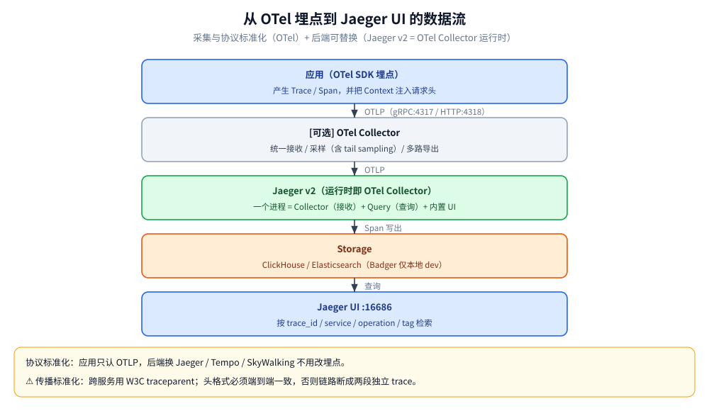
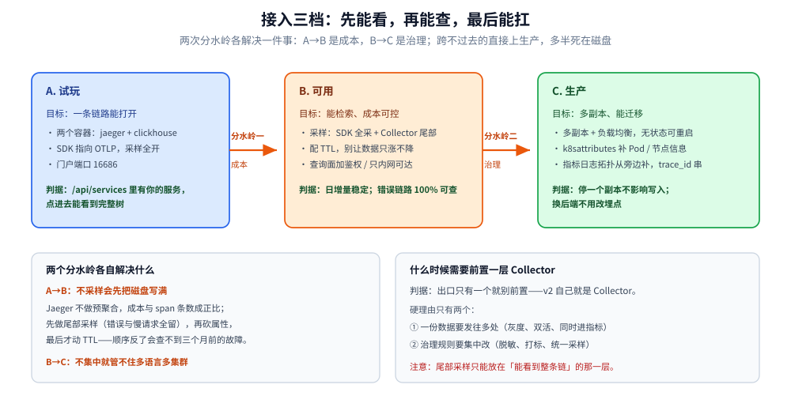

# 集成与生态

> 本篇回答三件事：**Jaeger 与 OTel 的边界到底划在哪**（谁产生、谁传输、谁存储、谁查询）、**要不要在它前面再挂一层 Collector**（三档路线与判据）、**它缺的指标/日志/拓扑怎么从旁边补**（Prometheus、Grafana、Loki 与 SkyWalking 的分工）。
>
> 不覆盖：组件内部形态（见 [架构与部署.md](架构与部署.md)）；`traceparent` 与采样的细节（见 [采集与传播.md](采集与传播.md)）；界面怎么读（见 [UI与排障.md](UI与排障.md)）。
>
> 实测环境：`jaegertracing/jaeger:2.20.0` + ClickHouse 26.3。**本轮只验证了「OTLP / Zipkin 两个入口都收」与「metrics 未配时返回 501」**，Collector 前置、Prometheus 抓取、Grafana 跳转、多语言 SDK 均未实跑，按官方文档陈述。

---

## 一、四条边界：谁产生、谁传输、谁存储、谁查询

**本节要点**：可观测性栈的分层不是「按产品」，而是**按职责**：OTel 管「产生与传输的标准」，Jaeger 管「存储与查询」。**边界一乱，换后端就要改埋点**。

| 层 | 归谁 | 具体是什么 | 换实现的代价 |
|---|---|---|---|
| 产生 | **OTel SDK / Agent** | API、SDK、instrumentation、语义约定 | 换语言不换模型 |
| 传输 | **OTLP** | gRPC `4317` / HTTP `4318`，`traceparent` 传播 | 换后端**零代价**（改 endpoint） |
| 存储 | **Jaeger `jaeger_storage`** | ClickHouse / ES / Cassandra / Badger | 换后端要迁数据，不改埋点 |
| 查询 | **Jaeger `jaeger_query`** | `16686` HTTP / `16685` gRPC + UI | 也可以换成 Tempo、SkyWalking 的查询面 |

⭐ 判据一句话：**「埋点只看 OTLP，后端随便换」是这条路线唯一的承诺**。反过来说，一旦你在业务代码里 import 了 `jaeger-client`，这个承诺就作废了（它已归档）。



图里三个色块正好对应前三层：左边「产生」、中间「可选的传输治理」、右边「存储与查询」。**Collector 那一块是虚线可拆的**——这也解释了为什么第二节的三档路线里，A 档就是不装它。

## 二、要不要前置一层 Collector：三档路线

**本节要点**：v2 的 Jaeger **自己就是 Collector**，所以「前置一层」不是必需，而是**为了集中治理**。三档路线按「出口数」和「治理需求」选。

| 档位 | 拓扑 | 什么时候选 | 代价 |
|---|---|---|---|
| **A. 直连** | 应用 → Jaeger（OTLP） | 单集群、单后端、只有一个 trace 信号 | 最简单；改采样要动 Jaeger 配置并重启 |
| **B. 前置统一** | 应用 → OTel Collector → Jaeger | 多语言多集群汇聚、要统一采样/脱敏/打标、要一份数据发多路 | 多一跳运维；Collector 本身要容量规划 |
| **C. 双跳** | 应用 → 边缘 Collector（批处理/脱敏）→ 中心 Collector（尾部采样）→ Jaeger | 跨地域、跨团队，边缘只需轻量转发 | 排障链变长，配置两处 |

```text
A:  app ──OTLP──▶ jaeger ──▶ ClickHouse
B:  app ──OTLP──▶ otelcol ──OTLP──▶ jaeger ──▶ ClickHouse
                  （统一采样/脱敏/多路导出）
C:  app ──OTLP──▶ 边缘 otelcol ──▶ 中心 otelcol（尾部采样）──▶ jaeger
```

⭐ 判据：**出口只有一个就别前置**。前置的唯一硬理由永远是「一份数据要发往多处」或「治理规则要集中改」。

## 三、补齐缺的四块：指标、日志、拓扑、告警

**本节要点**：Jaeger 只做链路，所以四块必须外部补。补法有两条路：**旁路拼装**（各管一摊，靠 `trace_id` 串）或**同源派生**（从 trace 里算出指标）。

| 缺的 | 旁路拼装 | 同源派生 | 判据 |
|---|---|---|---|
| 指标趋势 | Prometheus 抓应用的 `/metrics` | `span_metrics` connector 把 trace 折成指标（需 `metric_backends`） | 已有 `client_golang` 埋点 → 旁路；只有 trace → 派生 |
| 错误率 / P95 | Prometheus + Grafana | 同上（SPM 面板） | 派生指标与 trace 天然同口径 |
| 日志 | Loki / ELK，按 `trace_id` 关联 | — | 必须先把 `trace_id` 写进日志（见 [接入Jaeger.md](../../../../../01-编程语言/go/可观测性/接入Jaeger.md)） |
| 拓扑 | Grafana node graph / 手工画 | `/api/dependencies`（需依赖计算） | 本机默认没有依赖数据 |
| 告警 | Alertmanager | — | Jaeger 无规则引擎 |

⚠️ 本机实测的边界：**没配 `metric_backends` 时**，`/api/metrics/calls` 直接返回 `501 trace metrics are currently disabled - no metrics backend configured`——不是「空数据」，是「功能没开」。这类 501 在排障时要和「查不到」区分开。

## 四、trace ↔ 日志 ↔ 指标：三条跳转各自的前提

**本节要点**：三支柱能互相跳，靠的都是**一个字符串（`trace_id`）**。断在哪一环，跳转就在哪失效。

| 跳转 | 前提 | 断了会怎样 |
|---|---|---|
| trace → 日志 | 日志里有 `trace_id` 字段，且日志系统按它建了索引 | 界面上的「查这个请求的日志」按钮点过去是空结果 |
| 日志 → trace | 日志里的 `trace_id` 与存储里的**完全一致**（不能截断、不能大写） | 日志有 ID，Jaeger 里查不到 |
| trace → 指标 | trace 上有可用于聚合的维度（service、operation、status） | 只能看单条，做不了趋势 |
| 指标 → trace | 指标的打标里带 `trace_id`（高基数，通常**不建**） | 反向跳只能给到「时间段 + 服务」的检索页 |

⭐ 最实用的一条：**在网关统一把 `trace_id` 写进响应头（如 `X-Trace-Id`）**。用户报障时一个 ID 就能串起全部三支柱，不需要问「你几点操作的」。

## 五、多语言：谁成熟、谁要自己写

**本节要点**：Jaeger 的采集能力 = OTel 在本语言的成熟度。**它不像 SkyWalking 那样按语言提供官方探针**，所以「多语言支持」这句话要按语言拆开看。

| 语言 | 无侵入程度 | 说明 |
|---|---|---|
| **Java** | 高 | OTel Java Agent（`-javaagent`）覆盖主流框架；也可用 Micrometer Tracing 手写 |
| **Go** | 低（必须写代码） | 用 `otelhttp` / `otelgin` / `otelgorm` 等插件 + `tracer.Start`；没有官方字节码级方案 |
| **Python / Node.js** | 中 | 有 auto-instrumentation（`opentelemetry-instrument`）；Node 靠 monkey patch |
| **PHP** | 中低 | 依赖扩展或 SDK 手写，FPM 生命周期短，要在请求入口统一初始化 |

⭐ 与 SkyWalking 的分水岭：**SkyWalking 的优势主要在「Java 之外也能零改码」**（Go 用 native agent、PHP 用扩展）；**Jaeger 的优势在「任何语言都能用同一套语义约定」**，代价是 Go/PHP 要写代码。

## 六、K8s 侧：让「哪个 Pod 慢」能从链路里看出来

**要点**：Jaeger 不认识 Pod，只认识 resource 属性。**要让链路带上 K8s 元数据，必须由 SDK/Collector 注入**。

| 属性 | 来源 | 用途 |
|---|---|---|
| `service.name` | 应用显式设置（必填） | 服务维度的唯一分组键 |
| `service.instance.id` | SDK 或环境变量 | 区分同一服务的不同实例（本机实测出现在 `processes.tags`） |
| `k8s.pod.name` / `k8s.namespace.name` / `k8s.node.name` | Collector 的 `k8sattributes` processor（需前置 Collector） | 从「服务慢」下钻到「哪个 Pod 慢」 |
| `deployment.environment.name` | 应用或 Collector | 区分 dev / prod（本机实测作为资源属性落进 `processes`） |

判据：**直连（A 档）拿不到 Pod 级信息**——因为应用自己不知道 Pod 名（除非用 Downward API 注入）。要按 Pod 排查，就得走 B 档。

## 七、分工与混跑：三条结论

**本节要点**：Jaeger、SkyWalking、Zipkin 三者**不是同一层的替代品**：Jaeger 是「链路后端 + 查询」，SkyWalking 是「APM 全家桶」，Zipkin 是「老牌轻量追踪」。混跑能跑通，但**不要双报**。

| 维度 | **Jaeger** | **SkyWalking** | **Zipkin** |
|---|---|---|---|
| 探针方式 | OTel SDK / OTel Agent | Java Agent / 多语言 agent（含 Go native） | Brave / OTel SDK |
| 侵入性 | 中（SDK 显式埋点或 Agent） | 低（字节码增强，几乎零改码） | 中 |
| 存储 | ClickHouse / ES / Cassandra / Badger | BanyanDB（默认）/ ES / MySQL / PostgreSQL | ES / MySQL / 内存 |
| UI | 简洁，专注 trace 检索与瀑布 | 丰富：拓扑、指标、告警、日志关联 | 极简 |
| 生态 | 与 OTel 深度绑定（v2 即 Collector） | Apache 顶级，自成体系（OAP + agent） | 老牌，功能收敛 |
| 适用 | 已用 OTel、多语言、要后端可替换 | 要开箱即用的 APM 大盘与拓扑 | 极简嵌入式 |

⭐ 三条结论：

- **二选一为主线，不要并行双报**：同一入口两份 span、指标翻倍、`trace_id` 还未必一致。
- **Jaeger 收 OTLP，SkyWalking 也有 OTel receiver**——所以「换主线」可以在**不改埋点**的前提下做，只需要改 endpoint。
- **Zipkin 只适合「已经装了 Brave」的存量**；新项目没有理由选它。

## 八、接入三档路线：从试玩到生产

**本节要点**：接入不是一次决定，而是**三次升级**：先能看，再能查，最后能扛。

| 档 | 目标 | 做什么 | 判据（怎么算成了） |
|---|---|---|---|
| **A. 试玩** | 一条链路能在界面上打开 | 两个容器（Jaeger + 存储）、SDK 指向 OTLP、全采 | `/api/services` 里有你的服务；点进去能看到完整树 |
| **B. 可用** | 能按服务/时间/标签检索，成本可控 | 加采样（SDK 1.0 + Collector 尾部）、加 TTL、给查询面加鉴权 | 存储日增量稳定；错误链路 100% 可查 |
| **C. 生产** | 多副本、可观测自身、能迁移 | 多副本 + 负载均衡、`k8sattributes`、Grafana 跳转、依赖图或 SPM 补齐 | 停掉一个副本不影响写入；换后端不改埋点 |



图里的两次分水岭：**A→B 是「成本」**（不采样会先把磁盘写满），**B→C 是「治理」**（不集中就管不住多语言多集群）。

## 九、迁移路径：从别的后端换过来

| 起点 | 换到 Jaeger | 关键动作 |
|---|---|---|
| SkyWalking 主线 | 保留 OTel 埋点，只改 exporter 的 endpoint | ⚠️ 原来走 `-javaagent` 的服务要换成 OTel Agent 或 SDK；`sw8` 头不再被识别 |
| Zipkin | 应用侧换 OTel SDK（或让 Collector 转发） | Jaeger 的 `zipkin` receiver 可以先接住存量（本机实测 202） |
| 自研 / 无追踪 | 直接上 OTel SDK + OTLP | 先选一个服务做样板，把「初始化顺序 + 传播 + 采样」三件事跑通再铺开 |
| 老 Jaeger 1.x | 换镜像、重写配置、去掉 Agent | 见 [架构与部署.md](架构与部署.md) 第九节；配置格式完全不同 |

---

## 校验口径

| 内容 | 状态 |
|---|---|
| OTLP 与 Zipkin 两个入口都能收 | ✅ 本机实跑（OTLP HTTP 200 / Zipkin `POST /api/v2/spans` 202） |
| `metric_backends` 未配时 `/api/metrics/calls` 返回 501 及其原文 | ✅ 本机实跑 |
| `components` 里有 `span_metrics` connector、`prometheus` exporter | ✅ 本机 `components` 实测 |
| 四条边界（产生/传输/存储/查询）的划分 | ✅ 与 `print-config` 结构一致 |
| Collector 前置两档、`k8sattributes`、Prometheus 抓取、Grafana 跳转 | ⚠️ 按官方文档陈述，**本机均未实跑** |
| 多语言成熟度矩阵 | ⚠️ 按各语言 instrumentation 现状陈述，**本轮未起任何业务进程** |
| Jaeger vs SkyWalking vs Zipkin 对比表 | ⚠️ 架构层面对照，不含本机 benchmark |
| 迁移路径（SkyWalking → Jaeger、Zipkin → Jaeger） | ⚠️ 按协议兼容性推导，**未做实际迁移** |

---

## 延伸追问

- **为什么说「换后端不改埋点」这次真的成立了？** → 因为 OTLP 是双向标准：SDK 只认 endpoint 与协议，后端只认 OTLP。上一代做不到这件事（`jaeger-client` 与 `sw8` 都是私有协议），所以这个承诺值得单独记一笔。
- **Collector 前置后，采样应该配在哪一层？** → **尾部采样只能配在「能看到整条链」的那一层**。应用侧只做 `ParentBased(1.0)` 全采，Collector 侧做尾部判定；否则应用先丢一批，尾部采样再准也没数据。
- **一份数据发两个后端（灰度迁移）算不算双报？** → 迁移期可以，但要保证**两个后端的采样决策一致**（同一 `traceparent` 的 flags），且明确定一个截止时间。长期双报等于永久付两份存储。
- **Jaeger 能不能顶替 Prometheus？** → 不能。它没有指标抓取，只能从 trace 派生指标（`span_metrics`）；「JVM 堆、GC、连接池」这类指标必须另有来源。
- **为什么把 `k8sattributes` 放 Collector 而不是 SDK？** → Pod 名、节点名在应用里拿不到（除 Downward API 注入），而且这类元数据是集群视角的事，集中在 Collector 一处改，覆盖所有语言。
- **SPM 到底值不值得开？** → 只有「trace 量大到不能逐条看」时才值：它把 trace 折成服务/操作级的红指标，配合告警用。量小时直接查 trace 更快。

---

## 关联

- **上游/总纲**：[README.md](README.md) — 本册导读；[可观测性选型对比.md](../../可观测性选型对比.md) — 三支柱与五个层面的完整选型
- **下游机制**：[架构与部署.md](架构与部署.md) 第七节 — 生产形态里这些组件怎么摆
- **对照/互补**：[集成与生态.md](../Skywalking/集成与生态.md) — 另一条主线的生态边界（OTLP / Zipkin 通道、插件矩阵、混跑三结局）；[可观测性集成方案.md](../../../../数据存储/时序数据库/GreptimeDB/可观测性集成方案.md) — 时序库侧的接入视角
- **落地代码**：[接入Jaeger.md](../../../../../01-编程语言/go/可观测性/接入Jaeger.md)、[接入Jaeger.md](../../../../../01-编程语言/java/可观测性/接入Jaeger.md) — 三档路线在两种语言里分别怎么做
- **指标侧**：[手写Prometheus导出器.md](../../../../../01-编程语言/go/可观测性/手写Prometheus导出器.md) — 旁路拼装那条路的实现细节
