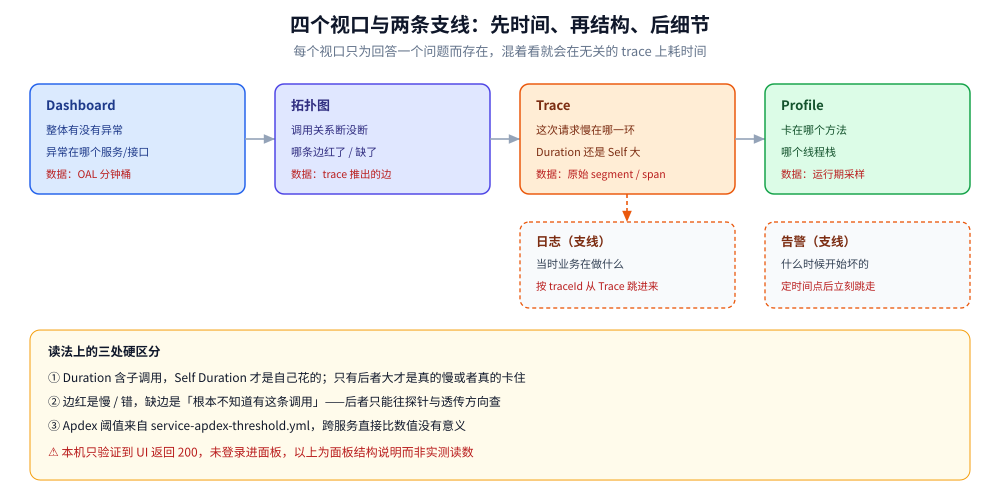
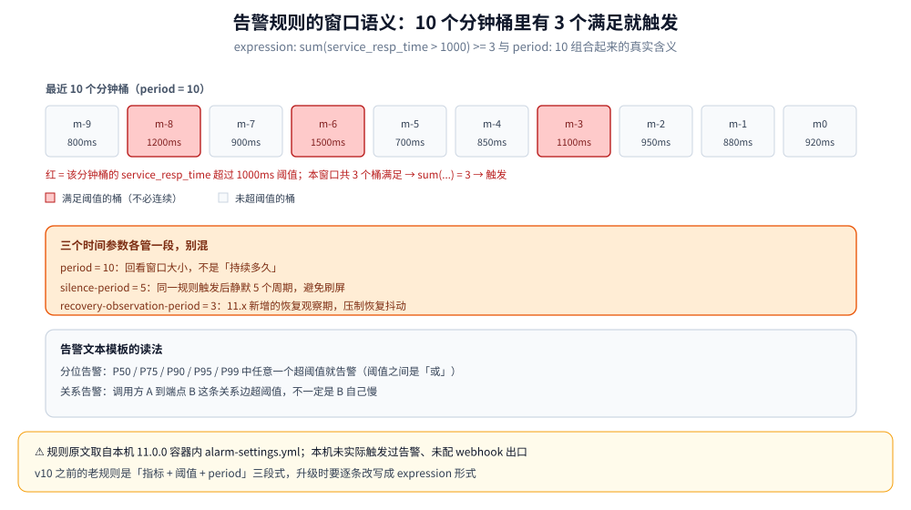
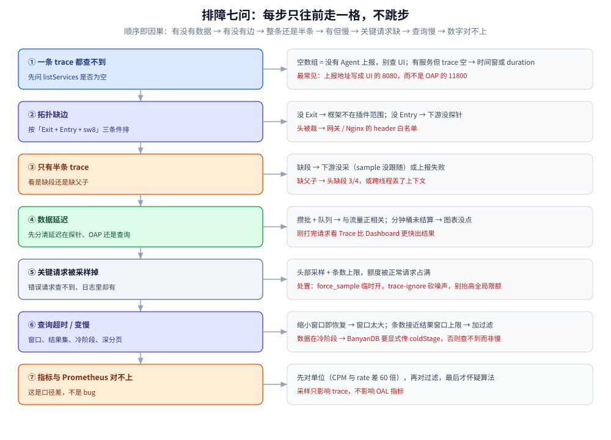

# UI 与排障

> 前半篇讲**面板怎么读**：四个视口各管一段、Dashboard 三 Tab、拓扑边的语义、瀑布图里 Duration 与 Self Duration 的区别、Profile 的 Dump Count、日志的 traceId 关联、告警的 MQE 窗口；后半篇讲**读不出来时怎么查**——七类症状的排障剧本（查不到 trace / 拓扑缺边 / 只有半条 / 数据延迟 / 被采样掉 / 查询超时 / 指标对不上）。
>
> 不覆盖：sw8 字段与 GraphQL 报文见 [协议与数据模型.md](协议与数据模型.md)；OAL / MAL / LAL 与部署形态见 [架构与部署.md](架构与部署.md)；三个 UI（SkyWalking / Jaeger / Grafana）的定位差异见 [可观测性选型对比.md](../../可观测性选型对比.md) 第六节。
>
> 实测环境：OAP 11.0.0 + BanyanDB 0.11.0 + Horizon UI 单机三容器。**⚠️ 本轮 UI 只验证到「返回 200」**（Horizon 无默认账号，登录未验证），因此下面所有面板描述按 11.x 面板结构与官方口径陈述，**不含登录后的截图级实测**；唯一的真实读数来自 GraphQL（见 [架构与部署.md](架构与部署.md) 第十节）。

---

## 一、四个视口的分工

**本节要点**：四个视口不是「四种图表」，而是**排查链条上的四段**——先看整体有没有异常（Dashboard），再看调用关系断没断（拓扑），然后看这一次请求慢在哪（Trace），最后看代码卡在哪一行（Profile）。日志与告警是两条**回溯支线**。



| 视口 | 回答的问题 | 数据来源 | 典型停留时长 |
|---|---|---|---|
| **Dashboard** | 整体有没有异常、异常在哪个服务/接口 | OAL 预聚合指标（分钟桶） | 10 秒扫一眼 |
| **拓扑图** | 服务间调用关系断没断、哪条边红了 | trace 推出的调用关系 + 各节点指标 | 30 秒看结构 |
| **Trace** | 这一次请求慢在哪一环、错在哪一步 | 原始 segment / span | 几分钟逐层展开 |
| **Profile** | 慢的那一环卡在哪个方法、哪个线程栈 | 运行期采样（dump 线程栈） | 只对目标端点短时开 |
| **日志**（支线） | 当时业务在做什么 | LAL 解析后的日志记录（按 traceId 关联） | 从 Trace 跳进来 |
| **告警**（支线） | 什么时候开始坏的 | `alarm-settings.yml` 规则 + 指标窗口 | 看时间点就跳走 |

⭐ 顺序铁律：**先时间、再结构、后细节**。先翻告警/大盘定时间点，再看拓扑定范围，最后才进 Trace 逐层展开——反过来做，会在一条不重要的 trace 上耗掉半小时。

---

## 二、Dashboard：三个 Tab 与六块内容

**本节要点**：Dashboard 的价值在「排行」——它不解释原因，只负责**按坏的程度排队**；先看 Apdex 与 P99 找出「谁最坏」，比从平均值入手准得多。

顶部可切时间范围（含时区）与自动刷新；正文分 **Service / Instance / Endpoint** 三个 Tab。以 `Service` 为例，六块内容：

- **Services Load (CPM)**：每分钟调用量，判断流量分布与突增突降。
- **Slow Services (ms)**：慢服务排行，先点名「谁拖慢了整条链路」。
- **Un-Health Services (Apdex)**：Apdex 不健康的服务，数值越低越差（`0.3045`、`0.5103` 属于明显不健康）。
- **Slow Endpoints (ms)**：慢端点排行，形如 `服务 : 端点`，比慢服务更精确。
- **Global Response Latency Percentiles**：P50 / P75 / P90 / P95 / P99 曲线。**P99 是判断「长尾是否恶化」最常用的指标**——平均值会被大量快请求拉平。
- **Global Heatmap**：纵轴响应时间区间、颜色深浅代表请求密度，用来发现「偶发但集中」的慢请求带。

`Instance` Tab 看多实例是否均衡（某台机器异常会先体现为它那一列延迟偏高）；`Endpoint` Tab 看单接口的延迟与成功率。

**典型路径：Service 榜找慢服务 → Slow Endpoints 锁定接口 → 去 Trace 捞该接口的慢请求看瀑布。**

⚠️ 两个读数陷阱：**Apdex 阈值来自 `service-apdex-threshold.yml`**，不同服务可以配不同阈值，跨服务直接比 Apdex 数值没有意义；**CPM 是每分钟调用数**，与 Prometheus 侧的 `rate(...[1m])` 口径不同，对不上是正常的（见第八节第七问）。

---

## 三、拓扑图：边的语义

**本节要点**：边是从 trace 数据里**推**出来的——**边出现即证明上下文透传成功**，所以拓扑图的真正用途不是「看架构」，而是「验证每一跳的探针协作是否成立」。

节点的颜色：

- **绿色**：所选时间窗内没有触发告警，指标在阈值内。
- **红色**：该服务触发了告警（P99 超阈值、成功率下降）或被标为 unhealthy；**边变红**通常表示这条调用链路上出现了告警。
- **灰色 / 无色**：该时间窗内没有数据上报（服务没被访问、探针没接、或刚重启尚未注册）。

使用方式：左上角 **Service Group / 服务名** 限定范围；悬停节点看简化指标（CPM、成功率、延迟），点击进服务详情，再点端点进 Trace。节点大小通常与 CPM 正相关。

⭐ **缺边比边红更值得追**：边红是「慢/错」，缺边是「根本不知道有这条调用」——后者往往是探针覆盖或上下文透传的问题，而这类问题在别的面板上完全看不出来（详见第八节第二问）。

---

## 四、Trace 瀑布图：Duration 与 Self Duration

**本节要点**：**找最长的条**是找瓶颈，**找 Self 最大的条**才是找「谁在真干活」——两者混着看，就会去优化一个只是在等下游的服务。

界面三栏：

- **左侧端点列表**：按耗时排序，每行「端点 + 耗时 + 时间」；顶部可按 Trace ID / 端点关键字 / 时间范围过滤。
- **右上 Span 树**：缩进表示父子关系：

```text
PrintServiceV2$Processor$CreatePdfByDocumentId   ← 入口 Entry span
 ├─ MySql/DBI/PreparedStatement/execute          ← Exit span（DB），共 2 次
 ├─ /v2/common/object/upload                     ← Exit span（HTTP 下游）
 └─ MySql/DBI/PreparedStatement/execute          ← Exit span（DB）
```

- **右下耗时瀑布图**：横轴时间、每 span 一根条、条长即耗时。两个用途：**找最长的条**（瓶颈路径）与**找 Self 最大的条**（自身耗时）。

| 指标 | 含义 | 用错时的后果 |
|---|---|---|
| **Duration** | 含所有子调用的总耗时 | 会把「等下游」的服务误判为「慢服务」 |
| **Self Duration** | 自身耗时（扣掉子调用） | 只有它大，才是真的在算或真的卡住 |

其他常用操作：点 span 展开 tags（HTTP 状态码、SQL 语句、peer 地址）；「查看日志」按 Trace ID 跳到日志面板；「保存为图片」可直接贴工单。

---

## 五、Profile：Dump Count 与被剖析的前提

**本节要点**：Dashboard 看的是**结果指标**（P99、慢端点），Profile 是**对运行中的代码采样**，直接抓「卡在哪个线程栈」；它有额外开销，只能对目标端点短时间开。

左侧 **Task List**：顶部「新建任务」创建剖析任务，参数是「服务 + 端点 + 持续时间 + 采样周期」。任务执行期间才产生数据，`No Data` 表示该时间窗没有任务在跑。

右侧结果区三张表：

| 表 | 字段 | 读法 |
|---|---|---|
| **Span** | `Span / Start Time / Exec(ms) / Exec(%) / Self(ms) / API / Service / Operation` | `Exec(%)` 是该方法占整个请求耗时的比例，从高到低排就是「时间花在哪」 |
| **Sampled Traces** | 被采样的具体请求 | 用来确认「样本是不是典型请求」 |
| **Thread Stack** | `Thread Stack / Duration(ms) / Self Duration(ms) / Dump Count` | ⭐ **同一栈被反复 dump（Dump Count 高、Duration 接近采样时长）说明请求长时间卡在这里** |

典型路径：Dashboard 发现端点 P99 高 → 针对该端点发起 Profile 任务 → Span 表找 `Exec(%)` / `Self(ms)` 最大的方法 → Thread Stack 看它卡在下游还是卡在某段逻辑。

⚠️ 三个前提，缺一个就采不到：① 任务的时间窗必须覆盖真实流量；② 该端点还在被调用（低峰期开任务只会得到 `No Data`）；③ Profile 需要额外开销（dump 线程栈），**不要对高 QPS 端点长开**。

---

## 六、日志面板：traceId 关联与 LAL 管道

**本节要点**：日志面板解决「日志在业务组手里、链路在 APM 里，两边对不上」的问题——做法是把日志**按 trace 上下文上报到同一套存储**，把 `traceId` 变成两边的公共键。

查询条件：**Service / 实例**限定范围；**Trace ID** 是最常用入口（先从 Trace 面板拿 traceId，粘回来直接捞出这次请求的所有日志）；**内容关键词 / 不包含关键词**做正反向过滤；**标签**按上报时打的 tag 过滤（日志级别、业务标记）。

结果表字段：`当前服务 / 当前实例 / 时间 / 内容类型 / 标记 / 内容 / 追溯 ID`——**追溯 ID 即 Trace ID**，点进去回到对应链路。

⭐ **日志能不能被关联，取决于 LAL 有没有提取 `traceId`**：

```text
filter {
    json {}
    extractor {
        traceId parsed.traceId      ← 这一句决定「日志 ↔ 链路」是否可跳转
        tag 'level': parsed.level
    }
    sink {}
}
```

- 业务日志里**没有** traceId → 无论怎么配 LAL 都关联不上（先解决日志格式：把 traceId 打进 MDC / context，见各语言接入分册）。
- 日志里**有** traceId 但 LAL 没提取 → 记录能入库，但「追溯 ID」列为空，面板里点不动。
- `metrics { ... }` 还能顺手从日志造指标（如 `log_count{level}`），再用 `log-mal-rules` 聚合——这是「日志变指标」的唯一入口。

---

## 七、告警：MQE 规则、恢复观察期与 webhook

**本节要点**：v10+ 的告警规则用 **MQE 表达式**描述，核心是「**在一个滑动窗口里，有多少个时间桶满足条件**」；读告警文本前先弄清这三件事：窗口、桶、条件个数。

规则在 OAP 的 `config/alarm-settings.yml`（**支持热更新**），UI 只负责展示与订阅。下面是本机 `apache/skywalking-oap-server:11.0.0` 容器内**出厂配置的原样摘录**：

```yaml
rules:
  service_resp_time_rule:
    expression: sum(service_resp_time > 1000) >= 3
    period: 10
    silence-period: 5
    recovery-observation-period: 3
    message: Response time of service {name} is more than 1000ms in 3 minutes of last 10 minutes.
  service_resp_time_percentile_rule:
    expression: sum(service_percentile{p='50,75,90,95,99'} > 1000) >= 3
    period: 10
    silence-period: 5
    message: Percentile response time of service {name} alarm in 3 minutes of last 10 minutes, due to more than one condition of p50 > 1000, p75 > 1000, p90 > 1000, p95 > 1000, p99 > 1000
```



上图是 `sum(指标 > 阈值) >= 3` + `period: 10` 的精确含义：**最近 10 个分钟桶里，有 3 个桶的值超阈值就告警**——不是「连续 3 分钟」，也不是「平均值超 3 分钟」。三个时间参数各管一段：

| 参数 | 作用 | 常见误解 |
|---|---|---|
| `period` | 回看窗口（分钟） | 以为它是「持续时长」，实际是**窗口大小** |
| `silence-period` | 同一规则触发后静默多久，避免刷屏 | 当成了「恢复等待」，其实恢复看下一项 |
| `recovery-observation-period` | 11.x 新增，恢复的观察期，压制「恢复抖动」 | 以为告警一消失就等于恢复 |

`webhooks` 定义通知出口（钉钉、飞书、邮件等）。⚠️ webhook 的 payload 与重试语义本机**未实测**（没有配过真实出口）。

### 7.1 告警文本怎么读

告警文本是**模板化生成**的，读法固定：

- `Percentile response time of service X alarm in 3 minutes of last 10 minutes, due to more than one condition of p50 > 1000, ...` → **服务级分位延迟告警**：P50 / P75 / P90 / P95 / P99 中**任意一个**超阈值就告警（阈值之间是「或」，不是「且」）。
- `Response time of endpoint relation User to (POST)/api/... is more than 1000ms in 2 minutes of last 10 minutes` → **端点间关系告警**：调用方 `User` 到该端点这条**关系边**超阈值。

**排查用法：告警面板定「什么时候开始坏的」→ 拓扑图看哪个节点变红 → Trace 看第一次报错/变慢的 span。**

---

## 八、排障剧本：七问七答

**本节要点**：七类症状按「**有没有数据 → 有没有边 → 有半条还是整条 → 有但慢 → 关键请求缺 → 查询本身慢 → 数字对不上**」的顺序排，每次只往前走一步，不跳步。



决策树要自上而下读：每一问的「否」都停在原地继续查，「是」才往下走一格——跳步最典型的后果是把「探针没接」当成「存储丢了数据」。

### 8.1 一条 trace 都查不到

| 步 | 查什么 | 判据 / 结论 |
|---|---|---|
| 1 | `{ listServices { name } }` | `[]` → **没有任何 Agent 上报**，问题在探针侧，别再查 UI |
| 2 | OAP 是否收到连接（11800 通不通） | 通且无数据 → 探针没启 / 采样为 0 / 上报地址写错 |
| 3 | Agent 侧日志（`logging.level` 调到 DEBUG） | 有 `connect` 但报 `UNAVAILABLE` → 服务端没就绪（schema 还在装） |
| 4 | 时间窗与 `step` | 有服务有指标但 trace 空 → 大概率是时间窗或 `queryTrace` 未传 `duration`（BanyanDB 默认只查最近 1 天） |

⚠️ 最常见根因是第 2 步的第三种：**上报地址写成了 UI 的地址**（8080）而不是 OAP 的 gRPC（11800）。

### 8.2 拓扑图缺边

按「边成立的三条件」逐个排除（判据在 [协议与数据模型.md](协议与数据模型.md) 第四节）：

| 可能 | 怎么验证 | 结论 |
|---|---|---|
| 上游没有 Exit span | Trace 里看调用方有没有对应 Exit | 没 Exit → 该框架不在插件覆盖范围，或调用方式特殊（自定义 RPC 封装） |
| 下游没有 Entry span | 下游服务详情里有没有这条端点 | 没有 → 下游没挂探针，或挂的是另一种格式 |
| `sw8` 在中间被丢 | 在中间一跳抓包/打日志看请求头 | 丢了 → 网关/Nginx 的 header 白名单、反向代理裁剪 |
| 采样不一致 | 下游 trace 是否独立 traceId | 独立 → 头没传；同 traceId 但无父引用 → 头传了但字段缺 |

⭐ 「边红」与「缺边」是两个问题：「红」去看告警与延迟，「缺」去看透传。

### 8.3 只有半条 trace

- **上游有、下游没有**：下游没采（sample 位没跟随）或下游探针的上报失败。
- **有 traceId 但没有父子关系**：`refs[]` 没建起来——跨进程头缺段 3/4（父 segment/span ID），或跨线程丢了上下文（`CROSS_THREAD` 还原不了的部分）。
- **跨线程段平级**：线程池没包上下文（Java 忘了 `@TraceCrossThread` / `ContextManager` 快照；Go 忘了传 context）。

### 8.4 数据延迟

按「延迟发生在哪一段」排，三段各有自己的量级：

| 段 | 原因 | 判据 |
|---|---|---|
| 探针侧 | 批量上报 + 队列攒批 | 延迟与流量正相关，低峰期自行消失 |
| OAP 侧 | 分析队列水位高、Storage 写慢 | OAP 日志/线程水位、存储写入耗时上升 |
| 查询侧 | 分钟桶还没结算 / 时间窗 `step` 太大 | 刚发生的请求要等一个桶周期才出现在图表上 |

⚠️ 「刚打完请求，Dashboard 上没有」通常不是故障：**指标按分钟桶聚合，桶没结算就没有点**；而 Trace 面板因为是原始数据，往往比 Dashboard 更早能看到。

### 8.5 关键请求被采样掉

- 现象：错误请求在日志里有，Trace 里查不到；或一天里只有零星几条 5xx 被采到。
- 根因：**头部采样 + 条数上限**，限额被正常请求占满，最需要看的请求反而被丢。
- 处置顺序：`agent.force_sample=true` 临时全采（排障窗口内）→ 用 `trace-ignore` 把噪声端点排除，把额度留给关键接口 → 长期则按服务重要性分配 `sample_n_per_3_secs`。
- ⚠️ 别用「提高全局限额」解决：那是拿成本换概率，噪声一起被放大。

### 8.6 查询超时 / 查询变慢

| 原因 | 判据 | 处置 |
|---|---|---|
| 时间窗太大 | 同条件缩小窗口即恢复 | 缩短窗口，或改用 `Hour`/`Day` 步长的聚合 |
| 结果集太大 | 返回条数接近结果窗口上限（measure 默认 100、stream/trace 默认 20） | 加过滤条件、分页 |
| 冷数据查询 | 数据已下沉冷阶段 | BanyanDB 下显式传 `coldStage`（否则查不到，而不是慢） |
| 存储侧压力 | 写入延迟同时升高 | 先解决写入，再谈查询 |
| ES 深分页 | 页码越大越慢 | 改用带条件过滤，避免翻页扫全量 |

### 8.7 面板指标与自建 Prometheus 对不上

这是**口径差**，不是 bug，四种差异按大小排序：

1. **聚合层不同**：SkyWalking 按服务/实例/端点聚合，且**默认先聚合再给分位**（指标是分钟桶上的近似）；Prometheus 是对原始样本做 `histogram_quantile`，两者必然有小幅差异。
2. **单位不同**：CPM（每分钟调用数）vs `rate(...[1m])`（每秒速率），差 60 倍。
3. **过滤条件不同**：SkyWalking 的 `service_cpm` 只统计被 OAL 认定为主调用的 span；Prometheus 侧通常按 HTTP 指标算，健康检查、内部调用是否计入两边不一样。
4. **采样影响**：**采样只影响 trace，不影响 OAL 指标**（指标来自全部被分析的 span）——但如果两边一个走 trace 派生、一个走 meter，就会出现「采样率变了，数字也变了」的错觉。

⭐ 判据：**先对单位，再对过滤，最后才怀疑计算方式**。对不上时最有价值的一步是把某个一分钟窗口的两边原始值都打出来，而不是继续比对曲线形状。

---

## 校验口径

| 内容 | 状态 |
|---|---|
| 四个视口分工、Dashboard 六块内容、三 Tab | ⚠️ 按 11.x 面板结构陈述，**未登录 UI 实测**（Horizon 无默认账号，只验证到返回 200） |
| 拓扑图颜色语义与「边从 trace 推出」 | ⚠️ 按官方文档与既往操作口径陈述，**本轮未复现缺边** |
| Trace 瀑布图 Duration / Self Duration、Span 树形态 | ✅ 字段语义与官方一致；⚠️ 面板截图级验证未做 |
| Profile 三张表与 Dump Count 读法 | ⚠️ 按官方文档陈述，**未创建过 Profile 任务** |
| 日志面板字段与 LAL 提取 `traceId` 的因果 | ⚠️ LAL 结构 ✅ 官方文档；⚠️ **日志面板链路未实测** |
| `alarm-settings.yml` 出厂规则原文（`period: 10` / `silence-period: 5` / `recovery-observation-period: 3`） | ✅ 本机 11.0.0 容器内原样摘录 |
| 告警文本模板读法 | ✅ 与出厂 `message` 模板逐字一致 |
| MQE 窗口语义（10 个分钟桶里有 3 个满足） | ✅ 按表达式与官方 MQE 文档；⚠️ **未实际触发过告警、未配 webhook** |
| 七问的判据与处置 | ⚠️ 结构性归纳（每条的判据都指向可观测的量），**其中「缺边」「被采样掉」两类未在本机复现** |
| 「采样只影响 trace、不影响 OAL 指标」 | ⚠️ 按机制推导（OAL 消费的是已入 OAP 的全部 span），**未做对照实验** |

---

## 延伸追问

- **为什么「先时间、再结构、后细节」？** → 时间点决定要不要继续查（可能已经恢复），范围决定看哪个服务，细节只在范围确定后才有价值；反过来会在无关 trace 上耗时间。
- **拓扑图的边为什么能当「透传验证器」用？** → 边是 Exit + Entry + `sw8` 三件事同时成立的产物，任何一环缺失都不出边；所以缺边本身就是证据。
- **`Duration` 大的服务一定是慢服务吗？** → 不是。它可能在等下游；只有 **Self Duration** 大才是自身慢。这条区分能省掉大量「优化了一个只会等待的服务」的无效工作。
- **同一个栈 Dump Count 很高意味着什么？** → 请求长时间卡在这个调用栈上，是代码级瓶颈最硬的证据；比「看哪行代码耗时高」更接近真相。
- **为什么告警里 `period: 10` 不等于「持续 10 分钟」？** → `period` 是**回看窗口**，`sum(...) >= 3` 数的是窗口里有几个桶满足条件；中间可以断开。
- **采样会不会让指标偏小？** → 不会。采样发生在 trace 上报前，OAL 指标由**已进入 OAP 的 span** 聚合，两者口径不同；混用「trace 派生的数字」和「meter 派生的数字」才会出现偏差。
- **UI 打开了但登录不进去，是部署问题吗？** → 大概率不是：Horizon 默认没有账号，必须配 `HORIZON_AUTH_LOCAL_USERS`（密码要 argon2id 哈希）。

---

## 关联

- **上游/总纲**：[可观测性选型对比.md](../../可观测性选型对比.md) — 三个 UI 的定位差异与组合建议（第六节）
- **本册导读**：[README.md](README.md) — 五篇的阅读路线与实测坐标
- **对照/互补**：[UI与排障.md](../Jaeger/UI与排障.md) — Jaeger 的检索式排障与「无预聚合」的代价
- **下游机制**：[协议与数据模型.md](协议与数据模型.md) — 七问里追到的字段与 query；[架构与部署.md](架构与部署.md) — 数据延迟与部署形态、采样旋钮
- **落地代码**：[接入Skywalking.md](../../../../../01-编程语言/java/可观测性/接入Skywalking.md) — 日志关联、跨线程上下文与优雅停机在代码侧的具体写法


