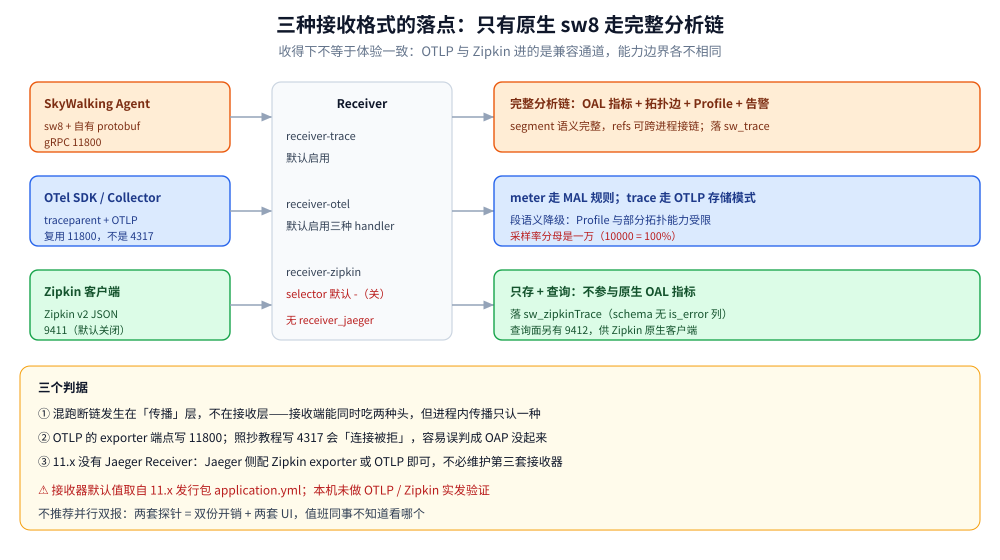
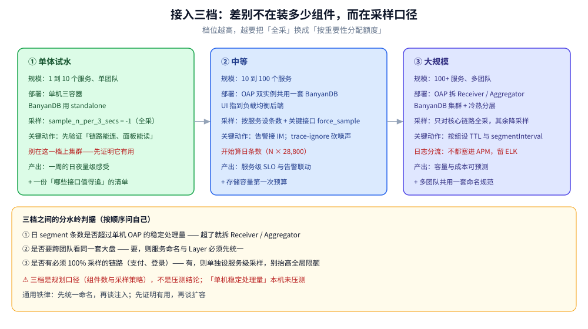

# 集成与生态

> 本篇讲 SkyWalking **怎么和别的工具拼起来**：与 OTel 谁产生数据、OTLP / Zipkin 两条兼容通道的真实边界（含「没有 Jaeger Receiver」这个常见误解）、跨进程载体清单、中间件插件矩阵、与 Prometheus / 日志系统 / K8s 的拼装方式、多语言混跑时 `sw8` 与 `traceparent` 共存会断在哪，最后给单体 / 中等 / 大规模三档接入路线。
>
> 不覆盖：OTel 路线本身的埋点与后端选择见 [README.md](../Jaeger/README.md)；字段级映射见 [协议与数据模型.md](协议与数据模型.md) 第七节；部署形态与容量见 [架构与部署.md](架构与部署.md)。
>
> 实测环境：本机只跑过 OAP 11.0.0 单机（无 Agent、无 OTLP 上报），因此**接收器配置取自 11.x 发行包 `application.yml` 与官方文档，未做双路同发实测**；凡属「按文档陈述」的都在文末「校验口径」逐条标注。

---

## 一、与 OTel 的关系：差别只在「谁产生数据」

**本节要点**：SkyWalking 与 OTel 不是竞品关系——**OTel 是采集与协议标准，SkyWalking 是后端 + 探针**。判断要不要混，只看一个问题：**链路的「头格式」在整条路径上是否统一**。

| 维度 | SkyWalking 自有路线 | OTel 路线 |
|---|---|---|
| 谁产生数据 | 自研 Agent（字节码增强 / 编译期注入 / 扩展 / patch） | OTel SDK 或 auto-instrumentation |
| 传播头 | `sw8`（8 字段） | W3C `traceparent`（4 段） |
| 上报协议 | 自有 gRPC（11800） | OTLP（gRPC / HTTP） |
| 后端 | 只能是 OAP | 任意 OTLP 后端（Jaeger / Tempo / OAP / 商业 APM） |
| 开箱能力 | 拓扑、Apdex、Profile、告警全带 | 只有数据，面板与告警自己配 |

四条边界结论：

- **SkyWalking 能收 OTel 数据**：`receiver-otel` 默认启用 `otlp-traces,otlp-metrics,otlp-logs`。收得下 ≠ 体验一致：OTLP 进来的 trace 少了 segment 语义，Profile 与部分拓扑能力受限。
- **不要并行双报**：两套探针 = 双份开销 + 两套 UI，值班同事不知道看哪个。选一条主线，另一条只在按 TraceID 精查时临时打开。
- **混跑断链发生在「传播」这一层，不在接收层**：接收端能同时吃两种格式，但**进程内传播只认一种头**——A 服务注 `traceparent`、B 服务只读 `sw8`，链就断在 A→B 那一跳。
- **Go / 多语言为主的团队更该走 OTel**：判据（探针成熟度是隐性成本大头）见 [可观测性选型对比.md](../../可观测性选型对比.md) 第二节。



上图是全篇的纲：**只有原生 `sw8` 进来的数据走完整分析链**（OAL 指标 + 拓扑 + Profile）；OTLP 与 Zipkin 进来的走各自的分析规则或只存原始数据。

---

## 二、Receiver：OTLP 与 Zipkin 两条通道的真实边界

**本节要点**：11.x **没有 `receiver_jaeger`**（Jaeger 生态走 Zipkin 格式）；OTLP 与原生上报**共用核心 gRPC 端口 11800**；Zipkin 接收器**默认关闭**，要显式打开才在 9411 听。

| 通道 | 配置块 / 开关 | 默认 | 端口 | 说明 |
|---|---|---|---|---|
| SkyWalking 原生 | `receiver-trace`（`SW_RECEIVER_TRACE`） | 启用 | **11800**（gRPC） | `sw8` + 自有 protobuf |
| **OTLP** | `receiver-otel`（`SW_OTEL_RECEIVER`） | 启用，handlers 默认 `otlp-traces,otlp-metrics,otlp-logs` | **11800**（复用核心 gRPC） | **不要指向 4317**——发行包未开该端口 |
| **Zipkin** | `receiver-zipkin`（`SW_RECEIVER_ZIPKIN`） | ⚠️ **默认 `-`（关闭）** | **9411**（`restPort`） | HTTP collector 默认开；Kafka collector 默认关 |
| Zipkin 查询面 | `query-zipkin`（`SW_QUERY_ZIPKIN_REST_PORT`） | — | **9412** | 给 Zipkin 原生客户端查 |
| Jaeger | **无独立块** | — | — | 8.x 起移除；Jaeger 侧配 Zipkin exporter 即可 |

### 2.1 OTLP 通道的三个配置项

```yaml
receiver-otel:
  default:
    enabledHandlers: ${SW_OTEL_RECEIVER_ENABLED_HANDLERS:"otlp-traces,otlp-metrics,otlp-logs"}
    otlpTraceStorage: ${SW_OTEL_TRACE_STORAGE:otlp}          # otlp / zipkin 两种 trace 存储模式
    otlpTraceSampleRate: ${SW_OTEL_TRACE_SAMPLE_RATE:10000}   # 一万为分母 = 100%
    otlpTraceMaxSpansPerSecond: ${SW_OTEL_TRACE_MAX_SPANS_PER_SECOND:0}   # 0 = 不限
```

- **`otlpTraceSampleRate` 的分母是 10000**，`10000` 表示全采、`1000` 表示 10%。写成 `100` 会被理解成 1%。
- **`otlpTraceMaxSpansPerSecond` 是接收侧限流**，`0` 为不限；生产上要设，否则被上游打爆的是 OAP 而不是探针队列。
- **`otlpTraceSearchableTags`** 决定哪些 tag 可被检索（默认包含 `span.http.request.method`、`span.db.system.name`、`span.messaging.destination.name` 等）。没进这个列表的字段，**能看不能搜**。

### 2.2 为什么「OTLP 没有独立端口」值得单独记一笔

几乎所有 OTel 教程都默认后端在 **4317**（gRPC）/ **4318**（HTTP）。SkyWalking 的 OTLP 接入走的是**自己的核心 gRPC 服务**，所以 exporter 端点必须改成 OAP 的 11800；照抄教程写 `localhost:4317` 会连不上，而且报错是「连接被拒」——很容易被误判成「OAP 没起来」。

⚠️ 该项按 11.x 发行包配置（无 4317 监听项）与官方文档陈述，**本机未做 OTLP 实发验证**。真要接入前，先 `curl` 探 11800 是否在听，再发一条最小 trace。

### 2.3 Zipkin 通道适合什么场景

- 已有 Zipkin 生态（Brave / Spring Cloud Sleuth 老版本）想先接进来，别急着换 SDK。
- 只借 OAP 的存储与 UI，不借它的分析链——**Zipkin 进来的 trace 不参与 OAL 的原生指标**（schema 也不同，`sw_zipkinTrace` 没有 `is_error` 列）。

---

## 三、跨进程载体清单

**本节要点**：载体只有五种，判据也只有一句——**中间那一跳认不认这个 key**。表里「断链风险」一列就是按这句话排的。

| 载体 | 具体位置 | 断链风险 | 排查手法 |
|---|---|---|---|
| **HTTP** | 请求头 `sw8` / `sw8-x` / `sw8-correlation` | 🔴 高：网关、Nginx、CDN、框架的 header 白名单常裁掉自定义头 | 在断点前打一行日志，打印全部 header |
| **gRPC** | metadata | 🟡 中：key 必须小写、`-`/`_` 规则要一致 | 用 `grpcurl` 带 metadata 复现 |
| **Dubbo** | attachment（隐式参数） | 🟡 中：跨大版本 attachment 透传规则会变 | Provider 侧打印 attachment 全部 key |
| **MQ** | 消息 header / 属性（Kafka headers、RocketMQ properties） | 🔴 高：生产者不写、消费者不读是常态；异步链路的耗时还要 `sw8-x` 的时间戳 | 直接消费一条消息看 header |
| **DB / 缓存** | 无（Exit span 到此为止） | 🟢 无 | 只在 Exit span 的 peer 上体现 |

⭐ 两个「最容易漏」的位置：**异步线程池**（同进程跨线程，不是跨进程，但现象一样是断链）与 **MQ 消费侧**（生产者写了 header，消费者没读）。这两处的共同点是「没有 HTTP 请求可抓」，只能靠日志。

---

## 四、中间件插件矩阵

**本节要点**：Java 生态覆盖最全（插件上百个），Go 靠编译期注入覆盖主流框架，PHP 只能覆盖扩展层；**「框架在不在插件列表里」决定你需不需要手埋点**。

| 类别 | Java（插件） | Go（`-toolexec` 注入） | PHP（扩展 + SDK） |
|---|---|---|---|
| Web 框架 | Spring MVC / Spring WebFlux / Spring Cloud Gateway / Tomcat / Jetty / Undertow | Gin / Echo / Fiber / net/http | 框架层需 SDK 适配 |
| RPC | Dubbo / gRPC / Thrift / Motan / Sofa | gRPC / Kratos | — |
| 消息 | Kafka / RocketMQ / RabbitMQ / Pulsar / ActiveMQ | Kafka / RocketMQ / NATS | — |
| 数据访问 | JDBC / MyBatis / Hibernate / MongoDB / Elasticsearch | `database/sql` / GORM / Mongo / ES | PDO / mysqli / redis 扩展 |
| 缓存 | Jedis / Lettuce / Redisson | go-redis | redis 扩展 |
| 定时/任务 | `@Scheduled` / Quartz / XXL-Job | — | — |

⚠️ 三点必须自己核对，别照抄任何文章（包括本篇）：

1. **版本区间**：每个插件只适配特定的框架版本区间，大版本升级前先查官方 supported-list。
2. **witness 类**：插件只在宿主加载了 witness 类时生效；把框架「换了个包名」（如某些发行版改名）会导致插件静默不生效。
3. **Go 的覆盖边界**：`-toolexec` 只对 `go build` 生效，`CGO` 或预编译依赖的特殊场景可能漏；且框架不在列表里就必须手埋点。

---

## 五、与 Prometheus、日志系统的拼装

**本节要点**：OAP 在 11.x 已经把**查询面**做成了多协议兼容（PromQL / LogQL / TraceQL），所以「Grafana 直连 OAP」是可行的；但**指标来源**仍要分清谁出，别指望一套 OAP 替掉全部。

### 5.1 谁出指标

| 指标类别 | 从哪来 | 说明 |
|---|---|---|
| 应用 RED 指标（CPM / 延迟 / 成功率） | OAP 的 OAL 产出 | 只有挂了探针的服务才有 |
| 中间件指标（MySQL / Redis / Kafka…） | OAP 的 `otel-rules`（`enabledOtelMetricsRules` 默认已开一大批，如 `mysql/*`、`redis/*`、`kafka/*`） | 需要对应 exporter 把指标推成 OTLP |
| 主机指标（CPU / 内存 / 磁盘） | **不在 OAP**：走 node_exporter + Prometheus | OAP 只管应用侧与部分中间件 |
| OAP 自身指标 | `otel-rules` 里的 `oap` 规则 + telemetry | 排 OAP 自身瓶颈时必看 |

### 5.2 两个出口，别混

- **telemetry Prometheus 出口**（`SW_TELEMETRY_PROMETHEUS_PORT` 默认 **1234**）：OAP 把自己的指标**暴露给** Prometheus 抓——方向是「OAP → Prometheus」。
- **PromQL 查询 API**（默认 **9090**）：外部用 PromQL 语法**查 OAP**——方向是「Grafana → OAP」。
- 同类的还有 LogQL（**3100**）与 TraceQL（**3200**）：让 Grafana 可以直接把 OAP 当数据源用，不必再部署 Loki / Tempo。

⚠️ 这四个端口是**按 11.x 发行包配置项列出**，本机只验证过 12800 / 17128 / 8080，**1234 / 9090 / 3100 / 3200 未实测**。

### 5.3 日志的两条路

1. **进 OAP**（LAL 解析 + traceId 关联）：优点是「日志 ↔ 链路」同库可跳；代价是 OAP 要扛日志写入量（用 BanyanDB 的 `sw_recordsLog` / 分组 TTL 压）。
2. **留在 ELK / Loki**：日志系统照旧，只把 traceId 打进日志，靠 Grafana 的跳转把两边连起来。⭐ 大流量团队更常见这条路——**日志量比 trace 大一个数量级，不必都塞进 APM**。

---

## 六、与 K8s：元数据对齐比注入方式更要紧

**本节要点**：探针注入只有三种形态（见 [架构与部署.md](架构与部署.md) 第七节，此处不重复）；真正决定「面板上能不能从 Pod 跳到链路」的是**元数据对齐**——`Layer`、`Service Hierarchy` 与命名规范。

| 对齐项 | 要做什么 | 不对齐的后果 |
|---|---|---|
| **服务命名** | 用 K8s `service.name` 作为探针的 `service_name` | 一个 Deployment 出现三个服务名（`photography-server` / `photography-server-7d9f` / `photography-server.default`） |
| **Layer** | 应用注册为 `GENERAL`，K8s 侧资源注册为 `K8S` | `listServices(layer)` 筛不到，Dashboard 分不出来 |
| **Service Hierarchy** | 10.x 的跨层关系（K8s Service ↔ Pod ↔ 进程） | 从容器指标跳不到应用链路 |
| **实例名** | 用 `pod_name` 或「主机名 + 进程标识」 | 实例数量随重启膨胀，Profile 选不到目标进程 |
| **K8s 事件 / 日志** | 用内置 LAL 规则（`k8s-service.yaml` 等）解析 | 只能看应用日志，看不到调度与探针注入失败事件 |

⭐ 一条实践判据：**先统一命名，再谈注入**。命名混乱时，注入方式再优雅也只是把混乱搬进面板。

---

## 七、多语言混跑：`sw8` 与 `traceparent` 共存会断在哪

**本节要点**：断点永远在「**读头的那一方**」。混跑的三种结局，取决于中间有没有一个组件同时认两种头。

| 组合 | 结果 | 原因 |
|---|---|---|
| 全是 SkyWalking 探针 | ✅ 完整链路 | 全家 `sw8` |
| 全是 OTel SDK + OAP 收 OTLP | 🟡 链路完整，但少了 segment 语义（Profile / 部分拓扑受限） | 接收端没问题，语义层降级 |
| SkyWalking 探针 + OTel SDK 混跑 | 🔴 **断成两段** | 一方注 `sw8`、一方只认 `traceparent`（或反之） |

桥接的三种做法，按侵入性排序：

1. **统一主线**（推荐）：要么全换 OTel SDK，要么全用 SkyWalking 探针；跨语言时优先选「该语言探针更成熟」的那条。
2. **中间件做转换**：在边界（网关 / OTel Collector 的 transform processor / 自研 sidecar）同时读两种头，再各写一份。⚠️ 转换会丢 `CROSS_THREAD` 语义（见 [协议与数据模型.md](协议与数据模型.md) 第七节）。
3. **只做接收兼容**：让 OAP 收 OTLP，但**不改进程内传播**——这只解决「数据能进来」，不解决「链路能连上」，属于最容易误解的一种「看起来配了」。

⚠️ 三种做法本机**都未实测**（无 Agent、无 OTLP 上报），结论来自协议层的字段对应关系。

---

## 八、接入三档路线

**本节要点**：三档的差别不在「装多少组件」，而在**采样策略与容量口径**——档位越高，越要把「全采」换成「按重要性分配额度」。



| 档位 | 典型规模 | 部署 | 采样 | 关键动作 |
|---|---|---|---|---|
| **① 单体试水** | 1~10 服务、单团队 | 单机三容器（BanyanDB `standalone`） | `-1` 全采 | 先验证「链路能不能连、面板能不能读」，别急着上集群 |
| **② 中等** | 10~100 服务 | OAP 双实例共用一套 BanyanDB，UI 指到负载均衡 | 按服务设 `sample_n_per_3_secs` + 关键接口 `force_sample` | 告警接 IM；用 `trace-ignore` 砍掉健康检查与噪声端点；开始算日条数 |
| **③ 大规模** | 100+ 服务 / 多团队 | OAP `Receiver` / `Aggregator` 分角色 + BanyanDB 集群（liaison + data，冷热分层） | 只对核心链路全采，其余降采样 | 存储按分组设 TTL 与 `segmentInterval`；指标与日志按「就近」原则分流（日志留 ELK） |

三档之间的**分水岭判据**（按顺序问）：

1. **日 segment 条数**：超过「单机 OAP 稳定处理量」就必须拆角色。条数公式见 [架构与部署.md](架构与部署.md) 第八节。
2. **是否需要跨团队看同一套大盘**：需要 → 服务命名与 Layer 必须先统一。
3. **是否有必须 100% 采样的链路**（支付、登录）：有 → 单独设服务级采样，别把全局限额调高。

---

## 校验口径

| 内容 | 状态 |
|---|---|
| `receiver-otel` / `receiver-zipkin` 配置项与默认值（handlers、`otlpTraceStorage`、`otlpTraceSampleRate=10000`、`maxSpansPerSecond=0`、zipkin 默认 `-`、9411） | ✅ 取自 11.x 发行包 `application.yml` |
| 「无 `receiver_jaeger` 块」 | ✅ 发行包中不存在该配置块（8.x 起移除） |
| OTLP 走 11800 而非 4317 | ⚠️ 按发行包无 4317 监听项 + 官方文档陈述，**未做 OTLP 实发验证** |
| Zipkin 查询面 9412、Kafka collector 默认关 | ✅ 发行包配置项 |
| 载体清单与断链风险排序 | ⚠️ 结构性归纳（依据协议与插件机制），**未逐种载体复现断链** |
| 中间件插件矩阵 | ⚠️ 按官方 supported-list 的**类别**整理，**未逐一核对版本区间**；装之前必须查官方列表 |
| telemetry Prometheus 1234 / PromQL 9090 / LogQL 3100 / TraceQL 3200 | ⚠️ 发行包配置项列出，**本机未实测这四个端口** |
| 「日志留 ELK、只带 traceId」的取舍 | ⚠️ 属经验判据，无本机读数 |
| K8s 元数据对齐五项 | ⚠️ 按官方 Layer / Hierarchy 机制陈述，**未在 K8s 验证** |
| 混跑三结局与三种桥接 | ⚠️ 按字段对应关系推导，**未实测**；转换会丢 `CROSS_THREAD` 语义一条与协议篇一致 |
| 三档路线 | ⚠️ 属规划口径（组件数与采样策略），**非实测容量数据**；分水岭判据里的「单机稳定处理量」本机未压测 |

---

## 延伸追问

- **「SkyWalking 能收 OTLP」等于「可以用 OTel SDK 了吗」？** → 只等于「数据能进来」。段语义、Profile、部分拓扑要原生探针，且**进程内传播头必须统一**，否则链路照断。
- **为什么 11.x 没有 Jaeger Receiver？** → Jaeger 自己也转向 OTLP；Jaeger 侧配 Zipkin exporter 或 OTLP 就能进 OAP，不必维护第三套接收器。
- **OTLP 的 exporter 为什么不能写 4317？** → OAP 的 OTLP 接入复用核心 gRPC 11800，没有独立 4317 监听；照抄 OTel 教程会连不上。
- **`otlpTraceSampleRate: 10000` 是 100% 还是 100 倍？** → 分母是一万，`10000` = 100%，`1000` = 10%。
- **日志到底该不该进 OAP？** → 看「要不要日志与链路同库跳转」。要，就得接受 APM 存储扛日志量；不要，就留在 ELK/Loki，只带 traceId。
- **混跑时最省事的桥接是什么？** → 统一主线。任何转换方案都会丢 `CROSS_THREAD` 语义，且多一处要维护的组件。
- **三档里最容易做错的一步？** → 在①档就上集群。单体三容器足够验证「链路通不通」，先证明它有用，再谈扩容。

---

## 关联

- **上游/总纲**：[可观测性选型对比.md](../../可观测性选型对比.md) — 五层选型与三套推荐组合，本篇的「混跑」是它的落地形态
- **本册导读**：[README.md](README.md) — 五篇的阅读路线与实测坐标
- **对照/互补**：[集成与生态.md](../Jaeger/集成与生态.md) — OTLP 主线的生态边界（四条边界、三档接入），与本篇的「OTLP 兼容通道」互为参照
- **下游机制**：[协议与数据模型.md](协议与数据模型.md) — `sw8` 与 `traceparent` 的字段级映射；[架构与部署.md](架构与部署.md) — 接收器、部署三形态与采样容量
- **落地代码**：[接入Skywalking.md](../../../../../01-编程语言/go/可观测性/接入Skywalking.md) — Go 侧「编译期注入 vs OTel SDK」两条路线的取舍；[接入Jaeger.md](../../../../../01-编程语言/go/可观测性/接入Jaeger.md) — 纯 OTel 一侧


