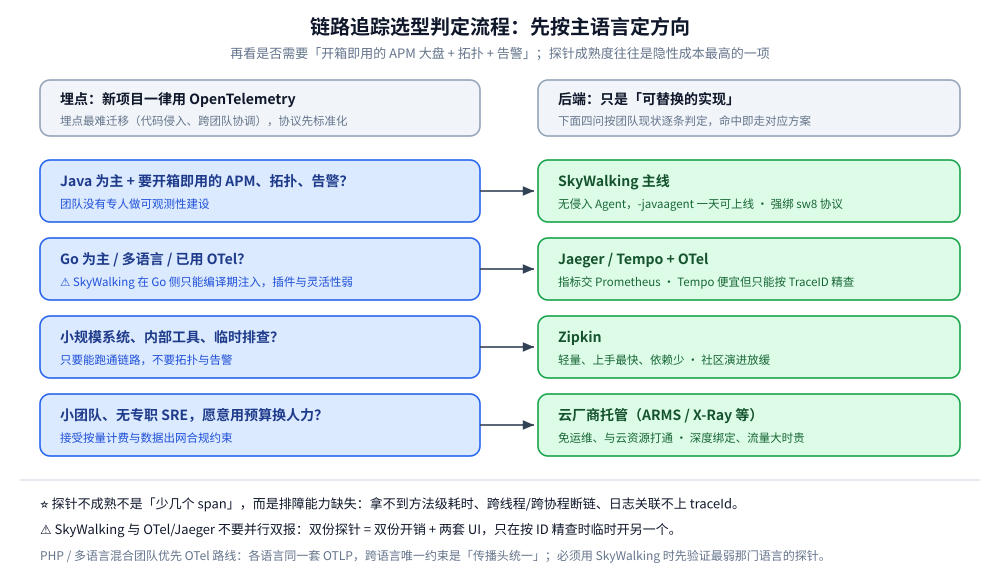

# 链路追踪技术选型

> 链路追踪的五条主流路线（SkyWalking / Jaeger + OTel / Zipkin / Tempo / 云托管）怎么选，以及选型里最容易被低估的一项——**探针在目标语言上的真实成熟度**。全篇按「先算成本 → 再比能力 → 最后按主语言落定」的顺序展开，末尾给出三条可直接照搬的落地路线与迁移成本提示。
>
> 内容整理自个人学习笔记。本篇只回答「选哪个」，**不含接入代码与部署步骤**：探针式 APM 主线的落地细节见 [README.md](Skywalking/README.md)（SkyWalking 册），OTel 主线的落地细节见 [README.md](Jaeger/README.md)（Jaeger 册），三大支柱的分工与总成本对比见 [可观测性选型对比.md](../可观测性选型对比.md)，三支柱如何按 `trace_id` 缝合见 [OpenTelemetry与关联分析.md](../OpenTelemetry/OpenTelemetry与关联分析.md)。

---

## 一、本目录怎么读

`可观测性/链路追踪/` 下是一篇选型 + 两个册，分工固定：

| 篇目 | 回答什么 | 读它的时机 |
| --- | --- | --- |
| **本篇**（`链路追踪选型对比.md`） | 五条路线怎么选、探针在某门语言上够不够用、成本重心在哪 | **先读**，决定方向 |
| [Skywalking/README.md](Skywalking/README.md)（1 导读 + 5 零件） | 探针式 APM 主线：架构、字节码增强、`sw8` 协议、UI 排障、生态集成 | 决定走 SkyWalking 之后 |
| [Jaeger/README.md](Jaeger/README.md)（1 导读 + 5 零件） | OTel 主线：v2 运行时、`traceparent` 传播、数据模型与查询、UI 排障、生态集成 | 决定走 OTel 之后 |

⭐ 阅读顺序：**本篇 → 选定一条主线 → 该册导读 → 按导读给的路线读零件**。两个册**不要并行通读**——它们的架构前提相反（SkyWalking 写时聚合、Jaeger 查时扫描），混读容易把两套模型揉在一起。

### 1.1 版本坐标与实测边界

本篇的对比结论不随小版本变化，但下表的**具体断言**有版本前提，引用时注意：

| 组件 | 版本坐标 | 本篇引用的实测/官方事实 |
| --- | --- | --- |
| SkyWalking | OAP **11.0.0** + BanyanDB **0.11.0** + Horizon UI | `version` 返回 `11.0.0-6f1fd78`、UI `:8080` 返回 200（见 [架构与部署.md](Skywalking/架构与部署.md)）；H2 存储于 **10.2 移除**；`storage.selector` 只有 banyandb / elasticsearch / mysql / postgresql |
| Jaeger | **2.20.0** + ClickHouse **26.3** | 跑通 7 项、未跑 5 项（清单见 [README.md](Jaeger/README.md)）；v2 运行时即 OTel Collector |
| OpenTelemetry | Collector **0.157.0**、OTLP/HTTP JSON | 三种信号的 resource 对齐与采样断链读数见 [OpenTelemetry与关联分析.md](../OpenTelemetry/OpenTelemetry与关联分析.md) 第六节 |

⚠️ **未实测的部分**：Zipkin、Grafana Tempo、云厂商托管三类**本篇未做任何实测**，对比内容整理自官方文档与版本说明；「探针成熟度」一栏是接入实践的经验归纳，不是基准测试。

### 1.2 边界与已知缺口

- **不收接入代码**：各语言 SDK / Agent 的写法在 `01-编程语言/{go,java,php}/可观测性/` 下，本篇只在选型维度提到「这条路在该语言上顺不顺」。
- **不收部署细节**：容器拓扑、存储选型、容量口径在 Jaeger 册的 [架构与部署.md](Jaeger/架构与部署.md) 与 SkyWalking 册的 [架构与部署.md](Skywalking/架构与部署.md)。
- **不收指标与日志**：链路追踪只回答「这次请求走了哪条路、慢在哪一跳」；系统整体健康看 [指标选型对比.md](../指标/指标选型对比.md)，单次请求的现场看 [日志系统选型对比.md](../日志系统/日志系统选型对比.md)。
- 已知缺口：**eBPF 自动埋点**（Pixie / OBI）只在原理层面提及，无实测；**跨云 / 混合云的采样协同**未覆盖。

---

## 二、先算成本，再比能力

链路追踪的成本结构和其他两个支柱不同：它不是「存多少」决定的，而是**「每秒产生多少 span × 留下多少比例 × 留多久」**决定的。

| 成本因子 | 量级怎么估 | 能压缩吗 |
| --- | --- | --- |
| **span 产生速率** | QPS × 每请求 span 数（一个 5 跳调用约 5~15 个 span，含 DB / 缓存 / MQ 客户端 span） | 只能靠**减少埋点粒度**，代价是排障信息变少 |
| **采样率** | 头部采样按比例丢；尾部采样按结果决策 | ⭐ **唯一能线性压缩成本的旋钮** |
| **保留期** | 通常 7~30 天（比指标短、比日志长） | 分层存储可压，但链路的价值集中在前几天 |
| **索引开销** | 按 tag 检索要建索引（ES）；只按 TraceID 查可以不建（Tempo） | 换存储形态即可，见 [可观测性选型对比.md](../可观测性选型对比.md) 第五节 |

⭐ **一条 1000 QPS、每请求 10 span 的服务**：全采一天就是 8.64 亿条 span。按 1% 头部采样只剩 864 万条——这就是为什么「采样率」不是优化项而是**上线前必须定的参数**，且**错误请求通常要强制保留**，否则排障时最需要的那条恰好被丢。

⚠️ 反面做法：先全采上线、出问题后再补采样。此时保留期已经按全采容量规划过，改采样率等于推翻容量模型。

---

## 三、五条主流路线的对比

这是「技术多、差异大」的典型场景。先说结论：**新项目一律用 OpenTelemetry 埋点**，因为埋点是最难迁移的部分（代码侵入、跨团队协调），协议先标准化；后端只是「可替换的实现」。

| 方案 | 优点 | 缺点 | 适用场景 |
| --- | --- | --- | --- |
| **SkyWalking** | 无侵入 Agent（字节码增强，几乎零改码）；内置 APM 大盘、拓扑图、告警规则；中文文档与社区友好；OAP 自带流式聚合 | 强绑定自家 Agent 与 `sw8` 协议；UI 定制能力弱；存储选型有限（11.0.0 的 `storage.selector` 只有 banyandb / elasticsearch / mysql / postgresql，**H2 已于 10.2 移除**）；生态活跃度不如 OTel | **Java 为主**、要开箱即用的 APM、团队没有专人做可观测性建设 |
| **Jaeger + OTel** | OTel 是事实标准、全语言天然支持；Jaeger v2 运行时即 OTel Collector；后端可替换（不锁厂商）；社区最活跃 | 只管链路，指标与告警要另配 Prometheus + Grafana；需自己埋点或引入 OTel Agent | **多语言**、已用或愿意用 OTel、要标准化、不想被单一厂商锁定 |
| **Zipkin** | 轻量、上手最快、依赖少 | 功能弱（无拓扑、无告警）；社区演进放缓；存储能力弱 | 小规模系统、内部工具、临时排查 |
| **Grafana Tempo** | 与 Grafana 生态无缝；成本极低（只索引 TraceID，Span 正文丢对象存储） | 只能按 TraceID 查，**无法按 tag 检索**（需配合 span metrics 或再加索引层） | 已用 Grafana LGTM 栈、链路主要用于「知道 ID 后精查」 |
| **云厂商托管**（阿里云 ARMS、腾讯云 APM、AWS X-Ray） | 免运维、开箱即用、与云资源天然打通 | 按量计费（流量大时贵）；数据出网与合规；深度绑定 | 小团队、无专职 SRE、用预算换人力 |

### 3.1 三条路线背后的架构分水岭

上面那张表的差异，本质来自**三个设计选择**，看清这三个就不用逐个背功能：

| 分水岭 | 一边 | 另一边 | 后果 |
| --- | --- | --- | --- |
| **聚合时机** | **写时聚合**（SkyWalking OAL / MAL 在 OAP 侧算好指标） | **查时扫描**（Jaeger 原样存 span，提问时再扫） | 写时聚合省查询、省存储；查时扫描保留原始细节、支持任意维度重算 |
| **索引粒度** | 按 tag / 端点建索引（ES、SkyWalking 存储） | 只索引 TraceID（Tempo、ClickHouse 主键） | 「按条件捞链路」和「按 ID 精查」是两个量级的能力，选型前先问自己排障时是哪种 |
| **接入方式** | **无侵入 Agent**（字节码增强 / eBPF） | **代码埋点**（SDK） | Agent 覆盖广但绑版本、绑启动方式；SDK 灵活可迁移但要改码、要跨团队协调 |

⚠️ **三者可以组合**（如 OTel SDK 埋点 + Collector 侧 tail sampling + ClickHouse 存储），但**组合的每一层都会增加一个可失败点**——这也是为什么小团队更该选一体化的 SkyWalking。

---

## 四、决策路径：先按主语言，再看要不要开箱大盘

⭐ **决策路径**：先按**主语言**定方向，再看是否需要「开箱即用的 APM 大盘 + 拓扑 + 告警」。

- **Java 为主** + 要开箱即用 APM → SkyWalking 主线（Agent 无侵入、一天可上线）
- **Go 为主 / 多语言 / 已用 OTel** → Jaeger / Tempo + OTel，指标交 Prometheus（⚠️ SkyWalking 在 Go 侧只能编译期注入，插件集与灵活性都弱于 Java）
- **两者都不要并行双报**——双份探针 = 双份开销 + 两套 UI，只在按 ID 精查时按需临时开另一个

图上的三条出口正好对应下面「契合语言」表里的三种团队画像：Java 为主且要开箱大盘的直接进 SkyWalking 册，Go 为主或多语言的进 Jaeger 册，并且明确标注「两者不要并行双报」这条限制。

### 4.1 为什么「不要并行双报」

双报指的是同一个应用同时挂 SkyWalking Agent 与 OTel SDK/Agent，把同一批请求报给两套后端。它的代价不是「多花点资源」：

| 代价 | 具体表现 |
| --- | --- |
| **双份探针开销** | 两次字节码增强 / 两套上下文，CPU 与内存叠加 |
| **断链风险翻倍** | 两套传播头（`sw8` 与 `traceparent`）必须各自完整，任一侧缺一跳就各自缺一段 |
| **两套 traceId** | 同一次请求在两个后端里 ID 不同，日志只能挂其中一套，另一套永远对不上 |
| **排障口径分裂** | 两个团队各看各的，回到「互相推诿」的原点 |

⭐ 正确的过渡姿态：**埋点统一到 OTel**，需要 SkyWalking 能力时用它的 **OTLP 接收面**收 OTel 数据（而不是再挂一个 Agent）。⚠️ 但这条兼容通道有真实边界——OTLP 复用 **11800** 而不是 4317、`otlpTraceSampleRate` 分母是**一万**、**11.x 没有 `receiver_jaeger`**，逐条见 [集成与生态.md](Skywalking/集成与生态.md) 第二节。

---

## 五、契合语言与团队栈怎么选 ⭐

同一份能力清单，落到不同语言上「探针成熟度、插件覆盖、运维工具」差别很大——**探针往往才是隐性成本最高的一项**（对照写法见 [消息队列选型对比.md](../../消息队列/消息队列选型对比.md) 的同名维度）。

| 方案 | 服务端 | 最契合语言 | Java 侧实际体验 | Go 侧实际体验 | PHP / 其他 |
| --- | --- | --- | --- | --- | --- |
| **SkyWalking** | Java | ⭐ **Java** | 字节码增强最成熟，Spring 全家桶插件最全，`-javaagent` 一行接入（见 [接入Skywalking.md](../../../../01-编程语言/java/可观测性/接入Skywalking.md)） | 只能**编译期 AST 注入**（`-toolexec` + `-a`），插件集有限、配置固化进二进制、运行期无法摘除（见 [接入Skywalking.md](../../../../01-编程语言/go/可观测性/接入Skywalking.md)） | PHP 扩展（.so）+ 共享内存 + fork 上报进程，多进程模型下坑最多（见 [接入Skywalking.md](../../../../01-编程语言/php/接入Skywalking.md)）；Node.js 靠 monkey patch，必须在业务代码前加载 |
| **Jaeger + OTel** | Go | ⭐ **语言无关**（OTel 对各语言都是一等公民） | OTel Java Agent 同样零改码；Spring Boot 3 另有 Micrometer Tracing 路线（见 [接入Jaeger.md](../../../../01-编程语言/java/可观测性/接入Jaeger.md)） | ⭐ **最顺**：OTel Go SDK 原生、contrib 覆盖 Gin/GORM/net/http，采样与导出地址运行期可配（见 [接入Jaeger.md](../../../../01-编程语言/go/可观测性/接入Jaeger.md)） | OTel PHP 为社区实现，成熟度低于 Java/Go；各语言都走同一套 OTLP，混跑时唯一约束是「传播头统一」 |
| **Zipkin** | Java | Java（Brave） | Brave 库成熟，但需要显式改码埋点 | 第三方客户端，社区演进慢 | 各语言有客户端，功能收敛 |
| **Grafana Tempo** | Go | ⭐ **语言无关**（只收 OTLP） | 同 Jaeger，挂 OTel Java Agent | 同 Jaeger，用 OTel Go SDK | 同 Jaeger |
| **云厂商托管** | — | 取决于云厂商 SDK | 通常 Java Agent + SDK 双路都有 | 多数提供 Go SDK | ⚠️ PHP 侧支持参差，接入前逐个确认 |

> ⭐ 三条结论：
> **① Java 团队**：SkyWalking 收益最大——字节码增强覆盖面最广、拓扑与告警开箱即用，`-javaagent` 一行即可上线。
> **② Go 团队**：⚠️ **SkyWalking 在 Go 侧是「二等公民」**，没有运行时增强能力，只能编译期注入，插件集与配置灵活性都弱于 Java；此时 **OTel SDK + Jaeger 反而更顺**（运行期可配、contrib 生态广、后端可替换）。
> **③ PHP / 多语言混合团队**：优先 OTel 路线（协议统一、各语言同一套 OTLP），把「传播头一致」当作唯一的跨语言约束；若必须用 SkyWalking，先验证最弱那门语言的探针——PHP 的多进程 + 共享内存模型坑最多。
>
> ⚠️ 反面教训：探针不成熟不是「少几个 span」，而是**排障能力缺失**——拿不到方法级耗时、跨线程/跨协程断链、日志关联不上 traceId，出问题时只能靠加日志重发布。

### 5.1 四种接入形态的覆盖与代价

除了「选哪个产品」，还要选**用哪种方式接进去**，两者的成本完全不同：

| 形态 | 代表 | 改码 | 覆盖广度 | 主要约束 |
| --- | --- | --- | --- | --- |
| **字节码增强 Agent** | SkyWalking Java Agent、OTel Java Agent | 零改码 | 框架/中间件全 | 绑 JDK 与启动方式；版本不匹配即失效；**运行期要有摘除预案** |
| **SDK 埋点** | OTel Go / Java / PHP SDK | 要改码 | 由你决定埋哪 | 埋点位置与 `context` 传递全靠人；但可迁移性最好 |
| **编译期注入** | skywalking-go（`-toolexec` + `-a`） | 零改码 | 仅官方列出的框架区间 | 配置固化进二进制、**运行期改不了也摘不掉** |
| **eBPF / 旁路** | Pixie、OTel eBPF Instrumentation | 零改码、零重启 | 内核可见的 syscall 层 | 只见网络与系统调用，**看不到应用内部方法**；内核版本约束强 |

⭐ 判据：**要「方法级耗时」就必须进到进程里**（Agent 或 SDK）；只关心「哪两跳之间慢」时 eBPF 够用且最省事。

---

## 六、迁移成本：为什么「埋点先标准化」

选型算的是上线成本，迁移成本才是三年后的真账单：

| 换掉什么 | 迁移代价 | 说明 |
| --- | --- | --- |
| **后端**（Jaeger → Tempo、ES → ClickHouse） | 低 | 只要协议还是 OTLP，改 exporter 地址即可；历史数据按需归档，不必迁 |
| **存储** | 中 | 查询语句要改（TraceQL / ClickHouse SQL / GraphQL），看板要重配 |
| **埋点方式**（SDK → Agent，或反向） | **高** | 要改代码或改启动参数，跨团队协调，通常伴随一次全量回归 |
| **传播协议**（`traceparent` → `sw8`，或混用） | **最高** | 一旦有服务用私有头，整条链在那一跳断掉，且**断链是静默的**——UI 上只表现为「链路短了一截」 |

⚠️ **断链静默**是最贵的一条：它不会报错，只会在你以为一切正常时缺少关键那一跳。所以「传播头统一」要在架构评审时就定死，写进接入规范。

---

## 七、延伸追问

- **采样率怎么定？** → 头部采样（SDK 端按比例）简单但可能丢弃错误链路；**尾部采样**（Collector 侧按结果决策）能做到「错误与慢请求 100% 保留、正常请求抽样」，是成本与信息量的最优解。⚠️ 尾部采样要等整条链结束才能决策，Collector 侧要预留缓冲（见 [采集与传播.md](Jaeger/采集与传播.md)）。
- **无侵入 Agent 的代价是什么？** → 字节码增强带来 CPU/内存开销；与 JDK 版本、Glibc 版本、其他 agent 存在兼容风险；探针异常理论上可能影响业务进程——所以生产要灰度、要能一键摘除。
- **SkyWalking 对 Go 友好吗？** ⭐ → 这是选型最容易踩的坑。Go 没有 classloader，**「运行时无侵入」在 Go 上不成立**，skywalking-go 走的是编译期 AST 注入（`go build -toolexec=… -a`）：配置在编译期写死进二进制、运行期改不了也摘不掉、插件只覆盖官方列出的框架版本区间。所以 **Java 侧的「零改码 + 灵活」体验在 Go 侧会打折**，Go 为主的项目更该走 OTel SDK。参见 [接入Skywalking.md](../../../../01-编程语言/go/可观测性/接入Skywalking.md)。
- **ES 和 ClickHouse 都能存 Trace，怎么选？** → 看查询模式：**按标签过滤 + 全文检索**选 ES；**按 TraceID 精查、高基数写入、要控成本**选 ClickHouse。Jaeger v2 对 CH 是一等公民。
- **采样丢了链路，日志里还有 traceId，怎么解释？** → 这是三支柱关联的固有裂缝：日志不受链路采样控制。头部采样率 50% 时约一半日志的 `trace_id` 在后端查不到实体，只能靠日志本身还原现场。量化读数见 [OpenTelemetry与关联分析.md](../OpenTelemetry/OpenTelemetry与关联分析.md) 第六节。
- **链路数据能不能直接算出指标？** → 能（span metrics / RED 指标由 span 派生），但**别拿它替代原生指标**：链路是采样过的，派生指标的绝对值会随采样率漂移，只适合作比率（错误率、P99）而非容量口径。

---

## 关联

- [可观测性选型对比.md](../可观测性选型对比.md) — 上游总纲：三大支柱的成本结构、存储后端与可视化告警的跨支柱对比
- [OpenTelemetry与关联分析.md](../OpenTelemetry/OpenTelemetry与关联分析.md) — 三支柱如何靠 trace_id / exemplar / resource 缝合，以及采样断链的实测
- [README.md](Skywalking/README.md) — SkyWalking 册导读（探针式 APM 主线，1 导读 + 5 零件）
- [README.md](Jaeger/README.md) — Jaeger 册导读（OTel 主线，1 导读 + 5 零件）
- [指标选型对比.md](../指标/指标选型对比.md) — 另一支柱的选型，与链路共享同一套 resource 语义
- [日志系统选型对比.md](../日志系统/日志系统选型对比.md) — 日志后端选型，以及「按 traceId 回捞日志」对存储的要求
- [消息队列选型对比.md](../../消息队列/消息队列选型对比.md) — 同属「多技术横向选型」的另一篇，可对照选型表与「契合语言」维度的写法
- [接入Jaeger.md](../../../../01-编程语言/go/可观测性/接入Jaeger.md) — Go 侧 OTel SDK + OTLP 落地
- [接入Skywalking.md](../../../../01-编程语言/java/可观测性/接入Skywalking.md) — Java 侧 `-javaagent` 无侵入接入
- [接入Skywalking.md](../../../../01-编程语言/php/接入Skywalking.md) — 多语言探针在 PHP-FPM 侧的实际接入步骤
- [HTTP与gRPC.md](../../../../02-计算机基础/网络/应用层/HTTP与gRPC.md) — trace 上下文在 HTTP / gRPC 请求头中的传播
- [时序数据库选型对比.md](../../../数据存储/时序数据库/时序数据库选型对比.md) — 链路派生的指标最终落到哪种时序存储
