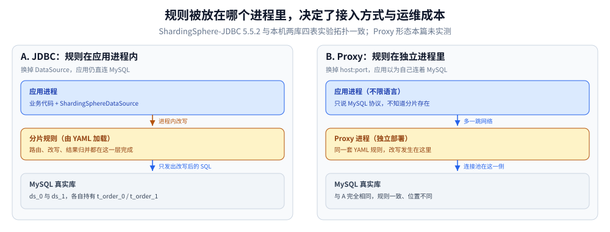
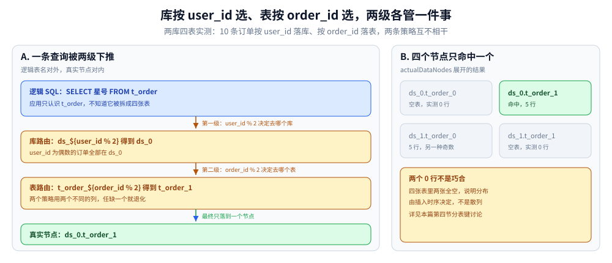
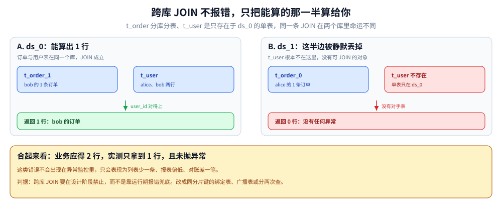

# ShardingSphere

> 覆盖：两种形态（JDBC 驱动 / Proxy 进程）的取舍、分片配置的五层对象、**三类特殊表的语义差别**（绑定表 / 广播表 / 单表）、分布式主键与分表键的冲突、SQL 支持边界（跨库 JOIN / 排序分页 / 聚合 / 分片键更新）、跨版本配置字段变更、排障。
>
> 不覆盖：路由算法本身（哈希取模、范围、基因法的推演与 Go 实现）见 [分表与路由.md](../../数据存储/关系型/MySQL/分表与路由.md)；主从复制与读写分离的机制见 [复制与高可用.md](../../数据存储/关系型/MySQL/复制与高可用.md)；连接池与索引设计见 [索引设计与EXPLAIN.md](../../数据存储/关系型/MySQL/索引设计与EXPLAIN.md) 与 [参数调优.md](../../数据存储/关系型/MySQL/参数调优.md)；该不该分片的决策见 [中间件选型.md](../中间件选型.md)。
>
> ⭐ 本篇读数为本机真跑：**ShardingSphere-JDBC 5.5.2 + MySQL 8.0**，两个库、每个库两张分表 + 一张广播表 + 一张单表，实际写入、查询、报错原文均来自真实执行；**Proxy 形态与读写分离未实测**，逐块标注见第六节。
>
> 内容整理自个人学习笔记，素材见 [素材清单](../../../素材清单.md)。

---

## 一、两种形态：驱动内嵌还是独立进程

**本节要点**：ShardingSphere 不是「一个产品」，而是「一套分片规则 + 两个包装方式」——**JDBC** 把规则塞进应用的数据源里，**Proxy** 把规则做成一个说 MySQL 协议的独立进程。规则相同，接入点不同。

### 1.1 同一套规则，两个接入位置



这张图只标一件事：**改写发生在哪一跳**。JDBC 的改写发生在应用进程内的 `DataSource` 里，应用仍然直连真实 MySQL；Proxy 的改写发生在独立进程里，应用只认识 Proxy。

| 维度 | ShardingSphere-JDBC | ShardingSphere-Proxy |
|---|---|---|
| 接入方式 | 换 `DataSource` / 换 JDBC URL | 换连接串的 host:port |
| 语言限制 | **只有 Java 生态** | 任何能说 MySQL 协议的语言 |
| 多一跳 | 无 | 有（应用 → Proxy → MySQL） |
| 事务 | 与本地事务同一个连接池 | 跨进程，注意连接数与超时 |
| 运维 | 跟着应用发布 | 独立部署、独立升级、独立扩容 |

### 1.2 五条判据

1. **技术栈是否单一**：只有 Java 就 JDBC；有 Go / Python / PHP 混用就必须 Proxy（或每个语言各写一套路由）。
2. **是否愿意多运维一个进程**：Proxy 要独立部署、监控、备份配置，**它挂了等于数据库挂了**。
3. **延迟敏感度**：Proxy 多一次网络往返，且连接池在它那一侧，**连接数会翻倍**。
4. **事务边界**：JDBC 下的本地事务天然跟业务连接一致；Proxy 下要确认 `XA` / 柔性事务的配置落在哪。
5. **测试成本**：JDBC 能在单测里用内存库跑；Proxy 要起容器。

### 1.3 本篇只实测 JDBC

⚠️ 下面所有读数都来自 **ShardingSphere-JDBC 5.5.2**。Proxy 的配置项名称与 JDBC 基本一致（都是那套 YAML 规则），但**行为差异（连接数、超时、事务）没有实测**。看第六节的口径表。

## 二、配置模型：一条 SQL 怎么被拆成多条

**本节要点**：配置是五层对象——`databaseName`（逻辑库）→ `dataSources`（真实库）→ `rules`（分片/广播/单表规则）→ `tables`（逻辑表）→ `actualDataNodes`（真实节点表达式）。**逻辑表名对外，真实节点对内**，一条 SQL 进来看逻辑表，出去时变成若干条对真实表的 SQL。

### 2.1 五个层次

```yaml
databaseName: sharding_db          # ① 逻辑库名，应用看到的名字
dataSources:                       # ② 真实数据源，每个是一个连接池
  ds_0:
    dataSourceClassName: com.zaxxer.hikari.HikariDataSource
    jdbcUrl: jdbc:mysql://mysql:3306/sharding_db_0
  ds_1: { ... }
rules:
  - !SHARDING                      # ③ 分片规则
    tables:
      t_order:                     # ④ 逻辑表
        actualDataNodes: ds_${0..1}.t_order_${0..1}   # ⑤ 真实节点
        tableStrategy:
          standard: { shardingColumn: order_id, shardingAlgorithmName: t_order_inline }
    defaultDatabaseStrategy:       # 库级策略：没在表上写库策略时用它
      standard: { shardingColumn: user_id, shardingAlgorithmName: db_inline }
    shardingAlgorithms:
      db_inline:
        type: INLINE
        props: { algorithm-expression: ds_${user_id % 2} }
      t_order_inline:
        type: INLINE
        props: { algorithm-expression: t_order_${order_id % 2} }
```

### 2.2 两级路由：先选库，再选表

**库策略和表策略是两个独立的分片键**——本例用 `user_id` 选库、`order_id` 选表：



⭐ 这个设计的直接后果：**`user_id` 是分库键，不带它的查询会打到所有库**。实测（第六节口径）：`SELECT ... WHERE status='NEW'` 在逻辑表上执行，**内部广播到 4 张物理表**再归并。

### 2.3 `actualDataNodes` 的表达式语法

`ds_${0..1}.t_order_${0..1}` 展开成 4 个节点：`ds_0.t_order_0`、`ds_0.t_order_1`、`ds_1.t_order_0`、`ds_1.t_order_1`。

写法要点：

- `${0..1}` 是**闭区间**，`${0..3}` 会展开 4 个；
- 前缀不一致时要拆开写：`ds_0.t_order_00${[0..9]},ds_0.t_order_0${[10..99]}`（`[...]` 表示枚举补零，见 [分表与路由.md](../../数据存储/关系型/MySQL/分表与路由.md) 使用二）；
- **节点数量决定启动时的元数据加载量**：256 张表 × 2 库 = 512 个节点，启动会明显变慢。

### 2.4 两个必踩的字段变更

5.5.x 与多数教程（5.3 以前）的写法**不兼容**，照抄会直接启动失败：

| 写法 | 报错原文 | 正确写法 |
|---|---|---|
| `broadcastTables: [t_dict]` 写在 `!SHARDING` 里 | `Unable to find property 'broadcastTables' on class: YamlShardingRuleConfiguration` | 独立规则 `- !BROADCAST` + `tables: [t_dict]` |
| 单表写成 `actualDataNodes: ds_0.t_user` | `No sharding database route info.` | 独立规则 `- !SINGLE` + `tables: [ds_0.t_user]` |

⚠️ 第二条尤其坑：**`actualDataNodes` 只写一个节点，编译器不会报错，配置能加载，但这条 SQL 一执行就抛「没有路由信息」**。原因是单表不参与分片，却仍被要求走「分库策略」，而 `!SHARDING` 的默认库策略只对分片表生效。

> 判据：**报错信息里出现 `Yaml...Configuration` 是「字段名不对」；出现 `No sharding database route info` 是「规则归属不对」**。前者改字段，后者换规则类型。

## 三、三类特殊表：绑定、广播、单表

**本节要点**：三类表的差别不在「怎么分」，而在**「多条 SQL 之间怎么对齐」**：绑定表让 JOIN 收敛到同库同表，广播表让每库都有一份全量，单表只存在于一个节点。

### 3.1 绑定表：把 JOIN 的物理组合从 m×n 降到 m

`t_order` 与 `t_order_item` 都按 `order_id` 分表、按 `user_id` 分库，声明确绑定：

```yaml
    bindingTables:
      - t_order,t_order_item
```

实测（同一份数据、同一条 JOIN，打开 MySQL `general_log` 数实际下发的语句）：

| 配置 | 下发到 MySQL 的 JOIN 语句 | 物理表组合 |
|---|---|---|
| **有 `bindingTables`** | **4 条** | `t_order_0 JOIN t_order_item_0`、`t_order_1 JOIN t_order_item_1`（**按后缀配对，2 组**） |
| 无 `bindingTables` | **8 条** | `t_order_{0,1}` × `t_order_item_{0,1}`（**全组合，4 组**） |

⭐ 读法：

- 绑定表把「`m` 张分表 JOIN `n` 张分表」的 `m×n` 组合压成 `m` 组**同后缀配对**——前提是两张表的**分片算法与分片键完全一致**。
- **结果行数两者都是 2，都正确**。绑定表省的**不是正确性，是查询次数**——不绑定时结果仍对（`ON` 条件会下推到每个组合），但 `general_log` 里是 8 条 SQL。
- 本例查询**没带 `order_id` 条件**，所以只能降到 2 组；**若 WHERE 里带 `order_id`，还能进一步裁剪到 1 组**（未单独实测）。

⚠️ 绑定表的隐含前提：**同一 `order_id` 的订单和明细必须在同一个库**。如果明细按 `item_id` 分表、订单按 `order_id` 分表，两者就不是绑定关系，硬配绑定表会查出**错行**——不是报错，是静默错。

### 3.2 广播表：写全量、读一份

`t_dict` 声明为广播表（`!BROADCAST`），实测：

| 动作 | 结果 |
|---|---|
| `INSERT INTO t_dict VALUES (1,'A'),(2,'B')`（不带任何分片键） | 成功 |
| 直连 MySQL 查 `ds_0.t_dict` | **2 行** |
| 直连 MySQL 查 `ds_1.t_dict` | **2 行** |
| 逻辑表 `SELECT COUNT(*) FROM t_dict` | **2** |
| 逻辑表 `SELECT dict_id, code FROM t_dict ORDER BY dict_id` | `1:A 2:B` |

⭐ 两个常见误解都被实测否定：

1. **「广播表查询会重复」**：不会。读只落一个数据源，`COUNT` 是 2 不是 4。
2. **「广播表写入要自己写两遍」**：不用，框架替你写所有库。**但这是同步写**——`n` 个库就 `n` 倍写放大，**不适合频繁变更的数据**（配置表、字典表可以，业务表不行）。

### 3.3 单表：`!SINGLE`，只在一个节点

```yaml
  - !SINGLE
    tables:
      - ds_0.t_user
```

实测：写入后 `ds_0.t_user` 有 2 行、`ds_1.t_user` **0 行**。单表**不复制、不分片、不参与路由计算**，等价于「告诉框架这张表在哪儿，别管它」。

### 3.4 选择树

| 这张表的特征 | 用哪种 | 判据 |
|---|---|---|
| 数据量大、要分片，且**总有另一张表按同一键关联** | 绑定表 | 两张表分片键与算法必须一致 |
| 数据量小、**每个库都要读全量**（字典、配置、租户元数据） | 广播表 | 写少读多；写放大可接受 |
| 不参与分片、只在一个库（历史表、辅助表） | 单表 | 明确指定节点，别让它去猜 |

## 四、分布式主键：能生成，但生成不了「能路由」的

**本节要点**：`SNOWFLAKE` 能生成全局唯一 ID，但**它的低位不是散列值，而是序列位**。用它当分表键，数据分布由插入节奏决定，而不是均匀分布。

### 4.1 生成结果

不指定主键插入 10 条，全部由框架生成：

```text
生成的主键数量: 10
前 5 个主键: [1320252646686199808, 1320252649169227777, 1320252649282473984,
              1320252649441857537, 1320252649525743616]
最大主键位数: 19 位
```

19 位 `BIGINT`，够用到下个世纪。`worker-id: 1` 是必须显式配的——**多个进程用同一个 `worker-id` 会撞 ID**。

### 4.2 ⭐ 分表键用 `order_id % 2` 会怎样

直连 MySQL 核对物理分布（10 条订单，`user_id` 1~10）：

| 物理表 | 行数 | `user_id` |
|---|---|---|
| `ds_0.t_order_0` | **0** | — |
| `ds_0.t_order_1` | 5 | 2,4,6,8,10 |
| `ds_1.t_order_0` | 5 | 1,3,5,7,9 |
| `ds_1.t_order_1` | **0** | — |

**分库是对的**（`user_id` 偶数在 `ds_0`），但**分表只用了 `t_order_0` / `t_order_1` 各一半、另外两张空表**。再看落在 `ds_1.t_order_0` 的 5 条 `order_id % 2`：

```text
ds_1.order_id%2 → 0,0,0,0,0
```

⭐ **5 条的末位全是 0**。原因在雪花 ID 的位布局：低位是**同一毫秒内的序列号**，从 0 开始递增，跨毫秒重置。本例 10 条插入跨了约 10 毫秒，序列在每个毫秒内只走 0~1，于是末位在 0/1 之间摆——**看起来像均匀分布，实际是「与插入时序绑定」**。

推论：**如果写入更慢（每条都落在不同毫秒且是同毫秒第一条），末位恒为 0，所有数据都会落到同一张表**。本次实验里每 5 条落一张表，已经能看出分布不是散列。

> 判据：**分表键必须是独立于主键生成算法的散列值**。要么用业务字段（`user_id`、`shop_id`），要么用「基因法」把分片位写进 ID（见 [分表与路由.md](../../数据存储/关系型/MySQL/分表与路由.md) 第一节 1.5 与使用一第 3 节）。

### 4.3 要让「主键反查分片」，三条路

| 做法 | 代价 | 适用 |
|---|---|---|
| **自定义 `KeyGenerator`**（基因法） | 要在生成时就算出分片位，ID 里含冗余 | 新系统、能改 ID 生成 |
| **复合分片键**（`order_id` + `user_id` 一起分） | 查询必须带齐两个键 | 关联查询固定的场景 |
| **路由表**（`order_id → 表后缀` 存一张索引表） | 多一次查询、多一张表要维护 | 无法改 ID 的老系统 |

⭐ 与存量篇的分工：**这三种做法在 [分表与路由.md](../../数据存储/关系型/MySQL/分表与路由.md) 里有完整推演与 Go 实现**，本篇只给「在 ShardingSphere 里怎么落」。

## 五、SQL 支持边界

**本节要点**：能改写的 SQL 会被拆成多条、归并结果；不能改写的直接报错；**最危险的是第三类——不报错但结果不对**。

### 5.1 能正确处理（实测）

| SQL | 实测结果 | 说明 |
|---|---|---|
| `WHERE order_id IN (三个真实主键)` | **3 行** | 按主键路由到不同表后聚合 |
| `ORDER BY amount DESC LIMIT 5` | `1000 900 800 700 600` | 各分片各取 Top5，再归并排序 |
| `... LIMIT 5 OFFSET 3` | `700 600 500 400 300` | 偏移正确 |
| `SELECT user_id, SUM(amount) GROUP BY user_id` | `1=100 2=200 3=300` | 分组聚合二次计算 |
| `UPDATE t_order SET status='DONE'`（无 WHERE） | **影响 10 行** | 广播到 4 张物理表 |
| `SELECT COUNT(*) FROM t_order` | 10 | 各表计数求和 |

### 5.2 明确报错

```text
UPDATE t_order SET user_id = 99 WHERE order_id = 1320252646686199808

SQLException: Can not update sharding value for table 't_order'.
```

⭐ **分片键不能 UPDATE**。原因很直白：改了 `user_id` 意味着这条记录要从 `ds_1` 搬到 `ds_0`，跨库搬迁无法在一个事务里完成。

绕法只有两条：**删除 + 重新插入**（新记录落到新库），或者把「换租户/换归属」设计成**业务上的新建**而不是修改。

### 5.3 ⭐ 最危险的一类：跨库 JOIN 不报错，但少给数据

`t_order`（分库分表）JOIN `t_user`（单表，只在 `ds_0`）：



这张图把同一条 JOIN 拆到两个库里看：ds_0 里订单表与用户表都在，能算出 bob 那一行；ds_1 里只有订单表，那半边直接消失且不报错。实测输出：

```text
跨库 JOIN 未抛异常，返回行数: 1
  明细前 5 行: 1320252649169227777=bob
```

而业务上应该是 **2 行**（`alice` 的 1 条订单在 `ds_1`，`bob` 的 1 条在 `ds_0`）。

⭐ **框架没有报错，只返回了 1 行**——它把能算的那部分算完就返回了。这比直接抛异常危险得多：

- 异常会被测试和监控捕获；
- **少一半数据不会**。列表页少了记录、报表数偏低、对账差一笔，全部是「业务现象」而不是「系统错误」。

> 判据：**跨库 JOIN 在设计阶段就要被禁止**，而不是靠运行期报错兜底。做法：把要 JOIN 的表做成**同分片键的分片表**（走绑定表），或者做成**广播表**（每库一份），或者在应用层**分两次查再拼**。

### 5.4 跨库分页的代价

`LIMIT 5` 看起来很便宜，实际每个分片都要执行一次 `LIMIT 5`（拿到各自的 Top5），再在内存里归并。所以：

- **`LIMIT n` 的成本 ≈ 分片数 × n**；
- **`OFFSET m` 的成本 ≈ 分片数 × (m + n)**，越翻到后面越贵；
- 深分页的正确做法见 [深分页与索引变更.md](../../数据存储/关系型/MySQL/深分页与索引变更.md)（游标翻页），在分片场景下**收益比单库更大**。

## 六、部署与排障

**本节要点**：分片框架的问题分三类——**配置没加载**（启动即失败）、**路由没命中**（运行时报错）、**路由命中了但结果不对**（最难查）。三类的入口各不相同。

### 6.1 该打开的三处日志

| 位置 | 打开方式 | 看什么 |
|---|---|---|
| 逻辑 SQL / 真实 SQL | `props.sql-show: true` | 一条逻辑 SQL 实际变成哪几条 |
| 分片路由 | 同上（SQL 日志里带 `Actual SQL`） | 命中了哪几个真实节点 |
| MySQL 侧 | `SET GLOBAL general_log='ON'; log_output='TABLE'` | **框架说发了什么，不如数据库收到了什么** |

⚠️ 实测中 `sql-show` 没有输出（SLF4J 绑定版本不匹配时日志框架会静默降级为 NOP）。**更可靠的办法是打开 MySQL 的 `general_log`**——本篇第三节与第五节的关键读数全部来自 `mysql.general_log`，而不是框架自己的日志。

### 6.2 报错对照表

| 报错原文 | 根因 | 修法 |
|---|---|---|
| `Unable to find property 'broadcastTables'` | 版本字段变更 | 改用独立 `!BROADCAST` 规则 |
| `No sharding database route info.` | 表没被任何规则覆盖，或单表写进了 `!SHARDING` | 用 `!SINGLE` 声明单表 |
| `Can not update sharding value for table 'x'` | UPDATE 了分片键 | 删+插，或改成业务新建 |
| `Unknown host xxx` | 数据源地址不可达（容器网络 / DNS） | 先 `ping`/`telnet` 通再说 |
| 启动时报 YAML 解析失败 | `!SHARDING` 的 tag 缩进或字段类型不对 | 对照版本官方示例，**别抄旧博客** |

### 6.3 上分片前的检查清单

1. **分片键选了吗**——它的查询覆盖率有多少？不带它的查询会广播到全部节点。
2. **主键带基因位吗**——否则主键反查要额外一跳（见第四节）。
3. **JOIN 的表同分片键吗**——不同就配绑定表；跨库 JOIN 会静默少数据（见 5.3）。
4. **有需要全量的字典表吗**——做成广播表，别每个库各写各的。
5. **跨库分页有没有兜底**——深翻页要么游标化，要么限制最大页码。
6. **扩容方案定了吗**——成倍扩容搬迁量最小（见 [分表与路由.md](../../数据存储/关系型/MySQL/分表与路由.md) 使用一第 4 节）。

## 七、校验口径

**本节要点**：本篇读数的范围与边界，引用前请对照。

### ✅ 实测口径

| 项 | 环境与做法 |
|---|---|
| 版本 | **ShardingSphere-JDBC 5.5.2**、MySQL **8.0**、JDK 17、HikariCP |
| 拓扑 | 单实例两库（`sharding_db_0` / `sharding_db_1`），每库 `t_order_{0,1}`、`t_order_item_{0,1}`、`t_dict`、`t_user` |
| 规则 | 库策略 `ds_${user_id % 2}`；表策略 `t_order_${order_id % 2}`；`!BROADCAST` + `!SINGLE` 各一 |
| 数据量 | 10 条订单 + 10 条明细（分布核对）；绑定表对比实验单独用 1 单 2 明细 |
| 语句计数 | MySQL `general_log`（`log_output=TABLE`），按 `argument LIKE '%JOIN t_order_item%'` 计数，**已排除查询日志自身的语句** |
| 物理分布 | 直连 MySQL 按库按表 `COUNT(*)` 与 `GROUP_CONCAT(user_id)` 核对 |
| 未保留 | 实验台在 `.workbuddy/tmp/sharding-lab/`（`Lab.java`、`Lab2.java`、`binding_cnt.sh`），可重跑 |

### ⚠️ 未实测

| 项 | 边界 |
|---|---|
| **ShardingSphere-Proxy 形态** | 完全未跑，第一节的对比表来自文档而非读数 |
| **读写分离 / 影子库** | 单实例环境无法测主从切换与影子路由 |
| **分布式事务（XA / BASE）** | 未构造跨库事务场景 |
| **数据迁移（Scaling）** | 未跑扩容搬迁 |
| **带分片键的 JOIN 是否降到 1 组** | 只测了不带 `order_id` 的 JOIN（2 组 / 4 组） |
| **`sql-show` 的输出形态** | SLF4J 绑定问题导致未输出，**用 `general_log` 替代** |
| **高并发下的连接池行为** | 单线程串行执行，`maximumPoolSize` 未压测 |
| **分页归并的内存与耗时曲线** | 未做深翻页的性能测量 |

> 引用本篇数字请带版本：**规则类型（`!BROADCAST` / `!SINGLE`）、字段名、算法名都随小版本变**，升级前对照官方 YAML 示例重跑一遍第二节的四个阶段最省事。

## 延伸追问

- **为什么 `defaultDatabaseStrategy` 对单表不生效？** 默认策略只作用于**分片表**；单表不是分片表，没有「选哪张表」的问题，它缺的是「在哪一个库」，所以要用 `!SINGLE` 显式指定节点。
- **广播表和数据同步（Canal / binlog）有什么区别？** 广播表由框架在写时同步到各库，**强一致但写放大**；binlog 同步是异步的，**有延迟但写入只一次**。字典这类「读多写极少、允许短暂不一致」的表，两种都能用。
- **分片键选错了能改吗？** 等价于数据重分布：要么停写迁移，要么双写 + 校验切换。**选之前先用真实查询分布算一遍覆盖率**，比事后迁移便宜一个数量级。
- **`bindingTables` 配错成非绑定关系会怎样？** 不会启动失败，会**查出跨库的错行**（同一 `order_id` 的订单与明细被配到不同库）。这是本篇最需要靠测试兜住的一类问题。

## 关联

- **路由算法**：[分表与路由.md](../../数据存储/关系型/MySQL/分表与路由.md) — 哈希/范围/基因法的推演、Go 实现、成倍扩容
- **读写分离**：[复制与高可用.md](../../数据存储/关系型/MySQL/复制与高可用.md) — 主从延迟与读写分离的取舍
- **深分页**：[深分页与索引变更.md](../../数据存储/关系型/MySQL/深分页与索引变更.md) — 分页在分片下的成本放大
- **选型**：[中间件选型.md](../中间件选型.md) — 什么时候该上分片中间件
- **事务**：[分布式事务 README](../../../04-架构与系统/分布式/分布式事务/README.md) — 跨库写的一致性方案
- **对照/互补**：[APISIX.md](../网关与代理/APISIX.md) — 同样「把规则从配置文件搬到数据里」的另一个中间件
