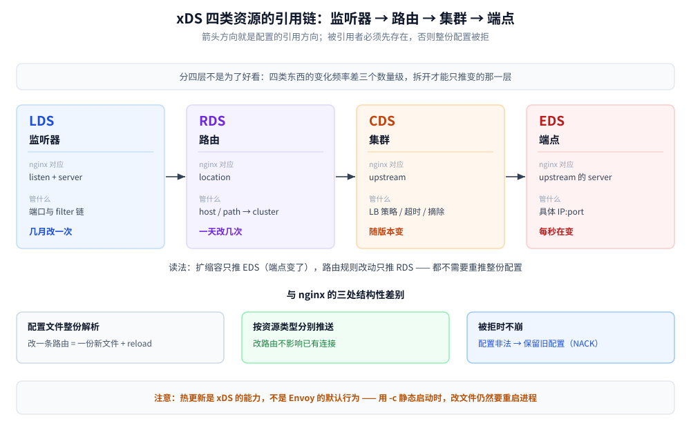
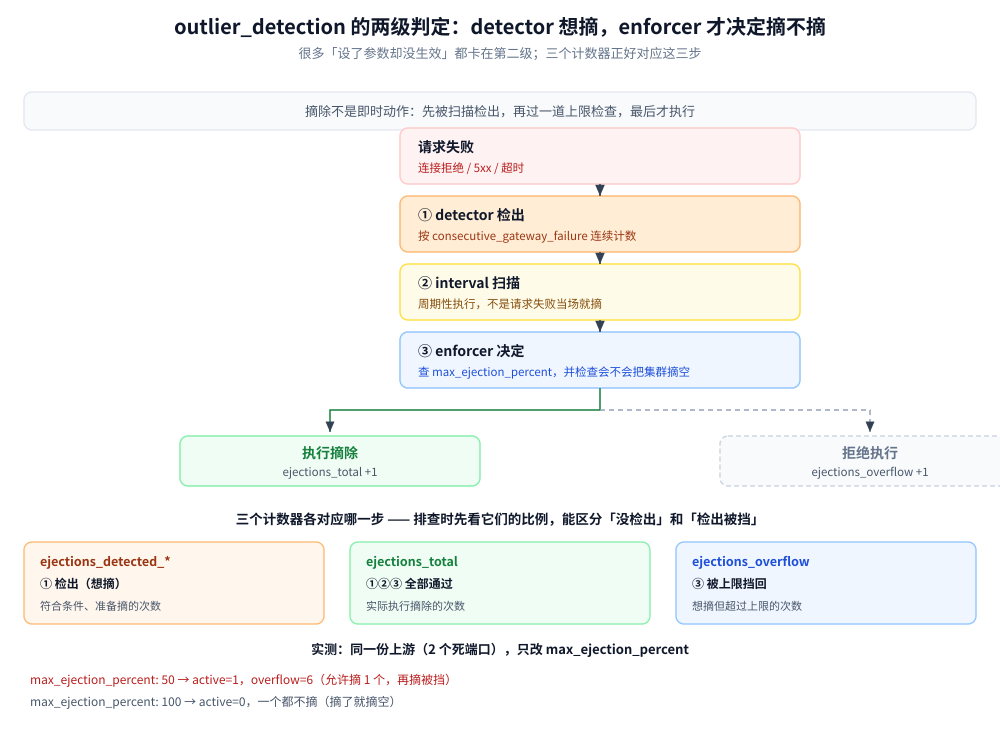

# Envoy

> 覆盖：Envoy 作为数据面代理的**落地形态**——四类 xDS 资源各管什么、按什么顺序下发，`--mode validate` 能查出哪类错误、漏掉哪类，`outlier_detection` 与 `health_checks` 两套健康判定的参数与实测，`grpc_web` 为什么必须由代理做转码，以及 admin 接口怎么用来排障。
>
> 不覆盖：为什么要做节点级摘除、连续失败与冷却+探测的判据、探测租约的原子性，见 [节点级被动摘除.md](../../../04-架构与系统/分布式/稳定性/节点级被动摘除.md)；负载均衡的分层与选路策略见 [负载均衡.md](../../../04-架构与系统/分布式/服务治理/负载均衡.md)；要不要上网格、Istio / Linkerd / Cilium 怎么选见 [容器与编排选型.md](../../../06-工程实践/部署/容器与编排选型.md) 第三节；控制面 CRD 怎么写、怎么翻译成 xDS 见 [Istio.md](Istio.md)。
>
> 内容整理自个人学习笔记。**实测环境：Docker Desktop 29.7.2 + `envoyproxy/envoy:v1.31-latest`（Envoy `1.31.10`，BoringSSL）**；配置校验、三组反例、`outlier_detection` 四组对照与 `health_checks` 四组对照均为本机真跑，**读数见第五节与第六节**，配置清单与已知限制见第九节。

---

## 一、一句话定位：分水岭在配置能不能流式下发

**本节要点**：两者真正的分水岭不在性能，在**配置能不能流式下发**。nginx 的配置边界在 worker 启动时划定，改一条路由要 reload；Envoy 的配置是一组可以增量推送的资源，改路由不用重启进程。

| 维度 | nginx / OpenResty | Envoy |
|---|---|---|
| 配置来源 | 配置文件，`nginx -s reload` 生效 | 静态文件 **或** xDS 流式下发 |
| 改配置的代价 | 新旧 worker 替换，**在飞的长连接被断**（实测见 [网关选型对比.md](../网关与代理/网关选型对比.md) 第 3.2 节） | 增量更新，已有连接不受影响 |
| 配置校验 | `nginx -t` | `envoy --mode validate`，**但有盲区**（见 2.3） |
| 配置的粒度 | 整份文件重新解析 | 按资源类型分别推送 |

⚠️ **一个必须澄清的误解**：「Envoy 能热更新」不等于「改配置永远不掉连接」。前提是配置通过 xDS 下发；如果用 `-c envoy.yaml` 静态启动，改文件仍然要重启进程。**热更新是 xDS 的能力，不是 Envoy 二进制的默认行为。**

## 二、核心概念：四类资源与它们的引用链

**本节要点**：四类资源是**四层引用关系**——监听器引用路由，路由引用集群，集群引用端点。记住这条链，配置报错时就能立刻定位是哪一层对不上。

### 2.1 四类资源各管什么

| 资源 | 全称 | 管什么 | nginx 里的对应物 |
|---|---|---|---|
| **LDS** | Listener Discovery Service | 监听哪个端口、上面挂哪条 filter 链 | `listen` + `server` |
| **RDS** | Route Discovery Service | host / path 命中后交给哪个集群 | `location` |
| **CDS** | Cluster Discovery Service | 上游集群的定义：LB 策略、超时、健康检查、摘除参数 | `upstream` 块 |
| **EDS** | Endpoint Discovery Service | 集群里具体有哪些 `IP:port` | `upstream` 里的 `server` 行 |



图上箭头方向就是配置里的引用方向，也是排查时的定位路径：先看监听器挂没挂上路由，再看路由指向的集群存不存在，最后看集群里的端点对不对。四类资源拆开而不是合成一份，是因为它们**变化频率完全不同**——端点随扩缩容每秒在变，路由规则一天改几次，监听器几个月才动一次；拆开之后扩缩容只推 EDS，不必重推整份配置。

### 2.2 引用关系决定推送顺序

**本节要点**：引用关系决定了推送顺序——**被引用者必须先存在**。路由指向一个还没下发的集群，会被直接拒绝。

```text
① CDS 先下发（集群定义存在）
② EDS 再下发（集群里有哪些端点）
③ RDS 之后（路由可以引用到已存在的集群）
④ LDS 最后（监听器引用到已存在的路由）
```

⚠️ **顺序反了的表现**是 `route: unknown cluster`，而且这条错误在**静态配置校验阶段就会暴露**——这就是 2.3 里第一个反例的由来。

> 在 xDS 场景下顺序反了不会崩，而是数据面**拒绝这份配置并保留旧配置**（NACK）。这正是「配置出错但服务不中断」的机制：宁可继续用旧配置，也不用错误的配置。

### 2.3 `--mode validate` 查得出什么、查不出什么

**本节要点**：`validate` 只做 schema 与引用完整性检查，**它不验证过滤器是否真的存在**——因为过滤器实现是按 `@type` 解析的，`name` 只是个标识。

三组反例，全部本机真跑：

| 反例 | 改动 | `--mode validate` 结果 |
|---|---|---|
| 路由指向不存在的集群 | `cluster: no_such_cluster` | ❌ 报错 `route: unknown cluster 'no_such_cluster'` |
| 过滤器 **`@type`** 拼错 | `...grpc_web.v3.GrpcWeb` → `...grpc_wb.v3.GrpcWb` | ❌ 报错 `could not find @type 'type.googleapis.com/envoy.extensions.filters.http.grpc_wb.v3.GrpcWb'` |
| 过滤器 **`name`** 拼错 | `envoy.filters.http.grpc_web` → `envoy.filters.http.grpc_wb` | ✅ **`configuration 'bad-filter.yaml' OK`，并且能正常启动** |

⚠️ 第三行是最容易踩的：**`name` 写错不会报任何错**，Envoy 按 `typed_config.@type` 找到实现，`name` 只进统计和日志。实测那台容器起来后跑得完全正常，`/config_dump` 里也**原样显示你写的 `grpc_wb`**——Envoy 不会把它纠正回 `grpc_web`。

所以这个字段的特殊之处在于：**它错了不会有任何地方告诉你**。validate 放行、进程正常、dump 里照抄你写的错名字，只有排障时按预期名字去 `/stats` 里找计数器才会发现找不到。判断 filter 有没有生效，只能看行为，不能看配置。

## 三、整体架构：静态文件与 xDS 是两条路径

**本节要点**：静态与动态不是两种启动参数，而是**两份完全不同的配置结构**——静态配置把 `static_resources` 写满，动态配置只留一个 `bootstrap`，真正的资源全由控制面推。迁不过去的部分，就是你必须自己回答的那几个问题。

### 3.1 两份配置结构的差别

| 维度 | 静态配置 | xDS 动态配置 |
|---|---|---|
| 入口文件 | `envoy.yaml` 写满 `static_resources` | `bootstrap.yaml`，只写 `node` 与 `dynamic_resources` |
| 谁定义监听器 / 集群 | 你自己 | 控制面（Istiod 或自建） |
| 改配置 | 重启进程 | 控制面推送，热生效 |
| 身份 | 不需要 | **`node.id` + `node.cluster` 必填**，控制面靠它区分是哪个数据面 |

### 3.2 SotW 与 Delta 两种推送语义

| 语义 | 全称 | 每次推什么 | 适用 |
|---|---|---|---|
| **SotW** | State of the World | **该类型的全量** | 默认，绝大多数控制面用这个 |
| **Delta** | Incremental | 只推增删改的条目 | 端点规模大（上万）时省带宽 |

⭐ 关键推论：**SotW 下「不推」等价于「不变」**。所以控制面必须实现「变更即推送」——如果它只在启动时推一次，数据面之后就永远停在那个版本，而**不会有任何报错**。这是「配置改了不生效」最隐蔽的一种成因。

## 四、部署：最小 bootstrap 与启动时的两道检查

**本节要点**：动态配置的启动文件只剩三件事——**我是谁**（`node`）、**去哪取配置**（`dynamic_resources`）、**取配置的那条连接自己怎么走**（`xds_cluster`）。前两项由控制面填内容，第三项必须你自己写死。

### 4.1 最小 bootstrap 骨架

注意它**故意不写任何监听器与集群**：

```yaml
node:
  id: sidecar-1
  cluster: edge
dynamic_resources:
  lds_config:
    resource_api_version: V3
    api_config_source:
      api_type: GRPC
      transport_api_version: V3
      grpc_services:
      - envoy_grpc: { cluster_name: xds_cluster }
  cds_config:
    resource_api_version: V3
    api_config_source:
      api_type: GRPC
      transport_api_version: V3
      grpc_services:
      - envoy_grpc: { cluster_name: xds_cluster }
```

### 4.2 唯一的例外：配置的源头不能由配置下发

`xds_cluster` 本身（控制面地址）必须写在 `static_resources` 里。这是 bootstrap 文件唯一必填的静态资源，也是新手最容易漏的一行——漏了会得到一个连不上控制面的空数据面，`/clusters` 里只有它自己。

### 4.3 启动时会有一条 warning 值得注意

```text
internal_address_config is not configured. The existing default behaviour will trust RFC1918 IP addresses,
but this will be changed in next release.
```

1.31 之后对**内部地址的默认信任范围**会变：依赖「内网 IP 自动被信任」的配置需要显式声明 `internal_address_config`，否则升级后会突然多出一批「请求头被拒」的故障。

## 五、使用一：被动摘除 `outlier_detection`

**本节要点**：被动摘除的核心不是那五个参数，而是**两级判定**——detector 决定「该不该摘」，enforcer 决定「能不能摘」。所有「参数设了却不生效」的悬案，绝大多数卡在第二级。

### 5.1 与 nginx `max_fails` 的口径差异

**本节要点**：两者都靠「有请求失败」才启动，但**计数口径和恢复方式完全不同**。nginx 是「窗口内累计次数」，Envoy 是「连续失败次数」+ 指数退避的摘除时长。

| 维度 | nginx `max_fails` / `fail_timeout` | Envoy `outlier_detection` |
|---|---|---|
| 触发判据 | **窗口内**累计失败达到 `max_fails` | **连续**失败达到 `consecutive_gateway_failure` |
| 判定时机 | 请求失败当场计数 | 请求失败记入 detector，由 `interval` **周期性扫描**执行 |
| 摘除时长 | 固定 `fail_timeout` | `base_ejection_time × 被摘次数`（**指数退避**） |
| 全摘保护 | 无（可以把上游全摘空，`fail_timeout` 到点自动回列） | `max_ejection_percent` + **不能摘空**（见 5.4） |
| 恢复方式 | **等下一个请求撞上来**才恢复 | `base_ejection_time` 到点**自动回列** |

> nginx 侧的对照读数（第 2 个请求打到死节点、等满 1 秒 `connect_timeout`、第 3 个起才摘除）见 [网关选型对比.md](../网关与代理/网关选型对比.md) 第 3.5 节，那里有完整的 access_log。

### 5.2 两级判定：detector 检出，enforcer 执行



**读法**：`ejections_detected_*` 是「符合条件、想摘」的次数，`ejections_enforced_*` 与 `ejections_total` 是「实际摘了」的次数，`ejections_overflow` 是「想摘但被上限挡回去」的次数。**排查摘除没生效时，先看这三个计数的比例**，能直接区分是「没检出」还是「检出被挡」。

### 5.3 实测：摘除不是即时的

四组对照，全部本机真跑（配置与读数见第九节）：

| 组 | 上游 | `max_ejection_percent` | 请求节奏 | 结果 |
|---|---|---|---|---|
| A | 2 个死端口 | 50 | 连发 14 个 | `ejections_active=1`、`overflow=6` |
| B | 2 个死端口 | **100** | 连发 8 个 | `ejections_active=0`、`total=0`（**一个都没摘**） |
| C | 1 活 1 死 | 50 | 连发 12 个 | 前 9 个 `503/200` 交替，**后 4 个全 200** |
| D | 1 活 1 死 | 50（`base=3s`） | 间隔 0.5s 发 8 个 | 第 **8** 个请求后 `active` 才变 1 |

⭐ **C 组的读数最能说明价值**：摘除生效后，后续请求全走健康节点，**用户不再周期性吃 503**。这与 nginx 被动摘除的差别在于——nginx 的恢复要等下一个请求撞上来，Envoy 是到点自动回列。

⚠️ **D 组暴露了一个容易误判的点**：`consecutive_gateway_failure: 1` 意味着「一次失败就够条件」，但**执行摘除的是 `interval` 的周期扫描**，所以从「第一次失败」到「真正被摘」之间存在最长一个 `interval` 的窗口。D 组把请求放慢到 0.5 秒一发，实测到第 8 个请求（约 3.5 秒）才生效——**不要拿「设了 1 次」去推断「第 2 个请求就一定被摘」**。

### 5.4 `max_ejection_percent` 的反直觉行为

**本节要点**：这个参数是**上限**，而且还要再叠一层「**不能把集群摘空**」的保护——两层叠起来，设成 100 时反而一个都不摘。

| 配置 | 2 个死节点时的行为 | 读数 |
|---|---|---|
| `max_ejection_percent: 50` | 允许摘 1 个（2 × 50% = 1），摘完之后**剩下那个也是死的**，再想摘就超限 | `active=1`、`overflow=6` |
| `max_ejection_percent: 100` | 试图摘 2 个 → 会导致**可用节点为 0** → 触发保护，**全部不摘** | `active=0`、`total=0`、`overflow=0` |

⚠️ 这是最容易反着理解的一条：`100` 不是「无限制」，而是「允许全摘」；但因为摘空会让集群不可用，Envoy 会退化成**一个都不摘**、继续按原样轮询（请求全部失败）。**生产上把它设成 100 比设成 50 更危险**。

> 反过来看，`50` 也不是安全值：两个节点时它恰好允许摘 1 个；节点只有 2 个而 1 个是坏的，`50%` 刚好够用。换成 4 个节点、3 个坏，`50%` 只能摘 2 个，仍会有 1 个坏节点在轮询里。

### 5.5 恢复：到点自动回列

`base_ejection_time × 被摘次数` 是摘除时长，到点后**不需要任何外部触发**，节点自动回到可用列表——这一点与 nginx 的 `fail_timeout` 语义相近，区别在 Envoy 会**指数退避**：同一个节点反复失败，第二次被摘的时长是 `2 × base`，第三次是 `3 × base`。

D 组把 `base_ejection_time` 设成 3 秒，实测 `active` 在到点后回到 0，后续请求又会打到坏节点、再被重新摘——**这是个循环，不是一次性动作**。

## 六、使用二：主动健康检查补上被动摘除的盲区

**本节要点**：`outlier_detection` 仍是**被动**的（必须有请求失败），主动探测是另一个配置块 `health_checks`。两者可以同时开，不是二选一；而且**开不开 panic 阈值，决定了判失败的端点还接不接流量**。

| 手段 | 触发条件 | 用户的代价 | nginx 社区版 |
|---|---|---|---|
| 被动摘除 | 有请求失败 | 第一个踩坑的用户等超时 | ✅ `max_fails` |
| 主动探测 | 定时 `GET /healthz`，与流量无关 | **零** | ❌ 只有商业版 / OpenResty 自己写 Lua |

配置块本身很短，本机实测跑通的形态如下：

```yaml
    health_checks:
    - timeout: 1s
      interval: 2s
      unhealthy_threshold: 2
      healthy_threshold: 2
      http_health_check:
        path: "/"
```

⚠️ 「主动探测用户零代价」的前提是**探测间隔足够短**；间隔 30 秒意味着最坏情况下有 30 秒的窗口会把请求打到死节点。这个窗口与 5.3 里 `interval` 的扫描周期一起，决定了摘除的时效。

### 6.1 判失败的端点还接不接流量：`healthy_panic_threshold`

**本节要点**：这是本篇第二个「保护阈值反而废掉机制」的地方——判失败的端点默认**照样接流量**，只要不健康比例没超过 `healthy_panic_threshold`（默认 50%）。

| 配置 | 2 个端点、1 个判失败时的行为 | 实测读数 |
|---|---|---|
| 默认（50%） | 50% 恰好触及阈值 → 进入 **panic 模式**，忽略健康标记、照常轮询 | 端点标记 `/failed_active_hc`，请求仍 `200/503` 交替 |
| `healthy_panic_threshold: 0` | panic 模式关闭，判失败的端点**不接流量** | 请求不再交替；本机两个端点都一度被判失败，于是全 503 |

⭐ 这一条与 5.4 的 `max_ejection_percent` 是同一类陷阱：**两个「保护性阈值」都会在小集群里让机制看起来完全没生效**。集群只有 2~3 个端点时，50% 这个默认值几乎必然被触及——「探测明明在跑，流量还打到坏端点」，答案往往在这一行。

### 6.2 实测：探测频率取决于「这个端点有没有流量」

两组采样，同一份配置（`interval: 2s`、`healthy_threshold: 2`、探测路径 `/`），唯一区别是**有没有给这个端点发业务请求**。

**A 组：全程不发请求**

| 时刻 | `attempt` | `success` | `failure` | 端点标记 |
|---|---|---|---|---|
| 5s | 1 | 0 | 1 | `/failed_active_hc` |
| 15s | 1 | 0 | 1 | `/failed_active_hc` |
| 35s | 1 | 0 | 1 | `/failed_active_hc` |
| 65s | 2 | 1 | 1 | `healthy` |
| 110s | 3 | 2 | 1 | `healthy` |
| 172s | 4 | 3 | 1 | `healthy` |

**B 组：先发 4 个请求，再等 70 秒**

| 时刻 | `attempt` | `success` |
|---|---|---|
| 发请求后 5s | 1 | 0 |
| 再等 70s | **40** | 39 |

⭐⭐ **两组一对比，结论就出来了**：A 组 172 秒只探了 4 次（约 50~60 秒一轮），B 组 70 秒探了 39 次（约 1.8 秒一轮，正好是配置的 `interval: 2s`）。**`interval` 只对「有流量」的端点生效**；没有流量的端点走 `no_traffic_interval`（默认 60 秒）这一类降频策略。

⚠️ 实操后果有两个：

1. **低流量服务的主动探测会退化成「一分钟一次」**（夜里没访问时），这个频率下它并不能替代被动摘除——这正是两者要同时开的原因。
2. **启动瞬间那次探测会「判错」并一直挂着**。第一次探测发生在被探测的 listener 就绪之前，记 1 次 `network_failure`，端点立刻标 `/failed_active_hc`；因为降频，它要等最长一个周期才会被下一次探测纠正。**刚启动几十秒内看 `/clusters` 就判「探测坏了」，是误判。**

## 七、使用三：`grpc_web` 转码

### 7.1 gRPC-Web 要改的三处

**本节要点**：gRPC-Web 不是「换了个 content-type」，而是**三处结构性改造**——分帧方式、trailer 的位置、以及 CORS。这三处都必须由能解析 HTTP/2 语义的一方来做。

| 差异 | 原生 gRPC | gRPC-Web | 谁负责转换 |
|---|---|---|---|
| 消息分帧 | 5 字节前缀（1 字节压缩标志 + 4 字节长度）+ 消息体 | 同左，但值可为 **base64 文本** | 代理 |
| trailer（`grpc-status`） | 在 HTTP/2 的 **trailer 帧**里 | HTTP/1.1 **没有 trailer 帧** → 塞进响应体尾部 | 代理 |
| 浏览器限制 | 浏览器读不到 trailer、发不了流式请求体 | —— | 无法绕过，只能适应 |

### 7.2 为什么 `proxy_pass` 做不到

`proxy_pass` 是**字节透传**：它不理解 HTTP/2 的帧边界，也不会把 trailer 搬到响应体里。所以 `proxy_pass` 到 gRPC 服务时，客户端要么读不到 `grpc-status`（于是把错误当成成功），要么直接协议错误。

> nginx 侧的 `grpc_pass` 与 `proxy_pass` 的实测对照见 [生态与网关.md](../RPC框架/gRPC/生态与网关.md) —— `grpc_pass` 是**协议感知**的转发，而 `proxy_pass` 到 gRPC 必然失败。

### 7.3 Envoy 在哪一步介入

`grpc_web` 是一个 **HTTP filter**，位置在路由之前、router 之后：

```yaml
http_filters:
- name: envoy.filters.http.grpc_web        # 只改格式，不做路由决策
  typed_config:
    "@type": type.googleapis.com/envoy.extensions.filters.http.grpc_web.v3.GrpcWeb
- name: envoy.filters.http.router
  typed_config:
    "@type": type.googleapis.com/envoy.extensions.filters.http.router.v3.Router
```

它做三件事：把 base64 的请求体解成二进制、把响应里的 trailer 追加到 body 尾部、补上 CORS 需要的头。**它不改变「请求发给哪个上游」**——那是 RDS 的事。

⚠️ **顺序不能反**：`grpc_web` 必须在 `router` **之前**，因为 filter 链是**逐层包裹**的，router 是最后一层、负责真正发出请求。

## 八、验证与排查

**本节要点**：`/config_dump` 看**生效的配置**，`/clusters` 看每个端点的**健康与连接**，`/stats` 看**计数器趋势**。三者的分工对应排障的三步：配置问题 → 连接问题 → 趋势问题。

### 8.1 先确认配置真的生效

| 端点 | 它回答什么 | 什么时候用 |
|---|---|---|
| `/ready` | 进程是否启动完成 | 启动探针；⚠️ **不代表上游可用** |
| `/clusters` | 每个端点的 `cx_connect_fail`、`rq_success`、`health_flags` | 怀疑「某个上游就是不通」 |
| `/config_dump` | **当前生效**的完整配置 | 怀疑「配置没生效」（对比它和你写的文件） |
| `/stats` | 全部计数器 | 看趋势与比例，如 `ejections_detected` 与 `overflow` 的比值 |
| `/logging` | 动态调整日志级别 | 临时开 `debug` 抓一次请求，**不用重启** |

四个实际用过的要点：

1. **`/stats` 支持前缀过滤**：`/stats?filter=cluster.pool_dead.outlier_detection` 比全量拉下来再 grep 快得多；本篇的 `outlier_detection` 读数就是这么取的。
2. **`/ready` 不能当业务探针**：它只反映「监听器已就绪」。上游全挂时它照样返回 200，拿它做 K8s 的 `readinessProbe` 会让一个没有可用上游的实例继续接流量。
3. **`/config_dump` 查不出 `name` 写错**：2.3 那份配置在 dump 里原样显示 `envoy.filters.http.grpc_wb`。它能把控制面推下来的内容摊开给你看，但**不会替你判断哪个字段写错了**——`name` 这种「不参与实现查找」的字段，dump 里看起来永远是对的。
4. **`/logging` 的入参是 `level=`，一改就是全局**：`POST /logging?level=debug` 实测把**所有** logger 一起调到 debug（返回的 `active loggers:` 下全部为 debug）。只想调一个要用 `?<logger 名>=debug` 这种形式。

### 8.2 常见故障速查

| 症状 | 先查什么 |
|---|---|
| `route: unknown cluster 'x'` | 路由引用的集群名与 CDS 里的 `name` 对不上（2.3 反例一） |
| filter 加了没反应 | 核对 `typed_config.@type`，不是 `name`（2.3 反例三） |
| 改了配置不生效、也没有报错 | 静态启动却没重启进程；或控制面只在启动时推过一次（3.2 的 SotW） |
| `ejections_detected` 在涨、`active` 却是 0 | 被 `max_ejection_percent` 或「不能摘空」挡回，看 `ejections_overflow`（5.4） |
| 摘除迟迟不生效 | 执行摘除的是 `interval` 周期扫描，最长要等一个 `interval`（5.3 D 组） |
| 探测在跑，流量还是打到坏端点 | `healthy_panic_threshold` 让小集群进了 panic 模式（6.1） |
| 刚启动几十秒内 `/clusters` 就报 `failed_active_hc` | 首次探测可能早于上游就绪，要等下一次探测成功才恢复，别急着判「探测坏了」（6.2） |
| `/ready` 返回 200 但请求全失败 | `/ready` 只代表监听器就绪，不代表上游可用（8.1） |

| 排查项 | 命令 |
|---|---|
| 配置能否通过校验 | `envoy --mode validate -c envoy.yaml` |
| 端点健康与连接 | `curl -s localhost:9901/clusters` |
| 摘除计数 | `curl -s "localhost:9901/stats?filter=cluster.<名>.outlier_detection"` |
| 生效配置 | `curl -s localhost:9901/config_dump` |
| 临时调日志级别 | `curl -X POST "localhost:9901/logging?level=debug"`（⚠️ 全局生效） |

## 九、校验口径

> ✅ 本篇代码的校验方式与范围（Docker Desktop 29.7.2，`envoyproxy/envoy:v1.31-latest`）：

- **真编译 + 运行通过**：`--mode validate` 校验 8 份配置（`envoy-a` ~ `envoy-h`）；`outlier_detection` 四组对照容器（A/B/C/D）与 `health_checks` 四份配置（E/F/G/H）真跑并读取 admin `/stats`、`/clusters`、`/config_dump`
- **反例已复现**：`route: unknown cluster`、`could not find @type`、**`name` 拼错静默通过且进程正常运行**
- **实测环境**：Windows 11 + Docker Desktop 29.7.2；Envoy `1.31.10`（BoringSSL）；上游用「一个死端口」与「Envoy 自身第二个 listener 的 `direct_response`」构造
- **未实测**：① xDS 实际下发（需要控制面，本篇只验证了静态配置）；② `grpc_web` 端到端转码（没有真 gRPC 上游，只验证过滤器能加载）；③ Istio 集成
- **已知限制**：`health_checks` 的上游用「同一进程内的第二个 listener」伪造，首次探测落在该 listener 就绪之前，因此 6.2 的第一行读数是「启动竞态」而不是真实的探测失败；要拿干净对照需要独立容器当上游，而本机 `docker network create` 报 `all predefined address pools have been fully subnetted`，未能建成第二个网络
- **实验台**：`.workbuddy/tmp/envoy-lab/`（不入库），八份配置可直接复跑

| 依赖 | 实际版本 |
|---|---|
| Envoy | `1.31.10`（镜像 `v1.31-latest`） |
| Docker | 29.7.2 |
| BoringSSL | 随镜像 |

## 延伸追问

- **`--mode validate` 通过就能上线吗？** → 不能。它查不出 `name` 拼错、查不出「filter 顺序反了」、查不出参数取值是否合理。上线前至少还要发一个真实请求，看行为对不对。
- **`outlier_detection` 能替代主动健康检查吗？** → 不能。它必须有请求失败才会动作，而**流量低的节点可能几小时没有请求**，故障就一直发现不了。低流量服务要靠 `health_checks` 的主动探测。
- **为什么 `max_ejection_percent: 100` 反而一个都不摘？** → 因为摘除会先把集群摘空，触发「不能摘空」的保护，于是退化成不摘、继续按原样轮询。见 5.4。
- **探测明明在跑，为什么流量还是打到坏端点？** → 先看 `healthy_panic_threshold`。2 个端点坏 1 个就是 50%，正好触及默认阈值，panic 模式会忽略健康标记照常轮询。见 6.1。
- **`health_checks` 的 `interval` 写 2 秒，真是 2 秒探一次吗？** → 取决于这个端点有没有流量。有流量时接近 2 秒（B 组 70 秒探 39 次）；没流量时走降频，A 组 172 秒只探了 4 次。判断探测频率只能看 `attempt` 计数，不能照配置推算。见 6.2。
- **`grpc_web` 和 `grpc_pass` 是一回事吗？** → 不是。`grpc_pass` 是 nginx 的**协议感知转发**（面向真 gRPC 客户端），`grpc_web` 是 Envoy 的**格式转换过滤器**（面向浏览器）。前者解决「怎么转发」，后者解决「浏览器说不了原生 gRPC」。
- **为什么 `name` 可以随便写？** → 因为 typed_config 模式下，实现是按 `@type` 的 type URL 查找的，`name` 只用于统计与日志标识。但**不要因此乱写**——排障时 `stats` 里的名字对不上，会让你找不到那条 filter 的计数器，而且 `config_dump` 也不会纠正它。

## 关联

- **上游/总纲**：[README.md](README.md) — 服务网格的三面分工与本目录的边界
- **上游/总纲**：[容器与编排选型.md](../../../06-工程实践/部署/容器与编排选型.md) — 要不要上网格、三个产品怎么选
- **对照/互补**：[Istio.md](Istio.md) — 控制面：CRD 怎么写、怎么翻译成这里消费的 xDS
- **对照/互补**：[网关选型对比.md](../网关与代理/网关选型对比.md) — nginx 侧的被动摘除实测（第 3.5 节）与 reload 行为（第 3.2 节）
- **对照/互补**：[生态与网关.md](../RPC框架/gRPC/生态与网关.md) — `grpc_pass` vs `proxy_pass` 的实测对照
- **下游机制**：[节点级被动摘除.md](../../../04-架构与系统/分布式/稳定性/节点级被动摘除.md) — 连续失败、冷却探测、原子性的理论判据
- **下游机制**：[负载均衡.md](../../../04-架构与系统/分布式/服务治理/负载均衡.md) — 选路策略与分层（第六节讲 K8s / Ingress / Istio 各在哪一层）
