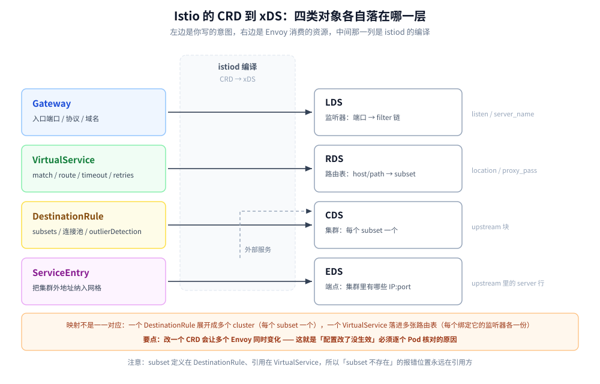
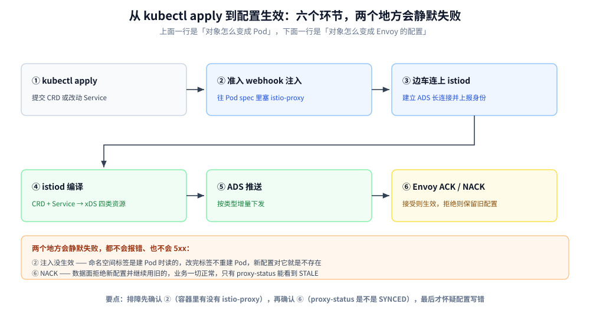

# Istio

> 覆盖：控制面落地——istiod 把 K8s 的 Service 与 CRD 编译成 Envoy 的 xDS；四类核心 CRD 各管什么、分别翻译成哪一层资源；`istioctl validate` 与 `istioctl analyze` 各查得出什么；注入失败与「配置写了不生效」的排障顺序。
>
> 不覆盖：数据面 Envoy 的参数语义（`outlier_detection`、`grpc_web`、admin 接口）见 [Envoy.md](Envoy.md)；为什么要做节点摘除、连接池与熔断的理论判据见 [节点级被动摘除.md](../../../04-架构与系统/分布式/稳定性/节点级被动摘除.md) 与 [负载均衡.md](../../../04-架构与系统/分布式/服务治理/负载均衡.md)；三个网格产品怎么选见 [容器与编排选型.md](../../../06-工程实践/部署/容器与编排选型.md) 第三节与 [README.md](README.md)。
>
> 内容整理自个人学习笔记。**实测环境：`istio/istioctl:1.24.1` + Docker Desktop 29.7.2**；第六节的四组反例用 `istioctl validate` 与 `istioctl analyze --use-kube=false` **离线真跑**，报错原文逐条照抄。⚠️ **本机未部署 K8s 集群，控制面与数据面的运行时行为（注入、xDS 下发、`proxy-config`）未取得实测读数**，相关章节只写机制与判据，见第八节。

---

## 一、一句话定位：它把 K8s 的对象编译成 Envoy 的配置

**本节要点**：Istio 自己**不转发任何请求**。控制面 istiod 只做一件事——把 Service、Endpoint 和几类 CRD 编译成 xDS 推给每个 Pod 里的 Envoy；真正接流量的是 Envoy。

| 角色 | 谁 | 做什么 | 不做什么 |
|---|---|---|---|
| 控制面 | istiod | 监听 K8s 对象 → 编译成 xDS → 推送 | 不经手任何业务流量 |
| 数据面 | 每个 Pod 里的 Envoy | 按收到的 xDS 转发、限流、加密 | 不自己判断「该怎么路由」 |
| 配置入口 | CRD + Service + 注入标签 | 声明「想要什么行为」 | 不写 Envoy 配置 |

这条分工有一个直接推论：**你写的是「意图」，不是「配置」**。想验证「我的意图有没有变成 Envoy 的配置」，要看的是 Envoy 的 `config_dump`，而不是自己写的 YAML——这正是 [Envoy.md](Envoy.md) 第八节那套排查手段在这里依然适用的原因。

## 二、核心概念：四类 CRD 与它们各自落在哪一层

**本节要点**：四类 CRD 不是并列关系，而是**分别落在 xDS 的不同层**——这解释了为什么改 `VirtualService` 能动路由但动不了连接池，改 `DestinationRule` 能动连接池却动不了路由。

| CRD | 管什么 | 编译成 | nginx 里的对应物 |
|---|---|---|---|
| **Gateway** | 入口监听哪个端口、什么协议、哪些域名 | 独立的 ingress gateway Deployment + **LDS** | `listen` + `server_name` |
| **VirtualService** | host / path / header 命中后走哪个 subset，超时与重试 | **RDS**（路由表） | `location` + `proxy_pass` |
| **DestinationRule** | 每个 subset 的连接池、LB 策略、被动摘除、mTLS 模式 | **CDS**（集群定义）+ **EDS** 的解读方式 | `upstream` 块 |
| **ServiceEntry** | 把集群外的地址纳入网格 | **CDS / EDS** | 手写的 `upstream` |



图上左边是你写的对象、右边是 Envoy 真正消费的资源，中间那列是 istiod 的编译动作。**映射不是一一对应**：一个 `DestinationRule` 会展开成多个 cluster（每个 subset 一个），一个 `VirtualService` 会落进多张路由表（每个绑定它的监听器一份）——这就是「改一个 CRD、多个 Envoy 同时变化」的来源。

### 2.1 VirtualService 与 DestinationRule 的分工

**本节要点**：判据只有一句——**「这一次请求该去哪」写 VirtualService，「那一群实例怎么连」写 DestinationRule**。前者按请求算，后者按集群算。

| 维度 | VirtualService | DestinationRule |
|---|---|---|
| 作用对象 | 一次请求（按 host / path / header 匹配） | 一个 host 下的所有实例 |
| 典型字段 | `match`、`route`、`timeout`、`retries`、`fault` | `subsets`、`trafficPolicy`（连接池、LB、`outlierDetection`） |
| 生效范围 | 只对**绑定它的**监听器生效 | 对整个网格里访问该 host 的流量生效 |
| 写错的后果 | 路由不命中，走到默认路由或 404 | 连接池与摘除参数静默失效（见 6.1） |

⚠️ **最容易混的一处**：`subset` 这个名字两边都出现，但**定义在 DestinationRule、引用在 VirtualService**。所以「subset 不存在」这类错误的根因永远在 DestinationRule 那一侧，而报错位置永远在 VirtualService 那一行——第 6 节的反例会把这个错位演示一遍。

### 2.2 为什么必须分成两半

因为两者的**变更频率和生效范围**不同。路由规则（灰度比例、header 匹配）通常按发布节奏一天改几次，只影响一个服务；连接池与摘除参数（`maxEjectionPercent`、`http2MaxRequests`）属于稳定性基线，几个月才调一次，却对全网格生效。合成一个对象的话，改一次灰度就要重推所有集群的连接池配置。

## 三、整体架构：控制面、数据面与注入三块

**本节要点**：Istio 的「无侵入」不是魔法，是**在 Pod 创建时改掉 Pod spec**——注入发生在准入阶段，业务镜像一行代码都不用改，代价是每个 Pod 多一个容器。



图上上下两行的分界很关键：**上面一行只发生一次**（Pod 创建时），**下面一行每次改配置都重来一遍**。所以「昨天还好、今天不生效」和「从来就没生效过」是两类问题，前者查 ⑥，后者查 ②。

### 3.1 istiod 的三个职责

| 早期组件 | 现在的职责 | 干什么 |
|---|---|---|
| Pilot | 服务发现与 xDS | 监听 Service / Endpoint / CRD，编译成 LDS/RDS/CDS/EDS 推送 |
| Citadel | 身份与证书 | 给每个工作负载签发证书，配合 SDS 下发，支撑 mTLS |
| Galley | 配置校验 | 校验 CRD 合法性（已并入 istiod） |

1.5 之后三者合并成单个 `istiod` 进程——**这带来一个运维上的变化**：以前可以分别扩容 `pilot` 与 `citadel`，现在是同一个 Deployment，扩副本就是全扩。

### 3.2 注入：改的是 Pod spec

注入由 `istio-sidecar-injector` 这个 **mutating admission webhook** 完成：Pod 创建时被拦一道，往 spec 里塞进两样东西——一个 `istio-init`（配 iptables 把流量导向 Envoy）和一个 `istio-proxy`（Envoy 本体）。

⚠️ 注入判据看**命名空间标签 + Pod 注解**两层：

```bash
# 命名空间级：给整个 ns 打上，之后创建的 Pod 自动注入
kubectl label namespace default istio-injection=enabled

# Pod 级：在 spec.template.metadata.annotations 里单独指定
#   sidecar.istio.io/inject: "true"   强制注入
#   sidecar.istio.io/inject: "false"  排除这一个
```

**判断注入到底生效没有，只有一个可靠办法**：看容器数。`kubectl get pod <名> -o jsonpath='{.spec.containers[*].name}'` 里有 `istio-proxy` 才算注入成功——光看命名空间标签不够，因为标签是在**创建时**读的，**已经存在的 Pod 不会补注入**，必须重建。

### 3.3 配置怎么到达数据面

istiod 通过 gRPC 长连接（ADS）把四类资源推给每个 Envoy。数据面对每份配置回一个 ACK 或 NACK：

| 数据面状态 | 含义 | 排查含义 |
|---|---|---|
| `SYNCED` | 已收到并接受 | 配置到了 |
| `NOT SENT` | 控制面没推 | 控制面认为没变化，或压根没匹配到 |
| `STALE` | 推了但没回 ACK | 数据面卡住或过载 |
| NACK | 收到了但拒绝 | 配置有错，**数据面继续用旧配置** |

⭐ 关键推论：**NACK 不会让服务崩，也不会让你看到 5xx**——它只是让新配置不生效。所以「配置改了没反应」这一类故障，第一现场在 `istioctl proxy-status` 的 NACK/STALE，而不是业务日志。这和 [Envoy.md](Envoy.md) 第 2.2 节讲的「拒绝这份配置并保留旧配置」是同一件事，只是一个从控制面看、一个从数据面看。

## 四、部署：profile 与注入标签

**本节要点**：profile 决定**装哪些组件**，注入决定**哪些 Pod 带边车**。两件事互不影响，但顺序有依赖——先装完控制面，打注入标签才有意义。

### 4.1 五种 profile

| profile | 装什么 | 用在哪 |
|---|---|---|
| `minimal` | 只有 istiod | 自己搭入口网关、只要 mTLS 与路由 |
| `default` | istiod + `istio-ingressgateway` | 生产起步 |
| `demo` | 全家桶 + 高日志 + 大采样率 | 学习与演示，**不要上生产** |
| `ambient` | 无 sidecar 模式（ztunnel + waypoint） | 想省掉边车开销时 |
| `empty` | 什么都不装 | 配合 `IstioOperator` 精细定制 |

```bash
# 装控制面（本机无集群，以下命令未实跑，仅示形态）
istioctl install --set profile=default -y

# 装之前先看它会改什么，这一步最省事
istioctl manifest generate --set profile=default | kubectl diff -f -
```

⚠️ `demo` 与 `default` 的差别不只是组件数：`demo` 把访问日志、追踪采样率都调到很大，**直接搬到生产会先被日志打满磁盘**。

### 4.2 注入与不进网格

| 需求 | 做法 |
|---|---|
| 整个命名空间进网格 | `kubectl label namespace <ns> istio-injection=enabled` |
| 只让某几个 Pod 进 | 命名空间不打标签，Pod 注解 `sidecar.istio.io/inject: "true"` |
| 整个命名空间不进，个别例外 | 命名空间打 `disabled`，例外 Pod 注解 `true` |
| 只给一个 Pod 关掉 | Pod 注解 `sidecar.istio.io/inject: "false"` |

两种标签是**互斥**的：`istio-injection=enabled` 与 `istio.io/rev=<revision>` 只能用一个，同时打会得到一条警告并只用其中一个。

## 五、使用：一份最小可用的路由配置

**本节要点**：一份能跑灰度的配置只需要两个对象——`VirtualService` 决定「怎么分」，`DestinationRule` 定义「分到哪几组」。两者缺一，subset 就不存在。

### 5.1 VirtualService 的五个字段

```yaml
apiVersion: networking.istio.io/v1
kind: VirtualService
metadata:
  name: reviews
  namespace: default
spec:
  hosts: ["reviews"]
  http:
  - match:
    - headers:
        end-user:
          exact: jason
    route:
    - destination:
        host: reviews
        subset: v2
    timeout: 2s
    retries:
      attempts: 3
      perTryTimeout: 500ms
      retryOn: 5xx
```

| 字段 | 语义 | 写错的典型表现 |
|---|---|---|
| `hosts` | 这份规则作用于哪些 host | 匹配不上就走默认路由，看起来「规则没生效」 |
| `match` | 请求级条件（header / uri / method / sourceLabels） | 顺序敏感，第一条命中即停 |
| `route` | 命中去哪个 `host + subset`，可带 `weight` | subset 未定义 → 6.1 的 `IST0101` |
| `timeout` | 整条路由的超时 | 与 `retries` 相乘，见下 |
| `retries` | 重试次数、单次超时、可重试条件 | 与外层超时叠加，放大总耗时 |

⚠️ **`timeout` 与 `perTryTimeout` 是相乘关系，不是取大**：`attempts: 3` + `perTryTimeout: 500ms` 在最坏情况下是 1.5 秒，再叠上 `timeout: 2s` 才会被截断。重试预算怎么算见 [重试与超时.md](../../../04-架构与系统/分布式/稳定性/重试与超时.md)。

### 5.2 DestinationRule 的三个块

```yaml
apiVersion: networking.istio.io/v1
kind: DestinationRule
metadata:
  name: reviews
  namespace: default
spec:
  host: reviews
  subsets:
  - name: v1
    labels: { version: v1 }
  - name: v2
    labels: { version: v2 }
  trafficPolicy:
    connectionPool:
      http:
        http1MaxPendingRequests: 100
        http2MaxRequests: 1000
    outlierDetection:
      consecutive5xxErrors: 5
      interval: 10s
      baseEjectionTime: 30s
      maxEjectionPercent: 50
```

| 块 | 编译到哪 | 说明 |
|---|---|---|
| `subsets` | 每个 subset 一个 **CDS cluster** | subset 的名字就是 VirtualService 里引用的名字 |
| `connectionPool` | cluster 的连接池上限 | 对应 Envoy 的连接池，不是限流 |
| `outlierDetection` | cluster 的 `outlier_detection` | **字段名与 Envoy 不同**：`consecutive5xxErrors` 对应 Envoy 的 `consecutive_5xx`，`baseEjectionTime` 对应 `base_ejection_time` |

⭐ 最后一行的对照关系是排查时的关键：[Envoy.md](Envoy.md) 第 5.4 节那个「`maxEjectionPercent: 100` 反而一个都不摘」的坑，在 Istio 里**一模一样**存在——因为参数只是换了名字，最后落的还是 Envoy 那个 cluster 字段。

### 5.3 灰度的两把刀

| 方式 | 配置 | 适用 |
|---|---|---|
| 按比例 | `route: [{destination: {subset: v1}, weight: 90}, {destination: {subset: v2}, weight: 10}]` | 无差别放量 |
| 按特征 | `match: [{headers: {end-user: {exact: jason}}}]` 单独一条路由指向 v2 | 内部员工先试 |

两把刀可以叠：先按特征拦一条精确路由，剩下的按权重分。**顺序必须在 `http` 数组里体现**——数组是从上到下匹配，第一条命中即停。

## 六、离线校验：两个命令各查什么

**本节要点**：`validate` 查**字段名与类型**（proto 解析），`analyze` 查**引用关系**（host / subset / gateway 存不存在）。**两者都只查一半，必须都跑**。

四组反例，全部用 `istio/istioctl:1.24.1` 离线真跑（`--use-kube=false`）：

| 反例 | `istioctl validate -f` | `istioctl analyze --use-kube=false` |
|---|---|---|
| `subset: v3` 未在 DestinationRule 定义 | ✅ `is valid` | ❌ `IST0101 Referenced host+subset in destinationrule not found: "reviews+v3"` |
| `gateways: ["public-gw"]` 未定义 | ✅ `is valid` | ❌ `IST0101 Referenced gateway not found` + ⚠️ `IST0132` 警告 |
| 字段名拼成 `outlierDetections` | ❌ `unknown field "outlierDetections" in istio.networking.v1alpha3.TrafficPolicy` | ✅ **`No validation issues found`** |
| `maxEjectionPercent: twenty`（类型错） | ❌ `cannot parse proto message: invalid character 'w' in literal true` | ⚠️ **报成 `subset` 不存在** |

⭐ 第三、四行是这张表的价值所在：

- **`analyze` 不做 schema 校验**。字段名拼错、类型写错，它都能放过——这和 [Envoy.md](Envoy.md) 第 2.3 节那个「`name` 拼错、validate 放行」是同一类陷阱：**校验工具只查它负责的那一层**。
- **类型写错时 `analyze` 会把你带偏**。`maxEjectionPercent: twenty` 让整个 DestinationRule 解析失败，`analyze` 于是认为这个 DR 不存在，报出的却是「VirtualService 引用的 subset 找不到」——**报错位置在 VS、根因在 DR**，正是 2.1 说的那个错位。

> 一个容易误会的小细节：报错里的类型名是 `istio.networking.v1alpha3.TrafficPolicy`，而 YAML 里写的是 `apiVersion: networking.istio.io/v1`。这不是版本写错——**CRD 的 API 版本与内部 proto 包名不是一回事**，v1 对象在工具链里仍走同一套 proto 定义。不要为了「对齐报错」把 apiVersion 改回 v1alpha3。

### 6.1 排查顺序：先 validate，再 analyze

```bash
# ① 查字段与类型：这一步不过，后面的引用检查全是噪音
istioctl validate -f reviews.yaml

# ② 再查引用关系：host / subset / gateway 存不存在
istioctl analyze --use-kube=false reviews.yaml

# ③ 有集群时再加一步：连不上集群的配置，analyze 也看不出来
istioctl analyze -n default
```

⚠️ 顺序不能反。先跑 `analyze` 的话，字段错误会被包装成「引用找不到」，你会顺着 subset 去查一个根本没写错的 subset。

## 七、验证与排查

**本节要点**：先确认**注入生效**，再确认**配置到达**，最后才查**配置对不对**。三步顺序反了，就会在「配置写错」上白查很久，而真正的问题是边车压根没注入。

### 7.1 先确认三件事

| 要确认的 | 命令 | 通过的样子 |
|---|---|---|
| 边车注入了没 | `kubectl get pod <名> -o jsonpath='{.spec.containers[*].name}'` | 输出里有 `istio-proxy` |
| 配置到了没 | `istioctl proxy-status` | 目标 Pod 那一行是 `SYNCED` |
| 到数据面成了什么 | `istioctl proxy-config routes <pod>`、`... cluster <pod>` | 能看到你写的 host / subset |

### 7.2 常见故障速查

| 症状 | 先查什么 |
|---|---|
| 规则完全没生效 | Pod 里有没有 `istio-proxy`（3.2）；命名空间标签是**建 Pod 时**读的，改标签要重建 Pod |
| `proxy-status` 显示 STALE / NACK | 配置推了但被拒；看 istiod 日志里的 NACK 原因，数据面仍在用旧配置（3.3） |
| `IST0101 ... subset not found` | DestinationRule 里 subset 名字对不对；也可能是 DR 整体解析失败（6.1 第四行） |
| `istioctl analyze` 说没问题但行为不对 | 字段名/类型错被放过了，补跑 `istioctl validate`（第六节） |
| 改了 `DestinationRule` 的摘除参数没反应 | 参数落到 Envoy cluster；按 [Envoy.md](Envoy.md) 第 5.4 节查 `max_ejection_percent` 与 overflow |
| 入口 404、Pod 之间正常 | Gateway 没绑上：`VirtualService.spec.gateways` 与 Gateway 的 selector / 端口对不上 |
| 两个命名空间的配置互相看不见 | `VirtualService` 的 `hosts` 写短名时只在**本命名空间**解析，跨命名空间要写全名 `<svc>.<ns>.svc.cluster.local` |

## 八、校验口径

> ✅ 本篇内容的校验方式与范围（Windows 11 + Docker Desktop 29.7.2）：

- **真跑通**：第六节四组反例，`istioctl validate` 与 `istioctl analyze --use-kube=false` 各 4 次，共 8 次调用，报错原文逐条照抄；基线配置 `01-good.yaml` 两个命令均通过
- **只做静态核对**：第三、四、七节的机制描述（注入 webhook、ADS 的 ACK/NACK、`proxy-status` 状态值、profile 组成）**未在本机运行验证**——本机没有 K8s 集群，`istioctl install` / `kubectl` 相关命令均未执行
- **未实测**：① 实际注入（需要集群与镜像拉取）；② xDS 真实下发与 NACK 复现；③ `istioctl proxy-config` 的输出形态；④ `ambient` 模式；⑤ 版本差异（`networking.istio.io/v1` 的可用版本边界随 Istio 版本变化，跨版本行为需按官方 release note 核对）
- **实验台**：`.workbuddy/tmp/istio-lab/`（不入库），6 份 YAML 可直接复跑

| 依赖 | 实际版本 |
|---|---|
| istioctl | `1.24.1`（镜像 `istio/istioctl:1.24.1`） |
| Docker | 29.7.2 |
| Kubernetes | 未部署（见上） |

## 延伸追问

- **`istioctl analyze` 通过就等于配置没问题吗？** → 不等于。它不查字段名与类型，`outlierDetections` 这种拼写错误会被静默放过；反过来字段类型错时它还会把原因错报成「subset 不存在」。两个命令都要跑，且先 `validate` 后 `analyze`。
- **为什么 subset 定义在 DestinationRule，却总在 VirtualService 那一行报错？** → 因为错的是「引用」而不是「定义」，分析器的报错位置跟引用走。根因永远在 DR：要么 subset 名不对，要么整个 DR 因为字段错误没被解析。
- **`VirtualService` 的 `timeout` 和 `perTryTimeout` 是什么关系？** → 相乘。`attempts × perTryTimeout` 决定重试阶段能拖多久，`timeout` 是整条路由的硬上限。两者都不设时，超时由上游自行决定。
- **改了标签为什么老 Pod 没进网格？** → 注入发生在 Pod **创建**时的准入阶段，标签是那一刻读的。改完命名空间标签必须重建 Pod。
- **`DestinationRule` 的 `outlierDetection` 和 Envoy 的 `outlier_detection` 是两套东西吗？** → 是同一套，只是 Istio 换了字段名做了一层封装，最终落到 cluster 的同名配置上。所以 Envoy 侧那些反直觉行为（比如 `maxEjectionPercent: 100` 反而不摘）在这里完全适用。

## 关联

- **上游/总纲**：[README.md](README.md) — 服务网格的三面分工、三个产品的落地形态差异
- **上游/总纲**：[容器与编排选型.md](../../../06-工程实践/部署/容器与编排选型.md) — 要不要上网格、Istio / Linkerd / Cilium 怎么选
- **对照/互补**：[Envoy.md](Envoy.md) — 数据面：本篇编译出来的 xDS 在 Envoy 里怎么消费、怎么排障
- **对照/互补**：[网关选型对比.md](../网关与代理/网关选型对比.md) — 不用网格时这些能力怎么在 nginx / API 网关上拼
- **下游机制**：[节点级被动摘除.md](../../../04-架构与系统/分布式/稳定性/节点级被动摘除.md) — `outlierDetection` 背后的连续失败、冷却与探测租约
- **下游机制**：[重试与超时.md](../../../04-架构与系统/分布式/稳定性/重试与超时.md) — `timeout` 与 `perTryTimeout` 的重试预算怎么算
- **下游机制**：[负载均衡.md](../../../04-架构与系统/分布式/服务治理/负载均衡.md) — subset 与 LB 策略的分层
