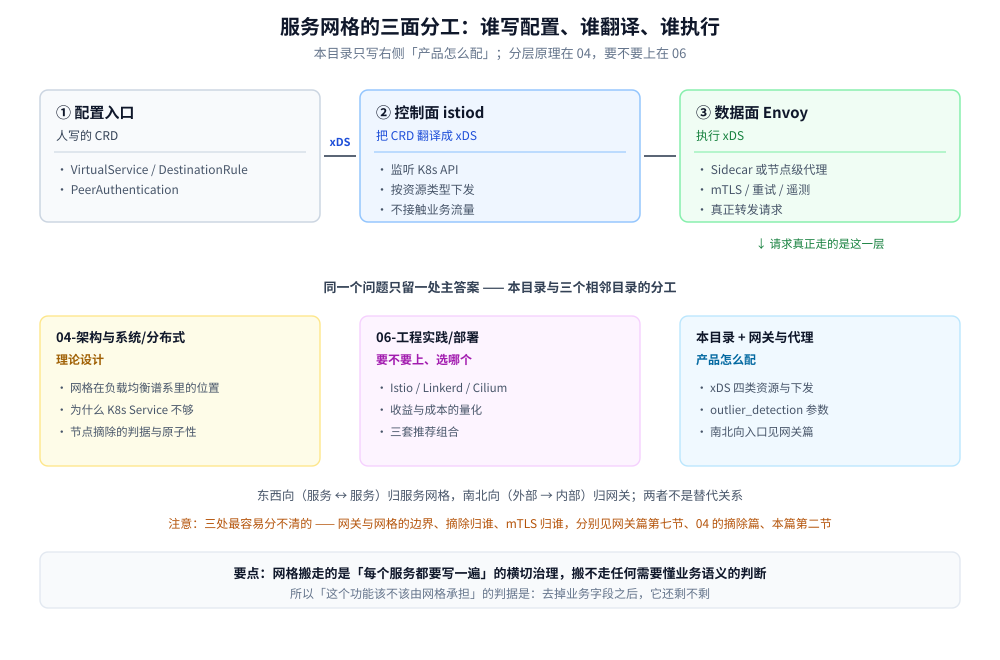

# 服务网格

> 覆盖：服务网格的**落地形态**——三个主流产品分别在控制面、数据面、配置入口上用什么实现，这些差异决定了迁移时哪些规则能搬、哪些要重写；以及 Sidecar 注入、排障顺序这些只有真上过线才会撞到的事。本目录按「产品怎么配」组织，不重复原理推导。
>
> 不覆盖：网格在负载均衡谱系里处于哪一层、为什么 K8s 的 Service 覆盖不到请求级，见 [负载均衡.md](../../../04-架构与系统/分布式/服务治理/负载均衡.md) 第六节；**要不要上网格、Istio / Linkerd / Cilium 怎么选**，见 [容器与编排选型.md](../../../06-工程实践/部署/容器与编排选型.md) 第三节；网关与网格的边界（南北向 vs 东西向），见 [网关选型对比.md](../网关与代理/网关选型对比.md) 第七节。
>
> 内容整理自个人学习笔记，素材见 [素材清单](../../../素材清单.md)。

---

## 一、服务网格从业务代码里搬走了哪四件事？

**本节要点**：网格搬走的是「每个服务都要写一遍」的横切治理，搬不走任何需要懂业务语义的判断。这是判断「这个功能该不该由网格承担」的唯一判据——**去掉业务字段之后它还剩不剩**。

| 能力 | SDK 时代写在哪 | 网格里写在哪 | 搬走的收益 | 搬不动的边界 |
|---|---|---|---|---|
| mTLS / 服务身份 | 每个服务的 HTTP 客户端各配一遍 | Sidecar 与 Sidecar 之间 | 语言无关，私钥不进业务进程 | 业务自己的**鉴权**（谁能调这个接口）搬不走 |
| 重试 / 超时 / 熔断 | 每个服务的框架配置 | Sidecar 的出站配置 | 一处配置、全站统一口径 | **该不该重试**要业务判断（非幂等写操作不能重试） |
| 遥测（指标 / 追踪） | 每个服务埋点 | Sidecar 旁路采集 | 零侵入、覆盖到协议层 | 业务指标（下单数、支付成功率）搬不走 |
| 流量切分 / 灰度 | 网关配置或代码开关 | 路由规则（按 header / 权重） | 不改代码就能切 | 灰度到哪一步算「可放量」是业务判断 |

⭐ 一句话：**这四件事的共同点是「与业务无关、但每个服务都要做」，网格把它们的实现从 N 份收敛成 1 份。**

## 二、控制面、数据面、配置入口是三件不同的事

**本节要点**：最常见的误解是「控制面也转发流量」。它不转发——**控制面只生产配置，数据面才执行**；控制面挂了，已有连接照常工作，只是新配置下发不出去。



| 角色 | 由谁担任 | 它做什么 | 它**不**做什么 | 配错时的表现 |
|---|---|---|---|---|
| 配置入口 | 人写的 CRD / 注解 | 声明「想要什么」 | 不涉及实现细节 | 写对了但不生效——多半是 CRD 没被监听 |
| 控制面 | Istiod | 把 CRD 翻译成 xDS 并下发 | **不接触业务流量** | 数据面拿不到新配置，报 `no healthy upstream` |
| 数据面 | Envoy 等代理 | 按 xDS 执行转发与治理 | 不产生配置 | 大量 503、mTLS 握手失败 |

xDS 具体是哪四类资源、按什么顺序下发，见 [Envoy.md](Envoy.md) 第二节——**这四类资源的分工是所有数据面代理共用的，不只是 Envoy**。

## 三、三个产品的落地形态差异 ⭐

**本节要点**：选型对比回答「选哪个」（在 06），本节回答「选完之后你会面对什么」——数据面用什么、配置要写多少、出问题从哪看。**这三件事直接决定迁移成本**。

| 维度 | Istio | Linkerd | Cilium |
|---|---|---|---|
| 数据面实现 | **Envoy**（C++） | 自研 micro-proxy（Rust） | **eBPF**（L3/L4，内核内）+ Envoy（L7） |
| 注入形态 | Sidecar，或 Ambient 模式（ztunnel + waypoint） | Sidecar | **无 Sidecar**，per-node agent |
| 配置抽象 | CRD 多（VirtualService / DestinationRule / PeerAuthentication / AuthorizationPolicy …） | CRD 少，大部分行为**自动**生效 | CRD（CiliumNetworkPolicy 等） |
| 能力广度 | 最全：故障注入、流量镜像、Wasm 插件 | 少而精：mTLS / 重试 / 超时 / 遥测 | 网络与安全最强，L7 治理相对弱 |
| 排障入口 | `istioctl proxy-config` / Envoy admin 端口 | `linkerd viz` | `hubble` |
| 单 Pod 额外开销 | 最高（一个 Envoy 进程） | 低 | 最低（不在用户态加进程） |

⭐ **这张表最有用的读法是反着读**：迁移时「配置抽象」那一行决定工作量——从 Istio 迁到 Linkerd，大部分 VirtualService 规则**没有对应物**，要退化成代码或网关配置；从 Linkerd 迁到 Istio 则相反，能接住的更多但要重写一遍。

> ⚠️ **本表为产品形态整理，未在本机集群实测**。本机不具备可用的 K8s 集群，表中「开销」「注入形态」取自各项目官方文档；能实测的是 Envoy 单体的行为，以及 `istioctl` 的离线校验（`validate` / `analyze --use-kube=false`），分别见 [Envoy.md](Envoy.md) 与 [Istio.md](Istio.md) 的校验口径。

## 四、本目录怎么读

| 想解决 | 读哪 |
|---|---|
| 控制面的 CRD 怎么写、编译成哪层 xDS、`validate` 与 `analyze` 各查什么 | [Istio.md](Istio.md) |
| Envoy 的 xDS 四类资源、`outlier_detection` 参数、`grpc_web` 怎么配 | [Envoy.md](Envoy.md) |
| 要不要上网格、三个产品怎么选 | → [容器与编排选型.md](../../../06-工程实践/部署/容器与编排选型.md) 第三节（本目录不重复） |
| 网格在负载均衡谱系里在哪一层、与 Ingress 的分工 | → [负载均衡.md](../../../04-架构与系统/分布式/服务治理/负载均衡.md) 第六节 |
| 南北向入口该用什么、网关够不够 | → [网关选型对比.md](../网关与代理/网关选型对比.md) |

## 五、与相邻目录的边界

**本节要点**：按「**理论设计归 04、落地工具归 03**」这一条切，边界只有一句话——04 回答「该由哪一层负责」，03 回答「这个产品怎么配」。

| 目录 | 它回答的问题 | 换个产品这句话还成立吗 | 主答案在哪 |
|---|---|---|---|
| [README.md](../../../04-架构与系统/分布式/README.md)（04 分布式） | 网格在整个负载均衡谱系里处于哪一层、为什么 K8s Service 只到连接级、节点摘除的判据与原子性 | ✅ 成立（与产品无关） | 04 的各零件篇 |
| [容器与编排选型.md](../../../06-工程实践/部署/容器与编排选型.md)（06 部署） | 要不要上、三个产品怎么选、收益与成本怎么算 | ✅ 成立（跨产品） | 该篇第三节 |
| 本目录 + [网关与代理](../网关与代理/)（03 中间件） | xDS 四类资源怎么下发、`outlier_detection` 参数怎么取、南北向入口怎么选 | ❌ 换产品就作废 | 本目录 / 网关篇 |

> ⭐ 一条实操判据：**写的时候如果发现自己正在解释「为什么」，那是 04 的地盘；在解释「怎么配」和「报错长什么样」，才是这里。**

## 六、落地时最先撞上的三件事

### 6.1 Sidecar 注入没生效

三类常见原因，按排查成本从低到高：

| 原因 | 判据 | 处置 |
|---|---|---|
| 命名空间没打标签 | `kubectl get ns` 的 labels 里看不到注入标签 | 补上标签后**重建 Pod**（改标签不影响已运行的 Pod） |
| Pod 用了 `hostNetwork: true` | `kubectl get pod -o yaml` 里 `hostNetwork` 为 true | 注入会被跳过，这类 Pod 只能靠节点级代理（Ambient / Cilium）覆盖 |
| Pod 模板上有显式关闭的注解 | 模板里有 `sidecar.istio.io/inject` 且值为 `false` | 去掉注解；注意**注解在 Pod 模板上，不在 Deployment 元数据上** |

### 6.2 排障的固定顺序

**本节要点**：先确认「配置到没到」，再看「执行对不对」。顺序反了会在数据面里找半天，最后发现配置根本没下发。

```text
① 配置被控制面接收了吗？  → istioctl analyze / CRD 的 status
② 数据面拿到配置了吗？    → config_dump 里搜不到这条路由 = 没下发
③ 拿到了为什么还不通？    → stats 里对应 cluster 的连接失败计数
④ 通了但结果不对？        → access log 看实际命中的 route 与 upstream
```

> ⚠️ **`config_dump` 与 `stats` 的分界**是排障里最省时间的一条：`config_dump` 里没有 → **配置问题**（控制面 / CRD）；`config_dump` 里有但 `stats` 报失败 → **连接问题**（mTLS / 端口 / 网络策略）。

### 6.3 开销与延迟从哪来

Sidecar 把一次调用从**两跳变四跳**（出站一侧、入站一侧各一次代理），这是网格成本的物理来源，不是实现缺陷。Cilium 的 eBPF 方案之所以开销低，正是因为它不把这两跳搬到用户态。

> ⚠️ 本节未在本机集群实测；延迟与内存的具体量级需按实际集群压测，不要引用二手数字。

## 延伸追问

- **控制面挂了，业务会不会中断？** → 不会。已有连接与已下发的配置都在数据面本地，业务照常；受影响的是**新配置下发**与**新 Pod 的注入**。这正是控制面可以独立于业务路径部署的原因。
- **网格能不能替代网关？** → 不能。网格管东西向（服务 ↔ 服务），网关管南北向（外部 → 内部）。Istio 的 `Gateway` 资源虽然叫 Gateway，本质仍是入口代理的配置，与 API 网关的插件生态不是一回事，判据见 [网关选型对比.md](../网关与代理/网关选型对比.md) 第七节。
- **有了网格还要不要在代码里写重试？** → 要区分「传输层重试」和「业务重试」。网格的重试在 HTTP 层，只对**幂等且确定没被处理**的请求安全；涉及扣款、下单这类非幂等操作的补偿，必须由业务自己做。
- **为什么 Linkerd 不用 Envoy？** → 它选择自研 micro-proxy（Rust），换来更小的内存与更简单的运维面，代价是**没有 Envoy 那套生态**（Wasm 插件、丰富的 filter 链）。这就是第三节「配置抽象」与「能力广度」两行的由来。

## 关联

- **上游/总纲**：[中间件选型.md](../中间件选型.md) — 治理族里「服务网格」这一子类的定位
- **上游/总纲**：[容器与编排选型.md](../../../06-工程实践/部署/容器与编排选型.md) — 要不要上网格、三个产品怎么选
- **下游机制**：[Envoy.md](Envoy.md) — 数据面代理的 xDS、摘除参数与 gRPC 转码
- **对照/互补**：[网关选型对比.md](../网关与代理/网关选型对比.md) — 南北向入口，与网格的东西向分工
- **对照/互补**：[负载均衡.md](../../../04-架构与系统/分布式/服务治理/负载均衡.md) — 网格在负载均衡谱系里的位置（第六节）
- **下游机制**：[节点级被动摘除.md](../../../04-架构与系统/分布式/稳定性/节点级被动摘除.md) — 摘除的判据与原子性，`outlier_detection` 的理论依据
- **下游机制**：[服务发现.md](../../../04-架构与系统/分布式/服务治理/服务发现.md) — 服务身份与 xDS 里的端点来源
