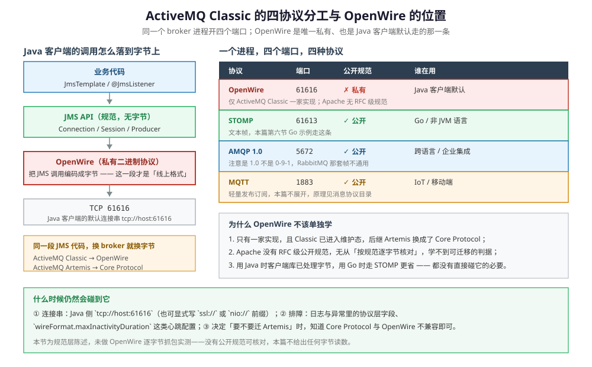

# ActiveMQ 协议

> 覆盖 ⭐ **JMS 与 OpenWire 的分层关系**（JMS 只规定接口语义，OpenWire 才是字节层）、同一 broker 进程四个数据端口的分工、STOMP 帧的五段结构及其在 ActiveMQ 上的 `/queue` `/topic` 约定、AMQP 1.0 与 0-9-1 为什么不能混用，以及 OpenWire 为什么不该单独学。
>
> 不覆盖：JMS 规范本身（三层约束、两个域、四种确认模式）见 [JMS规范.md](../JMS规范.md)；STOMP 的 13 种命令与转义规则见 [STOMP.md](../../../../02-计算机基础/网络/消息协议/STOMP.md)；AMQP 的二进制帧见 [AMQP.md](../../../../02-计算机基础/网络/消息协议/AMQP.md)；接入代码见 [Go 接入](../../../../01-编程语言/go/工程实践/接入ActiveMQ.md)。
>
> 内容整理自个人学习笔记。**实测口径**：五个连接器及其端口、参数在本机 `apache/activemq-classic:6.1.4` 容器上从 Jolokia 读取；⚠️ **未做帧级抓包**，STOMP / AMQP 的字节结构按公开规范陈述，OpenWire 因无公开规范只作定位说明、不给字节读数。

---

## 一、JMS 和 OpenWire 是什么关系？

**本节要点**：**JMS 定义 API 语义，OpenWire 定义这些 API 调用在线上长什么样。** 两层之间没有「JMS 协议」这个东西——JMS 是 Java 接口规范，本身不产生任何字节。

| 层次 | 是什么 | 有字节吗 |
| --- | --- | --- |
| 业务代码 | `JmsTemplate` / `@JmsListener` | ✗ |
| JMS API | Connection / Session / Producer 这套接口 | ✗ **规范只规定 Java 接口与语义，不规定线上格式** |
| **OpenWire** | 把 JMS 调用编码成字节的那一层 | ✓ **这一层才是「线上协议」** |
| TCP | 61616 | ✓ |



这张图要读出的核心：**左边整列只有下面两层有字节**，上面两层是「调用」与「规范」。所以「学 JMS」和「学协议」是两件事——前者学的是对象生命周期与确认语义，后者学的是字节布局。

⭐ **它同时解释了「为什么 JMS 不是协议」**：同一段 JMS 代码，在 Classic 上跑出 OpenWire 字节，在 Artemis 上跑出 Core Protocol 字节，在 IBM MQ 上又是另一套——**规范没变，字节全变**。这正是 [JMS规范.md](../JMS规范.md) 第一节那个结论的产品侧依据。

## 二、同一进程为什么开四个端口？

**本节要点**：因为**不同语言的客户端只能讲各自会讲的协议**。broker 内部只有一套消息存储，外面却要同时接待讲四种语言的客户端——这层「翻译」由连接器承担。

| 协议 | 端口 | 公开规范 | 谁在用 | 在 ActiveMQ 上的特点 |
| --- | --- | --- | --- | --- |
| OpenWire | **61616** | ✗ 私有 | Java 客户端默认 | 只有 ActiveMQ Classic 一家实现 |
| STOMP | **61613** | ✓ 公开（1.2） | Go / Python / 非 JVM | 纯文本，`destination` 由 broker 解释 |
| AMQP | **5672** | ✓ 公开（**1.0**） | 企业集成 / 跨语言 | ⚠️ 不是 RabbitMQ 的 0-9-1 |
| MQTT | **1883** | ✓ 公开 | IoT / 移动端 | 轻量发布订阅，适合海量连接 |
| WebSocket | **61614** | ✓ 公开 | 浏览器直连 | 把上述协议之一套在 ws 上 |
| HTTP | **8161** | ✓ | 控制台 / Jolokia | 管理面，不承载业务消息 |

本机运行时实测：五个业务连接器**全部存在**，且参数一致——`maximumConnections=1000`、`wireFormat.maxFrameSize=104857600`。也就是说「协议选择」不影响连接上限，上限是每个连接器**各自**算的。

> ⭐ 一句话记忆：**ActiveMQ 的协议覆盖是「接入层」的覆盖，不是「能力层」的覆盖**。四种协议进来之后落到同一套 JMS 语义与同一个 KahaDB 上——所以 STOMP 客户端也能用 selector 和延迟属性，但只能通过 ActiveMQ 的扩展头表达。

## 三、STOMP 的帧为什么能直接手敲？

**本节要点**：STOMP 是**纯文本帧**，结构只有五段：`COMMAND` 行、headers、一个空行、body、`NUL` 结尾。没有位运算、没有二进制长度头，所以能在 telnet 里手敲——这也是非 JVM 语言接 ActiveMQ 最省事的路径。

```text
SEND
destination:/queue/order-events
content-type:application/json
order-key:ORDER_1001

{"event":"created"}
^@
```

| 段 | 规则 | 注意 |
| --- | --- | --- |
| `COMMAND` | 全大写命令名 | `CONNECT` / `SEND` / `SUBSCRIBE` / `ACK` / `NACK` / `BEGIN` / `COMMIT` / `ABORT` |
| headers | 每行 `key:value`，首个冒号分隔 | 自定义属性也走这里（上面的 `order-key`） |
| 空行 | 单独一行 | ⚠️ 是 headers 与 body 的**唯一**分界，不能省 |
| body | 任意字节 | 含 `0x00` 时必须给 `content-length` |
| `NUL` | `0x00` | 帧与帧的分界；文本里常写成 `^@` |

⚠️ **`/queue` 与 `/topic` 不是 STOMP 规范**：它们是 ActiveMQ 的约定——`/queue/xxx` 落到点对点队列，`/topic/xxx` 落到发布订阅。换成 RabbitMQ，同一个字符串会落到完全不同的内部结构。这就是「STOMP 好上手、但换 broker 就踩坑」的根源，细节见 [STOMP.md](../../../../02-计算机基础/网络/消息协议/STOMP.md)。

**JMS 特性在 STOMP 上靠 header 表达**：

| JMS 能力 | STOMP 侧写法 |
| --- | --- |
| selector | `activemq.selector` 扩展头（部分版本也认 `selector`） |
| 延迟投递 | `AMQ_SCHEDULED_DELAY` / `_PERIOD` / `_REPEAT` / `_CRON` |
| 消息分组 | `JMSXGroupID` |
| 请求-应答 | `reply-to` + `correlation-id` |
| 事务 | `BEGIN` / `COMMIT` / `ABORT`，只覆盖同一连接上的 `SEND` |

## 四、AMQP 1.0 与 0-9-1 差在哪？

**本节要点**：**端口相同不代表协议相同**。ActiveMQ 开的是 AMQP **1.0**，RabbitMQ 生态主流客户端讲的是 **0-9-1**——两者的握手、帧结构与模型都不同，客户端库不能互换。

| 维度 | AMQP 0-9-1 | AMQP 1.0 |
| --- | --- | --- |
| 模型 | 有 exchange / queue / binding 三件套 | 核心是 **connection / session / link**，路由模型交给 broker 或应用 |
| 帧 | 固定头 + channel 多路复用 | 帧带 `type` 与 `channel`，但语义层不同 |
| 类型系统 | 自定义 field table | 内建丰富的类型系统（described types） |
| 谁在用 | RabbitMQ、旧版 Qpid | ActiveMQ（5672）、Azure Service Bus、Qpid Proton |
| 客户端库 | `amqp091-go`、`pika`、`spring-rabbit` | `qpid-proton`、`azure-servicebus`、`amqp10` |

⚠️ **最常见的错误是用 RabbitMQ 的客户端去连 ActiveMQ 的 5672**：TCP 能连上，但握手第一步就失败，报错通常只写「协议不匹配」或直接断开。**选客户端库之前先确认 broker 讲的是 1.0 还是 0-9-1**。

## 五、OpenWire 为什么不该单独学？

**本节要点**：因为它**只有一家实现、没有公开规范、两条使用路径都不需要直接碰它**。它真正的价值是解释「JMS 无字节、字节由 broker 定」这件事，而不是成为一门要背的协议。

三条理由都可核验：

1. **只有一家实现**。OpenWire 不出现在 ActiveMQ Classic 之外的任何 broker 上；Artemis 换成了 Core Protocol，RabbitMQ / Kafka / Pulsar 各有自己的协议。它不满足「可被多个产品实现」这条收录判据。
2. **没有公开规范可核对**。Apache 没有发布 RFC 级的 OpenWire 规范，只有 wire format 的内部说明；任何「逐字节」的写法都无法交叉验证，所以本篇不给出字节读数。
3. **两条使用路径都不需要直接碰它**。用 Java 时客户端库（`activemq-client`）已经处理好编解码；用 Go / 其他语言时走 STOMP 更省——十几行就能收发（见 [Go 接入](../../../../01-编程语言/go/工程实践/接入ActiveMQ.md)）。

那什么时候仍然会碰到它？三种情况：**连接串**（Java 侧 `tcp://host:61616`，也可显式写 `ssl://` / `nio://` 前缀）；**排障**（日志与异常里的协议层字段，以及 `wireFormat.maxInactivityDuration` 这类心跳配置）；**决定要不要迁 Artemis**（只需知道 Core Protocol 与 OpenWire 不兼容，客户端要跟着换）。

> ⭐ 一句话记忆：**OpenWire 是「JMS 的线上编码」，不是一门需要单独学的协议**。要学协议层，学 STOMP / AMQP / MQTT 那些有公开规范的；要用 ActiveMQ，用 Java 客户端或走 STOMP。

## 应用场景

| 场景 | 走哪条协议 | 注意 |
| --- | --- | --- |
| Java / Spring 应用接入 | OpenWire 61616 | 客户端库封装好，不用碰字节 |
| Go / Python 接入 | STOMP 61613 | `destination` 前缀决定 Queue / Topic |
| IoT 海量设备 | MQTT 1883 | 连接数与心跳模型和 JMS 不同 |
| 跨企业系统集成 | AMQP 1.0 5672 | 确认对端也讲 1.0，别用 0-9-1 客户端 |
| 浏览器直连 | WebSocket 61614 | 通常再套 STOMP over ws |
| 只做监控运维 | HTTP 8161 | Jolokia 读 MBean，需带 `Origin` 头 |

## 具体使用

Java 侧连接串的几种写法（决定走哪个协议 / 传输层）：

```text
tcp://127.0.0.1:61616          OpenWire，默认
ssl://127.0.0.1:61617          需要 broker 侧另开 ssl 连接器
nio://127.0.0.1:61616          同一协议换 NIO 传输，适合大量连接
failover:(tcp://b1:61616,tcp://b2:61616)   主从 / 多 broker 自动重连
```

STOMP 侧的最小交互（按 1.2 规范书写；本机宿主未映射 61613，**未实测**）：

```text
CONNECT
accept-version:1.2
host:/
login:admin
passcode:admin
^@

SUBSCRIBE
id:1
destination:/queue/order-events
activemq.selector:order-key = 'ORDER_1001'
ack:client
^@
```

## 延伸追问

- **JMS 和 STOMP 是替代关系吗？** → 不是。JMS 是 Java 侧接口规范，STOMP 是线上帧格式。同一个 ActiveMQ 里，JMS 客户端发 OpenWire 字节，STOMP 客户端发文本帧，broker 把它们翻成同一种内部消息。
- **为什么不用 OpenWire 做跨语言接入？** → 因为没有公开规范，非 JVM 语言没有成熟客户端；自己逆向实现的成本远高于直接用 STOMP。
- **AMQP 1.0 比 0-9-1 更好吗？** → 不是优劣，是取舍：1.0 把路由模型从协议里剥离，更像「消息传输层」；0-9-1 内建 exchange/binding，开箱即用但模型固定。选哪个取决于对端生态。
- **STOMP 的 `/topic` 能替代持久订阅吗？** → 不能。持久订阅要靠客户端 ID + 订阅名，STOMP 侧要用 ActiveMQ 的扩展头表达，语义仍由 broker 决定。
- **`maxFrameSize=104857600` 意味着可以发 100MB 的消息吗？** → 技术上能过帧层，但不建议：KahaDB 对大消息极不友好（见 [核心概念与架构.md](核心概念与架构.md) 第二节），大文件应放对象存储、消息里只传引用。

## 关联

- **上游/总纲**：[README.md](README.md) — 本册导读与实测坐标
- **上游/总纲**：[核心概念与架构.md](核心概念与架构.md) — KahaDB 单 store 与对象模型
- **对照/互补**：[STOMP.md](../../../../02-计算机基础/网络/消息协议/STOMP.md) — 帧结构、13 种命令与 `content-length` 定界
- **对照/互补**：[AMQP.md](../../../../02-计算机基础/网络/消息协议/AMQP.md) — 二进制帧与通道多路复用
- **对照/互补**：[JMS规范.md](../JMS规范.md) — JMS 为什么不是协议
- **对照/互补**：[Kafka协议.md](../Kafka/Kafka协议.md) — 另一种「私有协议 + 版本协商」的取舍
