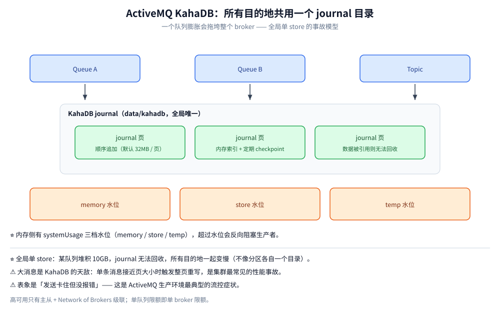
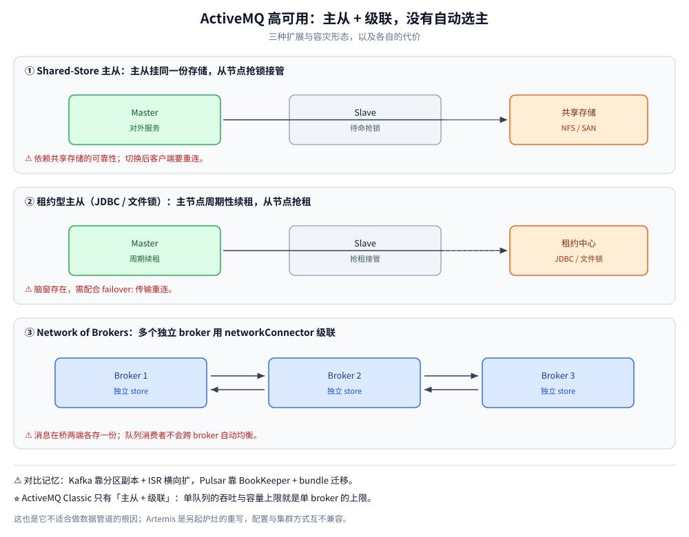

# 核心概念与架构

> 覆盖 ActiveMQ Classic 的对象模型（JMS 术语与通用 MQ 词汇的对照）、KahaDB 为什么是「一个 broker 一个 store」、`systemUsage` 三档水位如何反向阻塞生产者，以及主从 / 租约 / Network of Brokers 三种高可用形态的代价。
>
> 不覆盖：Queue / Topic 怎么分发、`JMSXGroupID` 与 prefetch 见 [消息类型与消费语义.md](消息类型与消费语义.md)；ACK、重投与 DLQ 见 [消息可靠性.md](消息可靠性.md)；四个端口上的协议见 [ActiveMQ协议.md](ActiveMQ协议.md)；Java / Go 接入代码见 [Java 接入](../../../../01-编程语言/java/工程实践/接入ActiveMQ.md) 与 [Go 接入](../../../../01-编程语言/go/工程实践/接入ActiveMQ.md)。
>
> 内容整理自个人学习笔记。**实测口径**：KahaDB 的目录结构、水位指标与连接器清单在本机 `apache/activemq-classic:6.1.4` 单机容器 `activemq-lab` 上读取；主从与级联**未搭建**（单容器），按官方配置模型陈述。

---

## 一、ActiveMQ 的文档为什么像「另一门语言」？

**本节要点**：ActiveMQ 的配置与报错全部使用 **JMS 词汇**，而 JMS 是一套**接口规范**，不是通用 MQ 术语。先把下面这张对照表记住，看 `activemq.xml` 才不会像看天书。

| JMS / ActiveMQ 术语 | 通用 MQ 对应物 | 说明 |
| --- | --- | --- |
| Destination（Queue / Topic） | Topic / Exchange+Queue | Queue 竞争消费；Topic 每订阅者一份，**离线即丢**（除非持久订阅） |
| Connection | 客户端连接 | 重量对象，内含 IO 线程；**进程内只建一次** |
| Session | 会话 / 事务边界 | 生产与确认的最小单位；`createSession(true, SESSION_TRANSACTED)` 开启本地事务 |
| MessageProducer / MessageConsumer | Producer / Consumer | 由 Session 创建，绑定一个 Destination |
| `DeliveryMode.PERSISTENT` | 持久化消息 | 非持久消息只进内存目的地，broker 重启即丢 |
| Durable Subscription | 持久订阅 | Topic 上「离线期间消息也给我留着」的订阅，用客户端 ID + 订阅名标识 |
| Selector | 服务端过滤 | SQL92 子集，按消息属性过滤；**被过滤掉的消息仍占队列空间** |
| AcknowledgeMode | ack 语义 | `AUTO_ACKNOWLEDGE` / `CLIENT_ACKNOWLEDGE` / `DUPS_OK_ACKNOWLEDGE` 三档 |
| `ActiveMQ.DLQ` | 死信队列 | 重投超过 `maximumRedeliveries`（默认 6）后进这里 |
| Temporary Queue | 临时队列 | 连接断开自动删除，是 Request-Reply 的标准载体 |
| Advisory Message | 系统事件 | broker 自身事件（消费者上下线、慢消费者）以消息形式发布，可关 |

**对象之间的创建关系是固定的**：`ConnectionFactory → Connection → Session → Producer / Consumer`，每一层都是上一层的子对象，`close()` 必须自下而上。这也是为什么客户端里把 `Connection` 做成单例、把 `Session` 留给每次业务操作——前者是长活资源，后者是事务边界。

> ⚠️ **铁律：JMS 是规范，行为由 broker 决定。** 同一个 `receive(5000)`、同一个 `acknowledge()`，在 ActiveMQ / Artemis / IBM MQ 上的超时语义、重投时机、`JMSXDeliveryCount` 是否自动填充都可能不同——跨 broker 迁移代码时，这些「规范没写死」的地方才是坑，详见 [JMS规范.md](../JMS规范.md)。

## 二、为什么说 KahaDB 是一个「全局单 store」？

**本节要点**：ActiveMQ Classic 的持久化默认是 **KahaDB**：所有持久化目的地**共用一个 journal 目录**（`data/kahadb`），journal 顺序追加 + 内存索引 + 定期 checkpoint。**它没有「每个队列一个目录」这层隔离**，所以一个队列的病会传给整个 broker。



这张图要读出的核心：**Queue A、Queue B、Topic 的消息写进的是同一个 journal**，消息被引用期间对应的 journal 页无法回收。于是「某个队列堆积」不是它自己的事，而是整个 store 的事。

由此得到 ActiveMQ 运维最典型的三条事故模型：

- **单队列膨胀会拖垮整个 broker**。某个队列堆积 10GB，journal 无法回收，磁盘与索引一起涨，所有目的地一起变慢——不像 Kafka「分区各自一个目录」那样能隔离。
- **大消息是 KahaDB 的天敌**。journal 按页（默认 32MB）追加，单条消息接近页大小时会触发整页重写；业务里塞 Base64 附件进消息体，是 ActiveMQ 集群最常见的性能事故。
- **内存侧有三档水位**（`systemUsage` 的 memory / store / temp），超过 memory 水位 broker 会**反向阻塞生产者**，表象是「发送卡住但没报错」。

> ⭐ 一句话记忆：**KahaDB 的设计目标是「单机可靠落盘」，不是「水平扩展」**。它的 journal 顺序写很适合中小流量，但一旦要求「单队列无限增长 + 多机分摊」，就必须换存储模型（Artemis 的分页 journal，或直接换 Kafka / Pulsar）。

## 三、三档水位是怎么把生产者挡住的？

**本节要点**：流控发生在**投递入口**，不在消费端。当内存 / 存储 / 临时文件任一档超过阈值，broker 会让生产者的 `send()` **停在原地等待**，而不是返回错误——这就是「发送卡住但不报错」的来源。

| 水位 | 含义 | 超标后的行为 |
| --- | --- | --- |
| `memoryUsage` | 未消费消息在内存中占用的比例 | ⭐ 默认触发 **producer flow control**：生产者阻塞 |
| `storeUsage` | KahaDB 目录占用的比例 | 拒绝接收持久消息，生产者阻塞或收到异常 |
| `tempUsage` | 临时文件（大消息 / 非持久溢出）占用 | 大消息场景先撞这一档 |

本机实测的读数是 `MemoryPercentUsage=0`、`StorePercentUsage=0`、`TempPercentUsage=0`（空载），所以**没有触发过流控**；触发后的表象来自官方配置模型与社区一致的故障描述，**未在本机复现**。

⚠️ **阻塞与拒绝要分清**：`memoryUsage` 超限时生产者是「卡住等消费」，`storeUsage` 超限时更接近「写不进去」。排障时先看是哪一档亮红，再决定是「加快消费」还是「扩存储」，不要一律重启。

## 四、高可用为什么只有「主从 + 级联」？

**本节要点**：ActiveMQ Classic 没有 Raft 类自动选主，也没有分区副本。它的高可用只有两条路：**主从**（共享存储或租约）与 **Network of Brokers**（多个独立 broker 用 `networkConnector` 级联）。**扩展能力与容灾能力是分开买的两张票**。



三种形态按「共享什么、切换多快、会不会重复」三个问题区分：

| 方案 | 机制 | 代价 |
| --- | --- | --- |
| Shared-Store Master/Slave | 主从挂同一份存储（NFS / SAN），从节点抢锁接管 | 依赖共享存储的可靠性；切换后客户端要重连 |
| 租约型 Master/Slave（JDBC / 文件锁） | 主节点周期性续租，从节点抢租 | 脑窗存在，需配合 `failover:` 传输重连 |
| Network of Brokers | 多个独立 broker 用 `networkConnector` 级联，消息可跨 broker 流动 | ⚠️ 消息在桥两端**各存一份**；队列消费者不会跨 broker 自动均衡；advisory 消息易形成风暴 |

> ⚠️ 对比记忆：Kafka 靠**分区副本 + ISR** 横向扩，Pulsar 靠 **BookKeeper quorum + bundle 迁移**，ActiveMQ Classic 只有「主从 + 级联」——**单队列的吞吐与容量上限就是单 broker 的上限**，这是它不适合数据管道的根因。

⚠️ **级联不是复制**：桥断开期间消息留在原 broker，重连后继续流动，所以运维看到的现象是「消息消失又出现」，而不是「消息丢了」。这一条在 [运维与排障.md](运维与排障.md) 的故障表里有对应条目。

## 五、Classic 与 Artemis 是同一条产品线吗？

**本节要点**：**不是**。Artemis 是 Apache **另起炉灶**的实现（源自 HornetQ 捐赠），核心协议换成自研 Core Protocol + 地址模型（Address / Queue 分离）、存储换成分页 journal、集群用 quorum 复制。**两者配置文件、地址语义、集群方式互不兼容**。

| 维度 | ActiveMQ Classic | ActiveMQ Artemis |
| --- | --- | --- |
| 线上协议 | OpenWire（私有）+ STOMP / AMQP 1.0 / MQTT | Core Protocol（自有）+ STOMP / AMQP 1.0 / MQTT |
| 配置文件 | `conf/activemq.xml` | `etc/broker.xml` |
| 存储 | KahaDB 全局单 store | 分页 journal，按地址分目录 |
| 集群 | 主从 + Network of Brokers | 复制 / 共享存储集群，quorum 投票 |
| 关系 | 独立产品，仍在维护 | **官方后继，但不是升级版** |

把 Classic 的 `activemq.xml` 抄进 Artemis 是新人最常见的事故；反过来，Artemis 的地址模型（先建 Address 再挂 Queue）在 Classic 里没有对应物。

## 应用场景

| 场景 | 用 ActiveMQ 的哪一部分 | 注意 |
| --- | --- | --- |
| 存量 JMS 系统维护 | Queue / Topic + Spring JMS | 先确认客户端是 `javax.jms` 还是 `jakarta.jms`，5.18 是分界线 |
| 多协议接入网关（IoT / 老系统） | 同进程的 MQTT / STOMP / AMQP 连接器 | 量小可以，量大换专用 broker（EMQX / RabbitMQ） |
| 需要 Request-Reply 的 RPC 式调用 | Temporary Queue + `reply-to` | 调用方要自建应答队列并保持连接 |
| 按属性过滤的订阅 | Selector | 被滤掉的消息仍占队列空间，不适合做多租户隔离 |
| 中小流量的业务异步 | Queue + PERSISTENT + CLIENT_ACKNOWLEDGE | 吞吐上限 = 单 broker 上限，先算量再选 |
| 数据管道 / 日志回放 | ⚠️ 不适合 | 无分区、无 retention 重放，见 [README.md](../Kafka/README.md) |

## 具体使用

查看当前 broker 的真实配置与水位（本机 6.1.4 实测返回）：

```bash
# 连接器清单：确认开了哪几个端口、单协议上限（本机实测返回 5 个连接器）
curl -s -H 'Origin: http://localhost' -u admin:admin \
  "http://127.0.0.1:8161/api/jolokia/read/org.apache.activemq:type=Broker,brokerName=localhost/TransportConnectors" \
  | python -m json.tool

# 三档水位：排「生产者卡住」时第一个要看的三个数
curl -s -H 'Origin: http://localhost' -u admin:admin \
  "http://127.0.0.1:8161/api/jolokia/read/org.apache.activemq:type=Broker,brokerName=localhost" \
  | python -c "import sys,json; d=json.load(sys.stdin)['value']; print({k:d[k] for k in ['MemoryPercentUsage','StorePercentUsage','TempPercentUsage']})"
```

改水位与单目的地上限则在 `conf/activemq.xml` 里动两处：

```xml
<systemUsage>
  <systemUsage>
    <memoryUsage><memoryUsage percentOfJvmHeap="70"/></memoryUsage>
    <storeUsage><storeUsage limit="20 gb"/></storeUsage>
    <tempUsage><tempUsage limit="10 gb"/></tempUsage>
  </systemUsage>
</systemUsage>
<destinationPolicy>
  <policyMap>
    <policyEntries>
      <policyEntry queue=">" memoryLimit="64mb"/>  <!-- 单队列内存上限，防一个队列吃光全局 -->
    </policyEntries>
  </policyMap>
</destinationPolicy>
```

> ⚠️ 上面两段 `activemq.xml` 片段按 Classic 的公开配置模型书写，**未在本机改过并重启验证**；改前先用 `bin/activemq console` 前台启动看日志。

## 延伸追问

- **KahaDB 和 JDBC 存储怎么选？** → 默认 KahaDB 更快（顺序写 journal），JDBC 的优势是「存储层可复用现有数据库做灾备」，代价是写入性能与数据库压力。两者都是**单 broker 单 store**，换存储不改变扩展上限。
- **为什么 ActiveMQ 不做分区？** → 它的定位是 JMS 规范实现，语义围绕「一个队列的 FIFO 与竞争消费」，分区会破坏单队列顺序与 selector 的实现前提。要分区就该换模型（Kafka 分区 / Pulsar bundle）。
- **主从切换时客户端会丢消息吗？** → 不丢已确认的消息；切换期间发送会失败或阻塞，需要 `failover:(tcp://...)` 让客户端自动重连。未确认的消息在从节点接管后按重投策略处理，可能重复。
- **`systemUsage` 配大一点是不是就不卡了？** → 只是把撞墙时间推后。内存上限受 JVM 堆约束，堆越大 GC 停顿越长；store 上限受磁盘约束。正确做法是「按消费能力定水位 + 监控净增长」。
- **Classic 还值得学吗？** → 维护存量系统必学；新项目优先 Artemis 或其它模型。Classic 的知识点（JMS 对象模型、selector、DLQ、prefetch）在 Artemis 上大部分概念仍然成立，迁移成本主要在配置与地址模型。

## 关联

- **上游/总纲**：[README.md](README.md) — 本册导读、阅读路线与实测坐标
- **下游机制**：[消息类型与消费语义.md](消息类型与消费语义.md) — Queue / Topic 分发、selector、`JMSXGroupID` 与 prefetch
- **下游机制**：[消息可靠性.md](消息可靠性.md) — PERSISTENT、ACK 模式、重投与 DLQ
- **运维/配置**：[部署与配置.md](部署与配置.md) — 单机起法、五个连接器与 `activemq.xml` 关键项
- **对照/互补**：[README.md](../Kafka/README.md) — 分区日志：为什么数据管道不选 ActiveMQ
- **对照/互补**：[README.md](../Pulsar/README.md) — 存算分离：把全局单 store 换成 BookKeeper
- **上游/总纲**：[JMS规范.md](../JMS规范.md) — JMS 为什么不是协议：三层约束与四种确认模式
