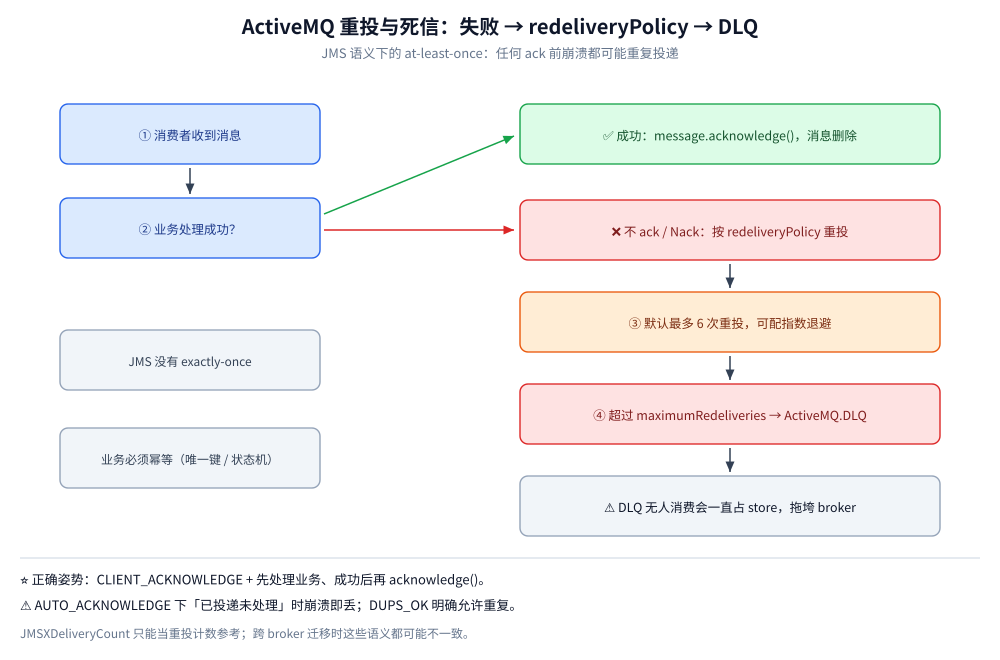

# 消息可靠性

> 覆盖 ActiveMQ Classic 从生产到消费的六段可靠性链路、`DeliveryMode.PERSISTENT` 与 `useAsyncSend` 的「返回不等于落盘」、三种 ACK 模式的取舍、`redeliveryPolicy` 与 `ActiveMQ.DLQ` 的配合（含本机投递次数 1/2/3 的实测），以及为什么它只能做到 at-least-once。
>
> 不覆盖：Queue / Topic 的分发与 selector 见 [消息类型与消费语义.md](消息类型与消费语义.md)；存储结构见 [核心概念与架构.md](核心概念与架构.md)；ACK 与重投的代码写法见 [Java 接入](../../../../01-编程语言/java/工程实践/接入ActiveMQ.md)。
>
> 内容整理自个人学习笔记。**实测口径**：投递次数、DLQ、发送速率、确认行为均在本机 `apache/activemq-classic:6.1.4` 容器 `activemq-lab` 上跑出；主从切换与 broker 崩溃丢消息**未实测**，按语义推导并标注。

---

## 一、消息在哪几个环节可能出问题？

**本节要点**：ActiveMQ 的可靠性要看**六个独立环节**，任何一环缺了，丢消息的形态都不一样。排障时先定位是哪一环，再谈配置。

| 环节 | 机制 | 会丢 / 会重的场景 |
| --- | --- | --- |
| 生产 | `DeliveryMode.PERSISTENT` + KahaDB journal 落盘；`useAsyncSend=true` 时 send 返回**不等于**已落盘 | 异步发送 + broker 崩溃 = 丢最后一批；非持久消息重启即丢 |
| 存储 | journal 顺序写 + checkpoint；`systemUsage` 水位保护 | store 写满后 broker 拒收持久消息（不是丢，是停） |
| 消费 | `CLIENT_ACKNOWLEDGE` 显式确认；事务会话 `commit/rollback` | `AUTO_ACKNOWLEDGE` 下「已投递未处理」崩溃即丢；`DUPS_OK` 明确允许重复 |
| 重投 | `redeliveryPolicy`：默认 6 次、可指数退避；超限进 `ActiveMQ.DLQ` | DLQ 无人消费会一直占 store，反过来拖垮 broker |
| 幂等 | JMS **没有** exactly-once；`JMSXDeliveryCount` 只能当重投计数参考 | 任何 ack 前崩溃都可能重复投递，业务必须幂等 |
| 顺序 | 单队列 + 单消费者有序；多消费者并发即乱序 | 要同 key 有序只能同组单消费者（`JMSXGroupID`）或业务侧分组 |

> ⭐ 结论：ActiveMQ 的可靠性是「**JMS 语义下的 at-least-once**」，和 RabbitMQ 的 confirm+ack、RocketMQ 的同步刷盘是同一档；它不提供 Kafka 那种「日志保留期内任意重放」，**ack 掉的消息就没了**。

## 二、`send()` 返回了，消息就算发出去了吗？

**本节要点**：**不一定**。`send()` 的语义取决于 `useAsyncSend`：同步发送会等 broker 的 receipt；异步发送只把消息放进客户端发送缓冲就返回。**「返回」与「落盘」之间隔着一整条网络与磁盘路径**。

| 配置 | `send()` 返回的含义 | 代价 |
| --- | --- | --- |
| `useAsyncSend=false`（默认） | broker 已接收并处理（持久消息已写 journal） | 每条一次往返，吞吐低 |
| `useAsyncSend=true` | ⚠️ 只代表进了**客户端发送队列** | broker 崩溃时最后一批丢失；需配合 `useAsyncSend` + 生产者窗口与重连策略 |
| `NON_PERSISTENT` | 只进了 broker 内存 | broker 重启即丢，与异步与否无关 |

本机实测（持久化、单机、未调优）：200 条消息耗时 **1129 ms**，平均 **5.645 ms/条**。这个数不是「ActiveMQ 的上限」，而是「单机默认配置下每条消息一次落盘 + 往返」的量级参考——用它做容量估算时，**先除以业务允许的批量**。

⚠️ 想「发了就算数」有两条路：**同步发送**（默认）或**异步发送 + 定期 `flush()` / 事务提交**。第二种吞吐更高，但要接受「进程崩溃时缓冲区里的消息丢失」。

## 三、三种 ACK 模式怎么选？

**本节要点**：ACK 模式决定「消息什么时候算消费成功」。三档不是「可靠性从低到高」，而是**三种不同的失败语义**。

| 模式 | 何时确认 | 失败时会怎样 | 用在哪 |
| --- | --- | --- | --- |
| `AUTO_ACKNOWLEDGE` | 消费方法返回后自动确认 | 处理到一半崩溃 → **消息已确认，丢失** | 允许丢的日志 / 通知 |
| `CLIENT_ACKNOWLEDGE` | 业务代码显式 `acknowledge()` | 未 ack 就崩溃 → 重投（可能重复） | ⭐ 业务消息的默认选择 |
| `DUPS_OK_ACKNOWLEDGE` | 延迟批量确认 | 崩溃可能批量重投，**明确允许重复** | 幂等且追求吞吐 |

```text
CLIENT_ACKNOWLEDGE 的正确顺序：
  receive() → 处理业务（写库 / 调下游）→ acknowledge()
                                 ↑
              任何一步之前崩溃，消息都还没被确认，会被重投
```

⚠️ **`AUTO_ACKNOWLEDGE` 不是「自动帮你处理完」**：它在 `onMessage` 返回后立即确认，所以「已投递、未处理、进程崩了」这一类就是丢。Spring 的 `@JmsListener` 默认 `sessionTransacted=false` + auto ack，要可靠必须显式改成事务会话或客户端确认。

## 四、redeliveryPolicy 与 DLQ 是怎么配合的？

**本节要点**：消费失败（不 ack / 抛异常 / 事务回滚）后，broker 按 `redeliveryPolicy` 重投；**重投次数超过 `maximumRedeliveries` 后，消息被移入 `ActiveMQ.DLQ`**。DLQ 不是「垃圾桶」，是「需要人工或专门程序处理的待办队列」。



本机实测（`maximumRedeliveries=2`、事务会话 + `rollback()` 模拟持续失败）：

| 第几次尝试 | `JMSXDeliveryCount` | `JMSRedelivered` | 结果 |
| --- | --- | --- | --- |
| 1 | 1 | `false` | 收到，回滚 |
| 2 | 2 | `true` | 重投，回滚 |
| 3 | 3 | `true` | 重投，回滚 |
| 4 | — | — | 取不到消息（已进 DLQ） |

随后从 `ActiveMQ.DLQ` 读到了这条消息（body 与原文一致），`lab.poison` 的 `EnqueueCount=1`、`DequeueCount=1`，DLQ 侧 `EnqueueCount=1`、`DequeueCount=1`（已被本次读取消费）。

这张图要读出的核心：**`maximumRedeliveries=N` 的含义是「首次投递 + N 次重投」**，所以 `JMSXDeliveryCount` 会走到 `N+1` 才进 DLQ。把它当「总共投 N 次」会算错一倍。

| 配置项 | 默认 | 作用 |
| --- | --- | --- |
| `maximumRedeliveries` | 6 | 重投上限，超过进 DLQ |
| `initialRedeliveryDelay` | 1000 ms | 首次重投延迟 |
| `redeliveryDelay` | 1000 ms | 后续重投间隔 |
| `useExponentialBackOff` | false | 开指数退避，配合 `backOffMultiplier` |
| `maximumRedeliveryDelay` | 无上限 | 退避的上限，防延迟无限增长 |

⚠️ **DLQ 无人消费会反噬 broker**：死信仍然是持久消息，占的是同一个 KahaDB store。DLQ 越积越多 → `StorePercentUsage` 上升 → 全 broker 触发流控。**上线时必须给 DLQ 配消费或归档任务**，或按业务拆分 `deadLetterStrategy`。

## 五、为什么它做不到 exactly-once？

**本节要点**：因为「消费成功」和「确认成功」是**两次独立的动作**，两者之间必然存在一个窗口。任何 ack 前崩溃都会导致重投，任何 ack 后崩溃都可能被误认为未处理——**这是分布式系统的共性，不是 ActiveMQ 的缺陷**。

| 想达到的效果 | 实际能保证的 | 需要业务补什么 |
| --- | --- | --- |
| 不丢 | at-least-once | 无需补，但要接受重复 |
| 不重 | at-most-once（先 ack 再处理） | 接受丢失 |
| 不丢 + 不重 | ❌ 中间件不提供 | 幂等：唯一键 / 去重表 / 状态机条件更新 |

⭐ **`JMSXDeliveryCount` 是观测工具，不是幂等方案**：它能告诉你「这条消息是第几次投递」，但不能阻止第二次处理。正确的做法是业务侧用「订单号 + 状态」做条件更新，重复消息到达时直接跳过。

⚠️ **事务会话也不等于 exactly-once**：`SESSION_TRANSACTED` 保证的是「一批消息要么全 ack 要么全回滚」，回滚后整批重投，重复依然存在。

## 应用场景

| 场景 | 配置组合 |
| --- | --- |
| 订单创建 / 支付回调 | `PERSISTENT` + `CLIENT_ACKNOWLEDGE` + 业务幂等 |
| 可丢的通知 / 埋点 | `NON_PERSISTENT` 或 `AUTO_ACKNOWLEDGE` |
| 批量入库 | 事务会话，一批 `commit` 一次 |
| 下游限流时退避 | `useExponentialBackOff=true` + `maximumRedeliveryDelay` |
| 坏消息隔离 | 按业务拆 `deadLetterStrategy`，DLQ 配消费任务 |
| 高吞吐但可接受重发 | `DUPS_OK_ACKNOWLEDGE` + 幂等 |

## 具体使用

客户端侧的重投策略（完整工程见语言分册）：

```java
RedeliveryPolicy policy = new RedeliveryPolicy();
policy.setInitialRedeliveryDelay(1000L);
policy.setMaximumRedeliveries(3);        // 首次 + 3 次重投，第 5 次投递前进 DLQ
policy.setUseExponentialBackOff(true);
policy.setBackOffMultiplier(2);
factory.setRedeliveryPolicy(policy);
```

查看 DLQ 与重投情况（本机实测）：

```bash
# DLQ 当前堆积
curl -s -H 'Origin: http://localhost' -u admin:admin \
  "http://127.0.0.1:8161/api/jolokia/read/org.apache.activemq:type=Broker,brokerName=localhost,destinationType=Queue,destinationName=ActiveMQ.DLQ" \
  | python -c "import sys,json; v=json.load(sys.stdin)['value']; print({k:v[k] for k in ['QueueSize','EnqueueCount','DequeueCount']})"
# → {'QueueSize': 0, 'EnqueueCount': 1, 'DequeueCount': 1}
```

给 DLQ 单配策略（`activemq.xml`，按公开配置模型书写，未在本机验证）：

```xml
<policyEntry queue=">">
  <deadLetterStrategy>
    <individualDeadLetterStrategy queuePrefix="DLQ." useQueueForQueueMessages="true"/>
  </deadLetterStrategy>
</policyEntry>
```

## 延伸追问

- **开了事务会话还要不要 `CLIENT_ACKNOWLEDGE`？** → 不需要。事务会话用 `commit/rollback` 表达确认，ack 模式被忽略；两者混用会让语义变得难以推理。
- **重投的消息会不会排到队尾？** → 默认重投是「放回原队列」并按策略延迟，可能排到队尾，也可能被优先派发，取决于 broker 与客户端版本。**别依赖重投的顺序**。
- **`useAsyncSend=true` 到底能快多少？** → 省掉每条消息的往返，批量场景提升明显；但本机测的是同步发送（默认），**异步的加速比未实测**。代价是崩溃丢最后一批。
- **DLQ 里的消息怎么恢复？** → 可以用管理台 / Jolokia 把它移动到原队列（`move` 操作），或用 `bin/activemq browse` 导出后重放。恢复前先确认失败原因已修复，否则会再次进 DLQ。
- **能不能只对某个队列配重投策略？** → 可以，`redeliveryPolicy` 既能挂在 ConnectionFactory 上（客户端侧），也能通过 `policyEntry` 在 broker 侧配。客户端与 broker 两侧都配时，**以客户端为准的语义更强**，排查时要两处都看。
- **为什么 ack 掉的消息不能像 Kafka 那样重放？** → 因为 ActiveMQ 的存储模型是「消息队列」：ack 即删除，没有 retention 概念。要重放就得选日志型存储（Kafka / Pulsar）。

## 关联

- **上游/总纲**：[README.md](README.md) — 本册导读与实测坐标
- **上游/总纲**：[核心概念与架构.md](核心概念与架构.md) — KahaDB 单 store 与三档水位
- **上游/总纲**：[消息类型与消费语义.md](消息类型与消费语义.md) — 分发、prefetch 与延迟投递
- **运维/配置**：[运维与排障.md](运维与排障.md) — DLQ 膨胀与生产者卡住的排查
- **对照/互补**：[消息可靠性.md](../RabbitMQ/消息可靠性.md) — confirm + ack 的另一套可靠性语义
- **对照/互补**：[消息可靠性.md](../Kafka/消息可靠性.md) — ISR 与 retention 重放
- **对照/互补**：[消息可靠性.md](../NATS/消息可靠性.md) — JetStream 的 AckWait / MaxDeliver 与「没有内建死信」
