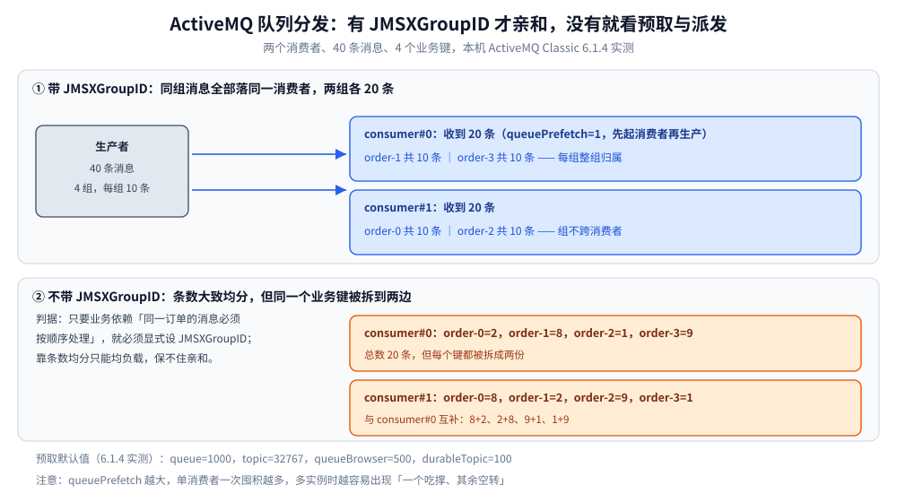

# 消息类型与消费语义

> 覆盖 Queue 与 Topic 的分发差异、持久订阅的命名规则、selector 在哪一侧过滤及其代价、`JMSXGroupID` 亲和（含本机 20/20 与 2/8/1/9 的对照实测）、prefetch 的四个默认值、延迟投递的四个属性与 `schedulerSupport` 开关，以及 Request-Reply 的 Temporary Queue 落地方式。
>
> 不覆盖：ACK 模式、重投与 DLQ 见 [消息可靠性.md](消息可靠性.md)；对象模型与 KahaDB 见 [核心概念与架构.md](核心概念与架构.md)；Java / Go 的收发代码见 [Java 接入](../../../../01-编程语言/java/工程实践/接入ActiveMQ.md) 与 [Go 接入](../../../../01-编程语言/go/工程实践/接入ActiveMQ.md)。
>
> 内容整理自个人学习笔记。**实测口径**：分发、prefetch、延迟投递均在本机 `apache/activemq-classic:6.1.4` 容器 `activemq-lab` 上以 Java 17 + `activemq-client 6.1.4` 跑出；Topic 与持久订阅未单独实测。

---

## 一、Queue 与 Topic 的分发差在哪？

**本节要点**：Queue 是**竞争消费**——一条消息只投给一个消费者；Topic 是**发布订阅**——每个订阅者各收一份。两者的差别不只是「一对一 / 一对多」，而是**离线期间消息归谁**。

| 维度 | Queue | Topic |
| --- | --- | --- |
| 一条消息的消费者 | 只有一个（竞争） | 每个订阅者一份 |
| 消费者离线时 | 消息留在队列，上线后继续 | ⚠️ **直接丢弃** |
| 离线也要收 | 不需要额外配置 | 必须建**持久订阅**（clientID + subscriptionName） |
| 扩容方式 | 加消费者即可分摊 | 加订阅者只增加副本，不减总量 |
| 典型用途 | 任务分发、订单处理 | 事件广播、配置变更通知 |

**持久订阅的标识是「客户端 ID + 订阅名」两个字段的组合**：同一 clientID 下同名订阅只能有一个活跃消费者；换 clientID 等于换了一个新订阅，旧订阅的消息不会转过来。这是「重启后 Topic 消息丢了」最常见的原因。

> ⚠️ Topic 的「离线即丢」不是配置问题，而是语义：没有订阅者时消息没有接收方，broker 不会替不存在的订阅保存。**只有持久订阅才会在 broker 侧留存**，且留存的是「该订阅的游标」，不是「整条 Topic 的日志」——所以 Topic 不能被当成 Kafka 用。

## 二、selector 在哪一侧过滤，代价是什么？

**本节要点**：selector 是 **broker 侧过滤**，按消息属性（SQL92 子集）匹配，消费者只收到匹配的消息。但**被滤掉的消息仍然留在队列里占空间**，直到被别的消费者取走或过期——这一点让它无法承担「多租户隔离」。

```text
selector 表达式示例（SQL92 子集）
  order-key = 'ORDER_1001'
  bizType IN ('order', 'refund') AND amount > 100
  JMSXGroupID LIKE 'order-%'
```

| 你以为的 | 实际发生的 |
| --- | --- |
| 不匹配的消息被丢弃 | ❌ 仍在队列中，`QueueSize` 照样涨 |
| selector 能替代多队列 | ❌ 多个 selector 的消费者会各自扫描同一个队列，被滤掉的消息谁都不要 |
| selector 在客户端过滤 | ❌ 在 broker 侧匹配，客户端收不到不匹配的消息 |

⭐ **正确的用法是「用 Queue 做隔离，用 selector 做同队列内的细分」**：不同租户 / 不同业务用不同队列，同一队列内再用 selector 区分优先级或子类型。跨产品的队列切分判据见 [消息模型与存储代价.md](../消息模型与存储代价.md)。

⚠️ **STOMP 侧的 selector 走扩展头**：ActiveMQ 接受 `activemq.selector`（部分版本也认标准 `selector` 头），接入前用一条不匹配的消息确认它真的在 broker 侧生效，而不是被客户端丢掉。

## 三、JMSXGroupID 为什么是唯一的保序手段？

**本节要点**：ActiveMQ 的 Queue **默认不做 key 亲和**——消息按预取与轮询派发给消费者，条数大致均分，但同一个业务键会被拆到不同消费者。**要让「同一订单的消息始终由同一个消费者处理」，唯一的手段是显式设置 `JMSXGroupID`**。



本机实测的对照（2 个消费者、先起消费者再生产 40 条、4 个业务键、`queuePrefetch=1`）：

| 场景 | consumer#0 | consumer#1 | 结论 |
| --- | --- | --- | --- |
| 带 `JMSXGroupID`（`order-0..3`） | `order-1=10, order-3=10`（20 条） | `order-0=10, order-2=10`（20 条） | ⭐ 整组归属，组不跨消费者 |
| 不带 GroupID（仅 `bizKey` 属性） | `order-0=2, order-1=8, order-2=1, order-3=9` | `order-0=8, order-1=2, order-2=9, order-3=1` | 条数均分，但**每个键都被拆开** |

这张图要读出的核心：**亲和不是由「业务属性同名」自动产生的，而是由 `JMSXGroupID` 这个保留属性显式触发的**。`bizKey` 只是普通属性，broker 完全不看它。

⚠️ **GroupID 的代价**：同组消息串行落到一个消费者，热点键会形成单点；组内消费者下线时，broker 会把该组**重新分配给还活着的消费者**（不是丢弃）。所以「保序」与「并发」在 ActiveMQ 上是一对矛盾，只能按业务键分片来折中。

## 四、prefetch 默认值为什么差三个数量级？

**本节要点**：prefetch 是**客户端一次向 broker 预取多少条**。它决定了「消费者本地的缓冲深度」，也决定了多实例部署时的负载倾斜程度。ActiveMQ 的默认值按目的地类型分了四档，差距极大。

| 目的地类型 | 默认 prefetch | 为什么是这个值 |
| --- | --- | --- |
| Queue | **1000** | 高吞吐：一次拿一批，减少来回 |
| Topic | **32767** | 广播语义：宁可多推，避免漏 |
| QueueBrowser | **500** | 浏览不消费，不需要太多 |
| Durable Topic | **100** | 持久订阅要按 ack 推进，不能囤太多 |

> 以上四个数来自本机 6.1.4 的 `ActiveMQPrefetchPolicy` 实测读取：`queue=1000 topic=32767 queueBrowser=500 durableTopic=100`。

⚠️ **prefetch 越大，越容易出现「一个吃撑、其余空转」**：消费者 A 一次领走 1000 条还没处理完，消费者 B 就只能在旁边等。本机做亲和对照时把 `queuePrefetch` 调成 **1**，就是为了让派发结果不被预取掩盖——这也是排查「两个实例负载严重不均」时第一个要改的参数。

## 五、延迟投递的四个属性怎么用？

**本节要点**：ActiveMQ 的延迟消息不靠插件，靠消息属性 `AMQ_SCHEDULED_*`，但 **broker 必须开 `schedulerSupport="true"`**，否则属性被忽略、消息立刻投递。

| 属性 | 单位 | 作用 |
| --- | --- | --- |
| `AMQ_SCHEDULED_DELAY` | 毫秒 | 首次投递前等多久 |
| `AMQ_SCHEDULED_PERIOD` | 毫秒 | 之后每隔多久重复一次 |
| `AMQ_SCHEDULED_REPEAT` | 次 | 重复几次 |
| `AMQ_SCHEDULED_CRON` | cron 表达式 | 按日历调度（与 DELAY 二选一） |

本机实测：`AMQ_SCHEDULED_DELAY=5000` 在**未开** `schedulerSupport` 时只延迟了 **171 ms**（等于没生效）；在 `activemq.xml` 的 broker 标签加上 `schedulerSupport="true"` 并重启后，同一条代码延迟 **5113 ms** 才被消费。

> ⚠️ 延迟消息在 broker 侧是「先存进调度器，到点再投递」，期间**占用存储**。大量长延迟消息（比如 7 天）会把 KahaDB 当成定时任务表用，这是把 ActiveMQ 当延迟队列时最容易踩的坑。

## 六、Request-Reply 在 JMS 里怎么落地？

**本节要点**：JMS 没有内建的 RPC 命令，但提供了两个原语：**`reply-to` 头 + Temporary Queue**。调用方建一个临时队列、发消息时带上 `reply-to`，服务方处理完往这个队列回写。

```text
调用方                                 服务方
  createTemporaryQueue() → temp
  send(request, JMSReplyTo=temp)  →    receive()
                                       处理
  receive(temp)                   ←   send(reply, JMSCorrelationID=原消息ID)
```

| 要点 | 说明 |
| --- | --- |
| 应答队列归属 | Temporary Queue 绑定在**创建它的连接**上，连接断开即删除 |
| 关联请求与应答 | 用 `JMSCorrelationID`，不要靠「只有一条应答」这种假设 |
| 超时 | `receive(timeout)` 超时返回 `null`，必须自己判空 |
| 与 NATS 的差别 | NATS 的 `_INBOX` 是协议内建；JMS 的临时队列要显式创建 |

⚠️ **Temporary Queue 的生命周期跟着连接走**：把连接做成进程级单例时，临时队列也会活到进程退出。调用量大时要复用而不是每次新建，否则 broker 侧会堆积大量临时目的地。

## 应用场景

| 场景 | 选择 | 注意 |
| --- | --- | --- |
| 任务分发 / 订单处理 | Queue + 多消费者 | 需保序就加 `JMSXGroupID` |
| 事件广播 / 配置变更 | Topic + 持久订阅 | 消费者上线前的事件收不到 |
| 同一队列内按类型分流 | Selector | 被滤掉的消息仍占空间 |
| 同一订单严格串行 | Queue + `JMSXGroupID` | 热点组会串行，注意单点 |
| 超时未支付关单 | `AMQ_SCHEDULED_DELAY` | broker 必须开 `schedulerSupport` |
| RPC 式同步查询 | Temporary Queue + `JMSCorrelationID` | 连接断开临时队列即删 |

## 具体使用

设置属性与订阅过滤的写法（完整可运行代码见语言分册）：

```java
// 生产者：设置 GroupID（保留属性名，broker 靠它做亲和）
message.setStringProperty("JMSXGroupID", "order-1001");
// 延迟 60 秒投递
message.setLongProperty("AMQ_SCHEDULED_DELAY", 60_000L);

// 消费者：broker 侧按属性过滤
session.createConsumer(queue, "order-key = 'ORDER_1001'");
```

```go
// Go 走 STOMP 时，GroupID 与 selector 都是 header
stomp.SendOpt.Header("JMSXGroupID", "order-1001")
stomp.SubscribeOpt.Header("activemq.selector", "order-key = 'ORDER_1001'")
```

验证分发是否符合预期，直接读队列读数（本机实测）：

```bash
curl -s -H 'Origin: http://localhost' -u admin:admin \
  "http://127.0.0.1:8161/api/jolokia/read/org.apache.activemq:type=Broker,brokerName=localhost,destinationType=Queue,destinationName=lab.groups" \
  | python -c "import sys,json; v=json.load(sys.stdin)['value']; print({k:v[k] for k in ['QueueSize','EnqueueCount','DequeueCount','ConsumerCount']})"
# lab.groups → {'QueueSize': 0, 'EnqueueCount': 120, 'DequeueCount': 120, 'ConsumerCount': 0}
```

## 延伸追问

- **`JMSXGroupID` 和 Kafka 的 key 是一回事吗？** → 目标相同（同 key 同消费者），机制不同：Kafka 是「hash 到分区」静态绑定；ActiveMQ 是「broker 记录组 → 消费者」的动态绑定，组内消费者掉线会重新分配。所以 ActiveMQ 的亲和**不是永久绑定**。
- **Topic 能不能当队列用？** → 不能。Topic 没有「一条消息只被消费一次」的语义，多个订阅者会各拿一份。要「广播 + 只处理一次」得自己加去重。
- **selector 能过滤消息体内容吗？** → 不能，只能按**属性**过滤。要按内容过滤只能在消费端做，但那已经不是 broker 侧过滤了。
- **prefetch 调小会不会变慢？** → 会。每条消息多一次网络往返，吞吐下降；但负载更均匀、故障时重投的消息更少。**默认 1000 适合吞吐，`1~10` 适合低延迟与均摊**。
- **延迟消息重启后会丢吗？** → 持久消息不会，调度器状态会随 KahaDB 恢复；非持久消息会丢。长延迟场景要按持久消息规划存储。
- **Queue 的消息能被多个消费者「都收到」吗？** → 不能，这是 Queue 与 Topic 的根本区别。需要「每个服务都收到一份」就建 Topic 或每个服务一个 Queue。

## 关联

- **上游/总纲**：[README.md](README.md) — 本册导读与实测坐标
- **上游/总纲**：[核心概念与架构.md](核心概念与架构.md) — JMS 对象模型与 KahaDB
- **下游机制**：[消息可靠性.md](消息可靠性.md) — ACK、重投与 DLQ
- **运维/配置**：[部署与配置.md](部署与配置.md) — `schedulerSupport` 与队列上限
- **对照/互补**：[消息模型与存储代价.md](../消息模型与存储代价.md) — 队列与订阅粒度的跨产品判据
- **对照/互补**：[消息类型与语义.md](../RocketMQ/消息类型与语义.md) — RocketMQ 的延迟级别与顺序消息
- **对照/互补**：[订阅与消费语义.md](../NATS/订阅与消费语义.md) — 队列组随机派发与「无 key 亲和」
> 反向引用（本篇被下列文档引到）：[接入ActiveMQ.md](../../../../01-编程语言/go/工程实践/接入ActiveMQ.md)、[接入ActiveMQ.md](../../../../01-编程语言/java/工程实践/接入ActiveMQ.md)
