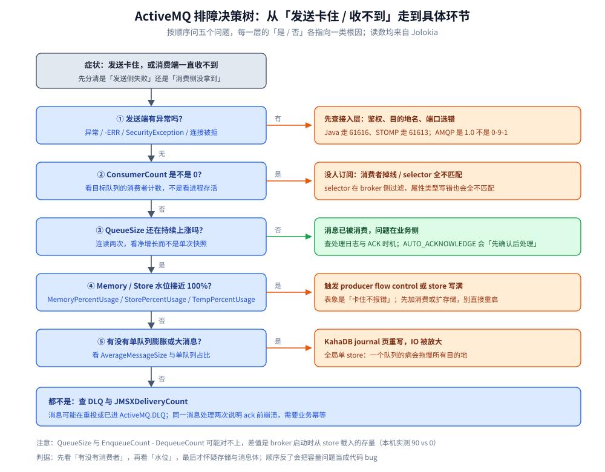

# 运维与排障

> 覆盖 ActiveMQ Classic 的三个观测入口（dstat / browse / Jolokia）、`QueueSize` 与 `EnqueueCount - DequeueCount` 对不上的解释、生产者「卡住不报错」的排查顺序、整个 broker 变慢的定位路径，以及指标优先级。
>
> 不覆盖：流控原理见 [核心概念与架构.md](核心概念与架构.md) 第三节；重投与 DLQ 的机制见 [消息可靠性.md](消息可靠性.md) 第四节；部署与连接器见 [部署与配置.md](部署与配置.md)。
>
> 内容整理自个人学习笔记。**实测口径**：dstat / browse 的可用性、Jolokia 的 MBean 与读数、`QueueSize=90` 的差异均在本机 `apache/activemq-classic:6.1.4` 容器 `activemq-lab` 上核对；主从切换、慢消费者告警**未实测**。

---

## 一、三个观测入口各看什么？

**本节要点**：ActiveMQ 的观测面分三层——**命令行看速率、browse 看内容、Jolokia 看指标**。三层互补，缺一层就会在排障时来回猜。

| 入口 | 看什么 | 适合 |
| --- | --- | --- |
| `bin/activemq dstat` | 队列大小 / 入队 / 出队 / 在途，每秒刷新 | ⭐ 实时看「有没有在消费」 |
| `bin/activemq browse <QUEUE>` | 队列里的消息内容（**不消费**） | 确认消息体、属性、是否进错队列 |
| Jolokia（8161） | `QueueSize`、`ConsumerCount`、`Enqueue/Dequeue`、三档水位 | ⭐ 做监控与告警的取数口径 |
| `bin/activemq console` | broker 启动日志与运行时异常 | 配置错误、连接被拒、DLQ 告警 |

**Jolokia 是唯一适合做监控的入口**：它按 MBean 暴露属性，可以直接接 Prometheus 的 JMX exporter 或定时拉取。但它有两个门槛：

- ⚠️ **必须带 `Origin` 头**（浏览器跨域保护），否则请求被拒，且错误信息不会告诉你是缺头。
- ⚠️ **MBean 名要拼对**：队列是 `destinationType=Queue,destinationName=<队列名>`，连接器清单是 Broker MBean 的 `TransportConnectors` 属性，写错返回 404 `InstanceNotFoundException`。

## 二、`QueueSize` 与 `Enqueue - Dequeue` 为什么会对不上？

**本节要点**：因为 **`EnqueueCount` 是「本次 broker 启动以来的入队数」，`QueueSize` 是「当前队列里真实的条数」**。broker 重启时从 store 载入的存量**不计入 `EnqueueCount`**——所以两者天然会差一个「历史存量」。

本机实测（`lab.orders`）：

| 指标 | 值 |
| --- | --- |
| `QueueSize` | **90** |
| `EnqueueCount` | 200 |
| `DequeueCount` | 200 |
| `ConsumerCount` | 0 |

`Enqueue - Dequeue = 0`，但 `QueueSize = 90`：这 90 条是**上一次运行留在 KahaDB 里、本次启动被载入**的消息。它们既没有在本次启动时入队，也还没被消费。

> ⭐ 判据：**看积压趋势要用 `QueueSize` 的两次采样差，不要用 `Enqueue - Dequeue` 的绝对值**。后者只反映「本次启动以来的净流量」，重启后会归零重算。

⚠️ 反过来也有坑：如果 `QueueSize` 一直不降、`DequeueCount` 却在涨，说明**有消费者在取但取不完**（消费速度 < 生产速度），不是消费者掉线。

## 三、生产者「卡住不报错」该按什么顺序查？

**本节要点**：这是 ActiveMQ 最典型的故障形态——**producer flow control 把 `send()` 阻塞住了，而不是抛异常**。排查顺序必须是「消费者 → 积压 → 水位 → 存储」，顺序反了就会把容量问题当成代码 bug。



上图把五个判断串成一条路径：发送端有无异常 → 有没有消费者 → 积压是否增长 → 水位是否见顶 → 是否大消息 / 单队列膨胀。每一步的读数都能从 Jolokia 直接取，不依赖日志。

**为什么「卡住」比「报错」更难查**：`systemUsage` 触顶时 broker 的默认策略是**让生产者等**，等消费腾出空间再继续。客户端看到的只是 `send()` 不返回，线程栈停在 socket 写——没有异常、没有日志。只有去看 `MemoryPercentUsage` / `StorePercentUsage` 才知道发生了什么。

| 现象 | 先看 | 结论 |
| --- | --- | --- |
| `send()` 长时间不返回 | `MemoryPercentUsage` | 内存水位满，消费跟不上 |
| `send()` 不返回且磁盘在涨 | `StorePercentUsage` | KahaDB 写满，需扩容或清理 |
| 只有大消息发不出去 | `TempPercentUsage` + `maxFrameSize` | 临时文件或单帧上限 |
| 所有队列一起变慢 | 单队列 `QueueSize` 占比 | 单队列膨胀拖垮全局 store |

## 四、整个 broker 变慢该怎么定位？

**本节要点**：ActiveMQ 的慢通常不是「某个功能慢」，而是**共享资源被一个目的地吃掉**。因为 KahaDB 是全局单 store，内存与 journal 都是共享的，所以定位的关键是「找出那个异常的目的地」。

| 线索 | 说明 | 动作 |
| --- | --- | --- |
| 单队列 `QueueSize` 远大于其他 | 积压占住 journal，无法回收 | 消费或清理该队列；评估拆 broker |
| `AverageMessageSize` 异常大 | 大消息触发 journal 页重写 | 消息体裁剪，大文件走对象存储 |
| `StorePercentUsage` 持续上涨 | 持久消息只进不出 | 查 DLQ、查无消费者的队列 |
| `ConsumerCount` 反复归零 | 消费者在崩溃重启 | 看客户端日志与 `redeliveryPolicy` |
| 网络与 CPU 都不高但吞吐低 | 可能卡在 journal 同步写 | 看磁盘 IOPS，评估换 SSD / 调 journal 参数 |

⚠️ **不要用「重启 broker」当第一手段**：重启会把内存里的非持久消息清掉、把 `EnqueueCount` 归零，问题暂时消失但存量还在，下一次堆积会更快到来。先定位是哪个队列、哪类消息。

## 五、常见故障速查

| 症状 | 大概率原因 | 处理 |
| --- | --- | --- |
| 生产者「卡住」但不报错 | producer flow control：memory / store 水位满 | 看 `MemoryPercentUsage` / `StorePercentUsage`；先消费或调水位，别盲目重启 |
| 整个 broker 变慢、所有队列一起积压 | 单队列 / 大消息把 KahaDB journal 撑满 | 清掉或消费膨胀队列；消息体裁剪；必要时拆 broker |
| 消费者收到大量「消费者上线 / 下线」消息 | advisory 消息默认开启 | `setWatchTopicAdvisories(false)` 或关 advisory 目的地 |
| 级联集群里消息「消失又出现」 | Network of Brokers 桥断开后消息回退 | 桥是级联不是复制，重连期消息留在原 broker；评估改主从或换 MQ |
| DLQ 越积越多、store 报警 | 死信无人消费 | 给 `ActiveMQ.DLQ` 配消费 / 归档任务，或按业务拆 `deadLetterStrategy` |
| 重启后非持久消息全没 | `DeliveryMode.NON_PERSISTENT` | 业务消息一律 PERSISTENT |
| 同一消息处理了两次 | ack 前崩溃重投（at-least-once） | 业务幂等 + `JMSXDeliveryCount` 打点观察重投率 |
| 消息延迟不生效 | `schedulerSupport` 未开 | broker 标签加 `schedulerSupport="true"` 并重启（见 [部署与配置.md](部署与配置.md) 第四节） |
| 控制台能登、客户端连不上 | 两套账号（Jetty 与 broker）只改了一边 | 分别改 `jetty-realm.properties` 与 `simpleAuthenticationPlugin` |

## 六、观测指标的优先级是什么？

**本节要点**：指标不是平权的。按「从症状到根因」排，前三个决定要不要告警，后两个决定往哪修。

| 优先级 | 指标 | 说明 |
| --- | --- | --- |
| 1 | `QueueSize` | 积压，最直接的业务影响 |
| 2 | `ConsumerCount` | 消费者是否掉线；0 就是没人处理 |
| 3 | `EnqueueCount - DequeueCount` | 净增长（注意是本次启动以来） |
| 4 | `MemoryPercentUsage` / `StorePercentUsage` / `TempPercentUsage` | 水位，决定会不会触发流控 |
| 5 | `AverageMessageSize` | 大消息预警 |

⭐ **告警口径建议**：`QueueSize` 按「持续 N 分钟单调上涨」告警，而不是按绝对阈值——不同队列的正常水位差几个数量级；`ConsumerCount=0` 对核心队列应立即告警；水位按 80% / 90% 两档。

## 具体使用

本机实测的三条取数命令：

```bash
# 单队列积压与消费者
curl -s -H 'Origin: http://localhost' -u admin:admin \
  "http://127.0.0.1:8161/api/jolokia/read/org.apache.activemq:type=Broker,brokerName=localhost,destinationType=Queue,destinationName=lab.orders" \
  | python -c "import sys,json; v=json.load(sys.stdin)['value']; print({k:v[k] for k in ['QueueSize','EnqueueCount','DequeueCount','ConsumerCount']})"
# → {'QueueSize': 90, 'EnqueueCount': 200, 'DequeueCount': 200, 'ConsumerCount': 0}

# broker 全局：版本、运行时长、总入出、三档水位
curl -s -H 'Origin: http://localhost' -u admin:admin \
  "http://127.0.0.1:8161/api/jolokia/read/org.apache.activemq:type=Broker,brokerName=localhost" \
  | python -c "import sys,json; d=json.load(sys.stdin)['value']; print({k:d[k] for k in ['BrokerVersion','Uptime','TotalEnqueueCount','TotalDequeueCount','TotalMessageCount','MemoryPercentUsage','StorePercentUsage']})"

# DLQ 堆积
curl -s -H 'Origin: http://localhost' -u admin:admin \
  "http://127.0.0.1:8161/api/jolokia/read/org.apache.activemq:type=Broker,brokerName=localhost,destinationType=Queue,destinationName=ActiveMQ.DLQ" \
  | python -c "import sys,json; v=json.load(sys.stdin)['value']; print({k:v[k] for k in ['QueueSize','EnqueueCount','DequeueCount']})"
```

容器内看实时速率与消息内容：

```bash
docker exec -it activemq-lab /opt/apache-activemq/bin/activemq dstat
docker exec -it activemq-lab /opt/apache-activemq/bin/activemq browse lab.orders
```

## 延伸追问

- **`dstat` 和 Jolokia 看的是同一份数据吗？** → 是。`dstat` 走的就是 JMX / Jolokia 那套 MBean，只是做成了每秒刷新的终端界面。所以监控和手工排障不会互相打架。
- **为什么 `ConsumerCount` 有值但消息不减少？** → 消费者在「取但不 ack」——典型是处理很慢或卡在下游。看 `DequeueCount` 是否在涨：涨说明在取，不涨说明卡在更前面（prefetch 已满、线程阻塞）。
- **`browse` 会改变消息状态吗？** → 不会消费、不会 ack，但会占用一次队列快照。大队列上频繁 browse 有开销。
- **控制台里看到的 `QueueSize` 和 API 不一致？** → 控制台有刷新间隔，且可能读的是缓存值；以 Jolokia 的即时读数为准。
- **告警应该盯 broker 还是盯每个队列？** → 两者都要：broker 级看水位与总流量，队列级看积压与消费者。只盯 broker 会漏掉「某个队列没消费者」这种局部故障。

## 关联

- **上游/总纲**：[README.md](README.md) — 本册导读与实测坐标
- **上游/总纲**：[核心概念与架构.md](核心概念与架构.md) — KahaDB 与三档水位的原理
- **上游/总纲**：[消息可靠性.md](消息可靠性.md) — 重投与 DLQ 的机制
- **运维/配置**：[部署与配置.md](部署与配置.md) — `schedulerSupport`、鉴权与连接器
- **运维/配置**：[运维与排障.md](../Kafka/运维与排障.md) — 日志型存储的排障入口（consumer lag）
- **运维/配置**：[运维与排障.md](../RocketMQ/运维与排障.md) — NameServer / Broker 双进程的排查路径
