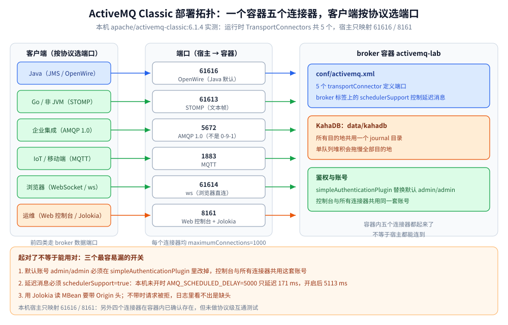

# 部署与配置

> 覆盖 ActiveMQ Classic 的单机起法、五个连接器分别给谁用、`activemq.xml` 里生产必改的几项、`schedulerSupport` 这个延迟消息的总开关，以及起完之后怎么确认「真的起对了」。
>
> 不覆盖：主从与级联的拓扑取舍见 [核心概念与架构.md](核心概念与架构.md)；延迟消息的四个属性见 [消息类型与消费语义.md](消息类型与消费语义.md)；出问题后的排查顺序见 [运维与排障.md](运维与排障.md)。
>
> 内容整理自个人学习笔记。**实测口径**：以下 `docker run` 参数、五个连接器、`schedulerSupport` 的前后对照、Jolokia 读数均在本机 `apache/activemq-classic:6.1.4` 容器 `activemq-lab` 上跑出；主从与级联未搭建。

---

## 一、单机最小可跑怎么起？

**本节要点**：一个容器就够了，但**端口决定你能用哪种客户端**。最小集只要 61616（Java）与 8161（控制台）；要用 Go 走 STOMP，必须额外映射 61613。

```bash
# 最小集：Java 客户端 + Web 控制台（本机实测用的就是这一条）
docker run -d --name activemq-lab \
  -p 61616:61616 -p 8161:8161 \
  dockerproxy.net/apache/activemq-classic:6.1.4

# 全协议集：再加 STOMP / AMQP / MQTT / WebSocket
docker run -d --name activemq-lab \
  -p 61616:61616 -p 61613:61613 -p 5672:5672 -p 1883:1883 -p 61614:61614 -p 8161:8161 \
  dockerproxy.net/apache/activemq-classic:6.1.4
```

| 项 | 本机实测值 |
| --- | --- |
| 镜像 | `apache/activemq-classic:6.1.4`（Jolokia `BrokerVersion` 返回 `6.1.4`） |
| 默认账号 | `admin/admin`（控制台与所有连接器共用） |
| 控制台 | `http://127.0.0.1:8161/admin` |
| 数据目录 | 容器内 `/opt/apache-activemq/data/kahadb` |
| 前台调试 | `docker exec -it activemq-lab /opt/apache-activemq/bin/activemq console` |

> ⚠️ 本机拉镜像只有 `dockerproxy.net` 通道可用，所以镜像名带前缀；换成官方源时把前缀去掉即可。标签必须与客户端版本对齐，`latest` 不可复现。

## 二、五个连接器分别给谁用？

**本节要点**：同一个 broker 进程同时开五个连接器，**不是「多此一举」，而是「不同客户端只能走各自的路」**——Java 走 OpenWire，非 JVM 走 STOMP，IoT 走 MQTT，企业集成走 AMQP 1.0，浏览器走 WebSocket。



本机从 Jolokia 的 `TransportConnectors` 读到的运行时清单（五个连接器参数完全一致）：

| 连接器 | 端口 | 协议 | 谁在用 |
| --- | --- | --- | --- |
| `openwire` | 61616 | ⚠️ 私有二进制 | Java 客户端默认（`tcp://host:61616`） |
| `stomp` | 61613 | 公开文本协议 | Go / Python / 非 JVM |
| `amqp` | 5672 | ⚠️ **AMQP 1.0** | 企业集成；**不能用 RabbitMQ 的 0-9-1 客户端** |
| `mqtt` | 1883 | 公开 | IoT / 移动端 |
| `ws` | 61614 | WebSocket | 浏览器直连 |
| `—` | 8161 | HTTP | Web 控制台 + Jolokia 管理接口 |

五个连接器的公共参数：`maximumConnections=1000`、`wireFormat.maxFrameSize=104857600`（100 MB）。前者是单协议连接上限，后者是单帧上限——**大消息场景先撞的是 `maxFrameSize`**，报错比流控更直接。

这张图要读出的核心：**「容器内五个连接器都起来了」不等于「宿主都能连到」**。本机只映射了 61616 / 8161，所以 Go 的 STOMP 示例虽然编译通过，却无法连这台容器运行——排障时先分清是「连接器没开」还是「端口没映射」。

## 三、`activemq.xml` 里哪几项必须改？

**本节要点**：默认配置是「能跑起来」而不是「能上生产」。按风险排序，下面六项是最该先动的。

| 配置点 | 作用 | 不配的后果 |
| --- | --- | --- |
| `simpleAuthenticationPlugin` | 替换默认 admin/admin | 控制台与 broker 全裸奔 |
| `systemUsage` 的 memory/store/temp 三档 | 生产者流控水位 | 默认值偏小，大流量下生产者被静默阻塞 |
| `policyEntry` 的 `memoryLimit` / `maxPageSize` | 单目的地内存上限 | 一个队列吃光全局内存，拖垮所有目的地 |
| `deadLetterStrategy` | 自定义 DLQ 名与是否保留非持久消息 | 默认全进 `ActiveMQ.DLQ`，难按业务分流 |
| KahaDB `journalMaxFileLength` / `enableIndexWriteAsync` | journal 页大小与索引写策略 | 大消息场景页重写放大 IO |
| `transportConnector` 的 `maximumConnections` | 单协议连接上限 | 连接泄漏时把 broker 打满 |

⭐ **还有一项不在上表，因为它属于「能力开关」而不是「安全 / 容量」：`schedulerSupport`**。它默认是关闭的，不打开就没有延迟消息，详见下一节。

> ⚠️ 本节配置项名称来自 ActiveMQ Classic 的公开配置模型，**未在容器里逐项改过并验证**；改之前先用 `bin/activemq console` 前台起一次看启动日志，配置写错时 broker 会直接起不来，错误在日志第一屏。

## 四、`schedulerSupport` 为什么是延迟消息的总开关？

**本节要点**：`AMQ_SCHEDULED_*` 属性只有 `schedulerSupport="true"` 时才会被处理；**关着的时候属性被静默忽略，消息立刻投递**——不报错、不告警，只在客户端看到「延迟没生效」。

```xml
<!-- conf/activemq.xml：broker 标签上开 -->
<broker xmlns="http://activemq.apache.org/schema/core"
        brokerName="localhost"
        dataDirectory="${activemq.data}"
        schedulerSupport="true">
```

本机前后对照（同一条 `AMQ_SCHEDULED_DELAY=5000` 的消息）：

| 配置 | 实测端到端延迟 | 现象 |
| --- | --- | --- |
| 未开 `schedulerSupport` | **171 ms** | 属性被忽略，消息即时投递 |
| 开启并重启 broker | **5113 ms** | 按 5 秒延迟投递 |

⚠️ **这个开关不区分消息类型**：打开后所有带 `AMQ_SCHEDULED_*` 的消息都进调度器，调度器状态随 KahaDB 持久化。长延迟（小时 / 天级）消息会长期占用 store，容量规划时要单独算这块。

## 五、鉴权怎么配才不是「裸奔」？

**本节要点**：默认的 admin/admin 是**明文写在 Jetty 与 broker 配置里的**，控制台和五个连接器共用。生产必须换成 `simpleAuthenticationPlugin` + 外部用户文件。

```xml
<!-- conf/activemq.xml -->
<plugins>
  <simpleAuthenticationPlugin>
    <users>
      <authenticationUser username="app" password="change-me" groups="producers,consumers"/>
      <authenticationUser username="admin" password="another-strong-one" groups="admins"/>
    </users>
  </simpleAuthenticationPlugin>
</plugins>
```

| 要点 | 说明 |
| --- | --- |
| 账号粒度 | `simpleAuthenticationPlugin` 只管「你是谁」；「能访问哪个队列」要配 `authorizationPlugin` |
| 控制台 | Jetty 的 `conf/jetty-realm.properties` 与 broker 账号**是两套**，只改一边会出现「客户端能连、控制台登不上」 |
| 生产做法 | 用 `jaasAuthenticationPlugin` 接 LDAP / 数据库；`simpleAuthenticationPlugin` 只适合小规模 |
| 明文风险 | `users.properties` 是明文口令，文件权限要收紧，不要进版本库 |

⚠️ 本机容器**未配置鉴权**（仍为 admin/admin），因此「配错后的报错原文」没有实测；上表来自官方配置模型。

## 六、怎么确认它真的起对了？

**本节要点**：**三步**——进程在、版本对、连接器全。只看容器 `Up` 是不够的：配置写错时容器可能反复重启，也可能起来了但只开了一半端口。

```bash
# ① 版本与运行时长
curl -s -H 'Origin: http://localhost' -u admin:admin \
  "http://127.0.0.1:8161/api/jolokia/read/org.apache.activemq:type=Broker,brokerName=localhost" \
  | python -c "import sys,json; d=json.load(sys.stdin)['value']; print(d['BrokerVersion'], d['Uptime'])"
# → 6.1.4 13 minutes

# ② 连接器清单（本机实测 5 个）
curl -s -H 'Origin: http://localhost' -u admin:admin \
  "http://127.0.0.1:8161/api/jolokia/read/org.apache.activemq:type=Broker,brokerName=localhost/TransportConnectors"
# → {"openwire":"tcp://...:61616?...","amqp":"...:5672?...","mqtt":"...:1883?...","stomp":"...:61613?...","ws":"...:61614?..."}

# ③ 发一条再收一条（Java 侧用语言分册的最小工程；先把队列建出来）
curl -s -H 'Origin: http://localhost' -u admin:admin \
  "http://127.0.0.1:8161/api/jolokia/read/org.apache.activemq:type=Broker,brokerName=localhost,destinationType=Queue,destinationName=lab.orders" \
  | python -c "import sys,json; v=json.load(sys.stdin)['value']; print({k:v[k] for k in ['QueueSize','EnqueueCount','DequeueCount','ConsumerCount']})"
```

⚠️ **Jolokia 请求必须带 `Origin` 头**（浏览器跨域保护），不带时返回 403 且错误信息不会告诉你缺的是头。这是本机实测踩到的第一个坑。

## 具体使用

调整队列上限与 DLQ 策略的最小片段（`activemq.xml`）：

```xml
<destinationPolicy>
  <policyMap>
    <policyEntries>
      <policyEntry queue=">" memoryLimit="64mb" producerFlowControl="true">
        <deadLetterStrategy>
          <individualDeadLetterStrategy queuePrefix="DLQ." useQueueForQueueMessages="true"/>
        </deadLetterStrategy>
      </policyEntry>
      <policyEntry topic=">" producerFlowControl="true"/>
    </policyEntries>
  </policyMap>
</destinationPolicy>
```

容器内的管理命令：

```bash
# 队列水位与消费速率（每秒刷新）
docker exec -it activemq-lab /opt/apache-activemq/bin/activemq dstat

# 窥探队列（不消费）
docker exec -it activemq-lab /opt/apache-activemq/bin/activemq browse lab.orders

# 前台的启动日志：配置错误时第一屏就会报
docker exec -it activemq-lab /opt/apache-activemq/bin/activemq console
```

## 延伸追问

- **为什么 `docker run` 要映射那么多端口，只用 Java 不行吗？** → 可以只映射 61616。但 ActiveMQ 的价值之一就是协议网关，只映射一个端口等于放弃了它的差异点。按实际客户端映射，不要图省事全开——端口暴露越多，鉴权面越大。
- **61616 和 61613 能互相替代吗？** → 不能。61616 是 OpenWire（只有 ActiveMQ 客户端会讲），61613 是 STOMP（通用协议）。Java 客户端的 `tcp://` 默认走 61616，写错了连不上。
- **AMQP 5672 为什么不是 RabbitMQ 那套？** → 端口一样只是巧合。ActiveMQ 开的是 **AMQP 1.0**，RabbitMQ 主流客户端讲的是 **0-9-1**，帧结构不同、握手不同。用 `amqp091-go` 连 ActiveMQ 会握手失败。
- **`maximumConnections=1000` 够不够？** → 对连接池模式通常够；对「每请求一连接」的写法远远不够。ActiveMQ 的连接是重量对象，客户端必须复用（见语言分册的单例约定）。
- **容器重启后数据还在吗？** → 默认在容器可写层，重启保留、删除容器即丢。生产必须挂 volume 到 `/opt/apache-activemq/data`，并把该目录纳入备份。

## 关联

- **上游/总纲**：[README.md](README.md) — 本册导读与实测坐标
- **上游/总纲**：[核心概念与架构.md](核心概念与架构.md) — KahaDB 单 store、三档水位与高可用形态
- **下游机制**：[消息类型与消费语义.md](消息类型与消费语义.md) — 延迟投递的四个属性
- **运维/配置**：[运维与排障.md](运维与排障.md) — dstat / browse / Jolokia 三入口与故障速查
- **对照/互补**：[部署与配置.md](../RocketMQ/部署与配置.md) — NameServer + Broker 的多进程起法
- **对照/互补**：[部署与配置.md](../NATS/部署与配置.md) — 单二进制、无外部协调组件的起法
> 反向引用（本篇被下列文档引到）：[接入ActiveMQ.md](../../../../01-编程语言/go/工程实践/接入ActiveMQ.md)、[接入ActiveMQ.md](../../../../01-编程语言/java/工程实践/接入ActiveMQ.md)
