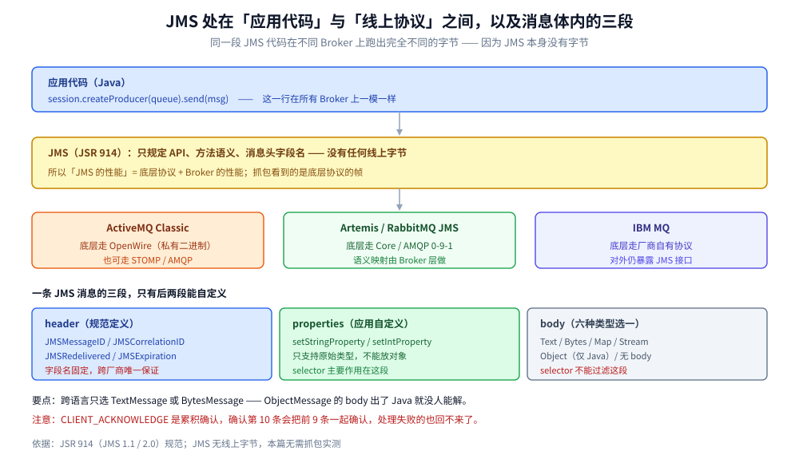

# JMS规范

> 覆盖 ⭐ **JMS 到底是什么、以及为什么把它当「协议」会错位**：它是 JSR 914 定义的 **Java API 规范**（没有线上报文格式）、两个消息域（P2P / Pub-Sub）的语义差异、六种消息类型怎么选、消息体内 header / properties / body 三段的分工、四种确认模式各保证什么、selector 与 XA 事务的边界，以及 1.1 与 2.0 的实质变化。
>
> 不覆盖：AMQP 的线上帧格式见 [AMQP.md](../../../02-计算机基础/网络/消息协议/AMQP.md)；STOMP 的文本帧见 [STOMP.md](../../../02-计算机基础/网络/消息协议/STOMP.md)；ActiveMQ 的 Java 接入与 `redeliveryPolicy` 落地见 [接入ActiveMQ.md](../../../01-编程语言/java/工程实践/接入ActiveMQ.md)；消息队列的粒度判据见 [消息模型与存储代价.md](消息模型与存储代价.md)。
>
> 内容整理自个人学习笔记，语义依据 JSR 914（JMS 1.1 / 2.0）规范。⚠️ **实测口径：本篇无需也不做容器实测**——JMS 规定的是 API 与语义，不是字节布局，**没有任何可抓的报文**；文中不引用吞吐或延迟数字。「具体使用」节的 Java 代码是规范用法，未在本机编译运行。

---

## 一、JMS 为什么不是协议？

**本节要点**：**JMS 没有任何线上报文格式**。它规定的是「Java 里有哪些接口、这些接口的方法语义是什么、消息头有哪些标准字段」。所以「JMS 协议」这个说法本身是错位的——它是**编程模型规范**，底层跑的是 AMQP、OpenWire、STOMP 或厂商私有协议。



上图要读出的核心：**JMS 处在「应用代码」与「线上协议」之间**。同一段 `session.createProducer(queue).send(msg)` 的代码，换成 ActiveMQ 走 OpenWire、换成 RabbitMQ 的 JMS 兼容层走 AMQP、换成 Artemis 走它自己的 Core 协议——**代码一行不改，线上字节完全不同**。

| 规范 | 规定了什么 | 有线上字节吗 |
| --- | --- | --- |
| **JMS**（JSR 914） | Java 接口、方法语义、消息头字段名、确认模式 | ❌ **完全没有** |
| **AMQP 0-9-1** | 帧布局、class-method、field table、连接协商 | ✅ 有（7 字节帧头 + `0xCE`） |
| **MQTT** | 固定头位段、14 种报文、QoS 状态机 | ✅ 有（最小 2 字节头） |
| **STOMP** | 文本帧四段结构、命令集 | ✅ 有（`COMMAND` + headers + 空行 + body + `NUL`） |
| **OpenWire** | ActiveMQ Classic 的私有二进制格式 | ✅ 有（但无公开规范） |

> ⭐ **这条区别决定了两件事**：① 讨论「JMS 的性能」时，实际讨论的是**底层协议 + Broker** 的性能，不是 JMS 的性能；② 排障时抓包看到的是**底层协议的帧**，不是「JMS 报文」。

### 1.1 那 JMS 到底约束了什么

三层约束，都很具体：

- **对象模型**：`ConnectionFactory` → `Connection` → `Session` → `MessageProducer` / `MessageConsumer`，以及它们各自的创建与关闭顺序。
- **语义**：发送是「异步到达 Broker 还是本地缓存」、确认是「何时算消费成功」、事务是「哪几条发送一起生效」。
- **字段名**：`JMSDestination`、`JMSMessageID`、`JMSCorrelationID` 这些**标准头字段的名字与含义**——这是跨厂商可移植的唯一保证。

## 二、两个域有什么区别？

**本节要点**：P2P（Point-to-Point，队列）是「**一条消息只被一个消费者拿到**」，Pub-Sub（Publish/Subscribe，主题）是「**一条消息被所有订阅者各拿一份**」。JMS 1.1 起用统一的 `ConnectionFactory` / `Destination` 接口，**域的区别只体现在 `Destination` 的实现类型上**。

| 维度 | P2P（Queue） | Pub-Sub（Topic） |
| --- | --- | --- |
| 一条消息给几个消费者 | **恰好一个**（竞争消费） | **每个订阅者一份** |
| 消费者不在线时消息怎么办 | **留在队列里**，上线后拿 | 非持久订阅者**错过就没了**；持久订阅（`createDurableSubscriber`）才保留 |
| 扩容消费能力的方式 | 加消费者（同一队列竞争） | 加订阅者（各自收一份，不提升单条处理速度） |
| 典型用途 | 任务分发、订单处理 | 事件广播、配置变更通知 |

> ⚠️ **最常见的误用**：以为「Topic 加消费者能提升吞吐」。P2P 加消费者是并行处理**不同**消息；Topic 加订阅者是每条消息**多复制一份**给人。要并行处理同一条流的消息，必须用 Queue（或者在 Broker 侧用共享订阅，那是 MQTT 5.0 的概念，不是 JMS）。

### 2.1 持久订阅的代价

`createDurableSubscriber` 让「订阅者离线期间的消息也被保留」，但代价是：

- **Broker 要为每个持久订阅维护一套独立的游标**（相当于每条订阅一份消费位点）。
- **订阅者长期不上线** → 消息在 Broker 持续堆积，直到过期策略清掉。
- ⚠️ **持久订阅的 `clientID` 必须稳定**：JMS 用 `clientID + subscriptionName` 标识一个持久订阅，`clientID` 变了就变成「新订阅」，老订阅的堆积永远没人消费。

## 三、六种消息类型怎么选？

**本节要点**：JMS 规定了六种 `Message` 子类型，**它们的区别只在 body 的承载方式**。选型的判据是「接收方是不是 Java」与「要不要跨语言」。

| 类型 | body 承载 | 适用 | 注意 |
| --- | --- | --- | --- |
| **`TextMessage`** | 一个 `String` | JSON / XML 文本 | ⭐ **跨语言首选**，任何客户端都能读 |
| **`BytesMessage`** | 原始字节流 | 二进制（图片、Protobuf、压缩块） | 跨语言可用，但要自己约定解析 |
| **`MapMessage`** | 一组 `name → 原始类型`（String / int / long / double / boolean 等） | 结构化的简单字段 | ⚠️ 只支持 JMS 定义的原始类型，**不能放嵌套对象** |
| **`ObjectMessage`** | 一个**可序列化的 Java 对象** | 纯 Java 内部通信 | ⚠️ **跨语言不可用**；反序列化有安全风险（需白名单） |
| **`StreamMessage`** | 按顺序写入的原始类型流 | 顺序化的定长数据 | 用得少，读顺序必须与写顺序一致 |
| **`Message`** | 无 body | 纯信号 / 事件通知 | 靠 header 与 properties 传信息 |

**选型判据**：

```text
接收方是 Java 且同版本？
├─ 是 → ObjectMessage 最省事（但要注意安全与版本兼容）
└─ 否 → 接收方是异构语言？
         ├─ 是 → TextMessage（JSON）或 BytesMessage（Protobuf）
         └─ 否（只在本服务内部）→ MapMessage / BytesMessage
```

> ⚠️ **`ObjectMessage` 的两个坑**：① 序列化后的类路径变了（改包名、改字段）会导致反序列化失败；② 反序列化任意类是已知的安全风险，生产环境必须配白名单（ActiveMQ 有 `trustedPackages`）。

## 四、消息体内三段的分工

**本节要点**：一条 JMS 消息由 **header（标准字段）+ properties（自定义字段）+ body（内容）** 三段组成。**header 是协议规定的、properties 是应用自定义的、body 是业务数据**。这个划分决定了「哪些字段能用于 selector」。

| 段 | 谁定义 | 内容 | 能否用于 selector |
| --- | --- | --- | --- |
| **header** | JMS 规范 | `JMSDestination` / `JMSDeliveryMode` / `JMSExpiration` / `JMSPriority` / `JMSMessageID` / `JMSTimestamp` / `JMSCorrelationID` / `JMSReplyTo` / `JMSRedelivered` / `JMSType` | ⚠️ **部分可以**（规范推荐用 properties） |
| **properties** | 应用 | 自定义 `key → 原始类型` | ✅ **这是 selector 的主要目标** |
| **body** | 应用 | 六种消息类型之一的内容 | ❌ 不能 |

**几个关键 header 的语义**：

- **`JMSMessageID`**：Broker 生成的唯一 ID，用于**幂等去重**与「这条消息处理过没有」。
- **`JMSCorrelationID`**：**请求-响应配对**用。客户端发请求时带上自己的标识，服务端在响应里原样回填。
- **`JMSRedelivered`**：**这条消息之前投递过**。收到 `true` 说明「前面有人没确认成功」——这是幂等逻辑必须看的标志。
- **`JMSExpiration`**：过期时间戳，**由 Broker 在投递时检查**，过期的消息不会投给消费者。
- **`JMSDeliveryMode`**：`PERSISTENT` / `NON_PERSISTENT`，决定 Broker 是否落盘。

> ⭐ **幂等的正确写法**：`if (msg.getJMSRedelivered()) { 用 JMSMessageID 查重 }`。**不能只靠 `JMSRedelivered`**——它只告诉你「可能重复」，不告诉你「哪条重复」。

## 五、四种确认模式各保证什么？

**本节要点**：确认模式决定「什么时候算消费成功、Broker 可以删消息」。四种模式的风险等级是**递增的宽松还是递增的严格**要看具体模式——`AUTO_ACKNOWLEDGE` 在 `receive()` 返回后即确认（**处理失败也算确认**），这是最容易被误用的一个。

| 模式 | 何时确认 | 保证 | 风险 |
| --- | --- | --- | --- |
| **`AUTO_ACKNOWLEDGE`** | `receive()` 返回后 / `onMessage()` 正常返回后 | 最少重复 | ⚠️ **业务处理失败也已确认**——消息丢了 Broker 不知道 |
| **`CLIENT_ACKNOWLEDGE`** | 显式 `msg.acknowledge()` | 处理完才确认 | ⚠️ 是**累积确认**：确认一条等于确认该 session 收到的全部 |
| **`DUPS_OK_ACKNOWLEDGE`** | 延迟批量确认 | 性能最好 | ⚠️ **允许重复**，消费端必须幂等 |
| **`SESSION_TRANSACTED`** | `commit()` 时确认，`rollback()` 则重投 | 一批消息要么都确认要么都不确认 | 需要事务开销；`rollback` 会触发重投 |

> ⚠️ **`CLIENT_ACKNOWLEDGE` 的累积语义是最大的坑**：收到 10 条、处理完第 10 条时 `acknowledge()`，**前 9 条也一起被确认**了。如果前 9 条里有处理失败的，它们永远不会重投。要逐条确认只能用事务 + 分批 commit，或者选 `DUPS_OK` + 幂等。

**`SESSION_TRANSACTED` 与 XA 的区别**：

- `SESSION_TRANSACTED` 是**本地事务**：只保证「本 session 的发送 / 确认一起生效」，**不涉及数据库**。
- **XA** 是**分布式事务**：把 JMS 与数据库放进同一个两阶段提交。代价是性能与运维复杂度（要事务管理器）。

> ⭐ 判据：**「消息处理 + 数据库写入必须原子」才需要 XA**；只是「一批消息一起确认」用 `SESSION_TRANSACTED` 就够。多数业务应该用「本地事务 + 幂等」而不是 XA。

## 六、selector 与 XA 事务

### 6.1 selector：Broker 侧的过滤

`session.createConsumer(destination, "type = 'ORDER' AND amount > 100")` 里的字符串是 **JMS selector**，语法是 **SQL92 的子集**，**在 Broker 侧求值**——不匹配的消息不会发到客户端。

| 能用的 | 不能用的 |
| --- | --- |
| `=`, `<>`, `>`, `>=`, `<`, `<=`, `BETWEEN`, `LIKE`, `IN`, `IS NULL`, `AND`, `OR`, `NOT` | 函数调用、子查询、body 内容、任意 Java 表达式 |

- ⚠️ **selector 只对 header 与 properties 生效**，不能过滤 body。
- ⚠️ **selector 是全量求值**：每个消费者一条 selector，Broker 对每条消息的可能匹配都要算。消费者多 + selector 复杂时，Broker 的 CPU 会先到顶。

### 6.2 XA 的代价

| 维度 | 本地事务（`SESSION_TRANSACTED`） | XA |
| --- | --- | --- |
| 涉及资源 | 只有 JMS session | JMS + 数据库（+ 可能更多） |
| 一致性 | 消息层面原子 | 跨资源原子 |
| 性能 | 一次 `commit` | 两阶段提交，**多一次日志落盘 + 网络往返** |
| 故障恢复 | Broker 自己处理 | 需要事务管理器的恢复日志 |
| 运维复杂度 | 低 | 高（悬挂事务、启发式回滚） |

## 七、JMS 1.1 与 2.0 差在哪？

**本节要点**：1.1 做了「**统一两个域的 API**」（之前 P2P 用 `QueueConnection`、Pub-Sub 用 `TopicConnection`，1.1 合并成通用接口）；2.0 做了「**简化样板代码**」（`JMSContext` 取代 Connection + Session 的成对创建与关闭）。**语义没变，只是 API 变简洁。**

| 维度 | 1.1 | 2.0 |
| --- | --- | --- |
| 域 API | ✅ 已统一（`ConnectionFactory` / `Destination`） | 同 1.1 |
| 创建对象 | `Connection` → `Session` → `Producer`，要逐层 `close()` | **`JMSContext`** 一个对象（`AutoCloseable`），try-with-resources |
| 异步发送 | 只有同步 `send()` | `send()` + `CompletionListener`（**异步确认发送完成**） |
| 延迟投递 | 无标准 | ✅ `setDeliveryDelay()`（Broker 支持才生效） |
| 共享订阅 | 无标准 | ✅ `createSharedConsumer`（对应 MQTT 5.0 的共享订阅概念） |

> ⚠️ **2.0 的 `JMSContext` 不是线程安全的**。它内部包着一个 `Session`，而 `Session` 在 JMS 里明确**不是线程安全的**。多线程共享一个 `JMSContext` 会导致确认错乱——这是 2.0 简化 API 后新的常见错误。

## 八、应用场景

| 场景 | 用什么 | 理由 |
| --- | --- | --- |
| **Java 生态内的任务分发** | P2P + `CLIENT_ACKNOWLEDGE` | 处理完才确认，且能控制批量 |
| **跨语言的消息互通** | `TextMessage`（JSON）或 `BytesMessage`（Protobuf） | `ObjectMessage` 出不了 Java |
| **事件广播给多个下游** | Pub-Sub + 持久订阅 | 下游离线期间的也要保留 |
| **消息 + 数据库必须原子** | XA 或「本地事务 + 幂等表」 | 优先后者，XA 是最后手段 |
| **按属性过滤减少网络传输** | selector | 在 Broker 侧过滤，省流量 |
| **高吞吐、允许重复** | `DUPS_OK_ACKNOWLEDGE` + 幂等 | 批量确认省往返 |

本仓对应落地：[接入ActiveMQ.md](../../../01-编程语言/java/工程实践/接入ActiveMQ.md)（Java JMS / Spring JMS 的完整接入代码、`redeliveryPolicy`、DLQ）、[消息模型与存储代价.md](消息模型与存储代价.md)（队列与 Topic 的粒度判据）。

## 九、具体使用

### 9.1 JMS 2.0 的最小发送与接收

```java
// 发送：JMSContext 自动关闭，不用逐层 close
try (JMSContext ctx = factory.createContext()) {
    Queue q = ctx.createQueue("orders");
    TextMessage m = ctx.createTextMessage("{\"orderId\":\"A-1\"}");
    m.setStringProperty("region", "cn");        // properties 才能被 selector 用
    m.setJMSCorrelationID("req-1");             // 请求-响应配对
    ctx.createProducer().send(q, m);
}

// 接收：带 selector，只在 Broker 侧收 region=cn 的消息
try (JMSContext ctx = factory.createContext(JMSContext.CLIENT_ACKNOWLEDGE)) {
    Queue q = ctx.createQueue("orders");
    JMSConsumer c = ctx.createConsumer(q, "region = 'cn'");
    Message m = c.receive(1000);                // 超时 1s
    if (m != null && m.getJMSRedelivered()) {
        // 之前投过：必须用 JMSMessageID 做幂等查重
        if (seen(m.getJMSMessageID())) { m.acknowledge(); return; }
    }
    handle(m);
    m.acknowledge();                            // ⚠️ 累积确认：本条及之前全部确认
}
```

### 9.2 排障时先看的五个点

```text
① 确认模式是 AUTO 还是 CLIENT？
   AUTO 在 onMessage 返回后就确认 —— 抛异常也已确认，消息丢了 Broker 不知道
② CLIENT_ACKNOWLEDGE 是不是以为逐条确认？
   它是累积确认，确认第 10 条会把前 9 条一起确认
③ 持久订阅的 clientID 稳定吗？
   clientID 变了就是新订阅，老订阅的堆积永远没人消费
④ selector 里是不是写了 body 字段？
   selector 只能看 header 与 properties，写 body 字段永远不匹配（且不报错）
⑤ 有没有开 XA？
   如果只是「一批确认」，SESSION_TRANSACTED 就够，XA 会带来两阶段提交开销
```

## 延伸追问

- **「JMS 协议」这个词对吗？** 不对。JMS 是 Java API 规范（JSR 914），没有线格式。说「JMS 协议」时，实际指的往往是底层协议（OpenWire / AMQP / STOMP）+ Broker。
- **JMS 能跨语言吗？** 规范本身不能（它是 Java 接口）。但 `TextMessage` / `BytesMessage` 的**内容**可以跨语言——只要其他语言的生产者按同样的格式写 body、按同样的字段名写 properties。
- **`AUTO_ACKNOWLEDGE` 为什么叫 auto 但很危险？** 因为「auto」指的是「框架自动确认」，不是「确认得安全」。`receive()` 一返回就确认，业务处理抛异常时消息已经没了。
- **持久订阅会不会把 Broker 撑爆？** 会。每个持久订阅是一套独立游标，订阅者长期不消费就一直堆积。生产环境必须配消息过期策略，并监控持久订阅的堆积量。
- **JMS 2.0 的 `JMSContext` 能共享吗？** 不能。它内部是一个 `Session`，而 `Session` 不是线程安全的。多线程要么各建一个 ctx，要么用连接池。
- **XA 现在是必需的吗？** 多数场景不是。用「本地事务 + 幂等表（用 `JMSMessageID` 做唯一键）」能达到同等效果，且没有两阶段提交的性能代价。XA 的价值在「事务管理器能处理悬挂事务」这个能力上。

## 关联

- **上游/总纲**：[消息模型与存储代价.md](消息模型与存储代价.md) — 队列与 Topic 在两族六款里的粒度判据，本篇的两个域是它族 A 一侧的 JMS 视角
- **上游/总纲**：[消息队列选型对比.md](消息队列选型对比.md) — 消息队列目录的选型入口与分册导航
- **下游机制**：[README.md](ActiveMQ/README.md) — JMS 最主要的开源实现：KahaDB、`redeliveryPolicy`、DLQ、Spring JMS 接入
- **对照/互补**：[AMQP.md](../../../02-计算机基础/网络/消息协议/AMQP.md) — AMQP 是**协议**（有字节），JMS 是**API**（无字节），这是两者最根本的区别
- **对照/互补**：[STOMP.md](../../../02-计算机基础/网络/消息协议/STOMP.md) — STOMP 也常被当作「JMS 的跨语言替代」，因为它的 destination 语义与 JMS 的 Queue/Topic 能对应
- **对照/互补**：[MQTT.md](../../../02-计算机基础/网络/消息协议/MQTT.md) — MQTT 的 QoS 与 JMS 的确认模式解决的是同一个问题（何时算消费成功），机制完全不同
