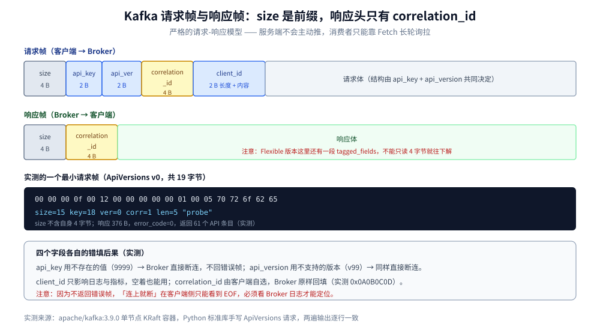

# Kafka 协议

> 覆盖 ⭐ **Kafka 的线上协议是严格的一问一答**（不是双向帧流）：请求帧与响应帧的字节布局、请求头四个字段的作用、`ApiVersions` 为什么必须是客户端的第一枪、版本不匹配时 Broker 的真实反应（实测**直接断连**）、Record Batch v2 的字段结构，以及 Flexible 版本（KIP-482）改了什么。
>
> 不覆盖：Topic 与分区怎么设计见 [Topic与分区设计.md](Topic与分区设计.md)；分区副本与 ISR 见 [核心概念与架构.md](核心概念与架构.md)；AMQP 的双向帧流见 [AMQP.md](../../../../02-计算机基础/网络/消息协议/AMQP.md)；NATS 的文本协议见 [NATS协议.md](../NATS/NATS协议.md)。
>
> 内容整理自个人学习笔记，字段定义依据 Kafka 官方协议文档（3.9）。**实测口径**：「请求帧 / 响应帧 / API 版本范围」读数来自本机 `apache/kafka:3.9.0`（KRaft 单节点，容器 `kafka-gran-lab`，宿主端口 19092），探针用 Python 标准库手写 `ApiVersions` 请求帧，**连续两遍输出逐行一致**；⚠️ **Record Batch v2 的字段布局未做本机落盘验证**（按规范陈述，未逐字节解出消息体）。

---

## 一、Kafka 协议是「请求-响应」而不是「帧流」

**本节要点**：AMQP / MQTT 是**双向帧流**（连接建立后双方都可以随时往同一条 TCP 上写帧），Kafka 是**严格的请求-响应**：客户端发一个请求帧，服务端回一个响应帧，**同一连接上请求可以流水线化，但响应必须按 `correlation_id` 配对**。

| 协议 | 交互模型 | 帧里靠什么配对 | 服务端能主动推吗 |
| --- | --- | --- | --- |
| **Kafka** | 一问一答 | `correlation_id` | ❌ **不能**（消费者靠 `fetch` 长轮询拉） |
| AMQP 0-9-1 | 双向帧流 | `channel id` | ✅ 能（`basic.deliver` 推给消费者） |
| MQTT | 双向帧流 | 无（连接内顺序） | ✅ 能（Broker 主动推 `PUBLISH`） |
| NATS | 双向行流 | `sid`（订阅 ID） | ✅ 能（`MSG` 主动推） |

> ⭐ **这条差异的后果**：Kafka 的消费者**没有「被推送」这回事**，只有 `fetch` 长轮询（请求里带 `max_wait_ms`，没数据就让服务端挂住一会儿）。所以「Kafka 消费延迟」的一大部分是**轮询间隔**，不是网络。

## 二、请求头四个字段

**本节要点**：请求帧 = `size(int32)` + 请求头 + 请求体。请求头只有四个字段：**`api_key`（调哪个 API）、`api_version`（用第几版）、`correlation_id`（配对用）、`client_id`（日志里认人）**。



上图要读出的核心：**`size` 是帧前缀，不是头的一部分**；**响应帧没有 `api_key` 与 `api_version`**（客户端已经知道自己在等什么），只有 `correlation_id` 加响应体。

### 2.1 实测的一个最小请求帧（19 字节）

```text
00 00 00 0f    size = 15（后面 15 字节，不含这 4 字节）
00 12          api_key = 18（ApiVersions）
00 00          api_version = 0
00 00 00 01    correlation_id = 1
00 05          client_id 长度 = 5
70 72 6f 62 65  "probe"
```

四个字段的作用各不相同：

| 字段 | 宽度 | 作用 | 错填的后果 |
| --- | --- | --- | --- |
| `api_key` | 2 B | 调哪个 API（18 = ApiVersions、0 = Produce、1 = Fetch） | 不存在的 key → **Broker 直接断连**（实测） |
| `api_version` | 2 B | 用第几版（同一 API 的不同版本结构不同） | 不支持的版本 → **Broker 直接断连**（实测） |
| `correlation_id` | 4 B | 请求与响应的配对标识 | 回填错误 → 客户端把响应用给错的回调 |
| `client_id` | 2 B 长度 + 内容 | 日志与指标里的客户端标识 | 空也能用，但排障时看不出是谁 |

**`correlation_id` 由客户端自己选**，实测发 `0x0A0B0C0D` 时 Broker 原样回填：

```text
--- 发 correlation_id=0x0A0B0C0D，回的是 0x0A0B0C0D
```

> ⚠️ **`correlation_id` 只有在「同一连接上并发多个请求」时才有意义**。同步客户端一次只发一个请求，看起来它没用；但异步 producer 会同时挂着几十个未完成的请求，全靠这个字段配对。

### 2.2 响应帧少两个字段

响应帧 = `size(int32)` + `correlation_id(int32)` + 响应体。**没有 `api_key` 与 `api_version`**——因为「我在等哪个 API 的哪个版本」是客户端自己的状态，服务端不需要重复。

⚠️ **Flexible 版本（见第五节）的响应头会多一段 `tagged_fields`**，所以解析响应头时「读 4 字节 correlation_id 就完事」只在非 flexible 版本成立。

## 三、版本协商：`ApiVersions` 为什么必须是第一枪

**本节要点**：Kafka 的每个 API 都有**多个版本**，且不同版本的请求体结构可能完全不同。客户端连上后的第一件事必须是发 `ApiVersions`（key=18），拿到服务端支持的 `min~max` 范围，再决定「用哪一版」。**跳过这一步直接用某个版本，版本不匹配就是断连。**

### 3.1 实测读数（`apache/kafka:3.9.0`）

| 项 | 实测值 |
| --- | --- |
| `ApiVersions` 响应帧大小 | **376 B** |
| 响应里的 `error_code` | `0` |
| **API 条目数** | **61** |
| 认识的 API key 最大值 | **81** |
| `ApiVersions`(18) 支持 | v0 ~ **v4** |
| `Produce`(0) 支持 | v0 ~ **v11** |
| `Fetch`(1) 支持 | v0 ~ **v17** |
| `Metadata`(3) 支持 | v0 ~ **v12** |

**61 个条目但最大 key 是 81**——这个差值本身就是一条信息：**API key 不是连续分配的**（中间有历史废弃的编号），所以「按 0~81 遍历」会拿到一堆不存在的能力。

### 3.2 版本不匹配的真实反应：直接断连

实测两种错误，Broker **都不返回错误帧，直接关连接**：

```text
--- ② ApiVersions v99：Broker 直接关闭连接，不回任何错误帧
--- ③ API key=9999：Broker 直接关闭连接（不返回错误帧）
```

⚠️ **这与「协议会返回 `UNSUPPORTED_VERSION`」的常见说法不同**。实测行为是：**连接被关闭**。所以客户端看到的现象是「连上了又断了，日志里没有明确错误」——排障时如果只找「错误响应」，会什么都找不到，**必须看 Broker 侧日志**。

> ⭐ **这也是为什么客户端库要主动协商**：不协商就直接发，出错时客户端连「为什么断」都拿不到。

### 3.3 协商的落地顺序

```text
① 连 TCP → 发 ApiVersions（v0，最低版本，任何 Broker 都认）
② 解析 61 个条目的 (api_key, min, max)，存成本地表
③ 对每个 API，选 min(客户端最高支持, 服务端 max)，且不能低于服务端 min
④ 之后所有请求都带这个协商后的版本号
⑤ 若某个 API 的版本区间无交集 → 客户端应报「Broker 版本过低」而不是硬发
```

## 四、Record Batch v2 长什么样？

**要点**：真正落在磁盘上、也真正在线上传的消息单位不是「一条消息」，而是 **Record Batch（一批）**。v2 是 0.11 起的格式，与 v0/v1 最大的区别是**加了 `producerId` / `producerEpoch` / `baseSequence` 三个幂等字段**。

⚠️ **下面按规范陈述，未做本机逐字节解出验证**：

| 字段 | 宽度 | 作用 |
| --- | --- | --- |
| `baseOffset` | int64 | 这批第一条的 offset（Broker 写入时填） |
| `batchLength` | int32 | 从 `partitionLeaderEpoch` 到结尾的字节数 |
| `partitionLeaderEpoch` | int32 | Leader 纪元，用于副本截断判断 |
| `magic` | int8 | **固定为 2**（v2 的标志） |
| `crc` | uint32 | 从 `attributes` 到结尾的 CRC32 |
| `attributes` | int16 | **位段**：低 3 位是压缩类型，bit3 时间戳类型，bit4 事务，bit5 控制批 |
| `lastOffsetDelta` | int32 | 这批的 offset 跨度 |
| `baseTimestamp` / `maxTimestamp` | int64 × 2 | 批次内时间戳范围 |
| **`producerId`** | int64 | 幂等 producer 的 ID（`-1` 表示非幂等） |
| **`producerEpoch`** | int16 | producer 的纪元，重启会 +1 |
| **`baseSequence`** | int32 | 这批第一条的序号，**Broker 靠它去重** |
| `recordsCount` | int32 | 批内消息条数 |
| `records` | 变长 | 每条记录用 **varint** 编码长度 |

**`attributes` 的位段**（这是唯一需要按位读的地方）：

| 位 | 含义 |
| --- | --- |
| bit 0~2 | 压缩：0=none、1=gzip、2=snappy、3=lz4、4=zstd |
| bit 3 | 时间戳类型：0=CreateTime、1=LogAppendTime |
| bit 4 | 是否事务批 |
| bit 5 | 是否控制批（事务的 commit/abort 标记） |

> ⭐ **幂等真正的实现点就在这三个字段**：Broker 对同一 `(producerId, producerEpoch)` 只接受「`baseSequence` 连续」的批次。序号重复 → 丢弃并回成功（幂等）；序号跳跃 → 报 `OUT_OF_ORDER_SEQUENCE_NUMBER`。**所以幂等是「按 producer 维度」的，不是按消息 ID 的。**

### 4.1 为什么用 varint 编码记录长度

一批消息里，绝大多数记录的 key 是短的、value 是几百字节。用 varint 编长度，小值只占 1 字节——**每批几万条时省下的字节很可观**。代价是解码要处理「续位」，与 MQTT 的变长剩余长度是同一套思路（见 [MQTT.md](../../../../02-计算机基础/网络/消息协议/MQTT.md) 第二节）。

## 五、Flexible 版本（KIP-482）改了什么？

**要点**：Flexible 版本是「同一 API 的新版本演进方式」——它把**所有字符串改成 compact 编码**（长度 + 1，省掉 4 字节长度）、并在消息末尾加**可选的 `tagged_fields`**（用 tag 编号定位的扩展区）。**目的是以后加字段不用再升版本号。**

| 项 | 非 flexible（如 ApiVersions v0） | flexible（如 ApiVersions v3+） |
| --- | --- | --- |
| 字符串 | `int16` 长度 + 内容（`-1` 表 null） | **compact**：`unsigned varint` 长度 + 1（`0` 表 null） |
| 数组 | `int32` 长度 + 元素 | **compact**：`unsigned varint` 长度 + 1 |
| 扩展字段 | 只能靠升版本 | **`tagged_fields`**：`tag` + `size` + `data`，未知 tag 可跳过 |
| 请求头 | 四字段 | 四字段 + `tagged_fields` |
| 响应头 | `correlation_id` | `correlation_id` + `tagged_fields` |

> ⚠️ **这是手写 Kafka 协议最容易翻车的地方**：同一个 API 的 v1 与 v3，**字符串的长度的编码方式就不一样**。用「固定解析逻辑 + 只换版本号」的写法，在跨 flexible 边界时必然解错，而且报错位置会偏离真正原因。

## 六、应用场景

| 场景 | 用什么 API | 注意 |
| --- | --- | --- |
| **连上后第一件事** | `ApiVersions`（18） | 必须先协商，否则版本不匹配直接断连且无错误帧 |
| **生产消息** | `Produce`（0） | 幂等靠 `producerId` + `baseSequence`，不是消息 ID |
| **消费消息** | `Fetch`（1） | 是**长轮询**，`max_wait_ms` 决定「没数据时挂多久」 |
| **建 / 删 Topic、扩分区** | `CreateTopics` / `DeleteTopics` / `CreatePartitions` | 管理面 API，普通客户端通常不直接用 |
| **查消费组位点** | `OffsetFetch` / `ListOffsets` | 与 `Fetch` 分属两套：一个查位点，一个取数据 |
| **排查「连上就断」** | — | 先看 Broker 日志的「不支持版本」记录，客户端侧看不到原因 |

本仓对应落地：[Topic与分区设计.md](Topic与分区设计.md)（分区数与副本）、[消费者组与重平衡.md](消费者组与重平衡.md)（消费组协议）、[运维与排障.md](运维与排障.md)（LAG 与排障）。

## 七、具体使用

### 7.1 手写一个 `ApiVersions` 请求（Python 标准库，实测可跑）

```python
import socket, struct

def frame(api_key, api_ver, corr, client=b"probe"):
    # 请求头 = api_key(2) + api_version(2) + correlation_id(4) + client_id(2+len)
    body = struct.pack(">hhi", api_key, api_ver, corr) + \
        struct.pack(">h", len(client)) + client
    return struct.pack(">i", len(body)) + body   # size 前缀不含自身 4 字节

s = socket.create_connection(("127.0.0.1", 19092), timeout=5)
s.sendall(frame(18, 0, 1))                       # ApiVersions v0

size = struct.unpack(">i", s.recv(4))[0]
resp = b""
while len(resp) < size:
    resp += s.recv(size - len(resp))

corr, err, n = struct.unpack(">ihi", resp[:10])   # 响应头只有 correlation_id
print(f"corr={corr} err={err} api_entries={n}")   # 实测：corr=1 err=0 n=61

for i in range(n):
    k, mn, mx = struct.unpack(">hhh", resp[10 + i * 6: 16 + i * 6])
    if k in (0, 1, 3, 18):
        print(f"api_key={k} 支持 v{mn}~v{mx}")
```

### 7.2 排障三个「看不到原因」的场景

```text
① 客户端连上就断，没有错误响应
   → 大概率是 api_key 不存在或 api_version 不支持；Broker 直接断连，不回帧
   → 只能看 Broker 日志，客户端侧的异常往往是 EOF

② 消费「没数据」但 LAG 在涨
   → Fetch 是长轮询，max_wait_ms 太小会让「空轮询」占满；太大则延迟高
   → 这不是协议问题，是参数问题

③ 幂等 producer 报 OUT_OF_ORDER_SEQUENCE_NUMBER
   → 同一 (producerId, producerEpoch) 的 baseSequence 不连续
   → 常见原因：上一批发送超时后客户端重试，Broker 已写入但没回 ack
```

## 延伸追问

- **Kafka 为什么不做服务端推送？** 因为它的消费模型是「客户端管位点」，服务端不知道某个消费者当前消费到哪（位点可以随时重置）。推送的前提是服务端持有「谁该收什么」的状态，而 Kafka 刻意不持有这个状态（这是它能水平扩展的原因之一）。
- **`ApiVersions` 为什么用 v0 发第一枪？** 因为 v0 是「所有 Broker 都支持的最低版本」，用它才能问到「你支持到哪一版」。如果先用高版本发，老 Broker 会直接断连。
- **`correlation_id` 会不会重复？** 会（客户端只要求在「未完成的请求」里唯一）。同步客户端每次都是 1 也没问题。
- **Record Batch 为什么要「批」而不是「一条一帧」？** 因为批内可以共享一份 CRC、一次压缩、一份 offset 基准。**批越大，单条开销越低**，这也是 `linger.ms` + `batch.size` 能显著提吞吐的原因。
- **Flexible 版本之后还会升版本号吗？** 会，但频率大幅下降——加字段可以走 `tagged_fields`，不必升版本。只有「语义变了」才需要新版本。
- **手写 Kafka 协议现实吗？** 读场景可以（`Fetch` 的响应结构相对简单），写场景不建议——客户端库处理了幂等、重试、批量、压缩、元数据刷新这些「协议之外的复杂度」，重写代价远高于收益。

## 关联

- **上游/总纲**：[README.md](README.md) — 本目录的阅读路线与三节点 KRaft 实测坐标
- **上游/总纲**：[队列粒度设计.md](../队列粒度设计.md) — 跨产品对比：Kafka 的 Topic/Partition 在三种 MQ 里的位置
- **下游机制**：[Topic与分区设计.md](Topic与分区设计.md) — 分区数与副本：协议层之下的存储决策
- **下游机制**：[核心概念与架构.md](核心概念与架构.md) — 日志段与稀疏索引：Record Batch 落盘之后长什么样
- **下游机制**：[消息可靠性.md](消息可靠性.md) — `acks` 与幂等：`producerId` / `baseSequence` 在可靠性里的作用
- **对照/互补**：[AMQP.md](../../../../02-计算机基础/网络/消息协议/AMQP.md) — 双向帧流 + channel 多路复用，与 Kafka 的严格请求-响应形成对照
- **对照/互补**：[NATS协议.md](../NATS/NATS协议.md) — 纯文本命令 + 长度字段，最小可读的「另一个消息协议」
