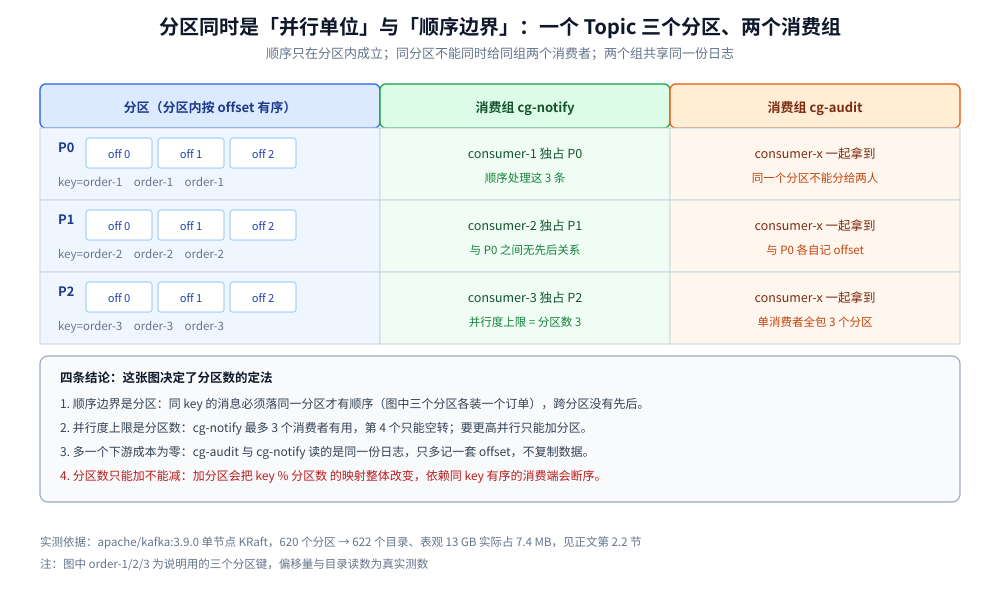

# Topic与分区设计

> 覆盖 ⭐ **Kafka 里「一个 Topic 几个分区」这个一次性决策怎么定**：Topic 与 Partition 各是哪种单位、分区数受哪三个约束（并行度上限 / 顺序边界 / 不可逆）、分区的真实资源代价（本机实测目录与占盘）、Topic 该拆还是该合（为什么「为每个下游建 Topic」是错的），以及分区键为什么会制造热点。
>
> 不覆盖：⭐ 跨产品的拆合判据与 RabbitMQ / RocketMQ 的落点对照见 [队列粒度设计.md](../队列粒度设计.md)；分区副本的分布与 ISR 机制见 [核心概念与架构.md](核心概念与架构.md) 第三、四节；消费组怎么在分区之间分摊见 [消费者组与重平衡.md](消费者组与重平衡.md)；可靠性的三侧配置见 [消息可靠性.md](消息可靠性.md)。
>
> 内容整理自个人学习笔记，素材见 [素材清单.md](../../../../素材清单.md)。**实测口径**：分区代价读数来自 `apache/kafka:3.9.0`（KRaft 单节点、`replication-factor=1`）容器 `kafka-gran-lab`，数据目录 `/tmp/kafka-logs`，用 `kafka-topics.sh` 声明 100 / 500 分区后数目录与文件；**唯一性验证为单节点单副本，三副本下的目录倍数按「× 副本数」推导，未实测**。分区数上限、`num.partitions` 等默认值未做逐项探针。

---

## 一、Topic 和 Partition 各是什么单位？

**本节要点**：Topic 是**分类与存储容器**（一个 Topic 的数据存在一起、共用一套配置），Partition 是**并行单位 + 顺序边界**。两件事都在 Partition 上收口，所以 Kafka 的分区数同时决定了「能并行多少」和「顺序能保证到哪一段」。

| 维度 | Topic | Partition |
| --- | --- | --- |
| 是什么单位 | 分类 + 存储 + 配置（保留时长、压缩、`min.insync.replicas`） | **并行 + 顺序** |
| 消费者能不能跨它并行 | 一个消费组内，不同分区可以分给不同消费者 | ✅ 一个分区同一时刻只给同组的一个消费者 |
| 顺序保证的边界 | ❌ 跨分区不保证顺序 | ✅ **分区内严格有序**（按 offset） |
| 能否事后改数量 | 只能改配置，不能「合并」 | ⚠️ **只能加，不能减**（实测被拒） |
| 副本的单位 | — | 每分区一份副本集，ISR 按分区维护 |



上图要读出的三件事：**顺序只在分区内成立**（不同分区之间没有先后）、**同一分区不能同时给同组的两个消费者**（所以并行度上限是分区数）、**两个消费组共享同一份日志**（多一个下游不复制数据）。

> ⭐ 一句话：**Kafka 的分区数同时是「并行度上限」和「顺序粒度」，这两件事绑死在同一个旋钮上，所以它比 RabbitMQ 的队列数更难改。**

## 二、分区数怎么定？

**本节要点**：分区数受**三个约束**同时夹住——并行度上限（同组消费者数不能超过分区数）、顺序边界（顺序只在分区内）、不可逆（只能加不能减）。所以正确顺序是：**先按「目标吞吐 ÷ 单分区实测吞吐」定下限，再按「未来两年的消费并行度」定上限，最后取靠近下限的值。**

### 2.1 三个约束各自的含义

| 约束 | 含义 | 违反了会怎样 |
| --- | --- | --- |
| **并行度上限** | 同组内一个分区只能给一个消费者 | 消费者数 > 分区数 → 多出来的消费者**空转**，还增加重平衡次数 |
| **顺序边界** | 只有分区内有序 | 需要「同一实体有序」时必须让该实体落同一分区（同 key） |
| **不可逆** | 分区数只能加不能减 | 估多了永久背着元数据与重平衡成本；**减少只能建新 Topic 迁数据** |

### 2.2 分区的真实代价（本机实测）

`apache/kafka:3.9.0` 单节点、`replication-factor=1`，声明 `gran-100`（100 分区）与 `gran-500`（500 分区）：

| 阶段 | Topic 分区总数 | 分区目录 | `.log` | `.index` | `.timeindex` | broker fd | 实际占盘 |
| --- | --- | --- | --- | --- | --- | --- | --- |
| 基线 | 2（系统 Topic） | 2 | 1 | 1 | 1 | 174 | — |
| 建 100 分区后 2s | 102 | **86** | 86 | 86 | 87 | 263 | — |
| 建 500 分区后取总量 | 620 | **622** | 621 | 621 | 621 | 796 | **7.4 MB** |

三条要单独说的读数：

- ⚠️ **`--create` 返回成功时，分区目录还没建完**。102 个分区只数到 86 个目录，等到 620 个分区时才是 622 个目录（620 + 2 个系统分区）。**建完立刻数会少算 15% 左右**，要么等几秒，要么用 `--describe` 数 `Partition:` 行。
- ⭐ **索引是稀疏预分配，`ls` 会骗人**：单个分区里 `.index` 显示 **10485760 B**、`.timeindex` 显示 **10485756 B**，但 620 个分区合计**表观 13 GB、实际只占 7.4 MB**（`du --apparent-size` 与 `du` 的差）。所以「500 分区吃 10 GB 索引」是错的——**磁盘不是分区的瓶颈**。
- **fd 不是线性的**：621 个数据文件只对应 796 个 fd（基线 174），索引文件按需打开。不能拿「分区数 × 3」估句柄。

单个分区目录的完整内容（`gran-100-0`）：

| 文件 | 大小 | 作用 |
| --- | --- | --- |
| `00000000000000000000.log` | 0（无消息） | 消息段，按 `segment.bytes` 滚动 |
| `00000000000000000000.index` | 10485760（稀疏） | 稀疏索引，实测每 4096 B 一条 |
| `00000000000000000000.timeindex` | 10485756 | 按时间戳检索的索引 |
| `leader-epoch-checkpoint` | 8 | Leader 纪元，副本截断判断 |
| `partition.metadata` | 43 | 分区的 Topic ID 与版本 |

> ⚠️ **副本数会乘上去**：上表是 `replication-factor=1`。三副本意味着每个分区在**三个 broker 上各一个目录、各一套文件**，所以「3 副本 × 500 分区 = 1500 个目录」。目录实际占盘仍很小，但**元数据项与 ISR 状态机按「分区 × 副本」增长**，这才是集群规模受限的地方。

### 2.3 「只能加不能减」这条约束有多硬

实测分区缩减请求被直接拒绝：

```text
Error while executing topic command : The topic gran-100 currently has 100 partition(s);
20 would not be an increase.
```

扩容则成功（`gran-100` 从 100 扩到 120，`--describe` 数到 120 个 `Partition:`）。**这条约束的后果不是磁盘，而是「估错了没有回头路」**：

- 估多了：永久背着多出来的元数据、Controller 的分配计算、以及每次重平衡要搬更多分区；
- 估少了：可以扩，但**扩容会打乱「同 key 落同分区」的映射**——原来 `key % 100` 的分布变成 `key % 120`，同一个 key 的新消息会落到不同分区，**顺序保证断裂**。

> ⭐ 扩容前必须确认：这个 Topic 的消费端是否依赖「同 key 有序」。如果依赖，扩容等于打破顺序保证，得走「建新 Topic + 双写 + 迁移」而不是原地扩容。这条在 [消费者组与重平衡.md](消费者组与重平衡.md) 与 [运维与排障.md](运维与排障.md) 都有落点。

### 2.4 定分区数的顺序

```text
第一步：下限 = 目标峰值吞吐 ÷ 单分区实测吞吐（自己压，别抄别人的数字）
第二步：上限 = 未来两年该 Topic 的最大消费并行度（同组消费者数）
第三步：取靠近下限的值，向上取到 2 的倍数附近便于后续翻倍扩容
第四步：确认「按什么 key 分区」，检查是否有热点（见第四节）
```

⚠️ **两种常见错法**：按「消费者数」定（消费者会变，分区不会）、按「业务实体数」定（实体数不封顶，分区必须封顶）。

## 三、Topic 该合还是该拆？

**本节要点**：Kafka 的 Topic 是**存储容器**，拆 Topic 就是拆存储，所以「为每个下游建一个 Topic」是错的——正确做法是**一个 Topic + N 个消费组**。真正该拆 Topic 的理由只有三条：**保留策略不同、权限不同、schema / 兼容性策略不同**。

### 3.1 与 RabbitMQ 的镜像关系

| 需求 | RabbitMQ 的做法 | Kafka 的做法 | 为什么相反 |
| --- | --- | --- | --- |
| 两个下游各处理一遍 | **两条队列**（各存一份） | **两个消费组**（共享一份） | RabbitMQ 的队列独占消息，Kafka 的日志共享位点 |
| 一个下游要更慢的重试节奏 | 拆队列 + 各自 prefetch | 新消费组 + 更小的 `max.poll.records` | Kafka 的配额是消费者级，不是分区级 |
| 审计要留 90 天、业务只留 7 天 | 两条队列 + 各自 TTL | ⚠️ **必须拆 Topic**（保留策略是 Topic 级） | 保留策略挂在存储容器上 |

第三行是关键：**Kafka 里唯一必须拆 Topic 的常见理由是「保留策略不同」**，因为 `retention.ms` / `cleanup.policy` 是 Topic 级配置，没法按消费组区分。

### 3.2 三条该拆 Topic 的理由

- **保留策略不同**：审计 90 天、业务 7 天 → 拆两个 Topic（或一个 Topic + 镜像到另一个集群）。
- **权限边界不同**：跨团队、跨租户要按 Topic 授 ACL → 拆。
- **schema 与兼容性策略不同**：`cleanup.policy=compact`（变更日志）与普通日志混在一个 Topic 里会互相干扰 → 拆。

> ⚠️ **反向错误**：按事件类型拆 Topic（`order.created` / `order.paid` / `order.refunded` 三个 Topic）。这会让「一次订单生命周期要按顺序处理」变成跨 Topic 无法保证顺序，而且每个 Topic 各占一套分区与副本。**类型差异用 key 或消息头表达，不用 Topic。**

### 3.3 一条判据

```text
问：两个消费方是否共享「同一份数据 + 同一套保留策略 + 同一套权限」？
├─ 是 → 同一个 Topic，两个消费组（不复制数据）
└─ 否 → 拆 Topic（并接受两份存储与两套分区）
```

## 四、命名与分区键怎么定？

**本节要点**：Kafka 的命名里，**分区键比 Topic 名更重要**——Topic 名错了改一次就完，分区键错了会造成永久热点。Topic 名按「业务域 + 事件类」定，分区键必须选**基数大且分布均匀**、同时**业务要求有序**的那个字段。

### 4.1 Topic 命名

| 规则 | 例子 | 理由 |
| --- | --- | --- |
| `<域>.<事件类>` | `order.events` / `payment.events` | 与「按业务域分」的粒度判据对齐，不把事件类型放进名字 |
| 不用 `__` 前缀 | ❌ `__order` | `__consumer_offsets` 等是内部 Topic 保留 |
| 不写环境前缀 | `order.events` 而非 `prod.order.events` | 多环境用不同集群 / 不同前缀 ACL 隔离 |
| 不写版本号 | `order.events` 而非 `order.events.v2` | 换实现换消费组，不换 Topic（数据不用搬） |

### 4.2 分区键：热点都从这里来

| 分区键选择 | 结果 |
| --- | --- |
| `orderId`（基数大、均匀） | ✅ 同一订单的消息有序，且分布均匀 |
| `userId`（基数大，但有大客户） | ⚠️ 大客户会把一个分区打满，需要加盐（`userId + 随机后缀`）或单独分流 |
| `tenantId`（基数小） | ❌ 租户数少时分区严重倾斜，分区数再多也没用 |
| 不指定 key（轮询） | ✅ 均匀，但**放弃顺序保证** |
| 常量 / `null` 语义混用 | ❌ 全部落一个分区，等于单分区 |

> ⭐ **判据**：分区键必须同时满足「**业务要求这部分有序**」和「**基数远大于分区数**」。只满足前者（如 `tenantId`）会造成倾斜，只满足后者（如 `UUID`）会丢掉顺序的意义。

⚠️ **测倾斜的方法**：对每个分区统计消息量，而不是看总 LAG。

```bash
kafka-run-class.sh kafka.tools.GetOffsetShell --bootstrap-server localhost:9092 \
  --topic order.events --time -1 | awk -F: '{print $2, $3}' | sort -n
```

各分区的 `offset` 差一个量级就说明分区键倾斜，与分区数无关——**加分区救不了倾斜**。

## 五、应用场景

| 场景 | 分区数怎么定 | 分区键 |
| --- | --- | --- |
| **订单事件**，需同订单有序 | 按峰值吞吐定，预留 2 倍扩容余量 | `orderId` |
| **用户行为埋点**，无需顺序 | 按吞吐定，可给较大值 | 不指定（轮询）或 `userId` |
| **CDC / 变更日志**（`cleanup.policy=compact`） | 与源表主键分布对齐 | 主键 |
| **审计日志**，保留 90 天 | 单独 Topic（保留策略不同） | 不指定或 `tenantId + 盐` |
| **多租户 SaaS**，租户数少 | 分区数 ≥ 租户数，否则倾斜 | `tenantId`（租户少时才可用） |

本仓对应落地：[核心概念与架构.md](核心概念与架构.md)（分区副本分布）、[消费者组与重平衡.md](消费者组与重平衡.md)（分区怎么分摊）、[运维与排障.md](运维与排障.md)（分区扩容与顺序破坏）。

## 六、具体使用

### 6.1 建 Topic 与确认分区数

```bash
# 建：分区数一次定好，副本数按集群规模（三节点集群用 3）
kafka-topics.sh --bootstrap-server localhost:9092 --create \
  --topic order.events --partitions 6 --replication-factor 3 \
  --config retention.ms=604800000 --config min.insync.replicas=2

# 数分区：别数目录（目录是延迟创建的），数 describe 的 Partition 行
kafka-topics.sh --bootstrap-server localhost:9092 --describe --topic order.events | \
  grep -c 'Partition:'

# 看每个分区的消息量（判倾斜，不是看总 LAG）
kafka-run-class.sh kafka.tools.GetOffsetShell --bootstrap-server localhost:9092 \
  --topic order.events --time -1
```

### 6.2 扩容前先确认「有没有依赖同 key 有序」

```bash
# 扩容只能加
kafka-topics.sh --bootstrap-server localhost:9092 --alter --topic order.events --partitions 12

# 缩减会直接被拒（实测报错原文）
# Error while executing topic command : The topic order.events currently has 12 partition(s);
# 6 would not be an increase.
```

> ⚠️ **扩容会改变 `key % 分区数` 的映射**。如果消费端依赖「同 key 有序」，扩容后同一个 key 的新消息会落到别的分区，与旧消息不再同分区。正确做法是「建新 Topic + 双写 + 位点迁移」，见 [运维与排障.md](运维与排障.md)。

### 6.3 用 AdminClient 查分区与倾斜（Java）

```java
try (AdminClient admin = AdminClient.create(Map.of("bootstrap.servers", "localhost:9092"))) {
    TopicDescription d = admin.describeTopics(List.of("order.events"))
            .allTopicNames().get().get("order.events");
    System.out.println("分区数=" + d.partitions().size());   // 与消费者数对照
}
```

## 延伸追问

- **分区数能按「消费者数」定吗？** 不能。消费者数会随发布、扩容、故障恢复变化，分区数不能跟着变。正确关系是「消费者数 ≤ 分区数」，超出部分是空转。
- **为什么「500 分区吃 10 GB 索引」是错的？** 因为 `.index` / `.timeindex` 是**稀疏预分配**：`ls` 显示 10 MiB，620 个分区合计表观 13 GB，但 `du` 实测只占 7.4 MB。真正的代价在元数据、ISR 状态机与重平衡，不在磁盘。
- **一个 Topic 最多多少分区？** 单机没有硬编码的数字上限，瓶颈是 Controller 的元数据规模与重平衡时间。实践判据是「单集群分区总数 × 副本数」控制在几千量级，超出后重平衡会变成分钟级。
- **`num.partitions` 默认值是多少，能依赖它吗？** 不能依赖。本仓实测默认值是 `1`（见 [部署与配置.md](部署与配置.md)），自动建 Topic 时按 1 分区建，等于把所有顺序与并行都压在一台上。**生产必须显式建 Topic 并给分区数。**
- **加了分区，为什么吞吐没涨？** 三个可能：消费组里消费者数没跟着加（并行度卡在消费者数）、分区键倾斜（消息都落一个分区）、或者 Broker 侧磁盘带宽先到顶。先看分区级 offset 分布，再看消费者数。

## 关联

- **上游/总纲**：[队列粒度设计.md](../队列粒度设计.md) — ⭐ 跨产品的拆合判据，本篇是它在 Kafka 侧的纵深
- **上游/总纲**：[README.md](README.md) — 本目录的阅读路线与三节点 KRaft 实测坐标
- **下游机制**：[核心概念与架构.md](核心概念与架构.md) — 分区副本分布、日志段与稀疏索引、「多分区与多副本两个正交旋钮」
- **下游机制**：[消费者组与重平衡.md](消费者组与重平衡.md) — 分区怎么在组内分摊，为什么并行度上限是分区数
- **下游机制**：[运维与排障.md](运维与排障.md) — 分区扩容的操作、顺序性破坏的四种原因
- **对照/互补**：[队列与绑定设计.md](../RabbitMQ/队列与绑定设计.md) — RabbitMQ 侧：队列是订阅、每下游一条队列才对
- **对照/互补**：[Topic与队列设计.md](../RocketMQ/Topic与队列设计.md) — RocketMQ 侧：Topic / Queue / Tag 三级，Tag 承担了 Kafka 里「消息头过滤」的角色
