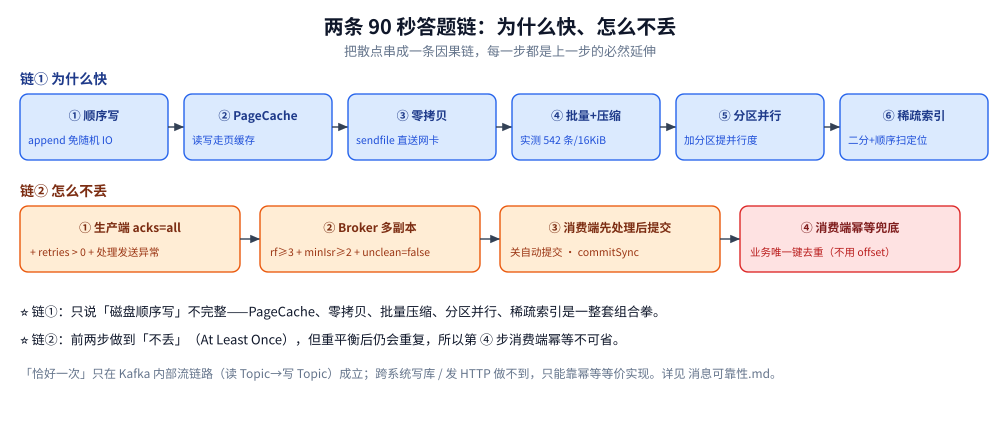

# 延伸追问

> 覆盖：把本目录各篇里最常被**连环追问**的问题集中成一页——每题给一句结论 + 指向详解篇目，用来快速自查「哪一块其实没答上来」。
>
> 不覆盖：每题背后的机制、表格与实测都在对应篇目里；本页**只做索引与一句话答案**，不重复展开。
>
> 内容整理自个人学习笔记。答案中的读数来自本机 `apache/kafka:3.9.0` 三节点 KRaft 集群实测。

---

## 一、这一页怎么用

按「问题 → 一句话结论 → 详解在哪」组织。建议的用法是：**先遮住结论自己答，答不上来的顺着指针回篇目**。

| 线索 | 篇 |
| --- | --- |
| 定位、核心概念、分区与副本、存储与读写链路 | [核心概念与架构.md](核心概念与架构.md) |
| 不丢 / 不重 / `acks` / `min.insync.replicas` | [消息可靠性.md](消息可靠性.md) |
| 消费组、分配策略、重平衡、两个超时参数 | [消费者组与重平衡.md](消费者组与重平衡.md) |
| docker 起法、默认值、分区数怎么定 | [部署与配置.md](部署与配置.md) |
| 积压、扩容、重复消费、顺序性、磁盘水位 | [运维与排障.md](运维与排障.md) |
| Go / Java 客户端代码 | [接入Kafka.md](../../../../01-编程语言/go/工程实践/接入Kafka.md)、[接入Kafka.md](../../../../01-编程语言/java/工程实践/接入Kafka.md) |

## 二、定位与核心概念

| 追问 | 一句话结论 | 详解 |
| --- | --- | --- |
| Kafka 是消息队列还是存储？ | 都是，还多一层流处理平台：Topic 是 append-only、不可变、可截断的日志，消费后不删 | [核心概念与架构.md](核心概念与架构.md) 第一节 |
| 与传统 MQ 最本质的区别？ | 消费即删 vs **消费后按时间/大小清理**，位点由消费者自己管，因此可回退重放 | 同上 |
| Offset 是全局唯一的吗？ | 不是，**只在分区内递增**，跨分区不可比 | [核心概念与架构.md](核心概念与架构.md) 第二节 |
| Kafka 能保证全局有序吗？ | 不能（除非只建 1 个分区，代价是并行度归零）；只保证**分区内有序** | 同上 |
| 想要「同一订单的消息有序」怎么做？ | 用业务 key（`orderId`）做分区路由，`hash(key) % 分区数` 让同实体固定落一个分区 | 同上 |
| Kafka 有哪些它天生没有的能力？ | 原生延迟消息、消息级 TTL、半消息事务回查——选型时最容易被这三项筛掉 | [消息队列选型对比.md](../消息队列选型对比.md) |

## 三、存储、分区与副本

| 追问 | 一句话结论 | 详解 |
| --- | --- | --- |
| 分区和副本是一回事吗？ | 不是。分区切**数据**买吞吐，副本复制**同一份数据**买冗余；两者不可互相替代 | [核心概念与架构.md](核心概念与架构.md) 第四节 |
| 加副本能提升读吞吐吗？ | **不能**。读写都只在 Leader，Follower 纯粹是备份——没有主从读写分离 | 同上 |
| 分区数为什么只能增不能减？ | 减需重建 Topic + 迁数据；增会改 `hash(key) % n`，**同 key 顺序被破坏** | [运维与排障.md](运维与排障.md) 第二节 |
| 稀疏索引「稀疏」到什么程度？ | 每写满 `log.index.interval.bytes`（实测默认 4096）才记一条；查找靠二分 + 顺序扫 | [核心概念与架构.md](核心概念与架构.md) 第五节 |
| 索引文件为什么一建出来就 10 MiB？ | 它是**预分配**的（`log.index.size.max.bytes` = 10485760），里面只有少量有效条目 | 同上 |
| 「消息进来了，副本什么时候落盘」？ | Leader 先 append 到 PageCache 就返回 → Follower **主动拉**并 append 到自己的 PageCache → Leader 才算 HW | [核心概念与架构.md](核心概念与架构.md) 第六节 |
| 零拷贝省掉了哪几次拷贝？ | 省掉「内核→用户态」「用户态→内核」两次 **CPU 拷贝**；数据从 PageCache 经 DMA 直送网卡 | [核心概念与架构.md](核心概念与架构.md) 第七节 |
| 什么会让零拷贝失效？ | 走 TLS、Broker 端 down-conversion、任何要改写字节的中间层 | 同上 |
| ZooKeeper 还在吗？ | 4.0 起已彻底移除，元数据由 KRaft 管；部署上 controller 可与 broker 合并角色 | [核心概念与架构.md](核心概念与架构.md) 第八节 |

## 四、可靠性与一致性

| 追问 | 一句话结论 | 详解 |
| --- | --- | --- |
| `acks=all` 就等于落盘了吗？ | 不等于。只保证 ISR 都收到并写进各自 PageCache；`log.flush.*` 实测默认是 `Long.MAX_VALUE`，从不主动 fsync | [消息可靠性.md](消息可靠性.md) 第二节 |
| `acks=all` 要配什么才有效？ | 必须配 `min.insync.replicas ≥ 2` + `replication.factor ≥ 3`，否则 ISR 只剩 Leader 时「all」形同 `acks=1` | [消息可靠性.md](消息可靠性.md) 第三节 |
| ISR 少于 `min.insync.replicas` 会发生什么？ | `acks=all` 被拒（`NotEnoughReplicasException`）；`acks=1` 能写但 **HW 不推进、消费者读不到**，ISR 恢复后位点立刻补齐 | [消息可靠性.md](消息可靠性.md) 第五节 |
| 「不重」能靠配置解决吗？ | 不能。幂等生产者只防自己实例的重试重复；跨系统必须靠**消费端幂等**（业务唯一键） | [消息可靠性.md](消息可靠性.md) 第六节 |
| 「恰好一次」真的存在吗？ | 只在 Kafka 内部流链路（读 Topic → 写 Topic）成立；跨系统写库/发 HTTP 做不到，只能等价实现 | 同上 |
| `unclean.leader.election.enable=true` 的代价？ | 换来「不拒写」，代价是落后副本上位后**永久丢数据**，默认 `false` | [消息可靠性.md](消息可靠性.md) 第三节 |

## 五、消费、扩容与排障

| 追问 | 一句话结论 | 详解 |
| --- | --- | --- |
| 消费者数超过分区数会怎样？ | 多出来的实例**分不到分区、纯空闲**；分区数是消费并行的天花板 | [消费者组与重平衡.md](消费者组与重平衡.md) 第一节 |
| `session.timeout.ms` 和 `max.poll.interval.ms` 的区别？ | 前者管「你还活着吗」（心跳），后者管「你的业务处理完了吗」（两次 poll 间隔）；处理慢先踩后者 | [消费者组与重平衡.md](消费者组与重平衡.md) 第四节 |
| 滚动发布怎么不触发重平衡？ | 配静态成员 `group.instance.id`（每实例唯一且稳定）+ 较大的 `session.timeout.ms` | [消费者组与重平衡.md](消费者组与重平衡.md) 第五节 |
| 重平衡为什么被称为灾难？ | EAGER 下全组停摆（Stop The World）；分区易主后从旧位点继续导致重复消费；处理慢还会形成踢出-重平衡死循环 | [消费者组与重平衡.md](消费者组与重平衡.md) 第三节 |
| LAG 一直不降怎么查？ | 先分单分区高（热点 key）还是全分区高（消费能力不足）；再查 `max.poll.interval.ms` 超时循环 | [运维与排障.md](运维与排障.md) 第一节 |
| 停掉一台 broker 后怎么快速判断影响面？ | `--describe` 看 `Isr` 是否收缩、`Leader` 是否改选；`kafka-log-dirs.sh` 看 `offsetLag` 是否回到 0 | [运维与排障.md](运维与排障.md) 第七节 |
| 磁盘满了能自愈吗？ | 不能。写入直接拒绝，删除按日志段滚动进行，必须人工降保留时间或扩容 | [运维与排障.md](运维与排障.md) 第六节 |

## 六、两条 90 秒答题链（把散点串起来）

**① 「Kafka 为什么快」**：顺序写磁盘（append-only，免随机 IO）→ PageCache（写先落页缓存、读优先命中）→ 零拷贝 sendfile（PageCache 直送网卡，用户态只发一次系统调用）→ 批量发送与整批压缩（实测一个批次 542 条 / 16 KiB）→ 分区水平并行 → 稀疏索引快速定位。**只说「磁盘顺序写」不完整。**

**② 「Kafka 怎么做到不丢」**：生产端 `acks=all` + 重试 + 处理发送异常 → Broker 端 `replication.factor≥3` + `min.insync.replicas≥2` + `unclean=false` → 消费端关闭自动提交、处理成功才提交 → 仍然会重复，所以**必须再加消费端幂等**。四步缺一，链条就断。

## 延伸追问

- **这一页的结论哪些是本机实测、哪些是口径？** → 带具体量值的（ISR 收缩、HW 冻住后补齐、副本 `size` 相等、`offsetLag=0`、CPU 对照、默认值）是本机 `apache/kafka:3.9.0` 三节点实测；概念性表述（ISR 语义、KRaft 演进、事务边界）是官方文档口径。**零拷贝没有做系统调用级实测**，只有端到端 CPU 对照。
- **换一款 MQ，这些问题还成立吗？** → 语义类问题（投递语义、消费位点、重平衡）在 [README.md](../RabbitMQ/README.md)、[README.md](../RocketMQ/README.md)、[Pulsar.md](../Pulsar.md)、[Nats.md](../Nats.md)、[ActiveMQ.md](../ActiveMQ.md) 各有对应写法；**「不丢」的推理结构可以照搬**，但参数名与机制完全不同（如 RocketMQ 的刷盘 × 复制组合、Pulsar 的 quorum 确认）。
- **哪些结论最可能随版本变化？** → 默认值（`session.timeout.ms` 在 3.0 从 10s 调成 45s；`log.flush.*` 一直是 `Long.MAX_VALUE`）、`--describe` 的列（3.9 多了 `Elr` / `LastKnownElr`）、以及 KRaft 的成熟度。**读旧资料时先对版本。**

## 关联

- **上游/总纲**：[README.md](README.md) — 本目录导读：定位、核心概念速览与阅读路线
- **对照/互补**：[核心概念与架构.md](核心概念与架构.md) — 第五节至第七节是「为什么快」的完整版
- **对照/互补**：[消息可靠性.md](消息可靠性.md) — 第五节是本页「ISR 与 HW」那条的实测完整版
- **对照/互补**：[消费者组与重平衡.md](消费者组与重平衡.md) — 重平衡与两个超时参数
- **对照/互补**：[部署与配置.md](部署与配置.md) — 默认值清单
- **对照/互补**：[运维与排障.md](运维与排障.md) — 排障三步法
> 反向引用（本篇被下列文档引到）：[延伸追问.md](../RocketMQ/延伸追问.md)
