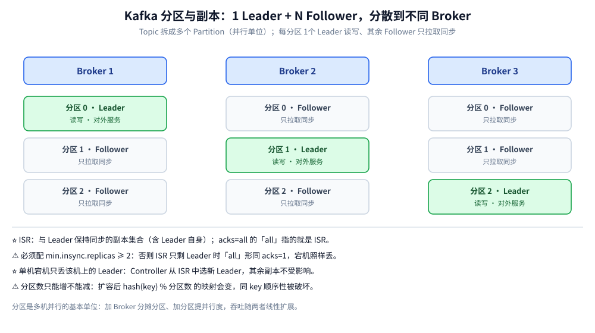
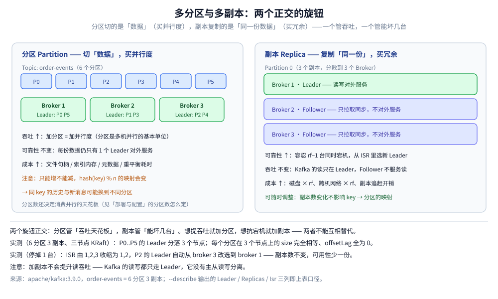
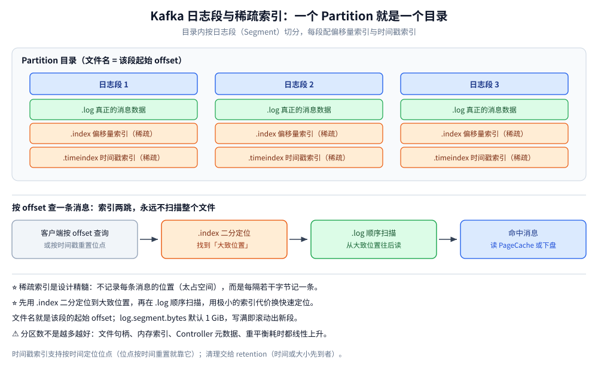
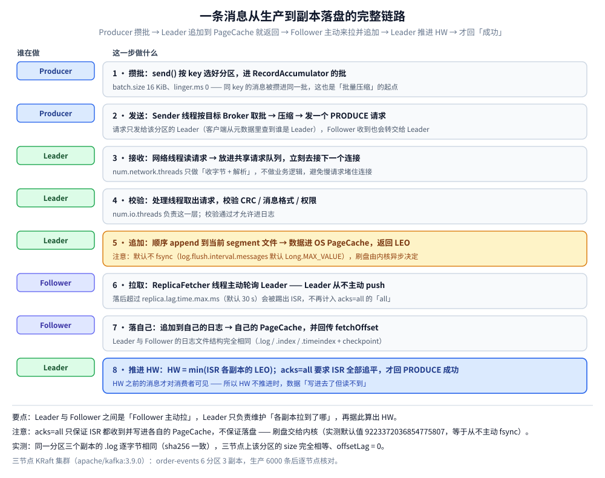
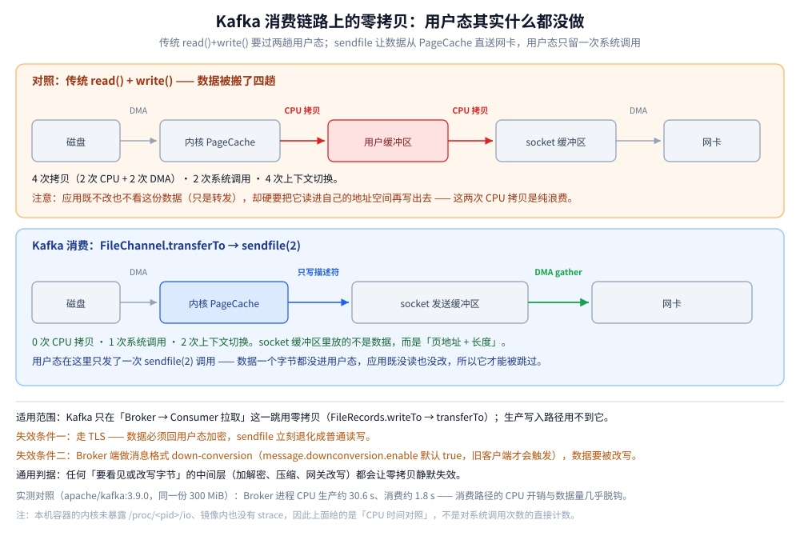

# 核心概念与架构

> 覆盖 Kafka 的定位与三重身份、核心概念表、分区与副本的分布方式、**多分区与多副本这两个旋钮的分工**、日志段与稀疏索引、**一条消息从生产到副本落盘的完整链路**（含零拷贝为什么快），以及 ZooKeeper → KRaft 的演进。
>
> 不覆盖：可靠性参数（`acks` / `min.insync.replicas` / 幂等 / 事务）见 [消息可靠性.md](消息可靠性.md)；消费者组与重平衡见 [消费者组与重平衡.md](消费者组与重平衡.md)；部署与分区数怎么定见 [部署与配置.md](部署与配置.md)；线上排障见 [运维与排障.md](运维与排障.md)。
>
> 内容整理自个人学习笔记。本篇所有读数来自本机 `apache/kafka:3.9.0` 三节点 KRaft 集群（`kafka-lab-1/2/3`），场景为 `order-events`：6 分区 3 副本，按 key 生产 6000 条。

---

## 一、一句话定位与它凭什么

**Kafka 是分布式事件流平台（Distributed Event Stream Platform），不只是消息队列**——官方给它三重身份：**消息队列 + 存储系统 + 流处理平台**。一条消息写进来，既可以当队列消费，也可以当可重放、可长期留存的日志，还能被 Flink / Kafka Streams 直接做流式计算。

| 卖点 | 说明 |
| --- | --- |
| **高吞吐** | 单机十几万 msg/s、集群百万级 QPS 量级（顺序写 + PageCache + 零拷贝 + 批量压缩 + 分区并行） |
| **可持久化** | 落盘保留（默认 7 天），**不是消费即删** |
| **可重放** | 位点由消费者自己管理，可任意回退重读 |
| **水平扩展** | 加 Broker 分摊分区、加分区提并行度 |
| **生态事实标准** | Flink / Spark / Debezium / Connect 的数据总线默认落点 |

> ⭐ 与传统 MQ 最本质的差异：传统 MQ **消费即删**（队列只是暂存管道），Kafka **消费后不删除**，靠 Offset 标记进度，清理交给时间（`log.retention.hours`，默认 168 小时）或大小（`log.retention.bytes`，默认不限）到期删除——因此数据模型是一条 **append-only、不可变、可截断的分区日志**。
>
> 一句话记忆：**Kafka 的 Topic 是一条只会追加、不会插队的日志；消费者不是「拿走」消息，而是「往前挪自己的书签」。**
>
> ⚠️ 也正因为这套设定，Kafka **没有原生延迟消息、没有消息级 TTL、也没有半消息事务回查**——这三项最容易在选型时直接筛掉它，详见 [消息队列选型对比.md](../消息队列选型对比.md)。

## 二、核心概念

| 概念 | 说明 | 关键点 |
| --- | --- | --- |
| **Broker** | 一个 Kafka 服务节点（进程），负责收发与存储 | 多 Broker 组成集群，每台承载若干分区（Leader 或 Follower） |
| **Topic** | 消息的**逻辑分类**，发布与订阅的对象 | 只是逻辑概念，物理上由若干 Partition 承载 |
| **Partition（分区）** ⭐ | Topic 的**物理分片**，Kafka **并行与有序的基本单位** | 一份 append-only 日志，只能被同组内**一个**消费者消费 |
| **Offset** | 消息在**某个分区内**的**递增序号**（从 0 开始） | ⚠️ 只在分区内有意义，跨分区不可比 |
| **Producer** | 生产者，向 Topic 写消息 | 决定消息落哪个分区（key 哈希 / 粘性轮询） |
| **Consumer** | 消费者，从分区拉取消息 | 拉模型（poll），消费者自己控制速率 |
| **Consumer Group** ⭐ | 消费组，组内**分摊**分区、组间**各自独立** | 一条消息在一个组内只被消费一次 |
| **Replica** | 分区副本，分 **Leader** 与 **Follower** | Leader 提供读写，Follower 只做同步备份 |
| **ISR** | In-Sync Replicas，与 Leader 保持同步的副本集合 | ⭐ `acks=all` 的「all」实际指 ISR，而非全部副本 |
| **Controller** | 集群「大脑」，负责分区 Leader 选举、Broker 上下线 | KRaft 时代由 Controller Quorum 承担，取代 ZooKeeper |
| **`__consumer_offsets`** | 内部 Topic，存各消费组的提交位点 | 默认 50 分区，组多、提交频繁会让它膨胀 |

### 铁律：分区内有序，分区之间无序

| 事实 | 含义 |
| --- | --- |
| ⭐ 结论 | Kafka **只能保证「局部有序」**：单个 Partition 内按 append / offset 严格 FIFO，**多个 Partition 之间无任何顺序保证** |
| 全局有序 | 需 Topic 只建 1 个分区，代价是并行度归零，一般不用 |
| 落地做法 | 用**业务 key**（如 `orderId`）做分区路由，`hash(key) % 分区数` 使同一实体永远落同一分区；key 不变 → 分区不变 → 该实体的消息有序 |

## 三、分区与副本的分布

每个分区 1 个 Leader + N 个 Follower，**Leader 读写、Follower 只拉取同步**（不对外服务）；分区与副本尽量**分散到不同 Broker**，单机宕机只丢该机上的 Leader（Controller 从 ISR 选新 Leader）；副本因子 `replication.factor` 决定冗余度，生产建议 **≥ 3**。

本机实测：三个节点组成集群后，6 个分区的 Leader 与副本集合分布如下（`--describe` 的原样读数）。

| 分区 | Leader | Replicas | Isr |
| --- | --- | --- | --- |
| P0 | 1 | 1,2,3 | 1,2,3 |
| P1 | 2 | 2,3,1 | 2,3,1 |
| P2 | 3 | 3,1,2 | 3,1,2 |
| P3 | 2 | 2,3,1 | 2,3,1 |
| P4 | 3 | 3,1,2 | 3,1,2 |
| P5 | 1 | 1,2,3 | 1,2,3 |

| 读数 | 值 | 说明 |
| --- | --- | --- |
| Leader 分布 | broker1 → P0、P5；broker2 → P1、P3；broker3 → P2、P4 | **每个节点各领 2 个分区**，分配是均衡的 |
| 每个分区的 `size` | 三节点**完全相等**（如 P0 = 30660 字节） | 副本是同一份数据的完整拷贝，不是校验块 |
| `offsetLag` | 全部分区、全部节点均为 **0** | Follower 已追平 Leader |
| `.log` 的 sha256 | 三节点**完全相同** | 副本内容逐字节一致 |
| `replication-offset-checkpoint` | 三节点**逐行相同** | 各节点本机记录的高水位一致 |

> ⭐ **`--describe` 输出的 `Leader / Replicas / Isr` 三列**是看副本健康度最快的一组数：`Replicas` 是「应该有几份」，`Isr` 是「现在几份是同步的」，`Leader` 是「读写落在谁身上」。
>
> ⚠️ 3.9 的 `--describe` 还多了 `Elr:` / `LastKnownElr:` 两列（KIP-966 引入的「合格 Leader 副本」概念），老资料里没有，看到空值属正常。

## 四、多分区与多副本：两个正交的旋钮

这两件事经常被当成一回事，实际上**动的是完全不同的两个变量**：

| 维度 | 加**分区** | 加**副本** |
| --- | --- | --- |
| 切什么 | 把**数据**切开，每份只有 1 个 Leader 对外 | 把**同一份数据**复制多份 |
| 主要收益 | **吞吐 / 并行度**：分区是多机并行的基本单位 | **可靠性 / 可用性**：容忍 `rf − 1` 台同时宕机 |
| 对吞吐 | ↑（可线性扩） | **基本不变** ⚠️ 读只在 Leader，Follower 不服务读 |
| 对可靠性 | 基本不变（仍靠副本兜底） | ↑ |
| 代价 | 文件句柄、索引内存、Controller 元数据、重平衡耗时都随分区数上升 | 磁盘 × rf、跨机网络 × rf、副本追赶开销 |
| 可逆性 | ⚠️ **只能增不能减**，且改 `hash(key) % n` 会破坏同 key 顺序 | 可随时调整，**不影响 key → 分区 的映射** |

> ⭐ 一句话：**想提吞吐就加分区，想抗宕机就加副本，两者不能互相替代。** 一个 6 分区 1 副本的 Topic 有 6 倍并行度但没有任何冗余；一个 1 分区 3 副本的 Topic 很抗宕机但消费并行度封顶为 1。
>
> ⚠️ **加副本不会提升读吞吐**——Kafka 的读写都只走 Leader，Follower 纯粹是备份。它没有「主从读写分离」，这是与 MySQL 主从最容易混淆的一点。
>
> ⚠️ 两者在故障时的表现也不同：停掉一台 broker 后实测 ISR 由 `1,2,3` 收缩为 `1,2`、落在该机上的 Leader 自动改选到其他副本；**副本数没变，只是可用性少了一份**（详见 [运维与排障.md](运维与排障.md) 第七节）。

## 五、日志段与稀疏索引

一个 Partition 的物理存储 = 一个目录，里面按**日志段**切分：

| 文件 | 作用 | 说明 |
| --- | --- | --- |
| `0000...000.log` | 真正的消息数据 | 文件名是**起始 offset**；写满 `log.segment.bytes`（默认 1 GiB）或超过 `log.segment.ms`（默认 7 天）后滚动新段 |
| `0000...000.index` | **偏移量索引**（稀疏） | 存「相对 offset → 物理位置」，二分定位后再顺序扫 |
| `0000...000.timeindex` | **时间戳索引**（稀疏） | 支持按时间戳定位（位点按时间重置就靠它） |
| `leader-epoch-checkpoint` | Leader 纪元 | 换主时用于判断副本的第几段是否领先 |
| `partition.metadata` | 分区元数据 | TopicId 等 |

> ⭐ **稀疏索引是设计精髓**：不记录每条消息的位置（太占空间），而是**每写满 `log.index.interval.bytes`（默认 4096）字节才追加一条索引项**，查找时先用索引**二分定位到大致位置**，再在 `.log` 中**顺序扫描**，用极小的索引代价换取快速定位。

本机实测（`order-events-0`，写入 1005 条 / 30660 字节）：

| 观察 | 读数 | 说明 |
| --- | --- | --- |
| `.log` 实际大小 | **30660** 字节 | 与 `kafka-log-dirs.sh` 报的 `size` 一致 |
| `.index` 大小 | **10485760** 字节（= `log.index.size.max.bytes`） | ⚠️ 索引文件是**预分配**的：文件已占满 10 MiB，但里面只有少量稀疏条目 |
| `.timeindex` 大小 | **10485756** 字节 | 同上，预留了一个「最大时间戳」的槽位 |
| 索引粒度 | `log.index.interval.bytes = 4096` | 每 4 KiB 才记一条，这就是「稀疏」的量化口径 |
| 批次头 | `baseOffset: 0 lastOffset: 541 count: 542 size: 16373 magic: 2 compresscodec: none` | **一个批次 542 条消息**（约 16 KiB），说明生产端攒批是真实生效的；`magic: 2` 是 v2 消息格式 |
| `.index` sanity check | `passed sanity check` | 偏移量索引结构完好 |

> ⚠️ 顺带一个容易吓人的观测：对**尚未滚动**的 `.timeindex` 跑 `kafka-dump-log.sh --index-sanity-check`，会报
> `CorruptIndexException: ... has non-zero size but the last timestamp is 0 which is less than the first timestamp`。
> 这是**预分配区尾部全零**导致的检查器行为，**不是数据损坏**——运行中的 broker 并不报错，`.index` 也正常通过。

## 六、一条消息从生产到副本落盘的完整链路

这是「Kafka 为什么既快又不丢」的骨架：**Leader 先写自己（进 PageCache 就返回），Follower 主动来拉，Leader 才算得准高水位。**

下面按「谁在做 → 这一步做什么」逐段拆开，其中第 ③ 步与第 ⑧ 步是「消息会不会丢」与「消息读不到」这两类问题的分界点：

| 阶段 | 关键事实 |
| --- | --- |
| ① 生产端攒批 | 同一个 key 的消息进同一批（`batch.size` 16 KiB），整批压缩后发往该分区的 Leader |
| ② Leader 接收与校验 | 网络线程只管收发与解析（`num.network.threads`），处理线程负责校验与落日志（`num.io.threads`） |
| ③ 追加到 PageCache | 顺序 append 到当前 segment；**默认不 fsync**（`log.flush.interval.messages` 与 `log.flush.scheduler.interval.ms` 实测默认都是 `9223372036854775807`，等于从不主动刷） |
| ④ Follower 主动拉 | **是 Follower 去 fetch，Leader 从不 push**；滞后超过 `replica.lag.time.max.ms`（实测默认 30000 ms）就被踢出 ISR |
| ⑤ Follower 落自己的副本 | 追加到自己的 segment 与 PageCache，回传自己的 fetchOffset |
| ⑥ Leader 推进 HW | `HW = min(ISR 各副本的 LEO)`；`acks=all` 要等 ISR 全部追平才回成功 |

> ⭐ **关键结论**：`acks=all` 保证的是「**ISR 都收到并写进各自的 PageCache**」，**不保证落盘**。真正的刷盘由内核按脏页策略异步进行——Kafka 的可靠性靠**多副本**，不靠**单机刷盘**。
>
> ⚠️ **HW 之前的消息才对消费者可见**。所以「写进去了但读不到」是可能发生的：当 ISR 少于 `min.insync.replicas` 时 HW 会停止推进（实测见 [消息可靠性.md](消息可靠性.md) 的 4.5 节）。

## 七、为什么顺序写磁盘还能这么快

| 机制 | 原理 |
| --- | --- |
| **顺序写（append-only）** | 只往文件末尾追加，不做随机写；顺序磁盘写速度可媲美内存随机写 |
| **PageCache** | 写入先进 OS 页缓存即返回，内核异步刷盘；读也优先命中缓存（不占 JVM 堆、省 GC） |
| **零拷贝（sendfile）** | 消费时数据从 PageCache **直接**送网卡，跳过「内核 → 用户态 → 内核」两次拷贝与上下文切换 |
| **批量 + 压缩** | 生产者攒批（实测一个批次 542 条 / 16 KiB），整批落盘、整批压缩（snappy / lz4 / zstd） |
| **分区并行** | 分区是多机并行的基本单位，吞吐随分区数 / Broker 数扩展 |

### 零拷贝：用户态其实什么都没做

| 路径 | 经过用户态 | CPU 拷贝 | 系统调用 | 上下文切换 |
| --- | --- | --- | --- | --- |
| 传统 `read()` + `write()` | 是 | **2 次** | 2 | 4 |
| **Kafka 消费（`sendfile`）** | 否 | **0 次** | 1 | 2 |

**为什么能跳过用户态**：应用（broker）**既不改也不看**这份数据，它只是原样转发给消费者——**把数据读进用户态再写出去，这两次 CPU 拷贝是纯浪费**。于是内核直接按「页地址 + 长度」把数据从 PageCache 交给网卡（DMA scatter-gather），socket 发送缓冲区里放的只是**描述符**。

| 问题 | 答案 |
| --- | --- |
| 用在哪一跳？ | 只在「**Broker → Consumer 拉取**」这一跳（`FileRecords.writeTo` → `FileChannel.transferTo`）；生产写入路径用不到 |
| 什么会让它失效？ | ① 走 **TLS**（数据必须回用户态加密）；② Broker 端做**消息格式 down-conversion**（`message.downconversion.enable` 默认 `true`，旧客户端请求时要把老格式写出来）；③ 任何**要看见或改写字节**的中间层（压缩、加解密、网关改写） |
| 收益怎么估？ | 收益**正比于数据量、反比于单位数据的业务处理量**；业务逻辑密集时优化 I/O 等于没优化。原理与五种实现路径见 [零拷贝.md](../../../../02-计算机基础/linux/零拷贝.md) |

本机实测对照（同一份 **300 MiB**，只统计 broker 进程 PID 1 的 CPU 时间，取 `/proc/1/stat` 的 `utime+stime`；容器 4 核 / 5.79 GiB 内存）：

| 动作 | Broker 进程 CPU | 换算 |
| --- | --- | --- |
| 生产 300 MiB（`zc-lab`，1 分区 1 副本，307200 × 1 KiB） | 3057 jiffies | ≈ **30.6 秒** |
| 消费同一份 300 MiB（第 1 次） | 178 jiffies | ≈ **1.8 秒** |
| 消费同一份 300 MiB（第 2 次，数据已在 PageCache） | 280 jiffies | ≈ **2.8 秒** |

> ⭐ **消费路径的 CPU 开销与数据量几乎脱钩**（300 MiB 只花 1.8 ~ 2.8 秒 CPU，而生产同样数据量要 30.6 秒，差约 17 倍），与「数据不进用户态、内核直接搬」的机制一致。
>
> ⚠️ 口径说明：这是**端到端的 CPU 对照**，不是对系统调用次数的直接计数——本机容器的内核未暴露 `/proc/<pid>/io`、镜像内也没有 `strace`，所以**不能**据此断言「零拷贝一定生效」。生产侧耗时高也不全是拷贝：还包含 CRC 校验、批处理记账与落页缓存的开销；两次消费的差值（1.8 s vs 2.8 s）属同量级波动，只能看量级。
>
> ⚠️ 反过来：**分区数不是越多越好**。分区越多，文件句柄、内存索引、Controller 元数据、重平衡耗时都线性上升，单分区故障影响面也更大。

## 八、ZooKeeper → KRaft 的演进

| 阶段 | 版本 | 说明 |
| --- | --- | --- |
| ZooKeeper 时代 | 0.8 ~ 2.x | 元数据、Controller 选举、ACL 全放 ZK（ZK 侧的定序机制见 [ZAB协议.md](../../../../04-架构与系统/分布式/共识协议/ZAB协议.md)）；ZK 成为**扩展性瓶颈**（分区上万后重选举极慢） |
| 过渡期 | 2.8 / 3.0 ~ 3.x | 引入 **KRaft**（Kafka Raft），双轨运行，3.3 起生产可用 |
| KRaft 时代 | **4.0 起** | ⭐ **彻底移除 ZooKeeper**，元数据作为内部 Topic 用 Raft 管理，Controller 可多副本；组件少一半、变更更快，可支撑**百万级分区** |

> ⭐ 对使用者的直接影响很小（客户端 API 不变），但对**部署与故障域**影响很大：KRaft 下 controller 与 broker 的角色可以合并（本机实测就是 `broker,controller` 三节点合并角色），组件数量减半；⚠️ 代价是**合并角色的集群受 controller quorum 约束**——3 个 voter 停掉 2 台会同时失去 broker 与 controller 多数派，整个集群不可写。

## 延伸追问

- **Kafka 为什么快？** → 顺序写磁盘（append-only，免随机 IO）+ PageCache（写先落页缓存、读优先命中）+ 零拷贝 sendfile（数据从页缓存直送网卡）+ 批量发送与整批压缩（实测一个批次 542 条 / 16 KiB）+ 分区水平并行 + 稀疏索引快速定位。**只说「磁盘顺序写」不完整，要凑齐这条链。**
- **分区和副本是一回事吗？** → 不是。分区切的是**数据**，买的是**吞吐与并行度**；副本复制的是**同一份数据**，买的是**能坏几台**。加副本**不提升读吞吐**（读写都只在 Leader），加分区也**不提升可靠性**。两者不可互相替代。
- **ISR 是什么？为什么要它？** → 与 Leader 保持同步（未落后超过 `replica.lag.time.max.ms`，实测默认 30 s）的副本集合，**含 Leader 自身**。`acks=all` 的「all」指 ISR 而非全部副本，所以必须配 `min.insync.replicas ≥ 2`。它是在**可用性与一致性**之间的折中：只从 ISR 选新 Leader，避免落后副本上位丢数据。
- **`acks=all` 就等于消息落盘了吗？** → 不等于。`acks=all` 只保证 ISR 都收到并**写进各自的 PageCache**；`log.flush.interval.messages` 实测默认是 `Long.MAX_VALUE`，等于从不主动 fsync，刷盘由内核异步完成。
- **为什么 Follower 不是 Leader 主动推？** → 拉模型让 Follower 自己控制节奏，Leader 只维护「各副本拉到了哪」（LEO），再据此算出 HW；这也让副本追赶的进度天然可观测（`offsetLag`）。
- **`--describe` 里的 `Elr:` 是什么？** → 3.9 新增列（KIP-966 的「合格 Leader 副本」）。老资料里没有这两列，读到空值属正常，不影响 `Leader / Replicas / Isr` 的读法。

## 关联

- **上游/总纲**：[README.md](README.md) — 本目录导读：定位、核心概念速览与阅读路线
- **对照/互补**：[消息可靠性.md](消息可靠性.md) — 三侧可靠性配置、HW 与写入拒绝
- **对照/互补**：[消费者组与重平衡.md](消费者组与重平衡.md) — 分区如何被消费、重平衡的代价
- **对照/互补**：[部署与配置.md](部署与配置.md) — 默认值清单、分区数怎么定
- **对照/互补**：[运维与排障.md](运维与排障.md) — 副本故障时 ISR 与 Leader 的变化
- **对照/互补**：[README.md](../Pulsar/README.md) — 存算分离的另一种路线
- **延伸**：[零拷贝.md](../../../../02-计算机基础/linux/零拷贝.md) — 零拷贝的原理与五种实现路径
- **延伸**：[栈与队列.md](../../../../02-计算机基础/数据结构/线性结构/栈与队列.md) — 内存队列搬到磁盘后为什么变成日志结构
- **上游/总纲**：[集群基础.md](../../../../04-架构与系统/分布式/集群基础.md) — 分区、副本与 controller 选举的通用集群判据
- **延伸**：[复制与Quorum.md](../../../../04-架构与系统/分布式/数据分布/复制与Quorum.md) — ISR 与多数派确认的区别
- **延伸**：[ZAB协议.md](../../../../04-架构与系统/分布式/共识协议/ZAB协议.md) — 第八节被 KRaft 取代的那套定序机制
> 反向引用（本篇被下列文档引到）：[接入Kafka.md](../../../../01-编程语言/go/工程实践/接入Kafka.md)、[零拷贝.md](../../../../01-编程语言/go/运行时/零拷贝.md)、[接入Kafka.md](../../../../01-编程语言/java/工程实践/接入Kafka.md)、[二分查找.md](../../../../02-计算机基础/算法/基础算法/查找/二分查找.md)、[霍夫曼编码.md](../../../../02-计算机基础/算法/贪心/霍夫曼编码.md)、[延伸追问.md](延伸追问.md)、[发布订阅.md](../../../数据存储/NoSQL/Redis/发布订阅.md)、[分区与再平衡.md](../../../../04-架构与系统/分布式/数据分布/分区与再平衡.md)
