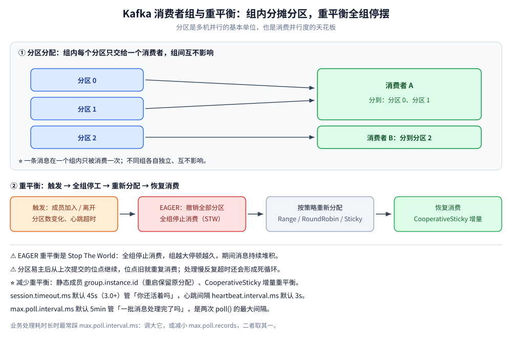

# 消费者组与重平衡

> 覆盖消费者组的语义、四种分区分配策略、重平衡的触发条件与代价、两个高频混淆的超时参数，以及「怎么让重平衡少发生」的落地配置。
>
> 不覆盖：集群扩容与消息积压的处置流程见 [运维与排障.md](运维与排障.md)；三侧可靠性配置（`acks` / `min.insync.replicas` / 手动提交）见 [消息可靠性.md](消息可靠性.md)；Go / Java 侧的消费者代码见 [接入Kafka.md](../../../../01-编程语言/go/工程实践/接入Kafka.md)、[接入Kafka.md](../../../../01-编程语言/java/工程实践/接入Kafka.md)。
>
> 内容整理自个人学习笔记。本目录的实测环境为三节点 KRaft 集群（`apache/kafka:3.9.0`），读数与原始输出见 [核心概念与架构.md](核心概念与架构.md) 与 [运维与排障.md](运维与排障.md)。

---

## 一、消费者组：一条消息在一个组里只被消费一次

**Consumer Group 是 Kafka 实现「广播 + 负载均衡」的唯一机制**：组内成员**分摊**分区，组间**各自独立**。

| 规则 | 含义 |
| --- | --- |
| 组内分摊 | 一个分区在**同一时刻**只能被组内的**一个**消费者消费，因此**分区数 = 组内消费并行的上限** |
| 组间独立 | 不同 `group.id` 互不影响，各自维护自己的位点——「同一份数据被多个业务各读一遍」靠的就是多组 |
| 位点归属 | 位点存服务端的内部 Topic `__consumer_offsets`（默认 50 分区），不随消费者重启丢失 |
| 消费者数 > 分区数 | ⚠️ 多出来的实例**分不到分区、纯空闲**——扩容前先看分区数够不够 |

> ⭐ 一句话：**分区是消费并行度的「配额」**。加了实例却没加分区，只是多养了几个空闲进程。

## 二、分区分配策略：四种，怎么选

| 策略 | 原理 | 特点 |
| --- | --- | --- |
| **Range**（旧默认） | 按 Topic 逐一分区排序后均分 | ⚠️ 多 Topic 时**排在前面的消费者总多分**，负载不均衡 |
| **RoundRobin** | 所有订阅 Topic 的分区统一轮询分配 | 比 Range 均衡，但重平衡会打散已有分配 |
| **Sticky** | 尽量**保留原有分配**，只调整必要部分 | 减少重平衡后的「全量漂移」 |
| **CooperativeSticky** ⭐ | 粘性 + **增量协作式重平衡** | 只撤销需要转移的分区，其他消费者**不停工**，当前推荐 |

配置项是 `partition.assignment.strategy`。⚠️ CooperativeSticky 需要**协议升级**：升级过程中会先经历一次全量（EAGER）重平衡，之后才增量；老版本客户端连上来仍会退回 EAGER。

## 三、重平衡的触发条件与代价



重平衡不只由「实例上下线」触发——下面三类事件都会让整个组重新分配分区：

| 触发条件 | 说明 |
| --- | --- |
| 组内成员**加入 / 离开** | 新实例启动、扩容、宕机、崩溃、优雅关闭 |
| **Topic 分区数变化** | 扩分区后必须重平衡才生效 |
| 消费者**心跳或拉取超时** | 被 Coordinator 判定为「死了」而踢出组 |

**为什么重平衡被称为「灾难」**：

| 代价 | 机制 |
| --- | --- |
| **Stop The World** | EAGER 协议下重平衡期间**全组停止消费**，组越大、分区越多，停顿越久 |
| **重复消费** | 分区易主后从**上次提交的位点**继续；位点旧则这段时间的消息被重新处理一遍 |
| **消息积压** | 停顿期间生产不停，重平衡结束后 LAG 陡增 |
| **死循环风险** | 消费者处理太慢反复超时被踢，形成「踢出 → 重平衡 → 又超时 → 又踢出」 |

## 四、两个超时参数：一个管「活着吗」，一个管「处理完了吗」

| 参数 | 默认值 | 含义 | 超时后果 |
| --- | --- | --- | --- |
| **`session.timeout.ms`** | 45s（3.0+） | **心跳**超时：多久没向 Coordinator 发心跳就算死 | 被移出组，触发重平衡 |
| **`max.poll.interval.ms`** | 300000（5min） | **两次 `poll()` 的最大间隔**，即一批消息的处理时间上限 | 客户端**主动**离组，触发重平衡 |
| `heartbeat.interval.ms` | 3000 | 心跳发送间隔 | 一般设为 `session.timeout.ms` 的 1/3 |

> ⭐ 区分口诀：**`session.timeout.ms` 管「你还活着吗」（心跳线程），`max.poll.interval.ms` 管「你的业务处理完了吗」（业务线程）。**
>
> ⚠️ 业务处理耗时长（批量入库、调外部接口、大批量写 ES）时最常踩的是**后者**：要么调大 `max.poll.interval.ms`，要么减小 `max.poll.records` 让单批更小，二者取其一。

## 五、怎么让重平衡少发生

| 手段 | 说明 |
| --- | --- |
| **静态成员 `group.instance.id`** ⭐ | 给每个实例配一个**唯一且稳定**的 ID：重启后在 `session.timeout.ms` 内回来可**保留原分配、不触发重平衡**——滚动发布的关键配置 |
| 增大 `session.timeout.ms` | 容忍网络抖动与长 GC，代价是故障发现变慢 |
| 增大 `max.poll.interval.ms` / 减小 `max.poll.records` | 解决「处理慢被踢」 |
| 用 CooperativeSticky | 增量重平衡，不再全组停工 |
| 消费者数 ≤ 分区数 | 多余的实例本来也拿不到分区，只会让重平衡更频繁 |

滚动发布时的组合：

```properties
group.instance.id=order-consumer-1          # 每个实例唯一且重启后不变
session.timeout.ms=45000
max.poll.interval.ms=300000
partition.assignment.strategy=org.apache.kafka.clients.consumer.CooperativeStickyAssignor
```

## 六、落到命令与配置

看组里有谁、分到了哪些分区、落后多少：

```bash
kafka-consumer-groups.sh --bootstrap-server localhost:9092 \
  --describe --group order-consumer-group
```

输出里的 `CONSUMER-ID` / `HOST` / `CLIENT-ID` 三列在**组内没有活跃成员时会全是 `-`**——这是判断「消费者是不是全挂了」的第一眼。LAG 的读法与处置见 [运维与排障.md](运维与排障.md)。

客户端侧的对应配置：

| 语言 | 关键位置 |
| --- | --- |
| Go（`kafka-go`） | `ReaderConfig.GroupID` 决定是否走消费组；`CommitInterval: 0` 关闭自动提交 |
| Go（`sarama`） | `config.Consumer.Group.Session.Timeout` / `Rebalance.Timeout` / `Group.Rebalance.Strategy` |
| Java（原生） | `group.id`、`session.timeout.ms`、`max.poll.interval.ms`、`group.instance.id`、`partition.assignment.strategy` |
| Java（Spring Kafka） | `spring.kafka.consumer.*` + 容器的 `listener.concurrency`（**不要超过分区数**） |

完整代码见 [接入Kafka.md](../../../../01-编程语言/go/工程实践/接入Kafka.md) 与 [接入Kafka.md](../../../../01-编程语言/java/工程实践/接入Kafka.md)。

## 延伸追问

- **消费者数超过分区数会怎样？** → 多出来的实例**分不到分区、纯空闲**；分区数是消费并行的上限，扩容前先看分区数。
- **`session.timeout.ms` 和 `max.poll.interval.ms` 有什么区别？** → 前者是**心跳**超时（心跳线程报「我还活着」，超时被移出组）；后者是**两次 `poll()` 的最大间隔**（业务线程报「这批我处理完了」，超时客户端主动离组）。业务处理慢时最先踩后者。
- **重平衡一定会停摆吗？** → EAGER 会（全组撤销分区再重分）；换成 CooperativeSticky 后只撤销需要转移的分区，其他消费者不停工。但升级过程本身要先经历一次 EAGER。
- **滚动发布怎么做到不重平衡？** → 配静态成员 `group.instance.id`（每实例唯一且稳定）+ 较大的 `session.timeout.ms`，让实例在超时窗口内回来，直接保留原分配。
- **一条消息会被同组的两个消费者各消费一次吗？** → 正常情况下不会（一个分区只属于组内一个消费者）；但**重平衡导致的位点回退**会让同一批消息被重新处理，所以业务侧必须幂等。

## 关联

- **上游/总纲**：[README.md](README.md) — 本目录导读：定位、核心概念速览与阅读路线
- **对照/互补**：[消息可靠性.md](消息可靠性.md) — 消费侧的位点提交与「不丢 / 不重」权衡
- **对照/互补**：[运维与排障.md](运维与排障.md) — LAG 排查、重复消费与扩容顺序
- **对照/互补**：[核心概念与架构.md](核心概念与架构.md) — 分区与副本的分布、存储结构
- **延伸**：[复制与Quorum.md](../../../../04-架构与系统/分布式/数据分布/复制与Quorum.md) — ISR 与多数派确认的区别
> 反向引用（本篇被下列文档引到）：[接入Kafka.md](../../../../01-编程语言/go/工程实践/接入Kafka.md)、[接入Kafka.md](../../../../01-编程语言/java/工程实践/接入Kafka.md)、[Topic与分区设计.md](Topic与分区设计.md)、[延伸追问.md](延伸追问.md)、[订阅与消费语义.md](../NATS/订阅与消费语义.md)、[消费者与投递语义.md](../RabbitMQ/消费者与投递语义.md)、[消费者与消费位点.md](../RocketMQ/消费者与消费位点.md)、[消息模型与存储代价.md](../消息模型与存储代价.md)
