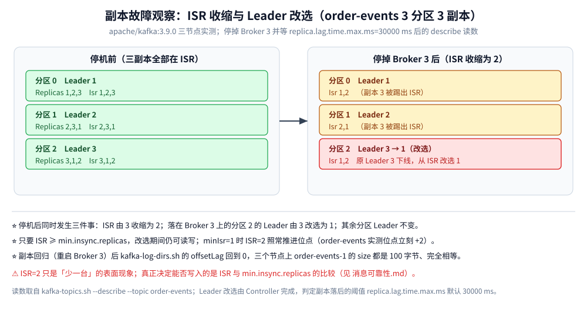
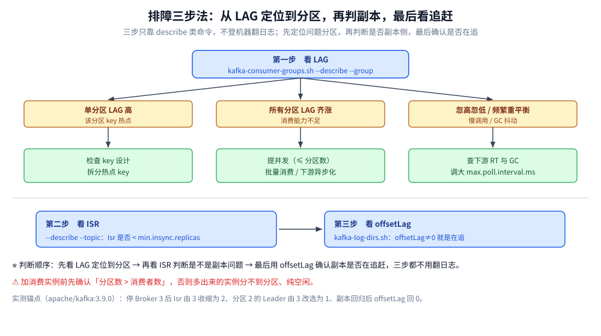

# 运维与排障

> 覆盖线上最常遇到的五类问题：消息积压、分区扩容、重复消费、顺序性被破坏、`__consumer_offsets` 膨胀，以及磁盘水位这条硬红线。
>
> 不覆盖：可靠性参数怎么配见 [消息可靠性.md](消息可靠性.md)；重平衡本身的机制与两个超时参数见 [消费者组与重平衡.md](消费者组与重平衡.md)；存储结构与 ISR 定义见 [核心概念与架构.md](核心概念与架构.md)。
>
> 内容整理自个人学习笔记。本机实测环境：`apache/kafka:3.9.0` 三节点 KRaft 集群（`kafka-lab-1/2/3`），本篇的 ISR 收缩与 Leader 改选读数来自该环境。

---

## 一、先看 LAG：积压排查的入口

```bash
kafka-consumer-groups.sh --bootstrap-server localhost:9092 \
  --describe --group order-consumer-group
```

输出字段：`TOPIC / PARTITION / CURRENT-OFFSET / LOG-END-OFFSET / LAG / CONSUMER-ID / HOST / CLIENT-ID`。**`LAG = LOG-END-OFFSET − CURRENT-OFFSET`**，是最核心的堆积指标。

| LAG 现象 | 可能原因 | 处理 |
| --- | --- | --- |
| 单分区 LAG 高 | 该分区 key 热点（某大客户订单集中在一个 key） | 检查 key 设计，拆分热点 key |
| 所有分区 LAG 齐涨 | 消费能力不足 | 提并发（≤ 分区数）、批量消费、下游异步化 |
| LAG 忽高忽低、重平衡频繁且不降 | 慢调用 / GC 抖动 / `max.poll.interval.ms` 超时循环 | 查下游 RT 与 GC；调大该值或减小 `max.poll.records` |
| 消费者数为 0 | 实例全挂，或位点过期被踢 | 查实例存活与 `session.timeout.ms` |

> ⚠️ **扩容顺序**：先确认「分区数 > 消费者数」，否则加实例无效——多出来的实例分不到分区。
>
> ⭐ 「显示 `-` 的 LAG 是 0 还是未知」要分清：组内没有活跃成员时 `CONSUMER-ID` / `HOST` / `CLIENT-ID` 都是 `-`，但 `LAG` 仍是真实差值（本机实测：组下线后 `--describe` 依旧能给出每分区的 LAG）。

## 二、分区扩容：能加，但不能减

| 事项 | 说明 |
| --- | --- |
| 只能增不能减 | ⚠️ Kafka **不支持减少分区数**；要减少只能重建 Topic + 迁移数据 |
| 增加分区会改数据分布 | 路由算法是 `hash(key) % 分区数`，**分母一变几乎全部 key 都会换分区** |
| 连锁影响 | ① 同 key 的有序性被破坏；② 同 key 的历史与新消息可能落不同分区；③ 立即触发一次重平衡 |
| 建议 | 尽量**一开始预估到位**；必须扩时接受顺序性损失，或改用「新 Topic 双写 + 逐步切换」 |

```bash
kafka-topics.sh --bootstrap-server localhost:9092 \
  --alter --topic order-events --partitions 6
```

> ⭐ 扩容前先算一笔账：**分区数只增不减**，所以「先少建、不够再加」这条经验在 Kafka 上要付**顺序性**的代价——这是它与「随时加机器」的存储系统最大的差别。

## 三、重复消费：这不是 bug，是语义

Kafka 只保证 **At Least Once**，以下场景**必然**重复：

| 场景 | 原因 |
| --- | --- |
| 处理完但**提交位点前**崩溃 | 重启后从上次提交的位点继续，中间那批被重新处理 |
| 重平衡后位点回退 | 分区易主，新持有者从旧位点继续 |
| `auto.offset.reset` 误配 | 位点过期被清理后不小心从头开始 |

幂等必须落在**消费端**：唯一键去重表 / Redis `SETNX` / 状态机 CAS / DB 唯一索引。⚠️ 用**业务唯一键**做幂等键，**不要拿 offset 当幂等键**——重平衡后同一批消息会换 offset。

## 四、顺序性被破坏的四种原因

| 原因 | 说明 |
| --- | --- |
| 生产端未指定 key（或 key 为空） | 消息被轮询散落到各分区，同实体事件乱序 |
| 生产端重试 + `max.in.flight > 1` | ⚠️ 请求 1 失败重试、请求 2 成功，落盘顺序反了；开 `enable.idempotence=true` 可保证重试不乱序 |
| 消费端多线程 / 异步处理同一分区 | 单分区内被并发消费，完成顺序不可控；要保序就**单分区串行** |
| 分区扩容或失败跳过消息 | `hash % n` 分母变化导致同 key 换分区；失败被跳过、后续消息先被处理 |

## 五、`__consumer_offsets` 膨胀

| 事项 | 说明 |
| --- | --- |
| 是什么 | 内部 Topic，存每个 `(消费组, 分区)` 的提交位点，默认 **50 个分区** |
| 膨胀原因 | 消费组多、提交过于频繁（每条消息都 commit）、`offsets.retention.minutes` 过长 |
| 表现 | 磁盘占用高、Controller 元数据变大、启动变慢 |
| 处理 | 调小 `offsets.retention.minutes`（默认 7 天）、降低提交频率、清理不用的组；其 `cleanup.policy` 是 `compact`，按 key 只保留最新位点 |

## 六、磁盘水位是硬红线

⚠️ 磁盘使用率超阈值后，Kafka 会**拒绝写入**：生产者报错、LAG 飞涨，且这个过程**不会自动恢复**，必须人工清盘。

| 做法 | 说明 |
| --- | --- |
| 监控磁盘水位 | 预留 ≥ 30% 空间；`kafka-log-dirs.sh --describe` 可以看每个 Broker 每个分区的字节数 |
| 收紧保留策略 | `log.retention.hours` / `log.retention.bytes` 谁先到谁触发删除 |
| 注意删除粒度 | 删除以**日志段**为单位，段越大（默认 1 GiB）释放越不灵活 |

## 七、副本侧故障的观察点（实测）

停掉一台 broker 后再看 `--describe`，能看到三件事同时发生：

| 观察 | 实测读数（停掉 broker 3，等 40 s） |
| --- | --- |
| **ISR 收缩** | `order-events` 各分区由 `Isr: 1,2,3` 变成 `Isr: 1,2`（判定依据是 `replica.lag.time.max.ms=30000`） |
| **Leader 改选** | 原本在 broker 3 上的 Leader 自动换到 ISR 内的其他副本（`P2` 的 Leader 由 `3` 变为 `1`） |
| **副本追赶** | 重启该 broker 后，`kafka-log-dirs.sh` 的 `offsetLag` 回到 `0`，ISR 恢复为 `1,2,3`，三个节点上该分区的 `size` 完全相等 |



```bash
# 看每个 Broker 上每个分区的字节数与落后量（offsetLag 不为 0 就是在追）
kafka-log-dirs.sh --bootstrap-server localhost:9092 --describe --topic-list order-events
```

> ⭐ 排障顺序建议：**先看 `--describe --group` 的 LAG 定位到分区，再看 `--describe --topic` 的 ISR 判断是不是副本问题，最后用 `kafka-log-dirs.sh` 确认副本是否在追。** 三步都不需要登机器翻日志。



## 延伸追问

- **LAG 一直不降怎么办？** → 先分清单分区高还是全分区高：单分区是热点 key，全分区是消费能力不足（提并发、批量消费、下游异步化）。⚠️ 提并发前先确认分区数 > 消费者数。
- **重平衡后为什么一定会重复消费？** → 分区易主后从**上次提交的位点**继续，位点之后的这批消息被重新处理；所以幂等必须落在消费端，且用业务唯一键而不是 offset。
- **分区扩容会影响顺序性吗？** → 会影响：`hash(key) % 分区数` 的分母变了，同 key 的新旧消息可能落到不同分区，分区内有序的保证也就断了。
- **一台 broker 挂掉后，受影响的分区多久恢复写入？** → Leader 改选由 Controller 完成（秒级）；ISR 会先收缩到剩余副本，只要 ISR ≥ `min.insync.replicas` 就继续可写，否则生产者开始收到 `NotEnoughReplicasException`。
- **磁盘满了为什么不能靠删消息自愈？** → 删除是按日志段滚动进行的，满了以后写入直接拒绝，滚动删除也拿不到新的段；必须人工降低保留时间或扩容。

## 关联

- **上游/总纲**：[README.md](README.md) — 本目录导读：定位、核心概念速览与阅读路线
- **对照/互补**：[消息可靠性.md](消息可靠性.md) — 三侧可靠性配置与「不丢不重」的取舍
- **对照/互补**：[消费者组与重平衡.md](消费者组与重平衡.md) — 重平衡机制与两个超时参数
- **对照/互补**：[核心概念与架构.md](核心概念与架构.md) — ISR、日志段与稀疏索引
- **对照/互补**：[部署与配置.md](部署与配置.md) — 保留策略与磁盘相关的配置项
> 反向引用（本篇被下列文档引到）：[延伸追问.md](延伸追问.md)
