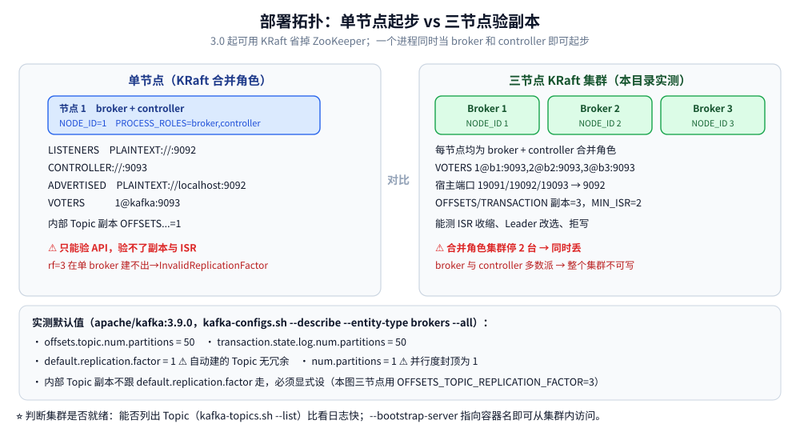

# 部署与配置

> 覆盖 Kafka 的两种起法（单节点 / 三节点 KRaft）、生产环境必须改的配置项、以及「分区数到底定多少」的推算与代价。
>
> 不覆盖：`acks` / `min.insync.replicas` / `unclean.leader.election.enable` 这组**可靠性配置**的语义与取舍见 [消息可靠性.md](消息可靠性.md)；存储结构与 KRaft 演进见 [核心概念与架构.md](核心概念与架构.md)；线上扩容与积压处置见 [运维与排障.md](运维与排障.md)。
>
> 内容整理自个人学习笔记。本机实测环境：`apache/kafka:3.9.0` 三节点 KRaft 集群（容器 `kafka-lab-1/2/3`，网络 `kafka-lab-net`，宿主端口 19091/19092/19093），下表与第二节的命令都来自这套环境。

---

## 一、单节点：docker-compose（KRaft 模式）

3.0 起可以用 KRaft 省掉 ZooKeeper；一个进程同时当 broker 和 controller 即可起步。

```yaml
services:
  kafka:
    image: apache/kafka:3.9.0
    ports:
      - "9092:9092"
    environment:
      KAFKA_NODE_ID: 1                                        # 本节点同时是 broker 和 controller
      KAFKA_PROCESS_ROLES: broker,controller
      KAFKA_CONTROLLER_QUORUM_VOTERS: 1@kafka:9093
      KAFKA_CONTROLLER_LISTENER_NAMES: CONTROLLER
      KAFKA_LISTENERS: PLAINTEXT://:9092,CONTROLLER://:9093   # 9092 对外，9093 走 controller 内部
      KAFKA_ADVERTISED_LISTENERS: PLAINTEXT://localhost:9092
      KAFKA_LISTENER_SECURITY_PROTOCOL_MAP: CONTROLLER:PLAINTEXT,PLAINTEXT:PLAINTEXT
      KAFKA_OFFSETS_TOPIC_REPLICATION_FACTOR: 1               # ⚠️ 单节点内部 Topic 副本必须为 1
      KAFKA_TRANSACTION_STATE_LOG_REPLICATION_FACTOR: 1
      KAFKA_TRANSACTION_STATE_LOG_MIN_ISR: 1
      KAFKA_LOG_RETENTION_HOURS: 168                          # 消息保留 7 天
      KAFKA_NUM_PARTITIONS: 3                                 # 自动建 Topic 的默认分区数
      KAFKA_AUTO_CREATE_TOPICS_ENABLE: "true"                 # 生产环境建议 false
    volumes:
      - kafka-data:/var/lib/kafka/data

volumes:
  kafka-data:
```

验证：

```bash
docker exec -it kafka /opt/kafka/bin/kafka-topics.sh \
  --bootstrap-server localhost:9092 --list
```

> ⚠️ 单节点只能验证 API，**验证不了副本与 ISR**：`replication.factor=3` 在只有一个 broker 时根本建不出来（会报 `InvalidReplicationFactorException`）。要看副本行为必须起 ≥ 3 个 broker。

## 二、三节点：直接跑出「副本与 ISR」的最小集群

本目录的所有实测结论都由这套三节点集群产出（`apache/kafka:3.9.0`，broker + controller 合并角色）：

```bash
docker network create kafka-lab-net

for i in 1 2 3; do
  docker run -d --name "kafka-lab-$i" --network kafka-lab-net \
    -p "1909$i:9092" \
    -e KAFKA_NODE_ID=$i \
    -e KAFKA_PROCESS_ROLES=broker,controller \
    -e KAFKA_CONTROLLER_QUORUM_VOTERS="1@kafka-lab-1:9093,2@kafka-lab-2:9093,3@kafka-lab-3:9093" \
    -e KAFKA_LISTENERS=PLAINTEXT://:9092,CONTROLLER://:9093 \
    -e KAFKA_ADVERTISED_LISTENERS="PLAINTEXT://kafka-lab-$i:9092" \
    -e KAFKA_CONTROLLER_LISTENER_NAMES=CONTROLLER \
    -e KAFKA_LISTENER_SECURITY_PROTOCOL_MAP=CONTROLLER:PLAINTEXT,PLAINTEXT:PLAINTEXT \
    -e KAFKA_OFFSETS_TOPIC_REPLICATION_FACTOR=3 \
    -e KAFKA_TRANSACTION_STATE_LOG_REPLICATION_FACTOR=3 \
    -e KAFKA_TRANSACTION_STATE_LOG_MIN_ISR=2 \
    -e KAFKA_LOG_DIRS=/var/lib/kafka/data \
    apache/kafka:3.9.0
done
```

三个要点：

| 要点 | 说明 |
| --- | --- |
| **`ADVERTISED_LISTENERS` 必须是容器名** | 客户端拿到元数据后要按这个地址回连；写成 `localhost` 只有同容器能连 |
| **controller quorum 要奇数** | 3 个 voter 容忍 1 台宕机；⚠️ 但三节点**合并角色**的集群里停掉 2 台会同时丢掉 broker 与 controller 多数派，整个集群不可写 |
| **内部 Topic 副本数要显式给** | `__consumer_offsets` / `__transaction_state` 的副本数不会跟着 `default.replication.factor` 走，必须单独设 |

> ⭐ 判断集群是否就绪，用「能否列出 Topic」比看日志快：
> `docker exec kafka-lab-1 /opt/kafka/bin/kafka-topics.sh --bootstrap-server kafka-lab-1:9092 --list`。



## 三、生产环境关键配置

下表右列是**本机 3.9.0 容器实际查到的默认值**（`kafka-configs.sh --describe --entity-type brokers --entity-name 1 --all`）：

| 配置 | 建议值 | 实测默认值 | 说明 |
| --- | --- | --- | --- |
| `default.replication.factor` | `3` | **`1`** | ⚠️ 默认 1 意味着**自动建的 Topic 没有任何冗余**，生产必须显式改 |
| `num.partitions` | 按吞吐反推 | **`1`** | ⚠️ 默认只建 1 个分区，消费并行度直接封顶为 1 |
| `min.insync.replicas` | `2` | **`1`** | 与 `acks=all` 配套才有意义 |
| `unclean.leader.election.enable` | `false` | `false` | 默认已经是「不允许落后副本上位」 |
| `auto.create.topics.enable` | `false` | `true` | ⚠️ 生产关闭，避免拼错 Topic 名就自动建出一堆垃圾 Topic |
| `log.retention.hours` | `168`（7 天） | `168` | 与 `log.retention.bytes`（默认 `-1` 不限）**先到者**触发删除 |
| `log.segment.bytes` | 1 GiB | `1073741824` | 段大小＝删除的最小粒度：太小文件多、太大删除不灵活 |
| `log.cleanup.policy` | `delete` / `compact` | `delete` | `compact` 按 key 保留最新值，用于状态类 Topic |
| `log.flush.interval.messages` | 一般不动 | **`9223372036854775807`** | ⭐ 等于 `Long.MAX_VALUE`：**Kafka 默认从不主动 fsync**，刷盘完全交给内核 |
| `log.flush.scheduler.interval.ms` | 一般不动 | **`9223372036854775807`** | 同上：连定时刷盘的检查都等于关闭 |
| `replica.lag.time.max.ms` | 30000 | `30000` | 副本落后超过这个时间才被踢出 ISR——**不是 10s 那么灵敏** |
| `message.downconversion.enable` ⚠️ | `true` | `true`（Topic 级） | 旧客户端请求时 broker 会把消息改写成旧格式，**这一步要改写字节，会打断零拷贝** |
| `num.recovery.threads.per.data.dir` | 2~4 | `1` | 启动时恢复日志的并行度，重启慢的集群可调大 |

> ⭐ **`log.flush.*` 的默认值是理解「`acks=all` 为什么不保证落盘」的关键**：broker 把数据写进 PageCache 就返回了，真正的 fsync 由内核按脏页策略异步做。这是官方刻意的取舍——靠**多副本**而不是靠**刷盘**来保数据。
>
> ⚠️ 反过来说：**别去手工把它改成每条都 fsync**（`log.flush.interval.messages=1`）。那会把「一次网络往返」变成「一次磁盘同步」，吞吐掉一个量级，而 Kafka 的设计里副本才是可靠性的来源。

## 四、分区数到底定多少

| 原则 | 说明 |
| --- | --- |
| **上限由消费者数决定** | 分区数＝消费并行的天花板：**消费者实例数 > 分区数时，多出来的实例拿不到分区、纯空闲** |
| 按目标吞吐反推 | 单分区吞吐参考约 10 MB/s，分区数 ≈ 目标吞吐 ÷ 单分区吞吐 |
| ⚠️ 不宜过多 | 分区越多，文件句柄、索引内存、Controller 元数据、重平衡耗时都线性上升，单点故障影响面也更大 |
| ⚠️ **只能增不能减** | 分区数**无法减少**（要减少只能重建 Topic + 迁数据）；扩容后 `hash(key) % 分区数` 的映射会变，**同 key 的顺序性可能被破坏** |
| 一次留余量 | 按「未来 1~2 年峰值」一次预估到位，别指望事后调 |

> ⭐ 分区数是**建 Topic 时定的、几乎不可逆**的参数——本目录把它放在「配置」里单独讲，就是因为这一条最贵：**改它等于改数据分布**。
>
> 副本数与它的分工（谁管吞吐、谁管能坏几台）见 [核心概念与架构.md](核心概念与架构.md) 的多分区与多副本一节。

## 延伸追问

- **默认 `replication.factor=1` 会出什么事？** → 自动建出来的 Topic 没有冗余，**单 broker 宕机即该分区的数据不可用**；生产必须显式设 ≥ 3。
- **为什么 `log.flush.interval.messages` 默认等于 `Long.MAX_VALUE`？** → Kafka 用「多副本 + ISR」保证不丢，不靠单机刷盘。改成每条 fsync 会让延迟与吞吐同时劣化，收益却只有「单机磁盘掉电」这一种极窄的场景。
- **三节点集群能容忍几台宕机？** → broker 侧理论上容忍 2 台（`rf=3` + `min.insync.replicas=2` 时只剩 1 份仍可读、但**写会被拒绝**）；但**合并角色**的 KRaft 集群还受 controller quorum 约束——3 个 voter 丢掉 2 个就失去多数派，整个集群不可写。
- **单节点能不能验证 ISR？** → 不能。`replication.factor` 大于 broker 数时建 Topic 会直接失败，所以副本相关的行为（ISR 收缩、`NotEnoughReplicas`、Leader 改选）必须 ≥ 3 节点才测得出来。

## 关联

- **上游/总纲**：[README.md](README.md) — 本目录导读：定位、核心概念速览与阅读路线
- **对照/互补**：[核心概念与架构.md](核心概念与架构.md) — 分区与副本的存储结构、多分区与多副本的区别
- **对照/互补**：[消息可靠性.md](消息可靠性.md) — `acks` / `min.insync.replicas` 这组配置的语义与取舍
- **对照/互补**：[运维与排障.md](运维与排障.md) — 扩容、积压、`__consumer_offsets` 膨胀
- **延伸**：[日志与持久化.md](../../../数据存储/关系型/MySQL/日志与持久化.md) — 顺序追加与页缓存
> 反向引用（本篇被下列文档引到）：[延伸追问.md](延伸追问.md)
