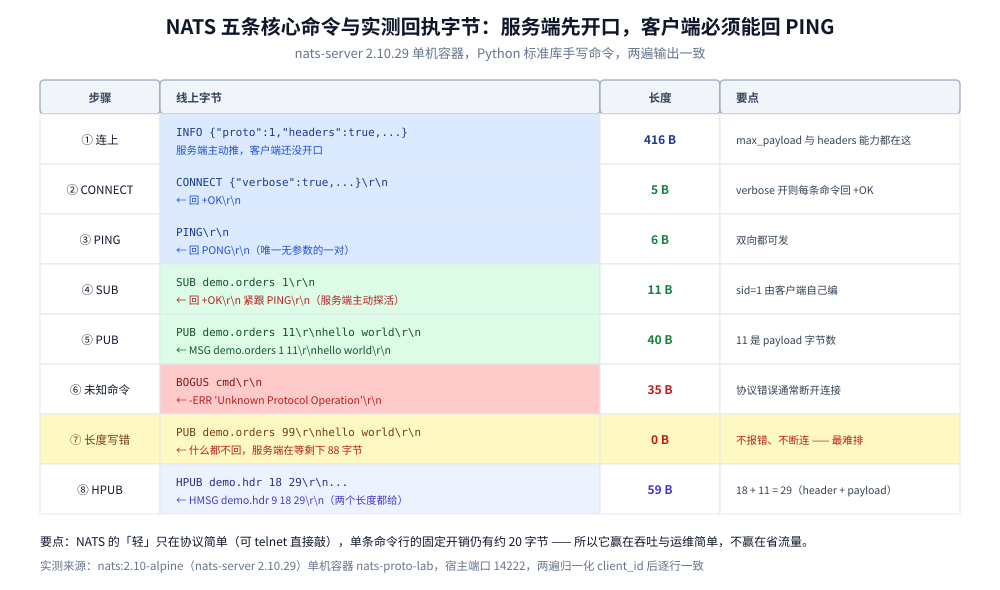

# NATS 协议

> 覆盖 ⭐ **NATS 用五行纯文本命令跑完整个发布订阅**：服务端为什么先推 `INFO`、`CONNECT` / `PUB` / `SUB` / `MSG` / `PING` 的精确字节形态、长度字段的三条硬规则（含**长度写错时服务端不报错、只等数据**这个实测行为）、`sid` 与队列组、请求-应答怎么在纯文本上实现、以及服务端主动 `PING` 的异步语义。
>
> 不覆盖：NATS 的产品能力（JetStream 持久化、集群、Leaf Node）见 [README.md](README.md)；Kafka 的二进制请求-响应协议见 [Kafka协议.md](../Kafka/Kafka协议.md)；AMQP 的帧流见 [AMQP.md](../../../../02-计算机基础/网络/消息协议/AMQP.md)；STOMP 的文本帧见 [STOMP.md](../../../../02-计算机基础/网络/消息协议/STOMP.md)。
>
> 内容整理自个人学习笔记，协议规则依据 NATS 官方文档。**实测口径**：本篇**全部字节读数来自本机 `nats:2.10-alpine`（nats-server **2.10.29**）容器 `nats-proto-lab`**（宿主端口 14222），探针用 Python 标准库手写命令、不引客户端库，**连续两遍输出在归一化 `client_id` 后逐行一致**；JetStream 相关的 `+ACK` / `-ACK` 流控**未实测**。

---

## 一、NATS 的会话是怎么开始的？

**本节要点**：与所有「客户端先开口」的协议不同，**NATS 服务端在 TCP 建连后立刻推一条 `INFO`**，把 `proto` 版本、`headers` 支持、`max_payload` 这些能力先告诉客户端。客户端据此决定 `CONNECT` 里带哪些选项——**所以「连上但没收到 INFO」就是异常**，不是正常等待。

实测连接后不开口，服务端主动发来 **416 字节**：

```text
INFO {"server_id":"NCYZ5JOZ...","server_name":"NCYZ5JOZ...","version":"2.10.29",
      "proto":1,"git_commit":"f91ddd8","go":"go1.24.2","host":"0.0.0.0","port":4222,
      "headers":true,"max_payload":1048576,"client_id":5,"client_ip":"172.17.0.1",
      "cluster":"my_cluster","xkey":"XCADHRPR..."} \r\n
```

三个字段决定后续行为：

| 字段 | 实测值 | 作用 |
| --- | --- | --- |
| `proto` | `1` | 协议版本（1 = 支持异步 `INFO` 更新与 `-ERR` 后仍可继续） |
| `headers` | `true` | **服务端支持 `HPUB` / `HMSG`**；为 false 时只能发纯 payload |
| `max_payload` | `1048576` | 单条消息上限 1 MiB，超过的直接 `-ERR` 并断开 |

> ⚠️ **`client_id` 每次连接都不同**（实测两次分别是 5 与另一个值），所以它**不能用来做幂等**——只是服务端侧的连接序号。

## 二、五条命令就够跑完发布订阅

**本节要点**：核心命令只有五个，全部以 `\r\n` 结尾、全部是「空格分隔的参数」。**没有二进制字段、没有长度前缀的嵌套结构**，这是它能被 `telnet` 直接驱动的原因。



这张对照表把每一步的「发出字节 / 返回字节 / 返回长度」钉在一起，最值得看的是两处反常：SUB 的回执里混进了一条服务端主动 PING，而长度写错时返回 0 字节。下面逐条说明。

### 2.1 实测的完整往返（真实字节与长度）

| 步骤 | 客户端发出 | 服务端返回 | 返回长度 |
| --- | --- | --- | --- |
| ① 连上（未开口） | — | `INFO {...}` | **416 B** |
| ② 声明能力 | `CONNECT {"verbose":true,...}\r\n` | `+OK\r\n` | **5 B** |
| ③ 探活 | `PING\r\n` | `PONG\r\n` | **6 B** |
| ④ 订阅 | `SUB demo.orders 1\r\n` | `+OK\r\n` + **`PING\r\n`** | **11 B** |
| ⑤ 发布 | `PUB demo.orders 11\r\nhello world\r\n` | `+OK\r\n` + `MSG demo.orders 1 11\r\nhello world\r\n` | **40 B** |
| ⑥ 未知命令 | `BOGUS cmd\r\n` | `-ERR 'Unknown Protocol Operation'\r\n` | **35 B** |
| ⑦ 长度写错 | `PUB demo.orders 99\r\nhello world\r\n` | **0 B（不报错）** | **0 B** |
| ⑧ 带 header 发布 | `HPUB demo.hdr 18 29\r\n...` | `+OK\r\n` + `HMSG demo.hdr 9 18 29\r\n...` | **59 B** |

**④ 那条多出来的 `PING` 是本节最值得注意的读数**：服务端**会主动发 `PING`**，客户端必须回 `PONG`，否则在默认的 2 分钟宽限期后被断开。所以「客户端只发 PING 就够」是错的——**它还得能随时响应服务端的 PING**。

### 2.2 五个命令的分工

| 命令 | 方向 | 参数 | 作用 |
| --- | --- | --- | --- |
| `CONNECT` | C→S | JSON（`verbose` / `pedantic` / `headers` / `no_responders`…） | 声明客户端能力与行为 |
| `PUB` | C→S | `<subject> [reply-to] <#bytes>` + payload | 发布 |
| `SUB` | C→S | `<subject> [queue] <sid>` | 订阅，`sid` 由客户端自己编 |
| `MSG` | S→C | `<subject> <sid> [#reply-to] <#bytes>` + payload | 投递 |
| `PING` / `PONG` | 双向 | 无参数 | 双向探活 |
| `+OK` / `-ERR` | S→C | `verbose:true` 时每条命令回 `+OK` | 回执与错误 |

> ⭐ **`verbose` 是一把双刃剑**：开着每条命令都回 `+OK`（调试方便、也能当「命令被接受」的确认），但**每条消息多一个 5 字节往返**。生产客户端一律 `verbose:false`。

## 三、长度字段的三条硬规则

**本节要点**：NATS 的长度字段是**整个协议唯一的强约束**，三条规则不满足就是错：**① 长度是 payload 的字节数**（不含命令行的 `\r\n` 与 payload 结尾的 `\r\n`）；**② 必须是字节数不是字符数**（中文一个字 3 字节）；**③ 写错了服务端不报错，只会静静等剩下的字节**。

### 3.1 第三条最坑：长度写错不报错

实测发 `PUB demo.orders 99\r\nhello world\r\n`（声明 99 字节，实际 11 字节），服务端返回 **0 字节**——它认为「还差 88 字节才凑够」，于是**一直等**。

```text
--- ⑦ 声明 99 B 实际 11 B 的回执  (0 B)
```

⚠️ **这比报错更难排**：连接不断、也没 `-ERR`，客户端表现为「发了但对方没收到」，直到 TCP 超时或服务端的心跳断开。**所以自研客户端时，长度计算必须在发送前断言一次。**

### 3.2 中文字符的经典错误

```text
payload = "你好"        # 字符数 2，UTF-8 字节数 6
错误写法：PUB demo.ch 2\r\n你好\r\n      → 服务端只取前 2 字节，剩 4 字节被当成下一条命令 → -ERR
正确写法：PUB demo.ch 6\r\n你好\r\n
```

## 四、`sid` 与队列组

**本节要点**：`sid`（subscription id）是**客户端自己编的订阅标识**，服务端在每条 `MSG` 里原样带回。**它由客户端负责唯一**——服务端不做任何校验，重复了就是两条订阅共用一条回复通道。

| 概念 | 谁分配 | 作用 | 注意 |
| --- | --- | --- | --- |
| **`sid`** | **客户端** | 把 `MSG` 路由回正确的回调 | ⚠️ 服务端不查重，客户端必须自己保证唯一 |
| **队列组**（`SUB subj group sid`） | 客户端声明 | 组内**只有一个**订阅者收到消息（负载均衡） | 组名是 `subject` 后的第二个参数，与 `sid` 位置不同 |

实测的 `MSG` 形态：`MSG demo.orders 1 11` —— 三个数字依次是 **subject、`sid`、字节数**。

**队列组与普通订阅的差别**：

```text
普通订阅：      SUB orders 1        SUB orders 2      → 两条都收到全量
队列组：        SUB orders workers 1  SUB orders workers 2  → 只有一条收到（轮询）
```

> ⭐ **队列组就是「NATS 版的竞争消费」**，对应 RabbitMQ 的「同一队列多消费者」与 MQTT 5.0 的 `$share`。**它不改变存储（Core NATS 本来就不存）**，只改变分发策略。

## 五、请求-应答怎么在纯文本上实现？

**本节要点**：NATS 没有专门的「请求」命令，而是**用 `PUB` 带 `reply-to` 参数 + 一个临时订阅**实现——发布方先 `SUB` 一个唯一主题（通常是 `_INBOX.<随机>`），把该主题作为 `reply-to` 发出去，响应方按 `reply-to` 回一条 `PUB`。**这是「协议层没有 RPC，但用两个原语拼出 RPC」的典型例子。**

```text
① 请求方：SUB _INBOX.abc123 90\r\n              ← 订阅一个唯一收件箱
② 请求方：PUB svc.lookup _INBOX.abc123 5\r\nhello\r\n
                                          ↑ reply-to
③ 响应方：收到 MSG svc.lookup 1 _INBOX.abc123 5\r\nhello\r\n
④ 响应方：PUB _INBOX.abc123 5\r\nworld\r\n      ← 按 reply-to 回
⑤ 请求方：收到 MSG _INBOX.abc123 90 5\r\nworld\r\n
```

`no_responders`（NATS 2.2+，`CONNECT` 里开）让「没人订阅这个 subject」时**立刻回一条空的响应**，而不是让请求方等到超时。这是把「超时」变成「快速失败」的关键开关。

> ⚠️ **`_INBOX` 前缀是保留的**：`_INBOX.>` 在所有服务端实现里都有特殊处理（可能被优化或限制），自建客户端不要用别的名字做请求-应答，否则可能在集群模式下出现「收件箱被路由到别的节点」。

## 六、服务端主动 `PING` 与 `-ERR`

### 6.1 服务端的 `PING` 是强制的

实测在 `SUB` 的回执里就混着一条 `PING`。服务端的规则是：

- 服务端按 `ping_interval`（默认 2 分钟）发 `PING`。
- 客户端必须回 `PONG`；**连续 `max_pings_out`（默认 2）次没回就断开**。
- 客户端也可以自己发 `PING` 探活，服务端回 `PONG`。

> ⚠️ **这解释了「客户端空闲一段时间后被断」的常见现象**：不是网络问题，是没回服务端的 `PING`。自研客户端必须在读循环里处理 `PING`，不能只在「要发消息时」才读。

### 6.2 `-ERR` 之后连接会怎样

实测未知命令回 `-ERR 'Unknown Protocol Operation'\r\n`（35 B）。根据 `proto` 版本：

- **`proto` ≥ 1**：`-ERR` **不必然断开**，客户端可以继续（但「协议错误」类通常会断）。
- **`proto` = 0**：多数 `-ERR` 后直接断开。

⚠️ **权限错误（`-ERR 'Permissions Violation for Publish to "x"'`）不会断开**，只是这一条被拒——但客户端如果不看 `-ERR`，会静默丢消息。

## 七、应用场景

| 场景 | 用什么命令组合 | 注意 |
| --- | --- | --- |
| **服务发现 / 配置推送** | `SUB` + 队列组 | Core NATS 不持久，订阅者不在线就错过 |
| **请求-应答（RPC 风格）** | `SUB _INBOX.x` + `PUB` 带 reply-to | 开 `no_responders` 让「无人订阅」快速失败 |
| **任务分发（竞争消费）** | `SUB subj group sid` | 队列组只改分发，不改存储 |
| **需要持久化 / 至少一次** | 换 JetStream（`+ACK` / `-ACK` 流控） | ⚠️ 本篇未覆盖 JetStream 的 ACK 流控 |
| **需要二进制 payload** | 直接用 `PUB`（长度按字节算） | 长度算错就静默卡住 |
| **需要消息头** | `HPUB` / `HMSG` | 前提是 `INFO` 里 `headers:true` |

本仓对应落地：[README.md](README.md)（JetStream、集群、Leaf Node、Go/Java 客户端）、[队列粒度设计.md](../队列粒度设计.md)（队列组与另两个产品的竞争消费对照）。

## 八、具体使用

### 8.1 用 Python 标准库手写一次完整往返（实测可跑）

```python
import socket

s = socket.create_connection(("127.0.0.1", 14222), timeout=5)
print(s.recv(4096)[:60])                    # ① 服务端先推 INFO

s.sendall(b'CONNECT {"verbose":true}\r\n')   # ② 开 verbose，每条命令回 +OK
print(s.recv(64))                            #    b'+OK\r\n'

s.sendall(b"SUB demo.orders 1\r\n")          # ④ sid 由客户端自己编
print(s.recv(64))                            #    b'+OK\r\nPING\r\n' ← 服务端主动 PING

s.sendall(b"PUB demo.orders 11\r\nhello world\r\n")   # ⑤ 11 是字节数
print(s.recv(128))                           #    b'+OK\r\nMSG demo.orders 1 11\r\nhello world\r\n'

s.sendall(b"PONG\r\n")                       # 别忘了回服务端的 PING
s.close()
```

### 8.2 长度算错的三种表现

```text
① 声明长度 > 实际长度：服务端等剩下的字节（实测 0 B 响应），连接不断，消息不投递
② 声明长度 < 实际长度：多出的字节被当成下一条命令 → -ERR 'Unknown Protocol Operation'
③ 中文按字符数算：同 ①，且每字差 2 字节，凑巧对上时更隐蔽
```

### 8.3 排障时先看的四个点

```text
① 有没有收到 INFO？没收到说明连的不是 NATS 端口
② verbose 开着吗？关着的话「命令被拒」不会有 +OK，只有 -ERR
③ 客户端在读循环里处理 PING 吗？不处理会被服务端断开
④ 长度是字节数吗？中文/emoji 按字符数算会静默卡住
```

## 延伸追问

- **NATS 为什么不设长度前缀的二进制头？** 因为它的目标是「极简协议 + 高性能」。文本命令行让协议可读、可直接 telnet 调试；代价是命令行本身有几十字节开销（`PUB demo.orders 11\r\n` 就是 20 字节）。**这就是它适合内网高频、不适合 IoT 按流量计费的原因。**
- **`sid` 为什么要客户端自己编？** 因为服务端不需要理解「客户端怎么组织回调」。服务端只做「原样回传」，把状态留在客户端——这是 NATS 服务端能做极轻的原因之一。
- **请求-应答里 `_INBOX` 会不会成为瓶颈？** 单节点下不会（它只是普通 subject）。但**集群模式下 `_INBOX` 的消息需要路由回请求方所在节点**，所以 NATS 对 `_INBOX.>` 有专门优化，自建客户端不要自己造前缀。
- **`-ERR` 之后连接还能用吗？** `proto:1` 下协议错误通常会断，权限错误不会断。**判据是看 `-ERR` 的文案**：`Unknown Protocol Operation` / `Maximum Payload Violation` 会断，`Permissions Violation` 不断。
- **为什么 `HPUB` 要两个长度？** 一个是 **header 段字节数**，一个是 **header + payload 的总字节数**（实测 `18` 与 `29`，18 + 11 = 29）。两个都给，服务端才能分别定位 header 与 payload，而不用先解析 header 再算偏移。

## 关联

- **上游/总纲**：[README.md](README.md) — 产品能力：JetStream、集群、Leaf Node、Go/Java 客户端
- **上游/总纲**：[队列粒度设计.md](../队列粒度设计.md) — 队列组与 RabbitMQ 竞争消费、Kafka 消费组的对照
- **上游/总纲**：[README.md](../../../../02-计算机基础/网络/README.md) — 网络目录导读：协议分层与消息协议的位置
- **对照/互补**：[Kafka协议.md](../Kafka/Kafka协议.md) — 同样是消息协议，Kafka 是二进制 + 严格请求-响应，NATS 是文本 + 双向推送
- **对照/互补**：[STOMP.md](../../../../02-计算机基础/网络/消息协议/STOMP.md) — 同为文本协议，STOMP 用「四段 + NUL」，NATS 用「命令行 + 长度字段」
- **对照/互补**：[AMQP.md](../../../../02-计算机基础/网络/消息协议/AMQP.md) — AMQP 把路由写进协议，NATS 只有 subject 通配
