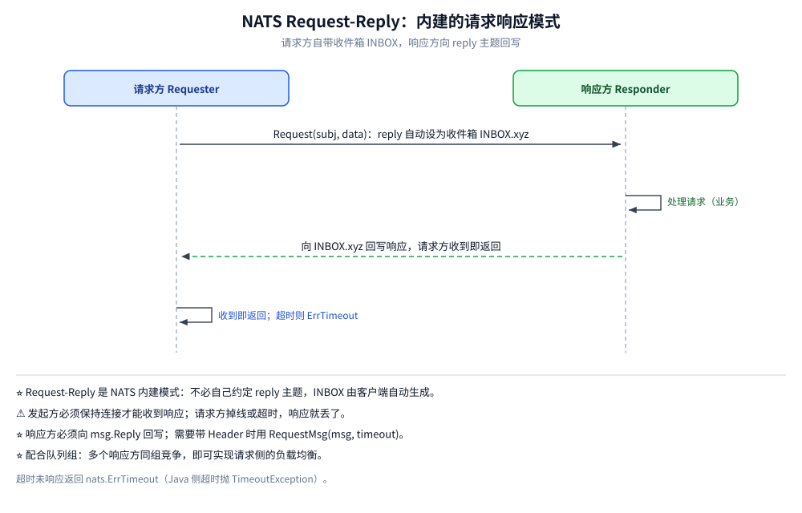
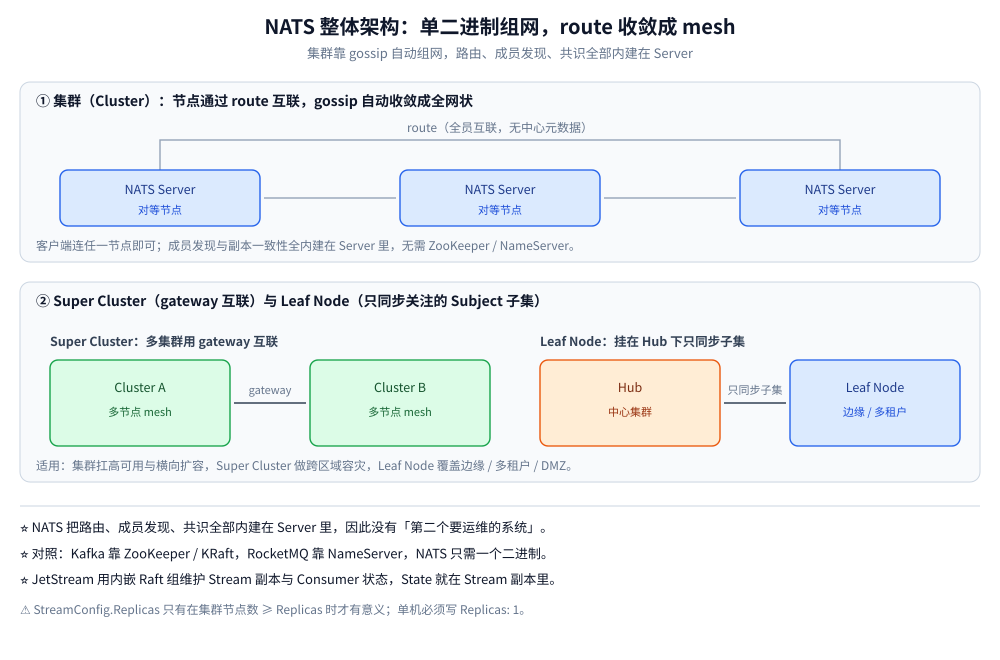

# 核心概念与架构

> 覆盖 NATS 的定位与它轻在哪、Core NATS 与 JetStream 两套语义的分水岭、Subject / Queue Group / Request-Reply / Stream / Consumer / Leaf Node 这几个必须先建起来的对象、单机到 Super Cluster 的四种形态，以及它为什么不需要 ZooKeeper 这类「第二个要运维的系统」。
>
> 不覆盖：消息分发与 ACK 的细节见 [订阅与消费语义.md](订阅与消费语义.md)；丢消息的边界与去重见 [消息可靠性.md](消息可靠性.md)；命令行字节格式见 [NATS协议.md](NATS协议.md)；接入代码见 [Go 接入](../../../../01-编程语言/go/工程实践/接入NATS.md) 与 [Java 接入](../../../../01-编程语言/java/工程实践/接入NATS.md)。
>
> 内容整理自个人学习笔记。**实测口径**：架构部分（单机与两容器对照）有本机 `nats-server v2.10.29` 容器实测；集群 / Super Cluster / Leaf Node 因本机无法建多容器网络，**按官方文档陈述未实测**。

---

## 一、NATS 凭什么只用「一个二进制」？

**本节要点**：NATS 把「路由、成员发现、元数据、副本一致性」全部塞进了 `nats-server` 自己：集群节点之间用 gossip 收敛成全网状 route，JetStream 用内嵌 Raft 组维护 Stream 副本。**所以它的运维清单里没有 ZooKeeper / NameServer 这一项**——这是它与 Kafka / RocketMQ 最直接的部署差异。

| 维度 | NATS | Kafka / RocketMQ |
| --- | --- | --- |
| 部署形态 | ⭐ 单二进制直接跑；集群靠 gossip 自动组网 | 依赖 ZooKeeper / KRaft / NameServer |
| 核心抽象 | Subject（轻量字符串）+ 通配符订阅 | Topic + Partition / MessageQueue |
| 默认语义 | Core NATS 是 At-Most-Once 纯内存转发 | 默认落盘、可回溯 |
| 延迟 | ⭐ 微秒~亚毫秒（Core NATS） | 毫秒级 |
| 定位 | 服务间通信 / 服务治理 / IoT / 边缘 | 大数据管道 / 日志流 / 削峰堆积 |

> 一句话记忆：**Kafka 是「分布式提交日志」，NATS 是「分布式消息总线」**。前者为吞吐与回溯而生，后者为低延迟与极简运维而生。

⭐ **「轻」是有代价的**：Core NATS 不存储。轻的收益是延迟与运维，代价是「订阅者不在线就错过」。要可靠必须启用 JetStream，而 JetStream 一开，副本数、ACK 窗口、去重窗口都要单独配——它并不比 Kafka 少几个概念，只是这些概念是**可选叠上去的**。

## 二、Core NATS 与 JetStream 差在哪？

**本节要点**：两者不是两个产品，而是**同一个 `nats.Conn` 上的两种用法**：`nc.Publish/Subscribe` 走纯内存转发，`nc.JetStream()` 拿到的 `JetStreamContext` 走持久化通道。**判断用哪个只看一个问题——这条消息丢了要不要补？**

| 维度 | Core NATS | JetStream |
| --- | --- | --- |
| 投递语义 | ⭐ **At-Most-Once**（可能丢） | ⭐ **At-Least-Once**（默认）/ **Exactly-Once**（配 `Msg-Id` 去重） |
| 持久化 | ❌ 无，纯内存转发 | ✅ 落盘（File / Memory），可配副本数 |
| 订阅者不在线 | ⚠️ **消息直接丢弃** | ✅ Stream 保留，上线后从游标继续 |
| 重放 / 回溯 | ❌ 不支持 | ✅ `DeliverAll` / `DeliverLast` / 按时间或 Seq |
| 背压 | ⚠️ 靠订阅端 pending 队列，写满即 SlowConsumer 丢消息 | ✅ 服务端 `MaxAckPending` 限流 |
| 延迟 | 微秒~亚毫秒 | 略高（多一次落盘 + ACK 往返） |
| 典型用途 | 服务间 RPC / 事件通知 / 心跳 / 服务发现 | 订单状态流转、支付回调等可靠异步链路 |

**同一 Subject 可以两条腿并行**：Core 订阅做实时广播（谁在线谁收），JetStream Consumer 做可靠兜底（谁处理完谁 ACK）。两者互不影响，这是 NATS 上很常见的组合。

> ⚠️ 判断标准很简单——「这条消息丢了，要不要报警 / 补数据？」要，就上 JetStream：服务发现、心跳、指标上报归 Core NATS；订单状态流转、支付回调、需重试回溯的异步链路归 JetStream。

## 三、核心对象有哪些？

**本节要点**：NATS 的对象只有三层——**Subject 决定去哪、订阅（含队列组）决定谁收、Stream / Consumer 决定存不存与记到哪**。先把这三层分清，后面的 ACK 与重投才有落点。

| 概念 | 说明 | 备注 |
| --- | --- | --- |
| **Subject** | 消息地址，形如 `photography.order.created`，用 `.` 分层 | ⭐ 支持 `*`（匹配一层）与 `>`（匹配剩余全部） |
| **Publish / Subscribe** | 发布者向 Subject 发、订阅者按 Subject 收；发布者不关心有无订阅者 | 默认广播：无队列组时每个订阅者都收到一份 |
| **Queue Group** | ⭐ 同一 Subject + 同一队列组名的订阅者**竞争消费**，一条消息只投给组内一个实例 | 即负载均衡；组与组之间互不影响 |
| **Request-Reply** | 请求方 `Request(subj, data, timeout)`，响应方回写 `msg.Reply` | ⭐ 内建模式，不必自己约定 reply 主题 |
| **JetStream** | ⭐ 持久化与流处理层：Stream 落盘、ACK 重投、重放、KV、Object Store | 服务端须以 `-js` 启动 |
| **Stream / Consumer** | Stream 是「消息集合 + 保留策略」，Consumer 是消费视图（游标） | JetStream 独有，Core NATS 没有 |
| **Leaf Node** | 叶子节点挂到远端 Hub，只同步关注的 Subject 子集 | 边缘 / 多租户 / DMZ |

**通配符**：`photography.order.created` 精确匹配；`photography.*.created` 匹配 `photography.order.created` 但不匹配 `photography.order.a.created`；`photography.>` 匹配其下全部层级。

⚠️ **通配符是订阅侧的匹配规则，不是发布侧的路由表**：发布时写 `photography.>` 不会「广播给所有子主题」，它本身就是一个字面 Subject（含 `>` 字符）。通配符只在 `SUB` 与 Stream 的 `Subjects` 里生效。

**Request-Reply 流程**：请求方发消息并把 `reply` 设为自动生成的收件箱（`_INBOX.<随机>`）→ 响应方处理完向该收件箱回写 → 收到即返回，超时返回 `nats.ErrTimeout`。

这张图要读出的核心：**NATS 的 RPC 不是协议里的命令，而是「一个临时订阅 + 一次带 reply 的发布」拼出来的**。所以请求方必须保持连接（收件箱是本连接上的一个订阅），掉线或超时之后响应就无处可投。

> ⚠️ **发起方必须保持连接**才能收到响应；请求方掉线或超时，响应就丢。

## 四、整体架构：集群凭什么自己收敛？

**本节要点**：NATS 的四种形态是**同一套机制的不同拓扑**：节点之间用 route 组成全网状 mesh，跨集群用 gateway 互联，边缘用 Leaf Node 只同步关心的 Subject 子集。客户端连任一节点即可，**不需要知道集群有几个节点**。

读图要点：中间一层是 route 组成的全网状 mesh，客户端只连一个节点；外侧两个集群之间靠 gateway 打通才成为 Super Cluster；最下面挂的 Leaf Node 不加入 mesh，只按配置同步自己关心的 Subject 前缀。下表把这四种形态的差别与适用场景逐项列出。

| 形态 | 说明 | 适用 |
| --- | --- | --- |
| 单机 | 一个 `nats-server` 进程 | 开发、单机小流量 |
| 集群（Cluster） | 多节点通过 **route** 组成全网状 mesh，客户端连任一节点即可 | 高可用、水平扩容 |
| Super Cluster | 多集群用 **gateway** 互联 | 跨区域容灾 |
| Leaf Node | 叶子节点挂到 Hub，只同步关注的 Subject 子集 | 边缘计算、多租户、DMZ |

**为什么 NATS 不需要外部队列协调组件** ⭐

| 组件 | Kafka | RocketMQ | NATS |
| --- | --- | --- | --- |
| 元数据存储 | ZooKeeper / KRaft | NameServer | ⭐ **无**，节点间 gossip 自发现 |
| 集群成员发现 | 依赖上述组件 | 依赖 NameServer 地址列表 | ⭐ 配 `routes` 即可，mesh 自动收敛 |
| 消费进度 | Broker 内 `__consumer_offsets` | Broker 内 ConsumerOffset | Consumer 状态**就在 Stream 副本里** |
| 运维复杂度 | 高（多组件协同） | 中 | ⭐ 极低，一个二进制 |

关键点：**NATS 把路由、成员发现、共识全部内建在 Server 里**——集群靠 gossip 收敛成全网状 route，JetStream 用内嵌 Raft 组维护 Stream 副本与 Consumer 状态。因此没有 ZooKeeper / NameServer 这类「第二个要运维的系统」。

> ⚠️ **「不需要外部组件」不等于「没有协调成本」**：route mesh 是**全连接**的，N 个节点是 N×(N-1)/2 条路由；规模上去后路由状态与广播开销会变成新的瓶颈，这也是大集群要用 Super Cluster 分域的原因。

## 应用场景

| 场景 | 用哪套语义 | 注意 |
| --- | --- | --- |
| **微服务间 RPC / 服务发现** | Core + Request-Reply | 开 `no_responders` 让「无人订阅」立即失败，而不是等超时 |
| **实时事件广播（在线状态、指标）** | Core Publish/Subscribe | 订阅者不在线就错过，适合「过期即无价值」的数据 |
| **任务分发（竞争消费）** | Core + Queue Group | 组内随机派发，**不保证同 key 同实例** |
| **订单状态流转 / 支付回调** | JetStream Stream + Durable Consumer | 必须配 `AckWait` / `MaxDeliver`，并自己做死信 |
| **边缘只同步部分 Subject** | Leaf Node | 叶子只声明关心的 Subject，减少回传流量 |
| **需要 KV / 对象存储** | JetStream KV / Object Store | 建在 Stream 之上，容量受 `max_file_store` 约束（本机默认 2 GiB） |

## 延伸追问

- **Core NATS 与 JetStream 是两套协议吗？** 不是。它们共用同一连接与同一套文本协议，区别只在「消息要不要进 Stream」。`nc.JetStream()` 只是在 Core 之上封装了 JetStream API（`$JS.API.>` 这些系统 Subject）。
- **为什么 NATS 的 Subject 不需要预先创建？** 因为 Core NATS 的 Subject 只是字符串匹配，没有元数据要存。JetStream 的 Stream 才需要创建——它要把「哪些 Subject 落盘、留多久、几副本」记下来。
- **集群里客户端连哪个节点？** 任意一个。Core 消息会沿 route 转发到有订阅者的节点；JetStream 的 Stream Leader 在哪个节点由 Raft 选，非 Leader 节点会把写请求转过去（客户端无感）。
- **Leaf Node 和普通集群节点有什么区别？** 普通节点参与全网状 route、同步所有 Subject 的订阅关系；Leaf Node 只与 Hub 建一条连接，**只同步自己声明的 Subject 子集**，因此适合弱网、跨域、DMZ。
- **JetStream 的副本和 Kafka 的副本是一回事吗？** 目标相同（多节点冗余），机制不同：Kafka 是 Leader/Follower 拉取 + ISR；JetStream 是内嵌 Raft 组，写要过多数派。**单机只有 1 个节点时只能 `Replicas: 1`**，写 2 会直接报错（见 [部署与配置.md](部署与配置.md) 第四节）。

## 关联

- **上游/总纲**：[README.md](README.md) — 本册导读、阅读路线与实测坐标
- **下游机制**：[订阅与消费语义.md](订阅与消费语义.md) — 队列组、Request-Reply、Durable 与 `DeliverPolicy`
- **下游机制**：[消息可靠性.md](消息可靠性.md) — 丢消息的四种边界与 ACK 重投
- **运维/配置**：[部署与配置.md](部署与配置.md) — 单机 / 集群起法与 `nats.conf`
- **对照/互补**：[README.md](../Kafka/README.md) — 分区日志模型：同一 key 落同一分区，NATS 没有对应物
- **对照/互补**：[README.md](../Pulsar/README.md) — 存算分离：Broker 无状态、消息在 BookKeeper
- **上游/总纲**：[Raft协议.md](../../../../04-架构与系统/分布式/共识协议/Raft协议.md) — JetStream 副本组用的共识算法
