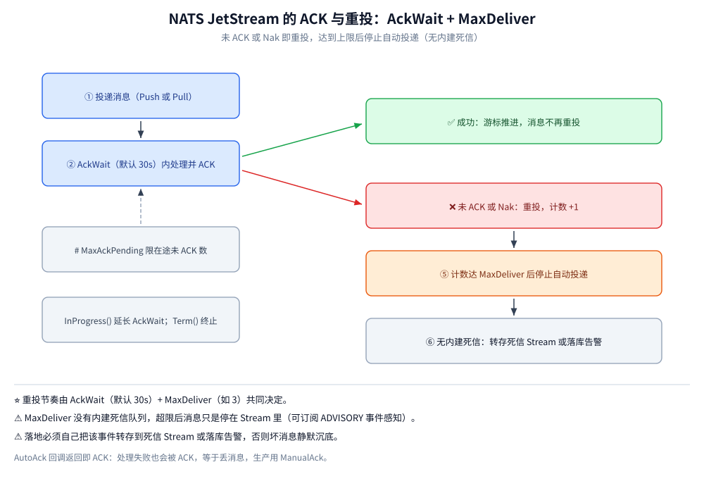

# 消息可靠性

> 覆盖 NATS 端到端的「不丢」与「不重」：Core NATS 在哪些情况下静默丢消息、`SlowConsumer` 的判定边界、`Msg-Id` 去重窗口的实测、ACK 的五种应答与 `MaxDeliver` 之后消息去哪、四层背压，以及停机时 `Drain` 与 `Close` 的差别。
>
> 不覆盖：队列组与消费模式的选择见 [订阅与消费语义.md](订阅与消费语义.md)；`MaxAge` / `MaxBytes` / 副本数怎么配见 [部署与配置.md](部署与配置.md)；代码写法见 [Go 接入](../../../../01-编程语言/go/工程实践/接入NATS.md)。
>
> 内容整理自个人学习笔记。**实测口径**：本轮在 `nats-server v2.10.29` + `nats.go v1.53.1` 上实测了去重、NAK 重投到 `MaxDeliver`、`MaxAckPending` 停投三组读数；**跨节点副本与 `+ACK`/`-ACK` 流控未实测**。

---

## 一、Core NATS 在哪些情况下会丢消息？

**本节要点**：Core NATS 的 `Publish` 是「写完 socket 就不管」，**没有任何回执**。四种情况都会静默丢：没有订阅者、订阅者离线、订阅者连接正在重连、订阅者客户端缓冲写满。前三种是语义决定的，第四种是配置边界。

| 丢消息的场景 | 会发生什么 | 怎么发现 |
| --- | --- | --- |
| **发布时无人订阅** | 消息直接消失 | 无法发现；用 `no_responders` 只能覆盖 Request-Reply |
| **订阅者离线** | 消息直接消失 | 消费端无日志，发布端无异常 |
| **订阅者正在重连** | 重连窗口内的消息丢失 | 客户端 `DisconnectedErrHandler` 有事件，但消息已丢 |
| **订阅者 pending 队列写满** | 库报 `SlowConsumer` 并丢弃 | ⭐ 客户端 `ErrorHandler` / 日志里有 `SlowConsumer` |
| **超过 `max_payload`** | 服务端 `-ERR` 并断开 | 发布端会收到错误 |

> ⚠️ **`Publish` 成功不等于对方收到**：nats.go 的 `Publish` 只写客户端缓冲，连「已写入 socket」都不保证。要确认已刷出缓冲得调 `Flush()`，但它也只到 socket 层，不代表对端应用处理了。

判断标准很简单——「这条消息丢了，要不要报警 / 补数据？」要，就上 JetStream：服务发现、心跳、指标上报归 Core NATS；订单状态流转、支付回调、需重试回溯的异步链路归 JetStream。

## 二、SlowConsumer 的边界在哪？

**本节要点**：`SlowConsumer` 是**客户端侧**的判定，不是服务端的。服务端只管往连接里写；写不动时消息堆在客户端库的 pending 队列里，队列满了库就丢消息并报 `SlowConsumer`。

| 参数 | 本机默认值 | 含义 |
| --- | --- | --- |
| `max_pending` | `67108864`（64 MiB，`/varz` 实测） | 服务端侧的写缓冲上限 |
| 客户端 pending | nats.go 默认 65536 条 / 64 MB | ⭐ 真正的丢消息点 |
| `MaxAckPending` | 消费者配置，无全局默认 | JetStream 在途未 ACK 上限 |

> ⭐ **SlowConsumer 的根因几乎都是「回调里做了慢操作」**：一个订阅一个 goroutine 串行处理，回调里查库 500ms，上游一秒推一万条，队列很快写满。正确做法是**把处理搬出回调**（投递到本地队列）或**按业务键分片到更多 Subject**，而不是调大 pending——调大只是把炸点往后推。

## 三、重复消息从哪来？怎么去重？

**本节要点**：NATS 的重复有两个来源——**发布端重发**（网络超时后重试）与**消费端重投**（ACK 超时 / NAK）。前者靠 `Msg-Id` 在服务端窗口内滤掉，后者只能靠消费端幂等。

| 手段 | 做法 | 边界 |
| --- | --- | --- |
| 服务端去重 | 发布带 `nats.MsgIdHdr`（Java 侧 `NatsMessage.builder().id(...)`），Stream 按去重窗口滤重 | ⚠️ 只覆盖窗口内（默认 2min），窗口外重发仍入库 |
| 消费端幂等 | 唯一键 / 去重表 / 状态机（「仅当状态为上一步时才推进」） | ⭐ 唯一可靠的做法，跨系统适用 |

**本轮实测**：Stream `LAB` 配 `Duplicates: 2 * time.Minute`，先发 5 条普通消息，再用**同一个 `Msg-Id`（`dup-1`）连发两次**：

```text
jetstream publish: messages=5 lastSeq=5 bytes=235
jetstream dedup: same Msg-Id published twice -> messages=6
```

⭐ **消息数从 5 变 6，不是 7**——第二次同 ID 的发布被服务端直接丢弃。要读出两点：去重是**按 `Msg-Id` 而非内容**（内容相同但 ID 不同仍会入库），且**窗口只有 2 分钟**（可配，但配太大会占内存）。

> ⚠️ **去重窗口不是「永久幂等」**：业务上的「一笔支付只入账一次」必须靠消费端状态机或唯一约束，不能指望 `Msg-Id`。

## 四、ACK 有哪几种应答？

**本节要点**：JetStream 的 ACK 不是布尔值，而是五种语义——确认、否定、终止、续期、以及「什么都不做等超时」。**选错哪一种，决定消息是重投、丢弃还是卡住。**



读图要点：一条消息从投递起就进入 `AckWait` 计时窗口，窗口内没有 ACK（或收到 NAK）就回到消费者面前重投，每次重投把计数加一；累计到 `MaxDeliver` 后不再自动投递。**五种应答分别落在这张图的哪条边上，决定了消息是重投、丢弃还是原地等待。** 逐项语义见下表。

| 选项 | 语义 | 用在哪 |
| --- | --- | --- |
| `ManualAck()` + `m.Ack()` | 业务代码显式确认 | ⭐ 默认推荐，处理成功才 ACK |
| 自动 ACK | 回调返回即 ACK | ⚠️ 处理失败也会被 ACK，等于丢消息 |
| `m.Nak()` | 否定应答 → 按退避重投 | 可重试的失败（下游限流、临时超时） |
| `m.Term()` | 终止投递，不再重试 | 不可恢复的错误（如报文格式非法） |
| `m.InProgress()` | 延长 `AckWait` | 长耗时任务，避免被误判超时重投 |

> ⚠️ **自动 ACK 是最常见的错误配置**：Push 订阅默认在回调返回时就 ACK。回调里 `return err` 不会被服务端看见，消息照样被确认——**看起来配了重投，实际一条都没重投**。

## 五、重投是怎么算的？`MaxDeliver` 之后去哪？

**本节要点**：重投由两件事触发——**`AckWait` 超时**或**显式 `Nak()`**。每投一次计数 +1，达到 `MaxDeliver` 后**停止自动投递**，但消息**仍在 Stream 里**（下次新建消费者还会读到）。

| 参数 | 含义 | 本机实测配置 |
| --- | --- | --- |
| `AckWait` | 单条消息等待 ACK 的上限 | `1s`（为了快速观察） |
| `MaxDeliver` | 最多投递次数 | `3` |
| `MaxAckPending` | 在途未 ACK 上限 | `8` / `1`（两组） |

**本轮实测**：5 条消息，其中 `order-2` 每次收到都 `Nak()`，其余正常 ACK：

```text
jetstream nak: acked=4 order-2 deliveries=3 consumer.num_redelivered=1
```

⭐ 三个数要连起来读：`acked=4`（另外 4 条都成功）、`deliveries=3`（`order-2` 投了 3 次后停）、`num_redelivered=1`（消费者视角「被重投过的消息」按**条**计，不是按**次数**计，所以是 1 而不是 2）。

> ⚠️ **JetStream 的 `MaxDeliver` 没有内建死信队列**：超限后消息只是停在 Stream 里（可订阅 `$JS.EVENT.ADVISORY.CONSUMER.MAX_DELIVERIES.*` 感知）。落地时必须**自己把该事件转存到死信 Stream 或落库告警**，否则坏消息静默沉底。
>
> ⚠️ **panic 会打崩读循环**：回调里 panic 且未 `recover`，会掀掉 nats 内部的读循环 goroutine，单条坏消息即可让整个服务重启、消息被反复重投。正确写法是**就地 `recover` + `msg.Nak()`**（或 `Term()`）。

## 六、背压靠什么撑住？

**本节要点**：NATS 的背压分散在四层，**每层管一段，缺一层就在那一层丢**。

| 层级 | 机制 | 说明 |
| --- | --- | --- |
| Stream | `MaxMsgs` / `MaxBytes` / `MaxAge` | 超限按 `Retention` 淘汰，防磁盘打满 |
| Consumer | ⭐ `MaxAckPending` / `RateLimit` | 在途未 ACK 上限，达到即**停止投递**；`RateLimit` 限投递速率 |
| 客户端 | pending 队列大小 | Core NATS 侧唯一缓冲，写满即 SlowConsumer 丢消息 |
| 模式 | 重负载下 Pull 优于 Push | 拉取天然背压，可批量、可暂停 |

**本轮实测**：`MaxAckPending=1` 的 Pull 消费者取 1 条后**故意不 ACK**：

```text
jetstream maxackpending: fetched=1 num_ack_pending=1 num_pending=4
```

⭐ **`num_pending=4` 是被「压住」的消息**：Stream 里还有 4 条，但因为在途未 ACK 已达上限 1，服务端**一条都不再发**。这正是流控生效的直接证据——不是客户端不取，是服务端不给。

同一个 Subject 上的消息按订阅串行处理（nats.go 每订阅一个 goroutine），**一条慢消息会阻塞该 Subject 的后续消息**，不同 Subject 互不影响。所以「每条消息起一个 goroutine 导致爆炸」并不存在；真实风险是**队头阻塞**与 **pending 队列写满丢消息**。提吞吐的正确姿势是**按业务键分片到不同 Subject / Stream**，而不是无脑加并发（会破坏顺序语义）。

## 七、停机为什么要 `Drain` 而不是 `Close`？

**本节要点**：`Close()` 立即掐断，`Drain()` 走完「退订 → 等在途回调 → 冲刷缓冲 → 关闭」。差别在于**在途消息是被处理完还是被丢弃**。

| 方法 | 行为 | 适用 |
| --- | --- | --- |
| `nc.Close()` | ⭐ **立即**取消所有订阅、丢弃在途回调与待发缓冲、断开连接 | 进程被强杀 / 只想立刻断开 |
| `nc.Drain()` | ⭐ **先**取消订阅（不再收新消息）→ **等在途回调跑完** → 冲刷待发缓冲 → 关闭连接 | 服务优雅停机 |

> ⚠️ 生产停机务必用 `Drain()`：`Close()` 会打断正在处理的消息，JetStream 消息因未 ACK 会在 `AckWait` 后被重投（At-Least-Once 下不算错，但造成重复消费与日志噪声）。
>
> ⚠️ `Drain()` 是**阻塞**的，别在 HTTP handler 里直接调用；应放在关停流程中并配超时兜底（例如 10s 后强制 `Close()`）。项目里的 `CloseNATS()` 用的是 `nc.Close()`，调用前**必须先 `mq.Consumer.Stop()`** 停掉消费循环，否则回调可能正跑就被掐断。

## 应用场景

| 可靠性目标 | 配置组合 | 代价 |
| --- | --- | --- |
| 允许丢（指标、心跳） | Core NATS | 无 |
| 不丢、可重复 | JetStream + Durable + `ManualAck` + `MaxDeliver` | 落盘 + ACK 往返 |
| 不丢、尽量不重 | 上一条 + `Msg-Id`（窗口内）+ 消费端幂等 | 窗口外仍会重，靠幂等兜 |
| 严格串行不丢 | Pull + `MaxAckPending=1` | 吞吐最低 |
| 坏消息不阻塞 | `Term()` + 自建死信 Stream | 需自己做落地 |

## 延伸追问

- **Core NATS 会丢消息吗？** 会。消息发到无人订阅（或订阅者离线）的 Subject 直接丢弃，发布端无回执；订阅者在线但 pending 队列写满（默认 65536 条 / 64 MB）也会被判 SlowConsumer 丢消息。**要可靠必须用 JetStream**。
- **`MaxDeliver` 到了以后消息会消失吗？** 不会。它只是「这个消费者不再自动投」。消息仍在 Stream 里，受 `MaxAge` / `MaxBytes` 淘汰；新建消费者仍能读到。
- **`Nak()` 与等 `AckWait` 超时有什么区别？** `Nak()` 立即触发重投（可带退避），不用等满 `AckWait`；对「明确失败」用它更快，对「卡住」只能等超时。
- **去重窗口能设很大吗？** 能，但窗口越大服务端要记的 `Msg-Id` 越多，占内存。超过窗口的重发仍会入库，所以窗口只是优化，幂等才是兜底。
- **`InProgress()` 会不会让消息永远不重投？** 会——只要一直续期，它就一直不来。所以续期必须有业务侧兜底（最大处理时长、超时自杀），否则一条卡死的消息会永久占住它在途名额。

## 关联

- **上游/总纲**：[README.md](README.md) — 本册导读与实测坐标
- **上游/总纲**：[核心概念与架构.md](核心概念与架构.md) — Core 与 JetStream 的语义分界
- **上游/总纲**：[订阅与消费语义.md](订阅与消费语义.md) — 队列组与 Push / Pull 的选择
- **运维/配置**：[部署与配置.md](部署与配置.md) — `MaxAge` / 副本数 / `max_file_store` 的配置
- **运维/配置**：[运维与排障.md](运维与排障.md) — 线上怎么定位「没收到」与 SlowConsumer
- **对照/互补**：[消息可靠性.md](../RocketMQ/消息可靠性.md) — 刷盘 × 复制组合与死信队列的完整链路
- **对照/互补**：[消息可靠性.md](../Kafka/消息可靠性.md) — `acks` 与 ISR 的「不丢」三段责任
> 反向引用（本篇被下列文档引到）：[接入NATS.md](../../../../01-编程语言/go/工程实践/接入NATS.md)、[接入NATS.md](../../../../01-编程语言/java/工程实践/接入NATS.md)、[消息可靠性.md](../ActiveMQ/消息可靠性.md)
