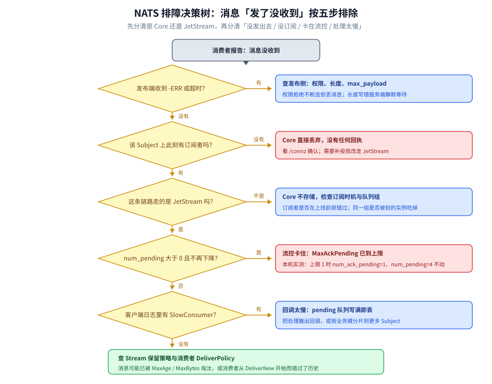

# 运维与排障

> 覆盖 NATS 跑起来之后怎么看：`/varz` `/connz` `/jsz` `/healthz` 各回答什么问题、消息「发了没收到」的五步排查顺序（配决策树）、`/jsz` 的四个计数怎么连起来读、连接与慢消费者的定位方法，以及常见故障速查表。
>
> 不覆盖：配置项的含义与起法见 [部署与配置.md](部署与配置.md)；可靠性参数的语义见 [消息可靠性.md](消息可靠性.md)；协议层字节排查看 [NATS协议.md](NATS协议.md)。
>
> 内容整理自个人学习笔记。**实测口径**：本篇全部端点读数来自本机 `nats-server v2.10.29` 容器（`nats-lab`，宿主 18222 → 容器 8222），实测时 Stream `LAB` 里留着 6 条消息、2 个 Consumer；`/routez` `/subsz` `/leafz` 因无集群**未实测**。

---

## 一、六个监控端点各看什么？

**本节要点**：NATS 的 HTTP 监控端口（`http_port`）没有聚合面板，而是**每个端点回答一个问题**。排障时按「服务活着吗 → 连接在吗 → 消费到哪了」的顺序点开即可。

| 端点 | 回答什么问题 | 本机实测 |
| --- | --- | --- |
| `/healthz` | 服务是否健康 | **200** |
| `/varz` | 这个 Server 的全局状态与配置 | `max_payload=1048576`、`max_pending=67108864`、`auth_required=true`、`max_connections=65536` |
| `/connz` | 当前有哪些客户端连接、各自订阅了什么 | `num_connections=0`（实测时客户端已全部断开） |
| `/jsz` | JetStream 的 Stream / Consumer / 消息量 | `streams=1`、`consumers=2`、`messages=6`、`bytes=317` |
| `/routez` | 集群路由状态（仅集群） | 无集群，空段 `"cluster": {}` |
| `/subsz` | 订阅关系与匹配统计 | 未实测 |

> ⚠️ **`/varz` 里 `"cluster": {}`、`"gateway": {}`、`"leaf": {}` 是「未启用」，不是「异常」**：单机模式下这些段本来就是空的，别当成配置丢失。

## 二、消息「发了没收到」按什么顺序查？

**本节要点**：这个问题的答案分散在五个地方，**顺序错了会白查**。正确顺序是：先分清发出去没有 → 再分清有没有订阅者 → 再分清 Core 还是 JetStream → 再看流控 → 最后看处理能力。



这张图的关键在第 2 步与第 4 步：**「没订阅者」在 Core 下是静默丢弃**（发布端毫无感知），而 **`num_pending` 不降不一定是消费慢**——很可能是 `MaxAckPending` 已经到顶，服务端主动停投。

### 2.1 每一步看哪个端点

| 步骤 | 看哪里 | 判据 |
| --- | --- | --- |
| ① 发出去没有 | 发布端 `-ERR` / 连接状态 | 有 `Permissions Violation` → 权限；有 `Maximum Payload Violation` → 超 `max_payload` |
| ② 有没有订阅者 | `/connz` 的 `subscriptions` | 无订阅 → Core 已丢，改 JetStream |
| ③ Core 还是 JetStream | `/jsz` 的 `streams` | `streams=0` 说明根本没建流 |
| ④ 卡在流控没有 | `/jsz` 的 consumer 详情 | `num_ack_pending` 达到 `MaxAckPending` |
| ⑤ 处理太慢 | 客户端日志 `SlowConsumer` | 有 → 回调阻塞 |

## 三、`/jsz` 的四个数字怎么连起来读？

**本节要点**：`streams` / `consumers` / `messages` / `bytes` 是**账户级汇总**，单独看任何一个都可能误判，必须连起来。

**本机实测**（`curl http://127.0.0.1:18222/jsz`）：

```text
streams: 1
consumers: 2
messages: 6
bytes: 317
api: { total: 53, errors: 12 }
```

四组读数要这样读：

| 组合 | 说明 |
| --- | --- |
| `streams=1` + `messages=6` | Stream 里有 6 条，**不等于**被消费了 6 条（消费进度在 Consumer 上） |
| `consumers=2` + `messages=6` | 两个 Consumer 各自有游标，同一个 Stream 可以「一份存储、两路消费」 |
| `bytes=317` | 6 条消息的存储字节数；与 `StreamInfo` 在 5 条时的 `bytes=235` 对得上（多出的正是去重后新增的第 6 条） |
| `api.errors=12` | ⭐ API 调用失败计数，本轮来自反复 `DeleteStream` / 重建；**它涨得快说明有客户端在反复试错** |

> ⚠️ **`messages` 是「存量」不是「增量」**：清理（`MaxAge` / `MaxBytes`）之后它会掉下来，别拿它当「总共进来过多少条」。累计量要看 `last_seq`。

## 四、连接与慢消费者怎么定位？

**本节要点**：先看 `/connz` 的**每连接 pending 字节数与订阅数**，再看客户端日志的 `SlowConsumer`。服务端的 `max_pending` 只说明上限，**真正的丢点在客户端库的 pending 队列**。

| 现象 | 先查 | 常见原因 |
| --- | --- | --- |
| 连接数不涨 | `/connz` 的 `num_connections` | 客户端连的不是这个端口 / 鉴权失败一直重连 |
| 连接时有时无 | `/connz` + 服务端日志 | 客户端没回服务端 `PING`，`ping_max` 到了被断 |
| 某个订阅收得慢 | `/connz` 的每连接 `pending_bytes` | 回调里做慢操作 |
| 日志有 `SlowConsumer` | 客户端 `ErrorHandler` | pending 队列写满，消息已被丢 |

> ⚠️ **服务端 `PING` 必须被客户端回应**：`ping_interval` 默认 120 s、`ping_max=2`，连续两次不回就断。表现为「空闲一段时间后连接莫名其妙没了」——不是网络问题。

## 五、常见故障速查

| 症状 | 先查什么 | 结论 |
| --- | --- | --- |
| 容器 healthy 但客户端连不上 | 端口映射 + 日志里的 `Listening for client connections` | 映射错或客户端连了容器内端口 |
| 容器一直 unhealthy | `nats.conf` 有没有 `http_port` | 探针依赖它，没写就恒失败 |
| `nats: jetstream not enabled` | 启动参数有没有 `-js` | 没有就只是 Core NATS |
| `replicas > 1 not supported in non-clustered mode` | 节点数 | 单机只能 `Replicas: 1` |
| 消息发了但 Stream 没涨 | `/jsz` 的 `streams` 与 Stream 的 `Subjects` | Subject 不在 Stream 的匹配范围内 |
| 消费端一直收到重复消息 | `/jsz` consumer 的 `num_ack_pending` + 客户端是否 ACK | 没 ACK 或 `AckWait` 太短 |
| 消息只增不减 | Stream 的 `MaxAge` / `MaxBytes` | 保留策略写成了 -1（不限） |
| 客户端空闲后断连 | `ping_interval` / `ping_max` | 读循环没处理服务端 `PING` |

## 具体使用

```bash
# 服务健康（本机实测 200）
curl -s --noproxy '*' -o /dev/null -w "%{http_code}\n" http://127.0.0.1:18222/healthz

# 全局状态：重点看 max_payload / max_pending / auth_required / jetstream
curl -s --noproxy '*' http://127.0.0.1:18222/varz | head -40

# 连接与订阅：确认「有没有订阅者」与每连接 pending
curl -s --noproxy '*' http://127.0.0.1:18222/connz

# JetStream：streams / consumers / messages / bytes / api.errors
curl -s --noproxy '*' http://127.0.0.1:18222/jsz
```

⚠️ 本机容器不带 `nats` CLI，上面全部走 `curl`；`/routez` `/subsz` 需要集群或更多连接才有内容，本轮**未取得读数**。

## 延伸追问

- **`/healthz` 返回 200 就说明消息能通吗？** 不能。它只说明 HTTP 监控端口活着；消息通不通要看 `/connz` 与 `/jsz`。
- **`num_connections=0` 正常吗？** 客户端全部断开时就该是 0；如果业务明明连着却是 0，说明你查的不是同一个 Server（容器内 8222 与宿主映射端口别搞混）。
- **`/jsz` 的 `bytes` 和磁盘占用为什么不等？** `bytes` 是消息体与元数据的逻辑大小，磁盘上还有索引、块文件与预分配，实际占用会更大。
- **怎么知道某条消息被投了几次？** JetStream 的 Consumer 详情里有 `num_redelivered`（按条计）与每条的 `delivery_count`；本机实测 `order-2` 投 3 次时 `num_redelivered=1`。
- **没有集群时 `/routez` 有什么意义？** 没有。但保留它是为了统一探针：集群上线后同一个采集脚本不用改。

## 关联

- **上游/总纲**：[README.md](README.md) — 本册导读与实测坐标
- **上游/总纲**：[部署与配置.md](部署与配置.md) — 监控端口与健康检查的配置来源
- **下游机制**：[消息可靠性.md](消息可靠性.md) — 决策树第 4、5 步背后的 ACK 与流控机制
- **下游机制**：[NATS协议.md](NATS协议.md) — 长度写错、权限拒绝在字节层的表现
- **对照/互补**：[运维与排障.md](../Kafka/运维与排障.md) — LAG、ISR 与分区扩容的排查路径
- **对照/互补**：[运维与排障.md](../RocketMQ/运维与排障.md) — 堆积 SOP 与消费停滞的三个高频原因
