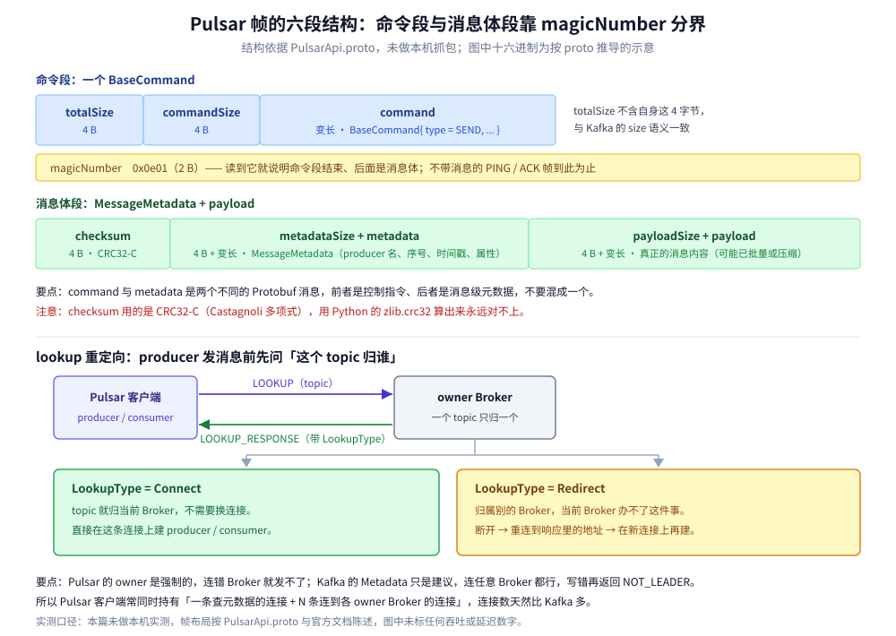

# Pulsar 协议

> 覆盖 ⭐ **Pulsar 协议为什么用 Protobuf 而不是自定义二进制**：一个帧的六段结构（总长 / 命令长 / 命令 / 魔数 / 校验和 / 元数据+载荷）、`BaseCommand` 的 oneof 分发机制、`lookup` 重定向为什么是 producer 的第一步、流控为什么靠 `FLOW` 的 permits 而不是 TCP 背压。
>
> 不覆盖：Pulsar 的产品能力（存算分离、BookKeeper、四种订阅类型、分层存储）见 [README.md](README.md)；Kafka 的请求-响应协议见 [Kafka协议.md](../Kafka/Kafka协议.md)；NATS 的文本协议见 [NATS协议.md](../NATS/NATS协议.md)；AMQP 的帧流见 [AMQP.md](../../../../02-计算机基础/网络/消息协议/AMQP.md)。
>
> 内容整理自个人学习笔记，帧结构与命令定义依据 Apache Pulsar 的 `PulsarApi.proto`。**实测口径**：本篇在本机 `apachepulsar/pulsar:4.0.5` standalone 容器（`pulsar-lab`，宿主 16650 → 容器 6650、宿主 18080 → 容器 8080）上跑通了完整的 producer / consumer 链路，`lookup` 的响应、四种订阅类型的投递差异、`deliverAfter` 的生效条件与 DLQ 的触发均有实测读数。⚠️ **未做帧级抓包**：字节布局按 `PulsarApi.proto` 与官方文档陈述，第七节的十六进制是推导示意而非抓包结果；文中不引用吞吐数字。

---

## 一、Pulsar 协议为什么用 Protobuf？

**本节要点**：AMQP / Kafka 各自**手写了一套二进制编码**（定长字段 + 长度前缀 + 位段），Pulsar 直接**用 Protobuf 定义所有命令与元数据**。这个选择的后果是：**协议演进几乎零成本**（加字段不改解析器），但**每条命令都要背 Protobuf 的 tag 开销**，而且**不能像 AMQP 那样按固定偏移直接读**。

| 协议 | 编码方式 | 加字段的代价 | 能否按固定偏移读 |
| --- | --- | --- | --- |
| **Pulsar** | **Protobuf**（`BaseCommand` oneof） | 加字段只加 tag，老客户端跳过 | ❌ 必须按 tag 解（变长） |
| Kafka | 手写二进制 + 版本号 | 加字段要升 `api_version` | ✅ 头部固定 |
| AMQP 0-9-1 | 手写位段 + field table | 靠 `field table` 扩展 | ✅ 头部固定 7 字节 |
| MQTT | 手写位段 | 靠 `properties`（5.0） | ✅ 固定头 1 字节 |
| NATS | 纯文本 | 靠 `CONNECT` 的 JSON 选项 | ✅ 命令行按空格切 |

> ⭐ **Protobuf 带来的两个直接后果**：① **命令种类可以无限扩**（Pulsar 已有 40 多种 `BaseCommand` 类型），② **手写客户端极难**——你必须先有一个 Protobuf 运行时。这也是 Pulsar 的客户端生态比 Kafka 薄的原因之一。

## 二、一个帧的六段结构

**本节要点**：Pulsar 的帧不是「命令 + 载荷」两段，而是**六段**：`totalSize` / `commandSize` / `command` / `magicNumber` / `checksum` / `metadata + payload`。**`command` 与 `metadata` 是两个不同的 Protobuf 消息**：前者是控制指令（`BaseCommand`），后者是消息级的元数据（`MessageMetadata`）。



上图要读出的核心：**`command` 段与「metadata + payload」段是互斥出现的**——纯命令帧（如 `PING`、`ACK`）没有后面两段；带消息的帧才有。而 **`magicNumber` 是两段的分界标记**，它出现就说明「命令段结束，后面是消息体」。

| 段 | 宽度 | 作用 |
| --- | --- | --- |
| `totalSize` | 4 B | 整帧字节数（**不含自身这 4 字节**） |
| `commandSize` | 4 B | `command` 段的字节数 |
| `command` | 变长 | 一个 `BaseCommand`（Protobuf） |
| `magicNumber` | 2 B | 固定 **`0x0e01`**，标记「下面是消息体」 |
| `checksum` | 4 B | **CRC32-C**，校验范围是 `metadata + payload` |
| `metadataSize` + `metadata` | 4 B + 变长 | 一个 `MessageMetadata`（Protobuf）：producer 名、序号、时间戳、属性 |
| `payloadSize` + `payload` | 4 B + 变长 | 真正的消息内容（可能已被批量/压缩） |

**两处最容易错的地方**：

- ⚠️ **`totalSize` 不含自身 4 字节**（与 Kafka 的 `size` 一致，与 AMQP 的 `frame size` 只算 payload 不同）。三个协议的「长度语义」各不相同，混着记必错。
- ⚠️ **`checksum` 用 CRC32-**C**（Castagnoli 多项式），不是常见的 CRC32（IEEE）**。用 Python 的 `zlib.crc32` 算出来永远对不上。

## 三、`BaseCommand` 的 oneof 分发

**本节要点**：所有命令都是同一个 `BaseCommand` 消息，靠 `type` 字段 + `oneof` 决定「这次带的是哪个子消息」。**这是 Protobuf 的标准做法**，好处是「一个解析入口吃所有命令」，坏处是「不看 `type` 就无法知道后面是什么」。

代表性的命令（按用途分组）：

| 分组 | 命令 | 方向 | 作用 |
| --- | --- | --- | --- |
| **连接** | `CONNECT` / `CONNECTED` | 双向 | 建连与能力声明 |
| | `PING` / `PONG` | 双向 | 心跳 |
| | `CLOSE` / `CLOSE_PRODUCER` / `CLOSE_CONSUMER` | 双向 | 逐层关闭 |
| **路由** | `LOOKUP` / `LOOKUP_RESPONSE` | 双向 | ⭐ **问「这个 topic 归哪个 Broker」** |
| | `PARTITIONED_METADATA` / `..._RESPONSE` | 双向 | 分区 topic 的元数据 |
| **生产** | `PRODUCER` / `SEND` / `SEND_RECEIPT` / `SEND_ERROR` | 双向 | 建生产者、发消息、收据、错误 |
| **消费** | `SUBSCRIBE` | C→S | 建消费者（带订阅名与订阅类型） |
| | `MESSAGE` | S→C | 投递（带消息体） |
| | `ACK` / `ACK_RESPONSE` | 双向 | 确认 |
| | `FLOW` | C→S | ⭐ **流控：给 Broker 发放 permits** |
| | `REDELIVER_UNACKNOWLEDGED_MESSAGES` | C→S | 要求重投未确认的 |
| **其他** | `AUTH_CHALLENGE` / `AUTH_RESPONSE` | 双向 | 认证 |
| | `GET_SCHEMA` / `GET_OR_CREATE_SCHEMA` | 双向 | Schema 协商 |

> ⚠️ **`unsubscribe` 与 `close consumer` 是两件事**：`UNSUBSCRIBE` 会**删除订阅**（位点一起删，重订阅从头开始），`CLOSE_CONSUMER` 只是断开这个消费者（订阅与位点保留）。混淆这两个是「重启后消息重复消费」的常见原因。

## 四、`lookup` 重定向：producer 的第一步不是发消息

**本节要点**：Pulsar 是**存算分离**的，一个 topic 只归属**某一个 Broker**。所以任何客户端在发/收之前都必须先 `LOOKUP` 问「这个 topic 现在归谁」，Broker 回一个 `LOOKUP_RESPONSE`——**要么是「你自己连吧」（Connect），要么是「去连那个地址」（Redirect）**。

### 4.1 两种响应

| `LookupType` | 含义 | 客户端接下来做什么 |
| --- | --- | --- |
| **`Connect`** | 这个 topic 就归当前 Broker | 在同一连接上直接建 producer / consumer |
| **`Redirect`** | 归别的 Broker | **断开当前连接，重连到响应里的地址**，再在该连接上建 |

> ⭐ **这就是「Pulsar 客户端连接数比 Kafka 多」的原因**：一个客户端可能同时持有「一个查元数据的连接 + N 个连到不同 owner Broker 的连接」。Kafka 的元数据请求（`Metadata`）是**建议性**的，客户端可以连任意 Broker 发消息（由 Broker 转发或返回 NOT_LEADER）；Pulsar 是**强制性**的，连错 Broker 就发不了。

### 4.2 重定向为什么会反复发生

topic 的 owner 会因以下原因变化，每次变化都触发重定向：

- **Broker 重启或下线** → owner 被重新分配。
- **负载均衡**（`loadBalancerEnabled`）→ Broker 会主动把高负载 topic 卸载给别的节点。
- **topic 从「无 owner」变成「有 owner」** → 首次访问时可能要多跳一次。

⚠️ **所以「发消息偶发慢一下」在 Pulsar 上常见于「刚好赶上 owner 切换」**，客户端会经历「断开 → 重连 → 重新 lookup」这三步，耗时是秒级而非毫秒级。

## 五、流控靠 `FLOW` 的 permits

**本节要点**：Pulsar 的消费流控**不是靠 TCP 背压**，而是靠客户端显式给 Broker 发 `FLOW`，声明「我还能处理 N 条」。**Broker 手里的 permits 用完了就停止推送**——这是应用层流控，比 TCP 窗口精确得多。

```text
客户端：FLOW（permits = 1000）        ← 我最多还能处理 1000 条
Broker：推送 MESSAGE × 1000          ← 用掉全部 permits
Broker：停止推送（permits = 0）       ← 但连接不断，等新 permits
客户端：处理完一批，再发 FLOW（permits = 500）
Broker：继续推送
```

**为什么不用 TCP 背压**：

- **TCP 窗口是字节级的**，而消费端的瓶颈常常是「条数」（每条要查库、要调下游）。用字节数控制不住条数。
- **一条 TCP 上可能多路复用多个 consumer**（不同 topic），TCP 窗口无法区分「谁的消费慢了」。
- ⚠️ 但 **Pulsar 的 `FLOW` 是 per-consumer 的**，所以同一连接上慢 consumer 不会拖住快 consumer——这一点与 AMQP 的 `basic.qos`（per-channel）类似，与 Kafka 的 `max.poll.records`（per-consumer）目的相同、机制不同。

## 六、应用场景

| 场景 | 协议层要注意什么 |
| --- | --- |
| **首次连接就发消息** | 必须先 `LOOKUP`，可能要多跳一次重定向 |
| **topic 负载高需要迁移** | owner 切换会带来秒级「断连重连」 |
| **需要精确控制消费速率** | 调 `FLOW` 的 permits 与 `receiverQueueSize`，不要指望 TCP 背压 |
| **多 topic 共用一个客户端** | 连接会按 owner Broker 分裂成多条，不是一条打天下 |
| **需要 Schema 校验** | `GET_OR_CREATE_SCHEMA` 是协议级支持，Kafka 要靠外部 Registry |
| **需要断点续消费** | 用 `CLOSE_CONSUMER` 而不是 `UNSUBSCRIBE`（后者删订阅与位点） |

本仓对应落地：[README.md](README.md)（存算分离、MessageId、四种订阅类型、Go/Java 客户端）、[队列粒度设计.md](../队列粒度设计.md)（消息粒度在三产品里的落点）。

## 七、具体使用

### 7.1 一个 `SEND` 帧的六段（按 proto 推导的示意）

```text
① totalSize      00 00 00 xx              整帧长度（不含自身 4 字节）
② commandSize    00 00 00 xx              BaseCommand 的字节数
③ command        ...                      BaseCommand{type=SEND, send=...}
④ magicNumber    0e 01                    固定魔数，标记「下面是消息体」
⑤ checksum       xx xx xx xx              CRC32-C，范围是 ⑥ + ⑦
⑥ metadataSize   xx xx xx xx
   metadata      ...                      MessageMetadata{producer_name, sequence_id, publish_time, properties}
⑦ payloadSize    xx xx xx xx
   payload       ...                      真正的消息内容
```

⚠️ **上图的十六进制是结构示意，不是实测抓包**——各个 `xx` 的具体值取决于 Protobuf 编码后的长度。

### 7.2 排障时先看的四个点

```text
① 客户端日志里有几次 lookup？
   首次 + 每次 owner 切换各一次；频繁重定向说明负载均衡在反复搬 topic
② checksum 用的是 CRC32-C 还是 CRC32？
   自己解析帧时用错多项式会全部校验失败
③ 消费慢是 permits 不够还是处理慢？
   看 FLOW 的发送频率：一直发但仍堆积 → 处理慢；不发 → 客户端自己卡住了
④ UNSUBSCRIBE 还是 CLOSE_CONSUMER？
   用错会导致订阅被删、位点丢失、重启后从最旧消息开始
```

## 延伸追问

- **Pulsar 为什么不用 Kafka 那种「任意 Broker 都能收」的模型？** 因为它的存储与计算是分离的（消息在 BookKeeper，不在 Broker 本地）。「谁负责这个 topic 的写入顺序」必须由 owner 单点保证，所以写入必须打到 owner。
- **Protobuf 会不会让协议变慢？** 编解码比手写二进制多一层 tag 解析，但差距在「网络 + 磁盘」面前通常不显著。真正的代价在**客户端实现复杂度**（必须有 Protobuf 运行时），不在运行时性能。
- **`magicNumber` 为什么必要？** 因为它是「命令段结束」的唯一标记。没有它，解析方无法知道 `command` 段到哪结束、`metadata` 从哪开始（`commandSize` 只给了命令段长度，靠它也能算，但魔数让「读到错位」能被立刻发现）。
- **`FLOW` 的 permits 给多了会怎样？** 消息会在客户端堆积（内存涨）。所以 permits 要和 `receiverQueueSize` 匹配：**permits 超过队列容量时，多出来的消息只能堆在内存里等着**。
- **Pulsar 的协议比 Kafka 复杂多少？** 命令种类上多得多（40+ vs 61 个 API，但 Pulsar 的命令覆盖了 Kafka 需要多个 API 才能做的事，比如 lookup + metadata）。真正复杂的是「lookup 重定向」这套 owner 模型，Kafka 没有对应概念。

## 关联

- **上游/总纲**：[README.md](README.md) — 产品能力：存算分离、BookKeeper、订阅类型、分层存储
- **上游/总纲**：[队列粒度设计.md](../队列粒度设计.md) — 跨产品的粒度判据与代价对照
- **对照/互补**：[Kafka协议.md](../Kafka/Kafka协议.md) — Kafka 手写二进制 + 版本协商，与 Pulsar 的 Protobuf + 无版本号形成对照
- **对照/互补**：[NATS协议.md](../NATS/NATS协议.md) — 纯文本命令，与 Pulsar 的 Protobuf 是两个极端
- **对照/互补**：[AMQP.md](../../../../02-计算机基础/网络/消息协议/AMQP.md) — AMQP 用 magic 前缀与帧尾 `0xCE` 双重定界，Pulsar 用 `magicNumber` 分段
