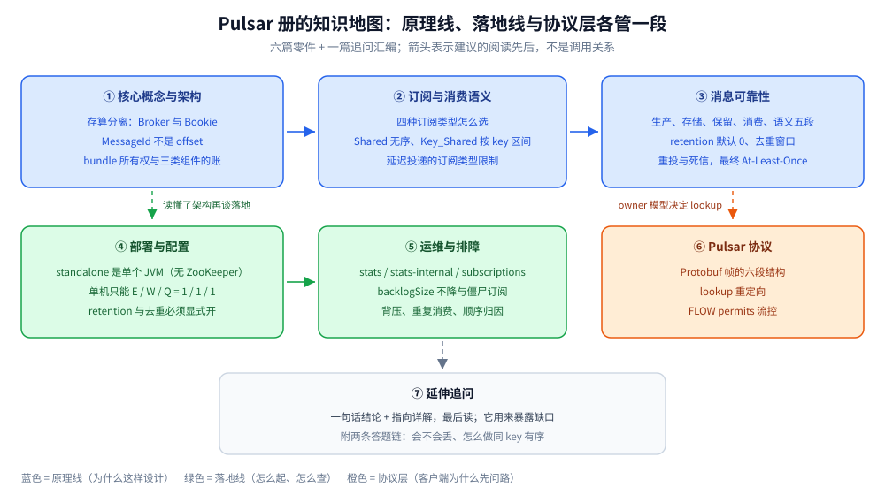

# Pulsar 目录导读

> 覆盖 Apache Pulsar 的定位与「存算分离」的代价、MessageId 与订阅游标、四种订阅类型的投递差异（含 Key_Shared 的 key 区间切分与 Shared 的轮询实测）、端到端可靠性（quorum、retention、去重窗口、重投与死信）、standalone 部署与关键配置、运维排障、Protobuf 帧与 lookup 重定向——共 **6 篇零件 + 1 篇追问汇编**。
>
> 不覆盖：六款消息队列的横向对比与选型见 [消息队列选型对比.md](../消息队列选型对比.md)；「该拆几个订阅、分几组」的**跨产品判据**见 [队列粒度设计.md](../队列粒度设计.md)；quorum 复制的通用原理见 [复制与Quorum.md](../../../../04-架构与系统/分布式/数据分布/复制与Quorum.md)；分布式事务的选型见 [最终一致方案.md](../../../../04-架构与系统/分布式/分布式事务/最终一致方案.md)；订阅积压指标的采集口径见 [可观测性选型对比.md](../../可观测性/可观测性选型对比.md)。
>
> 内容整理自个人学习笔记。本目录带一组本机容器实测：`apachepulsar/pulsar:4.0.5` **standalone** 容器 `pulsar-lab`（宿主 16650 → 容器 6650、宿主 18080 → 容器 8080），实测客户端为容器自带的 Corretto JDK 21 + `pulsar-client 4.0.5`；各篇逐处标注读数。⚠️ 全册为**单机 standalone**：多 Broker、多 Bookie、Proxy 与跨机房复制均未实跑。

---

## 一、一句话定位与它凭什么

**Pulsar 是「存算分离」的消息与流平台**：Broker 只做协议、路由、订阅与分发，消息数据全部落在 **Apache BookKeeper**，Broker 本地不留数据。它把 Kafka「数据跟着分区副本走」换成了「数据跟着 BookKeeper 走，Broker 只是随时可换的临时工」。

| 维度 | Pulsar 的事实 |
| --- | --- |
| 架构 | ⭐ **Broker（无状态）+ Bookie（存储）+ 元数据存储** 三层，standalone 一个进程把三者都带上 |
| 存储单位 | **Ledger / Entry**；MessageId = `(ledgerId, entryId, partitionIdx)`，**不是 offset** |
| 命名层级 | `persistent://tenant/namespace/topic`，策略配在 **namespace** 上 |
| 订阅 | ⭐ **订阅独立于 topic 存在**，游标由 Broker 保存；一份数据可被多个订阅各自推进 |
| 分发模型 | 四种订阅：Exclusive / Shared / Key_Shared / Failover |
| 可靠性 | BookKeeper quorum 写；retention **默认 0**（ack 完即可删）；去重默认关闭 |
| 运维成本 | ⚠️ 三类组件、故障域互相牵连，是它最常被诟病的一点 |

> ⭐ 一句话记忆：**Kafka 的扩容是「搬数据」，Pulsar 的扩容是「搬所有权」**。加 Broker 只是把 bundle 的归属挪过去，BookKeeper 里的 ledger 一个字节都不用动。
>
> ⚠️ 代价同样直白：**写路径多一跳 quorum 确认**（单条延迟与吞吐不如 Kafka 的 PageCache 顺序写）、**组件最多**、**流处理生态最小**。选型结论见 [消息队列选型对比.md](../消息队列选型对比.md)。

## 二、核心概念速览

| 概念 | 一句话 |
| --- | --- |
| **Broker** | 无状态服务节点，负责协议、订阅分发与负载均衡；挂掉后 topic 所有权由别的 Broker 接管 |
| **Bookie** | 存储节点，真正落盘消息；一组 bookie 组成 ensemble，按 quorum 确认 |
| **Ledger / Entry** | Ledger 是只追加日志，Entry 是一条记录；一个 topic 的数据由若干 Ledger 组成 |
| **MessageId** ⭐ | `(ledgerId, entryId, partitionIdx)`，不能加减、不能当 offset 用 |
| **Tenant / Namespace** | 隔离与策略容器；保留、TTL、配额、去重、分层存储都配在 namespace 上 |
| **Bundle** ⭐ | 命名空间内的 topic 哈希区间，是**所有权与负载均衡的最小单位** |
| **Topic** | `persistent://` 落 BookKeeper；`non-persistent://` 只在 Broker 内存 |
| **Subscription** ⭐ | 消费进度（游标）的持有者，独立于 topic；多个订阅各自回溯、互不影响 |
| **Consumer** | 订阅的接入实例；行为由**订阅类型**决定 |
| **Reader** | 不建订阅、自管位置的读取模式，适合重放与对账 |
| **Proxy** | 可选统一入口，跨机房与 K8s 场景常用 |

> ⚠️ **铁律：MessageId 不是 Kafka 的 offset。** 它指向 BookKeeper 的 `ledger:entry`，本机实测第一批 200 条消息的 MessageId 从 `3:100:-1` 开始、到 `3:299:-1` 结束——**起点不是 0**，因为它前面还有别的批次写入同一 ledger。

## 三、阅读路线

本目录的阅读顺序（每篇的知识点描述见 [全仓知识点目录](../../../../目录.md)，此处**不重复描述**）：

| 顺序 | 篇 | 视角 | 什么时候读 |
| --- | --- | --- | --- |
| ① | [核心概念与架构.md](核心概念与架构.md) | ⭐ **主线 / 原理** | 存算分离的写读路径、MessageId 为什么不是 offset、bundle 所有权与「不搬数据」的扩容、三类组件的运维账 |
| ② | [订阅与消费语义.md](订阅与消费语义.md) | 消费侧语义 | 四种订阅类型怎么选、Shared 为什么无序（实测 `2/6/6/6` vs `8/4/4/4`）、Key_Shared 按 key 区间切（实测 1 key vs 3 keys）、延迟投递的订阅类型限制、起始位置与通配符 |
| ③ | [消息可靠性.md](消息可靠性.md) | 可靠性 | 生产端确认、BookKeeper quorum、retention 默认 0、去重窗口（实测重复写返回 `-1:-1:-1`）、重投与死信（实测 redeliveryCount 0→3）、为什么仍只能 At-Least-Once |
| ④ | [部署与配置.md](部署与配置.md) | 落地 | standalone 起法、6650/8080 两个端口、`standalone.conf` 的关键项、单机 E/W/Q=1/1/1、retention 与去重怎么开、起对了怎么验 |
| ⑤ | [运维与排障.md](运维与排障.md) | 排障 | `topics stats` / `stats-internal` / `peek-messages` 三个入口、积压与 `backlogSize`、慢订阅与背压、`ConsumerBusyException`、故障速查 |
| ⑥ | [Pulsar协议.md](Pulsar协议.md) | 协议层 | ⭐ **为什么用 Protobuf**、帧的六段结构、`BaseCommand` 的 oneof、lookup 重定向、`FLOW` permits 流控 |
| ⑦ | [延伸追问.md](延伸追问.md) | 自查 | 各篇最常被连环追问的问题：一句话结论 + 指向详解，附两条答题链 |

语言分册（按 AGENTS.md 约定，**接入代码放在语言目录，本目录只留链接**）：

| 语言 | 篇 | 内容 |
| --- | --- | --- |
| Go | [接入Pulsar.md](../../../../01-编程语言/go/工程实践/接入Pulsar.md) | 官方 `pulsar-client-go`：客户端单例、Producer/Consumer、Reader 重放、DLQ、优雅退出 |
| Java | [接入Pulsar.md](../../../../01-编程语言/java/工程实践/接入Pulsar.md) | `pulsar-client`：`PulsarClient` 单例、Producer/Consumer、Spring Pulsar、重投与 DLQ |

### 依赖关系

| 本篇 | 建议先读 | 为什么 |
| --- | --- | --- |
| 订阅与消费语义.md | 核心概念与架构.md | 订阅游标建在存算分离的读路径上 |
| 消息可靠性.md | 核心概念与架构.md、订阅与消费语义.md | quorum 与重投都要先知道「数据在哪、游标归谁」 |
| 部署与配置.md | — | 可独立读；但 retention 与去重建议配合可靠性篇看 |
| 运维与排障.md | 前三篇 | 排障是「积压、背压、所有权」三组结论的应用面 |
| Pulsar协议.md | 核心概念与架构.md | 先懂 Broker 是 topic 的 owner，再看 lookup 重定向才不突兀 |
| 延伸追问.md | 建议最后读 | 它的作用是暴露缺口，不是第一次学习 |

> ⭐ **两条线**：**原理线**（① 核心概念与架构 → ② 订阅与消费语义 → ③ 消息可靠性）回答「数据存哪、消息投给谁、为什么只能 at-least-once」；**落地线**（④ 部署与配置 → ⑤ 运维与排障 → 语言分册）回答「怎么起、怎么用、出事怎么查」。⑥ 解释「客户端为什么发消息前要先问路」。

这张图把上面的文字路线压成一页：蓝色三篇是原理线、绿色两篇是落地线、橙色那篇解释客户端为什么先 lookup，虚线箭头表示「先读懂前一篇才不突兀」；按它读就不会在没搞清存算分离时直接翻排障命令。

## 四、本轮实测坐标

| 项 | 值 |
| --- | --- |
| 镜像 / 版本 | `apachepulsar/pulsar:4.0.5`（standalone） |
| 集群 | 单机容器 `pulsar-lab`，宿主 16650 → 6650（二进制协议）、18080 → 8080（Admin / Web） |
| 进程 | 单个 JVM（PID 1）同时承担 Broker、内嵌 Bookie 与元数据存储，RSS **804 MB**；仅 6650 / 8080 对外监听 |
| 元数据 | 4.x standalone **不带 ZooKeeper**：日志首行 `Starting BK with RocksDb metadata store`，元数据落本地 RocksDB，2181 不监听；内嵌 bookie 用随机端口（本机 `45855`） |
| 存储 | `/pulsar/data/metadata` 75 MB（元数据 RocksDB）+ `/pulsar/data/standalone/bookkeeper` 150 MB（ledger 75 MB + locations 75 MB） |
| Broker 配置 | `managedLedgerDefaultEnsembleSize/WriteQuorum/AckQuorum = 1/1/1`、`defaultRetentionTimeInMinutes=0`、`defaultRetentionSizeInMB=0`、`brokerDeduplicationEnabled=false`、`transactionCoordinatorEnabled=false`、`allowAutoTopicCreation=true` |
| 客户端 | 容器内 Corretto JDK 21 + `pulsar-client 4.0.5`（`/pulsar/lib`），直连 `pulsar://127.0.0.1:6650` |
| 场景 Topic | `lab-orders`（收发压测）、`lab-keys` / `lab-keys-fair`（Key_Shared）、`lab-shared`（Shared）、`lab-delayed-*`（延迟）、`lab-dlq-src2` / `lab-dlq2`（重投与死信）、`public/dedup-lab/*`（去重） |

六条最值得记住的读数：

| 读数 | 值 | 出处 |
| --- | --- | --- |
| 200 条持久消息写入耗时 | `1233 ms`，平均 **6.165 ms/条**；publisher `150.41 msg/s`，发布延迟 med 4 ms / 95pct 9 ms / 99pct 15 ms | [核心概念与架构.md](核心概念与架构.md) 第三节 |
| Shared 是**按条轮询**，不保 key 亲和 | 40 条 / 4 个 key / 2 消费者 → `{order-0=2, order-1=6, order-2=6, order-3=6}` vs `{8,4,4,4}`，同一个 key 被拆到两边 | [订阅与消费语义.md](订阅与消费语义.md) 第二节 |
| Key_Shared 按 key 区间切，不按条数均分 | 两个消费者拿到 `1 个 key（10 条）` vs `3 个 key（30 条）` | [订阅与消费语义.md](订阅与消费语义.md) 第三节 |
| 延迟投递只在 Shared / Key_Shared 生效 | `deliverAfter=5s`：Shared **4961 ms** 收到；Exclusive **229 ms** 就收到（立即投递） | [订阅与消费语义.md](订阅与消费语义.md) 第五节 |
| 去重认「生产者名 + 序号」 | 同一序号重复发送，第二次返回 `-1:-1:-1`；发 3 条、消费到 2 条 | [消息可靠性.md](消息可靠性.md) 第四节 |
| 死信在 `maxRedeliverCount=3` 后生效 | `redeliveryCount` 依次 0、1、2、3，第 5 次取不到消息，DLQ topic 收到它 | [消息可靠性.md](消息可靠性.md) 第五节 |

> ⚠️ **未实测项**：多 Broker / 多 Bookie / Proxy、地理复制、分层存储、事务（`transactionCoordinatorEnabled=false`）、Schema Registry 演化、TLS 与认证，本机均为单容器，**没有对应读数**；`bookkeeperEnsemble=3` 这类多副本配置只按官方文档陈述。

## 五、本目录的边界

| 本目录收 | 不收（在哪） |
| --- | --- |
| Pulsar 这一个产品自身的机制与用法 | **多产品横向选型** → [消息队列选型对比.md](../消息队列选型对比.md) |
| 存算分离、订阅类型、可靠性、配置、排障、协议 | **各语言接入代码** → [go/工程实践](../../../../01-编程语言/go/工程实践)、[java/工程实践](../../../../01-编程语言/java/工程实践) 下的 `接入Pulsar.md` |
| BookKeeper quorum 在 Pulsar 里的落点 | **多数派与复制的一般原理** → [复制与Quorum.md](../../../../04-架构与系统/分布式/数据分布/复制与Quorum.md) |
| 「同 key 有序」在这个产品里怎么实现 | **队列与订阅粒度的跨产品判据** → [队列粒度设计.md](../队列粒度设计.md) |
| Pulsar 的 Protobuf 帧与 lookup | **可被多产品实现的协议族** → [消息协议族全景.md](../../../../02-计算机基础/网络/消息协议/消息协议族全景.md) |
| 订阅积压、背压的产品侧指标 | **指标采集与告警口径** → [可观测性选型对比.md](../../可观测性/可观测性选型对比.md) |
| 事务 API 的定位 | **跨系统分布式事务** → [最终一致方案.md](../../../../04-架构与系统/分布式/分布式事务/最终一致方案.md) |

## 延伸追问

- **只想补一块，最短路径是什么？** → 「顺序乱了」读 [订阅与消费语义.md](订阅与消费语义.md) 第二、三节；「想回溯但没数据」读 [消息可靠性.md](消息可靠性.md) 第三节；「消费卡住不投」直接读 [运维与排障.md](运维与排障.md) 第三节；要写代码跳语言分册。
- **这套实测环境怎么复现？** → [部署与配置.md](部署与配置.md) 第一节给了 `docker run` 参数与容器内编译命令；客户端连 `pulsar://127.0.0.1:6650`。
- **为什么「订阅语义」与「可靠性」要分成两篇？** → 读者不同：语义篇服务「这条消息该给谁、顺序怎么保」，可靠性篇服务「会不会丢、重了几次」。混在一篇最容易出现的错误，是把「没收到」当成「重投配置错了」。

## 关联

- **上游/总纲**：[消息队列选型对比.md](../消息队列选型对比.md) — 六款 MQ 的横向对比与选型入口
- **上游/总纲**：[队列粒度设计.md](../队列粒度设计.md) — 队列与订阅粒度的跨产品判据
- **对照/互补**：[README.md](../Kafka/README.md) — 存算一体的对照路线：分区/ISR、acks、零拷贝为什么快
- **对照/互补**：[README.md](../RocketMQ/README.md) — 业务消息功能最全的另一条路线（半消息事务、18 级延迟）
- **对照/互补**：[README.md](../NATS/README.md) — 轻量派：Core NATS + JetStream，Go 生态里的另一选择
- **对照/互补**：[README.md](../ActiveMQ/README.md) — JMS broker 路线：KahaDB 单 store 与主从级联
- **下游机制**：[复制与Quorum.md](../../../../04-架构与系统/分布式/数据分布/复制与Quorum.md) — BookKeeper quorum 写与多数派的对应关系
- **下游机制**：[最终一致方案.md](../../../../04-架构与系统/分布式/分布式事务/最终一致方案.md) — Pulsar 事务只解决「流内」，跨系统仍靠最终一致
