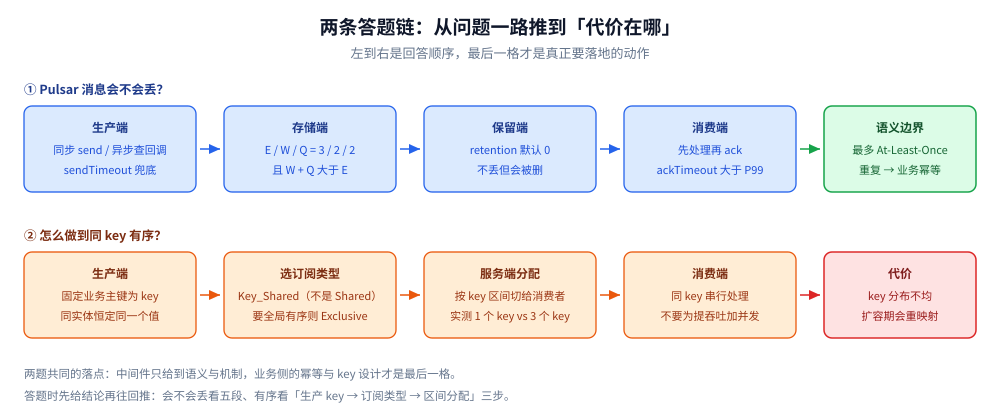

# 延伸追问

> 把 Pulsar 各篇最常被连环追问的问题集中成一页：一句结论 + 指向详解。它的作用是暴露缺口，不是第一次学习——没读顺的条目，回到对应篇目补。
>
> 不覆盖：具体机制在 [核心概念与架构.md](核心概念与架构.md)、[订阅与消费语义.md](订阅与消费语义.md)、[消息可靠性.md](消息可靠性.md)、[部署与配置.md](部署与配置.md)、[运维与排障.md](运维与排障.md)、[Pulsar协议.md](Pulsar协议.md)；接代码见 [Go 接入](../../../../01-编程语言/go/工程实践/接入Pulsar.md) 与 [Java 接入](../../../../01-编程语言/java/工程实践/接入Pulsar.md)。

---

## 一、定位与架构

- **Pulsar 和 Kafka 最本质的差别是什么？** → 存算分离。Kafka 的分区副本落在 Broker 本机，扩容要搬数据；Pulsar 把存储交给 BookKeeper，Broker 无状态，迁的是 topic 所有权。附带好处是 Broker 可弹性扩缩、多订阅扇出共享一份数据、分层存储天然好做。详见 [核心概念与架构.md](核心概念与架构.md) 第一、四节。
- **为什么 Pulsar 吞吐通常不如 Kafka？** → 写路径要过 BookKeeper quorum 确认（跨节点、多副本 ack），换来「确认即持久」；Kafka 靠 PageCache + 顺序追加 + 零拷贝把落盘异步化，吞吐高但 `acks=all` 不等于已刷盘。这是**可靠性实现方式的取舍，不是实现质量差异**。本篇不引用吞吐数字，两者都受批次、压缩与硬件影响。
- **MessageId 为什么不能当 offset 用？** → offset 是「分区内第几条」，可加减；MessageId 是 `(ledgerId, entryId, partitionIdx)`，指向 BookKeeper 里的一条记录。本机第一批 200 条的 ID 从 `3:100:-1` 起、到 `3:299:-1` 止——**起点不是 0**，因为前面还有别的批次写进同一 ledger。详见 [核心概念与架构.md](核心概念与架构.md) 第二节。
- **Broker 无状态，那「谁是 topic 的 owner」记在哪？** → 元数据存储里（4.x standalone 是本机 RocksDB，生产是 ZK / etcd）。owner 落在 **bundle** 上：一个命名空间被切成若干哈希区间，每个区间归一个 Broker。详见 [核心概念与架构.md](核心概念与架构.md) 第四、五节。
- **扩容为什么不用搬数据？** → 加 Broker 后负载均衡器把一部分 bundle 的**所有权**迁过去，ledger 仍在 BookKeeper 不动。代价是切换瞬间有秒级「断连 → 重新 lookup → 重连」，见 [Pulsar协议.md](Pulsar协议.md) 第四节。
- **三类组件的运维账怎么算？** → Broker 管协议与订阅、Bookie 管存储、元数据管策略与归属；故障域互相牵连（bookie 磁盘故障会表现成消费报错）。团队没有对应能力时，选型应保守，见 [核心概念与架构.md](核心概念与架构.md) 第五节。

## 二、订阅与顺序

- **四种订阅类型怎么选？** → 要并行选 Shared（但无序）；要同实体有序选 Key_Shared（生产端必须设 key）；要单实例严格有序选 Exclusive；要有序 + 热备选 Failover。⚠️ 高频错误是「用 Shared 又抱怨消息乱序」。详见 [订阅与消费语义.md](订阅与消费语义.md) 第一、四节。
- **Shared 为什么保证不了顺序？** → 它按条轮询派发，不认 key。本机 40 条 / 4 个 key / 2 消费者，分布是 `{2,6,6,6}` 与 `{8,4,4,4}`——同一个 key 被拆到两边。详见 [订阅与消费语义.md](订阅与消费语义.md) 第二节。
- **Key_Shared 是「按 key 均分」吗？** → 不是，是**按 key 区间**切。本机两个消费者拿到 `1 个 key（10 条）` 与 `3 个 key（30 条）`；负载不均不代表坏了，它优先保证同 key 不分裂。详见 [订阅与消费语义.md](订阅与消费语义.md) 第三节。
- **同一个订阅能挂多个消费者吗？** → 取决于订阅类型：Exclusive 第二个直接报 `ConsumerBusyException: Exclusive consumer is already connected`（本机实测原文）；Shared / Key_Shared 可以；Failover 是主备。详见 [运维与排障.md](运维与排障.md) 第三节。
- **订阅和消费者是什么关系？** → 订阅是**长期实体**，持有游标；消费者是接入实例，断了游标还在。所以多个订阅各自回溯互不影响，而同一订阅的多个消费者共享进度。详见 [订阅与消费语义.md](订阅与消费语义.md) 第一节。
- **`unsubscribe` 和关掉消费者有什么区别？** → `unsubscribe` 删订阅与游标（重回起点），`close()` 只断开实例（位点保留）。混用是「重启后消息重复消费」的常见原因，见 [运维与排障.md](运维与排障.md) 第二节。

## 三、可靠性

- **怎么保证不丢？** → 三处各管一段：生产端同步发送 + `sendTimeout` + 失败重试；存储端 E/W/Q ≥ 3/2/2 且满足 `W + Q > E`；消费端先处理后 ack，`ackTimeout` 大于业务 P99，配死信兜底。缺一处都不成立。详见 [消息可靠性.md](消息可靠性.md) 第一、二节。
- **`send()` 返回了就一定写进去了吗？** → 同步 `send()` 返回 MessageId 表示 Broker 已收到 BookKeeper 的确认；`sendAsync()` 只是提交到本地队列，**必须检查回调并 `flush()`**，否则进程退出会丢在途消息。详见 [消息可靠性.md](消息可靠性.md) 第二节。
- **retention 为什么默认是 0？** → 0 表示「所有订阅 ack 完即可删」，为省磁盘；但它意味着**回溯无数据**。要重放必须显式把 namespace 的 `retentionTimeInMinutes` / `retentionSizeInMB` 调大。详见 [消息可靠性.md](消息可靠性.md) 第三节。
- **去重窗口能挡掉哪些重复？** → 只挡「**同一生产者名 + 同一序号**」的重发，且在窗口内。本机第二次发送同序号返回 `-1:-1:-1`，发 3 条只消费到 2 条。它挡不了「业务代码用新序号重发同一条」，也挡不了消费端重复处理。详见 [消息可靠性.md](消息可靠性.md) 第四节。
- **重投与死信怎么落地？** → 未 ack 超 `ackTimeout` 或主动 `Nack` 都会重投；`maxRedeliverCount` 到达后进 `deadLetterTopic`。本机实测 `redeliveryCount` 依次 `0/1/2/3`，第 5 次取不到消息，DLQ 收到它。详见 [消息可靠性.md](消息可靠性.md) 第五节。
- **为什么最终仍然只能做到 At-Least-Once？** → 「处理成功」与「ack 送达」无法原子化：ack 丢失必然重投，重投必然重复处理。中间件能给的上限就是 At-Least-Once，**业务幂等是唯一可靠的补丁**（唯一键 / 去重表 / 状态机 CAS）。详见 [消息可靠性.md](消息可靠性.md) 第六节。

## 四、部署、延迟与协议

- **延迟消息怎么实现？为什么我设了 `deliverAfter` 却立刻收到？** → ⭐ 延迟投递**只在 Shared / Key_Shared 订阅生效**，Exclusive / Failover 下会被立即派发。本机 `deliverAfter=5s`：Shared 实测 `4961 ms` 收到，Exclusive 只有 `229 ms`。另外必须关批次（`enableBatching(false)`）。详见 [订阅与消费语义.md](订阅与消费语义.md) 第五节。
- **为什么 5 秒的延迟实际是 4961 ms？** → 延迟投递按 `delayedDeliveryTickTimeMillis`（本机默认 1000）周期性扫描，误差上限就是这个刻度；`maxMessagesInDelayedDelivery` 默认 100，超过阈值会降级为粗粒度。详见 [部署与配置.md](部署与配置.md) 第三节。
- **standalone 是「自带 ZooKeeper」吗？** → 4.x 不再是。本机日志第一行是 `Starting BK with RocksDb metadata store`，元数据落在 `/pulsar/data/metadata`（本机 75 MB），2181 不监听，内嵌 bookie 用随机端口（本机 `45855`）。详见 [部署与配置.md](部署与配置.md) 第二节。
- **端口映射后客户端能连吗？** → 单 Broker 且 lookup 返回 `Connect` 时可以（本机从宿主实测发送成功）；一旦返回 `Redirect`，客户端按 broker 自报地址重连，而 `advertisedAddress` 为空时自报 `localhost`，跨机就会断。详见 [部署与配置.md](部署与配置.md) 第二节。
- **单机为什么只能是 E/W/Q = 1/1/1？** → 只有 1 个 bookie，ensemble 大于 1 凑不出候选节点，写入会报 `NotEnoughBookiesException`。生产 3/2/2 要有 3 个 bookie；且不能单独调低 `ackQuorum` 换可用性。详见 [部署与配置.md](部署与配置.md) 第四节。
- **为什么客户端发消息前要先 lookup？** → topic 只归一个 Broker 所有，连错就发不了。`LOOKUP_RESPONSE` 要么 `Connect`（就归你），要么 `Redirect`（去连那个地址）。这是 Pulsar 客户端连接数比 Kafka 多的原因。详见 [Pulsar协议.md](Pulsar协议.md) 第四节。
- **流控为什么不用 TCP 背压？** → TCP 窗口按字节算，消费瓶颈常按条数；且一条连接上多路复用多个 consumer，TCP 分不清谁慢。Pulsar 用 per-consumer 的 `FLOW` permits，Broker 用完就停推。详见 [Pulsar协议.md](Pulsar协议.md) 第五节。
- **协议为什么用 Protobuf 而不是手写二进制？** → 加命令只加 tag，老客户端能跳过；代价是每条命令都背 tag 开销，手写客户端必须先有 Protobuf 运行时。帧的六段结构与 CRC32-C 校验见 [Pulsar协议.md](Pulsar协议.md) 第二、三节。
- **监控 `/metrics` 为什么是空的？** → 返回 302，要 `curl -L` 跟随；本机 `-L` 后 3284 行。指标名如 `pulsar_subscription_back_log_no_delayed`、`pulsar_subscription_blocked_on_unacked_messages`。详见 [运维与排障.md](运维与排障.md) 第八节。

## 五、两条答题链

这张图把两条链的**回答顺序**画成横向流程：前一格是后一格的前提，最后一格才是真正要落地的动作——丢消息的链落在业务幂等，有序的链落在 key 设计与扩容代价上。

**① 「Pulsar 消息会不会丢？」** → 生产端：同步发送 / 异步查回调 + `flush`，`sendTimeout` 兜底 → 存储端：E/W/Q 3/2/2 且 `W + Q > E`，确认即持久 → 保留端：retention 默认 0，**不丢但会删**，要重放必须改 → 消费端：先处理再 ack，`ackTimeout` 大于 P99，死信接住反复失败的 → 语义边界：最多 At-Least-Once，重复靠业务幂等收敛。

**② 「Pulsar 怎么做到同 key 有序，代价是什么？」** → 生产端固定业务主键为 key → 选 Key_Shared（按 key 区间分配给消费者）→ 同 key 恒定落同一消费者、串行处理 → 代价：key 分布不均时消费者负载不均（本机 10 条 vs 30 条），且消费者数量变化会重新映射 key → 若只需全局有序，用 Exclusive 换掉并行度；Shared 一律不保序。

## 关联

- **上游/总纲**：[README.md](README.md) — 本册导读与阅读路线
- **上游/总纲**：[消息队列选型对比.md](../消息队列选型对比.md) — 六款 MQ 的横向对比与选型结论
- **对照/互补**：[延伸追问.md](../Kafka/延伸追问.md) — 同一组问题在分区日志模型下的答案
- **对照/互补**：[延伸追问.md](../RocketMQ/延伸追问.md) — 事务消息与延迟级别的另一套答案
- **对照/互补**：[延伸追问.md](../NATS/延伸追问.md) — 轻量派在顺序与可靠性上的取舍
- **下游机制**：[复制与Quorum.md](../../../../04-架构与系统/分布式/数据分布/复制与Quorum.md) — E/W/Q 与多数派的一般原理
