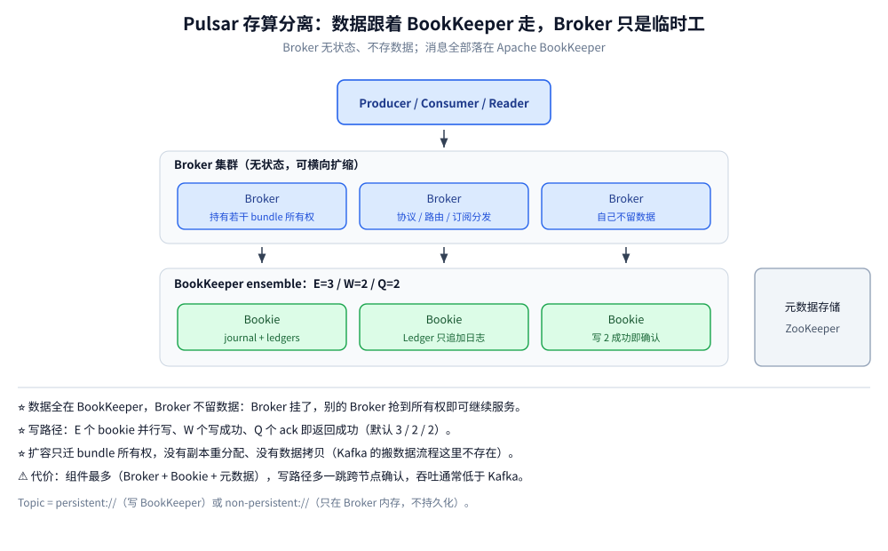
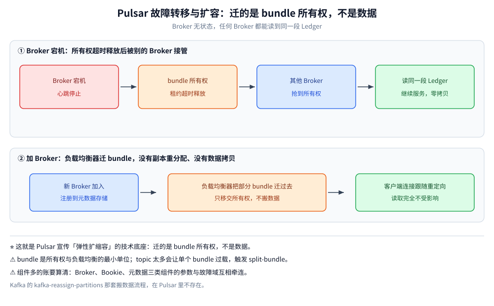

# 核心概念与架构

> 覆盖 Pulsar 的定位与「存算分离」换来了什么、MessageId 为什么不是 offset、一次写入从 Producer 到 BookKeeper quorum 的完整路径、bundle 所有权如何让扩容与故障转移不搬数据，以及三类组件的运维账。
>
> 不覆盖：四种订阅类型与分发细节见 [订阅与消费语义.md](订阅与消费语义.md)；quorum、retention 与去重的配置落点见 [消息可靠性.md](消息可靠性.md)；standalone 起法与端口见 [部署与配置.md](部署与配置.md)；Protobuf 帧与 lookup 重定向见 [Pulsar协议.md](Pulsar协议.md)；接入代码见 [Go 接入](../../../../01-编程语言/go/工程实践/接入Pulsar.md) 与 [Java 接入](../../../../01-编程语言/java/工程实践/接入Pulsar.md)。
>
> 内容整理自个人学习笔记。**实测口径**：本机 `apachepulsar/pulsar:4.0.5` standalone 容器（`pulsar-lab`，宿主 16650 → 6650、18080 → 8080）实测了写入耗时、MessageId 形态、数据目录、bundle 划分与进程资源；**多 Broker / 多 Bookie 的副本与故障转移未实测**，按官方文档陈述。

---

## 一、Pulsar 凭什么把计算与存储拆开？

**本节要点**：Pulsar 与 Kafka / RocketMQ 最本质的差别只有一个——**Broker 不存数据**。消息落在 BookKeeper 的 ledger 里，Broker 只负责协议、路由、订阅和分发。理解这一条，后面「扩容不搬数据」「一份数据多路消费」「Broker 挂了只换 owner」都是它的推论。



上图要读出的核心：**Broker 与 Bookie 之间是「读/写请求」关系，不是「本地磁盘」关系**。同一条消息被几个订阅消费，Broker 就去 BookKeeper 读几次（或读一次分发多份），**不会为每个订阅复制一份数据**。

| 能力 | 依赖的架构前提 | 对比 Kafka |
| --- | --- | --- |
| ⭐ **扩容 / 故障转移不搬数据** | 数据在 BookKeeper，任何 Broker 都能读到任意 ledger | Kafka 加分区要做副本重分配，Broker 挂了靠副本重建 |
| ⭐ **原生多租户**（tenant / namespace / bundle） | 命名空间承载保留、TTL、配额、复制、分层存储 | Kafka 只有前缀约定 + ACL，没有租户层 |
| ⭐ **一份数据被多个订阅独立读** | 读位置（cursor）由订阅持有，与存储无关 | Kafka 也共享日志，但保留期是分区固定的 |
| **分层存储成熟** | BookKeeper 之上再挂 S3 / GCS / MinIO 归档 | Kafka Tiered Storage 落地更晚 |

核心卖点之外，还有三项业务消息常用能力是 Kafka 没有的：**任意时刻的延迟投递**、**原生死信 / 重试队列**、**按生产者序号去重**。这三项在 [订阅与消费语义.md](订阅与消费语义.md) 与 [消息可靠性.md](消息可靠性.md) 展开。

> ⭐ 一句话记忆：**Kafka 是「数据跟着分区走」，Pulsar 是「数据跟着 BookKeeper 走」**。代价是写路径多一跳 quorum 确认、组件多一层、生态小一圈。

## 二、MessageId 为什么不能当 offset 用？

**本节要点**：Pulsar 的 MessageId 是 **`(ledgerId, entryId, partitionIdx)` 三段值**，它指向「哪本账、第几页、哪个分区」，**不是「分区内第 N 条」**。所以它不能加减、不能算 lag、也不能当业务幂等键。

| 事项 | 说明 |
| --- | --- |
| 结构 | `(ledgerId, entryId, partitionIndex)`；Java 的 `toString()` 形如 `3:100:-1`，Go 用 `id.LedgerID()` / `id.EntryID()` 取值 |
| 不能做算术 | 没有「offset + 1」「lag = 末尾 − 当前」；积压看 `topics stats` 的 `backlogSize` 与订阅级 `msgBacklog` |
| 起点不是 0 | 本机第一批 200 条的 MessageId 是 `3:100:-1` → `3:299:-1`：同一 ledger 前面已有 100 条别的批次 |
| 回溯入口 | ① `seek(MessageId)`；② `seekByTime(时间戳)` 按时间回溯；③ 用 Reader 自管起点 |
| 幂等键 | ⚠️ 别拿 MessageId 当业务幂等键，要用业务唯一键；MessageId 只能证明「同一条消息被重复投递」 |

本机两次读数正好印证「同一条消息的 MessageId 可以重复出现，但账本编号会变」：

| 场景 | 读数 |
| --- | --- |
| 生产 200 条（`lab-orders`） | 首条 `3:100:-1`、末条 `3:299:-1`，`lastSequenceId=199` |
| 去重实验（`public/dedup-lab`） | 首条 `95:0:-1`、第三条 `95:1:-1`；重复写返回 **`-1:-1:-1`** |

> ⚠️ **`-1:-1:-1` 是「这条没写进去」的信号**，不是错误码。去重命中时 Broker 会回这个无效 MessageId，客户端 `send()` 仍然成功返回——这是 [消息可靠性.md](消息可靠性.md) 第四节的关键细节。

## 三、一次写入到确认经过了什么？

**本节要点**：写路径是 **Producer → Broker → BookKeeper ensemble**。Broker 校验、应用策略、必要时攒批，然后把 entry 交给一组 bookie：**E 个 bookie 参与、W 个写成功、Q 个确认后返回 Producer**。确认语义来自 BookKeeper 的 quorum，而不是 Broker 自己的页缓存。

```text
Producer → Broker（校验 / 多副本策略 / 批次）→ BookKeeper ensemble
         E 个 bookie 并行写 → 收到 W 个写成功 → 累计 Q 个 ack → 返回 Producer
```

| 参数 | 生产建议 | 本机 standalone |
| --- | --- | --- |
| `managedLedgerDefaultEnsembleSize`（E） | 3 | **1** |
| `managedLedgerDefaultWriteQuorum`（W） | 2 | **1** |
| `managedLedgerDefaultAckQuorum`（Q） | 2 | **1** |

生产 3/2/2 的含义：**写成功即数据已在 2 个 bookie 上落盘**，Broker 崩了也不丢。本机 standalone 只有 1 个 bookie（`bookies list-bookies` 返回 `172.17.0.3:45855`），所以只能 1/1/1，**没有任何冗余**——这是单机实验与生产在可靠性上最容易被忽略的差距。

> ⭐ 与 Kafka 的差别：Kafka 的 `acks=all` 只保证 ISR 副本收到，**不保证落盘**（还靠 OS 刷盘）；Pulsar 的确认来自 BookKeeper quorum，语义更接近「已持久化」。
> ⚠️ 代价：写路径多一次跨节点确认，**单条延迟与吞吐都不如 Kafka 的 PageCache 顺序写**——这是「Pulsar 吞吐低于 Kafka 一个量级」说法的真实来源，是取舍不是实现质量问题。

本机 200 条持久消息的写入读数（单机、单 bookie、17 B 载荷）：

| 指标 | 读数 |
| --- | --- |
| 总耗时 | **1233 ms** |
| 平均每条 | **6.165 ms** |
| 发布速率 | **150.41 msg/s** |
| 发布延迟 | med **4 ms** / 95pct **9 ms** / 99pct **15 ms** / max 52 ms |
| 失败与在途 | Failed 0 / Pending 0 |

写完之后，数据在盘上的位置能直接看出「存算分离」：

| 路径 | 大小 | 是什么 |
| --- | --- | --- |
| `/pulsar/data/metadata` | 75 MB | 元数据（RocksDB）：命名空间策略、ledger 元信息、bundle 归属 |
| `/pulsar/data/standalone/bookkeeper/current/ledgers` | 75 MB | BookKeeper 的 ledger 数据 |
| `/pulsar/data/standalone/bookkeeper/current/locations` | 75 MB | BookKeeper 的索引（entry 位置） |
| `/pulsar/data/standalone/bookkeeper/current/*.log` / `*.txn` | 合计 < 0.5 MB | journal 与事务文件 |

> ⚠️ **Broker 没有自己的消息目录**。standalone 里三者同进程，看起来只有一个 `data` 目录；拆成集群后，Broker 节点的本地盘上**不会**出现消息数据，这正是「Broker 可以随时换」的物质基础。

## 四、扩容与故障转移为什么不用搬数据？

**本节要点**：Pulsar 以 **bundle** 为单位分配 topic 的所有权。Broker 挂掉时，租约超时释放，别的 Broker 抢到 bundle 后**直接从 BookKeeper 读同一段 ledger** 继续服务；加 Broker 时，负载均衡器把部分 bundle 的归属挪过去。**迁的是所有权，不是数据。**



| 步骤 | 发生什么 | 数据是否移动 |
| --- | --- | --- |
| Broker 宕机 | 它持有的 bundle 所有权（元数据存储上的租约）超时释放 | 否 |
| 其他 Broker | 抢到 bundle 所有权，从 BookKeeper 读同一段 ledger | 否 |
| 加 Broker | 负载均衡器把部分 bundle 迁过去 | 否 |
| Kafka 加分区 | 副本重分配，逐分区拷贝数据 | **是** |

**bundle 是哈希区间，不是 topic 列表**。本机 `public/default` 的实测划分：

```bash
docker exec pulsar-lab bin/pulsar-admin namespaces bundles public/default
# {"boundaries":["0x00000000","0x40000000","0x80000000","0xc0000000","0xffffffff"],"numBundles":4}
```

4 个新区间 `[0x00000000,0x40000000)`、`[0x40000000,0x80000000)`、`[0x80000000,0xc0000000)`、`[0xc0000000,0xffffffff]`，topic 名做哈希后落进某个区间。由此带来两条运维结论：

- **单 topic 的吞吐上限 = 单个 Broker 的上限**：一个 topic 只属于一个 bundle、由一个 Broker 持有。上不去就建**分区 topic** 或拆 topic，让 bundle 摊开。
- **topic 太多会把单个 bundle 压垮**：需要 `split-bundle` 或 `unload` 重新分配。

> ⚠️ **unload 不是无损重启**：bundle 迁移期间这个 bundle 下的 producer / consumer 会经历「断开 → 重新 lookup → 重连」，耗时是秒级。客户端如果没配重试，表现为一次发送失败或一段时间的消费停滞。

## 五、组件多的账怎么算？

**本节要点**：Pulsar 的「运维重」不是修辞。**Broker、Bookie、元数据存储三类组件的参数与故障域互相牵连**：bookie 磁盘坏 → ledger 可读性下降 → Broker 侧消费报错；ledger 元数据问题要查元数据存储；bundle 负载不均要会 `split-bundle` / `unload`。

| 组件 | 作用 | 能不能省 | 故障表现 |
| --- | --- | --- | --- |
| Broker | 计算层：协议、订阅、分发 | 不能 | topic 所有权漂移，客户端重定向 |
| Bookie | 存储层：真正落盘 | 不能（立身之本） | 写入报 `NotEnoughBookiesException`、读失败 |
| 元数据存储（ZK / Raft + RocksDB） | 命名空间策略、ledger 元信息、bundle 所有权 | 生产难省 | 建 topic / 加载策略失败，bundle 无法接管 |
| Proxy | 统一入口、跨机房 | 单机可省，K8s / 多机房一般要 | 客户端连不上或路由绕远 |
| Functions / Connector | 流计算与集成 | 按需 | 不影响主链路 |

本机的 standalone 把三类组件塞进**一个 JVM**（PID 1，RSS **804 MB**），对外只监听 **6650**（二进制协议）与 **8080**（Admin / Web），ZooKeeper 2181、Bookie 3181 都没有单独暴露。这让人容易低估真实集群的组件数——**standalone 是开发环境，不是生产拓扑的缩略图**。

> ⚠️ 选型时「运维复杂度高」的权重应该放高：团队没有 JVM 与分布式存储运维经验时，Bookie 磁盘故障与 ledger 恢复会成为长期负担。

## 应用场景

| 场景 | 用到的架构特性 | 注意 |
| --- | --- | --- |
| **多租户 SaaS 的消息平台** | tenant / namespace 承载配额与策略 | 策略配在 namespace，不要逐个 topic 配 |
| **需要回溯的业务消息**（订单、支付） | 订阅游标 + retention | ⭐ retention **默认 0**，不显式打开就没有历史可回 |
| **一份数据多个业务组各读各的** | 多订阅独立游标、扇出不复制 | 慢订阅会拖住删除位置，必须配 backlog 配额 |
| **弹性扩缩容** | bundle 所有权迁移 | 迁移瞬间有秒级重连，客户端要能重试 |
| **冷热分层** | BookKeeper + 分层存储 | 本机未实测 offload |
| **可丢的实时信号** | `non-persistent://` | 不落 BookKeeper，Broker 重启即丢 |

## 具体使用

### 建命名空间并确认 bundle 划分

```bash
# standalone 自带 public/default；自己的租户与命名空间要建
docker exec pulsar-lab bin/pulsar-admin tenants create shop
docker exec pulsar-lab bin/pulsar-admin namespaces create shop/default

# 看 bundle 区间：默认 4 个，是所有权与负载均衡的最小单位
docker exec pulsar-lab bin/pulsar-admin namespaces bundles shop/default
```

### 看一个 topic 到底写了多少、存在哪

```bash
# 写入总量、存储大小、积压
docker exec pulsar-lab bin/pulsar-admin topics stats persistent://public/default/lab-orders

# ledgers / entries：本机实测 1 个 ledger、300 条 entry、26540 B
docker exec pulsar-lab bin/pulsar-admin topics stats-internal persistent://public/default/lab-orders
```

本机 `lab-orders` 的实测读数：

| 字段 | 值 | 说明 |
| --- | --- | --- |
| `msgInCounter` | 300 | 累计写入 300 条（200 条压测 + 100 条早期批次） |
| `storageSize` | 26540 B | 实际存储 |
| `backlogSize` | 25660 B | 尚未被所有订阅消费的部分 |
| `currentLedgerEntries` | 300 | 当前 ledger 里的 entry 数 |
| 订阅数 | 3 | `lab-consume-1` / `sub-excl` / `sub-excl2`，积压分别 100 / 290 / 200 |

> ⚠️ **`backlogSize` 是 topic 级汇总，不等于「积压了多少条」**。条数要看订阅级 `msgBacklog`；不同订阅创建时间不同，积压数也会不一致（本机 290 > 300 的减法是成立的，只因各订阅游标位置不同）。

## 延伸追问

- **Pulsar 和 Kafka 最本质的差别是什么？** 存算分离。Kafka 的分区副本落在 Broker 本机，扩容要搬数据；Pulsar 把存储交给 BookKeeper，Broker 无状态，迁的是 topic 所有权。
- **为什么 Pulsar 吞吐通常不如 Kafka？** 写路径要经过 BookKeeper quorum 确认（跨节点、多副本 ack），换来「确认即持久」；Kafka 靠页缓存 + 顺序追加 + 零拷贝，把刷盘异步化。
- **MessageId 能拿来算积压吗？** 不能。它是 `(ledger, entry, partition)`，不是连续序号；积压看 `topics stats` 的 `backlogSize` / 订阅级 `msgBacklog`。
- **Broker 挂了，正在处理的消息会怎样？** 未 ack 的消息在订阅游标里仍是「未确认」状态，新 Broker 接管后按订阅类型重新投递——这是 At-Least-Once 的来源之一。
- **为什么 standalone 只有 6650 / 8080 两个端口？** 因为 ZooKeeper、Bookie、Broker 在同一进程内，2181 / 3181 没有单独监听；集群部署才会分端口暴露。
- **bundle 和分区的区别？** bundle 是**命名空间下的 topic 哈希区间**，用于分配 Broker 所有权；分区是**单个 topic 内部**的并行单元。一个分区 topic 的所有分区仍属于同一个 bundle。

## 关联

- **上游/总纲**：[README.md](README.md) — 本册导读、阅读路线与实测坐标
- **下游机制**：[订阅与消费语义.md](订阅与消费语义.md) — 四种订阅类型、延迟投递限制、起始位置
- **下游机制**：[消息可靠性.md](消息可靠性.md) — quorum、retention、去重窗口、重投与死信
- **运维/配置**：[部署与配置.md](部署与配置.md) — standalone 起法与 `standalone.conf` 关键项
- **对照/互补**：[Pulsar协议.md](Pulsar协议.md) — lookup 重定向正是「所有权」在协议层的体现
- **对照/互补**：[核心概念与架构.md](../Kafka/核心概念与架构.md) — 分区副本模型：数据跟着分区走
- **下游机制**：[复制与Quorum.md](../../../../04-架构与系统/分布式/数据分布/复制与Quorum.md) — E/W/Q 与多数派的对应关系
