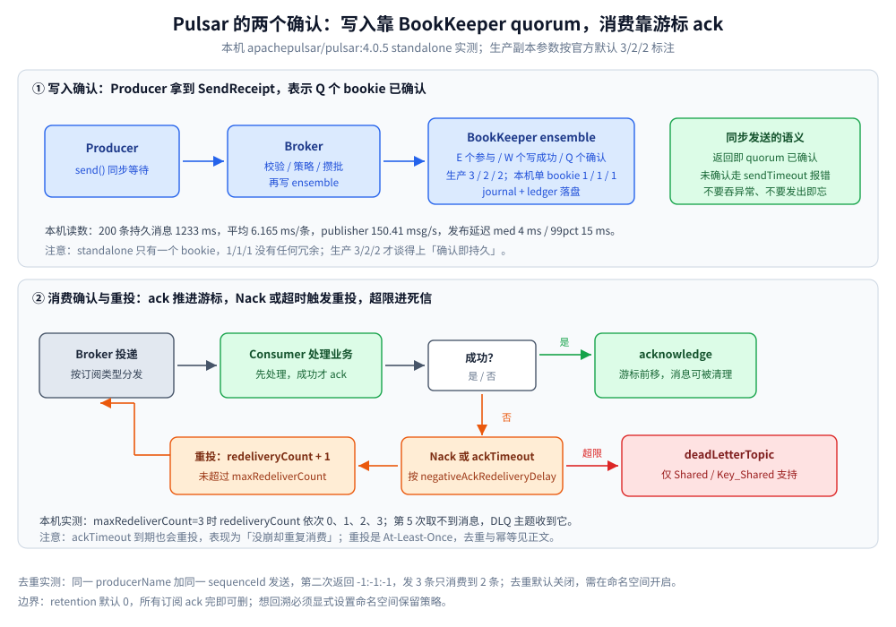

# 消息可靠性

> 覆盖 Pulsar 端到端的可靠性：生产端什么时候才算「写进去了」、BookKeeper quorum 与 retention 的配置落点、去重窗口按「生产者名 + 序号」挡住了什么、ackTimeout / Nack / 死信的重投路径，以及为什么它最终仍然只能做到 At-Least-Once。
>
> 不覆盖：订阅类型对重投与顺序的影响见 [订阅与消费语义.md](订阅与消费语义.md)；E/W/Q 与存算分离的架构原因见 [核心概念与架构.md](核心概念与架构.md)；retention、去重的命令怎么敲见 [部署与配置.md](部署与配置.md) 第五节；接入代码见 [Go 接入](../../../../01-编程语言/go/工程实践/接入Pulsar.md) 与 [Java 接入](../../../../01-编程语言/java/工程实践/接入Pulsar.md)。
>
> 内容整理自个人学习笔记。**实测口径**：本机 `apachepulsar/pulsar:4.0.5` standalone 容器（`pulsar-lab`）实测了写入耗时、去重窗口、Nack 重投与死信触发的完整计数；**多副本 quorum 写、Broker 宕机后的重投、事务 API 未实测**，按官方文档陈述。

---

## 一、消息在哪几个环节可能出问题？

**本节要点**：Pulsar 的可靠性要**五处分别配**，缺一处就有一个漏洞：生产端确认、存储端副本、保留策略、消费端 ack、重复兜底。它们不在一张配置页上，这是排障时最容易漏检的原因。

| 环节 | 机制 | 会丢 / 会重的场景 |
| --- | --- | --- |
| **生产** | 同步 `send()` 等待 `SendReceipt`；`sendTimeout` 兜底 | 异步发送只看回调、不判异常 = 发出即忘；超时异常被吞 = 静默丢 |
| **存储** | BookKeeper E/W/Q quorum，生产建议 3/2/2 | 单 bookie（本机 1/1/1）无冗余；bookie 数不足 `ensemble` 直接写失败 |
| **保留** | 命名空间 retention（默认 **0**） | ⚠️ 所有订阅 ack 完即删，回溯窗口为零 |
| **消费** | 先处理后 ack；`ackTimeout` 兜底重投 | ack 前崩溃 = 重复；`ackTimeout` 小于处理耗时 = 「没崩却重复」 |
| **重复兜底** | 命名空间去重（默认关）+ 业务幂等 | 去重只覆盖窗口内、同一生产者名的序号；跨系统仍靠业务幂等 |

## 二、`send()` 返回了，消息就算写进去了吗？

**本节要点**：**同步发送返回 MessageId，才代表 Q 个 bookie 已确认**。异步发送的返回只是「交给客户端队列」，必须看回调；进程退出前不 `flush()`，缓冲区里的消息会随进程一起消失。

| 手段 | 配置 / API | 语义 |
| --- | --- | --- |
| 同步发送 | `producer.send(msg)` / Go `Producer.Send(ctx, msg)` | 返回 MessageId = BookKeeper quorum 已确认；失败抛异常，交给调用方重试 |
| 发送超时 | `sendTimeout(30, SECONDS)` / `ProducerOptions.SendTimeout` | 不配可能长期挂住；超时即报错，不要吞异常 |
| 在途与背压 | `maxPendingMessages(1000)` + `blockIfQueueFull(true)`；客户端总缓冲 `memoryLimit(64MB)` | 队列满时**阻塞**发送线程形成背压，而不是把压力变成异常 |
| 异步回调 | `sendAsync().whenComplete(...)` / `SendAsync(..., callback)` | ⚠️ 回调里必须判异常；退出前 `flush()` |
| 生产者去重 | 命名空间 `brokerDeduplicationEnabled=true` + `SequenceID` | 按「生产者 + 序号」挡重复写，见第四节 |

本机 200 条同步发送的实测（单机、单 bookie、17 B 载荷、客户端默认批量参数）：

| 指标 | 读数 |
| --- | --- |
| 总耗时 / 平均 | **1233 ms** / **6.165 ms/条** |
| 发布速率 | **150.41 msg/s** |
| 发布延迟 | med **4 ms** / 95pct **9 ms** / 99pct **15 ms** / max 52 ms |
| Failed / Pending | 0 / 0 |

> ⚠️ **这是单机单 bookie 的数字，不能当容量规划依据**：生产 3/2/2 时每条要等 2 个 bookie 确认，延迟与吞吐都会变；真实压测必须在目标拓扑上做。

## 三、retention 为什么默认是 0？

**本节要点**：Pulsar 的默认语义是「**所有订阅都 ack 完的数据可以立刻删除**」——`defaultRetentionTimeInMinutes=0`、`defaultRetentionSizeInMB=0`。这不是 bug，而是「消息队列」与「流存储」两种定位的分界：**想回溯，必须显式打开 retention**。

本机 `standalone.conf` 的实测默认值：

| 配置 | 值 | 含义 |
| --- | --- | --- |
| `defaultRetentionTimeInMinutes` | **0** | 不按时间保留，ack 完即可删 |
| `defaultRetentionSizeInMB` | **0** | 不按容量保留 |
| `messageTTLInSeconds`（命名空间） | 0 | 未 ack 消息不过期 |
| `backlogQuotaDefaultLimitGB`（命名空间） | 未设 | 慢订阅可以把磁盘顶满 |

由此引出三条生产必做项：

- **要回溯就开 retention**：`namespaces set-retention <ns> --size 10G --time 7d`；否则「重放昨天的数据」一定失败，而且报错是「没有数据」而不是「配置没开」。
- **给积压设上限**：慢订阅/僵尸订阅会把删除位置拖住，`backlogSize` 只涨不降；用 backlog 配额限制，超限动作可选 `producer_request_hold` / `exception` / `consumer_backlog_eviction`。
- **区分 retention 与 TTL**：retention 管「ack 完之后还留多久」，TTL 管「未 ack 的消息活多久」。两者都配 0，等于既不保留也不清理。

> ⚠️ **从 Kafka 迁过来最容易栽的一次**：Kafka 默认保留 7 天，团队默认「历史总在」；Pulsar 默认 0，回溯窗口为零。上线前先确认 `set-retention` 已执行，而不是等出事故再查。

## 四、去重窗口能挡掉哪些重复？

**本节要点**：Pulsar 的去重是**命名空间级**的，判定依据是「**生产者身份（producerName）+ 消息序号（sequenceId）**」。命中重复时，Broker **丢弃这条写入**，并给 Producer 回一个无效 MessageId `-1:-1:-1`——`send()` 仍然成功，所以**不能靠 `send()` 是否报错判断是否重复**。

本机实测（命名空间 `public/dedup-lab` 已开去重，同一生产者发 3 条）：

| 动作 | 返回的 MessageId | 结果 |
| --- | --- | --- |
| 第 1 条，`sequenceId=N` | `95:0:-1` | 写入成功 |
| 第 2 条，**同一** `sequenceId=N` | **`-1:-1:-1`** | ⭐ 被判重复，未写入 |
| 第 3 条，`sequenceId=N+1` | `95:1:-1` | 写入成功 |
| 消费结果 | —— | **共 2 条**（`payload-1`、`payload-2`），重复那条从未出现 |



上图要读出的核心：**「写进去」与「重复」是两条独立的判定**——quorum 决定这条写有没有持久化，去重窗口决定这条写要不要被丢弃；而消费侧的重投与死信只处理「已经写进去、但业务没成功处理」的那一类。

去重能挡住的与挡不住的：

| 能挡 | 挡不住 |
| --- | --- |
| 生产者重试导致的**同序号重复写** | 不同 `producerName` 的相同业务消息 |
| 同一生产者短时间内的重复发送 | 超出去重信息保留范围的旧序号（快照按 `brokerDeduplicationEntriesInterval` 周期生成） |
| —— | 消费端处理失败导致的重投（那是 At-Least-Once，见第五节） |

> ⚠️ **必须显式设 `producerName`**：不设时客户端每次启动生成新名字，相当于换了身份，去重窗口对它无效。生产者重启后序号要不要连续，也要与业务约定好。

## 五、重投与死信怎么落地？

**本节要点**：消费失败有两条路——**不 ack 等 `ackTimeout`**（被动）或 **Nack 主动交还**（可控）。重投次数累计到 `maxRedeliverCount` 后进入 `deadLetterTopic`，但**死信只对 Shared / Key_Shared 生效**。

| 手段 | 配置 | 语义 |
| --- | --- | --- |
| 先处理后 ack | `acknowledge(msg)` / `consumer.Ack(msg)` 放在业务成功之后 | 与 Kafka 一致的铁律 |
| ack 超时重投 | `ackTimeout(60, SECONDS)` | ⚠️ 处理慢于该值 → 消息被重投，**表现为「没崩却重复消费」** |
| 显式否定应答 | `negativeAcknowledge(msg)` / Go `consumer.Nack(msg)` | 按 `negativeAckRedeliveryDelay` 延迟重投 |
| 单条自定义延迟 | Go `consumer.ReconsumeLater(msg, delay)` | 退避重试，比固定延迟灵活 |
| 死信 + 重试队列 | `DeadLetterPolicy.builder().maxRedeliverCount(3).deadLetterTopic(...).retryLetterTopic(...)` | ⭐ 仅 Shared / Key_Shared 可用 |
| ack 可追踪 | Go `AckWithResponse: true` | 让 Broker 回 ack 结果，能发现「以为提交了其实失败」 |

本机死信实测（`maxRedeliverCount=3`、`negativeAckRedeliveryDelay=100ms`、Shared 订阅）：

| 第几次取到 | `redeliveryCount` | 结果 |
| --- | --- | --- |
| 1 | 0 | 原投 |
| 2 | 1 | 第 1 次重投 |
| 3 | 2 | 第 2 次重投 |
| 4 | 3 | 第 3 次重投 |
| 5 | —— | **取不到消息**（源码队列已无），`lab-dlq2` 收到该消息 |

两条容易踩的细节：

- **死信主题名有默认规则**：不显式给 `deadLetterTopic` 时，默认是 `<订阅名>-DLQ`；重试主题默认 `<订阅名>-RETRY`。订阅名自带后缀时要注意不要拼成 `…-DLQ-DLQ`。
- **死信不是自动清理的**：它就是一个普通 topic，没人消费就按 retention 留着，久了会积压。必须有人（或一个定时任务）处理并记录。

> ⚠️ **`retryLetterTopic` 与 `deadLetterTopic` 不是一回事**：前者是「再试一次」的中转（可反复回主队列），后者是「判定失败」的终点。把两者混用，会出现「消息在重试队列里无限循环」。

## 六、为什么最终仍然只能做到 At-Least-Once？

**本节要点**：去重只覆盖「同一生产者 + 同一序号」的**写入重复**；消费端 ack 前崩溃、ack 超时、Nack 重投都会造成**投递重复**。Pulsar 的事务只解决「同集群流内」的原子性，跨系统的「恰好一次」仍然只能靠业务幂等。

| 目标 | 生产端 | 存储端 | 消费端 |
| --- | --- | --- | --- |
| **不丢（At Least Once）** | 同步发送 + `sendTimeout` + 失败重试 | E/W/Q ≥ 3/2/2 + 打开 retention | 先处理后 ack，`ackTimeout` 大于业务 P99 |
| **不重（幂等）** | 开命名空间去重 + 稳定 `producerName` 与 `SequenceID` | —— | ⚠️ 仍需业务幂等：唯一键去重表 / 状态机 CAS |
| **恰好一次** | 事务 API | 事务协调器 + ledger | 只在同集群流内成立，跨系统仍靠幂等 |

本机 `transactionCoordinatorEnabled=false`——**事务默认关闭**，而且它与 RocketMQ 的「半消息 + 回查」不是一回事：Pulsar 事务处理的是「读 A → 处理 → 写 B（+ ack）」的流内原子提交，不做业务侧的两阶段确认。业务分布式事务仍看 [最终一致方案.md](../../../../04-架构与系统/分布式/分布式事务/最终一致方案.md)。

> ⭐ 现实结论与 Kafka 相同：**中间件只能做到 At-Least-Once，「不重」靠消费端幂等**。幂等的四种做法见 [消息队列选型对比.md](../消息队列选型对比.md)。

## 应用场景

| 场景 | 可靠性配置组合 | 注意 |
| --- | --- | --- |
| 支付回调、订单状态流转 | 同步发送 + 3/2/2 + retention + 死信 + 消费幂等 | 死信必须有人处理 |
| 日志 / 埋点（可少量丢） | 异步发送 + 1/1/1 + 不保留 | 回调仍要判异常，否则连「丢了多少」都不知道 |
| 需要回放对账 | retention 设为业务窗口 + Reader 重放 | Reader 不动订阅游标 |
| 避免重复写（生产者重试） | 命名空间去重 + 固定 `producerName` | 去重不是跨系统幂等 |
| 处理很慢（分钟级） | `ackTimeout` 大于 P99 或改手动 Nack | 否则「没崩也重复」 |
| 坏消息不阻塞队列 | `maxRedeliverCount` + 死信主题 + 转存 | 死信主题也要有消费者 |

## 具体使用

### 打开保留与去重

```bash
# ⭐ 想回溯必须先打开 retention（默认 0，ack 完就删）
docker exec pulsar-lab bin/pulsar-admin namespaces set-retention public/default \
  --size 1G --time 1h

# 去重按「生产者名 + 序号」判定，命名空间级开关（默认关闭）
docker exec pulsar-lab bin/pulsar-admin namespaces set-deduplication public/default --enable
docker exec pulsar-lab bin/pulsar-admin namespaces get-deduplication public/default

# 确认当前策略：返回 null 表示没设，走 Broker 默认
docker exec pulsar-lab bin/pulsar-admin namespaces get-retention public/default
```

### 消费端：先处理、成功再 ack、失败 Nack

```java
Consumer<String> consumer = client.newConsumer(Schema.STRING)
        .topic("persistent://public/default/lab-dlq-src2")
        .subscriptionName("sub-dlq")
        .subscriptionType(SubscriptionType.Shared)      // 死信只对 Shared / Key_Shared 生效
        .subscriptionInitialPosition(SubscriptionInitialPosition.Earliest)
        .ackTimeout(60, TimeUnit.SECONDS)               // 小于业务 P99 会「没崩也重复」
        .negativeAckRedeliveryDelay(100, TimeUnit.MILLISECONDS)
        .deadLetterPolicy(DeadLetterPolicy.builder()
                .maxRedeliverCount(3)                   // 实测：0/1/2/3 共 4 次投递后进死信
                .deadLetterTopic("persistent://public/default/lab-dlq2")
                .build())
        .subscribe();

while (true) {
    Message<String> msg = consumer.receive(2, TimeUnit.SECONDS);
    if (msg == null) {
        continue;
    }
    try {
        handle(msg);                    // 业务 + 幂等校验
        consumer.acknowledge(msg);      // ⭐ 成功才 ack
    } catch (Exception e) {
        consumer.negativeAcknowledge(msg); // 交还 Broker，按延迟重投
    }
}
```

### 死信里的消息要有人接

```bash
# 死信只是一个普通 topic：这里看到它，说明重投已超限
docker exec pulsar-lab bin/pulsar-client consume \
  persistent://public/default/lab-dlq2 -s dlq-handler -t Shared -n 1
```

> ⚠️ 处理死信前先看 `getRedeliveryCount()` 与消息属性，判断是「业务 Bug」还是「不可恢复的坏消息」；前者修完重放，后者归档后丢弃，别直接无限重投。

## 延伸追问

- **怎么保证不丢？** → 生产端同步发送 + `sendTimeout` + 失败重试；存储端 E/W/Q ≥ 3/2/2；消费端先处理后 ack、`ackTimeout` 大于业务 P99、配死信兜底。三处缺一处都不成立。
- **重复消费怎么来的？** → `ackTimeout` 到期重投、`Nack`、Broker 重启后未 ack 消息重新派发、消费者重连。中间件层面只能 At-Least-Once，正解是业务幂等。
- **开了去重就不会重复消费了吗？** 不会。去重挡的是「生产端重复写」，消费端重投是另一回事；本机实测去重后「发 3 条收到 2 条」，但那是写入去重，不是消费去重。
- **为什么重复写不报错？** 去重命中时 `send()` 仍成功返回，MessageId 是 `-1:-1:-1`。要判断是否写入成功，看 MessageId 是否为这个无效值。
- **retention 与 TTL 有什么区别？** retention 管 ack 完的数据还留多久；TTL 管未 ack 的消息活多久并被丢弃。回溯靠前者，防僵尸消息靠后者。
- **死信为什么没收到消息？** 先查订阅类型是不是 Shared / Key_Shared（Exclusive / Failover 不支持死信），再查 `maxRedeliverCount` 与死信主题名是否拼对。
- **事务能替代幂等吗？** 不能跨系统。Pulsar 事务只保证流内「读—处理—写」的原子提交，且本机默认关闭；跨库、跨服务仍靠唯一键 / 状态机。

## 关联

- **上游/总纲**：[README.md](README.md) — 本册导读与实测坐标
- **上游/总纲**：[核心概念与架构.md](核心概念与架构.md) — E/W/Q 与存算分离为什么决定「确认即持久」
- **上游/总纲**：[订阅与消费语义.md](订阅与消费语义.md) — 订阅类型决定重投与死信是否可用
- **运维/配置**：[部署与配置.md](部署与配置.md) — retention / 去重的命令与 `standalone.conf` 默认值
- **对照/互补**：[消息可靠性.md](../Kafka/消息可靠性.md) — acks 与 ISR：确认不等于落盘
- **对照/互补**：[消息可靠性.md](../RocketMQ/消息可靠性.md) — 同步刷盘与事务消息的另一条路
- **下游机制**：[最终一致方案.md](../../../../04-架构与系统/分布式/分布式事务/最终一致方案.md) — 跨系统幂等与最终一致
- **下游机制**：[复制与Quorum.md](../../../../04-架构与系统/分布式/数据分布/复制与Quorum.md) — W/Q 与多数派的对应关系
