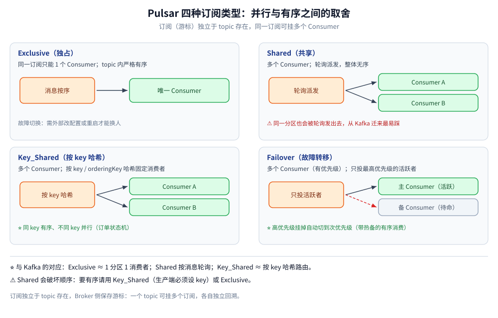

# 订阅与消费语义

> 覆盖 Pulsar 的订阅与消费者的关系、四种订阅类型的投递差异（Exclusive / Shared / Key_Shared / Failover）、Shared 为什么必然破坏顺序、Key_Shared 的 key 区间切分与「生产者先发」陷阱、延迟投递只对 Shared / Key_Shared 生效这条硬限制，以及起始位置、通配符订阅与 Reader。
>
> 不覆盖：存算分离与 MessageId 见 [核心概念与架构.md](核心概念与架构.md)；ACK、重投与死信见 [消息可靠性.md](消息可靠性.md)；订阅粒度的跨产品判据见 [消息模型与存储代价.md](../消息模型与存储代价.md)；接入代码见 [Go 接入](../../../../01-编程语言/go/工程实践/接入Pulsar.md) 与 [Java 接入](../../../../01-编程语言/java/工程实践/接入Pulsar.md)。
>
> 内容整理自个人学习笔记。**实测口径**：本机 `apachepulsar/pulsar:4.0.5` standalone 容器（`pulsar-lab`）上跑了 Shared / Key_Shared / Exclusive 的对照实验与延迟投递对照；**Failover 需要多消费者优先级切换，未实测**，按官方文档陈述。

---

## 一、订阅和消费者是什么关系？

**本节要点**：**订阅（Subscription）是游标的持有者，消费者只是接在订阅上的实例**。游标与消费进度存在 Broker 侧，消费者全下线了订阅还在；消费者数量与角色由**订阅类型**决定。这是 Pulsar 与「消费者组 = 一群人共享一个 offset」最不一样的地方：**订阅是长期存在的实体，消费者是临时接入的**。

| 对象 | 生命周期 | 存哪 | 关键含义 |
| --- | --- | --- | --- |
| Topic | 长期 | Broker 元数据 + BookKeeper | 数据本体 |
| **Subscription** | 长期，直到 `unsubscribe` | Broker 侧（游标 + 元数据） | ⭐ 独立回溯、独立积压、独立 ack |
| Consumer | 短，随连接建立与断开 | 无（连上即加入订阅） | 行为由订阅类型决定 |
| Reader | 短，不建订阅 | 客户端自管位置 | 重放 / 对账，不影响任何订阅 |

三条由此推出的结论：

- **消费者全挂，消息不会丢**：订阅游标还在，重新连上继续消费（与 NATS Core 的「无人订阅即丢」相反）。
- **订阅名就是消费进度**：换一个订阅名 = 从头开始一份新的进度；同一个订阅名只要类型兼容，就能接上原来的游标。
- **`UNSUBSCRIBE` ≠ `CLOSE_CONSUMER`**：前者删除订阅与游标（重订阅从头），后者只断开这个消费者（游标保留）。用错是「重启后消息重复消费」的常见原因，协议层细节见 [Pulsar协议.md](Pulsar协议.md) 第三节。

## 二、Shared 为什么保证不了顺序？

**本节要点**：Shared 是**按条轮询**派发给任意空闲消费者，**没有 key 概念、没有分区绑定**。所以它能把负载摊平，也必然把同一个业务键的消息拆到不同实例——顺序与 key 亲和都不存在。



| 订阅类型 | 同一订阅允许的 Consumer 数 | 消息分发 | 顺序保证 | 故障切换 | 典型场景 |
| --- | --- | --- | --- | --- | --- |
| **Exclusive** | 只能 1 个（其余报「已占用」） | 全给这个消费者 | ⭐ topic / 分区内严格有序 | 需要外部干预才能换人 | 单实例顺序消费 |
| **Shared** | 多个 | ⭐ **轮询**给任意空闲消费者 | ❌ 整体无序（同 key 也不保证） | 未 ack 消息重投给别人 | 水平扩容、吞吐优先 |
| **Key_Shared** | 多个 | 按 `key` / `orderingKey` 哈希到固定消费者 | ⭐ **同 key 有序**，不同 key 并行 | 消费者变动时相关 key 重排 | 订单状态机这类「同实体有序」 |
| **Failover** | 多个（有优先级） | 只给最高优先级的活跃消费者 | 有序（带热备的 Exclusive） | ⭐ 高优先级挂掉自动切次优先级 | 有序 + 高可用 |

本机 Shared 实测（2 个消费者、40 条消息、4 个 key 各 10 条）：

| 消费者 | 收到的 key 分布 |
| --- | --- |
| consumer#0 | `{order-0=2, order-1=6, order-2=6, order-3=6}` |
| consumer#1 | `{order-0=8, order-1=4, order-2=4, order-3=4}` |

两个消费者的条数大致均分（20 / 20），但**每个 key 都被拆到了两边**：`order-0` 是 2 + 8，其余是 6 + 4。这就是「Shared 均负载但不保亲和」的直接证据。

> ⚠️ **从 Kafka 迁过来最容易踩的认知差**：Kafka 一个分区只会被组内一个消费者拿，所以「分区内有序」天然成立；Pulsar 的 Shared 会把同一分区的消息轮询发出去，**有序假设直接失效**。要有序请用 Key_Shared（生产端必须设 key）或 Exclusive。

## 三、Key_Shared 怎么做到「同 key 有序」？

**本节要点**：Key_Shared 按 **key 的哈希**把 key 分配给消费者，**同一个 key 恒定落到同一个消费者**，不同 key 可以并行。它保证的是「同 key 有序」，不是「全 topic 有序」；而且分配是**按 key 区间（哈希范围）**切的，不是按条数均分。

本机做了两组对照，结论完全不同：

| 实验顺序 | consumer#0 | consumer#1 | 说明 |
| --- | --- | --- | --- |
| **先生产 40 条，再起两个消费者** | `{order-0=10, order-1=10, order-2=10, order-3=10}` 共 40 条 | **空** | ⚠️ 消费者还没加入时 key 映射只指向已存在的那个，且它的预取队列一次吃下全部 |
| **先起两个消费者，再生产 40 条** | `{order-0=10}` 共 10 条 | `{order-1=10, order-2=10, order-3=10}` 共 30 条 | 按 key 的哈希区间切：1 个 key 归 c0，3 个 key 归 c1 |

第二组是「稳态」读数：**分布由 key 的哈希决定，条数可以差 3 倍**。想更均匀，要么增加 key 的基数（别只用 4 个业务键），要么接受「同 key 必须同实例」这个约束。

> ⚠️ **第一组的「全给一个人」不是 Key_Shared 坏了**：第二个消费者加入之前，消息已经进入第一个消费者的接收队列；消费者组映射的重新分配只影响之后的消息。**这就是「先启动消费者、再开始生产」在 Key_Shared 下尤其重要的原因**——它避免了启动瞬间的倾斜，但解决不了 key 本身就少的问题。

## 四、Exclusive 与 Failover 差在哪？

**本节要点**：两者都保证有序，区别在**能不能有人待命**。Exclusive 只允许一个消费者，第二个连接直接被拒；Failover 允许多个，但只有最高优先级的那个在消费，其余是热备，主挂掉自动顶上。

本机 Exclusive 的实测报错（第二个消费者接同一订阅）：

```text
ConsumerBusyException: {"errorMsg":"Exclusive consumer is already connected", ...}
```

| 维度 | Exclusive | Failover |
| --- | --- | --- |
| 消费者数 | 1 | 多个，按优先级排序 |
| 谁在消费 | 唯一的那个 | 优先级最高的活跃者 |
| 挂了怎么办 | 等它重连，期间无人消费 | ⭐ 次优先级自动接管 |
| 顺序 | 严格有序 | 有序 |
| 适合 | 单实例顺序消费 | 有序 + 高可用（主备） |

> ⚠️ **Exclusive 的「高可用」不在 Pulsar 里**：消费者挂了订阅不会自动换人，必须等同一个消费者重连。要「有序 + 故障自动切换」请直接选 Failover。

## 五、延迟投递为什么只在 Shared / Key_Shared 生效？

**本节要点**：`deliverAt` / `deliverAfter` 是消息级能力，但**投递端只对 Shared 与 Key_Shared 生效**；在 Exclusive 与 Failover 下，延迟消息会被**立即投递**。这不是配置问题，是官方明确的行为。

官方文档原话：*Only shared and key-shared subscriptions support delayed message delivery. In other subscriptions, delayed messages are dispatched immediately.*

本机对照（同一条 `deliverAfter(5s)` 的消息，只换订阅类型）：

| 订阅类型 | 从生产到收到的耗时 | 结论 |
| --- | --- | --- |
| Shared | **4961 ms** | ✅ 延迟生效（允许早于设定值最多一个 tick） |
| Exclusive | **229 ms** | ❌ 立即投递，延迟被忽略 |

两个配套条件同样会让人误判：

| 条件 | 配错的表现 |
| --- | --- |
| 生产者必须**关闭批量**（`enableBatching(false)`） | 开批量时延迟语义不生效，消息随批次立即发出 |
| 命名空间策略 `maxMessagesInDelayedDelivery`（默认 100） | 延迟消息数超过阈值时**不再保证精确延迟，会提前投递** |

> ⚠️ **跨天 / 跨周的定时任务不要用 MQ 承载**：延迟 tracker 适合分钟级以内的场景；长周期任务用「定时任务 + 状态表」更可靠（判据见 [消息队列选型对比.md](../消息队列选型对比.md) 延迟队列一节）。

## 六、起始位置与通配符订阅怎么用？

**本节要点**：起始位置**只对新建订阅生效**，已有游标的订阅按游标继续。Java 用 `subscriptionInitialPosition`，Go 的新订阅默认从 Latest 开始、要补历史必须显式 `Seek`。通配符订阅让一个消费者吃下整个命名空间的事件流。

| 客户端 | 起始位置怎么写 | 注意 |
| --- | --- | --- |
| Java | `.subscriptionInitialPosition(Earliest / Latest)` | ⭐ 只对**新建订阅**生效 |
| Go | `ConsumerOptions` 没有该字段，新订阅默认 **Latest** | 要补历史用 `consumer.Seek(pulsar.EarliestMessageID())` 或 `SeekByTime` |
| 通用 | `StartMessageIDInclusive` | 决定起点那条消息本身算不算；默认排他，容易「少了第一条」 |

| 方式 | Java | Go |
| --- | --- | --- |
| 显式多 topic | `.topics(List.of("a","b"))` | `ConsumerOptions.Topics: []string{...}` |
| 正则匹配 | `.pattern("persistent://shop/default/event-.*")` | `TopicsPattern: "persistent://shop/default/event-.*"` |
| 匹配范围 | `RegexSubscriptionMode PersistentOnly / AllTopics` | 同义配置 |

> ⚠️ **Go 默认 Latest 是高频坑**：本地联调时「消息明明发了却收不到」，多半是消费者晚于生产者启动、而且没有 `Seek`。Java 侧则相反，很多人误以为 `Earliest` 每次启动都会从头读——它只对**新建订阅**有效。

## 应用场景

| 场景 | 选哪种订阅 | 理由 |
| --- | --- | --- |
| 订单状态机（同一订单必须串行） | **Key_Shared**，key = 订单号 | 同 key 有序，不同订单并行 |
| 普通业务消费、追求吞吐 | **Shared** | 轮询均负载；不要在业务上假设顺序 |
| 单实例串行处理（对账、导出） | **Exclusive** | 严格有序，但无热备 |
| 有序 + 高可用 | **Failover** | 主备切换，等价于带热备的 Exclusive |
| 埋点 / 审计的整命名空间订阅 | **正则 / 多 topic 订阅** | 一个消费者吃一串 topic |
| 离线重放与对账 | **Reader** | 不建订阅、不动任何游标 |

## 具体使用

### 四种订阅的建法与关键参数

```java
// Shared：多实例并行，实测 40 条在两消费者间大致均分但同 key 被拆
Consumer<String> shared = client.newConsumer(Schema.STRING)
        .topic("persistent://public/default/lab-shared")
        .subscriptionName("sub-shared")
        .subscriptionType(SubscriptionType.Shared)
        .subscriptionInitialPosition(SubscriptionInitialPosition.Earliest)
        .subscribe();

// Key_Shared：同 key 同实例；生产端必须设 key
Consumer<String> keyed = client.newConsumer(Schema.STRING)
        .topic("persistent://public/default/lab-keys-fair")
        .subscriptionName("sub-keys-fair")
        .subscriptionType(SubscriptionType.Key_Shared)
        .subscribe();

// Exclusive：第二个消费者会直接报 ConsumerBusyException
Consumer<String> single = client.newConsumer(Schema.STRING)
        .topic("persistent://public/default/lab-orders")
        .subscriptionName("sub-exclusive")
        .subscriptionType(SubscriptionType.Exclusive)
        .subscribe();
```

### 延迟消息必须同时满足三件事

```java
// ① 生产者关闭批量；② 订阅类型是 Shared / Key_Shared；③ 延迟消息数不超过命名空间阈值
Producer<String> p = client.newProducer(Schema.STRING)
        .topic("persistent://public/default/lab-delayed-shared")
        .enableBatching(false)
        .create();

p.newMessage().value("timeout-check")
        .deliverAfter(5, TimeUnit.SECONDS)   // 或 deliverAt(绝对时间戳)
        .send();

Consumer<String> c = client.newConsumer(Schema.STRING)
        .topic("persistent://public/default/lab-delayed-shared")
        .subscriptionName("sub-delayed-shared")
        .subscriptionType(SubscriptionType.Shared)   // ⭐ 换成 Exclusive 就立即投递
        .subscriptionInitialPosition(SubscriptionInitialPosition.Earliest)
        .subscribe();
```

### 回溯：游标定位而不是 offset 运算

```bash
# 按时间把订阅游标拨回 1 小时前（Pulsar 没有 offset，回溯就是改游标）
docker exec pulsar-lab bin/pulsar-admin topics reset-cursor \
  -s sub-shared --time 1h persistent://public/default/lab-shared

# 跳过积压：直接推进到最新
docker exec pulsar-lab bin/pulsar-admin topics skip-all \
  -s sub-shared persistent://public/default/lab-shared
```

> ⚠️ `reset-cursor` / `skip-all` 会让一批消息**不被处理**，操作前确认业务幂等与补偿方案；回溯能读到的前提是 retention 覆盖了那段时间（见 [消息可靠性.md](消息可靠性.md) 第三节）。

## 延伸追问

- **四种订阅类型怎么选？** → 并行选 Shared（但无序）；同实体有序选 Key_Shared（生产端必须设 key）；单实例严格有序选 Exclusive；有序 + 热备选 Failover。
- **Key_Shared 为什么不按条数均分？** 它按 key 的哈希区间分配，key 少时天然不均。本机 4 个 key 分成 1 : 3。增加 key 基数才能摊平。
- **为什么先生产再起消费者会全落在一个实例？** 第二个消费者加入前，消息已进入第一个消费者的接收队列；映射调整只影响后续消息。消费者优先启动是稳态读数的前提。
- **Shared 里能靠加实例提升顺序吗？** 不能，加实例只会让乱序更严重。要顺序就用 Key_Shared 或 Exclusive。
- **延迟消息为什么不生效？** 先查三件事：订阅类型是不是 Shared / Key_Shared、生产者是否关了批量、延迟消息数是否超过 `maxMessagesInDelayedDelivery`。
- **Failover 的主备怎么定优先级？** 按消费者加入顺序 / 优先级排序，最高优先级活跃者消费；它挂掉后次优先级接管。本机未实测多消费者切换。

## 关联

- **上游/总纲**：[README.md](README.md) — 本册导读与实测坐标
- **上游/总纲**：[核心概念与架构.md](核心概念与架构.md) — 订阅为什么是长期实体
- **下游机制**：[消息可靠性.md](消息可靠性.md) — ack、重投与死信；延迟消息与重投延迟的区别
- **运维/配置**：[运维与排障.md](运维与排障.md) — 订阅积压与「不投消息」的排查
- **对照/互补**：[消息模型与存储代价.md](../消息模型与存储代价.md) — 队列与订阅粒度的跨产品判据
- **对照/互补**：[消息类型与语义.md](../RocketMQ/消息类型与语义.md) — 顺序消息与延迟级别的另一种实现
- **对照/互补**：[订阅与消费语义.md](../NATS/订阅与消费语义.md) — 队列组的随机派发与 Key_Shared 的 key 映射对照
> 反向引用（本篇被下列文档引到）：[接入Pulsar.md](../../../../01-编程语言/go/工程实践/接入Pulsar.md)、[接入Pulsar.md](../../../../01-编程语言/java/工程实践/接入Pulsar.md)、[部署与配置.md](部署与配置.md)、[Topic切分与事件设计.md](../Topic切分与事件设计.md)
