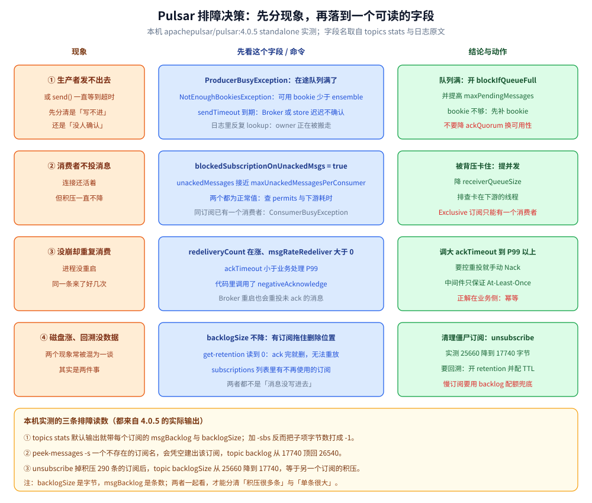

# 运维与排障

> 覆盖 Pulsar 线上排障的三个入口（`topics stats` / `stats-internal` / `subscriptions`）、`backlogSize` 为什么只涨不降（附清理僵尸订阅的实测前后读数）、消费者「不投消息」的三类原因、重复消费的证据链、磁盘上涨的几条来路、顺序错乱的归因、以及 8080 上该看哪些指标。
>
> 不覆盖：retention、去重与 quorum 的语义见 [消息可靠性.md](消息可靠性.md)；订阅类型对顺序与重投的影响见 [订阅与消费语义.md](订阅与消费语义.md)；配置项与本机默认值见 [部署与配置.md](部署与配置.md)；客户端参数的写法见 [Go 接入](../../../../01-编程语言/go/工程实践/接入Pulsar.md) 与 [Java 接入](../../../../01-编程语言/java/工程实践/接入Pulsar.md)。
>
> 内容整理自个人学习笔记。**实测口径**：本篇命令与读数均在本机 `apachepulsar/pulsar:4.0.5` standalone 容器 `pulsar-lab` 上取得，topic 为 `persistent://public/default/lab-orders`（300 条、3 个订阅）；`blockedSubscriptionOnUnackedMsgs` 为 `true` 的场景**未构造**（需要 5 万条未 ack），该字段含义按配置语义陈述。

---

## 一、排障的三个入口怎么分工？

**本节要点**：三个入口各答一个问题——`topics stats` 答「**积压多少**」、`stats-internal` 答「**位置在哪**」、`subscriptions` 答「**有哪些订阅在拖**」。混着用会绕远路。

| 入口 | 回答什么 | 关键字段 |
| --- | --- | --- |
| `topics stats <topic>` | 积压、吞吐、每个订阅的消费情况 | `msgInCounter`、`storageSize`、`backlogSize`、每订阅的 `msgBacklog` / `unackedMessages` / `blockedSubscriptionOnUnackedMsgs` |
| `topics stats-internal <topic>` | ledger 与游标的**精确位置** | `entriesAddedCounter`、`lastConfirmedEntry`、`ledgers[].ledgerId`、`cursors.<sub>.markDeletePosition` / `readPosition` |
| `topics subscriptions <topic>` | 这个 topic 上到底挂了哪些订阅 | 订阅名列表（僵尸订阅一眼可见） |



这张图要读出的是**现象到字段的映射**：四类现象（发不出去、不投了、重复消费、磁盘涨）各自只有一个主字段，先把那个字段读出来再决定动作，比一上来翻日志快得多；图底三条是本机实测的读数，说明这些字段在本版本确实能读到。

本机 `lab-orders` 的实测结构（300 条写入、3 个订阅）：

| 字段 | 读数 | 怎么读 |
| --- | --- | --- |
| `msgInCounter` | `300` | 累计写入条数 |
| `storageSize` | `26540` | 落盘字节数（**字节，不是条数**） |
| `backlogSize`（topic） | `25660` | 被最慢订阅拖住的字节数 |
| `sub-excl2` / `lab-consume-1` / `sub-excl` 的 `msgBacklog` | `200` / `100` / `290` | 三个订阅各自还剩多少条没消费 |
| `stats-internal.lastConfirmedEntry` | `3:299` | 最后确认写入的位置：ledger 3、entry 299 |
| `stats-internal.state` | `LedgerOpened` | 当前 ledger 处于打开可写状态 |
| `cursors.<sub>.markDeletePosition` | `3:99` / `3:199` / `3:299` | 三个订阅各自的删除位点 |
| `cursors.pulsar.dedup` | `markDeletePosition=3:299`、`cursorLedger=49` | ⭐ 开了去重后，会多出这个**系统游标** |

> ⚠️ **4.0.5 的 `topics stats` 没有 `-s` 参数**。老写法 `topics stats -s <sub-name>` 会直接报 `Unknown options: '-s'`；默认输出里**已经带**每个订阅的 `msgBacklog` 与 `backlogSize`，直接读即可。
>
> ⚠️ **`-sbs` 不是「按订阅看字节数」的开关**。实测 `topics stats -sbs` 会把每个订阅的 `backlogSize` 打成 `-1`（`msgBacklog` 仍正常）；想看字节数就用默认输出，想看条数就认 `msgBacklog`。`-gpb`（精确积压）在小 topic 上与默认读数相同（都是 `17740`），大 topic 才有差别。

## 二、`backlogSize` 不降时先怀疑什么？

**本节要点**：`backlogSize` 是「**最慢那个订阅还没消费的字节数**」，不是「多少消息没发出去」。它不降，先看**订阅列表里有没有不再工作的游标**——一个从不消费的订阅能把整个 topic 的数据钉在磁盘上。

本机做了一组对照：`sub-excl` 有 290 条积压、早已没有消费者，删掉它之后：

```bash
# 删之前：topic backlogSize = 25660，3 个订阅
docker exec pulsar-lab bin/pulsar-admin topics subscriptions persistent://public/default/lab-orders

# 删除这个不再工作的订阅（游标一起删，位点不保留）
docker exec pulsar-lab bin/pulsar-admin topics unsubscribe -s sub-excl persistent://public/default/lab-orders

# 删之后：topic backlogSize = 17740，只剩 2 个订阅
```

| 时刻 | 订阅列表 | topic `backlogSize` |
| --- | --- | --- |
| `unsubscribe` 前 | `sub-excl2` / `lab-consume-1` / `sub-excl` | `25660` |
| `unsubscribe` 后 | `sub-excl2` / `lab-consume-1` | `17740` |

> ⭐ **`17740` 正好等于 `sub-excl2` 的积压**——说明 topic 级 `backlogSize` 就是「所有订阅里最慢那个」的字节数，而不是各订阅之和。**加订阅不会让 backlog 变小，删订阅才会。**
>
> ⚠️ **`unsubscribe` 是破坏性的**：订阅和游标一起删，重订阅只能按起始位置来（可能从最旧或最新开始）。只是临时断开消费者请用 `close()` / `CLOSE_CONSUMER`，位点会保留。

**还有一个更隐蔽的造订阅方式**——本机实测：

```bash
# 对不存在的订阅名 peek
docker exec pulsar-lab bin/pulsar-admin topics peek-messages -s no-such-sub -n 1 persistent://public/default/lab-orders
```

它**不报错**，而是新建了一个从最早位置开始读的订阅，并返回 `Message ID: 3:0`；随后 `subscriptions` 里凭空多出 `no-such-sub`，topic `backlogSize` 从 `17740` 顶回 `26540`（整个 topic）。**一条「只看一眼」的命令，把磁盘上可删的范围缩回到了起点。**

> ⚠️ 所以排障时的顺序应该是：先 `topics subscriptions` 看有没有陌生名字，再 `stats`。确认订阅名是**现存的**再去 peek，否则每次 peek 都在制造僵尸。

## 三、消费者「不投消息了」怎么定位？

**本节要点**：连接还活着但不投，只有三类原因：**客户端自己卡住（permits 不再发）**、**Broker 因未 ack 超限停投**、**订阅被另一个消费者占住**。前两类看 `stats`，第三类看异常原文。

| 现象 | 判据 | 处理 |
| --- | --- | --- |
| 客户端不再发 `FLOW` | `lastConsumedFlowTimestamp` 很久没更新 | 消费线程卡在下游（查库 / 调外部接口）、`receiverQueueSize` 太小 |
| Broker 主动停投 | `blockedSubscriptionOnUnackedMsgs = true`，`unackedMessages` 接近 `maxUnackedMessagesPerConsumer`（默认 50000） | 提并发消费、降低单批处理耗时、确认没有「收到但不 ack」的分支 |
| 订阅已被占用 | 第二个消费者建 Exclusive 订阅时报错 | 见下面的原文 |

本机实测的 Exclusive 冲突原文：

```text
ConsumerBusyException: {"errorMsg":"Exclusive consumer is already connected",
"reqId":2877462980755814409, "remote":"127.0.0.1/127.0.0.1:6650", "local":"/127.0.0.1:51108"}
```

> ⚠️ **`ConsumerBusyException` 不是故障,是订阅类型的设计**：Exclusive 只允许一个消费者，想多实例并行必须换 Shared / Key_Shared / Failover（见 [订阅与消费语义.md](订阅与消费语义.md) 第一、四节）。
>
> ⭐ **第一类与第二类的区分方法**：看 `lastConsumedFlowTimestamp`。客户端在正常消费时会周期性地发 `FLOW` 补充 permits；这个时间戳停滞说明**问题在客户端**，而 `blockedSubscriptionOnUnackedMsgs=true` 说明**问题在 ack 侧**——两者都不投消息，但一个要改客户端、一个要改处理逻辑。

## 四、没崩却重复消费，证据在哪？

**本节要点**：Pulsar 只保证 At-Least-Once，重复是**正常语义**。定位要看是「重投」还是「两条真消息」：`redeliveryCount` 在涨 = 重投；`redeliveryCount` 归零但业务重复 = 生产端重复发送。

| 证据 | 含义 |
| --- | --- |
| `redeliveryCount` 逐次递增 `0 → 1 → 2 → 3` | 同一条消息被反复投递（本机死信实验的原始读数） |
| `msgRateRedeliver` 大于 0 | 该订阅正在持续重投 |
| `lastAckedTimestamp` 长期不动 | 消费者收到但不 ack |
| 去重游标 `pulsar.dedup` 存在 | 命名空间开了去重，重复发送会被挡在 Broker 侧（见 [消息可靠性.md](消息可靠性.md) 第四节） |

常见触发源（按出现频率）：

- **`ackTimeout` 小于业务处理 P99**：处理慢过超时，Broker 判定失败重投，而第一条其实还在处理——于是同一条被处理两遍。
- **主动 `negativeAcknowledge`**：业务异常时交还 Broker，按 `negativeAckRedeliveryDelay` 延迟后重投。
- **Broker 重启 / 消费者重连**：未 ack 的消息会重新派发。
- **生产端重试**：`sendAsync` 回调失败后业务自己重发，若没开去重就是两条真消息。

> ⚠️ **调大 `ackTimeout` 只是把概率降低，不是解决**。中间件层面无法区分「处理失败」与「处理成功但 ack 丢了」，正解始终是**业务幂等**（唯一键、去重表、状态机 CAS）。

## 五、磁盘持续上涨有哪几条来路？

**本节要点**：按「**谁在占**」分四类，不要一律归因到 retention。

| 来路 | 判据 | 处理 |
| --- | --- | --- |
| **僵尸订阅拖住删除位置** | `backlogSize` 不降，`subscriptions` 里有陌生名字 | `unsubscribe` 掉不用的订阅（本篇第二节有实测） |
| **慢订阅持续积压** | `msgBacklog` 持续上涨 | 提消费能力；给命名空间设 backlog 配额，超限按 `producer_request_hold` / `exception` / `consumer_backlog_eviction` 处理 |
| **retention 开得过大** | `get-retention` 的时间 / 大小远超需要 | 收窄 `retentionTimeInMinutes` / `retentionSizeInMB`，历史窗口按需定 |
| **ledger 未滚动或 bookie GC 滞后** | `stats-internal.ledgers` 数量异常、bookie 目录只增不减 | 查 bookie 磁盘与 GC 日志；数据量大时开分层存储下沉冷数据 |

本机磁盘视图（standalone）：`/pulsar/data/standalone/bookkeeper/current` 150 MB（ledger 75 MB + locations 75 MB），元数据 RocksDB 75 MB；`lab-orders` 一个 300 条的 topic 只占 `26540` 字节。

> ⭐ **`storageSize` 与 `backlogSize` 的差值是「已消费但还在保留期」的部分**：本机 `storageSize=26540`、`backlogSize=17740`，差的 8800 字节就是已被 ack、但因 retention（本机 60 分钟 / 100 MB）尚未删除的数据。**磁盘涨而 backlog 正常，多半是 retention 在起作用，不是积压。**

## 六、顺序为什么乱了？

| 归因 | 判据 | 处理 |
| --- | --- | --- |
| 用了 Shared 订阅 | `stats` 里订阅 `type` 为 `Shared` | 要「同 key 有序」换 Key_Shared；要全局有序换 Exclusive |
| 生产端没设 key | `MessageMetadata` 里没有 key，或每次 key 不同 | 生产端固定业务主键作为 key，消费端同 key 串行 |
| Key_Shared 的 key 被重新映射 | 消费者数变化后，同 key 的承接者变了 | 这是正常行为：只在**同一时刻**保证同 key 同消费者，不保证跨扩容期连续 |
| 分区数 / bundle 变化 | `stats` 里 `partitions` 变化，或做过 `split-bundle` | 顺序只在同一分区内有保证，扩容前规划好 |

> ⚠️ **本机 Key_Shared 的分配是「按 key 区间」不是「按条数」**：两个消费者拿到 `1 个 key（10 条）` 与 `3 个 key（30 条）`。所以「消费者负载不均」不等于「Key_Shared 坏了」——它优先保证同 key 不分裂。

## 七、Broker 为什么会 Full GC / OOM？

| 原因 | 判据 | 处理 |
| --- | --- | --- |
| 预取队列 × 并发消费者过大 | 堆增长与消费者数正相关 | 降 `receiverQueueSize`、限并发、给客户端设 `memoryLimit` |
| 单 topic 消息过大 / 批次过大 | `averageMsgSize` 高、批次配置激进 | 压小批次，或把大消息拆开 |
| broker 缓存与 bookie 缓存挤在同一 JVM（standalone） | 单进程 RSS 804 MB 就是这种形态 | 生产必须拆进程，别把 standalone 当生产 |
| topic 数过多、bundle 过碎 | `stats-internal` 与 bundle 负载不均 | 按 topic 数拆 Broker；必要时 `split-bundle` 后再均衡 |

> ⚠️ `maxUnackedMessagesPerBroker=0` 是**不限**，别理解成「上限为 0」。本机实测该值就是 `0`，配合 `maxUnackedMessagesPerConsumer=50000` 与 `...PerSubscription=200000` 一起看。

## 八、线上看哪几个指标？

| 指标（8080 `/metrics`） | 用途 |
| --- | --- |
| `pulsar_subscription_back_log_no_delayed` | 订阅积压条数（不含延迟消息） |
| `pulsar_subscription_unacked_messages` | 未 ack 条数，背压的前兆 |
| `pulsar_subscription_blocked_on_unacked_messages` | 是否已被背压停投（0 / 1） |
| `pulsar_subscription_msg_rate_redeliver` | 重投速率，重复消费的第一信号 |
| `pulsar_subscription_msg_rate_out` / `msg_throughput_out` | 消费速率与字节吞吐 |
| `pulsar_storage_size` / `pulsar_storage_backlog_size` | 落盘总量与积压字节 |
| `pulsar_storage_write_latency_*` / `read_latency_*` | 存储侧延迟，bookie 慢会先在这里体现 |
| `pulsar_storage_backlog_quota_exceeded_evictions_total` | 积压配额触发的清理次数 |
| `jvm_info` | 运行环境（本机实测为 Corretto `21.0.7+6-LTS`） |

> ⚠️ **`/metrics` 返回 302，直接 `curl` 会拿到空响应**（本机实测）。要加 `-L` 跟随跳转；不加时看到的是 0 行，很容易误判成「没开监控」。本机 `-L` 后共 3284 行。

## 具体使用

```bash
# ① 积压与订阅：默认输出已含每订阅的 msgBacklog / backlogSize / unackedMessages
docker exec pulsar-lab bin/pulsar-admin topics stats persistent://public/default/lab-orders

# ② 精确位置：ledger 与游标（排查「卡在哪一条」）
docker exec pulsar-lab bin/pulsar-admin topics stats-internal persistent://public/default/lab-orders

# ③ 订阅清单：找僵尸订阅的第一步
docker exec pulsar-lab bin/pulsar-admin topics subscriptions persistent://public/default/lab-orders

# ④ 窥探未消费消息（确认订阅名存在后再用，否则会新建订阅）
docker exec pulsar-lab bin/pulsar-admin topics peek-messages -s sub-excl2 -n 2 persistent://public/default/lab-orders

# ⑤ 手动推进游标：跳过坏消息 / 按时间回溯（操作前确认业务幂等）
docker exec pulsar-lab bin/pulsar-admin topics skip-all -s sub-excl2 persistent://public/default/lab-orders
docker exec pulsar-lab bin/pulsar-admin topics reset-cursor -s sub-excl2 --time 1h persistent://public/default/lab-orders

# ⑥ 策略回读：磁盘与保留问题先看这里
docker exec pulsar-lab bin/pulsar-admin namespaces get-retention public/default
docker exec pulsar-lab bin/pulsar-admin namespaces get-backlog-quotas public/default

# ⑦ 指标：必须 -L 跟随 302
docker exec pulsar-lab curl -sL http://127.0.0.1:8080/metrics | grep pulsar_subscription_back_log_no_delayed | head
```

> ⚠️ **`reset-cursor --time 1h` 依赖 retention > 0**：数据已经删掉时游标能回退，但读不到旧消息。本机 `public/default` 的 retention 是 60 分钟 / 100 MB，回退超过 1 小时就会撞到边界。
>
> ⚠️ `skip-all` 会把当前所有未消费消息标为已消费，**不可逆**；只在确认这些消息是脏数据时使用。

## 延伸追问

- **为什么删掉一个订阅，backlog 就降了？** → topic 的删除位置由「最慢的那个订阅」决定，删掉它，删除位置前移到下一个最慢订阅的位置。本机实测 `25660 → 17740`，后者正好等于剩余订阅中最大的积压。
- **`backlogSize` 和 `msgBacklog` 该看哪个？** → 前者是字节、后者是条数。判断「磁盘会不会满」看字节，判断「消费落后多少」看条数；两者一起看才能区分「积压很多小消息」与「积压少量大消息」。
- **`peek-messages` 为什么危险？** → 它要求一个订阅名，名字不存在时会**静默创建**并从最早位置读。本机实测它把 backlog 从 `17740` 顶回 `26540`。排障时先 `subscriptions` 确认名字，或干脆用 `Reader`。
- **`stats` 里 `storageSize` 为什么大于 `backlogSize`？** → 差值是「已消费但仍在 retention 窗口内」的数据。retention 为 0 时两者应接近；差得越多说明保留策略越宽松。
- **Exclusive 订阅报 `ConsumerBusyException` 是故障吗？** → 不是，是设计：一个 Exclusive 订阅只允许一个消费者。要并行必须换订阅类型，不是重试能解决的。
- **`unsubscribe` 和关掉消费者有什么区别？** → `unsubscribe` 删订阅与游标（重回起点），关掉消费者只断开实例（位点保留）。混用是「重启后消息重复消费」的常见原因。
- **监控里哪个指标最适合做积压告警？** → `pulsar_subscription_back_log_no_delayed`（按订阅维度），再配 `pulsar_storage_backlog_age_seconds` 看「最老积压有多旧」——只告字节数会在小消息场景下漏报。

## 关联

- **上游/总纲**：[README.md](README.md) — 阅读路线与本册实测坐标
- **上游/总纲**：[部署与配置.md](部署与配置.md) — 端口、默认值与「起对了怎么验」
- **下游机制**：[消息可靠性.md](消息可靠性.md) — retention、去重窗口与重投死信
- **下游机制**：[订阅与消费语义.md](订阅与消费语义.md) — 订阅类型、顺序保证与起始位置
- **对照/互补**：[运维与排障.md](../Kafka/运维与排障.md) — Kafka 的消费组 lag 与分区重平衡排障
- **对照/互补**：[运维与排障.md](../RocketMQ/运维与排障.md) — 堆积、重试队列与 DLQ 的另一套命令
- **对照/互补**：[运维与排障.md](../NATS/运维与排障.md) — JetStream 的 consumer 积压与 ack 视角
- **下游机制**：[可观测性选型对比.md](../../可观测性/可观测性选型对比.md) — 指标采集与告警口径
> 反向引用（本篇被下列文档引到）：[接入Pulsar.md](../../../../01-编程语言/go/工程实践/接入Pulsar.md)、[接入Pulsar.md](../../../../01-编程语言/java/工程实践/接入Pulsar.md)
