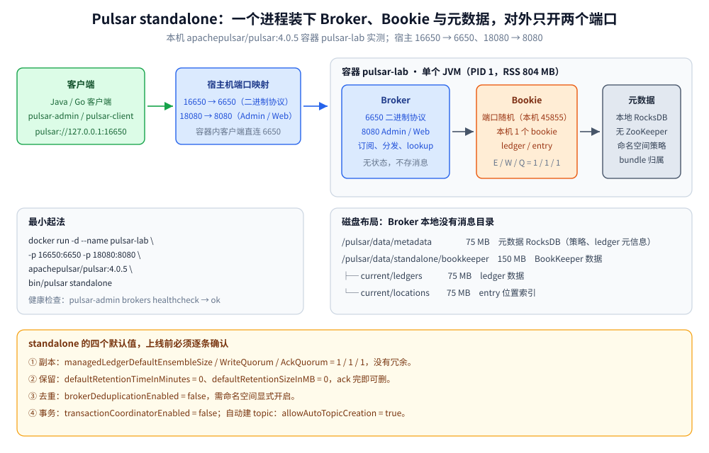

# 部署与配置

> 覆盖 Pulsar 的 standalone 起法与它「一个进程装下三样东西」的真相（4.x 已不带 ZooKeeper）、6650 / 8080 两个端口的来路、`standalone.conf` 里上线前必须逐条确认的默认值、单机为什么只能是 E/W/Q = 1/1/1、retention 与去重为什么必须显式开、生产拓扑与关键配置表、以及起完之后怎么确认「真的对了」。
>
> 不覆盖：存算分离的读写路径与 bundle 所有权见 [核心概念与架构.md](核心概念与架构.md)；retention 与去重对「会不会丢」的影响见 [消息可靠性.md](消息可靠性.md)；上线后的积压与背压排查见 [运维与排障.md](运维与排障.md)；客户端连接与单例写法见 [Go 接入](../../../../01-编程语言/go/工程实践/接入Pulsar.md) 与 [Java 接入](../../../../01-编程语言/java/工程实践/接入Pulsar.md)。
>
> 内容整理自个人学习笔记。**实测口径**：本篇的启动命令、端口、配置默认值、日志原文、目录体积全部来自本机 `apachepulsar/pulsar:4.0.5` standalone 容器 `pulsar-lab`（宿主 16650 → 6650、18080 → 8080）；**多 Broker / 多 Bookie / Proxy 的 compose 未实机验证**，第六节逐条标注。

---

## 一、单机最小可跑怎么起？

**本节要点**：standalone 一条命令就把「元数据 + Bookie + Broker」全带起来，**不需要 ZK、不需要单独起 bookie**；开发环境唯一的动作是把两个端口映射出来。

```bash
# 最小起法：单容器 = 元数据 + 1 个 bookie + 1 个 broker
docker run -d --name pulsar-lab \
  -p 16650:6650 -p 18080:8080 \
  apachepulsar/pulsar:4.0.5 bin/pulsar standalone

# 起完先验健康（返回 ok 才算 broker 就绪）
docker exec pulsar-lab bin/pulsar-admin brokers healthcheck

# 建租户 / 命名空间 / topic（standalone 自带 public/default）
docker exec pulsar-lab bin/pulsar-admin tenants create shop
docker exec pulsar-lab bin/pulsar-admin namespaces create shop/default
docker exec pulsar-lab bin/pulsar-admin topics create persistent://shop/default/order-events
```

> ⚠️ 本机拉镜像只有 `dockerproxy.net` 通道可用，所以实际镜像是 `dockerproxy.net/apachepulsar/pulsar:4.0.5`；换成官方源时去掉前缀即可。标签必须写死版本，`latest` 不可复现。

> ⭐ **两个端口各管什么**：`6650` 是二进制协议端口，客户端发消息、消费、lookup 全走它；`8080` 是 Admin / Web 端口，`pulsar-admin` 走它，`/metrics` 也在它上面。**少了 8080 不会影响收发消息，但所有管理命令与监控全部失效**。

## 二、standalone 一个进程里装了几样东西？

**本节要点**：standalone 是**单个 JVM**，里面跑着 Broker 线程、一个内嵌 bookie、一份本地元数据存储。4.x 的 standalone **没有 ZooKeeper**——元数据用本地 RocksDB，这是与老教程最大的出入。



这张图要读出的结论是：**磁盘上只有元数据目录与 bookie 目录，没有「Broker 数据目录」**——Broker 不存消息这件事在单机上同样成立；而元数据那一格在本机是「本地 RocksDB、无 ZooKeeper」，与 2.x / 3.x 时代的 standalone 口径不同。

启动日志把这层结构写得很直白（`docker logs pulsar-lab` 的前几行）：

```text
[main] INFO  org.apache.pulsar.PulsarStandalone - Starting BK with RocksDb metadata store
[main] INFO  ...RocksdbMetadataStore - new RocksdbMetadataStore, url=MetadataStoreConfig(... metadataStoreName=metadata-store ...)
[main] INFO  ...PulsarRegistrationManager - Initializing metadata for new cluster, ledger root path: /ledgers
[main] INFO  ...BKCluster - Starting new bookie on port: 45855
[main] INFO  ...DbLedgerStorage -  - Write cache size: 64 MB
[main] INFO  ...DbLedgerStorage -  - Read Cache: 64 MB
```

| 观察项 | 本机实测 |
| --- | --- |
| 进程 | 单个 JVM（PID 1），RSS **804 MB**，同时承担 Broker / Bookie / 元数据 |
| 对外监听 | 只有 **6650 与 8080**；bookie 用的是**随机端口**（本机 `45855`），元数据不起监听端口 |
| 集群视图 | `clusters list` → `standalone`；`brokers list standalone` → `localhost:8080`；`bookies list-bookies` → `172.17.0.3:45855` |
| 元数据 | `/pulsar/data/metadata` **75 MB**（RocksDB：`CURRENT` / `MANIFEST` / `.log` / `LOCK`） |
| BookKeeper | `/pulsar/data/standalone/bookkeeper/current` **150 MB**（ledger 75 MB + locations 75 MB），`DbLedgerStorage` |
| bookie 缓存 | 写缓存 64 MB、读缓存 64 MB（日志原文），已含在 804 MB RSS 里 |

两处容易踩的坑：

- ⚠️ **日志里的 `Problems reading from data/standalone/bookkeeper/current/lastMark (this is okay if it is the first time starting this bookie` 是首次启动的正常输出**，不是损坏。它只是说明还没有上一次的 mark 文件可读，紧接着会 `Stamping new cookies on all dirs` 正常初始化。
- ⚠️ **`advertisedAddress=` 是空的**，于是 broker 对外自报的主机名就是 `localhost`（`brokers list` 返回 `localhost:8080` 是直接证据）。**单 Broker 时不一定出事**：本机从宿主机连 `127.0.0.1:16650` 实测能正常建生产者并发送——因为 lookup 返回 `Connect`，客户端复用了当前连接，没有去解析自报地址。但只要发生 **`Redirect`**（多 Broker、owner 迁移、Proxy 转发），客户端就会按自报地址重连，跨机时那个地址指向它自己，表现为「连上了、发消息却超时」。跨机部署应显式设 `advertisedAddress` 或 `advertisedListeners`。

## 三、`standalone.conf` 哪几项必须改？

**本节要点**：standalone 的默认值是为「本机能跑起来」调的，不是为「数据不丢」调的。下表每一行的实测值都取自容器内 `/pulsar/conf/standalone.conf`，**上线前逐条确认**。

| 配置 | 实测默认值 | 为什么必须看它 |
| --- | --- | --- |
| `brokerServicePort` | `6650` | 二进制协议端口；改宿主映射时容器内端口不用动 |
| `webServicePort` | `8080` | Admin / Web / `/metrics`；关闭等于放弃管理面 |
| `metadataStoreUrl` | **空** | standalone 启动器会填成本地 RocksDB；**生产必须显式写后端**（ZK / etcd） |
| `clusterName` | `standalone` | 集群名，多集群 / 地理复制的前提 |
| `advertisedAddress` | **空** | 空 = 自报 `localhost`，跨机必坏，见上一节 |
| `managedLedgerDefaultEnsembleSize` | `1` | ⭐ 副本数；生产 3 |
| `managedLedgerDefaultWriteQuorum` | `1` | 写成功需要的副本数；生产 2 |
| `managedLedgerDefaultAckQuorum` | `1` | 返回确认需要的副本数；生产 2 |
| `defaultRetentionTimeInMinutes` / `SizeInMB` | `0` / `0` | ⭐ 0 = 所有订阅 ack 完即可删，想回溯必须改 |
| `brokerDeduplicationEnabled` | `false` | 生产者去重默认关，重复发送不会被挡 |
| `transactionCoordinatorEnabled` | `false` | 事务能力默认关 |
| `allowAutoTopicCreation` | `true` | 拼错 topic 名会**静默建出垃圾 topic** |
| `allowAutoTopicCreationType` | `non-partitioned` | 自动建出来的是普通 topic，不是分区 topic |
| `allowAutoSubscriptionCreation` | `true` | 任意订阅名都能建出来，容易留下僵尸订阅 |
| `maxUnackedMessagesPerConsumer` | `50000` | 未 ack 到这个数会**暂停该订阅投递**（背压） |
| `maxUnackedMessagesPerSubscription` | `200000` | 订阅级上限 |
| `maxUnackedMessagesPerBroker` | `0` | 0 = 不限 |
| `brokerDeduplicationMaxNumberOfProducers` | `10000` | 去重表按生产者名维护，容量上限 |
| `brokerDeduplicationEntriesInterval` | `1000` | 每 1000 条打一次去重快照 |
| `brokerDeduplicationProducerInactivityTimeoutMinutes` | `360` | 生产者不活跃 6 小时后清理去重状态 |
| `delayedDeliveryTickTimeMillis` | `1000` | ⭐ 延迟投递的检查粒度；`deliverAfter=5s` 实测 4961 ms 就是这个 1 秒刻度 |

> ⭐ **一行总结**：这张表里 1/1/1、0 / 0、`false` / `false`、`true` / `true` 这四组值，分别对应**没冗余、不保留、不开去重与事务、什么都自动建**——它们全是为「单机演示」服务的默认值。

## 四、单机为什么只能是 E/W/Q = 1/1/1？

**本节要点**：E/W/Q 是**跨 bookie 的副本策略**，单机只有 1 个 bookie，ensemble 大于 1 时根本凑不出候选节点，写入会直接失败（`NotEnoughBookiesException`）。所以「单机调成 3/2/2」不是更安全，而是起不来。

| 部署形态 | bookie 数 | E / W / Q | 含义 |
| --- | --- | --- | --- |
| **standalone（本机）** | 1 | **1 / 1 / 1** | 写 1 份、确认 1 份，**bookie 挂 = 数据没了** |
| 最小冗余集群 | 3 | 3 / 2 / 2 | 容忍 1 个 bookie 故障；写 2 份成功即返回 |
| 更高冗余 | 5 | 5 / 3 / 3 | 容忍 2 个故障，写延迟随 quorum 上升 |

> ⚠️ **不要把 `ackQuorum` 单独调低来「换可用性」**：E/W/Q 的关系是 `E ≥ W ≥ Q` 且 `W + Q > E`，才有「已确认的写入一定存在于至少一个未故障副本」的保证。破坏这个不等式，等于让确认过的消息可能随单点故障一起消失。
>
> ⚠️ **测试环境与生产环境必须分开记这两组数**：本机所有读数（写入 1233 ms / 200 条、`msgInCounter` 300）都产生在 **1/1/1** 之下，不能直接外推成三副本集群的延迟与可用性；三副本要多等一个副本的确认，写入延迟会上升。

## 五、retention 与去重为什么必须显式开？

**本节要点**：这两项都**不是** broker 全局开关一开就完事的，它们配在 **namespace** 上（`pulsar-admin namespaces set-*`），broker.conf 里的 `default*` 只是新命名空间的起点；而这两个默认起点恰好都是「关」。

```bash
# ⭐ 想能回溯必须先打开 retention（默认 0，ack 完就能删）
docker exec pulsar-lab bin/pulsar-admin namespaces set-retention shop/default \
  --size 10G --time 7d

# 生产者去重（幂等）：命名空间级，开了才对「同名生产者 + 同序号」去重
docker exec pulsar-lab bin/pulsar-admin namespaces set-deduplication shop/default --enable

# 回读确认（策略写没写进去，只看命令返回码不够）
docker exec pulsar-lab bin/pulsar-admin namespaces get-retention shop/default
docker exec pulsar-lab bin/pulsar-admin namespaces get-deduplication shop/default
```

本机实验命名空间 `public/default` 的实测回读：

```json
{
  "retentionTimeInMinutes" : 60,
  "retentionSizeInMB" : 100
}
```

```text
true
```

> ⭐ **保留与去重是两码事**：retention 决定「消息在磁盘上还能留多久」，去重决定「同一个生产者重发同序号会不会被写两次」。前者影响**能不能回溯**，后者影响**重复写会不会进 topic**；两者都关着时，跑得通但一查历史就没数据、一重试就多一条。
>
> ⚠️ **本机的 60 分钟 / 100 MB 是为实测改过的命名空间策略**，与 `standalone.conf` 的 `defaultRetention*=0` 不冲突：`default*` 只决定**新建命名空间的初始值**，已有命名空间以它自己的策略为准。排查时先 `get-retention` 看实际生效值，别只看配置文件。
>
> 💡 **backlog 配额是第三件事**：本机 `lab-orders` 的 `topics stats` 里读到 `backlogQuotaLimitSize: 10737418240`（10 GB），含义是「未消费积压超过 10 GB 时按策略处理」。它与 retention 的区别是：retention 管「消费完之后留多久」，backlog quota 管「**还没消费**的积压能堆多大」。

## 六、生产拓扑长什么样？

**本节要点**：生产要拆成四类进程：ZooKeeper（或 etcd）、Bookie、Broker、可选的 Proxy。**三者职责与单机完全一样，只是不再挤在一个 JVM 里**；broker 成为真正无状态、可水平扩的一层。

```yaml
services:
  zookeeper:
    image: apachepulsar/pulsar:4.0.5
    command: bin/pulsar zookeeper
    healthcheck:
      test: ["CMD", "bin/pulsar", "zk", "status"]
      interval: 10s
    volumes:
      - zk-data:/data/zookeeper

  bookie:
    image: apachepulsar/pulsar:4.0.5
    command: >
      bin/apply-config-from-env.py conf/bookkeeper.conf &&
      bin/pulsar bookie
    environment:
      BOOKIE_PORT: "3181"
      # bookie 侧的元数据地址：BK 自己的写法（md:: 前缀 = ZooKeeper 元数据工厂）
      zkServers: zookeeper:2181
      metadataServiceUri: md::zookeeper:2181
      journalDirectory: /data/journal
      ledgerDirectories: /data/ledgers
    depends_on:
      zookeeper:
        condition: service_healthy
    volumes:
      - bk-journal:/data/journal
      - bk-ledgers:/data/ledgers
```

```yaml
  broker:
    image: apachepulsar/pulsar:4.0.5
    command: >
      bin/apply-config-from-env.py conf/broker.conf &&
      exec bin/pulsar broker
    environment:
      # ⭐ 元数据存储：新版键是 metadataStoreUrl（`zk:` 前缀指后端类型，不是协议）；
      # 旧键 zookeeperServers 仍被接受，两个都给最省事
      metadataStoreUrl: zk:zookeeper:2181
      zookeeperServers: zookeeper:2181
      webServiceUrl: http://broker:8080
      brokerServiceUrl: pulsar://broker:6650
      advertisedAddress: broker
      # ⭐ 与 BookKeeper 的三副本策略对齐
      bookkeeperEnsemble: 3
      bookkeeperWriteQuorum: 2
      bookkeeperAckQuorum: 2
      transactionEnable: "false"
      allowAutoTopicCreation: "false"
      maxUnackedMessagesPerConsumer: 50000
    ports:
      - "6650:6650"
      - "8080:8080"
    depends_on:
      - bookie
    volumes:
      - broker-conf:/pulsar/conf

  proxy:
    image: apachepulsar/pulsar:4.0.5
    command: >
      bin/apply-config-from-env.py conf/proxy.conf &&
      exec bin/pulsar proxy
    environment:
      metadataStoreUrl: zk:zookeeper:2181
      brokerServiceURL: pulsar://broker:6650
    ports:
      - "6651:6650"
    depends_on:
      - broker

volumes:
  zk-data:
  bk-journal:
  bk-ledgers:
  broker-conf:
```

> ⚠️ **`bookkeeperEnsemble=3` 需要有 3 个 bookie 才真正达到写 2 确认**。单 bookie 时要把它降到 1/1/1（可靠性随之降到无冗余），这点在测试与生产必须区分开。
>
> ⚠️ **未实机验证**：本机没有跑这套 compose（`docker network create` 在本机常失败，且三 bookie 的内存预算不够）。配置键名——尤其 `metadataStoreUrl` / `zookeeperServers` / `metadataServiceUri`——随 Broker 版本有差异，落地前以所用版本 `conf/*.conf` 模板与 `bin/pulsar broker` 的启动日志为准。
>
> ⚠️ **Proxy 的端口写的是 `6651:6650`**：Proxy 对外同样用 6650，宿主侧换端口只是为了避免与 broker 冲突；客户端连 Proxy 时，lookup 会由 Proxy 代答，这正是它「统一入口」的价值（见 [Pulsar协议.md](Pulsar协议.md) 第四节）。

## 七、生产关键配置有哪些？

**本节要点**：分三层看——**broker.conf** 管副本与背压的全局默认值，**命名空间策略**管保留 / TTL / 配额 / 去重（可按租户差异化），**offloader** 管冷数据下沉。

| 配置 | 位置 | 建议值 | 说明 |
| --- | --- | --- | --- |
| `managedLedgerDefaultEnsembleSize` / `WriteQuorum` / `AckQuorum` | broker.conf | 3 / 2 / 2 | 副本与确认策略；bookie 数不足会直接写入失败 |
| `backlogQuotaDefaultLimitGB` | 命名空间策略 | 按盘定 | ⭐ 防止慢订阅把磁盘顶满；超限动作可配 `producer_request_hold` / `exception` / `consumer_backlog_eviction` |
| `messageTTLInSeconds` | 命名空间策略 | 按业务 | 未 ack 消息的存活期，过期丢弃或进死信 |
| `retentionTimeInMinutes` / `retentionSizeInMB` | 命名空间策略 | 需要重放就必须 > 0 | 默认 0，即「所有订阅 ack 完即可删」 |
| `maxUnackedMessagesPerConsumer` / `...PerSubscription` | broker.conf | 50000 / 200000 | 未 ack 达阈值会**暂停该订阅的投递**（背压，表现为「不消费了」） |
| `brokerDeduplicationEnabled` | 命名空间策略 | 核心链路开 | 生产者 + 序号去重（本机实测见 [消息可靠性.md](消息可靠性.md) 第四节） |
| `tieredStorageEnabled` + offloader | broker.conf / 命名空间 | 冷数据多时开 | 本地盘只留热数据 |
| `loadBalancerEnabled` / bundle 分裂 | broker.conf | 默认开 | 单 bundle topic 过载时触发 split，或用 `pulsar-admin namespaces split-bundle` |
| `delayedDeliveryTickTimeMillis` | broker.conf | 默认 1000 | 延迟投递的检查粒度，决定延迟误差上限 |

## 八、怎么确认它真的起对了？

**本节要点**：分三步验：**进程与健康**（broker 认不认）、**存储视图**（bookie 与元数据通不通）、**端到端**（真的能写能读）。只看容器 `Up` 不够——standalone 的容器在 broker 还没就绪时就已处于 `Up`。

```bash
# ① 健康检查：healthcheck 返回 ok；brokers / clusters 能列出来
docker exec pulsar-lab bin/pulsar-admin brokers healthcheck
docker exec pulsar-lab bin/pulsar-admin clusters list
docker exec pulsar-lab bin/pulsar-admin brokers list standalone

# ② 存储视图：bookie 必须被注册进来（standalone 的端口是随机的，不能按 3181 找）
docker exec pulsar-lab bin/pulsar-admin bookies list-bookies

# ③ 端到端：命令行发一条、再收一条（-t 必须写全 Exclusive/Shared，大小写敏感）
docker exec pulsar-lab bin/pulsar-client produce persistent://public/default/lab-orders -m '{"event":"ping"}'
docker exec pulsar-lab bin/pulsar-client consume persistent://public/default/lab-orders -s probe-sub -t Exclusive -n 1
```

本机实测读数：

| 检查 | 输出 |
| --- | --- |
| `brokers healthcheck` | `ok` |
| `clusters list` | `standalone` |
| `brokers list standalone` | `localhost:8080` |
| `bookies list-bookies` | `172.17.0.3:45855` |
| 端口 | 对外仅 `6650`、`8080`；其余为临时连接 |
| topic 盘点 | `topics list public/default` 共 **19 个**（实验遗留的 `lab-*`），说明自动建 topic 生效 |

> ⚠️ **`pulsar-client consume` 必须带订阅名**（`-s`），否则它会顺手建一个订阅；实验里这些自动建出来的订阅就是后面「僵尸订阅拖住删除位置」的来源之一。

## 具体使用

```bash
# 版本与运行时长
docker exec pulsar-lab bin/pulsar version
docker ps --filter name=pulsar-lab --format "{{.Image}}\t{{.Status}}"

# 命名空间策略：设置后必须回读，别只看命令成功
docker exec pulsar-lab bin/pulsar-admin namespaces get-retention shop/default
docker exec pulsar-lab bin/pulsar-admin namespaces get-deduplication shop/default
docker exec pulsar-lab bin/pulsar-admin namespaces get-backlog-quotas shop/default

# 配置里真正生效的默认值（不是看文档，是看这个容器里的文件）
docker exec pulsar-lab grep -nE "^(managedLedgerDefault|defaultRetention|brokerDeduplication|transactionCoordinator|allowAuto|maxUnacked|advertisedAddress)" /pulsar/conf/standalone.conf

# 容器内编译并运行客户端（本机实测用的路径：JDK 21 + /pulsar/lib/*.jar）
docker cp .workbuddy/tmp/pulsar-lab/PulsarLab.java pulsar-lab:/tmp/
docker exec pulsar-lab bash -lc "cd /tmp && javac -cp '/pulsar/lib/*' PulsarLab.java && java -cp '/pulsar/lib/*:.' PulsarLab produce"
```

> 💡 客户端连哪里取决于**谁在跑**：容器内的进程连 `pulsar://127.0.0.1:6650`（容器内端口），宿主机上的进程连 `pulsar://127.0.0.1:16650`（映射端口）。本册所有实测都在容器内执行，所以代码里写的是 6650。

## 延伸追问

- **standalone 能不能直接当生产用？** → 不能。它是 1 个 JVM 里塞了三类组件：E/W/Q = 1/1/1 没有冗余、retention 与去重默认关、`advertisedAddress` 自报 localhost、容器重建即丢数据。它只适合开发与实验。
- **为什么 4.x 的 standalone 没有 ZooKeeper 了？** → 4.x 的元数据层抽象成了 `MetadataStore`，standalone 默认用**本地 RocksDB**（日志第一行 `Starting BK with RocksDb metadata store`）。所以 2181 不监听、`data/metadata` 是 RocksDB 文件；老教程里「进容器连 2181」的步骤在 4.x 已经不适用。
- **`bookies list-bookies` 返回的端口为什么不是 3181？** → standalone 的内嵌 bookie 用**随机端口**启动（本机日志 `Starting new bookie on port: 45855`），避免与宿主或其他实验冲突。生产用 `bin/pulsar bookie` 时才固定监听 `BOOKIE_PORT`。
- **E/W/Q 三个数怎么记？** → E 是「写几份」、W 是「几份成功算写成功」、Q 是「几份持久化才回 ack」；要同时满足 `W + Q > E`。单机 1/1/1 只是这个不等式在只有 1 个 bookie 时的退化形态。
- **改了 `standalone.conf` 怎么生效？** → 必须重启容器内的进程；`pulsar-admin namespaces set-*` 这类**命名空间策略**是热生效的，不用重启。这也是「改了配置文件没反应」的常见原因——改的是没被重新加载的那一类。
- **端口映射成 16650 后，客户端能不能直接连？** → 单 Broker、lookup 返回 `Connect` 时可以（本机从宿主实测建生产者并发送成功）；但发生 `Redirect` 时客户端会按 broker 自报的地址重连，而本机自报的是 `localhost`。多 Broker / 跨机部署必须设 `advertisedAddress`，否则表现为「连接成功、发消息超时」。

## 关联

- **上游/总纲**：[README.md](README.md) — 阅读路线与全套实测坐标
- **下游机制**：[核心概念与架构.md](核心概念与架构.md) — Broker / Bookie / 元数据三层的写读路径与 bundle 所有权
- **下游机制**：[消息可靠性.md](消息可靠性.md) — 副本、retention、去重三件事对「会不会丢」的影响
- **下游机制**：[订阅与消费语义.md](订阅与消费语义.md) — 延迟投递的订阅类型限制（本篇的 `delayedDeliveryTickTimeMillis` 是它的精度来源）
- **运维/配置**：[运维与排障.md](运维与排障.md) — 起对之后，积压、背压与所有权漂移怎么查
- **对照/互补**：[部署与配置.md](../Kafka/部署与配置.md) — Kafka 的 KRaft 集群与副本配置，对照「谁存数据」
- **对照/互补**：[部署与配置.md](../NATS/部署与配置.md) — 单二进制起服务，对照 Pulsar 的三类组件
- **下游机制**：[复制与Quorum.md](../../../../04-架构与系统/分布式/数据分布/复制与Quorum.md) — E/W/Q 与多数派复制的一般原理
- **下游机制**：[可观测性选型对比.md](../../可观测性/可观测性选型对比.md) — 8080 上 `/metrics` 的采集口径
> 反向引用（本篇被下列文档引到）：[接入Pulsar.md](../../../../01-编程语言/go/工程实践/接入Pulsar.md)、[接入Pulsar.md](../../../../01-编程语言/java/工程实践/接入Pulsar.md)
