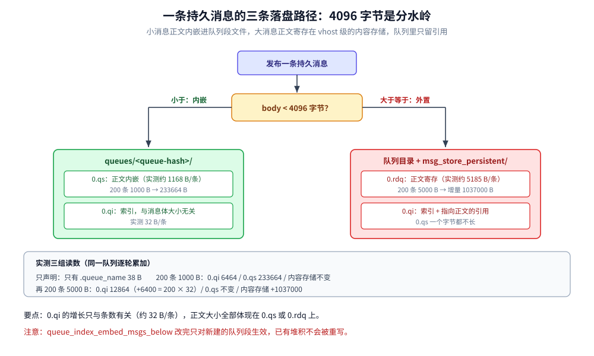
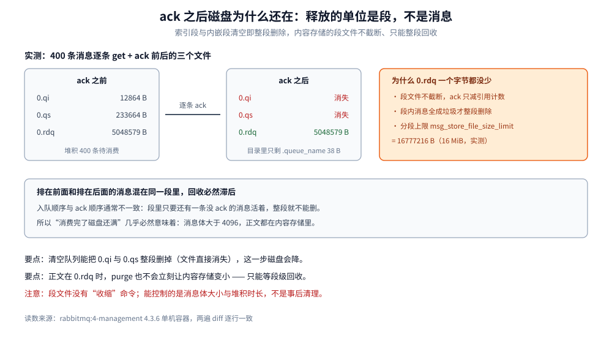

# 存储与投递过程

> 覆盖一条持久消息落盘要碰哪几个文件、⭐ **`queue_index_embed_msgs_below` = 4096 如何决定「内嵌」还是「走内容存储」**（含 200 条 1000 B 与 200 条 5000 B 的字节级对照）、清空队列后为什么磁盘占用不降、以及消息从磁盘被投递到消费者并 ack 的完整路径。
>
> 不覆盖：Confirm × 持久化 × ack 的三段责任见 [消息可靠性.md](消息可靠性.md)；prefetch 与消费语义见 [消费者与投递语义.md](消费者与投递语义.md)；三种队列类型的取舍见 [队列类型与消息模式.md](队列类型与消息模式.md)；帧的字节布局见 [AMQP.md](../../../../02-计算机基础/网络/消息协议/AMQP.md)。
>
> 内容整理自个人学习笔记；文件角色与参数默认值参考 RabbitMQ 官方文档（4.x）。本篇所有文件大小读数来自本机 `rabbitmq:4-management`（**4.3.6**）单机容器 `amqp-lab`，消息用 Python 标准库手写 AMQP 帧发布（不引客户端库），连续两遍 `diff` 逐行一致。

---

## 一、一条持久消息落盘要碰哪几个文件？

**本节要点**：持久消息落盘不是「写一个文件」，而是**三处分工**——队列索引记位置、队列段文件存内嵌的小消息、内容存储存大消息的正文。哪一处落笔，由消息体大小决定。



本机实测的文件布局（`msg_stores/vhosts/<vhost-hash>/`）：

```text
queues/<queue-hash>/
    .queue_name     38 B      队列名的落盘记录
    0.qi            6464 B    队列索引（每 16384 条消息一段）
    0.qs           233664 B    队列段文件：内嵌的小消息正文
msg_store_persistent/
    0.rdq       5048579 B     内容存储：大消息正文 + 引用计数，每段 16 MiB
```

| 文件 | 角色 | 什么时候长 | 什么时候消失 |
| --- | --- | --- | --- |
| `.queue_name` | 队列名与参数 | 声明队列时 | 删除队列时 |
| `0.qi` | **队列索引**：消息在队列里的位置与引用 | 每进一条消息（约 32 字节/条） | 索引段整段被回收 |
| `0.qs` | **队列段文件**：内嵌消息的正文 | 只有 `< 4096` 的消息 | 整段被回收 |
| `0.rdq` | **内容存储**：`≥ 4096` 的消息正文 | 只有大消息 | 整段被回收（不截断） |

> ⭐ 一句话记忆：**小消息连正文一起待在队列目录里，大消息只把「引用」留在队列里、正文寄存在 vhost 级的内容存储。**

**这三个文件都不是「一条消息一条记录」**。`0.qi` 是追加日志式的索引段，`0.qs` 与 `0.rdq` 是定长分段的存储文件——「段」这个单位是后面理解「磁盘为什么不缩」的关键。

## 二、为什么 1000 字节的消息根本不进内容存储？

**本节要点**：`queue_index_embed_msgs_below` 默认 **4096** 字节。小于它的消息**正文直接内嵌进队列段文件**，内容存储一个字节都不写；大于它才把正文挪到 `msg_store_persistent`，队列里只留引用。

本机实测三组读数（同一队列 `store.small`，逐轮累加）：

| 阶段 | `0.qi` | `0.qs` | `msg_store_persistent` |
| --- | --- | --- | --- |
| 只声明，0 条消息 | — | — | 不变 |
| 200 条 × 1000 B | **6464** | **233664** | **不变** |
| 再 200 条 × 5000 B | **12864**（+6400） | **233664**（不变） | **+1037000** |

这组数字能推出四条硬结论：

- **1000 B 的消息完全没碰内容存储**：第二轮之后 `msg_store_persistent` 累计值一个字节没动。若它写了，这里的值必然变化。
- **`0.qi` 是纯索引，每条约 32 字节**：12864 − 6464 = 6400，正好 `200 × 32`。所以索引与消息体大小无关，只与条数有关。
- **`0.qs` 每条约 1168 字节**：233664 ÷ 200 = 1168.32。1000 B 正文 + 约 168 B 的消息属性与段内开销。
- **5000 B 的消息正文进了内容存储**：1037000 ÷ 200 = **5185 字节/条**，5000 B 正文 + 约 185 B 的存储头部与引用。

**为什么阈值是 4096？** 这是「多一次随机读」与「多占一份索引空间」之间的折中：把小消息内嵌，消费时一次顺序读就能拿到正文，省掉去内容存储里按偏移寻址；但内嵌会让队列段文件随消息数线性膨胀，且**只有持久队列的索引段才值得这么花**。4096 近似一个磁盘页的整数倍，小于它的消息按页读的成本差别不大。

> ⚠️ **改这个参数要谨慎**：它是 `rabbitmq.conf` 里的全局项，改完只对**新建的队列段**生效，已有段不会重写。想「把已有大堆积改成内嵌」得重建队列。

## 三、ack 之后磁盘占用为什么没降？

**本节要点**：因为释放的单位是**段**，不是消息。队列清空会把索引段与内嵌段整段删掉（文件直接消失），但**内容存储的段文件不截断**——只有当一整段里的消息全部被 ack，这段才会被回收。所以「清空队列后磁盘不降」几乎必然意味着：你的消息大部分大于 4096，正文都在内容存储里。



本机实测：400 条消息（200 条 1000 B + 200 条 5000 B）全部逐条 `basic.get` + `basic.ack` 之后。

```text
===== 4. 逐条 get+ack 清空之后再读一次（验文件是否缩）=====
队列=store.small 逐条 get+ack 共消费 400 条，队列已空
--- 逐条 ack 之后
.queue_name 38
--- msg_store_persistent 累计: 5048579 字节（与 ack 前相同说明内容文件不缩）
```

`0.qi` 与 `0.qs` **整段消失**了（目录里只剩 `.queue_name`），而 `msg_store_persistent` 的累计值**一个字节都没少**。

| 文件 | 清空后 | 释放机制 |
| --- | --- | --- |
| `0.qi` | 消失 | 索引段内的消息全部被 ack → 整段删除 |
| `0.qs` | 消失 | 内嵌段内的消息全部被 ack → 整段删除 |
| `0.rdq` | **大小不变** | 段内还有引用（或尚未触发 GC）时不回收；只有整段成垃圾才删 |

**这就解释了两个常见现象**：

- **「消息都消费完了，磁盘还是满的」**：消息体大于 4096 时正文在 `0.rdq` 里，ack 只是把引用计数减一，段文件不缩。要等整段消息全被 ack 才回收，而入队顺序与 ack 顺序往往不一致，所以回收会滞后。
- **「队列 purge 之后磁盘立刻降了」**：purge 属于「整段清空」的特例，索引段与内嵌段可以一次删掉；但如果正文在内容存储里，purge 也不会立刻让 `0.rdq` 变小。

> ⭐ 内容存储的分段上限是 `msg_store_file_size_limit` = **16777216**（16 MiB，本机实测 `application:get_env` 读数）。段越大，回收越滞后——这也是官方建议「堆积期间不要盲目调大这个值」的原因。

> ⚠️ **本篇未逐项实测的边界**：部分 ack（只消费一半再观察段文件大小）、`0.rdq` 段级 GC 的触发时机、`msg_store_transient`（非持久消息）的同类行为。上面的机制结论来自「清空前后」两点读数加文件分段规则，**中间过程未做逐段采样**。

## 四、投递是怎么把消息从磁盘送到消费者的？

**本节要点**：投递路径与落盘路径是**两条独立的链**。落盘负责「收得住」，投递负责「送得出」，两者唯一的交汇点是**队列进程**——它同时是落盘与投递的串行化点。

| 步 | 动作 | 依赖什么 | 出错的表现 |
| --- | --- | --- | --- |
| ① 消费者注册 | `basic.consume` 把消费者挂到队列上 | 队列名、consumer tag | 队列不存在 → `NOT_FOUND` 关 channel |
| ② 配额判定 | 队列看这个 channel 的未 ack 数是否到 `prefetch` | `basic.qos` 的 prefetch | 配额满则**停止推送**，堆积涨而连接正常 |
| ③ 取正文 | 内嵌消息从 `0.qs` 读，大消息按引用去 `0.rdq` 读 | 消息是否小于 4096 | 内容存储段缺失 → 消息判为损坏 |
| ④ 推送 | 发 `basic.deliver`（method + header + body 三段帧） | AMQP 帧通道 | 帧超 `frame_max` 会被切 body 帧 |
| ⑤ 记账 | 消息进 **unacked 表**，`messages_unacknowledged` +1 | 未 ack 的消息必须可重投 | 消费者崩溃 → 全部重回 ready |
| ⑥ ack 后 | 索引项标记删除、引用计数减一、unacked 移除 | `basicAck` | `consumer_timeout` 到期强制断连 |

**为什么「取正文」这一步决定了吞吐？** 内嵌消息的正文与索引在同一个段文件里，一次顺序读就够；大消息要先读索引拿引用，再去内容存储按偏移定位——**多一次随机 I/O**。所以「消息体大小」不只影响磁盘占用，还影响消费侧的读放大。

**第⑤步的 unacked 表不是「暂存副本」**：消息在 unacked 期间**仍在队列里**（索引项未删），只是被标记为「已投出」。所以 `messages` = `messages_ready` + `messages_unacknowledged`，两个数分得很清——这条恒等式就是排查「消费者到底有没有在干活」的第一判据（见 [运维与排障.md](运维与排障.md) 第一节）。

**队列进程是唯一的串行点**：入队、出队、ack 记账、过期扫描、段回收都在这个 Erlang 进程里完成，所以单队列吞吐有上限。这也是「队列数不能太多」的物理原因——每个队列都是一个独立进程（见 [队列与绑定设计.md](队列与绑定设计.md)）。

## 五、quorum 队列的落盘差在哪？

**本节要点**：quorum 队列**不用队列索引段**，它把消息写成 **Raft 日志**，由多数派确认后才算落盘。代价是每次写入多一轮网络往返，收益是「少数派故障不丢消息」。

| 维度 | classic 队列（本篇实测对象） | quorum 队列 |
| --- | --- | --- |
| 落盘单位 | 队列索引段 + 段文件 + 内容存储 | Raft WAL + 段文件，**每个副本各写一份** |
| 「已落盘」的判据 | 写入本节点磁盘 | **多数派**确认（3 副本要 2 个写成功） |
| 消息内嵌 | 支持（`queue_index_embed_msgs_below`） | 不支持，统一走日志与段 |
| 索引 | `0.qi` 队列索引 | 由 Raft 日志位置取代 |
| 磁盘放大 | 1 份（单节点） | **副本数份**（3 副本约 3 倍） |
| 消费即删 | 是 | 是（但删除也要走 Raft） |

**多数派读数怎么拿？** `rabbitmq-queues quorum_status <队列名>` 会给出每个副本的 `Raft State`、`Last Log Index`、`Commit Index`——**`state=running` 不代表可用**，要看 `Commit Index` 是否在推进（本机三节点实验里，只剩 1/3 时 `state` 仍是 `running`，但两个 follower 的 `Raft State` 已变成 `noconnection`，此时无法写入）。

> ⚠️ **两种队列的磁盘不能一起估算**：classic 的 1 GB 堆积在 quorum 下大约是 3 GB（3 副本），再乘上日志重写期间的临时占用。做容量规划时要按队列类型分别算。

## 六、具体使用

### 6.1 看一个队列到底占了哪些文件

```bash
# 进容器找 vhost 目录（hash 与 vhost 名不同，只能按目录列出来对）
docker exec amqp-lab sh -c 'ls /var/lib/rabbitmq/mnesia/rabbit@*/msg_stores/vhosts/'

# 列出某个队列目录下每个文件的大小
docker exec amqp-lab sh -c \
  'find /var/lib/rabbitmq/mnesia/rabbit@*/msg_stores/vhosts/*/queues/* -type f -printf "%p %s\n" | sort -k2 -n'
```

> ⚠️ 队列目录名是 26 位哈希，**不等于队列名**。要定位某个队列，最省事的办法是「发消息前记录目录清单，发完再 diff 出新增的那个目录」。

### 6.2 读关键参数的真实取值

```bash
# 内嵌阈值：小于它的消息正文进队列段文件
rabbitmqctl eval 'application:get_env(rabbit, queue_index_embed_msgs_below).'
# => {ok,4096}

# 内容存储的段大小上限
rabbitmqctl eval 'application:get_env(rabbit, msg_store_file_size_limit).'
# => {ok,16777216}
```

### 6.3 判断「磁盘为什么降不下来」

```bash
# ① 先看还有多少消息没被 ack
rabbitmqctl list_queues name messages messages_ready messages_unacknowledged

# ② 再看消息体大小的分布：决定正文在 0.qs 还是 0.rdq
rabbitmqctl list_queues name messages message_bytes

# ③ 看内容存储的实际占用：这一项不会因为 ack 而变小
du -sh /var/lib/rabbitmq/mnesia/rabbit@*/msg_stores/vhosts/*/msg_store_persistent
```

三步的顺序不能反：**先确认「还有没有消息」（①②），再确认「正文存在哪」（②③）**。如果第①步显示消息已清零而第③步仍然很大，那就是「段还没被整段回收」——只能等，或按官方流程重启触发回收，而不是继续删队列。

## 延伸追问

- **既然内嵌更省一次随机读，为什么不全内嵌？** 因为内嵌让队列段文件随消息数线性增长，而队列索引的段是**定长 16384 条**的——把几 MB 的正文塞进每一段，段文件会迅速膨胀到需要频繁滚动，回收粒度反而变粗。4096 是「一条消息不太可能超过一页」的经验分界。
- **`0.qi` 每条约 32 字节，这个数能用来估容量吗？** 能，但只管索引：100 万条消息约 32 MB 索引，与消息体大小无关。真正的容量大头永远是正文——小于 4096 的在 `0.qs`（约 1168 字节/条，实测），大于的在 `0.rdq`（约 5185 字节/条，实测）。
- **为什么 quorum 队列不支持内嵌？** 它的存储是 Raft 复制的追加日志，正文直接就是日志条目的一部分；再套一层「内嵌到索引段」等于让日志与索引两份数据竞争同一段磁盘，且副本之间的段边界无法对齐。
- **ack 之后能不能主动让磁盘降下来？** 不能靠命令「收缩文件」。RabbitMQ 的段文件不截断，只能等整段成垃圾后删除。所以运维上的正确做法是**控制消息体大小**（减少大消息进内容存储）与**控制堆积时长**（别让段一直有零星引用活着）。
- **`msg_store_transient` 什么时候用？** 非持久消息用它。它在 Broker 重启后整段丢弃，所以重启后磁盘立刻降——这也从侧面印证「持久内容存储不缩」不是 bug 而是设计。

## 关联

- **上游/总纲**：[README.md](README.md) — 本目录的定位与实测坐标
- **上游/总纲**：[核心概念与架构.md](核心概念与架构.md) — 第四节「一条消息从 publish 到 ack」的六段链路，本篇是把第⑤步展开
- **上游/总纲**：[AMQP.md](../../../../02-计算机基础/网络/消息协议/AMQP.md) — 帧收完之后才轮到本篇：字节怎么变成文件
- **下游机制**：[消息可靠性.md](消息可靠性.md) — 持久化四组合的重启读数：写进文件 ≠ 重启后还在
- **下游机制**：[消费者与投递语义.md](消费者与投递语义.md) — 第四节投递路径里 prefetch 与 unacked 的完整语义
- **下游机制**：[队列与绑定设计.md](队列与绑定设计.md) — 一个队列一个进程：队列数为什么不能太多
- **对照/互补**：[README.md](../RocketMQ/README.md) — CommitLog 混写 + ConsumeQueue 索引的另一套落盘分工
- **对照/互补**：[README.md](../Kafka/README.md) — 分区日志与零拷贝：为什么 Kafka 的堆积不这样占磁盘
