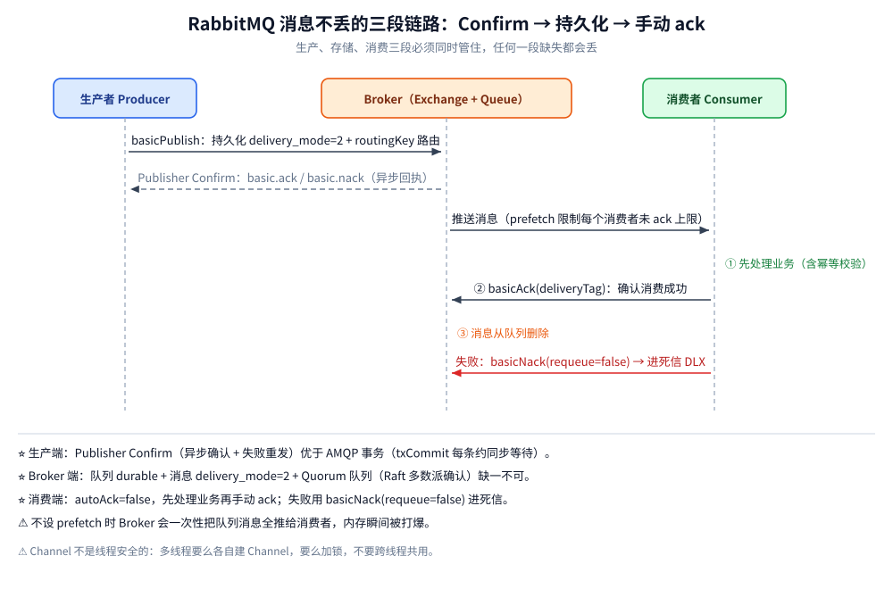
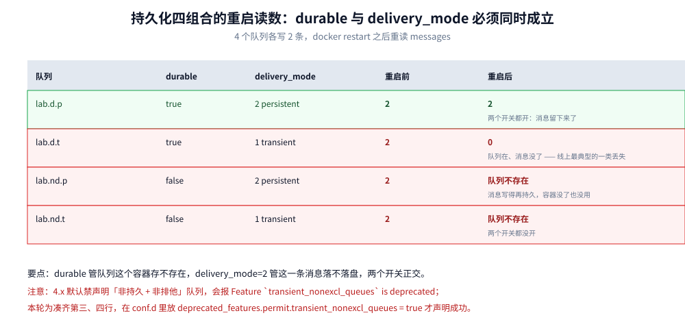
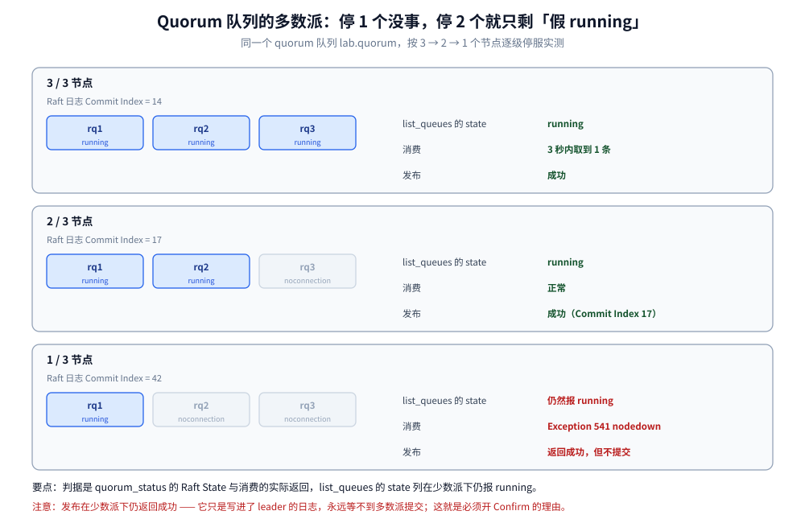

# 消息可靠性

> 覆盖「消息不丢」的三段责任（生产端 Confirm / Broker 端持久化 / 消费端手动 ack）、⭐ **durable 与 delivery_mode 四组合的重启实测**、Quorum 队列的 Raft 多数派与「只剩 1/3 节点时究竟发生了什么」的实测、`ack` / `nack` / `requeue` 的三种落点、以及为什么幂等只能落在消费端。
>
> 不覆盖：交换机路由规则见 [核心概念与架构.md](核心概念与架构.md) 第三节；prefetch 与 `consumer_timeout` 见 [消费者与投递语义.md](消费者与投递语义.md)；磁盘告警导致的「发布成功但没入队」见 [运维与排障.md](运维与排障.md) 第二节；可靠消息最终一致的通用方案见 [最终一致方案.md](../../../../04-架构与系统/分布式/分布式事务/最终一致方案.md)。
>
> 内容整理自个人学习笔记；Confirm 与 Quorum 的机制部分参考 RabbitMQ 官方文档（4.x）。本篇读数来自本机 `rabbitmq:4-management`（4.3.6）：单机容器 `amqp-lab` 做持久化四组合，三节点集群 `rq1`/`rq2`/`rq3` 做多数派故障；持久化组合重跑两次读数相同。

---

## 一、「不丢」要同时满足哪三段？

**本节要点**：从生产到消费，消息要跨过**两个确认点**和**一次落盘**；三段里任何一段缺条件，都会有对应的一段「已经丢了但没人知道」。



三段链路各自要满足什么条件、漏掉条件以后会以什么形式丢消息，下面这张表按「环节 → 条件 → 缺了会怎样」逐段列清楚：

| 环节 | 条件 | 缺了会怎样 |
| --- | --- | --- |
| **生产端** | ✅ **Publisher Confirm**（异步确认 + 失败重发） | Broker 没收到也以为发成功了（见 [运维与排障.md](运维与排障.md) 第二节的实测） |
| **Broker 端** | ✅ 队列 `durable=true` **+** 消息 `delivery_mode=2` **+** Quorum 队列（多副本） | 只持久化不多副本 → 节点挂丢；只多副本不持久化 → 重启后消息没了 |
| **消费端** | ✅ `autoAck=false`，**先处理业务，再手动 ack** | 先 ack 后处理，处理失败时消息已被删除 |

> ⭐ **三段的责任人不同，排查时要分开看**：生产端怀疑「没发出去」，Broker 端怀疑「没落盘 / 副本不够」，消费端怀疑「处理失败但已确认」。把三类问题混成「MQ 丢消息」，是最常见的归因错误。

### 1.1 场景落到「三段怎么配」

三段的严格程度是**按业务分级**的，不是一律拉满——日志类业务把三段全开，等于用订单级代价处理可丢数据：

| 场景 | 三段怎么配 | 额外要求 |
| --- | --- | --- |
| 订单创建、支付回调 | Confirm + quorum 队列 + 手动 ack | 消费端按订单号幂等 |
| 积分 / 短信等旁路通知 | Confirm + quorum + 手动 ack，失败进 DLX | 允许延迟，不允许丢 |
| 日志 / 埋点 | 可关 Confirm、classic 队列、`autoAck=true` | ⚠️ 接受丢失才这么配 |
| 与外部系统对接 | Confirm + 本地消息表 + 定时补发 | 见 [最终一致方案.md](../../../../04-架构与系统/分布式/分布式事务/最终一致方案.md) |

> ⭐ 表里「日志 / 埋点」这一行是唯一允许关掉 Confirm 的——**只有明确接受丢失，才可以退到最弱配置**；其余三行缺任何一段，都属「已经丢了但没人知道」。

## 二、生产端：Confirm 为什么必须配异步回执？

| 机制 | 原理 | 性能 | 结论 |
| --- | --- | --- | --- |
| **Publisher Confirm** ⭐ | Channel 开 `confirm` 模式后，每条消息得到一个 `deliveryTag`，Broker 接受后异步回 `basic.ack` / `basic.nack` | 高，**批量确认更快** | 生产推荐：异步确认 + 未确认集合 + 超时重发 |
| **AMQP 事务**（`txSelect` / `txCommit` / `txRollback`） | 显式事务包裹发布，提交后才生效 | ⚠️ **极差**，每条消息同步等待，吞吐断崖式下降 | 几乎不用 |

**为什么 Confirm 不能「同步等」？** `waitForConfirmsOrDie(5000)` 会阻塞到这一批全部确认，等于把异步变成同步；生产做法是维护一个 `SortedSet<deliveryTag>` 存未确认消息，在 `ConfirmListener` 里按 tag 移除，超时未移除的整批重发。

> ⚠️ **Confirm 与 `mandatory` 是两回事**：Confirm 说「Broker 收到并接受了这条消息」，`basic.return` 说「这条消息在 Broker 里找不到任何可路由的队列」。**两者可以同时发生**——消息被退回，但你仍然会收到 `basic.ack`。要判断「是否真的进了队列」，两个都得听。

```go
// Go：异步 Confirm —— 未确认集合 + 定时重发（骨架）
ch.Confirm(false)
confirms := ch.NotifyPublish(make(chan amqp.Confirmation, 256))
returns := ch.NotifyReturn(make(chan amqp.Return, 16))

go func() {
	for r := range returns {
		log.Printf("无路由被退回: code=%d key=%s body=%s", r.ReplyCode, r.RoutingKey, r.Body)
	}
}()
go func() {
	for c := range confirms {
		if !c.Ack {
			log.Printf("Broker 拒绝 tag=%d，需重发", c.DeliveryTag)
			continue
		}
		markConfirmed(c.DeliveryTag) // 从「未确认集合」里摘掉
	}
}()
```

## 三、Broker 端：durable 与 delivery_mode 为什么缺一不可？

**本节要点**：`durable` 管的是**队列这个容器**存不存在，`delivery_mode=2` 管的是**消息这一条**落不落盘。两个开关是**正交**的，只在同时打开时才保得住。

实测：4 个队列各写 2 条，然后 `docker restart amqp-lab`，重启后再读。

| 队列 | `durable` | `delivery_mode` | 重启前 | 重启后 |
| --- | --- | --- | --- | --- |
| `lab.d.p` | `true` | `2` persistent | 2 | ⭐ **2** |
| `lab.d.t` | `true` | `1` transient | 2 | ⚠️ **0**（队列还在，消息没了） |
| `lab.nd.p` | `false` | `2` persistent | 2 | ❌ **队列不存在** |
| `lab.nd.t` | `false` | `1` transient | 2 | ❌ **队列不存在** |



重启后的四个读数里，有三个值得单独拎出来说清楚，尤其前两个反直觉的组合：

- **第 2 行是坑**：`durable=true` 只保证**队列**在重启后还在，`delivery_mode=1` 的消息根本没落盘，重启后队列是空的（0 条）。线上最典型的「队列还在但消息没了」就是这个组合。
- **第 3 行更反直觉**：消息设了 `delivery_mode=2`，但队列不持久，重启后**连队列都不存在**——消息写得再持久也没用，它所在的容器没了。
- **`delivery_mode` 是「消息属性」，不是「队列属性」**：同一个队列里可以有持久消息和瞬态消息混杂，重启后瞬态的那些丢、持久的那些留。

> ⚠️ **4.x 的一个新行为**：声明「非持久 + 非排他」的队列会直接报错 ——
>
> ```text
> Exception (541) INTERNAL_ERROR - Feature `transient_nonexcl_queues` is deprecated.
> By default, this feature is not permitted anymore.
> ```
>
> 本轮为了凑齐四组合，在 `conf.d` 里放了一行 `deprecated_features.permit.transient_nonexcl_queues = true` 才声明成功。**新系统不必为这个组合留口子**：队列持久化是默认做法，需要「临时队列」时用 `exclusive=true`（连接断开即删）。

## 四、Quorum 队列的多数派是怎么保证的？

**本节要点**：quorum 队列的写入成功条件是 **Raft 多数派落盘**，不是「leader 收到」；但**降级后的表现非常隐蔽**——队列在管理接口里仍显示 `running`，变得不可用的是**消费**。



实测环境：三节点集群 `rq1`（leader）/ `rq2` / `rq3`，队列 `lab.quorum` 声明为 `x-queue-type=quorum`。

| 阶段 | `cluster_status` | `list_queues` 的 `state` | `quorum_status` | 消费 | 发布 |
| --- | --- | --- | --- | --- | --- |
| 3 节点全在 | rq1 / rq2 / rq3 | `running` | leader `rq1` + 2 follower，Commit Index 14 | ✅ 3 秒内取到 1 条 | ✅ |
| 停 1 个（2/3） | rq1 / rq2 | `running` | leader + 1 follower，Commit Index 17 | ✅ 正常 | ✅ 正常 |
| **停 2 个（1/3）** | 只剩 rq1 | ⚠️ **仍是 `running`** | rq2 / rq3 显示 `noconnection` | ❌ **`Exception (541) … nodedown`** | ⚠️ **返回成功** |
| 两个节点恢复 | 三节点 | `running` | 恢复正常 | ✅ 恢复 | ✅ |

**三个必须记住的读数**：

- ⚠️ **`list_queues` 的 `state=running` 不能当可用性判据**。只剩 1/3 节点时它照样报 `running`，因为 leader 本地还有一份副本状态。真正的判据是 `rabbitmq-queues quorum_status` 里的 Raft State（其余成员变 `noconnection`）和**消费是否报 `nodedown`**。
- **发布在少数派下会「假装成功」**：`PublishWithContext` 返回 `nil`，`mandatory=true` 也没收到退回——因为消息只是进了 leader 的日志，永远等不到多数派提交。**这就是为什么生产端必须开 Confirm**：Confirm 在这种情况下永远不会回 `basic.ack`。
- **多数派的意义是「写入要不要等」**：3 节点停 1 个，写入仍需 2 票（leader + 剩余 follower），所以 qps 会有可感知的抖动；停 2 个后连 1 票都凑不齐，日志无法提交。

> ⭐ **为什么要求奇数节点？** 3 节点容忍 1 个故障，4 节点也只能容忍 1 个（多数派是 3），却多一份存储与网络开销。所以 quorum 队列的集群规模按 3 / 5 / 7 递增。

## 五、消费端：ack / nack / requeue 的三种落点

| 操作 | 语义 | 落点 |
| --- | --- | --- |
| `basicAck(deliveryTag, multiple)` | 确认成功 | 消息从队列**删除** |
| `basicNack(deliveryTag, multiple, requeue)` | 拒绝，可一次拒多条 | `requeue=true` → **回队头重投**；`false` → 进 DLX |
| `basicReject(deliveryTag, requeue)` | 拒绝单条 | 同 nack 的单条版 |

> ⚠️ **`requeue=true` 的死循环**：失败原因与消息内容相关时（脏数据、反序列化失败），消息被放回**队头**、立刻又被同一个消费者拿到，形成「消息卡在队头 + CPU 空转」。正确做法是 `requeue=false` 进死信 + 限制重试次数 + 告警。

## 六、既然只保证 at-least-once，幂等该落哪？

RabbitMQ 的投递语义是 **at-least-once**：网络抖动、ack 丢失、连接断开重投、消费者进程崩溃，任一情况都会导致同一条消息被投递两次以上。**中间件不做去重**，只能消费端做幂等。

| 做法 | 适用 | 注意 |
| --- | --- | --- |
| **数据库唯一索引** | 插入型业务（订单、流水） | 最可靠，靠存储引擎兜底 |
| **去重表**（与业务同事务写入已处理标记） | 更新型业务 | 多一次写入，需与业务同一个事务 |
| **Redis `SETNX`** | 高并发、允许极小概率误判 | 要设过期时间，且 key 不能是消息 ID |
| **业务状态机 CAS** | 有明确状态流转（待支付→已支付） | `UPDATE … WHERE status='待支付'` 天然幂等 |

> ⚠️ **去重键要用业务唯一键，不要用消息 ID**：重投时消息 ID 可能变化（重新发布就是一条新消息），而业务键（订单号）不变。用消息 ID 去重等于没去重。

## 七、具体使用

### 7.1 生产端：持久消息 + Confirm

```go
// 关键三行：delivery_mode=2、confirm 模式、等 ack
ch.Confirm(false)
confirms := ch.NotifyPublish(make(chan amqp.Confirmation, 1))
err := ch.PublishWithContext(ctx, "order.exchange", "order.created", true /* mandatory */, false,
	amqp.Publishing{
		ContentType:  "application/json",
		DeliveryMode: amqp.Persistent, // ⭐ 2：消息持久化，须配合 durable 队列
		Body:         body,
	})
if err != nil {
	return err
}
select {
case cf := <-confirms:
	if !cf.Ack {
		return errors.New("broker nack，需重发")
	}
case <-time.After(5 * time.Second):
	return errors.New("confirm 超时，需重发")
}
```

### 7.2 消费端：先处理再 ack，失败进死信

```go
msgs, _ := ch.Consume("order.queue", "", false /* autoAck=false */, false, false, false, nil)
for d := range msgs {
	if err := handle(d.Body); err != nil {
		// ⚠️ requeue=false：进死信；true 会无限重入队
		_ = d.Nack(false, false)
		continue
	}
	_ = d.Ack(false) // 业务成功后才确认
}
```

### 7.3 Spring AMQP 侧的等价配置

```yaml
spring:
  rabbitmq:
    publisher-confirm-type: correlated   # ⭐ 开 Confirm，回执带 correlation data
    publisher-returns: true              # ⭐ 无路由时回调 ReturnsCallback
    template:
      mandatory: true
    listener:
      simple:
        acknowledge-mode: manual         # ⭐ 手动 ack
        prefetch: 30
        retry:
          enabled: true
          max-attempts: 3                # 本地重试 3 次后按 reject 处理
```

### 7.4 声明 quorum 队列并验证副本

```bash
# 声明 quorum 队列（也可在客户端用 x-queue-type 参数）
rabbitmqadmin declare queue name=order.quorum durable=true arguments='{"x-queue-type":"quorum"}'

# ⭐ 看 Raft 成员与提交位点：state=running 不代表可用，这里才看得出
rabbitmq-queues quorum_status order.quorum

# 集群成员
rabbitmqctl cluster_status
```

## 延伸追问

- **Confirm 收到 ack 就一定能保证不丢吗？** 不能。`basic.ack` 只代表「Broker 接受了」：持久消息已落盘 + quorum 已多数派提交，才算真的安全；`classic` 队列如果只落 PageCache 没刷盘，机器掉电仍可能丢。要压到最低就用 quorum 队列。
- **`classic` 队列还有必要用吗？** 有，两类场景：需要**优先级队列**或**惰性模式**（quorum 都不支持），以及可以接受节点故障时队列暂时不可用的短生命周期消息。
- **为什么「停 2 个节点」时发布还返回成功？** 因为 AMQP 的 publish 是**单向命令**，Broker 收到帧就返回（不等提交）；真正的确认走 Confirm。这也是为什么「不开 Confirm 就等于不保证送达」。
- **消费失败重试该在客户端还是 MQ 做？** RabbitMQ **没有原生延迟重试队列**（不像 RocketMQ 的 `%RETRY%`），要么用 Spring 的 `RetryTemplate` 在**本地内存**重试，要么自己搭「重试队列 + TTL + DLX」把延迟做出来，见 [队列类型与消息模式.md](队列类型与消息模式.md) 第三节。
- **死信队列要不要也配 Confirm 和持久化？** 要。死信链路是「最后一道兜底」，它丢等于消息彻底丢；实践中死信队列同样用 quorum + 持久消息，并单独配监控（死信堆积说明有系统性问题）。

## 关联

- **上游/总纲**：[核心概念与架构.md](核心概念与架构.md) — 第四节的六段链路是本节两个确认点所在的位置
- **上游/总纲**：[最终一致方案.md](../../../../04-架构与系统/分布式/分布式事务/最终一致方案.md) — 本地消息表 + 重试的通用方案
- **上游/总纲**：[Raft协议.md](../../../../04-架构与系统/分布式/共识协议/Raft协议.md) — quorum 队列多数派的原理来源
- **下游机制**：[消费者与投递语义.md](消费者与投递语义.md) — ack 之外的消费侧语义：prefetch、`consumer_timeout`、重连恢复
- **下游机制**：[运维与排障.md](运维与排障.md) — 告警与流控：发布「成功」却没入队的三道水位
- **对照/互补**：[消息可靠性.md](../RocketMQ/消息可靠性.md) — 刷盘 × 复制四组合与重试队列：另一种「不丢」的拼法
- **对照/互补**：[消息可靠性.md](../Kafka/README.md) — `acks` 各档与 ISR：多数派的第三种写法
> 反向引用（本篇被下列文档引到）：[存储与投递过程.md](存储与投递过程.md)、[部署与配置.md](部署与配置.md)、[队列类型与消息模式.md](队列类型与消息模式.md)、[队列粒度与命名设计.md](队列粒度与命名设计.md)
