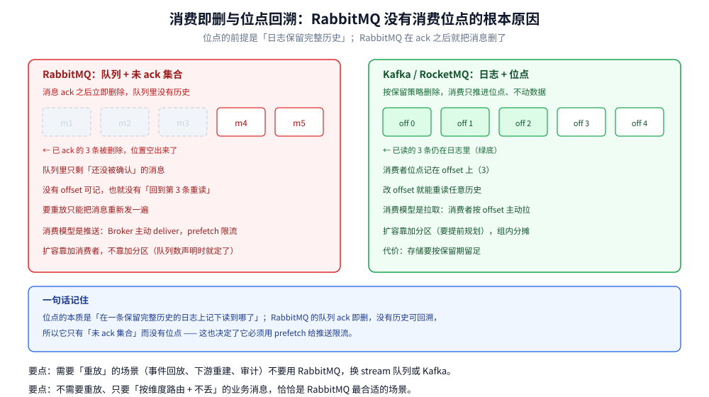
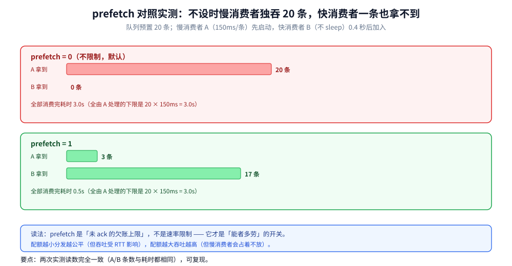

# 消费者与投递语义

> 覆盖 RabbitMQ 为什么没有「消费位点」以及这个选择的代价、⭐ **prefetch 到底限制的是什么**（实测：不设时慢消费者独吞 20 条、快消费者一条拿不到）、`basic.qos` 的 `global` 参数在 4.x 的语义变化、consumer tag / exclusive / priority / 单活跃消费者的适用边界、断连后的恢复路径，以及 `consumer_timeout` 造成的「消费莫名卡住」。
>
> 不覆盖：ack / nack / requeue 的落点与幂等设计见 [消息可靠性.md](消息可靠性.md) 第五、六节；队列类型与延迟消息见 [队列类型与消息模式.md](队列类型与消息模式.md)；堆积与流控排障见 [运维与排障.md](运维与排障.md)。
>
> 内容整理自个人学习笔记；`basic.qos` 与 `consumer_timeout` 的语义参考 RabbitMQ 官方文档（4.x）。本篇 prefetch 对照来自本机 `rabbitmq:4-management`（4.3.6）实测，跑两遍读数完全一致。

---

## 一、RabbitMQ 为什么没有「消费位点」？

**本节要点**：位点的本质是「在一条**保留完整历史**的日志上记下读到哪了」。RabbitMQ 的队列在 ack 之后**删除**消息，没有历史可回溯，所以它只有「未 ack 集合」而没有位点。



| 维度 | RabbitMQ | Kafka / RocketMQ |
| --- | --- | --- |
| 消息生命周期 | ack 后**立即删除** | 按保留策略（时间 / 大小）删除 |
| 消费进度 | 「未 ack 集合」（内存 + 队列索引） | 位点（offset），持久化 |
| 重放 | ❌ 不能（要重放只能重新发一遍） | ✅ 任意回溯 |
| 消费模型 | **推送**（Broker 主动 deliver，prefetch 限流） | **拉取**（消费者按 offset 拉） |
| 位点提交 | 每条 ack 就是一次「提交」 | 定期 / 手动 commit |
| 消费组语义 | 队列级竞争消费（同一个队列的消费者互斥） | 组内分区分摊，组间独立 |

**「推送」带来两个直接后果**：

- ⭐ **必须有 prefetch**。推送是 Broker 主导的，不设上限时它会把队列里的消息**一次全推给消费者**——消费者内存直接被灌爆（下一节实测）。
- **扩容靠加消费者，不靠加分区**。队列数在声明时就定了，加消费者只是让同一个队列的投递分摊到更多连接上；分区数则要提前规划。

## 二、prefetch 到底限制的是什么？

**本节要点**：`basic.qos(prefetchCount)` 限制的是**这个 Channel 上未 ack 的消息条数**，不是「每秒投递条数」，也不是全局配额。不设（默认 0 = 不限）时，Broker 会把队列里的消息按连接一次性推给各个消费者，**跟消费者处理得快不快无关**。



实测设计：队列预置 20 条；慢消费者 A（每条 sleep 150ms）先启动，快消费者 B（不 sleep）0.4 秒后加入，两者用同一组参数。

| prefetch | A 拿到 | B 拿到 | 全部消费完耗时 |
| --- | --- | --- | --- |
| **0**（不限制，默认） | **20** | **0** | 3.0s |
| **1** | **3** | **17** | 0.5s |

**怎么读这两行**：

- `prefetch=0` 时 A 在启动的头几百毫秒内就把 20 条全部收进自己的未 ack 配额（RabbitMQ 默认把它一次性推完），B 加入时队列已经是空的——**B 从 0.4s 起一直空转到 3.0s**，整体耗时等于「A 一个人处理 20 条」的下限 `20 × 150ms = 3.0s`。
- `prefetch=1` 时 A 手上最多挂 1 条，B 一加入就开始抢，最终 A 只分到 3 条、B 拿走 17 条，总耗时降到 **0.5s**——**快了 6 倍**，靠的不是加机器，而是把配额调对。

> ⭐ **一句话记住**：prefetch 是「未确认的欠账上限」，不是速率限制。**它就是「能者多劳」的开关**：配额越小，分发越公平，但吞吐受 RTT 影响；配额越大，吞吐越高，但慢消费者会占着不放。

**取值怎么定？**

| 场景 | prefetch 建议 | 其他设置 | 理由 |
| --- | --- | --- | --- |
| 每条处理快（<10ms，转发 / 通知） | 100~300 | 普通竞争消费 | 减少等待下一批的网络往返 |
| 每条处理慢（秒级，图片 / 报表） | 1~10 | `consumer_timeout` 调大或拆任务 | 避免一个消费者囤积大量在途消息 |
| 消费端会 OOM | 从 30 起调 | — | 未 ack 消息全在客户端内存里 |
| 需要严格公平 | 1 | — | 最公平，但吞吐最低 |
| 必须串行的同一实体 | 任意 | `x-single-active-consumer=true`，或按业务键分队列 | 避免并发改同一条记录 |
| 排障时暂停消费 | — | `basicCancel` 或 `exclusive` 独占 | 不丢消息、不动队列 |
| 跨机房消费 | 低 | 消费参数 `x-priority` | 让同机房消费者先拿 |

> ⭐ 这张表按**消费形态**分档，不按业务分档：同一个业务里的「发通知」和「导报表」应该用两个队列、两组 prefetch，而不是一刀切。

## 三、`basic.qos` 的 `global` 参数改了什么？

```go
// prefetchCount=30, prefetchSize=0（不按字节限）, global=false
ch.Qos(30, 0, false)
```

| `global` | 4.x 语义 | 影响范围 |
| --- | --- | --- |
| `false`（推荐） | 配额**按消费者**计算 | 同一 Channel 上多个消费者各自 30 条 |
| `true` | 配额**按 Channel** 计算 | 同一 Channel 上所有消费者**共享** 30 条 |

> ⚠️ **3.x 语义曾经反过一次**：早期版本 `global=false` 的含义是「应用到整个 Channel」，后来按 AMQP 规范修正为「按消费者」。跨版本共用的客户端库（尤其老版本 Java 客户端）要确认它传的是哪个值，否则会出现「明明设了 30，两个消费者却各自拿 30」这种偏差。

## 四、consumer tag、exclusive、priority、单活跃消费者

| 特性 | 参数 / API | 语义 | 什么时候用 |
| --- | --- | --- | --- |
| **consumer tag** | `basicConsume` 的第 2 个参数，留空自动生成 | 消费者的唯一标识，`basicCancel` 用它取消 | 需要在运行时动态增减消费者 |
| **exclusive consumer** | `basicConsume(..., exclusive=true, ...)` | ⭐ 该队列**只允许这一个消费者**，其他人订会报 `ACCESS_REFUSED` | 排障时「独占队列」停掉全部消费，或单点消费场景 |
| **consumer priority** | 消费参数 `x-priority`（整数，越大越优先） | 高优先级消费者**先拿到**消息，低优先级的只在它忙不过来时才有 | 同机房消费者优先于跨机房消费者 |
| **单活跃消费者** | 队列参数 `x-single-active-consumer=true` | 组内**只有一个**消费者在收，其余待命 | 必须严格串行处理同一队列 |
| **no-local** | `basicConsume(..., noLocal=true, ...)` | 不投给「发布它的那条连接」 | 很少用，RabbitMQ 实现不完整，官方标注不支持 |

> ⚠️ **`exclusive` 有两个不同含义**，别混：**队列的 `exclusive`**（声明时，连接断开即删队列）和**消费者的 `exclusive`**（订阅时，独占该队列）。前者是队列生命周期，后者是订阅权限。

**consumer priority 的坑**：它只影响「有空闲消息时先推给谁」，不做抢占。高优先级消费者如果一直是空闲的，低优先级就永远拿不到消息；要的是「负载均衡」就别用它。

## 五、连接断了，消费者怎么恢复？

RabbitMQ **不会**替你恢复消费者——消费者绑定在 Channel 上，连接一断，Channel、消费者、`basic.qos` 配额、未 ack 消息的投递记录全部消失。

| 语言 / 客户端 | 恢复机制 | 要自己补什么 |
| --- | --- | --- |
| Java `amqp-client` | `factory.setAutomaticRecoveryEnabled(true)`（默认开）+ `setTopologyRecoveryEnabled(true)` | 一般不用管；但要处理 `RecoveryListener` 里的重复投递 |
| Spring AMQP | `SimpleMessageListenerContainer` 自带重连 | 重试次数、`RecoveryCallback` |
| Go `amqp091-go` | ❌ **没有自动恢复** | ⭐ 必须自己监听 `NotifyClose` → 重连 → **重建 Channel → 重新 `Qos` → 重新 `Consume`** |

```go
// Go：断线重连骨架（NotifyClose 是最可靠的触发点）
for {
	conn, err := amqp.Dial(url)
	if err != nil {
		time.Sleep(time.Second)
		continue
	}
	closed := conn.NotifyClose(make(chan *amqp.Error, 1))
	go consume(conn) // 内部创建 Channel / Qos / Consume
	err = <-closed   // 阻塞到连接断开
	log.Printf("连接断开: %v，准备重连", err)
}
```

> ⚠️ **重连后必须重新 `Qos`**：`basic.qos` 是 Channel 级状态，新 Channel 上不重设就退化成「不限制」——你的消费者会突然开始被灌爆，而日志里什么都不会说。

## 六、`consumer_timeout`：为什么消费会「莫名卡住」

4.x 默认 `consumer_timeout = 1800000`（**30 分钟**，实测）。含义：一个消费者投递出去的消息，若在 30 分钟内**既没有 ack 也没有 nack / reject**，Broker 会认为这个消费者失联，**强制关闭它的 Channel**。

| 现象 | 原因 |
| --- | --- |
| 日志里出现 `PRECONDITION_FAILED - delivery acknowledgement on channel 1 timed out` | 某条消息处理超过 30 分钟没 ack |
| 消费者「什么都没做就被断开」，重连后又断 | 同一条消息反复超时（卡在同一个耗时任务上） |
| 长任务（视频转码、大批量导入）必然踩到 | 单条处理时间 > 30 分钟 |

**三种处理方式**：

| 做法 | 适用 |
| --- | --- |
| 调大 `consumer_timeout`（`rabbitmq.conf` 里配，需重启） | 确实有长任务，且能接受「失联检测变慢」 |
| 拆任务 + 心跳式续期（中途 ack 一部分再处理下一批） | ⭐ 推荐：把长任务拆成多条消息 |
| 把长任务移出消费链路（先落库，异步 worker 处理） | 消费端只做「收下并记录」 |

## 七、具体使用

### 7.1 设置 prefetch 并消费（Go）

```go
// ⭐ 必须在 Consume 之前设置；每个 Channel 单独设
if err := ch.Qos(
	30,    // prefetchCount：未 ack 上限
	0,     // prefetchSize：0 = 不按字节限
	false, // global：false = 按消费者
); err != nil {
	return err
}

msgs, err := ch.Consume(
	"order.queue",
	"",    // consumer tag，留空自动生成
	false, // autoAck：⚠️ 必须 false
	false, // exclusive
	false, // noLocal
	false, // noWait
	nil,
)
```

### 7.2 按优先级消费与单活跃消费者（Java）

```java
// 消费参数 x-priority：数值越大越优先
Map<String, Object> consumerArgs = new HashMap<>();
consumerArgs.put("x-priority", 10);
channel.basicConsume("order.queue", false, "hi-pri",
        false, true, consumerArgs, deliverCallback, cancelCallback);

// 队列参数 x-single-active-consumer：组内只有一个消费者在收
Map<String, Object> queueArgs = new HashMap<>();
queueArgs.put("x-single-active-consumer", true);
channel.queueDeclare("order.serial", true, false, false, queueArgs);
```

### 7.3 运维侧读数

```bash
# 每个队列有几个消费者、多少未 ack
rabbitmqctl list_queues name consumers messages_ready messages_unacknowledged

# 每个消费者的详情（含 prefetch 与未 ack 数）
rabbitmqctl list_consumers queue_name consumer_tag prefetch_count ack_required

# 连接与通道的实时状态（含 flow / blocking 标记）
rabbitmqctl list_connections name state channels
rabbitmqctl list_channels number consumer_count messages_unacknowledged prefetch_count
```

> ⭐ **`messages_unacknowledged` 是判断「消费者卡住」的第一读数**：它等于 prefetch 上限且长时间不动，说明消费者在慢慢处理或者已经卡死；它等于 0 但 `messages_ready` 在涨，说明根本没有消费者在工作。

## 延伸追问

- **prefetch 设成 1 会不会太慢？** 单条处理耗时远大于一次网络往返（RTT 通常 <1ms）时，设 1 的代价可以忽略；反过来，如果每条只处理几微秒，设 1 会让吞吐被 RTT 卡死。判断标准是「处理耗时与 RTT 的比例」。
- **为什么 `autoAck=true` 是危险的默认值？** 它不是「自动帮你 ack」，而是「**Broker 一发出就当你确认了**」——消费者进程崩溃时消息已经删除。唯一适合它的场景是「丢了也无所谓」的日志 / 指标。
- **单活跃消费者能不能做到自动故障转移？** 能。当前活跃消费者断开后，Broker 会在剩余的候选里重新选一个（约几秒），期间消息堆积。这正是它比「自己写分布式锁」省事的地方。
- **`consumer_timeout` 超时后被关闭的 Channel，消息会重投吗？** 会。未 ack 的消息回到 `ready` 状态重新投递——所以「超时断开」表现为**重复消费**而不是丢消息，消费端仍然需要幂等。
- **能不能用 `basicGet` 做「拉模式」绕过 prefetch？** 技术上可以，但 `basicGet` 是**同步、逐条**的（一次一次往返），吞吐极低，官方明确说它只适合工具和排障，不要用在生产消费链路。

## 关联

- **上游/总纲**：[核心概念与架构.md](核心概念与架构.md) — Channel 是 prefetch 的作用域，第二节解释了为什么它不是全局
- **上游/总纲**：[README.md](README.md) — 本目录的定位与实测坐标
- **下游机制**：[消息可靠性.md](消息可靠性.md) — ack / nack 的落点与 at-least-once 下的幂等
- **下游机制**：[运维与排障.md](运维与排障.md) — `messages_unacknowledged` 不动时的定位顺序
- **对照/互补**：[消费者与消费位点.md](../RocketMQ/消费者与消费位点.md) — 位点存 Broker vs 存消费端：另一种消费进度模型
- **对照/互补**：[消费者组与重平衡.md](../Kafka/消费者组与重平衡.md) — 拉模式下的再平衡与本文「队列级竞争消费」的差异
> 反向引用（本篇被下列文档引到）：[存储与投递过程.md](存储与投递过程.md)、[队列类型与消息模式.md](队列类型与消息模式.md)、[队列粒度与命名设计.md](队列粒度与命名设计.md)
