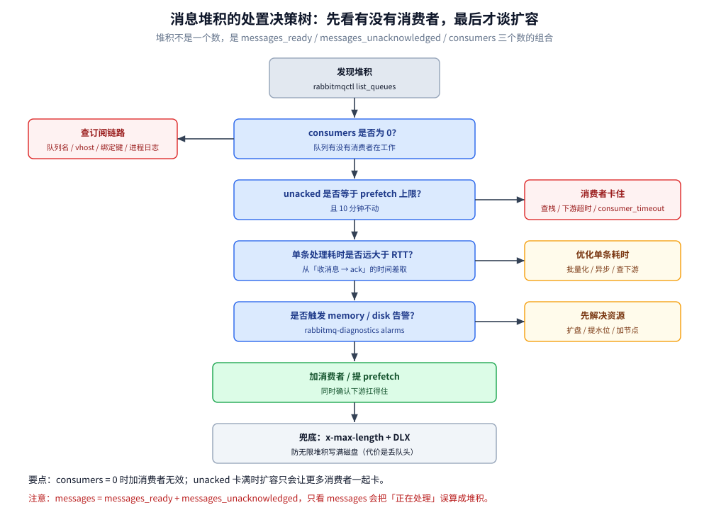
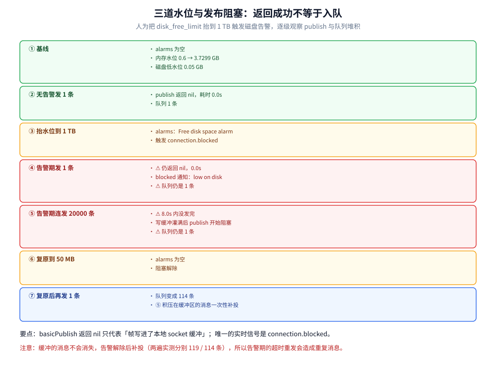

# 运维与排障

> 覆盖消息堆积的三层读数与处置顺序、⭐ **「发布返回成功但消息没入队」——三道水位与 connection.blocked 的实测**、`list_queues` 的 `state` 列为什么在失去多数派后仍然报 `running`、连接 / 通道 / 队列数量异常增长时的定位顺序、常见故障表与速查命令。
>
> 不覆盖：三段可靠性的设计见 [消息可靠性.md](消息可靠性.md)；prefetch 与消费侧卡顿的语义见 [消费者与投递语义.md](消费者与投递语义.md)；水位配置项见 [部署与配置.md](部署与配置.md) 第三节。
>
> 内容整理自个人学习笔记；告警与流控的机制部分参考 RabbitMQ 官方文档（4.x）。本篇读数来自本机 `rabbitmq:4-management`（4.3.6）单机与三节点集群，磁盘告警是**人为把 `disk_free_limit` 抬到 1 TB** 触发的。

---

## 一、消息堆积怎么看、怎么处置？

**本节要点**：堆积不是一个数，是**三个数**——`messages_ready`（可投递）、`messages_unacknowledged`（已投递未确认）、`consumers`（消费者数）。三者组合决定了该「加消费者」还是「查消费者」。

| 读数组合 | 含义 | 处置 |
| --- | --- | --- |
| `ready` 涨、`consumers` = 0 | **没有消费者在工作** | 先看消费者进程是否挂了 / 队列名是否绑错；加消费者无效 |
| `ready` 涨、`consumers` > 0、`unacked` 小 | 消费者处理不过来 | ⭐ 加消费者 / 提高 prefetch / 优化单条耗时 |
| `ready` 小、`unacked` = prefetch 上限且不动 | **消费者卡住**（长任务、死循环、下游超时） | 查消费者栈与下游；`consumer_timeout` 会最终把它踢掉 |
| `ready` 与 `unacked` 都大、`consumers` 正常 | 流量真的超了处理能力 | 削峰（队列缓冲）+ 扩容 + 限流 |
| 队列 `state` 不是 `running` | 队列本身不可用 | 看 [第三节](#三list_queues-的-state-列为什么骗人) 与 [消息可靠性.md](消息可靠性.md) 第四节 |



**处置顺序（照这个顺序做，别一上来就扩容）**：

1. **看 `consumers`**：为 0 说明问题不在容量。查队列名、vhost、绑定键、消费者进程日志。
2. **看 `unacked`**：等于 prefetch 上限且 10 分钟不动 → 消费者卡住，扩容只会让更多消费者一起卡。
3. **看单条耗时**：从消费端日志的「收消息 → ack」时间差取；如果单条 200ms 而 QPS 需求是 1000，那是 200 个消费者的事，不是加一个能解决的。
4. **看是否触发流控**：`rabbitmq-diagnostics alarms` 有 `memory` / `disk` 告警时，**Broker 本身在阻塞发布**，此时扩容消费者是对的，但根因是资源。
5. **再扩容**：加消费者 / 提 prefetch，同时确认下游（DB、第三方接口）扛得住。
6. **兜底**：给队列设 `x-max-length` + DLX，避免无限堆积把磁盘写满（⚠️ 代价是丢队头消息）。

## 二、发布「成功」却没入队：三道水位与 blocking

**本节要点**：Broker 在**内存**或**磁盘**告警时会阻塞发布连接。⚠️ **但 `basicPublish` 是单向命令，它照样返回成功**——这是 RabbitMQ 最危险的「静默失败」。



实测序列（`lab.slow` 队列，1 条消息 1 KiB）：

| 步 | 操作 | 读数 |
| --- | --- | --- |
| ① | 基线 | `alarms` = 无；`vm_memory_high_watermark` = 0.6 → **3.7299 GB**；`Low free disk space watermark` = **0.05 GB** |
| ② | 无告警时发 1 条 | 返回 `nil`，耗时 0.0s，队列 **1** 条 ✅ |
| ③ | `set_disk_free_limit 1099511627776`（1 TB） | `alarms` 报 **`Free disk space alarm on node rabbit@amqp-lab`** |
| ④ | 告警期间发 1 条 | ⚠️ **返回 `nil`，耗时 0.0s**；Go 客户端收到 `[blocked 通知] 进入阻塞：low on disk`；队列**仍是 1 条** |
| ⑤ | 告警期间连发 20000 条 | ⚠️ **8.0s 内没发完**（写缓冲灌满后 publish 调用本身开始阻塞）；队列**仍是 1 条** |
| ⑥ | 复原 `set_disk_free_limit 50MB` | `alarms` = 无 |
| ⑦ | 复原后再发 1 条 | 队列变成 **114** 条 —— ⑤ 里积压在缓冲区的消息**一次性补投**了 |

**三个必须记住的结论**：

- ⭐ **`basicPublish` 返回 `nil` 不代表入队**。它只代表「帧写进了本地 socket 缓冲」。第 ④ 步的读数（返回成功、队列 0 新增）是这条结论最直接的证据。
- ⭐ **`connection.blocked` 是唯一的实时信号**。Go 用 `conn.NotifyBlocked(ch)`，Java 用 `addBlockedListener`；没有这个监听，你的发布端会「安静地丢消息」直到缓冲区满。
- ⭐ **堆积在缓冲区里的消息不会消失，会在告警解除后补投**。第 ⑦ 步的 114 条就是证据（两遍实测分别 119 / 114，缓冲量与解除时机有关）。**这意味着「告警期间的超时重发」会造成重复消息**，消费端必须幂等。

**三道水位分别是什么**：

| 水位 | 配置键 | 默认 | 触发后果 |
| --- | --- | --- | --- |
| **内存高水位** | `vm_memory_high_watermark` | 0.6（本机算得 3.7299 GB） | 阻塞**所有**发布的连接（消费者不受影响），同时把消息换页到磁盘 |
| **磁盘低水位** | `disk_free_limit` | 50 MB | 同上 |
| **分页阈值** | `vm_memory_high_watermark_paging_ratio` | 0.5 | 到水位一半就开始把队列内容换出内存 |

> ⚠️ **告警是「阻塞」不是「丢弃」**：RabbitMQ 不会拒绝消息，它只是让发布连接停在 TCP 层。所以上游看到的是**超时**，不是错误码——上游的超时重试会放大重复，这一点在监控上通常表现为「QPS 掉、重复消息涨、队列不涨」。

## 三、`list_queues` 的 `state` 列为什么骗人？

**本节要点**：quorum 队列在**失去多数派**后，`list_queues` 的 `state` 列**仍然报 `running`**。真正的判据是 `quorum_status` 的 Raft State 和「消费是否报 `nodedown`」。

实测（三节点 `rq1`/`rq2`/`rq3`，停掉 `rq2` / `rq3` 后只剩 `rq1`）：

```text
$ rabbitmqctl list_queues name type state members
name         type    state    members
lab.quorum   quorum  running  [rabbit@rq1, rabbit@rq2, rabbit@rq3]   ← ⚠️ 仍然 running

$ rabbitmq-queues quorum_status lab.quorum
 rabbit@rq1  leader          voter   ...
 rabbit@rq2  noconnection           ...                              ← 这里才看得出来
 rabbit@rq3  noconnection           ...

$ （消费）
订阅失败：Exception (541) Reason: "INTERNAL_ERROR - failed consuming from
          quorum queue 'lab.quorum' in vhost '/': nodedown"
```

| 判据 | 失去多数派时是否可信 |
| --- | --- |
| `list_queues` 的 `state` | ❌ 不可信（仍 `running`，因为 leader 本地还有副本状态） |
| `rabbitmq-queues quorum_status` 的 Raft State | ✅ 可信（其余成员变 `noconnection`） |
| 消费 / 发布的实际返回 | ✅ 可信（消费报 `nodedown`；发布**不报错**） |
| `cluster_status` 的 Running Nodes | ✅ 可信（只剩一个节点） |

> ⭐ **写监控就用 `cluster_status` 的节点数与 `quorum_status` 的成员状态**，别用 `state` 列——它会在你最需要告警的时候保持沉默。

## 四、常见故障表

| 现象 | 原因 | 处置 |
| --- | --- | --- |
| **`PRECONDITION_FAILED`** ⚠️ | 用不同的 `durable` / `autoDelete` / `args` 重复声明同名队列或交换机 | 声明参数必须完全一致；旧队列**先删重建**或换名字。⚠️ 这是 **channel 级**异常，会让**整个 Channel 关闭** |
| **`ACCESS_REFUSED - user can only connect via localhost`** | 用 `guest` 从非 localhost 连接 | 建专用账号 + `set_permissions` + `set_user_tags administrator` |
| **`ACCESS_REFUSED - access to vhost '/prod' refused`** | 用户没有该 vhost 的权限，或连接串里的 vhost 写错 | `rabbitmqctl list_permissions -p /prod`；注意 `/` 要写成 `%2F` |
| **`NOT_FOUND - no queue`** | 队列还没声明，或声明的 vhost 不对 | 消费者启动前先声明资源（或用 `passive=true` 探测） |
| **`INTERNAL_ERROR … nodedown`** | quorum 队列失去多数派 | 恢复节点；见上一节 |
| **`Feature 'transient_nonexcl_queues' is deprecated`** | 4.x 默认禁止「非持久 + 非排他」队列 | 改用 `durable=true`，或临时队列用 `exclusive=true` |
| **管理台看不到队列** | 登录后选的 vhost 不对 | 右上角切 vhost，或 URL 里指定 |
| **连接数暴涨** | 客户端没复用 Connection（每次请求新建） | 一个进程一条 Connection + 多 Channel；检查 `list_connections` |
| **`messages_unacknowledged` 不动** | 消费者卡住 / prefetch 太小 / 长任务 | 见 [消费者与投递语义.md](消费者与投递语义.md) 第六节的 `consumer_timeout` |
| **延迟消息不准** | TTL + DLX 的**队头阻塞** | 换延迟插件，或按延迟粒度分队列（见 [队列类型与消息模式.md](队列类型与消息模式.md) 第三节） |
| **重启后消息没了** | 队列 `durable` 与消息 `delivery_mode` 没同时满足 | 见 [消息可靠性.md](消息可靠性.md) 第三节的四组合读数 |

## 五、具体使用

### 5.1 三分钟定位脚本

```bash
# 1) 先看有没有告警（内存 / 磁盘会阻塞发布）
rabbitmq-diagnostics alarms

# 2) 队列三层读数：ready / unacked / consumers
rabbitmqctl list_queues name type state messages_ready \
  messages_unacknowledged consumers

# 3) quorum 队列的成员状态（别信 state 列）
rabbitmq-queues quorum_status order.quorum

# 4) 消费者详情：prefetch 与是否要求 ack
rabbitmqctl list_consumers queue_name consumer_tag prefetch_count ack_required

# 5) 连接与通道：连接数暴涨时看这里
rabbitmqctl list_connections name state channels send_pend
rabbitmqctl list_channels number consumer_count messages_unacknowledged prefetch_count

# 6) 集群成员
rabbitmqctl cluster_status | sed -n '/Running Nodes/,/Versions/p'
```

### 5.2 HTTP API 读数（适合接监控）

```bash
# 队列详情：messages / messages_ready / messages_unacknowledged / consumers
curl -s -u admin:$RABBITMQ_PASSWORD \
  http://localhost:15672/api/queues/%2F/order.queue | jq \
  '{messages, messages_ready, messages_unacknowledged, consumers, state}'

# 全量队列概览
curl -s -u admin:$RABBITMQ_PASSWORD http://localhost:15672/api/queues | \
  jq '.[] | {name, messages, consumers}'

# Prometheus 指标（15692 默认开）
curl -s http://localhost:15692/metrics | grep -E 'rabbitmq_queue_messages|rabbitmq_alarms'
```

### 5.3 紧急处置

```bash
# 暂停消费（不丢消息）：取消消费者的订阅
rabbitmqctl list_consumers queue_name consumer_tag    # 先找到 tag
# 客户端调 basicCancel(tag)；或直接停消费者进程

# 清空队列（⚠️ 不可恢复，只在确认消息无价值时用）
rabbitmqctl purge_queue order.queue

# 磁盘告警时临时放宽水位，给扩容争取时间（治标不治本）
rabbitmqctl set_disk_free_limit 200MB
```

> ⚠️ **不要用 `delete_queue` 代替 `purge_queue`**：前者删掉队列本身（连同绑定关系），消费者会收到 `NOT_FOUND` 并可能进入重建队列的死循环；后者只清消息，队列与绑定都在。

## 延伸追问

- **堆积到磁盘满了会怎样？** 触发磁盘告警 → 阻塞所有发布连接（不丢消息、不 OOM），同时消费者仍在工作。此时表现为「上游全线超时、MQ 队列不涨」，非常容易误判成网络问题。
- **为什么告警期间消费端会出现重复消息？** 因为上游超时重试 + 缓冲区里的消息在告警解除后补投，同一条业务消息被发了两遍。幂等键要用业务唯一键，见 [消息可靠性.md](消息可靠性.md) 第六节。
- **`messages_ready` 和 `messages` 差在哪？** `messages = messages_ready + messages_unacknowledged`。只看 `messages` 会把「正在被处理」误算成「堆积」。
- **怎么判断该加消费者还是该提 prefetch？** `unacked` 长期接近 prefetch 上限而 `ready` 在涨 → 提 prefetch；`unacked` 远小于上限而消费者 CPU 不满 → 加消费者或查单条耗时。
- **`send_pend` 是什么？** 连接上还没发出去的字节数。它持续大于 0 说明这条连接被流控或对端处理不过来，是定位 blocking 的关键读数。

## 关联

- **上游/总纲**：[部署与配置.md](部署与配置.md) — 三道水位的配置键与默认值
- **上游/总纲**：[消息可靠性.md](消息可靠性.md) — 「不丢」的三段责任是本节所有排障的目标
- **上游/总纲**：[消费者与投递语义.md](消费者与投递语义.md) — `unacked` 不动时先看 prefetch 与 `consumer_timeout`
- **下游机制**：[队列类型与消息模式.md](队列类型与消息模式.md) — 队列类型决定了「不可用」的表现形式
- **对照/互补**：[运维与排障.md](../RocketMQ/运维与排障.md) — 堆积 SOP 与「某队列消费停滞」的三判据
- **对照/互补**：[运维与排障.md](../Kafka/运维与排障.md) — LAG 读数与分区扩容：另一种堆积视角
