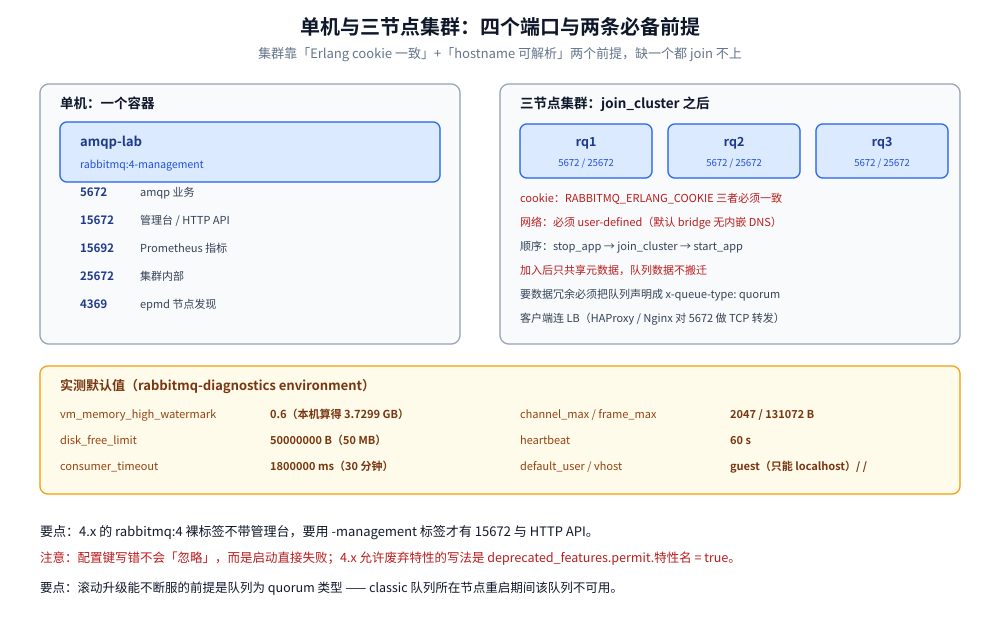

# 部署与配置

> 覆盖单机 `docker run` 与 compose 的最小起法、四个监听端口与三个数据目录、必改配置项（附本机 `rabbitmq-diagnostics environment` 采到的默认值）、⭐ **三节点集群的完整组建命令与坑**、网络分区策略三选一、插件的安装方式与代价。
>
> 不覆盖：Quorum 队列的多数派故障实测见 [消息可靠性.md](消息可靠性.md) 第四节；告警与流控的排障见 [运维与排障.md](运维与排障.md) 第二节；队列类型选型见 [队列类型与消息模式.md](队列类型与消息模式.md) 第一节。
>
> 内容整理自个人学习笔记；配置项语义参考 RabbitMQ 官方文档（4.x）。本篇端口、默认值、集群命令均来自本机 `rabbitmq:4-management`（**4.3.6**）实测。

---

## 一、单机怎么起？

**本节要点**：单机只需要一个容器 + 一个 user-defined 网络。⚠️ **管理插件要选 `-management` 标签**，`rabbitmq:4` 裸标签不带管理台。

```bash
# 1) 建一个 user-defined 网络：集群要靠它做名字解析
docker network create --subnet 10.77.0.0/24 --gateway 10.77.0.1 amqp-lab-net

# 2) 单机（管理台 + Prometheus 插件都在 -management 标签里）
docker run -d --name amqp-lab \
  --network amqp-lab-net --hostname amqp-lab \
  -v $PWD/conf:/etc/rabbitmq/conf.d \
  -e RABBITMQ_DEFAULT_USER=admin \
  -e RABBITMQ_DEFAULT_PASS=labpass123 \
  -p 5672:5672 -p 15672:15672 \
  rabbitmq:4-management
```

```yaml
# docker-compose.yml —— 生产需在此基础上加固
services:
  rabbitmq:
    image: rabbitmq:4-management
    container_name: rabbitmq
    hostname: rabbitmq                 # ⚠️ 集群时 hostname 必须可解析且唯一
    ports:
      - "5672:5672"                    # AMQP 协议端口（应用连接）
      - "15672:15672"                  # 管理控制台
    environment:
      RABBITMQ_DEFAULT_USER: admin     # ⚠️ 生产必须改掉默认 guest
      RABBITMQ_DEFAULT_PASS: ${RABBITMQ_PASSWORD}
      RABBITMQ_DEFAULT_VHOST: /prod
    volumes:
      - rabbitmq_data:/var/lib/rabbitmq          # 持久化数据目录
      - ./conf:/etc/rabbitmq/conf.d              # 配置片段目录
    healthcheck:
      test: ["CMD", "rabbitmq-diagnostics", "-q", "ping"]
      interval: 30s
      timeout: 10s
      retries: 3
    restart: unless-stopped

volumes:
  rabbitmq_data:
```

> ⚠️ **`guest` 只能从 localhost 登录**：容器里跑起来后，用宿主 IP 连管理台会报 `ACCESS_REFUSED`。生产必须建专用账号并按 vhost 授权：
>
> ```bash
> docker exec rabbitmq rabbitmqctl add_user admin "$RABBITMQ_PASSWORD"
> docker exec rabbitmq rabbitmqctl set_permissions -p /prod admin ".*" ".*" ".*"
> docker exec rabbitmq rabbitmqctl set_user_tags admin administrator
> docker exec rabbitmq rabbitmqctl delete_user guest
> ```

## 二、四个端口与三个目录

**本节要点**：四个端口各有用途，其中 **4369 是 Erlang 的端口映射守护进程（epmd）**，集群里最容易被防火墙漏掉的就是它。



本机跑 `rabbitmq-diagnostics listeners` 得到的实测端口清单如下，四个端口缺一个就连不上或组不了集群：

| 端口 | 协议 | 用途 |
| --- | --- | --- |
| **5672** | `amqp` | AMQP 0-9-1 与 AMQP 1.0 业务端口 |
| **15672** | `http` | 管理台与 HTTP API（`-management` 标签默认启用） |
| **15692** | `http/prometheus` | Prometheus 指标导出（4.x 默认启用） |
| **25672** | `clustering` | 节点间通信与 CLI 工具 |
| **4369** | `epmd` | Erlang Port Mapper，**节点互相发现的前提**，不在 listeners 列表里 |

| 目录 | 内容 |
| --- | --- |
| `/var/lib/rabbitmq` | 数据、mnesia（元数据）、消息存储 —— **必须挂卷** |
| `/etc/rabbitmq/conf.d` | 配置片段目录，`*.conf` 按文件名顺序加载 |
| `/opt/rabbitmq/plugins` | 插件目录；社区插件（如延迟插件）要放这里 |

## 三、必改的配置项

**本节要点**：默认值是「能跑起来」不是「能上生产」。下面六项里，前三项决定稳定性，后三项决定可观测性与安全。

本机实测默认值（`rabbitmq-diagnostics environment`）：

| 配置键 | 实测默认值 | 该不该改 | 说明 |
| --- | --- | --- | --- |
| `vm_memory_high_watermark` | **0.6** | ⭐ 改 | 内存超阈值触发 **blocking**（不是 OOM kill）；本机 8 GB 机器算出 **3.7299 GB** |
| `disk_free_limit` | **50000000**（50 MB） | ⭐ 改 | 磁盘剩余低于它触发告警并阻塞发布；建议不低于磁盘的 5% |
| `consumer_timeout` | **1800000**（30 分钟） | 长任务要改 | 超时不 ack 会被强制断 Channel，见 [消费者与投递语义.md](消费者与投递语义.md) 第六节 |
| `channel_max` | **2047** | 一般不改 | 单连接最大 Channel 数 |
| `frame_max` | **131072**（128 KiB） | 一般不改 | 单帧上限，大消息自动切帧 |
| `heartbeat` | **60**（秒） | 跨公网时调小 | 双向心跳，`heartbeat_interval` = 100 ms |
| `default_user` | `guest` | ⭐ 必改 | 只能从 localhost 登录 |
| `default_vhost` | `/` | ⭐ 建议改 | 按环境/租户分 vhost |

```ini
# conf.d/99-production.conf —— 生产基线
vm_memory_high_watermark.relative = 0.6
disk_free_limit.absolute = 5GB

# 内存告警时的行为：默认 block（阻塞发布），也可设为 credit_flow
vm_memory_high_watermark_paging_ratio = 0.5     # 到水位一半就开始把消息换出到磁盘

# 集群
cluster_partition_handling = pause_minority
cluster_formation.peer_discovery_backend = rabbit_peer_discovery_classic_config
```

> ⚠️ **配置键写错不会「忽略」，而是启动直接失败**。本轮实测踩到的原文：
>
> ```text
> You've tried to set deprecated_features_permitted, but there is no setting with that name.
>   Did you mean one of these?
>     deprecated_features.permit.$name
> ```
>
> 4.x 里允许「已废弃特性」的写法是 **`deprecated_features.permit.<特性名> = true`**（带点号的路径式键），不是下划线式的 `deprecated_features_permitted`。这个错误的代价是容器反复重启，日志里只有 `failed_to_prepare_configuration`。

## 四、三节点集群怎么组？

**本节要点**：集群靠 **Erlang cookie 一致 + hostname 可解析** 两个前提；组建顺序是「先起三个独立节点，再 `stop_app` → `join_cluster` → `start_app`」。⚠️ 数据**不会**因为加入集群而迁移。

```bash
# 1) 三个节点，同一 cookie、同一网络、各自唯一 hostname
for n in rq1 rq2 rq3; do
  docker run -d --name $n --hostname $n --network amqp-lab-net \
    -e RABBITMQ_ERLANG_COOKIE=LABCOOKIE \
    -e RABBITMQ_DEFAULT_USER=admin -e RABBITMQ_DEFAULT_PASS=labpass123 \
    rabbitmq:4-management
done

# 2) 等每个节点 own 起来
for n in rq1 rq2 rq3; do
  until docker exec $n rabbitmq-diagnostics -q ping >/dev/null 2>&1; do sleep 2; done
done

# 3) rq2 / rq3 加入 rq1（⭐ 必须先 stop_app，否则报 node is running）
for n in rq2 rq3; do
  docker exec $n rabbitmqctl stop_app
  docker exec $n rabbitmqctl join_cluster rabbit@rq1
  docker exec $n rabbitmqctl start_app
done

# 4) 验证：三个都在 Running Nodes 里
docker exec rq1 rabbitmqctl cluster_status
```

本机实测的 `cluster_status` 结果：

```text
Running Nodes

rabbit@rq1
rabbit@rq2
rabbit@rq3
```

**四个容易踩的坑**：

| 坑 | 现象 | 原因 / 解法 |
| --- | --- | --- |
| **cookie 不一致** | `join_cluster` 报 `unable to connect to epmd` 或认证失败 | 三个节点的 `RABBITMQ_ERLANG_COOKIE` 必须完全相同（或共用 `/var/lib/rabbitmq/.erlang.cookie` 卷） |
| **hostname 解析不了** | 同上，或加入成功但节点反复掉线 | ⚠️ 必须用 **user-defined 网络**（默认 `bridge` 网络不能按容器名解析）；`--hostname` 要与容器名一致 |
| **忘了 `stop_app`** | `join_cluster` 报 `node is running` | 先 `rabbitmqctl stop_app`，join 完再 `start_app` |
| **以为加节点会搬数据** | 新节点上队列是空的，老队列仍只在原节点 | classic 队列**不会**自动复制；要复制必须把队列声明成 `x-queue-type: quorum`（见 [队列类型与消息模式.md](队列类型与消息模式.md) 第一节） |

**接入方式**：客户端应连**负载均衡器**（HAProxy / Nginx / 云 LB 对 5672 做 TCP 转发），而不是固定节点。⚠️ 但 LB 只分摊**连接**，不解决「队列数据在哪个节点」——只有 quorum 队列才能故障切换。

## 五、网络分区三选一

`cluster_partition_handling` 必须在三种策略里明确选一个，默认值（`ignore`）在生产上等于「等人工介入」。

| 策略 | 行为 | 适用 |
| --- | --- | --- |
| `pause_minority` ⭐ | 少数派节点**自我暂停**，通信恢复后再加入 | 推荐：优先保数据一致 |
| `autoheal` | 分区恢复后选一个「获胜」分区，**丢弃其他分区的状态** | 更看重可用性、可接受丢数据 |
| `ignore` | 不做处理，等人工 | 极少数明确知道自己在做什么的场景 |

> ⚠️ `pause_minority` 要求集群节点数为**奇数**且 ≥3，否则「少数派」的判定没有意义（2 节点分区后两边各 1 票，都认为自己该暂停）。

## 六、插件：延迟插件的装法与代价

```bash
# 官方镜像自带插件：列出来（management / prometheus 默认已启用）
rabbitmq-plugins list -e

# 社区插件（如延迟插件）官方镜像「不内置」，enable 会静默无效
rabbitmq-plugins enable rabbitmq_delayed_message_exchange
```

> ⚠️ **本机实测**：`rabbitmq:4-management`（4.3.6）的 `/opt/rabbitmq/plugins` 里**没有** `rabbitmq_delayed_message_exchange`，上面那条 `enable` 返回 `Plugin configuration unchanged.` 且不报错（正是「静默无效」）。要装必须：
>
> ```bash
> # 1) 下载对应版本的 ez 文件（版本必须与 Broker 主次版本兼容）
> # 2) 挂载进容器
> docker run -v $PWD/plugins/rabbitmq_delayed_message_exchange-*.ez:/opt/rabbitmq/plugins/ ...
> # 3) 再 enable 并重启
> ```
>
> 本轮网络受限未下载，插件路径**未实测**；延迟队列的两条路线对照见 [队列类型与消息模式.md](队列类型与消息模式.md) 第三节。

## 七、具体使用

### 7.1 常用运维命令速查

```bash
# 版本与节点信息
rabbitmqctl version
rabbitmqctl status | head -30

# 用户与权限（权限是 配置/写/读 三个正则）
rabbitmqctl add_user app 'Str0ng_Pass'
rabbitmqctl set_permissions -p /prod app "^order\..*" "^order\..*" "^order\..*"
rabbitmqctl list_permissions -p /prod

# vhost
rabbitmqctl add_vhost /prod
rabbitmqctl list_vhosts

# 队列与消费者
rabbitmqctl list_queues name type state messages messages_ready messages_unacknowledged consumers
rabbitmqctl list_consumers queue_name consumer_tag prefetch_count ack_required

# 队列操作
rabbitmqctl purge_queue order.queue      # ⚠️ 清空（不可恢复）
rabbitmqctl delete_queue order.queue

# 集群
rabbitmqctl cluster_status
rabbitmq-queues quorum_status order.quorum

# 告警与水位
rabbitmq-diagnostics alarms
rabbitmq-diagnostics environment | grep -E "vm_memory|disk_free|channel_max"
```

### 7.2 运行时改水位（不重启）

```bash
# 磁盘水位：立刻生效（本轮用它人为触发告警做实验）
rabbitmqctl set_disk_free_limit 50MB

# 内存水位：按相对值或绝对值
rabbitmqctl set_vm_memory_high_watermark 0.6
rabbitmqctl set_vm_memory_high_watermark absolute 2GB
```

> ⚠️ **运行时改的不一定都生效**：`set_disk_free_limit` / `set_vm_memory_high_watermark` 是运行时命令，立即生效；但**刷盘方式这类「决定用哪个实现类」的配置必须写进 `conf.d` 并重启**——运行时改配置值只改数字，不换实现。

## 延伸追问

- **为什么集群必须用 user-defined 网络？** 默认 `bridge` 网络没有内嵌 DNS，容器之间无法按容器名解析；而 Erlang 分布式靠 hostname 建连（`rabbit@hostname`），解析不了就 join 不上。
- **节点加入集群后，之前的数据会同步过去吗？** 不会。集群只共享**元数据**（Exchange / Queue / Binding / 用户 / vhost），队列数据留在创建它的节点上；要数据冗余必须用 quorum 队列。
- **`vm_memory_high_watermark` 到了会 OOM 吗？** 不会。RabbitMQ 触发的是 **blocking**：阻塞所有发布连接（消费者照常工作），同时把消息换页到磁盘。这比 OOM kill 温和，但会让上游超时——见 [运维与排障.md](运维与排障.md) 第二节。
- **`disk_free_limit` 设多大合适？** 至少「磁盘总量 5%」与「50 MB」取大者。它要留够空间做**消息换页与合并**：磁盘真的满了，Broker 连自己的元数据都写不下去。
- **滚动升级能不能不断服？** 能，但要按顺序：先停一个节点 → 升级 → 启动并等它同步 → 再下一个。⚠️ 前提是**队列是 quorum 类型**；classic 队列所在节点重启期间该队列不可用。

## 关联

- **上游/总纲**：[README.md](README.md) — 本目录的定位、实测坐标与环境复现说明
- **上游/总纲**：[核心概念与架构.md](核心概念与架构.md) — Connection / Channel / vhost 的语义决定了配置项的落点
- **下游机制**：[运维与排障.md](运维与排障.md) — 水位、告警与 blocking 的排障路径
- **下游机制**：[消息可靠性.md](消息可靠性.md) — quorum 队列的多副本要求与集群规模的关系
- **对照/互补**：[部署与配置.md](../RocketMQ/部署与配置.md) — NameServer + Broker 的部署形态与 `broker.conf` 关键项
- **对照/互补**：[部署与配置.md](../Kafka/部署与配置.md) — KRaft 三节点的最小参数与本文 `join_cluster` 的差异
