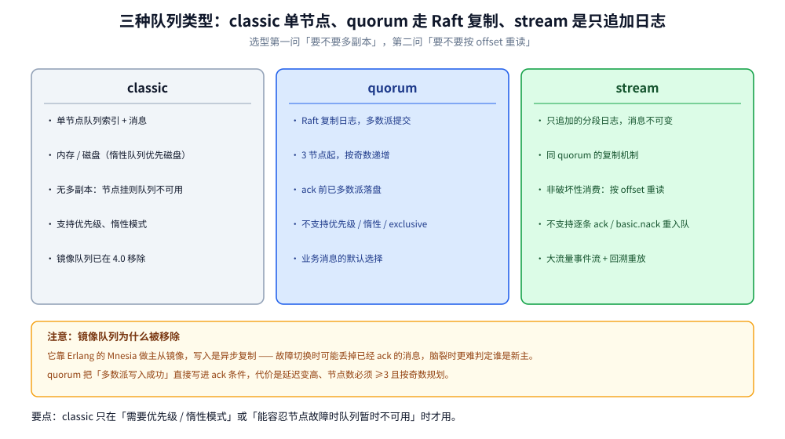
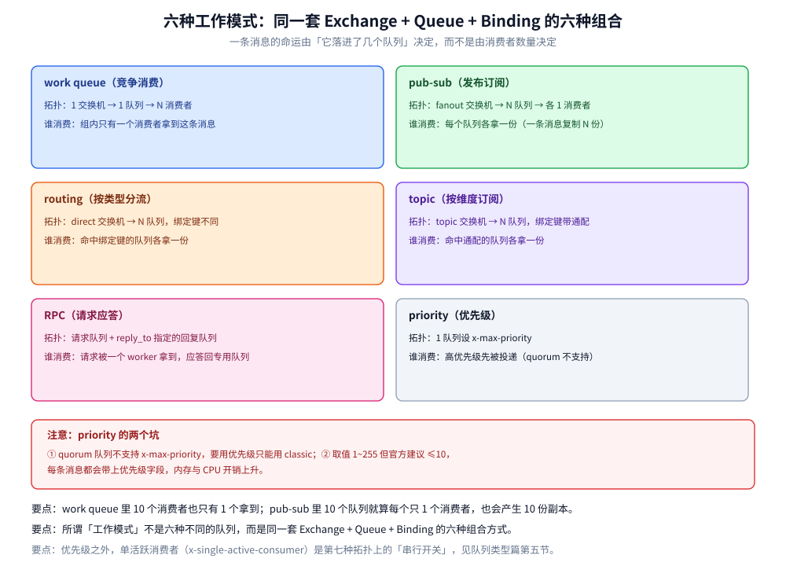
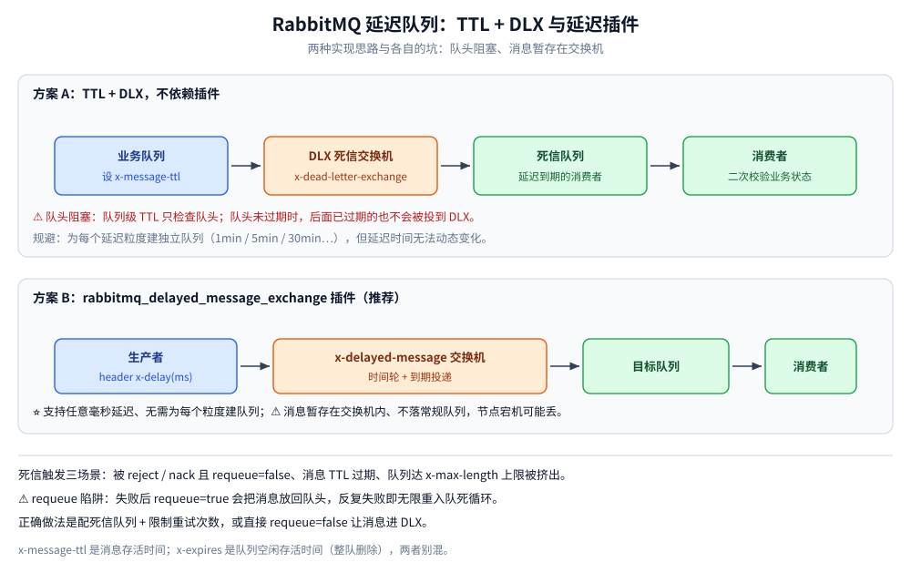

# 队列类型与消息模式

> 覆盖 classic / quorum / stream 三种队列类型在存储与复制上的差别、六种工作模式（work queue / pub-sub / routing / topic / RPC / priority）在拓扑上怎么区分、⭐ **延迟消息为什么在 RabbitMQ 里只能是「TTL + DLX 拼出来」**（含队头阻塞实测：1 秒 TTL 的消息等了 6.0 秒）、DLX 的三种触发场景、优先级与单活跃消费者的适用边界。
>
> 不覆盖：交换机路由的判定规则与投递矩阵见 [核心概念与架构.md](核心概念与架构.md) 第三节；Confirm × 持久化 × ack 的三段责任见 [消息可靠性.md](消息可靠性.md)；Quorum 队列的多数派故障实测见 [消息可靠性.md](消息可靠性.md) 第四节。
>
> 内容整理自个人学习笔记；队列类型与 DLX 的参数语义参考 RabbitMQ 官方文档（4.x）。本篇 TTL 时序来自本机 `rabbitmq:4-management`（4.3.6）实测，跑两遍 `diff` 逐行一致。

---

## 一、三种队列类型分别解决什么？

**本节要点**：三种队列类型不是「新旧关系」而是**三种存储模型**——classic 是单节点内存 + 磁盘索引，quorum 是多副本 Raft 复制日志，stream 是不可变的追加日志（可重读）。选型的第一问是「数据要不要多副本」，第二问是「要不要重读」。



| 维度 | **classic** | **quorum** ⭐ | **stream** |
| --- | --- | --- | --- |
| 存储形态 | 单节点队列索引 + 消息（内存 / 磁盘，惰性队列优先磁盘） | ⭐ **Raft 复制日志**，多数派确认才算写入 | ⭐ **只追加的分段日志**，消息不可变 |
| 多副本 | ❌ 无（镜像队列已在 **4.0 移除**） | ✅ 3 节点起，多数派 | ✅ 同 quorum 的复制机制 |
| 消费语义 | ack 即删除 | ack 即删除 | **非破坏性**：按 offset 重读，可多消费者各读一份 |
| 主要限制 | 节点挂则队列不可用 | 不支持优先级 / 惰性模式 / exclusive；要求奇数节点 | 不支持逐条 ack、不支持 `basic.nack` 重入队 |
| 适用 | 短生命周期、可接受重建的业务消息 | **默认选它**：业务消息需要不丢 | 大流量事件流、需要回溯重放、多订阅者各读全量 |

> ⚠️ **4.x 的默认答案**：业务消息用 **quorum**；`classic` 只在「可以容忍节点故障时丢队列」或「需要优先级 / 惰性队列」时用；`stream` 用于替代「用 Kafka 做但不想上 Kafka」的场景。

**为什么 4.0 移除镜像队列？** 镜像队列靠 Erlang 的 Mnesia 做主从同步，写入是**异步复制**、故障切换时可能丢已 ack 的消息，脑裂时更难判定谁是新主。quorum 用 Raft 把「多数派写入成功」写进了 ack 条件，代价是延迟变高、节点数要求 ≥3。

## 二、六种工作模式在拓扑上怎么区分？

**本节要点**：所谓「工作模式」不是六种不同的队列，而是**同一套 Exchange + Queue + Binding 的六种组合方式**。看懂拓扑就看懂模式，记住「队列数」与「消费者数」两个维度即可。



| 模式 | 拓扑 | 一条消息被谁消费 | 用来解决 |
| --- | --- | --- | --- |
| **work queue**（竞争消费） | 1 交换机 → **1 队列** → N 消费者 | 组内**只有一个**消费者拿到 | 削峰、并行处理同一类任务 |
| **pub-sub**（发布订阅） | fanout 交换机 → **N 队列** → 各 1 消费者 | **每个队列各一份** | 广播、多系统各收一份 |
| **routing**（按类型分流） | direct 交换机 → N 队列，绑定键不同 | 命中绑定键的队列各一份 | 订单创建 / 支付 / 退款分流 |
| **topic**（按维度订阅） | topic 交换机 → N 队列，绑定键带通配 | 命中通配的队列各一份 | 「业务线 + 事件」组合订阅 |
| **RPC** | 请求队列 + `reply_to` 指定回复队列 + `correlation_id` 配对 | 请求被一个 worker 拿到，应答回专用队列 | 需要同步返回值的跨进程调用 |
| **priority**（优先级） | 1 队列设 `x-max-priority` | 高优先级先被投递 | 少量高优任务插队 |

> ⭐ **一条消息的命运由「它落进了几个队列」决定，而不是由消费者数量决定。** work queue 里 10 个消费者也只有 1 个拿到；pub-sub 里 10 个队列就算每个只有 1 个消费者，也会产生 10 份副本。

**优先级队列的两个坑**（`x-max-priority`，取值 1~255，**建议 ≤10**）：

- ⚠️ **quorum 队列不支持优先级**；要用优先级只能用 classic。
- ⚠️ 队列一旦声明了 `x-max-priority`，每条消息都会带上优先级字段，内存与 CPU 开销上升；官方建议「只在真有的排期需求时开」。

### 2.1 场景落到「队列类型 + 模式」的对应表

把上面两张表（队列类型、工作模式）合起来看，同一批场景各自该选什么：

| 场景 | 队列类型 | 模式 | 为什么 |
| --- | --- | --- | --- |
| 订单事件按类型分流 | quorum | routing | 需要不丢，事件类型固定可枚举 |
| 缓存刷新广播 | classic 或 quorum | pub-sub | 每条消息复制进多个队列，各系统独立消费 |
| 图片缩略图生成 | quorum | work queue | 任务同质，靠加消费者扩容 |
| 30 分钟未支付关单 | quorum | TTL + DLX 或延迟插件 | 见第三节；粒度少时 TTL 够用 |
| 大流量埋点事件、需要回溯 | **stream** | 按 offset 重读 | 消费即删满足不了「重放」 |
| 少量 VIP 任务插队 | **classic** | priority | quorum 不支持优先级 |

> ⭐ 这张表里最容易踩的两行是最后两行：**要回溯就得换队列类型（stream），要优先级就得换回 classic**——它们都不是加个参数能解决的，声明时就定死了。

## 三、延迟消息为什么在 RabbitMQ 里是「拼出来」的？

**本节要点**：RabbitMQ **没有原生的延迟投递**（不像 RocketMQ 把延迟做进了 Broker）。两条路：TTL + DLX（不装插件，但有**队头阻塞**），或 `rabbitmq_delayed_message_exchange` 插件（任意延迟，但消息暂存在交换机里）。



两条路线各有代价：TTL + DLX 不用装插件，但同队列里延迟不同的消息会互相堵住；延迟插件支持任意延迟，代价是消息暂存在交换机侧而不落到队列里。

### 3.1 方案 A：TTL + DLX

思路：给业务队列设 TTL，消息过期后自动转投死信交换机 → 死信队列，死信队列的消费者就是「延迟到期后」的处理者。

```bash
# 队列级 TTL 6s，过期后转投死信队列 lab.ttl.dlq（默认交换机 + 队列名当路由键）
rabbitmqadmin declare queue name=lab.ttl durable=true \
  arguments='{"x-message-ttl":6000,"x-dead-letter-exchange":"","x-dead-letter-routing-key":"lab.ttl.dlq"}'
```

### 3.2 队头阻塞：实测 1 秒的消息等了 6 秒

**根因**：队列级 TTL **只在消息到达队头时才检查**。队头那条还没到期，后面即使早就过期也不会被转投。

实测配置：队列 `lab.ttl` 设 `x-message-ttl=6000`（6 秒），队内依次放 3 条——m1 不带 `expiration`（吃队列 TTL 6s），m2 / m3 各自带 `expiration=1000`（1 秒）。对照组 `lab.ttl.ctl` 队列无 TTL，只放 1 条 `expiration=1000`。

```text
t(s)     lab.ttl 堆积     lab.ttl.dlq 堆积   对照队列 lab.ttl.ctl
0.0      3              0                1
1.1      3              0                0
6.0      0              3                0
9.1      0              3                0
```

**三个读数**：

- **t=1.1s**：对照组那条 1 秒 TTL 的消息已经消失（0），但 `lab.ttl` 里 3 条一条没动——**m2 / m3 早就过期了，却还在队列里**。
- **t=6.0s**：m1 到期，三条**一起**被转投到死信队列（dlq 从 0 跳到 3）。
- **结论**：标着 1 秒 TTL 的消息实际等了 **6.0 秒**，误差不是「毫秒级不准」而是**整整 5 秒**，且误差大小取决于排在前面的消息还要躺多久。

**规避**：

| 做法 | 代价 |
| --- | --- |
| 为每个延迟粒度建独立队列（1min / 5min / 30min 各一条） | 粒度固定，延迟时间无法动态变化 |
| 只用**消息级** `expiration`（不设队列级 TTL） | ⚠️ 仍然只检查队头，只是队头换成了「最早那条」；要求消息必须**按过期时间递增入队** |
| 换延迟插件（方案 B） | 需装插件；消息暂存在交换机里，见下 |

### 3.3 方案 B：`rabbitmq_delayed_message_exchange` 插件

装好后可用类型为 `x-delayed-message` 的交换机，消息通过头 `x-delay`（毫秒）指定延迟，到期由交换机投递到目标队列。

```bash
rabbitmq-plugins enable rabbitmq_delayed_message_exchange
```

| 维度 | TTL + DLX | 延迟插件 |
| --- | --- | --- |
| 延迟精度 | 受队头阻塞影响，偏大且不可控 | 较高，接近设定值 |
| 任意延迟 | ❌ 需为每个粒度建队列 | ✅ 任意毫秒值 |
| 额外依赖 | 无（原生） | 需插件 + 重启 Broker |
| 消息存储 | 在队列里（有 DLX 兜底） | ⚠️ 暂存在**交换机**内，不落常规队列 |
| 适用 | 粒度少、体量小 | 需要任意延迟、可接受插件依赖 |

> ⚠️ **本机未实测插件**：`rabbitmq:4-management` 官方镜像**不内置**这个插件（`/opt/rabbitmq/plugins` 里没有，`rabbitmq-plugins enable` 静默无效），需自行下载 `ez` 文件挂载到插件目录。上表关于插件的两行按官方文档口径陈述。

## 四、DLX 到底什么时候触发？

**本节要点**：死信不是「消费失败」的同义词，它有**三个**触发条件，其中两个与消费者无关。

| 触发场景 | 条件 | 说明 |
| --- | --- | --- |
| **被 reject / nack 且 `requeue=false`** | 消费者明确拒绝 | 前提是队列声明了 `x-dead-letter-exchange` |
| **消息 TTL 过期** | 消息级 `expiration` 或队列级 `x-message-ttl` 到期 | 到期是**在队头**被判定（见上节） |
| **队列达到长度上限** | `x-max-length` / `x-max-length-bytes` 触发，**队头**消息被挤出 | X-Overflow 策略决定是丢头还是拒新 |

```go
// 声明一个带死信目标的队列（Go / amqp091-go）
args := amqp.Table{
	"x-dead-letter-exchange":    "dlx.exchange", // 死信交换机
	"x-dead-letter-routing-key": "dlx.routing",  // 可选：改写路由键
	"x-message-ttl":             int32(60_000),  // 可选：消息存活时间（毫秒）
	"x-max-length":              int32(100000),  // 可选：队列最大条数
}
_, err := ch.QueueDeclare("biz.queue", true, false, false, false, args)
```

> ⚠️ **`x-message-ttl` 与 `x-expires` 别混**：前者是**消息**存活时间；后者是**队列**空闲存活时间（队列无消费者且未被访问达到时间就整队删除）。两者写错一个，线上表现完全不同——前者消息消失，后者队列消失。

> ⚠️ **死信链路无环**：`x-dead-letter-exchange` 指向的队列如果也配了死信目标，可能形成回环把消息来回转。设计时让死信队列**不再配 DLX**，或指向一个只做归档的终点队列。

## 五、优先级、单活跃消费者、惰性队列各在什么时候开？

| 特性 | 参数 | 什么时候开 | 代价 |
| --- | --- | --- | --- |
| **优先级** | `x-max-priority`（1~255，建议 ≤10） | 少量高优任务需要插队 | quorum 不支持；每条消息带优先级字段，开销上升 |
| **单活跃消费者** | `x-single-active-consumer` | 一组消费者里**只要一个在工作**（避免顺序被打乱） | 其余消费者纯待命，故障切换需等重新选主 |
| **惰性模式** | `x-queue-mode: lazy` | 大堆积、消息在队列里躺很久 | ⚠️ quorum 不支持；4.x 中 classic 的默认行为已偏向磁盘，收益变小 |
| **队列长度上限** | `x-max-length` / `x-max-length-bytes` | 防无限堆积打爆磁盘 | 超限会**丢队头消息**（进 DLX）或拒绝新消息，取决于 `x-overflow` |

> ⭐ **单活跃消费者不是「消费组」**：它保证的是**组内只有一个消费者在收**，用于「必须严格串行处理同一队列」的场景。要并行就用普通竞争消费，要顺序就按业务键分队列。

## 六、具体使用

### 6.1 声明三种队列类型

```go
// classic：默认，不写 x-queue-type
_, err := ch.QueueDeclare("q.classic", true, false, false, false, nil)

// quorum：必须 durable=true，且队列不能被 exclusive
_, err = ch.QueueDeclare("q.quorum", true, false, false, false, amqp.Table{
	"x-queue-type": "quorum",
})

// stream：也是队列类型，但消费语义是「按 offset 读」
_, err = ch.QueueDeclare("q.stream", true, false, false, false, amqp.Table{
	"x-queue-type":               "stream",
	"x-max-age":                  "7D",  // 日志保留时长
	"x-stream-max-segment-size-bytes": 500_000_000,
})
```

### 6.2 延迟消息的两种写法

```java
// 方案 A：TTL + DLX —— 注意队列级 TTL 会有队头阻塞
Map<String, Object> args = new HashMap<>();
args.put("x-dead-letter-exchange", "dlx.exchange");
args.put("x-dead-letter-routing-key", "order.timeout");
args.put("x-message-ttl", 1800_000);            // 30 分钟
channel.queueDeclare("order.delay.30m", true, false, false, args);

// 方案 A 的变体：只给消息设 expiration，要求按过期时间递增入队
AMQP.BasicProperties props = new AMQP.BasicProperties.Builder()
        .expiration("1800000")                   // 毫秒，字符串形式
        .deliveryMode(2)
        .build();
channel.basicPublish("", "order.delay", props, body);

// 方案 B：延迟插件 —— 交换机类型是 x-delayed-message，延迟放在消息头
Map<String, Object> exArgs = new HashMap<>();
exArgs.put("x-delayed-type", "direct");          // 底层按 direct 路由
channel.exchangeDeclare("delay.exchange", "x-delayed-message", true, false, exArgs);
AMQP.BasicProperties delay = new AMQP.BasicProperties.Builder()
        .headers(Map.of("x-delay", 1800_000))    // 毫秒
        .deliveryMode(2)
        .build();
channel.basicPublish("delay.exchange", "order.timeout", delay, body);
```

### 6.3 查看队列类型与死信落点

```bash
# 队列类型与状态（state 列的坑见运维篇）
rabbitmqctl list_queues name type state messages

# quorum 队列的 Raft 成员与提交位点
rabbitmq-queues quorum_status lab.quorum

# 死信队列的堆积：DLX 生效时会看到它涨
rabbitmqctl list_queues name messages | grep dlq
```

## 延伸追问

- **为什么 TTL + DLX 会有队头阻塞，而延迟插件没有？** TTL 的检查发生在**队列进程的出队路径**上——只有消息到了队头才被判过期；插件则把消息存在交换机内部的一张按到期时间排序的结构里，到期才投递，不依赖队头位置。
- **quorum 队列为什么不支持优先级和惰性模式？** 它的存储是 Raft 复制的追加日志，「按优先级取」需要在日志之上再维护有序索引，而日志本身的顺序是复制的共识顺序；惰性模式对「日志本来就在磁盘」的 quorum 而言没有意义。
- **stream 和 Kafka 的差别在哪？** 都是追加日志，但 stream 建在 AMQP 之上（要遵守 AMQP 的队列语义），订阅模型只有「一个消费者组按 offset 读 + 可选的多组」，没有 Kafka 的分区再平衡与 compact 策略；见 [README.md](../Kafka/README.md)。
- **`x-max-length` 超限时丢头还是拒新？** 由 `x-overflow` 决定：`drop-head`（默认，丢队头并进 DLX）、`reject-publish`（拒绝新消息，配合 Confirm 会收到 nack）、`reject-publish-dlx`（拒绝并转投 DLX）。
- **能不能用「每用户一个延迟队列」实现个性化延迟？** 可以但不推荐：队列数是 Erlang 进程数，每个队列都是独立进程，几千个用户就是几千个进程；正确做法是延迟插件 + 按到期时间排序，或把「到期时间」写进业务表由定时任务扫。

## 关联

- **上游/总纲**：[核心概念与架构.md](核心概念与架构.md) — 交换机与绑定的路由规则是本节所有参数的作用面
- **上游/总纲**：[README.md](README.md) — 本目录的定位与实测坐标
- **下游机制**：[消息可靠性.md](消息可靠性.md) — quorum 队列的多数派写入与少数派故障实测
- **下游机制**：[消费者与投递语义.md](消费者与投递语义.md) — 死信之后谁来接：消费侧的 ack / nack / requeue
- **下游机制**：[运维与排障.md](运维与排障.md) — 延迟队列积压与死信暴涨怎么查
- **对照/互补**：[消息类型与语义.md](../RocketMQ/消息类型与语义.md) — RocketMQ 把延迟与事务做进了 Broker，对比「拼出来」的代价
- **对照/互补**：[README.md](../Pulsar/README.md) — 订阅类型与 retained 消息：另一种「可重读」的实现
