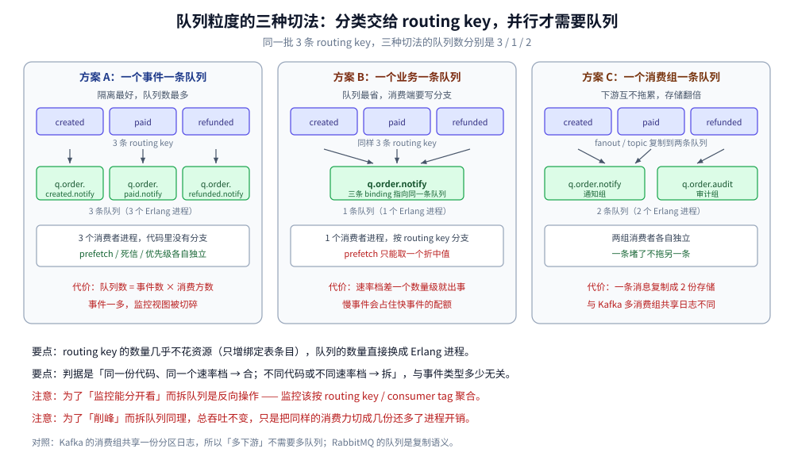
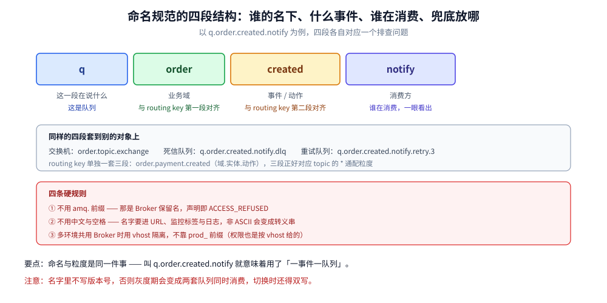

# 队列粒度与命名设计

> 覆盖 ⭐ **「一个事件一个队列」与「一个业务一个队列」的取舍判据**、RabbitMQ 里 `topic` 为什么**不是**消息分类容器（它只是一种交换机类型）、队列数的真实资源代价（Erlang 进程 / 内存 / 磁盘文件），以及 exchange / queue / routing key / 死信队列的命名规范。
>
> 不覆盖：交换机路由的判定规则见 [核心概念与架构.md](核心概念与架构.md) 第三节；一个队列为什么是串行的、落盘碰哪些文件见 [存储与投递过程.md](存储与投递过程.md)；prefetch 的分档建议见 [消费者与投递语义.md](消费者与投递语义.md) 第二节；多产品选型见 [消息队列选型对比.md](../消息队列选型对比.md)。
>
> 内容整理自个人学习笔记；「队列数代价」读数来自本机 `rabbitmq:4-management`（**4.3.6**）单机容器 `amqp-lab`，用 Python 标准库手写 AMQP 帧声明队列并各投 1 条消息。两遍读数的**进程数与目录数完全一致**，内存只取量级（原因见第三节的读数对齐说明）。命名规范部分以本仓 Go/Java 接入手册的用法为准。

---

## 一、RabbitMQ 里的 `topic` 到底是什么？

**本节要点**：`topic` 在 RabbitMQ 里是**四种交换机类型之一**，不是消息的分类容器。消息的「分类」落在 **routing key** 上，而 routing key 与队列的关系由 **binding** 决定。所以「一个事件一个 topic」这句话在 RabbitMQ 里不能直译，必须先翻译成「一个事件一个队列 / 还是一组事件共用一个队列」。

这个前提不先纠正，后面所有讨论都会错位：

| 概念 | Kafka / RocketMQ | RabbitMQ |
| --- | --- | --- |
| 消息的一级分类容器 | **Topic**（分区 / 队列是它的子单位） | **Exchange + routing key**（队列不是分类，是订阅） |
| 消费者怎么拿到消息 | 订阅 Topic（+ Tag），位点自己管 | 队列被 binding 到交换机，**队列决定谁消费** |
| 同一个「主题」能被几组人独立消费 | 多个消费组各自维护位点 | 要几条队列（fanout / topic 各绑一条） |
| 「topic」这个词指什么 | 分类容器 | **一种按 `.` 分词做通配匹配的交换机类型** |

> ⭐ 一句话记忆：**Kafka 的 topic 是「数据放在哪」，RabbitMQ 的 routing key 是「这条消息该去谁那儿」。前者是存储分区，后者是路由标签。**

**为什么这个区别会直接影响粒度设计？** 因为在 RabbitMQ 里**加一个消费者往往意味着加一条队列**（除非用同一个队列做竞争消费）。队列是「消费单位」，topic 交换机只是「匹配规则」。所以问题不是「要不要一个事件一个 topic」，而是：

- 要不要「一个事件一条队列」→ 决定**队列数**与**进程数**；
- 要不要「一个事件一个 routing key」→ 只决定**绑定表条目**，几乎不花资源。

**后者的成本远低于前者**，这是本篇最重要的一条成本差异。

## 二、一个事件一条队列，还是一个业务一条队列？

**本节要点**：队列是**并行单位 + 故障隔离单位**，不是分类单位。分类交给 routing key，并行才需要队列。所以判断标准不是「事件类型多不多」，而是「**消费方是不是同一份代码、同一个速率档**」。



三种典型切法：

| 切法 | 拓扑 | 队列数 | 优点 | 代价 |
| --- | --- | --- | --- | --- |
| **A 一个事件类型一条队列** | `order.created` → `q.order.created`；`order.paid` → `q.order.paid` | 事件数 × 消费方数 | 消费者职责单一，prefetch、死信、优先级各自独立 | 队列数增长最快，运维视图被切得很碎 |
| **B 一个业务域一条队列** | `order.*` → `q.order`（三条 routing key 绑同一队列） | 业务域数 × 消费方数 | 队列少、进程少、监控好聚合 | 消费端必须按 routing key 过滤，`prefetch` 只能取一个折中值 |
| **C 一个消费组一条队列** | 同一批 routing key 绑到 `q.order.notify`、`q.order.audit` 两条队列 | 事件数 × 消费方数（同 A，但按消费方分组） | 不同下游互不影响，一条堵了不拖另一条 | 生产者侧的多播由 fanout / topic 复制，存储按队列数翻倍 |

**A 与 B 的真实取舍点**是「消费端要不要写分支」：

```text
方案 A：3 个消费者进程，每个只处理一种事件，代码里没有 switch
方案 B：1 个消费者进程，代码里按 routing key 分三种处理分支
```

**只要有一个事件的消费速率是另一个的 10 倍，B 就会变成事故**：`prefetch` 是队列级配额，快事件的消费者会被慢事件拖住（一条慢消息占住配额，快消息排在后面等）。这时必须回到 A。

> ⭐ **判据一句话**：**同一份代码、同一个速率档 → 合；不同代码或不同速率档 → 拆。** 与「事件类型多不多」无关。

**还有一个容易被忽略的维度：存储放大**。方案 C 里一条消息被复制进 N 条队列，就是 N 份存储（惰性队列下也在磁盘上 N 份）。所以「多消费组」在 RabbitMQ 里不是免费的——这一点与 Kafka「多消费组共享一份日志」本质不同。

## 三、队列数到底贵在哪？

**本节要点**：贵在**每个队列都是一个独立的 Erlang 进程**。这个进程串行处理入队、出队、ack 记账、过期扫描、段回收。队列数一多，调度器要管理的进程数线性上升，而每个队列的吞吐并不会因此变快。

本机实测（声明 N 个 durable 队列，每个队列投 1 条 7 字节消息，声明完 `sleep 2` 再取读数）：

| 本轮新增 | 累计队列数 | Erlang 进程增量 | 总内存增量 | 队列存储目录增量 |
| --- | --- | --- | --- | --- |
| 10 | 10 | **+20** | +207312 B | +10 |
| 100 | 110 | **+220** | +3385504 B | +110 |
| 500 | 610 | **+1220** | +23828992 B | +610 |

三个读数的结论：

> 📏 **两遍读数对齐情况**：进程增量 `20 / 220 / 1220` 与目录增量 `10 / 110 / 610` **两遍完全一致**；内存增量第二遍是 `903768 / 7952120 / 24385768` B——第三轮相差 2%，前两轮因基线 GC 状态不同波动到 2~4 倍。**只有进程数与目录数能当判据，内存只能取量级。**

- ⭐ **每个队列固定 2 个 Erlang 进程**：`20 / 10 = 2.0`、`220 / 110 = 2.0`、`1220 / 610 = 2.0`，三轮两遍都一致。这不是巧合，而是「队列进程 + 其配套进程（索引/统计）」的结构决定的。
- **内存是「每个队列几十 KB」的量级，但不能按「乘一下」估**：两遍的每队列内存从 20 KB 到 90 KB 都出现过，取决于基线堆状态与 GC 时机。做容量规划时按「每队列 50 KB 起、留 2 倍余量」比按精确值乘更安全。
- **磁盘目录 1:1**：`queues/<hash>/` 一条队列一个目录，两遍都是严格的 1:1，与 [存储与投递过程.md](存储与投递过程.md) 第一节的落盘结构一致。

**这组数的分量**：600 条队列看着不多，但已经吃掉 1220 个 Erlang 进程。按官方「几千条队列量级」的上限推算，进程数会到万级——那时 Erlang 调度器的调度开销本身就会变成延迟的一部分。

> ⚠️ **上表是「空队列」的代价**。加消息后每个队列还有索引缓存与消息体占用（见 [存储与投递过程.md](存储与投递过程.md)），所以真实业务里「每队列几十 KB」是最低值，不是平均值。

**从这组数往下推，三条结论**：

- **进程数是硬上限，不是软约束**：Erlang 调度器能管理的进程数有上限，而队列数 × 2 就是进程数的下限。所以「每用户一个队列」「每订单一个延迟队列」这类设计在几千用户时就会撞墙，**不是性能问题，是可用性问题**。
- **quorum 队列更贵**：副本之间要跑 Raft，每条 quorum 队列的进程数高于 classic。同样是 600 条队列，全用 quorum 会比上表读数高出一截。
- **空队列不是零成本**：上表已经是最低值（每个队列只有 1 条 7 字节消息）。一旦有真实堆积，每个队列还要加索引缓存与消息体占用，内存按「队列数 × 平均堆积」双维增长。

> ⚠️ **官方对上限的口径是「几千条队列量级」**，实践中的分界线更依赖「每个队列的消费者数」与「平均消息大小」：队列多 + 消费者多 + 消息大，三者叠加才是压垮调度器的组合。

## 四、怎么判断该拆还是该合？

**本节要点**：把「拆队列」的动机分成四类，只有前三类必须拆，第四类应该用 routing key 解决。

| 动机 | 必须拆队列？ | 用什么解决 |
| --- | --- | --- |
| **消费逻辑不同**（不同下游、不同处理流程） | ✅ 拆 | 每个下游一条队列（fanout / topic 复制） |
| **速率档差一个数量级**（一个 10ms、一个 3s） | ✅ 拆 | 拆开后各自设 prefetch |
| **需要独立的死信 / 重试策略** | ✅ 拆 | 死信交换机按队列配，混在一起会互相污染 |
| **需要独立的优先级** | ✅ 拆 | `x-max-priority` 是队列级参数，且 quorum 不支持 |
| **只是事件类型不同，处理完全一样** | ❌ 不拆 | 用 routing key 区分，同一个队列多条 binding |
| **只是同一类任务要并行处理** | ❌ 不拆 | 同一个队列挂多个消费者（work queue 竞争消费） |

**一个常见的反向错误**：为了让「监控能分开看」而拆队列。监控的分组维度应该是 **routing key / consumer tag**，不是队列——用 `list_queues` 看 300 条队列远比看 3 条队列 + 按 routing key 聚合更难。

**另一个常见错误**：为「削峰」拆队列。削峰的容量来自**消费端并发 + prefetch**，拆队列只是把同样的消费能力切成几份，总吞吐不变，反而多了进程开销。真要提吞吐，先加消费者，再加队列。

## 五、命名怎么定才不出错？

**本节要点**：命名要能把「归属、类型、方向、兜底」四件事一眼读出来，并且**永远不要以 `amq.` 开头**（Broker 保留前缀，声明会报 `ACCESS_REFUSED`）。



推荐格式（与 routing key 的点分结构对齐）：

| 对象 | 格式 | 例子 | 为什么这么定 |
| --- | --- | --- | --- |
| **Exchange** | `<域>.<类型>.exchange` | `order.topic.exchange` | 一眼看出用哪种路由规则；同名不同型是排障时最常见的误判 |
| **Queue** | `q.<域>.<事件>.<消费方>` | `q.order.created.notify` | 前两段与 routing key 对齐，第三段说明**谁在消费** |
| **routing key** | `<域>.<实体>.<动作>` | `order.payment.created` | 三段正好对应 topic 的 `*` 通配粒度 |
| **死信队列** | `<队列名>.dlq` | `q.order.created.notify.dlq` | 与原队列成对出现，排障时能直接搜到 |
| **重试队列** | `<队列名>.retry.<n>` | `q.order.created.notify.retry.3` | 分级重试的层级写在名字里，不用查配置 |

**四条硬规则**：

- ⚠️ **不用 `amq.` 前缀**：`amq.direct` / `amq.topic` 这些是 Broker 预声明的保留名，自定义以 `amq.` 开头会报 `ACCESS_REFUSED`。
- ⚠️ **不用中文与空格**：队列名会进 HTTP API 的 URL、进监控指标标签、进日志。非 ASCII 名字在这些地方会变成转义串，检索时对不上。
- ⚠️ **不带环境前缀就别带**：`prod_order_q` 这种前缀在「一个环境一个 vhost」的部署下是冗余的；如果确实多环境共用一个 Broker，**应该用 vhost 隔离**而不是靠名字前缀——权限也是按 vhost 给的。
- ⚠️ **名字里不写版本号**：`q.order.v2` 会在灰度期变成两套队列同时消费，切换时还得双写。要换实现应该换消费者，不是换队列名。

> ⭐ **命名与粒度是同一件事的两面**：`q.order.created.notify` 这种名字本身就是「方案 A（一事件一队列）」的产物；如果实际用的是方案 B（一业务一队列），名字应该叫 `q.order.notify`，否则名字会骗人。

## 六、具体使用

### 6.1 方案 A：一个事件一条队列（topic 交换机）

```go
// 一条 routing key 一条队列，绑定键写成字面量而非通配
keys := []string{"order.created", "order.paid", "order.refunded"}
for _, k := range keys {
    q := "q." + k + ".notify"           // q.order.created.notify
    if _, err := ch.QueueDeclare(q, true, false, false, false, amqp.Table{
        "x-dead-letter-exchange": "dlx.exchange",
    }); err != nil {
        return err
    }
    if err := ch.QueueBind(q, k, "order.topic.exchange", false, nil); err != nil {
        return err
    }
}
```

### 6.2 方案 B：一个业务一条队列（多条绑定键共用一个队列）

```java
// 三条 routing key 绑到同一条队列：队列少，但消费端要按 routing key 分支
channel.queueDeclare("q.order.notify", true, false, false, null);
for (String key : new String[]{"order.created", "order.paid", "order.refunded"}) {
    channel.queueBind("q.order.notify", "order.topic.exchange", key);
}

// 消费端：routing key 从信封里拿，不要从消息体里猜
channel.basicConsume("q.order.notify", false, (tag, delivery) -> {
    switch (delivery.getEnvelope().getRoutingKey()) {
        case "order.created"  -> handleCreated(delivery);
        case "order.paid"     -> handlePaid(delivery);
        case "order.refunded" -> handleRefunded(delivery);
        default -> {}                      // 绑定表变了会走到这里，别静默吞掉
    }
    channel.basicAck(delivery.getEnvelope().getDeliveryTag(), false);
}, tag -> {});
```

### 6.3 数清一个 vhost 里到底有多少队列

```bash
# 按前缀聚合，一眼看出粒度设计有没有失控
rabbitmqctl list_queues name | awk -F. '/^q\./ {print $2}' | sort | uniq -c | sort -rn

# 每个队列的消费者数与堆积：消费者为 0 的队列是「僵尸队列」的第一嫌疑
rabbitmqctl list_queues name consumers messages messages_ready

# 队列总数（含系统队列）
rabbitmqctl list_queues name | wc -l
```

> ⚠️ **消费者数为 0 且堆积不动的队列**要么是废弃队列，要么是消费者挂了。前者应该删（`rabbitmqctl delete_queue`），后者是故障——先看 `list_consumers`，别直接删。

## 延伸追问

- **能不能用 `direct` 交换机代替 `topic`？** 能，只要绑定键都是字面量（方案 A 就是纯字面量）。`direct` 的路由是哈希查表，比 `topic` 的通配匹配快；只有在确实需要通配（`order.*.created`）时才用 `topic`。
- **一个队列挂 100 个消费者，和 10 条队列各挂 10 个消费者，哪个吞吐高？** 后者。因为单队列的处理是串行的（见 [存储与投递过程.md](存储与投递过程.md) 第四节），多队列才能并行；但队列数一多进程开销上升，所以有拐点，通常按「消费者数量级 / 队列数 ≈ 10」估。
- **延迟队列会放大队列数吗？** 会，而且是放大最狠的一类。TTL + DLX 的方案里「每个延迟档位一条队列」还算可控，一旦做成「每个订单一条延迟队列」就会撞进程上限——正确做法是延迟插件或「到期时间写表 + 定时扫描」。
- **多租户系统该按租户分队列吗？** 不该。租户数是不封顶的，队列数会跟着不封顶。应该按**业务域**分队列，租户 ID 放在消息头或 routing key 里，隔离靠消费端的租户上下文，不靠队列。
- **队列改名会丢消息吗？** 会。改名的本质是「建一条新队列 + 删旧队列」，旧队列里没消费完的消息随之消失。要平滑改名只能双写一段时间，等新队列的消费位点追上再删旧队列。

## 关联

- **上游/总纲**：[README.md](README.md) — 本目录的定位、阅读路线与实测坐标
- **上游/总纲**：[核心概念与架构.md](核心概念与架构.md) — 第三节的路由规则：routing key 与 binding 才是「分类」的落点
- **上游/总纲**：[存储与投递过程.md](存储与投递过程.md) — 一个队列一个进程、一个队列一套落盘文件，队列数代价的物理来源
- **下游机制**：[消费者与投递语义.md](消费者与投递语义.md) — 第二节 prefetch 分档：拆队列之后每个队列各自设配额
- **下游机制**：[消息可靠性.md](消息可靠性.md) — 独立死信与重试策略是「必须拆队列」的第四个理由
- **对照/互补**：[README.md](../RocketMQ/README.md) — Topic / Queue / Tag 三层：分类与并行是分开的两级
- **对照/互补**：[README.md](../Kafka/README.md) — 多消费组共享一份分区日志，为什么 Kafka 不需要为每个消费方建队列
