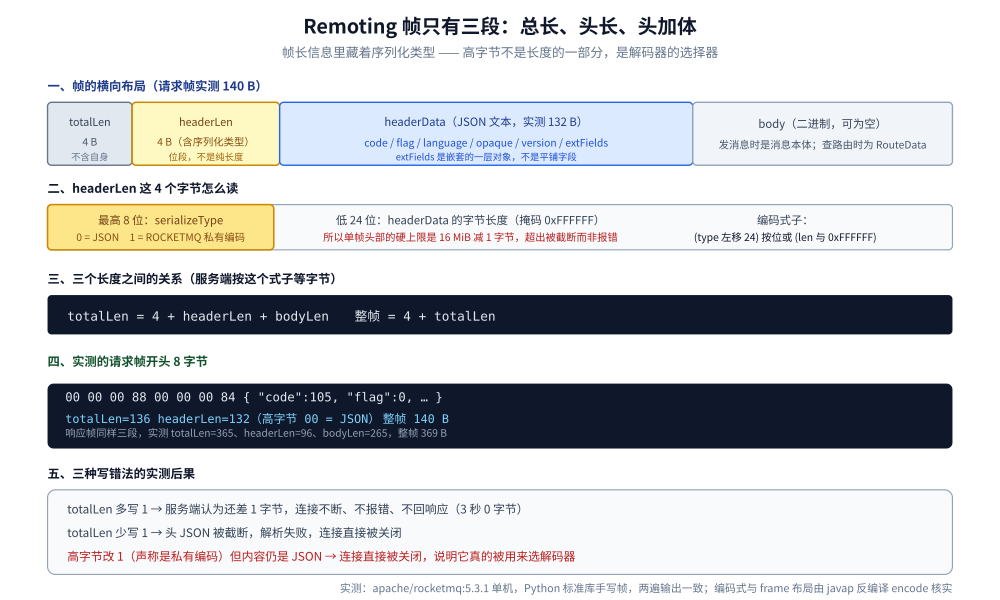
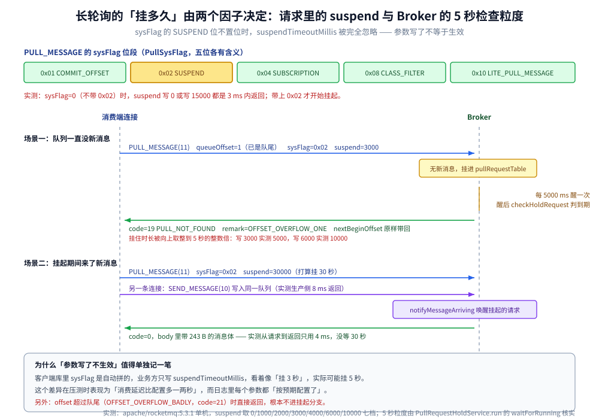
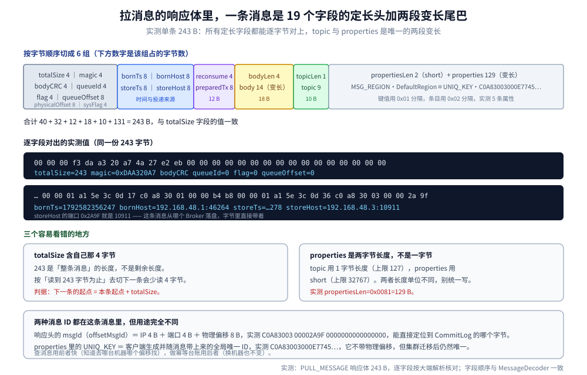
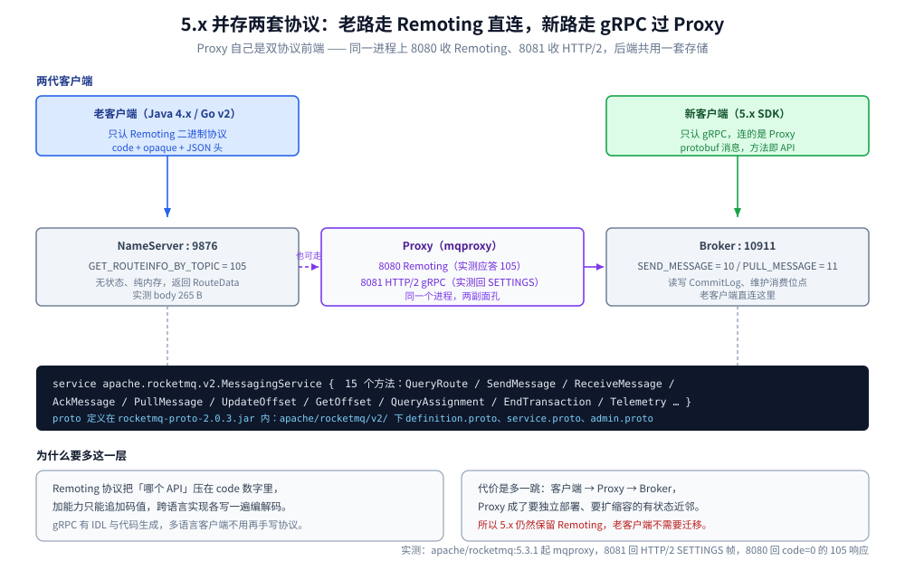

# RocketMQ 协议

> 覆盖 ⭐ **RocketMQ 自研的 Remoting 私有二进制协议**：帧的三段布局（`totalLen` / 带序列化类型的 `headerLen` / JSON 头 + 二进制体）、header 里六个字段各自的作用与错填后果、`code` 字段在请求与响应两套码表里的组织方式（155 个 opcode 按号段分模块、响应码三层）、一次路由查询与一次发消息的逐字节往返、长轮询为什么会「写 3 秒却挂 5 秒」（`sysFlag` 的 SUSPEND 位 + Broker 的 5 秒检查粒度）、拉消息响应体里单条消息的 19 个字段、两种消息 ID 的区别、服务端主动帧，以及 5.x 新增的 gRPC 与 Proxy 双协议。
>
> 不覆盖：CommitLog / ConsumeQueue / IndexFile 三层存储见 [核心概念与架构.md](核心概念与架构.md)；消费位点与 rebalance 见 [消费者与消费位点.md](消费者与消费位点.md)；重试与死信见 [消息可靠性.md](消息可靠性.md)；事务消息的两阶段与回查见 [消息类型与语义.md](消息类型与语义.md)；堆积与排障 SOP 见 [运维与排障.md](运维与排障.md)。协议族层面的四种定界方式见 [消息协议族全景.md](../../../../02-计算机基础/网络/消息协议/消息协议族全景.md)；Kafka 的严格请求-响应见 [Kafka协议.md](../Kafka/Kafka协议.md)；NATS 的纯文本命令行见 [NATS协议.md](../NATS/NATS协议.md)。
>
> 内容整理自个人学习笔记。**实测口径**：本篇全部字节读数来自本机 `apache/rocketmq:5.3.1` 单机（1 NameServer `rmq-namesrv` 宿主 19876 + 1 Broker `rmq-broker` 宿主 19011 + 1 Proxy `rmq-proxy` 宿主 18080/18081），探针用 Python 标准库手写帧、不引任何客户端库，**连续两遍输出逐行一致**；字段名、位偏移与常量表用容器内 `javap -p -constants` 与 `-c` 反编译核对。⚠️ **未实测**：TLS / ACL 加密链路、`CONTROLLER_*` 系列 opcode（需要 Controller 集群）、POP 消费模式、gRPC 侧的业务调用（只验证了端口协议与 proto 定义，没跑通一次真实收发）。

---

## 一、RocketMQ 为什么要自己写一套二进制协议？

**本节要点**：判据不在「自研更酷」，而在**语义深度**——RocketMQ 要的原语（事务消息回查、多级延迟、按队列提交位点、消费组动态分配）比 AMQP / MQTT 的标准原语多，套用标准协议就得在应用层再叠一层私有语义；**自研的代价是跨语言编解码要写很多遍**，这正是 5.x 补 gRPC 的原因。

| 判据 | 标准协议的情况 | RocketMQ 的需要 | 结果 |
| --- | --- | --- | --- |
| **路由模型** | AMQP 走「交换机 → 绑定 → 队列」，路由写在协议里 | Topic / Queue 直投，NameServer 给出「哪台 Broker 的哪个队列」 | 用 **105 查路由**，客户端自己选队列，协议层不做路由 |
| **原语数量** | MQTT 五个核心命令跑完发布订阅 | 还要事务回查、延迟级别、位点提交、消费组分配、轨迹 | **155 个 opcode**（见第四节） |
| **扩展方式** | AMQP 靠版本（0-9-1 / 1.0 结构不兼容） | 想加能力不能逼所有客户端升级 | 追加 opcode + 头部用 JSON（加字段不破坏解析） |
| **跨语言成本** | 有现成的多语言客户端 | 每个语言都要手写编解码 | 5.x 补 gRPC + Proxy（见第九节） |

> ⭐ 一句话记：**它把「协议」当内部的 RPC 通道用，而不是当对外标准用**。一个 `code` 直接对应服务端一个 `RequestProcessor`，不做通用语义抽象——这是它 opcode 数量到 155 个、却没有版本协商机制的根因。

## 二、一帧长什么样？

**本节要点**：帧只有三段——**`totalLen`（4 B）、`headerLen`（4 B）、头与体**。头是 **JSON 文本**，体是**二进制**。两个长度字段的关系是 `totalLen = 4 + headerLen + bodyLen`，而 `totalLen` **不含自身那 4 字节**。



上图要读出的核心：`headerLen` 这 4 个字节**不是一个纯长度**，它的高 8 位是序列化类型、低 24 位才是头的字节数；三个长度写错时的行为各不相同。下面逐条说清。

### 2.1 三段与三者的关系

| 段 | 宽度 | 内容 | 实测（请求帧） |
| --- | --- | --- | --- |
| `totalLen` | 4 B | 从 `headerLen` 起到帧尾的字节数，**不含自己** | `00 00 00 88` = 136 |
| `headerLen` | 4 B | 高 8 位序列化类型 + 低 24 位头长度 | `00 00 00 84` = 132（高字节 0 = JSON） |
| `headerData` | `headerLen & 0xFFFFFF` | JSON 文本 | 132 B |
| `body` | `totalLen - 4 - headerLen` | 二进制，可为 0 | 0 B（查路由时） |

整帧 = `4 + totalLen`。实测这条请求帧共 **140 B**（4 + 136），解析出的头是 132 B，与 `headerLen` 低 24 位一致。

响应帧同样是三段，实测 `totalLen=365`、`headerLen=96`、`bodyLen=265`，整帧 369 B——**body 里装的是 RouteData 的 JSON**（见第五节）。

### 2.2 编码式与那个 16 MiB 上限

`headerLen` 的写法由 `RemotingCommand.markProtocolType` 决定，反编译出来的运算就是一句位运算：

```text
headerLen 字段 = (serializeType 左移 24 位) 按位或 (headerDataLength 与 0xFFFFFF)
```

`0xFFFFFF` 这个掩码带来一个硬上限：**头部最长 16 MiB 减 1 字节，超出的高位被直接截掉，不会报错**。正常头只有一两百字节，撞不到；但如果有人把整条消息塞进 `extFields`，症状是「服务端收到一个解析不出来的头」而不是「头太大」。

`serializeType` 只有两个值（反编译枚举的构造参数核实）：

| 值 | 枚举 | 头的编码 |
| --- | --- | --- |
| `0` | `JSON` | JSON 文本（默认，Broker 启动日志会打 `serializeType=JSON`） |
| `1` | `ROCKETMQ` | `RocketMQSerializable` 的私有二进制编码 |

### 2.3 三种写错法的实测后果

| 写法 | 服务端行为 | 实测 |
| --- | --- | --- |
| `totalLen` 多写 1 | 认为还差 1 字节，**继续等**；连接不断、不报错、不回响应 | 3 秒 0 字节 |
| `totalLen` 少写 1 | 头 JSON 被截断，解析失败 → **直接关连接** | 0 字节且连接关闭 |
| `headerLen` 少写 1 | 同上，JSON 解析失败 → **关连接** | 0 字节且连接关闭 |
| 高字节改 1 但内容仍是 JSON | 按私有编码去解 JSON → **关连接** | 0 字节且连接关闭 |

> ⚠️ **「totalLen 写大」最像 NATS 的长度陷阱**（见 [NATS协议.md](../NATS/NATS协议.md) 第三节）：服务端不报错、只是等，客户端表现为「发了但对方没反应」。自研客户端必须在发送前断言一次长度。

## 三、header 里那几个字段各管什么？

**本节要点**：头是 JSON，固定字段只有六个——`code`（做什么）、`flag`（方向与单向）、`language`（谁发的）、`opaque`（配对）、`version`（协议版本）、`extFields`（业务参数，**嵌套一层**）；`remark` 只在响应里出现，装错误原文。

实测一条请求头（131 B，为便于阅读折了行）：

```json
{"code":105,"flag":0,"language":"JAVA","opaque":11,
 "serializeTypeCurrentRPC":"JSON","version":433,
 "extFields":{"topic":"lab-topic"}}
```

| 字段 | 实测值 | 作用 | 错填的后果 |
| --- | --- | --- | --- |
| `code` | 105 / 10 / 11 | **请求时是 opcode，响应时是响应码**（两套码表，见第四节） | 不存在的 opcode → 回 `code=3`，**不断连** |
| `flag` | 0（请求）、1（响应）、2（单向） | 位段：bit0 方向、bit1 单向 | 见下 3.2 |
| `language` | `"JAVA"` | **枚举名字符串**，不是数字 | 只影响服务端日志与统计口径 |
| `opaque` | 11 | 请求自增 ID，服务端**原样回填** | 回填错 → 客户端把响应用给错的回调 |
| `version` | 请求 433、响应 475 | Remoting 协议版本 | **不校验**（见下 3.1） |
| `extFields` | `{"topic":"lab-topic"}` | 每个 opcode 自己的业务头 | 字段名写错 → 服务端读到 `null`，走业务报错而非协议报错 |
| `remark` | 仅响应 | 错误原文，如 `No topic route info …` | — |

### 3.1 `version` 是「声明」不是「闸门」

实测请求里写 `version=433`、服务端响应回 `version=475`（Broker 自己的版本），请求照常被处理。**RocketMQ 不做 Kafka 那种版本协商**：Kafka 的 `api_version` 不支持就断连，RocketMQ 的 `version` 只用于统计与个别兼容分支。

> ⭐ 这与 Kafka 形成鲜明对照（见 [Kafka协议.md](../Kafka/Kafka协议.md) 第三节）：Kafka 必须先发 `ApiVersions` 才能干活，RocketMQ 直接发业务 opcode 就行。**代价是一旦某个 opcode 的 `extFields` 结构变了，老客户端只能靠服务端做兼容分支**。

### 3.2 `flag` 的四个实测取值

| 发出方填的 `flag` | 服务端行为 | 实测 |
| --- | --- | --- |
| `0`（请求） | 正常处理并回响应（响应里 `flag=1`） | 有响应 |
| `1`（声称是响应） | **不回响应**（当响应帧丢弃） | 3 秒 0 字节 |
| `2`（单向 oneway） | 处理并**不回响应** | 3 秒 0 字节 |
| `4`（请求 + 响应的子类型位） | 正常处理并回响应 | 有响应，响应仍 `flag=1` |

结论：**参与路由决策的只有 bit0 与 bit1**，bit2 以上是响应自身的类型位，服务端收请求时不看。

### 3.3 `extFields` 为什么必须嵌套一层

很多资料写「自定义头字段平铺在同一层」。实测 5.3.1 **不是**：平铺时服务端读到 `topic: null`，报的是业务错误而不是协议错误——

```text
平铺写法  {"code":105,…,"topic":"lab-topic"}
   → code=17 remark="No topic route info in name server for the topic: null"
嵌套写法  {"code":105,…,"extFields":{"topic":"lab-topic"}}
   → code=0  + 265 B 的 RouteData
```

⚠️ **这个坑最贵的部分不是报错，而是报错口径**：服务端把「头里没有这个字段」当业务参数缺失处理，返回 `TOPIC_NOT_EXIST` 而不是「请求非法」。照着错误码去建 Topic 会白折腾。

## 四、同一个 `code` 字段，请求和响应装的是两套码表

**本节要点**：`code` 在两代方向上半点不通用——**请求侧是 opcode（做什么），响应侧是结果码（做成没有）**，靠 `flag` 的 bit0 区分。请求侧 155 个常量按号段分模块；响应侧按「系统级 / 业务级 / 事务与特殊」三层分开。

### 4.1 请求侧：155 个 opcode，号段即模块

反编译 `RequestCode` 得到 155 个常量，最小 10、最大 200151。号段划分不是随意的，**每一段对应一个子系统**：

| 号段 | 数量 | 职责 | 代表 |
| --- | --- | --- | --- |
| `0`–`99` | 40 | 消息收发与消费协调 | `SEND_MESSAGE=10`、`PULL_MESSAGE=11`、`QUERY_BROKER_OFFSET=13`、`HEART_BEAT=34`、`NOTIFY_CONSUMER_IDS_CHANGED=40` |
| `100`–`199` | 7 | 配置与路由注册 | `GET_ROUTEINFO_BY_TOPIC=105`、`REGISTER_BROKER=103`、`GET_BROKER_CLUSTER_INFO=106` |
| `200`–`299` | 25 | 管理面：Topic 与订阅组 | `UPDATE_AND_CREATE_SUBSCRIPTIONGROUP=200`、`GET_TOPIC_STATS_INFO=202`、`DELETE_TOPIC_IN_BROKER=215` |
| `300`–`399` | 37 | 查询与诊断：消费进度、轨迹 | `QUERY_TOPIC_CONSUME_BY_WHO`、`QUERY_TOPICS_BY_CONSUMER` |
| `400`–`599` | 4 | 分配与静态 Topic | `QUERY_ASSIGNMENT`、`UPDATE_AND_CREATE_STATIC_TOPIC` |
| `900`–`999` | 8 | 成员组与主备切换 | `GET_BROKER_MEMBER_GROUP`、`ADD_BROKER` |
| `1000`–`1099` | 13 | Controller 自动主备（5.x） | `CONTROLLER_ELECT_MASTER`、`CONTROLLER_ALTER_SYNC_STATE_SET` |
| `2000`–`2099` | 4 | 冷数据流控 | `UPDATE_COLD_DATA_FLOW_CTR_CONFIG` |
| `3000`–`3099` | 10 | ACL 认证 | `AUTH_CREATE_USER`、`AUTH_UPDATE_USER` |
| `200000`+ | 7 | POP 消费模式（5.x） | `POP_MESSAGE=200050`、`ACK_MESSAGE`、`BATCH_ACK_MESSAGE` |

⚠️ **包路径在 4.x→5.x 迁过**：`org.apache.rocketmq.common.protocol.RequestCode` 变成 `org.apache.rocketmq.remoting.protocol.RequestCode`。照着 4.x 博客写 import 的代码在 5.3.1 上直接编译不过。

⭐ **opcode 的支持范围按服务端角色划分**：`GET_ROUTEINFO_BY_TOPIC=105` 只有 NameServer 与 Proxy 认，**直接发给 Broker 回 `code=3`**（`REQUEST_CODE_NOT_SUPPORTED`）。看着像「协议不支持」，其实是「这个角色没有这个 API」——排障时先确认自己连的是 9876 还是 10911。

### 4.2 响应侧：三层加一组负数

| 区间 | 含义 | 代表 |
| --- | --- | --- |
| `0`–`4` | **系统级**：这条链路本身行不行 | `SUCCESS=0`、`SYSTEM_ERROR=1`、`SYSTEM_BUSY=2`、`REQUEST_CODE_NOT_SUPPORTED=3`、`TRANSACTION_FAILED=4` |
| `10`–`28` | **业务级**：消息与消费语义 | `FLUSH_DISK_TIMEOUT=10`、`TOPIC_NOT_EXIST=17`、`PULL_NOT_FOUND=19`、`PULL_OFFSET_MOVED=21`、`SUBSCRIPTION_GROUP_NOT_EXIST=26` |
| `200`–`215` | **事务与特殊状态** | `TRANSACTION_SHOULD_COMMIT=200`、`TRANSACTION_SHOULD_ROLLBACK=201`、`NO_MESSAGE=208`、`FLOW_CONTROL=215` |
| `501`/`604`/`1500` | 主备与连接迁移 | `NOT_LEADER_FOR_QUEUE=501`、`ILLEGAL_OPERATION=604`、`GO_AWAY=1500` |
| `2000`–`2016` | Controller 集群 | `CONTROLLER_NOT_LEADER=2007`、`CONTROLLER_MASTER_NOT_AVAILABLE=2004` |
| `3001`–`3002` | ACL | `USER_NOT_EXIST`、`POLICY_NOT_EXIST` |
| **负数** | **客户端本地产生，永远不出现在线上帧里** | `RPC_TIME_OUT=-1006`、`RPC_SEND_TO_CHANNEL_FAILED=-1004` |

两条容易踩的事实：

- **负数响应码是客户端兜底**。抓包抓不到 `-1006`，它是客户端等响应超时后自己造的——所以「日志里有 `-1006`」等价于「请求发出去了但没等到回帧」，要去查连接与 Broker 端。
- **同值不同名**：`209` 既是 `UPDATE_AND_CREATE_ACL_CONFIG_FAILED` 又是 `POLLING_FULL`，`210`/`211` 同样各有两名。按数值写 if-else 的代码在遇到真正含义是另一个的时候会给出误导性的日志。

### 4.3 哪一层该重试

| 响应码 | 该不该重试 | 判据 |
| --- | --- | --- |
| `0` | 不需要 | 成功 |
| `10`/`12`（刷盘/同步从库超时） | **看配置**：`SYNC_FLUSH` + 超时才出现，重试通常能成功，但要先确认不是磁盘打满 | 是否持续出现 |
| `2`（`SYSTEM_BUSY`） | 退避后重试 | 服务端主动限流 |
| `14`（`SERVICE_NOT_AVAILABLE`） | 退避后重试 | 常见于从库不可用 |
| `19`（`PULL_NOT_FOUND`） | **重试就是正常行为** | 空拉，长轮询到期也会回它 |
| `21`（`PULL_OFFSET_MOVED`） | **不能原样重试** | 必须按响应里带回的 `nextBeginOffset` 重置 |
| `24`/`25`/`26`（订阅相关） | 不要重试 | 配置或版本不一致，重试不会自愈 |
| `17`（`TOPIC_NOT_EXIST`） | 不要空转重试 | 先把 Topic 建出来（或开 `autoCreateTopicEnable`） |

## 五、两次真实的往返长什么样？

**本节要点**：查路由与发消息都是「一请求一响应」，但**头的字段数差一个量级**——查路由的 `extFields` 只有 1 个字段，发消息有 13 个。响应侧也带 `extFields`，`msgId` 与 `queueOffset` 就在这里。

### 5.1 查路由：一个字段，回 265 B

请求头 132 B、整帧 140 B（头部已见第三节）。响应 `code=0`，body 是 RouteData：

```json
{"brokerDatas":[{"brokerAddrs":{"0":"192.168.48.3:10911"},"brokerName":"broker-a",
  "cluster":"DefaultCluster","enableActingMaster":false}],
 "filterServerTable":{},
 "queueDatas":[{"brokerName":"broker-a","perm":6,"readQueueNums":4,
  "topicSysFlag":0,"writeQueueNums":4}]}
```

`perm=6` 是位段（`2` 可写、`4` 可读），`readQueueNums=4` 对应建 Topic 时写的 4 队列。

### 5.2 发消息：13 个业务字段

`schema` 来自反编译 `SendMessageRequestHeader`：`producerGroup`、`topic`、`defaultTopic`、`defaultTopicQueueNums`、`queueId`、`sysFlag`、`bornTimestamp`、`flag`、`properties`、`reconsumeTimes`、`unitMode`、`batch`、`maxReconsumeTimes`。

实测请求（头 423 B + 体 14 B，整帧 445 B）：

```json
{"code":10,"flag":0,"language":"JAVA","opaque":21,"version":433,
 "extFields":{"producerGroup":"probe-producer","topic":"lab-topic","defaultTopic":"TBW102",
  "defaultTopicQueueNums":"4","queueId":"0","sysFlag":"0","bornTimestamp":"1792582356247",
  "flag":"0","properties":"KEYS\u0001probe-key\u0002TAGS\u0001TagA",
  "reconsumeTimes":"0","unitMode":"false","batch":"false","maxReconsumeTimes":"-1"}}
```

两个细节：

- **`extFields` 的值全是字符串**（`"queueId":"0"`），数字与布尔都要转字符串再序列化。
- **`properties` 是一条扁平字符串**，`\u0001` 分隔键与值、`\u0002` 分隔条目。它与消息体里的 properties 段是**同一套编码**（见第七节），只是这里以文本形式放在头里。

响应实测 291 B，`code=0`，`extFields` 带回发送结果：

```json
{"queueId":"0","queueOffset":"0",
 "msgId":"C0A8300300002A9F0000000000000000",
 "transactionId":"C0A83003000E77459877697949320000",
 "TRACE_ON":"true","MSG_REGION":"DefaultRegion"}
```

> ⭐ **`msgId` 与 `transactionId` 长得像但完全不同**：前者是 `offsetMsgId`（IP + 端口 + 物理偏移），后者是客户端生成的 `UNIQ_KEY`（全局唯一 ID）。区别见第七节 7.3。

## 六、拉消息为什么不是推送？

**本节要点**：`PULL_MESSAGE`（11）是**客户端主动发的请求**，协议层没有「服务端主动推消息」这种原语。所谓长轮询，是**服务端把请求挂住、等有新消息再回**——挂多久由两个因子共同决定：请求里的 `sysFlag` 的 SUSPEND 位（`0x02`）与 `suspendTimeoutMillis`，以及 Broker 自己的 5 秒检查粒度。



上图要读出的是三个数：**不带 `0x02` 时 3 ms 就返回**（`suspend` 被完全忽略）、**写了 3000 却挂 5000**、**挂起期间来消息 4 ms 就被唤醒**。下面把这三条钉死。

### 6.1 `sysFlag` 不置位，`suspendTimeoutMillis` 等于没写

`PullSysFlag` 反编译出五个位（`COMMIT_OFFSET=0x01`、`SUSPEND=0x02`、`SUBSCRIPTION=0x04`、`CLASS_FILTER=0x08`、`LITE_PULL_MESSAGE=0x10`）。实测同一队列、同一 `queueOffset`，只改 `sysFlag`：

| `sysFlag` | `suspendTimeoutMillis` | 实测耗时 | 说明 |
| --- | --- | --- | --- |
| `0` | `0` / `3000` / `15000` | **3–4 ms** | 不进挂起分支，参数白给 |
| `2` | `0` | **401 ms 与 3953 ms（两次不同）** | 也进挂起，返回时刻取决于距下一个检查点还有多远 |
| `2` | `1000` / `2000` / `3000` / `4000` | **5000 ms** | 到期后要等下一个检查点 |
| `2` | `6000` | **10000 ms** | 同上，向上取整到 5 秒的整数倍 |
| `2` | `10000` | **14999 ms** | 同上 |

### 6.2 为什么会向上取整到 5 秒

反编译 `PullRequestHoldService.run()`，主循环是：

```text
while (未停止) {
    if (longPollingEnable) waitForRunning(5000); else waitForRunning(shortPollingTimeMills);
    checkHoldRequest();     // 逐个判到期
}
```

**`suspendTimeoutMillis` 只决定「最早什么时候可以返回」，真正放行要等这一轮 `checkHoldRequest`**。长轮询开关打开时这轮是 5 秒一次，所以 3000 会挂到 5000、6000 会挂到 10000。

`sysFlag=2` + `suspend=0` 那行两次测得 401 ms 与 3953 ms，正好反证了这套模型：**返回值不是 `suspend`，而是「距下一个检查点还剩多久」**——`suspend` 比它短时，就看检查点的相位。

> ⚠️ **这条差异在压测时的症状**是「消费延迟比配置多一两秒」，而客户端日志里 `suspendTimeoutMillis=3000` 明明写着。别去怀疑网络。

### 6.3 挂起期间来了消息：4 ms 唤醒

实测一个挂 30000 ms 的 `PULL_MESSAGE`，1 秒后用**另一条连接**往同一队列发一条消息：发送侧 8 ms 返回 `code=0`，挂起侧**4 ms 内被唤醒**并返回 `code=0` + 243 B 的消息体。

这说明唤醒靠的是 `notifyMessageArriving` 的**主动通知**，不是轮询——**所以长轮询的延迟取决于「消息写入后多久通知到挂起的请求」，而不是检查周期**。

### 6.4 offset 超尾就直接返回，不挂

实测 `queueOffset` 超过队尾很多时返回 `code=21`（`PULL_OFFSET_MOVED`，remark `OFFSET_OVERFLOW_BADLY`），`queueOffset` 正好等于队尾时返回 `code=19` + remark `OFFSET_OVERFLOW_ONE`——**两种都在挂起分支之前就返回了**，跟 `suspendTimeoutMillis` 无关。响应里一定带回 `nextBeginOffset` / `maxOffset` / `minOffset` 三个位点，客户端按它纠正。

## 七、消息体在 body 里长什么样？

**本节要点**：拉消息响应的 body 是**消息序列**，不是 JSON。每条消息 = 19 个定长字段（共 88 B）+ `body`（变长）+ `topic`（1 B 长度 + 内容）+ `properties`（2 B 长度 + 内容）。



上图把 243 B 切成六组，最值得看的是后半段：`storeHost` 的端口字节就是 10911，`properties` 里同时躺着 `UNIQ_KEY`。下面按字段过一遍。

### 7.1 字段顺序与实测值

| 字段 | 宽度 | 实测值 | 说明 |
| --- | --- | --- | --- |
| `totalSize` | 4 B | `243` | **含自身 4 字节**，下一条起点 = 本条起点 + 它 |
| `magicCode` | 4 B | `0xDAA320A7` | 消息魔数 |
| `bodyCRC` | 4 B | `4a27e2eb` | 消息体 CRC32 |
| `queueId` | 4 B | `0` | 落在哪个队列 |
| `flag` | 4 B | `0` | 消息级 flag，与协议头的 flag 无关 |
| `queueOffset` | 8 B | `0` | 队列内逻辑位点 |
| `physicalOffset` | 8 B | `0` | CommitLog 内物理偏移 |
| `sysFlag` | 4 B | `0` | 消息系统标志（压缩、事务等位段） |
| `bornTimestamp` | 8 B | `1792582356247` | 客户端生产时间 |
| `bornHost` | 8 B | `192.168.48.1:46264` | 生产端地址（4 B IP + 4 B 端口） |
| `storeTimestamp` | 8 B | `1792582356278` | Broker 落盘时间 |
| `storeHost` | 8 B | `192.168.48.3:10911` | 落盘 Broker 地址（端口 `0x2A9F` = 10911） |
| `reconsumeTimes` | 4 B | `0` | 已重投次数 |
| `preparedTransactionOffset` | 8 B | `0` | 事务消息的预备位点 |
| `bodyLength` | 4 B | `14` | 后面 `body` 的字节数 |
| `body` | 变长 | `hello-remoting` | 消息本体 |
| `topicLength` | **1 B** | `9` | 上限 127 |
| `topic` | 变长 | `lab-topic` | |
| `propertiesLength` | **2 B** | `129`（`0x0081`） | short，上限 32767 |
| `properties` | 变长 | 见 7.2 | |

### 7.2 properties 的编码与实测内容

`properties` 是一条扁平字节串：键值之间 `0x01`、条目之间 `0x02`。实测 129 B 解出 5 条：

```text
MSG_REGION \x01 DefaultRegion
UNIQ_KEY   \x01 C0A83003000E77459877697949320000
CLUSTER    \x01 DefaultCluster
TAGS       \x01 TagA
KEYS       \x01 probe-key
TRACE_ON   \x01 true
```

> ⭐ **`TAGS` 与 `KEYS` 没有独立的头部字段**，它们就是 properties 里的两个键。所以 Tag 过滤发生在「读完 properties 之后」，不是解析头部时——这是 Tag 只支持一个、而 Key 可以有多个的协议层原因。

### 7.3 两种消息 ID：一个能定位，一个能跨集群

| | `offsetMsgId` | `UNIQ_KEY` |
| --- | --- | --- |
| 出现位置 | 响应头 `extFields.msgId` | 消息 properties 里 |
| 实测值 | `C0A8300300002A9F0000000000000000` | `C0A83003000E77459877697949320000` |
| 结构 | IP 4 B + 端口 4 B + 物理偏移 8 B | 客户端生成，不含物理偏移 |
| 用途 | **按 ID 查消息**：能直接算出「去哪个 Broker 的哪个字节找」 | **幂等台账 / 链路追踪**：换机器、换集群仍唯一 |
| 风险 | 消息被清理或迁移后失效 | 不随消息生命周期变化 |

## 八、服务端能不能主动往连接上发帧？

**本节要点**：**能**。这是它与 Kafka 最本质的差别之一——Kafka 同一个连接上只有「响应」没有「推送」（见 [Kafka协议.md](../Kafka/Kafka协议.md) 第一节），RocketMQ 允许服务端随时发一条没有对应请求的帧，客户端读循环必须能处理它。

实测：发一次 `HEART_BEAT`（34），**收到两帧**：

```text
第 1 帧  opaque=179  code=40 (NOTIFY_CONSUMER_IDS_CHANGED)  flag=2
第 2 帧  opaque=1    code=0   extFields={"IS_SUPPORT_HEART_BEAT_V2":"true","IS_SUB_CHANGE":"true"}
```

第 2 帧才是我这次心跳的响应（`opaque=1` 是我填的）。第 1 帧的 `opaque` 是服务端自己生成的（两次实验分别是 `179` 与 `208`，它的计数器独立于客户端）、`flag=2`（单向），语义是「消费组里的实例变了，该 rebalance 了」。

> ⚠️ **这就是自研客户端最常见的错位 bug**：如果读循环写的是「收到帧就当成当前请求的响应」，那么先到的那条 `code=40` 会被当成心跳的结果，真正的响应反而被下一个请求吃掉。**必须有「`opaque` 匹配不上就交给通知处理器」的分支**。

配套的一条实测：**消费组信息是按连接登记的**。断开连接、换一条新连接发 `PULL_MESSAGE`，即使订阅组配置在 Broker 上存在，也返回 `code=24`（`SUBSCRIPTION_GROUP_NOT_EXIST`）；在同一条连接上先发心跳再拉，就正常返回 `code=0`。

## 九、5.x 为什么又加了一套 gRPC？

**本节要点**：Remoting 的问题是**每个语言的客户端都要手写一遍编解码**，而它的 API 数量已经到 155 个。5.x 的做法不是替换，是**并存**：新客户端走 gRPC 连 Proxy，老客户端继续直连 Broker。



实测的 Proxy 是**双协议前端**：同一个进程上 Remoting 与 gRPC 各占一个端口，后端共用同一套 Broker 存储。

| 端口 | 协议 | 实测证据 |
| --- | --- | --- |
| `8081` | HTTP/2（gRPC） | 发 HTTP/2 preface + 空 SETTINGS，服务端回 `SETTINGS` 帧（`len=18 type=0x04`） |
| `8080` | Remoting | 发 `GET_ROUTEINFO_BY_TOPIC=105`，回 `code=0` + `extFields={"TRACE_ON":"false","MSG_REGION":""}` |

gRPC 侧的服务定义在 `rocketmq-proto-2.0.3.jar`（`apache/rocketmq/v2/` 下三个 `.proto`），服务名与 15 个方法与 Remoting 的 opcode 是**一一对应**的：

```text
service apache.rocketmq.v2.MessagingService
  QueryRoute / SendMessage / ReceiveMessage / AckMessage / PullMessage
  UpdateOffset / GetOffset / QueryOffset / QueryAssignment / ChangeInvisibleDuration
  EndTransaction / ForwardMessageToDeadLetterQueue / NotifyClientTermination
  Heartbeat / Telemetry
```

对照关系很直白：`SendMessage` ↔ `SEND_MESSAGE=10`、`PullMessage` ↔ `PULL_MESSAGE=11`、`QueryRoute` ↔ `GET_ROUTEINFO_BY_TOPIC=105`。

代价与收益：

| | Remoting 直连 | gRPC 过 Proxy |
| --- | --- | --- |
| 跳数 | 客户端 → Broker | 客户端 → Proxy → Broker |
| 多语言客户端 | 每语言手写编解码 | 由 proto 生成 |
| 部署形态 | 只需 NameServer + Broker | 多一组要扩缩容的 Proxy |
| 兼容性 | 4.x 客户端直接可用 | 需要 5.x SDK |

> ⭐ **所以「5.x 换协议了」是误读**：它只是给多语言客户端补了一条基于 IDL 的路，Remoting 在 5.3.1 里仍然是 Broker 的对外主端口（`10911`）。

## 十、应用场景

| 场景 | 用哪个 opcode / 字段 | 注意 |
| --- | --- | --- |
| **先查路由再发** | `GET_ROUTEINFO_BY_TOPIC=105` | 返回的 `queueDatas.perm` 是位段，`6` = 读写 |
| **发一条普通消息** | `SEND_MESSAGE=10` + 13 个 `extFields` | `properties` 是扁平字符串，不是 JSON |
| **要让服务端立刻回** | `flag=0` | 填 `1` 或 `2` 都拿不到响应 |
| **低延迟消费** | `PULL_MESSAGE=11` + `sysFlag` 带 `0x02` | 不置位就是短轮询，`suspend` 无效 |
| **排查「发出去没反应」** | — | 先看 `totalLen` 算没算对，再看 `flag` 是不是填成 1 |
| **排查「消费组不存在」** | `HEART_BEAT=34` | 组信息按连接登记，换连接要重新心跳 |
| **自己实现管理命令** | `200`–`299` 号段 | 这一段是 `mqadmin` 的协议底座 |
| **新语言客户端** | `apache.rocketmq.v2.MessagingService` | 优先用 gRPC，别手写 Remoting |

本仓对应落地：[核心概念与架构.md](核心概念与架构.md)（长轮询在存储层的另一半）、[消费者与消费位点.md](消费者与消费位点.md)（位点提交与 rebalance）、[运维与排障.md](运维与排障.md)（用 `mqadmin` 的这些 opcode 排障）、[消息模型与存储代价.md](../消息模型与存储代价.md)（队列数与 `readQueueNums` 的关系）。

## 十一、具体使用

### 11.1 手写一帧（Python 标准库，实测可跑）

```python
import json, socket, struct

def build(code, ext=None, body=b"", opaque=1, flag=0, version=433):
    h = {"code": code, "flag": flag, "language": "JAVA", "opaque": opaque,
         "serializeTypeCurrentRPC": "JSON", "version": version}
    if ext:
        h["extFields"] = ext                 # 必须嵌套，平铺会读成 null
    hb = json.dumps(h, separators=(",", ":")).encode()
    total = 4 + len(hb) + len(body)          # totalLen 不含自己 4 字节
    return struct.pack(">i", total) + struct.pack(">i", len(hb)) + hb + body

def recv_exact(s, n):
    buf = b""
    while len(buf) < n:
        chunk = s.recv(n - len(buf))
        if not chunk:
            return buf
        buf += chunk
    return buf

s = socket.create_connection(("127.0.0.1", 19876), timeout=5)   # NameServer
s.sendall(build(105, {"topic": "lab-topic"}, opaque=7))
total = struct.unpack(">i", recv_exact(s, 4))[0]
rest = recv_exact(s, total)
hlen = struct.unpack(">i", rest[:4])[0] & 0xFFFFFF              # 低 24 位才是头长
print(json.loads(rest[4:4 + hlen]))
print(json.loads(rest[4 + hlen:]))                              # RouteData
```

### 11.2 排障时按这个顺序问

```text
① 帧长对吗？    totalLen = 4 + headerLen + bodyLen，不含自身 4 字节
② 头里字段对吗？ extFields 嵌套一层，值全用字符串
③ code 存在吗？  不存在会回 code=3（不断连），不是断连
④ flag 填了吗？  1 或 2 都拿不到响应，请求必须是 0
⑤ 响应配对吗？   opaque 对不上，先想是不是服务端主动帧（code=40）
⑥ 拉不到消息？   sysFlag 有没有 0x02；offset 是不是超尾（21 / 19）
⑦ 组不存在？    同一条连接上先发 HEART_BEAT
```

### 11.3 与另外三个协议的定位对照

| | RocketMQ Remoting | Kafka | NATS | AMQP 0-9-1 |
| --- | --- | --- | --- | --- |
| 编码 | JSON 头 + 二进制体 | 全二进制 | 纯文本命令行 | 二进制帧 |
| 长度前缀 | `totalLen` + 位段式 `headerLen` | `size` 单前缀 | 命令内长度字段 | 7 B 帧头 |
| 请求标识 | `opaque` | `correlation_id` | 无（连接内顺序） | `channel id` + 方法 |
| 版本协商 | **无**（`version` 不校验） | 必须（`ApiVersions`） | `INFO` 里报 `proto` | 握手协商 |
| 服务端主动帧 | **有**（`code=40`） | 无 | 有（`MSG` / `PING`） | 有（`basic.deliver`） |
| 未知 opcode | 回 `code=3` | **直接断连** | 回 `-ERR` | 关 channel |

## 延伸追问

- **为什么 `totalLen` 不含自己那 4 字节？** 因为服务端解析时先读 4 字节拿到 `totalLen`，再按它 read 剩余部分；把自身算进去会让「读多少」多算一次。代价是所有手写实现都容易多减一次 4——两种错法的实测后果见 2.3。
- **`headerLen` 为什么要把序列化类型塞进高字节？** 省一个字段：如果单独放类型，帧头会变成 5 个字段、每帧多 1 字节，而这条协议是给十万级 TPS 用的。代价是头长被压到 24 位（16 MiB 上限）。
- **`flag=1` 的请求为什么会被静默丢弃？** 因为服务端按 bit0 判定「这是一条响应」，进了响应的处理分支；那个分支只做「按 `opaque` 找等待中的请求」，找不到就丢。**协议层没有「非法方向」这种错误码**，所以不会有任何回执。
- **`opaque` 会不会重复？** 客户端只要求「未完成的请求里唯一」。同步客户端每次用同一个值也没问题；异步客户端并发几十个请求时必须自增。
- **服务端主动发的 `code=40` 会不会把 `opaque` 撞上？** 会。它用的是服务端自己的计数器，与客户端的不在同一空间——**这就是必须靠「找不到匹配请求」来分流、而不能靠 `opaque` 大小判断的原因**。
- **`PULL_MESSAGE` 和 gRPC 的 `ReceiveMessage` 有什么区别？** 前者是「拉一批、客户端自己管位点」，后者是「服务端把消息投给某个消费者、用 `ChangeInvisibleDuration` 控制可见性」。5.x 的 POP 模式（`code=200050`）走的是后一种语义。
- **自己实现一个 RocketMQ 客户端现实吗？** 读场景可以（本篇就是），发消息场景也能跑通；但重试、路由刷新、位点管理、连接复用这些「协议之外的复杂度」客户端库已经做了十几年，重写的收益远低于成本。**新语言优先走 gRPC**。

## 关联

- **上游/总纲**：[README.md](README.md) — 本目录的阅读路线与 5.3.1 实测坐标
- **上游/总纲**：[消息协议族全景.md](../../../../02-计算机基础/网络/消息协议/消息协议族全景.md) — 四种定界方式（7 B 帧头 / 变长剩余长度 / 空行 NUL / XML 流）与 RocketMQ 的位置
- **下游机制**：[核心概念与架构.md](核心概念与架构.md) — 长轮询在存储层的另一半：消息写入后怎么触发通知
- **下游机制**：[消费者与消费位点.md](消费者与消费位点.md) — `queueOffset` 与 `nextBeginOffset` 在消费侧的用法
- **下游机制**：[消息可靠性.md](消息可靠性.md) — 响应码 `10`/`12`/`14` 对应的刷盘与复制路径
- **下游机制**：[消息类型与语义.md](消息类型与语义.md) — 事务消息 `200`/`201`/`202` 三个响应码的用法
- **运维/配置**：[运维与排障.md](运维与排障.md) — 用 `mqadmin` 背后这些 opcode 定位堆积与停滞
- **对照/互补**：[Kafka协议.md](../Kafka/Kafka协议.md) — 严格请求-响应、必须版本协商、未知版本直接断连
- **对照/互补**：[NATS协议.md](../NATS/NATS协议.md) — 纯文本命令行 + 长度字段，最小可读的消息协议
- **对照/互补**：[AMQP.md](../../../../02-计算机基础/网络/消息协议/AMQP.md) — 双向帧流 + channel 多路复用，路由写在协议里
- **对照/互补**：[Pulsar协议.md](../Pulsar/Pulsar协议.md) — 同为私有二进制协议，另一套帧头与命令组织方式
