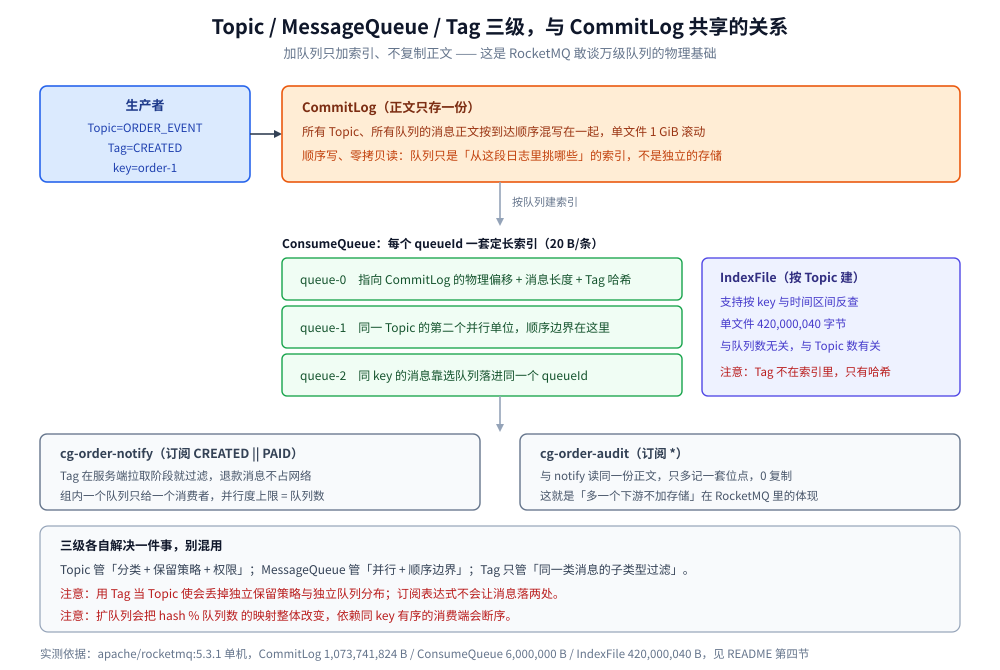

# Topic与队列设计

> 覆盖 ⭐ **RocketMQ 的 Topic / MessageQueue / Tag 三级各是什么**、Tag 为什么不是分类容器（它是属性上的哈希过滤，不是索引）、队列数怎么定以及扩容为什么会破坏同 key 有序、Tag 的过滤发生在哪一侧、以及命名与队列分配的落地写法。
>
> 不覆盖：**业务层该按什么维度切 Topic**、`event_type` 与 Tag 的对应约定见 [Topic切分与事件设计.md](../Topic切分与事件设计.md)；⭐ 跨产品的拆合判据与 RabbitMQ / Kafka 的落点对照见 [消息模型与存储代价.md](../消息模型与存储代价.md)；CommitLog / ConsumeQueue / IndexFile 三层存储见 [核心概念与架构.md](核心概念与架构.md) 第四节；顺序消息的实现见 [消息类型与语义.md](消息类型与语义.md) 第二节；消费位点与 rebalance 见 [消费者与消费位点.md](消费者与消费位点.md)。
>
> 内容整理自个人学习笔记，素材见 [素材清单.md](../../../../素材清单.md)。**实测口径**：本篇涉及的队列与偏移读数来自本机 `apache/rocketmq:5.3.1` 单机（1 NameServer + 1 Broker，`brokerRole=ASYNC_MASTER`），见 [README.md](README.md) 第四节；**未做队列数代价实测**（队列数 → ConsumeQueue 文件数与句柄数的增量未采读数），第二节的代价部分按存储结构陈述并标注；队列数与消费者数的关系未做压测。

---

## 一、Topic / MessageQueue / Tag 三级各是什么？

**本节要点**：Topic 是**分类与存储容器**（一套 CommitLog 索引 + 一套保留策略），MessageQueue 是**并行单位 + 顺序边界**，Tag 是**消息属性上的二级过滤**。三级里最容易被误用的是 Tag——它既不是分类容器，也不是索引，而是消费端与 Broker 侧的字符串过滤。

| 层级 | 是什么单位 | 数量可否事后改 | 成本落在哪 |
| --- | --- | --- | --- |
| **Topic** | 分类 + 配置（保留策略、队列数上限、权限） | 可改配置 | 一套 ConsumeQueue 目录树 + 一组 IndexFile |
| **MessageQueue** | **并行 + 顺序边界**（一个队列同组内只给一个消费者） | ✅ **可扩**（`updateTopic`） | 每队列一套 ConsumeQueue 定长文件（20 B/条索引），**正文在共享 CommitLog** |
| **Tag** | 消息属性上的过滤字符串 | 无（随消息走） | 几乎为零，但**Tag 过多会拖慢过滤** |



上图要读出的核心：**消息正文在 CommitLog 里只有一份**，Topic 与队列只是「索引怎么看」的差异。这一点与 Kafka 的「分区目录里各存一份」不同，也是 RocketMQ 能挂万级队列的物理基础。

> ⭐ 一句话对照：**RabbitMQ 加队列要多存一份消息，Kafka 加分区要多一套目录，RocketMQ 加队列只是多一套索引。**

## 二、Tag 为什么不是分类容器？

**本节要点**：Tag 是**消息发送时带上的属性字符串**，消费者的过滤发生在**服务端拉取阶段**（Broker 按 Tag 的哈希码比对），它既没有独立的存储、也没有独立的分区/队列分布。所以「用 Tag 当 Topic 使」会同时丢掉两件事：**独立的保留策略**和**独立的队列分布**。

### 2.1 Tag 与 Topic 的分工

| 需求 | 用 Topic | 用 Tag |
| --- | --- | --- |
| 独立的消息数量上限 / 队列数 | ✅ | ❌ 共用 Topic 的队列 |
| 独立的保留策略（几天过期） | ✅ | ❌ 共用 |
| 独立的权限（谁能发、谁能订） | ✅ | ❌ 共用 |
| 同一类消息的**子类型过滤**（创建 / 支付 / 退款） | ⚠️ 过重 | ✅ 正解 |
| 消费端按属性做复杂条件过滤 | ❌ | ⚠️ 简单 Tag 可以，复杂条件用 SQL92 过滤（另有代价） |

### 2.2 Tag 使用的三条边界

- **一个 Topic 的 Tag 种类不宜过多**：过滤是在订阅关系上做的字符串匹配，Tag 种类爆炸会让订阅关系与过滤开销上升。经验值上限与业务规模相关，**不要超过几十种**。
- **Tag 不能替代「独立队列」**：如果一个子类型需要独立的消费并行度或独立的堆积，必须拆 Topic 或至少确认该 Topic 的队列数足够。
- **`*` 与 `||` 是订阅语法不是通配存储**：`TagA || TagB` 是订阅表达式，它不会让消息落两处。

> ⚠️ **反向错误**：把订单的 `created` / `paid` / `refunded` 做成三个 Topic，再用同一个消费组分别订阅。这会让「一个订单生命周期要按顺序处理」变成跨 Topic 无法保证顺序（顺序只在队列内），而且三套队列白占索引。正确做法：**一个 Topic + 三个 Tag + 同 key 顺序消息**。

## 三、队列数怎么定？

**本节要点**：队列数的下限是**目标并行度**（同组消费者数不能超过队列数），上限受**索引文件与元数据**约束（比 RabbitMQ 的进程约束轻得多）。RocketMQ 允许事后扩容（`updateTopic`），但**扩容同样会改变「同 key 落哪个队列」的映射**，所以依赖同 key 有序的 Topic 扩容等于断序——这一点与 Kafka 相同。

### 3.1 三个约束

| 约束 | 含义 | 违反后果 |
| --- | --- | --- |
| **并行度上限** | 同组内一个队列只给一个消费者 | 消费者数 > 队列数 → 多余消费者空转 |
| **顺序边界** | 只有队列内有序 | 需同 key 有序时必须同队列（同 key 选队列） |
| **索引成本** | 每队列一套 ConsumeQueue（20 B/条） | 队列多 → 索引文件与句柄增长（**比 RabbitMQ 轻，比 Kafka 略重**） |

### 3.2 代价对比：RocketMQ 与另两个产品的差别

⚠️ **以下是按存储结构陈述，未做队列数代价实测**：

| 产品 | 加一个并行单位的物理代价 | 可逆性 |
| --- | --- | --- |
| RabbitMQ | 2 个 Erlang 进程 + 1 个目录 + 几十 KB 内存（实测） | 可逆（删队列丢未消费消息） |
| Kafka | 1 个目录 × 副本数 + 元数据项（磁盘近 0） | ⚠️ **只能加不能减** |
| **RocketMQ** | **1 套 ConsumeQueue 定长文件**（约 6,000,000 B/文件起，实测该尺寸），正文不复制 | ✅ **可扩**（`updateTopic` 加队列） |

**为什么 RocketMQ 能挂万级队列**：因为加队列只加**索引**，正文在共享 CommitLog 里。RabbitMQ 加队列要加进程，Kafka 加分区要加目录与副本——只有 RocketMQ 的增量落在纯索引上。

### 3.3 扩容为什么会断序

顺序消息靠「**同 key 选同队列**」实现（`MessageQueueSelector` 按 key 取模，详见 [消息类型与语义.md](消息类型与语义.md) 第二节）。取模的分母是**队列数**，队列数一变，同一个 key 的新消息就落到别的队列：

```text
扩容前：queueNums=4，key=order-1 → hash % 4 = 1  → 队列 1
扩容后：queueNums=8，key=order-1 → hash % 8 = 5  → 队列 5（与旧消息不再同队列）
```

**结果**：旧消息在队列 1 的尾部，新消息进了队列 5，两个队列由不同消费者并行处理 → **顺序断裂**。

> ⚠️ 所以「RocketMQ 可扩队列」不等于「扩容无副作用」。**依赖同 key 有序的 Topic，扩队列前必须确认消费端不依赖跨消息顺序，或走「停写 → 等堆积清空 → 扩容 → 恢复写」。**

### 3.4 定队列数的顺序

```text
第一步：下限 = 预期的同组最大消费者数（并行度上限就是队列数）
第二步：上限 = 索引文件与句柄能接受的范围（RocketMQ 侧很宽松，万级队列是官方口径）
第三步：取一个能整除的整齐值（便于 hash 分布均匀，如 4 / 8 / 16）
第四步：确认顺序需求 —— 若依赖同 key 有序，队列数就此定死，后续扩要走「停写清空」
```

## 四、命名与队列分配

**本节要点**：RocketMQ 的命名坑最少（Topic 只有一级），但有一条它独有的：**Topic 名要按 `mqadmin` 的操作习惯写全大写风格还是小写风格必须统一**，因为 `topicList` 输出的顺序与大小写混排会让脚本匹配出错。命名规则与另两个产品一致的四条硬规则仍然适用。

| 对象 | 格式 | 例子 | 注意 |
| --- | --- | --- | --- |
| **Topic** | `<域>_<事件类>`（大写为主） | `ORDER_EVENT` | 不用 `%RETRY%` / `%DLQ%` 前缀（系统生成） |
| **Tag** | 动作名，全大写 | `CREATED` / `PAID` / `REFUNDED` | 种类控制在几十种内 |
| **消费组** | `cg-<域>-<消费方>` | `cg-order-notify` | **消费方写在组名里**（队列是共享的） |
| **队列** | 由 Broker 分配 `queueId` | `0..3` | 不手工命名，只定数量 |

**四条硬规则**（与另两个产品通用，详见 [消息模型与存储代价.md](../消息模型与存储代价.md) 第四节）：

- ⚠️ 不用 `%RETRY%` / `%DLQ%` 前缀——系统会生成同名队列，冲突后重试与死信会串。
- ⚠️ 不用中文与空格——会进 `mqadmin` 命令与监控标签。
- ⚠️ 不带环境前缀，多环境用独立集群或命名空间隔离。
- ⚠️ 名字里不写版本号，换实现换消费组。

## 五、应用场景

| 场景 | 用什么 | 判据 |
| --- | --- | --- |
| **订单生命周期的多种事件**（创建 / 支付 / 退款） | 一个 Topic + 三个 Tag | 保留策略与队列分布相同，只是子类型不同 |
| **需要同订单有序** | 一个 Topic + `MessageQueueSelector` 按 `orderId` 选队列 | 顺序只在队列内，靠选队列实现 |
| **审计要留 90 天、业务只留 7 天** | 拆两个 Topic | 保留策略是 Topic 级 |
| **两个下游各处理一遍** | 两个消费组 | 共享 CommitLog，不复制正文 |
| **延迟 / 定时任务** | 延迟级别或 5.x 任意时间，**不按订单建队列** | 队列数不封顶会撞索引上限 |
| **多租户 SaaS** | 按业务域分 Topic，租户 ID 进 key 或消息属性 | 租户数不封顶，不能映射成队列 |

本仓对应落地：[核心概念与架构.md](核心概念与架构.md)（三层存储）、[消息类型与语义.md](消息类型与语义.md)（顺序消息与 Tag 过滤）、[部署与配置.md](部署与配置.md)（Topic 与队列数的配置项）。

## 六、具体使用

### 6.1 建 Topic 并确认队列数

```bash
# 建 Topic：-r 读队列数、-w 写队列数，生产一般保持一致
mqadmin updateTopic -n localhost:9876 -c DefaultCluster -t ORDER_EVENT -r 8 -w 8

# 看队列数：topicRoute 输出里每个 Broker 的 readQueueNums / writeQueueNums
mqadmin topicRoute -t ORDER_EVENT -n localhost:9876 | grep -E "queueNums|QueueNums"

# 列出全部 Topic（留意 %RETRY% / %DLQ% 这些系统生成的）
mqadmin topicList -n localhost:9876
```

> ⚠️ **读写队列数不一致**（如 `-r 8 -w 4`）是灰度期的手段，长期不一致会让消费端能拉到的队列与写入的队列错位。生产环境建完就核对一次。

### 6.2 顺序消息：按 key 选队列（Java）

```java
producer.send(msg, new MessageQueueSelector() {
    @Override
    public MessageQueue select(List<MessageQueue> mqs, Message msg, Object arg) {
        String orderId = (String) arg;
        // ⚠️ 分母是队列数：扩队列后这段映射会整体改变，依赖顺序的 Topic 不能随便扩
        int idx = Math.abs(orderId.hashCode()) % mqs.size();
        return mqs.get(idx);
    }
}, orderId);
```

### 6.3 按 Tag 过滤订阅

```java
// 只收创建与支付两类，退款不收
consumer.subscribe("ORDER_EVENT", "CREATED || PAID");
// 全收
consumer.subscribe("ORDER_EVENT", "*");
```

> ⚠️ **Tag 过滤不能替代拆 Topic**：`subscribe` 的 Tag 表达式只影响「这个消费者收到哪些消息」，不改变消息在 Broker 上的存储位置与队列分布。所以「按 Tag 过滤」省的是消费端处理量，不是存储或队列数。

## 延伸追问

- **RocketMQ 的 Tag 和 Kafka 的消息头（header）有什么区别？** Kafka 的 header 只能由消费端自行过滤（Broker 不参与），RocketMQ 的 Tag 在**服务端拉取阶段**就能过滤，省掉网络传输。但两者都不能替代 Topic：都不带独立的保留策略与队列分布。
- **队列数能不能按「租户数」定？** 不能。租户数不封顶，队列数必须封顶。应按业务域分 Topic，租户 ID 进 key 或消息属性。
- **扩队列一定会断序吗？** 只有依赖「同 key 有序」且用「hash % 队列数」选队列时会断。如果顺序只要求「同一事务内的消息」且这些消息在扩容窗口内不跨越，则影响有限。**保守做法是停写 → 等堆积清空 → 扩容 → 恢复写。**
- **RocketMQ 为什么敢说能挂万级队列，RabbitMQ 不敢？** 因为加队列的增量不同：RocketMQ 只加 ConsumeQueue 索引（正文共享），RabbitMQ 要加 2 个 Erlang 进程。对照见 [消息模型与存储代价.md](../消息模型与存储代价.md) 第三节。
- **SQL92 过滤和 Tag 过滤该怎么选？** Tag 是精确匹配（性能最好），SQL92 支持属性表达式但开销高。**能用 Tag 就别用 SQL92**，SQL92 只用于确实需要属性组合条件的场景。

## 关联

- **上游/总纲**：[消息模型与存储代价.md](../消息模型与存储代价.md) — ⭐ 跨产品拆合判据，本篇是它在 RocketMQ 侧的纵深
- **上游/总纲**：[README.md](README.md) — 本目录阅读路线与单机 5.3.1 实测坐标
- **下游机制**：[核心概念与架构.md](核心概念与架构.md) — 第四节：CommitLog / ConsumeQueue / IndexFile 三层存储，队列代价的物理来源
- **下游机制**：[消息类型与语义.md](消息类型与语义.md) — 第二节：顺序消息的选队列实现、Tag 过滤与延迟级别
- **下游机制**：[消费者与消费位点.md](消费者与消费位点.md) — 队列怎么在组内分配、rebalance 为什么重复消费
- **对照/互补**：[Topic与分区设计.md](../Kafka/Topic与分区设计.md) — Kafka 侧：分区只能加不能减，与 RocketMQ 的可扩形成对照
- **对照/互补**：[队列与绑定设计.md](../RabbitMQ/队列与绑定设计.md) — RabbitMQ 侧：队列是订阅，每下游一条队列才对
