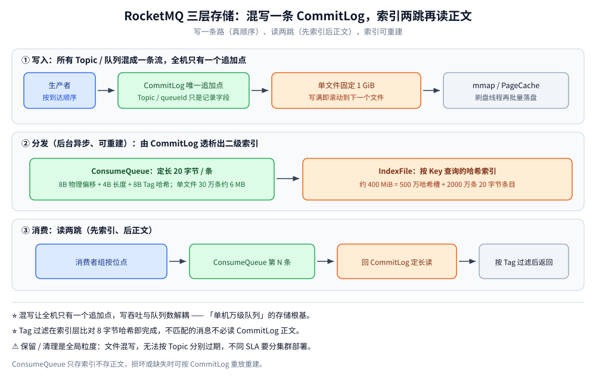
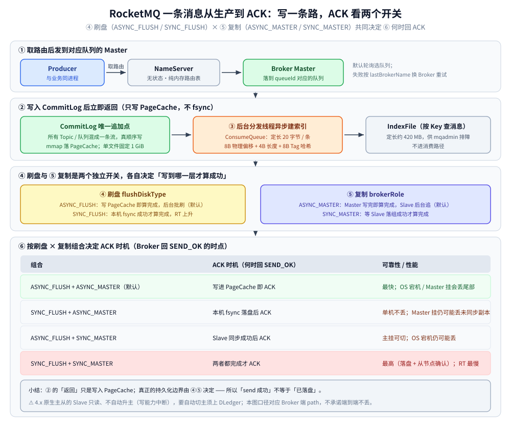
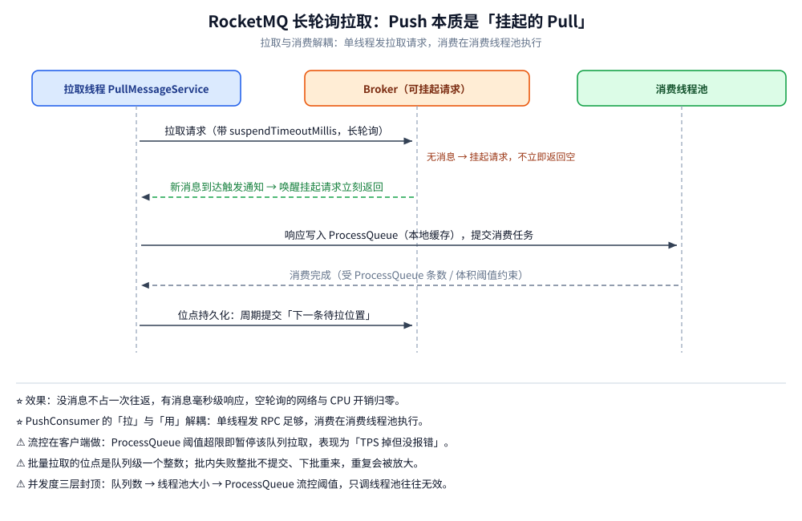

# 核心概念与架构

> 覆盖 RocketMQ 的四大角色与核心概念、NameServer 为什么比 ZooKeeper 轻（含路由实现细节）、三层存储（CommitLog / ConsumeQueue / IndexFile）与消息在 CommitLog 里的物理布局、**一条消息从生产到副本落盘与 ACK 的完整链路**，以及长轮询为什么不是真 Push。
>
> 不覆盖：六种消息类型的语义与实现见 [消息类型与语义.md](消息类型与语义.md)；刷盘 × 复制的四组合取舍见 [消息可靠性.md](消息可靠性.md)；消费位点与 rebalance 见 [消费者与消费位点.md](消费者与消费位点.md)；起集群与关键配置见 [部署与配置.md](部署与配置.md)。
>
> 内容整理自个人学习笔记；存储与路由机制的机制部分参考《RocketMQ 分布式消息中间件核心原理与最佳实践》（李伟）。本篇读数来自本机 `apache/rocketmq:5.3.1` 单机集群（`rmq-namesrv` + `rmq-broker`）。

---

## 一、一句话定位与它凭什么

RocketMQ 是阿里 2012 年开源、2016 年捐给 Apache（2017 年成为顶级项目）的分布式消息中间件，**纯 Java 实现**，单机十万级 TPS、支持万级队列。

| 卖点 | 说明 |
| --- | --- |
| 功能最全 | **原生支持延迟消息、事务消息、消息轨迹**，这是它与 Kafka / RabbitMQ 最直接的差异 |
| 万级队列 | 混写一条 CommitLog + 定长轻量索引，队列数与写吞吐解耦 |
| 金融级可靠 | 刷盘 × 复制两个开关可组合出四档语义，配合 DLedger 支持自动切主 |
| 生态贴合业务 | 阿里内部电商链路打磨多年，Tag 过滤、按 Key 查消息、Dashboard 开箱可用 |

> ⭐ 一句话记忆：**RocketMQ 把「所有 Topic 混写进一条 CommitLog」当存储根基，把「延迟 / 事务」做进 Broker 而不是留给业务方。**

## 二、四大角色与核心概念

| 角色 | 职责 | 状态 | 关键点 |
| --- | --- | --- | --- |
| **NameServer** | 路由注册中心：Broker 上报 Topic/队列信息，客户端按 Topic 拉路由 | ❌ 无状态，数据在内存 | 节点之间**互不通信**，可任意扩容；默认端口 9876 |
| **Broker** | 消息存储与转发：CommitLog 落盘、ConsumeQueue 索引、长轮询投递 | ✅ 落盘 | 分 Master/Slave（`brokerId=0` 为 Master，>0 为 Slave）；默认端口 10911 |
| **Producer** | 取路由、按策略选队列发送、失败换 Broker 重试 | — | 与业务同进程；ProducerGroup 事务消息必需 |
| **Consumer** | 拉取消息并消费、提交位点 | 位点存 Broker | PushConsumer 本质是「长轮询 + 回调」，并非真正推送 |

消息流转：`Producer → NameServer 取路由 → Broker 写 CommitLog → ConsumeQueue 建索引 → Consumer 长轮询拉取 → 提交位点`。发送策略默认**轮询**，开启 `sendLatencyFaultEnable` 后变为「延迟故障规避 + 随机」，对慢 Broker 自动降权。

| 概念 | 说明 | 类比 Kafka |
| --- | --- | --- |
| **Topic** | 消息的逻辑分类，由多个队列组成 | Topic |
| **MessageQueue（Queue）** | Topic 的最小并行单元，`queueId` 从 0 开始；**一个队列同一时刻只能被同消费组内一个消费者消费** | Partition |
| **Tag / Key** | Tag 是二级分类（Broker 端过滤，只有一个）；Key 是业务唯一标识（建索引供 `mqadmin queryMsgByKey` 排障） | ❌ 无 |
| **Offset** | 队列内消费位点；集群模式存 Broker，广播模式存消费者本地 | Offset |
| **ConsumerGroup** | 集群模式下组内平分队列，一条消息只被组内一个实例消费 | Group |

## 三、NameServer 为什么比 ZooKeeper 轻

| 维度 | NameServer | ZooKeeper（Kafka 旧版用法） |
| --- | --- | --- |
| 一致性模型 | AP，最终一致（客户端本地缓存 + 30s 定期拉取） | CP，ZAB 协议强一致 |
| 节点关系 | 各节点独立无通信、无主无选举，信息纯内存不落盘 | 需选主，半数以上存活才可写，ZNode + 事务日志 |
| 故障影响 | 单节点挂掉不影响其余节点，客户端用本地缓存路由继续收发 | 半数以下存活则整体不可用 |
| 运维成本 | 无状态，部署即用，可任意加节点 | 需维护集群、磁盘、会话、GC |

⭐ 设计取舍：路由数据**允许短暂不一致**（Broker 上下线延迟几十秒可接受），所以不需要一致性协议。Broker 每 30s 向**所有** NameServer 注册心跳，NameServer 每 10s 扫描 `brokerLiveTable`，超过 120s 未心跳则摘除。Kafka 也正因 ZK 在分区数增大时成为瓶颈，才在 3.0 后用 KRaft 取代 ZK。

### 3.1 NameServer 与客户端路由的实现细节

承接上表的「薄」，落到代码结构上讲薄在哪：

- **NameServer 内存在几张表**：`topicQueueTable`（Topic → 队列分布）、`brokerAddrTable`（BrokerName → 主从地址）、`brokerLiveTable`（存活检测）、`filterServerTable`（Tag/SQL 过滤地址路由）。全部纯内存、无落盘、无持久化，重启即空表——等 Broker 30s 心跳重新注册即可恢复，这就是「无状态」的底气。
- **路由单元**：客户端按 Topic 拉一份完整 `TopicRouteData`（队列列表 + 主从拓扑 + 读写权限位），NameServer 不做增量协议。Topic 路由数据量极小（一条 Topic 几百字节），**全量下发比增量协议简单得多**，代价只是缓存过期窗口（客户端周期性更新）。
- **客户端本地缓存 + 重试时「投票」**：Producer 默认轮询队列；失败重试时按 `lastBrokerName` 避开刚挂的那台 Broker 重新选（同组内换队列而不是换 Broker），配合 `sendLatencyFaultEnable` 时还会把慢 Broker 记入故障掩码、一段时间内降权。路由指向已下线 Broker 时发送报错、下一次更新路由自愈——**错误容忍窗口换来了协议极简**。
- **自动建 Topic 的钩子也藏在路由里**：`autoCreateTopicEnable=true`（本机实测默认就是 `true`）时新 Topic 借用默认 Topic（`TBW102`）的路由模板下发，这解释了为什么没建过的 Topic 也能发出去，也是生产必须关掉它的原因。
- ⭐ 回到本质：NameServer 能薄，是因为路由错误的代价**可以被重试消化**（选错队列就换一个）。但「谁是 Master」这类元数据错误会导致双写，不能重试消化——所以 DLedger 模式才把主选举交给 Raft（见 [消息可靠性.md](消息可靠性.md) 第一节），两套机制回答的是同一个问题：**这份数据要不要强一致**。对照见 [Raft协议.md](../../../../04-架构与系统/分布式/理论/Raft协议.md)。

## 四、存储设计：CommitLog / ConsumeQueue / IndexFile



本机实测（`apache/rocketmq:5.3.1`）的文件尺寸，三个数字都能用配置项解释：

| 文件 | 实测尺寸（字节） | 由什么决定 |
| --- | --- | --- |
| CommitLog 单文件 | **1,073,741,824**（= 1 GiB） | `mappedFileSizeCommitLog` 默认 `1073741824`，开跑即预分配满 |
| ConsumeQueue 单文件 | **6,000,000** | `mappedFileSizeConsumeQueue` 默认 `6000000` = **30 万条 × 20 字节** |
| IndexFile 单文件 | **420,000,040** | `40 + 500 万 × 4 + 2000 万 × 20`：40 B 文件头 + 500 万个 4 B 哈希槽 + 2000 万条 20 B 条目 |
| timerwheel（5.x 定时消息） | **38,707,200** | 5.x 定时消息的存储文件，Broker 启动即建 |

> ⚠️ 常见说法「IndexFile 约 200 MB、50 万槽、1000 万条」是**错的**——那是把 500 万记成了 50 万。实测恒为 `420000040` 字节，反推 `hashSlotNum = 5000000`、`indexNum = 20000000`。另外 IndexFile 头 40 字节的前四个 8 字节字段是 `beginTimestamp / endTimestamp / beginPhyoffset / endPhyoffset`，后两个 4 字节字段实测为 `hashSlotCount=10`、`indexCount=11`——正好等于本轮写入的消息条数。

### 4.1 CommitLog：所有 Topic 混在一条日志里顺序写

- Broker 只有**一条** CommitLog：所有 Topic、所有队列的消息按**到达物理顺序**追加写进当前的 mmap 文件（单文件 1 GiB）。Topic/queueId 只是记录里的字段，不影响写的位置。
- 为什么混写：若像 Kafka 那样「每分区一条日志」，万级队列就意味着上万个并发追加目标，磁盘队列深度被摊薄、磁头（或 SSD 通道）在文件间跳来跳去，「顺序写」退化成**文件间随机写**。混写让全机只有一个追加点，写吞吐与队列数解耦——这是「单机万级队列」的存储根基（另一根基是下面的轻量索引）。
- 代价：读某一条队列时数据**散落在整条日志里**，必须有二级结构把「逻辑顺序」重建出来，否则消费就变成全文件扫描。⚠️ 这一点在本机实测里能直接看到：同一队列 `lab-topic/2` 的前四条 ConsumeQueue 记录，其 8 字节物理偏移依次是：

```text
offset=0    len=223  tag=0
offset=223  len=223  tag=0
offset=892  len=223  tag=0
offset=1784 len=223  tag=0
```

  同一条队列的相邻消息都是 223 字节，物理偏移却按 `0 → 223 → 892 → 1784` 跳着走（差 `223 / 669 / 892`）——**中间夹着的就是别的 Topic / 别的队列的消息**。这就是「混写」最直观的证据：队列内逻辑连续，物理上并不连续。

### 4.2 ConsumeQueue：定长「逻辑消费队列」，消费只读索引不读正文

- 后台分发线程从 CommitLog 异步「透析」出 ConsumeQueue：每条消息一条**定长 20 字节**记录 = 8B CommitLog 物理偏移 + 4B 消息长度 + 8B Tag 哈希；单文件固定 30 万条（= 6,000,000 B，本机实测吻合），于是队列内第 N 条消息的索引位置 = `queueOffset × 20`，**寻址是纯算术，不需要任何树**。
- 消费路径：按位点读 ConsumeQueue 顺序拿「位置+长度」→ 再去 CommitLog 定长读。**顺序读被摊在两个文件上**：索引侧永远顺序，数据侧按索引顺序取，绝大多数情况仍接近顺序读。
- Tag 过滤在索引层就完成（比对 8 字节哈希），不匹配的消息不必读 CommitLog 正文——这是「Tag 过滤便宜、SQL92 过滤贵」（见 [消息类型与语义.md](消息类型与语义.md) 第五节）的物理原因：SQL 表达式要拿到消息体才能求值，读放大回不来。
- 同一条消息被多个消费组订阅，物理只存一份，各组推各组的 ConsumeQueue 位点：**订阅者数量不放大存储**。
- 注意 ConsumeQueue 是**可重建的派生数据**：只存索引不存正文，损坏或缺失时可按 CommitLog 重放重建，这让「索引丢一点」不构成数据事故。

### 4.3 IndexFile：按 Key 查询的哈希索引（服务于排障，不在消费路径）

- 结构：定长文件（实测 **420,000,040 字节**）= 40 B 文件头 + **500 万个** 4 字节哈希槽（约 19 MB）+ **2000 万条** 20 字节条目（约 381 MB）；条目 = 4B keyHash + 8B CommitLog 偏移 + 4B 时间差 + 4B **同槽上一条目的偏移**——槽指向最新条目，向前回溯成一条链，是「哈希桶 + 链式地址」的定长文件版。
- 发送时把消息 Key（业务单号）哈希写进索引，`mqadmin queryMsgByKey` / Dashboard 按 Key 查消息走的就是它。本机实测：`mqadmin queryMsgByKey -t lab-java -k ORDER_1002` 返回 `Message ID = C0A83004000167424E823E90DA350001, QID = 2, Offset = 0`，与生产者落位一致。
- ⚠️ 两个边界：① 槽位固定、条目写满后**轮回头覆盖最旧的**，所以只查得到近期消息，别把它当审计存储；② 只哈希 Key 不存 Key 原文，比对的是哈希值，理论上存在极小概率误报，查到的结果要以消息内容确认。

### 4.4 消息在 CommitLog 里的物理布局

```text
+------------------- 定长部分（示意，非全字段）-------------------+------ 变长部分（长度前缀+内容）------+
| totalLen 4B | magic 4B | bodyCRC 4B | queueId 4B | flag 4B      |
| queueOffset 8B | physOffset 8B | sysFlag 4B                      | bornHost | storeHost
| bornTimestamp 8B | storeTimestamp 8B | reconsumeTimes 4B         | topic
| preparedTxOffset 8B                                             | properties | body(长度4B声明在前)
+-----------------------------------------------------------------+--------------------------------+
```

- 记录自带总长，**向前「读长度→读内容」即可解析，永远不需要回溯定位**；这也是「改一条消息 = 在日志尾部追加新版本」的 append-only 模型（事务的操作状态、重试的 reconsumeTimes 都靠追加实现）。
- 消息装不下当前文件剩余空间时，用**全零的 BLANK magic 填到文件末尾**再换新文件——启动恢复时按 magic 判断边界，天然识别「半条消息」并丢弃尾部。
- `bornTimestamp`（生产端时间）与 `storeTimestamp`（Broker 落盘时间）分开存：两者差值直接暴露「客户端 → Broker」的网络/排队耗时，是排障 RT 的第一现场。

### 4.5 mmap、读写路径与「写放大为什么低」

- 写：`memcpy` 进 mmap 映射的 PageCache 即算完成，刷盘线程再批量落盘（异步刷盘时 `send` 成功 ≠ 已落盘，见下一节与 [消息可靠性.md](消息可靠性.md)）；顺序写 + 大块提交，让磁盘侧几乎跑满顺序带宽。本机实测 `commitCommitLogLeastPages=4`（累计 4 页才提交一次）、`commitCommitLogThoroughInterval=200`（ms，兜底间隔）。
- 读：优先命中 PageCache（刚写入就被消费的「热消息」零磁盘 IO）；读旧消息才下盘。与 Kafka 不同，RocketMQ 读路径经 mmap 回到用户态（要做过滤、协议组装），**用不了 sendfile 式的纯零拷贝**——换来的是过滤与查询灵活性，代价是高吞吐消费时的用户态拷贝 CPU。

| 维度 | RocketMQ（混写 CommitLog + 索引） | Kafka（分区级日志） |
| --- | --- | --- |
| 写 | 单追加流，真顺序；队列数不影响写 | 分区多时写头分散，页缓存/磁盘队列被摊薄 |
| 读 | 两跳（索引 → 数据），有随机化风险，靠顺序分发摊平 | 分区内纯顺序，读路径更直 |
| 队列/分区扩展成本 | 加队列 ≈ 加索引文件，极轻（万级队列可行） | 加分区 = 加一套日志段与句柄，重（数百为警戒线） |
| 数据与配置耦合 | 保留/清理是**全局**粒度（文件混写，无法按 Topic 分别过期，见 [运维与排障.md](运维与排障.md)） | 每个 Topic 可独立设 retention |

对照阅读：[README.md](../Kafka/README.md)。

三层结构的写读全景（写一条路、读两跳）：

```text
写入（全 Topic 混成一条流）：
  Producer TopicA/q0 ─┐
  Producer TopicA/q1 ─┼─► CommitLog 唯一追加点 ─► 1GiB 文件写满换下一个 ─► mmap/PageCache ─► 刷盘
  Producer TopicB/q0 ─┘
分发（后台异步，可丢可重建）：
  CommitLog 扫描 ─► 按 (topic, queueId) 追加 20B 条目 ─► ConsumeQueue（每队列一套）
             └─► 按 Key 哈希插入 IndexFile（排障查询用）
消费（读 = 索引两跳）：
  消费者组X 在 TopicA/q3 位点=1024 ─► ConsumeQueue/q3 第 1024 条 ─► (物理偏移,长度,tagHash)
                                    └─► 回 CommitLog 定长读正文 ─► 按 tagHash 过滤后返回
```

## 五、一条消息从生产到副本落盘与 ACK：完整链路



把「写」与「何时算写成功」拆开看，就是下面这六步。前五步是**数据流**，第 ⑥ 步是**语义**：

| 步 | 做什么 | 关键事实 |
| --- | --- | --- |
| ① | Producer 从 NameServer 取路由，选出目标队列的 **Master** | 默认轮询；失败按 `lastBrokerName` 避开刚挂的 Broker 重试 |
| ② | 写入 CommitLog（mmap 写 PageCache） | ⭐ **这一步完成即可返回**，不等于落盘 |
| ③ | 后台分发线程**异步**建 ConsumeQueue 索引 | 与 ② 解耦；索引可重建，慢一点不影响发送 |
| ④ | 按刷盘策略决定何时 `fsync`：`ASYNC_FLUSH` / `SYNC_FLUSH` | 决定「本机磁盘上有没有」 |
| ⑤ | Slave 拉取同步：`ASYNC_MASTER` / `SYNC_MASTER` | 决定「别的机器上有没有」 |
| ⑥ | 按 ④ × ⑤ 组合决定 ACK 时机 | Broker 回 `SEND_OK` 的时点 |

第 ⑥ 步的四种组合（详细取舍见 [消息可靠性.md](消息可靠性.md) 第一节）：

| 组合 | ACK 时机 | 可靠性 / 性能 |
| --- | --- | --- |
| `ASYNC_FLUSH` + `ASYNC_MASTER`（**默认**） | 写进 PageCache 即 ACK | 最快；OS 宕机 / Master 挂会丢尾部 |
| `SYNC_FLUSH` + `ASYNC_MASTER` | 本机 `fsync` 落盘后 ACK | 单机不丢；Master 挂仍可能丢未同步副本 |
| `ASYNC_FLUSH` + `SYNC_MASTER` | Slave 同步成功后 ACK | 主挂可切；OS 宕机仍可能丢 |
| `SYNC_FLUSH` + `SYNC_MASTER` | 两者都完成才 ACK | 最高（落盘 + 从节点确认）；RT 最慢 |

> ⭐ **一句话**：② 的「返回」只是写进了 PageCache，**真正的持久化边界由 ④⑤ 决定**——所以「`send` 成功」不等于「已落盘」。这也解释了为什么 RocketMQ 的可靠性永远要同时看两个开关，而不能只说「同步刷盘就安全了」。
>
> ⚠️ 本机是单 Broker，**主从复制（⑤ 与 `SYNC_MASTER`）无法实测**，上表 ⑤ 相关结论按官方文档口径陈述；④ 的 `ASYNC_FLUSH → SYNC_FLUSH` 动态切换做过 RT 对照，读数见 [消息可靠性.md](消息可靠性.md) 第一节。

## 六、拉取与长轮询：Push 本质是「挂起的 Pull」



- **没有真的推**：PushConsumer 内部是 `PullMessageService` **单线程**不停从拉取任务队列取请求发 RPC（拉本身是异步网络调用，一个线程够了），消费则在消费线程池执行——「拉」和「用」解耦，才是 Push 语义的全部真相。
- **Broker 端挂起实现准实时**：拉取请求带 `suspendTimeoutMillis`，无消息时 Broker 不立即返回空，而是把请求挂起；新消息落入 CommitLog 时触发到达通知，按队列 + Tag 哈希匹配唤醒挂起的请求立刻返回。效果：**没消息不占一次往返，有消息毫秒级响应**，空轮询的网络/CPU 开销归零。Broker 对挂起请求的数量与时长都有上限保护，挂起满了会退化为短轮询。
- **三种消费形态对照**：

| 形态 | 节奏控制 | 实时性 | 适用 |
| --- | --- | --- | --- |
| 原生 Pull（`DefaultMQPullConsumer`，5.x 已基本被 SimpleConsumer 取代） | 完全自管位点与轮询 | 取决于轮询间隔 | 批处理、精确位点控制 |
| 长轮询 Pull | 客户端自管 | 毫秒级（挂起唤醒） | 常规服务的默认选择 |
| Push（`DefaultMQPushConsumer`） | 框架自动拉 + 回调 | 毫秒级 | 绝大多数在线消费 |
| 5.x SimpleConsumer | **Broker 侧分配与不可见时间**（`changeInvisibleTime`），客户端无 rebalance | 拉模式 | 函数计算、需要「消费失败短隐藏」的场景 |

- **流控在客户端做**：每个队列的本地缓存（ProcessQueue）有条数/体积阈值，消费慢 → 阈值超 → 暂停该队列拉取并延后重试。表现为「**消费 TPS 掉但客户端没报错**」——排查堆积时先想到它（见 [运维与排障.md](运维与排障.md)）。
- **失败退避**：拉取异常或位点非法（如被过期清理）→ 延后重发拉取请求，位点非法时按 `consumeFromWhere` 语义重置；找不到队列 → 触发路由重取。

消费端线程模型（`rebalance → ProcessQueue → PullMessageService → 消费线程池 → 位点持久化`）与「并发度三层封顶」的细节，见 [消费者与消费位点.md](消费者与消费位点.md) 第四节。

## 延伸追问

- **为什么 RocketMQ 单机能支持数万队列，而 Kafka 分区多了会变差？** CommitLog 顺序写 + ConsumeQueue 轻量索引（每条约 20 字节，单文件 30 万条仅约 6 MB）让存储与队列数解耦；Kafka 每个分区一套日志段与索引文件，分区数增大带来随机 IO 与文件句柄压力。（第四节）
- **CommitLog 写放大为什么低？换来了什么代价？** 全部 Topic 混写 → 全机单追加点 + mmap 写 PageCache + 批量刷盘，磁盘接近顺序带宽；ConsumeQueue 是定长追加。代价在读：单队列数据散落全日志，必须两跳（索引 → 正文，实测同一队列物理偏移不连续）；且「写一次」后每个消费组各读一遍，热 Topic 高并发消费时 PageCache 会被读挤占。
- **长轮询和真正的 push 差在哪？为什么不做成 Broker 主动推？** 差在连接方向：长轮询是「客户端挂起请求等结果」，Broker 不需要维护到客户端的反向连接。不做真推的理由：客户端在 NAT/负载均衡后面不可达、Broker 要保持每消费者的连接与状态（有状态化）、消费端扩缩容时 Broker 得感知连接变化——把状态全留在位点与队列锁上，Broker 才能对消费者近乎无感。（第六节）
- **IndexFile 怎么按 Key 找到消息？** 哈希定位到定长文件的槽（实测 500 万槽），槽内存「最新条目偏移」，条目里带「同槽前一条偏移」形成链，沿链比对 keyHash + 时间差。写满覆盖最旧条目——所以只保证查到近期数据；且只比哈希不存原文，结果需二次确认。（4.3 节）
- **NameServer 挂了会怎样？** 已运行的客户端用**本地缓存路由**继续收发；新客户端启动、Topic 变更、Broker 上下线失效。它无状态，直接重启任一节点即可；生产部署 2~3 台。（第三节）

## 关联

- **上游/总纲**：[README.md](README.md) — 本目录导读与阅读路线
- **对照/互补**：[消息类型与语义.md](消息类型与语义.md) — 六种消息类型建在这套存储与链路之上
- **对照/互补**：[消息可靠性.md](消息可靠性.md) — 第 ⑤⑥ 步的两个开关怎么选
- **对照/互补**：[消费者与消费位点.md](消费者与消费位点.md) — 消费端线程模型与位点
- **对照/互补**：[README.md](../Kafka/README.md) — 分区级日志的另一种存储路线
- **对照/互补**：[日志与持久化.md](../../../数据存储/关系型/MySQL/日志与持久化.md) — 顺序追加日志与页缓存的通用原理
- **上游/总纲**：[Raft协议.md](../../../../04-架构与系统/分布式/理论/Raft协议.md) — 「谁是 Master」为什么不能靠重试消化
> 反向引用（本篇被下列文档引到）：[部署与配置.md](部署与配置.md)
