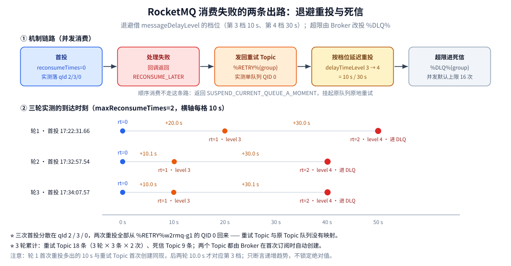
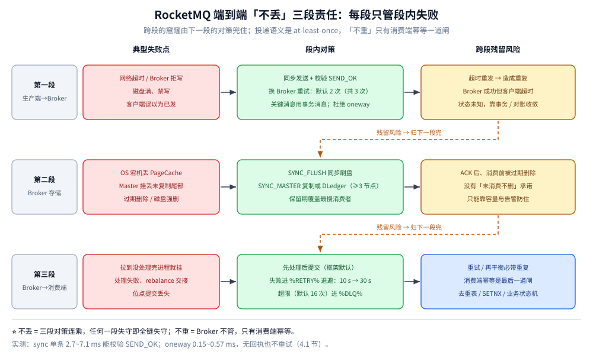

# 消息可靠性

> 覆盖 RocketMQ 的「不丢」怎么凑齐：刷盘策略 × 主从复制四组合的取舍与 DLedger 补的那一块、三种发送方式各自的回执能力与耗时量级、消息重试与死信队列的实现细节（含退避间隔与进死信的实测读数）、幂等为什么只能落在消费端，以及把这一切汇总起来的**端到端「不丢」三段责任表**。
>
> 不覆盖：写入链路上「写 PageCache 即返回」的机制见 [核心概念与架构.md](核心概念与架构.md) 第五节；消费位点与 rebalance 造成的重复见 [消费者与消费位点.md](消费者与消费位点.md)；失败堆积的处置见 [运维与排障.md](运维与排障.md)。
>
> 内容整理自个人学习笔记；刷盘与复制机制、重试与死信部分参考《RocketMQ 分布式消息中间件核心原理与最佳实践》（李伟）。本篇读数来自本机 `apache/rocketmq:5.3.1` 单机集群 + `rocketmq-client 5.3.1`。

---

## 一、刷盘策略 × 主从复制：四组合

| 组合 | 配置 | 可靠性 | 性能 | 适用 |
| --- | --- | --- | --- | --- |
| 异步刷盘 + 异步复制 | `ASYNC_FLUSH` + `ASYNC_MASTER`（**实测默认**） | 最低：OS 宕机丢 PageCache，Master 挂丢未同步数据 | 最高 | 日志、埋点等可容忍少量丢失 |
| 同步刷盘 + 异步复制 | `SYNC_FLUSH` + `ASYNC_MASTER` | 单机不丢；Master 挂可能丢未同步副本 | 中 | 消息不可丢、可接受 RT 上升 |
| 异步刷盘 + 同步复制 | `ASYNC_FLUSH` + `SYNC_MASTER` | Master 挂可切换，OS 宕机仍可能丢 | 中 | 高可用优先 |
| 同步刷盘 + 同步复制 | `SYNC_FLUSH` + `SYNC_MASTER` | 最高：落盘 + 从节点确认后才 ACK | 最低 | 支付、订单等金融场景 |

⭐ 这两列对应 [核心概念与架构.md](核心概念与架构.md) 第五节链路图的 ④ 与 ⑤ 两个开关：**一个管「本机磁盘上有没有」，一个管「别的机器上有没有」**，两个都开才等于「不丢」。

### 1.1 复制方式对「不丢」与 RT 的影响，以及 DLedger 补的那块

- **异步复制的丢失窗口**：Master 写完即 ACK，Slave 追赶是后台流式复制——Master 磁盘报废这类「不可恢复故障」时，**已 ACK 但未同步**的尾部消息即丢失。同步复制（`SYNC_MASTER`）把 ACK 推迟到组内多数 / Slave 落组成功，窗口归零，代价是 RT 受组内**最慢副本**牵制、Slave 落后时 Master 会限流拒绝写入（明确失败，不静默丢）。
- **原生主从缺的不是复制，是「切换」**：4.x 原生主从 Master 挂掉后 Slave **只读、不会自动升主**，该组写能力直接中断（客户端的延迟故障规避只是绕开发送，不能恢复写）。要自动切换才上 DLedger 模式：把一组 Broker 组成 Raft 组，Master 故障自动选主。
- **DLedger 的三笔代价**：① 每组必须 ≥3 节点（多数派）；② 提交需多数写成功，RT 与可用性绑定网络分区；③ 选主窗口内该组不可写。5.x 起也可用独立 NameServer 集群（`enableControllerInNamesrv`）承载主切换、保留原生复制模型——「自动切主」和「多数派写」其实是两件事，选型时分开评估。Raft 细节见 [Raft协议.md](../../../../04-架构与系统/分布式/共识协议/Raft协议.md)。
- 顺带回答「为什么半同步思路不常见」：RocketMQ 的 `SYNC_MASTER` 是「写组成功才 ACK」的整体语义，不像 MySQL 有「收到 ACK 即返回」的 after-sync 中间档——要「RT 低一点」只能靠减副本数或换异步，没有半档可调（以官方文档语义为准）。

## 二、消息重试与死信

| 阶段 | 机制 | 关键参数 |
| --- | --- | --- |
| 生产者重试 | 同步发送失败换队列 / Broker 重发 | `retryTimesWhenSendFailed`（客户端实测默认 **2** = 共 3 次尝试） |
| 消费者重试（并发） | 返回 `RECONSUME_LATER` → 进 `%RETRY%{group}`，延迟递增重投 | `maxReconsumeTimes`：客户端字段默认 `-1`（= 用框架默认），并发消费超限默认 16 次 |
| 消费者重试（顺序） | `SUSPEND_CURRENT_QUEUE_A_MOMENT` 挂起队列，**默认无限重试** | 顺序消费把 `-1` 映射成 `Integer.MAX_VALUE`（本机对 `ConsumeMessageOrderlyService.getMaxReconsumeTimes()` 字节码核实） |
| 死信 | 重试超限进 `%DLQ%{group}`，只能人工通过 Dashboard / `mqadmin` 重投 | 需监控 DLQ 条数 |

### 2.1 重试队列与死信的实现细节

- **命名规则**：消费组首次订阅时 Broker 自动创建 `%RETRY%{consumerGroup}`（较新版本按 Topic 细分为 `%RETRY%{group}_{topic}`，以自己集群版本为准）与 `%DLQ%{consumerGroup}` 两个系统 Topic——它们**与普通 Topic 走同一套存储与消费路径**，重试队列本质上只是「名字里带组的普通 Topic」，消费者会额外订阅它，因此重试消息天然回到**同一个组**而不是原 Topic 的其他组。
- **延迟递增 = 复用延迟消息机制**：并发消费失败时，客户端把消息「发回」重试 Topic，并携带 `reconsumeTimes` 映射出的延迟级别——首次重试是十秒级，随重试次数递增到分钟、小时级。⚠️ 这意味着**重试退避依赖延迟消息基础设施**：4.x 上第 16 次重试早已超过小时档，尾部会落在最高档反复等——退避不是无限的指数，是封顶的（18 级的上限是 2h，见 [消息类型与语义.md](消息类型与语义.md) 第三节）。
- **为什么顺序消费不能走 `%RETRY%`**：重试 Topic 的队列与原 Topic 队列没有顺序映射关系，消息绕道回来时**原队列里的后继消息会被先消费**，顺序直接破坏。所以顺序消费失败只能「挂起原队列、原地重试」，代价就是毒消息卡死整条队列——两条路是同一枚硬币的两面：**并发要吞吐所以敢换队重投，顺序要语义所以只能卡住**。
- **次数上限与判定的归属**：`reconsumeTimes` 存在消息系统属性里、跟着消息走（不是存在消费端），所以换实例、重启都不重置；超限（默认 16）后 Broker 侧改投 DLQ。
- **死信的「兜底」才是问题**：DLQ 队列容量有上限、且和消息保留期一样会被过期清理——**进 DLQ ≠ 进保险箱，没人管就是最终丢失**。可操作的分层：① 监控 `%DLQ%` 堆积数告警（Dashboard / `stats.log`）；② 上线一个专职「死信消费者」把消息落库归档；③ 业务侧按 [降级.md](../../../../04-架构与系统/分布式/稳定性/降级.md) 的**写降级补偿**思路处理：失败消息落本地补偿表，人工 / 定时重放，与「本地消息表」同构。

### 2.2 实测：一次「失败 → 退避重投 → 进死信」的完整读数

环境：`apache/rocketmq:5.3.1` 单 Broker（容器内 `javac` / `java` 为 OpenJDK 1.8.0_432，客户端 `rocketmq-client 5.3.1`）。Topic `w2rmq-lab` 4 队列，消费组 `w2rmq-g1` 显式 `maxReconsumeTimes=2`、消费线程 1，回调**一律返回 `RECONSUME_LATER`**；每轮同步发 3 条，连跑 3 轮。逐条打印投递时刻与消息自带的 `reconsumeTimes` / `delayTimeLevel`：

| 轮 | 首投时刻 | 第 1 次重投的间隔 | 该条携带 `delayTimeLevel` | 第 2 次重投的间隔 | 该条携带 `delayTimeLevel` | 之后 |
| --- | --- | --- | --- | --- | --- | --- |
| 1 | 17:22:31.66 | +20.0 s | 3 | +30.0 s | 4 | 进 DLQ |
| 2 | 17:32:57.54 | +10.1 s | 3 | +30.0 s | 4 | 进 DLQ |
| 3 | 17:34:07.57 | +10.0 s | 3 | +30.1 s | 4 | 进 DLQ |

`mqadmin getBrokerConfig` 实测 `messageDelayLevel = 1s 5s 10s 30s 1m …`，即第 3 档 = 10 s、第 4 档 = 30 s。后两轮的首次重投实测 10.0 s 正好落在第 3 档；第 1 轮多出的 10 s 与 `%RETRY%` Topic 的**首次创建**同时发生（首次订阅该 Topic 还要多等一轮拉取周期），不可复现为「退避本身」的一部分，所以只能断言趋势：**间隔按档位递增，不是自定义退避**。

三条实测结论：

- **退避档位是「借」来的**：重投消息带的 `delayTimeLevel` 随失败次数从 3 走到 4，对应 `messageDelayLevel` 的 10 s / 30 s 两档 —— 2.1 节「复用延迟消息机制」由此坐实，也说明退避序列被这张固定档位表限死。
- **重投会把消息搬到另一个队列**：3 条消息首投时分散在 `queueId=2 / 3 / 0`（轮询选队列），两次重投**全部**从 `%RETRY%w2rmq-g1` 的 `queueId=0` 回来。`mqadmin topicStatus` 显示该重试 Topic 只有 1 个队列、3 轮累计 Max Offset 18（= 3 轮 × 3 条 × 2 次），`consumerProgress` 里 `Broker Offset 18 / Consumer Offset 18 / Diff 0`。这就是 2.1 节「重试 Topic 与原 Topic 队列没有顺序映射关系」最直接的照片。
- **DLQ 也是自动建的普通 Topic**：`%DLQ%w2rmq-g1` 单队列、Max Offset 9（= 3 轮 × 3 条），`topicList` 里它和 `%RETRY%`、`SCHEDULE_TOPIC_XXXX`、`rmq_sys_wheel_timer` 混在一起，没有特殊权限。

死信的重投同样实测过：用一个**新消费组**订阅 `%DLQ%w2rmq-g1` 能把 9 条全部读走，逐条 `new Message(原 Topic, 原 tag, 原 key, 原 body)` 再 `send`，9 条全部返回 `SEND_OK`，落位变成 `queueId=0/1/3`、`queueOffset=1…6`（重新轮询选队列）。⚠️ 两个连带结论：① 重投是**发一条新消息**，不是把状态回滚——`Message` 类根本没有 `setReconsumeTimes`（本机编译期直接报 `cannot find symbol`），所以重投后消息在 DLQ 里留下的 `reconsumeTimes=3` 不会带进新消息；② 正因为 msgId / 队列 / 位点全变了，3 节的去重 key 只能用业务唯一键。完整处置顺序见 [运维与排障.md](运维与排障.md) 第三节。

> ⚠️ 修正第二节表格里「只能人工通过 Dashboard / `mqadmin` 重投」的口径：本机 5.3.1 的 `mqadmin` **没有**死信重投子命令（可用的是 `queryMsgByKey`、`queryMsgById`、`resetOffsetByTime`、`cloneGroupOffset`、`consumeMessage` 这一批，均不做「读 DLQ → 发回原 Topic」），实际可落地的就是上面这段「自己起一个消费者订阅 `%DLQ%{group}` 再发送」。rocketmq-dashboard 上的「重新投递」按钮本机**未实测**（未部署 Dashboard），只按其可见功能对待。

下图把 2.1 的机制和 2.2 的读数合在一条流转线上（并发消费与顺序消费两个分支）：



## 三、消息幂等（必须消费端做）

RocketMQ 只保证 **at least once**：网络抖动、超时重发、位点提交失败都会导致重复消费，**Broker 不做去重**，去重只能落在消费端：

| 方案 | 实现 | 优点 | 缺点 |
| --- | --- | --- | --- |
| 唯一索引去重表 | 消费前插入去重表（`msg_key` 唯一索引），冲突即已消费 | 强一致、实现简单 | 每次消费一次 DB 写，需定期清理 |
| Redis 去重 | `SET key:msgKey 1 NX EX 86400`，返回 0 则跳过 | 性能高、天然过期 | 需容忍 Redis 故障（可降级放行） |
| 业务状态机 | `UPDATE order SET status='PAID' WHERE id=? AND status='UNPAID'`，影响行数 0 即重复 | 无额外存储、最贴近业务 | 仅适用有状态流转的场景 |

⚠️ 去重 key 优先用**业务唯一键**（`msg.getKeys()`、订单号），不要用 `msgId`：消息进重试队列后 msgId 与 offsetMsgId 都会重新生成。

## 四、端到端「消息不丢」三段责任表

把前面所有机制按「失败发生在哪一段」重排——每段只对段内失败负责，跨段的窟窿必须由下一段的对策补：

| 段 | 典型失败点 | 段内对策 | 段间残留风险（归下一段兜） |
| --- | --- | --- | --- |
| **生产端 → Broker** | 网络超时、Broker 拒写（磁盘满 / 禁写）、客户端误以为已发 | 同步发送 + 校验 `SEND_OK` + 换 Broker 重试；关键消息用事务消息把「本地落库」与「发送」绑成最终一致；杜绝 oneway | 超时重发造成**重复**；「Broker 成功但客户端超时」造成状态未知 → 靠事务消息 / 对账收敛 |
| **Broker 存储** | OS 宕机丢 PageCache、Master 故障丢未复制尾部、过期删除 / 磁盘强删 | 同步刷盘、同步复制或 DLedger；保留期覆盖最慢消费者 | ACK 之后**消费前**消息被过期物理删除（保留期 < 堆积时长）→ 只能靠容量与告警防住，没有「未消费不删」承诺 |
| **Broker → 消费端** | 拉到了没处理完进程就挂、处理失败、rebalance 交接、提交位点丢失 | **先处理后提交**（框架默认即如此）；失败交给 `%RETRY%` 退避重试；毒消息有上限后进 DLQ 并有人兜底 | 重试 / 再平衡必带**重复** → 消费端幂等是整条链的最后一道闸（去重表 / 状态机） |

⭐ 一句话版本：RocketMQ 的投递语义是 **at-least-once**——「不丢」由三段各自对策连乘而成（任何一段失守全链即失守），「不重」Broker 不管，只有消费端一道防线。



### 4.1 三种发送方式：第一段的全部选择

生产端 → Broker 这一段能不能「不丢」，首先取决于选哪种发送方式——只有同步发送拿得到 `SEND_OK`，也才谈得上第四节表里写的「校验 `SEND_OK`」：

| 发送方式 | 客户端 API | 有没有回执 | 失败会不会自动重试 | 可靠性 |
| --- | --- | --- | --- | --- |
| 同步发送 | `producer.send(msg)` | 阻塞到 Broker 回 `SendResult`，可判 `SEND_OK` | 会：本机 `retryTimesWhenSendFailed` 实测默认 **2**（共 3 次尝试），每次换队列 | 高，「不丢」段的标准选择 |
| 异步发送 | `producer.send(msg, SendCallback, timeout)` | 有，但在回调线程里才知道成败 | 会：`retryTimesWhenSendAsyncFailed` 同样默认 2 | 与同步等价，代价是回调线程要自己管成败与补偿 |
| 单向发送 | `producer.sendOneway(msg)` | ❌ 无回执、无异常（连 Broker 拒写都不告诉你） | ❌ 不重试 | 最低，只能用于可容忍整段丢失的埋点 / 日志 |

**本机实测三种方式的耗时量级**（`apache/rocketmq:5.3.1` 单 Broker，Java 客户端 5.3.1；每种方式预热 20 条后连发 100 条，各跑 3 轮；`oneway` 记的是「调用返回」耗时，`sync` 记的是「拿到 `SendResult`」耗时）：

| 方式 | 单条平均（3 轮） | 单条最大（3 轮） | 失败数 |
| --- | --- | --- | --- |
| `sync` | 4.7 / 7.1 / 2.7 ms | 14.8 / 36.0 / 7.9 ms | 0 |
| `oneway` | 0.27 / 0.15 / 0.57 ms | 5.7 / 2.6 / 20.6 ms | 0 |
| `async` | 回执 100/100 条，`fail=0`；本轮从提交到回调的等待 70~401 ms | — | 0 |

三点读法：

1. **`oneway` 比 `sync` 低一个量级**（0.15~0.57 ms vs 2.7~7.1 ms），省掉的正是「等 Broker 回包」这一趟；但省掉这趟的同时也省掉了「知道成败」——这是第四节第一段「杜绝 oneway」的实度量纲。
2. ⚠️ **`async` 那一列不能当 RT 读**：100 条在几百毫秒内全部提交进客户端发送队列，回调延迟被排队时间主导（本机 70~401 ms 波动，远大于 `sync` 的单条耗时），它反映的是「批量提交后的排队」而不是单条链路成本。异步的价值在**不阻塞业务线程**，不在降 RT。
3. 三种方式的**成败判定能力**才是可靠性差异的来源，耗时只是副产品；选 `sync` + 校验 `SEND_OK` + 允许换队列重试，是第一段唯一能自证的写法。

## 五、实测：`ASYNC_FLUSH` 与 `SYNC_FLUSH` 的 RT 对照

环境：`apache/rocketmq:5.3.1` 单机（1 NameServer + 1 Broker）。测法：生产者预热 20 条后，连发 100 条**同步发送**，统计单条平均与最大耗时；每组跑 3 轮。⚠️ **每组都改 `broker.conf` 后重启 Broker**（原因见本节第 3 条）。

| 组 | 配置 | 单条平均 RT（3 轮） | 单条最大 RT（3 轮） | 启动时选的刷盘服务 |
| --- | --- | --- | --- | --- |
| A | `ASYNC_FLUSH` + `flushCommitLogTimed=true`（默认） | 6.6 / 3.8 / 4.0 ms | 15.2 / 7.5 / 8.1 ms | `FlushRealTimeService` |
| B | `SYNC_FLUSH` + `flushCommitLogTimed=true` | 20.3 / 5.2 / 6.8 ms | 82.3 / 9.0 / 14.7 ms | `GroupCommitService` |
| C | `SYNC_FLUSH` + `flushCommitLogTimed=false` | 5.4 / 4.8 / 4.7 ms | 8.2 / 8.4 / 9.2 ms | `GroupCommitService` |

三条结论，第 3 条比数字本身重要：

1. **本机测不出 `SYNC_FLUSH` 的显著代价**：三组稳态都在 4~7 ms 量级，只有组 B 的首轮偏高（平均 20.3 ms、最大 82 ms）——那一轮同时包含了页缓存预热与刷盘服务刚启动。B 与 C 只差 `flushCommitLogTimed` 一个开关，实测几乎一致。
2. ⚠️ **不能因此断言「`SYNC_FLUSH` 在生产上不贵」**：这条 RT 里包含一次完整的 RPC 往返 + 客户端排队 + JVM 开销，而宿主机是 Docker Desktop on Windows、落盘经虚拟化磁盘，fsync 的增量被这些开销**淹没**了。「实测结论与常识不符时，先怀疑环境把差异抹平了」——要量真实代价，必须在目标硬件上重复这个实验，并补一个能放大差异的对照组。
3. ⭐ **刷盘服务的实现类在 Broker 启动时就选定了**：`SYNC_FLUSH` 对应 `GroupCommitService`、`ASYNC_FLUSH` 对应 `FlushRealTimeService`。本机先试过用 `mqadmin updateBrokerConfig -k flushDiskType -v SYNC_FLUSH` **运行时切换**——配置值确实变了，但 `store.log` 里仍在打印 `FlushRealTimeService` 的刷盘统计，直到写进 `broker.conf` 重启后日志才出现 `GroupCommitService service started`。**结论：改 `flushDiskType` 必须改配置文件并重启，运行时改不生效。**

```text
# 重启后才出现的日志（12:13:02）
INFO main - start commitLog successfully. storeRoot: /home/rocketmq/store
INFO GroupCommitService - GroupCommitService service started
```

> ⚠️ **单机测不出复制侧**：`SYNC_MASTER` 的 RT 取决于组内最慢副本，本机只有一个 Broker 无法构造——上表只覆盖了刷盘（④）那一半，复制（⑤）那一半按官方文档口径陈述。

## 延伸追问

- **如何保证消息不丢、不重复？** 不丢：生产端同步发送 + 重试 + 事务消息，Broker 端按 SLA 组合刷盘 × 复制，消费端处理成功后再提交位点；不重复：RocketMQ 只保证 at-least-once，只能消费端幂等（去重表 / Redis SETNX / 业务状态机），去重 key 用业务唯一键而非 msgId。（第三、四节）
- **什么时候必须上 DLedger？** 需求是「Master 故障自动恢复**写**能力」时——原生主从的 Slave 不会自动升主，客户端故障规避只救发送不救该组写。代价：≥3 副本、多数派写抬高 RT、选主窗口不可写。本质是把 NameServer 不要的强一致，恰好补给「谁是 Master」这份不能靠重试消化的元数据。（第一节）
- **死信队列里消息放着就安全吗？** 不：DLQ 队列容量有上限会被覆盖，消息同受全局保留期约束，到期物理删除——没人消费的死信等于丢了。标准动作是监控 DLQ 增量告警 + 专职消费者落库归档 + 按写降级补偿思路重放。（2.1 节）
- **为什么顺序消费不能走 `%RETRY%`？** 重试 Topic 的队列与原 Topic 队列没有顺序映射关系，消息绕道回来时原队列的后继消息会被先消费，顺序直接破坏；所以顺序消费只能「挂起原队列、原地重试」，代价是毒消息卡死整队。（2.1 节）
- **把 `flushDiskType` 改成 `SYNC_FLUSH` 就一定慢很多吗？** 本机实测三组（默认 / `SYNC_FLUSH`+定时 / `SYNC_FLUSH`+非定时）稳态都在 4~7 ms 量级，差异被 RPC 与宿主环境淹没，**不能**据此下「便宜」或「昂贵」的结论；但有一条是确定的：刷盘服务的实现类在 Broker 启动时选定，改 `flushDiskType` 必须改配置文件并**重启**才生效。（第五节）
- **同步、异步、单向发送在「不丢」上差在哪？** 差在有没有回执、失败会不会自动重试：`sync` 阻塞拿到 `SendResult` 才能校验 `SEND_OK`，`async` 有回执但在回调线程里，`oneway` 既无回执也不重试（Broker 拒写也不会通知）。本机实测 `oneway` 单条 0.15~0.57 ms、`sync` 2.7~7.1 ms，省下的一个量级正是「等回包」这一趟，代价是失去成败判定；`async` 的回调等待受批量提交排队影响（本机 70~401 ms），不能当单条 RT 读。（4.1 节）
- **消费失败的退避间隔到底是多少？** 借 `messageDelayLevel` 的档位：本机实测 `maxReconsumeTimes=2` 下，首投失败后第 1 次重投带 `delayTimeLevel=3`（10 s 档，实测间隔 10.0~20.0 s，首轮多出的一倍与重试 Topic 首次创建同现），第 2 次带 `delayTimeLevel=4`（30 s 档，实测 30.0~30.1 s），随后超限进 `%DLQ%{group}`。退避不是自定义指数，而是被这张固定档位表限死。（2.1、2.2 节）
- **死信队列里的消息怎么捞回来？** 用一个新消费组订阅 `%DLQ%{group}` 读走，逐条按原 Topic / tag / key / body 重新 `send`——本机实测 9 条全部 `SEND_OK`，但落位换到了别的队列和新位点。这是「发新消息」不是「状态回滚」：`Message` 类连 `setReconsumeTimes` 都没有（编译期即报 `cannot find symbol`），所以重投必须搭配消费端幂等。（2.2 节）

## 关联

- **上游/总纲**：[README.md](README.md) — 本目录导读与阅读路线
- **对照/互补**：[核心概念与架构.md](核心概念与架构.md) — 写入链路与 ACK 时机的机制底座
- **对照/互补**：[消费者与消费位点.md](消费者与消费位点.md) — rebalance 造成的重复从哪来
- **对照/互补**：[消息类型与语义.md](消息类型与语义.md) — 事务消息作为生产端「不丢」的兜底
- **对照/互补**：[运维与排障.md](运维与排障.md) — 过期删除导致的「ACK 了也会丢」
- **对照/互补**：[消息可靠性.md](../Kafka/消息可靠性.md) — Kafka 侧三侧配置凑「不丢」的对照
- **上游/总纲**：[重试与超时.md](../../../../04-架构与系统/分布式/稳定性/重试与超时.md) — 消费重投的次数、退避与超时预算
- **上游/总纲**：[最终一致方案.md](../../../../04-架构与系统/分布式/分布式事务/最终一致方案.md) — 可靠消息最终一致
- **上游/总纲**：[降级.md](../../../../04-架构与系统/分布式/稳定性/降级.md) — 写降级补偿
> 反向引用（本篇被下列文档引到）：[部署与配置.md](部署与配置.md)
