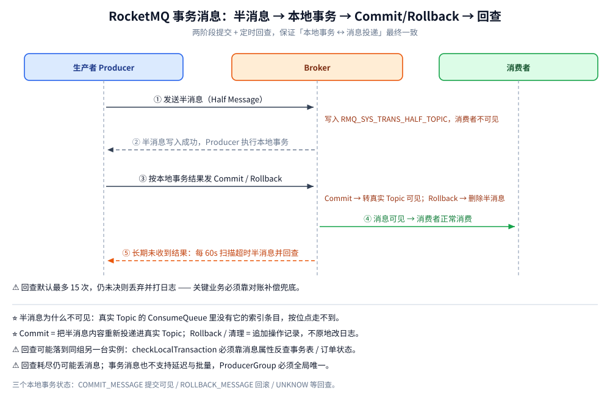
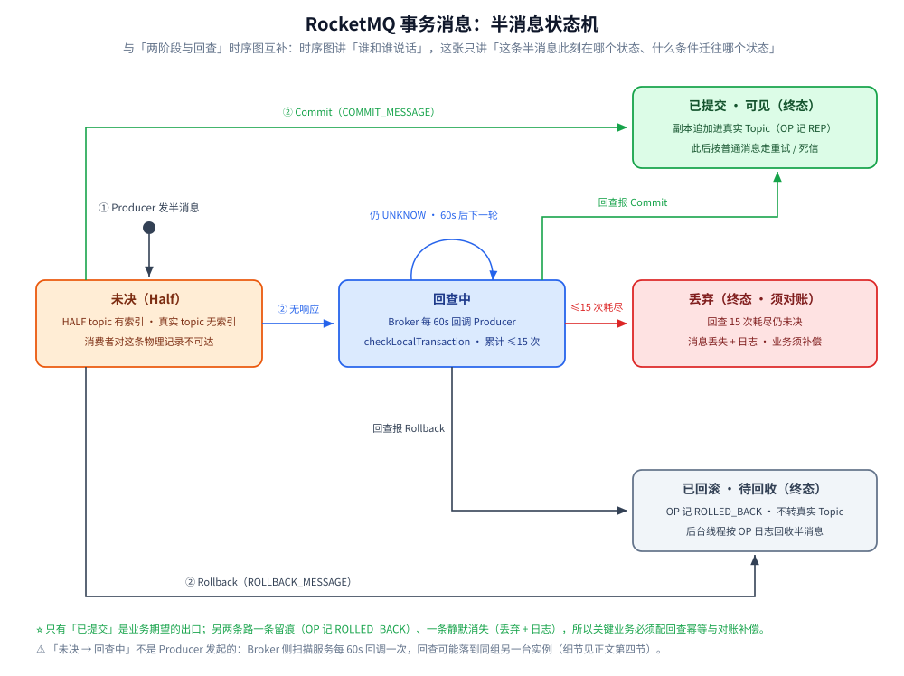

# 消息类型与语义

> 覆盖 RocketMQ 六种消息类型——普通、顺序、延迟、事务、批量、消息轨迹——各自的语义、典型场景、限制与实现路径，重点讲清 4.x 固定 18 级延迟与 5.x 任意时间延迟的分水岭、以及事务消息的两阶段 + 回查。
>
> 不覆盖：消息类型依赖的三层存储与写入链路见 [核心概念与架构.md](核心概念与架构.md)；失败重投与死信队列见 [消息可靠性.md](消息可靠性.md)；三种消息的**完整可运行代码**见语言分册 [接入RocketMQ.md](../../../../01-编程语言/java/工程实践/接入RocketMQ.md)（Java）与 [接入RocketMQ.md](../../../../01-编程语言/go/工程实践/接入RocketMQ.md)（Go）。
>
> 内容整理自个人学习笔记；延迟消息与事务消息的实现部分参考《RocketMQ 分布式消息中间件核心原理与最佳实践》（李伟）。本篇读数来自本机 `apache/rocketmq:5.3.1` 单机集群 + `rocketmq-client 5.3.1`（Java）/ `rocketmq-client-go/v2`（Go）。

---

## 一、六种消息类型全景

| 类型 | 核心语义 | 消费方式 | 关键 API |
| --- | --- | --- | --- |
| **普通消息** | 无顺序保证，吞吐最高 | `MessageListenerConcurrently` | `producer.send(msg)` |
| **顺序消息** | 同 key 严格 FIFO，分区顺序 / 全局顺序 | `MessageListenerOrderly` | `send(msg, selector, arg)` |
| **延迟消息** | 4.x 18 个固定级别；5.x 任意时间 | 同普通消息 | `setDelayTimeLevel(n)` / `setDelayTimeMs()` |
| **事务消息** | 本地事务与消息投递最终一致 | 同普通消息 | `TransactionMQProducer` |
| **批量消息** | 多条小消息合并发送，减少 RPC 次数 | 同普通消息 | `send(Collection<Message>)` |
| **消息轨迹** | 生产/存储/消费全链路轨迹，写系统 Topic | — | `setEnableMsgTrace(true)` |

## 二、普通消息与顺序消息

**普通消息**没有顺序保证：`DefaultMQProducer` 默认**轮询**所有队列，所以同一批消息会被打散到不同队列。本机实测（`lab-java` 4 队列）：三条同步发送分别落 `queueId=1/2/3`，异步那条落 `queueId=1`，单向那条落 `queueId=0`——一条消息落哪个队列由客户端选队列策略决定。

**典型场景（普通消息）**：

| 场景 | 为什么用它 / 做法与边界 |
| --- | --- |
| 事件解耦与多下游分发 | 下单成功后把「订单创建」事件发到一个 Topic，积分、风控、推荐、数仓各建一个消费组订阅；新增下游只加消费组、不改上游代码，同一条消息物理只存一份（见 [核心概念与架构.md](核心概念与架构.md) 4.2 节） |
| 削峰填谷 | 大促、秒杀把请求先写进 Topic，消费者按数据库能承受的速率匀速拉取，把峰值摊成平稳的消费曲线；堆积由 Broker 的磁盘承担（处置顺序见 [运维与排障.md](运维与排障.md) 第一节） |
| 可容忍重复的通知 | 短信、邮件、站内信、Push；失败会进 `%RETRY%` 重投（见 [消息可靠性.md](消息可靠性.md) 第二节），业务侧用「手机号 + 模板 + 业务单号」做幂等即可 |
| ⚠️ 不适合：同一实体的状态流转 | 默认轮询会把「创建 → 支付 → 取消」打散到不同队列（本机实测 `queueId=1/2/3`），并发消费下后发的消息可能先被处理——这类场景改用下面的顺序消息 |

### 2.1 顺序消息的两种粒度

- **全局顺序**：Topic 只建 1 个队列，Producer 单线程发、Consumer 单线程收（吞吐低，仅强合规场景用）。
- **分区顺序（生产常用）**：队列数 > 1，用 `MessageQueueSelector` 把**同一业务 key**（如 orderId）路由到**同一队列**，消费者用 `MessageListenerOrderly` 按队列加锁消费。

本机实测（`lab-order` 4 队列，同一 `orderId = ORDER_SEQ_9001`，连发 4 条）：

```text
ORDER  seq=1 queueId=1 offset=0 sameQueue=true
ORDER  seq=2 queueId=1 offset=1 sameQueue=true
ORDER  seq=3 queueId=1 offset=2 sameQueue=true
ORDER  seq=4 queueId=1 offset=3 sameQueue=true
```

⭐ 四条消息全部落 `queueId=1` 且偏移连续 `0,1,2,3`；消费侧用 `MessageListenerOrderly` 消费时也按 `offset 0→3` 顺序回调。Go 侧（`HashQueueSelector` + `ShardingKey`）跑出同样结果——**顺序的前提是「同 Key 同队列」，而不是靠消费端补救**。

**典型场景（顺序消息）**：

| 场景 | 为什么用它 / 做法与边界 |
| --- | --- |
| 订单状态流转 | 同一 `orderId` 的创建 → 支付 → 发货 → 完成必须按序应用，乱序时「发货」先于「支付」会被状态机的合法转移校验直接拒绝（见 [订单系统设计.md](../../../../04-架构与系统/系统设计/秒杀系统/订单系统设计.md) 第一节）；用 `orderId` 做选队列的 key，**不同订单之间仍然并行** |
| 账户与库存流水 | 同一 `accountId` 的扣款 / 回补、同一 `skuId` 的扣减 / 归还按序落账，否则余额或可售库存会被旧值覆盖 |
| 同一主键的变更重放 | CDC / binlog 同步把同一行的多次变更投给下游时，目标侧要按提交顺序覆盖，否则旧镜像可能盖掉新镜像 |
| ⚠️ 场景筛选 | 顺序的代价是「队列数锁死 + 单队列串行」，只把**真正需要按实体保序**的链路做成顺序消息；不同实体之间没有顺序要求时用 key 分散到多队列并行，不要为了省事开全局顺序（1 队列 = 吞吐封顶）。队列数怎么按峰值并行度一次定好见 [部署与配置.md](部署与配置.md) 第四节；脏数据卡死整条队列的预案见下面的限制 ④ |

⚠️ 四条限制：

| 限制 | 后果 |
| --- | --- |
| ① 队列数确定后不能再改 | 扩容会让同一 key 落不同队列，历史顺序断裂 |
| ② 顺序消息**不支持广播模式** | 广播场景要顺序须自己在业务层做 |
| ③ 必须用 `send(msg, selector, arg)` | 普通 `send` 会轮询打散，顺序在入口就没了 |
| ④ `MessageListenerOrderly` 消费失败默认**无限重试并阻塞该队列** | 返回 `SUSPEND_CURRENT_QUEUE_A_MOMENT` 原地重试以保证不跳号，脏数据会卡死整条队列 |

## 三、延迟消息：4.x 与 5.x 的分水岭

**4.x：18 个固定延迟级别**（level 从 1 开始，无 level 0）。本机 5.3.1 的 `messageDelayLevel` 实测默认值：

```text
messageDelayLevel = 1s 5s 10s 30s 1m 2m 3m 4m 5m 6m 7m 8m 9m 10m 20m 30m 1h 2h
```

| Level | 1 | 2 | 3 | 4 | 5 | 6 | 7 | 8 | 9 | 10 | 11 | 12 | 13 | 14 | 15 | 16 | 17 | 18 |
| --- | --- | --- | --- | --- | --- | --- | --- | --- | --- | --- | --- | --- | --- | --- | --- | --- | --- | --- |
| 延迟 | 1s | 5s | 10s | 30s | 1m | 2m | 3m | 4m | 5m | 6m | 7m | 8m | 9m | 10m | 20m | 30m | 1h | 2h |

**5.x：任意时间定时消息**（RIP-43），系统 Topic 为 `rmq_sys_wheel_timer`，基于 TimerLog + 多级时间轮：

```java
Message msg = new Message("TopicDelay", body);
msg.setDelayTimeSec(10);                                     // 10s 后投递
msg.setDelayTimeMs(10_000L);                                 // 毫秒版，效果同上
msg.setDeliverTimeMs(System.currentTimeMillis() + 10_000L);  // 定时到某个时间点投递
```

| 维度 | 4.x 固定级别 | 5.x 任意时间 |
| --- | --- | --- |
| 灵活性 / 精度 | 只能选 18 个档位，秒级 | 毫秒级任意时间，默认精度 `timerPrecisionMs=1000`（实测） |
| 上限 | 2h（改 `messageDelayLevel`） | `timerMaxDelaySec`，实测默认 **259200**（= 3 天），超出报 `timer message illegal` |
| 实现 / 客户端 | `SCHEDULE_TOPIC_XXXX` + 定时扫描；`setDelayTimeLevel` | `rmq_sys_wheel_timer` + 时间轮；`setDelayTimeSec/Ms`、`setDeliverTimeMs`（需 5.0.0+ 客户端 + 5.x Broker） |

⭐ 本机实测（5.3.1 Broker + 5.3.1 Java 客户端）两条延迟消息：

| 消息 | 方式 | 结果 |
| --- | --- | --- |
| level 5（1 分钟） | `msg.setDelayTimeLevel(5)` | 发送 `SEND_OK`；12s 后真实 Topic `lab-delay` 里**仍看不到它**（未到期） |
| 10 秒定时 | `msg.setDelayTimeMs(10_000L)` | 发送 `SEND_OK`；12s 后真实 Topic `lab-delay` 位点 = **1**（已到期投递） |

同时 `mqadmin topicList` 里 `SCHEDULE_TOPIC_XXXX` 与 `rmq_sys_wheel_timer` **两个系统 Topic 都在**（前者是 4.x 兼容路径，后者是 5.x 时间轮），store 根目录下也有固定的 `timerwheel` 文件（实测 38,707,200 字节）。⚠️ 4.x 的 `setDelayTimeLevel(0)` 会抛异常；Go 老客户端（`rocketmq-client-go/v2`）用 `WithDelayTimeLevel` 连 5.x Broker 时仍按 18 个固定档位生效，**不会**升级为任意延迟。

**典型场景（延迟消息）**：

| 场景 | 做法 | 边界 |
| --- | --- | --- |
| 超时关单 | 下单时投一条 30 分钟延迟消息，到点检查订单仍是「待支付」就取消并归还库存；4.x 选 `setDelayTimeLevel(16)`（30m），5.x 用 `setDelayTimeMs(30 * 60 * 1000L)` | 延迟消息可能丢、可能积压，**扫表兜底必须保留**；两条路的成本对照见 [订单系统设计.md](../../../../04-架构与系统/系统设计/秒杀系统/订单系统设计.md) 第五节 |
| 到期提醒 | 优惠券到期前 3 天、预约开始前 1 天；4.x 改 `messageDelayLevel` 加长档位，或上 5.x 用 `setDeliverTimeMs(目标时刻)` | 4.x 默认最大只有 2h；5.x 默认上限 3 天（`timerMaxDelaySec=259200`），7 天以上的周期提醒要调大配置或改用调度系统 |
| 延迟重试与定时轮询 | 支付结果查单按 5s / 30s / 1m / 5m 逐级退避、下单后延迟双查库 | 消费失败进 `%RETRY%` 后的重投本身就是延迟级别机制的一次复用（见 [消息可靠性.md](消息可靠性.md) 第二节） |
| ⚠️ 精度边界（所有场景共通） | 把延迟时间当作「大致到点」，关键时点另配调度或扫表 | 5.x 默认 `timerPrecisionMs=1000`，停机期间到期的消息会在恢复后集中补投（见 3.1 节）；账务结算、整点开抢这类强时点任务不能只靠它 |

### 3.1 延迟消息的实现代价与重启行为

- **4.x 为什么「只能 18 档」反而便宜**：每个级别独占 `SCHEDULE_TOPIC_XXXX` 的一条队列，队列内消息天然按到期时间有序（同级别延迟相同 → 写入顺序就是到期顺序），扫描只需看队头，**没有任何排序/优先队列成本**。任意时刻数就要求队列按「到期时间」排序，这是 18 档与任意时间之间真正的工程分水岭。
- **5.x 时间轮的代价换灵活性**：任意定时消息先顺序追加进 TimerLog，再由多级时间轮（按到期时间分格）驱动投递。延迟档位从「零成本」变成「要维护轮 + 重写投递」，精度由 `timerPrecisionMs` 控制，精度调得越细、轮推进越频繁。
- **重启行为（定性）**：两代的延迟消息**都是先落 CommitLog 再延迟投递**，到期时间随消息持久化，Broker 重启后从持久化的进度（4.x 各级别队列消费位点 / 5.x 定时器的 checkpoint 从 TimerLog 重放）继续投递——**不会丢，也不会提前**；但停机期间到期的消息会在恢复后集中补投，下游要按「延迟可能批量迟到」设计。
- 无论哪代，「延迟」改变的只是**投递时机**，不影响存储顺序与消费语义；消费失败的 `%RETRY%` 重投本身就是对延迟级别机制的一次复用（见 [消息可靠性.md](消息可靠性.md) 第二节）。

## 四、事务消息（两阶段 + 回查）



1. Producer 发送**半消息（Half Message）**：对消费者不可见，写入系统 Topic `RMQ_SYS_TRANS_HALF_TOPIC`；
2. Broker ACK 后 Producer 执行**本地事务**，再按结果发送 **Commit / Rollback**：Commit 把消息转入真实 Topic 并可见，Rollback 删除半消息；
3. 若 Broker 长时间收不到结果（Producer 回 `UNKNOW`、宕机或断网），`TransactionalMessageCheckService` **每 60s 扫描**超时半消息，回查 Producer 的 `checkLocalTransaction`，默认最多 **15 次**，仍未决则丢弃并打日志。

⭐ 三个本地事务状态：`COMMIT_MESSAGE`（提交，消息可见）、`ROLLBACK_MESSAGE`（回滚，半消息删除）、`UNKNOW`（等 Broker 回查）。
⚠️ 事务消息是**最终一致**而非强一致：回查耗尽仍可能丢消息，关键业务要对账补偿；也不支持延迟与批量。

**典型场景（事务消息）**：

| 场景 | 做法 | 边界 |
| --- | --- | --- |
| 下单扣库存 + 发事件 | 本地事务里建订单、扣库存，同时把「订单已创建」事件交给履约、积分、风控 | 解决「库存扣了、消息没发出去」或「消息发了、本地事务回滚了」两种不一致，是 [订单系统设计.md](../../../../04-架构与系统/系统设计/秒杀系统/订单系统设计.md) 第三节四条路中的一条 |
| 支付成功触发下游 | 支付单状态落库与「支付成功」事件同生共死；发货、开票、通知各自异步消费 | 主链路不再逐一同步调用，下游感知延迟由回查节奏与消费链路共同决定 |
| 与本地消息表选型 | 已有消息表、或 MQ 不支持事务消息 → 本地消息表更通用；不占业务库、无轮询延迟 → 事务消息 | 事务消息绑定 RocketMQ 且必须实现回查；完整对照见 [最终一致方案.md](../../../../04-架构与系统/分布式/分布式事务/最终一致方案.md) 第三节与 [消息队列选型对比.md](../消息队列选型对比.md) 第四节 |
| ⚠️ 管不到的地方 | 事务消息 ≠ 分布式事务；下游一致性另配幂等、对账与补偿 | 只保证「本地事务 ↔ 消息投递」的最终一致；不支持延迟与批量，别指望「事务消息 + 30 分钟延迟」叠在一起用 |

本机实测（三条事务消息分别返回 commit / rollback / UNKNOW）：

| 观察对象 | 位点 | 说明 |
| --- | --- | --- |
| `RMQ_SYS_TRANS_HALF_TOPIC` | **3** | 三条半消息**都**先落在这里（对消费者不可见） |
| `RMQ_SYS_TRANS_OP_HALF_TOPIC` | **1** | 操作日志（已回滚/已提交的标记）只写了 1 条 |
| 真实 Topic `lab-tx` | **1** | 只有 `COMMIT` 的那条被转入、对消费者可见 |

⭐ 这三行读数把「半消息不可见」讲透了：**三条消息物理上都在 CommitLog 里，但只有 1 条在真实 Topic 的 ConsumeQueue 里有索引**——可见性由索引决定，不由存储位置决定。



上面的时序图讲「谁和谁说话」，下面的状态机讲「这条半消息此刻处于什么处境」——两个视角合起来才是事务消息的全貌：

| 当前态 | 存储形态 | 迁移条件 | 迁移结果 |
| --- | --- | --- | --- |
| **未决（Half）** | HALF topic 有索引、真实 topic 无索引 → 消费者不可达 | Producer 回 `COMMIT_MESSAGE` | **已提交**：副本追加进真实 topic（OP 记 REP），转为可见 |
| **未决（Half）** | 同上 | Producer 回 `ROLLBACK_MESSAGE` | **已回滚**：OP 记 `ROLLED_BACK`，等后台线程回收 |
| **未决（Half）** | 同上 | 回 `UNKNOW`、宕机或断网 | **回查中**：Broker 每 60s 回调 `checkLocalTransaction` |
| **回查中** | HALF 索引仍在 | 回查报 Commit / Rollback | 进入上面的**已提交 / 已回滚** |
| **回查中** | 同上 | 回查仍 `UNKNOW` | 原地等下一轮（累计 ≤15 次） |
| **回查中** | 同上 | 15 次耗尽仍未决 | **丢弃**：消息丢失 + 日志，业务必须对账补偿 |

### 4.1 半消息为什么「不可见」，回查为什么「必须写」

- **不可见靠的是「位点模型」而非「隐藏标记」**：消费者拉消息的路径是 真实 Topic → ConsumeQueue → CommitLog（见 [核心概念与架构.md](核心概念与架构.md) 第四节）。半消息虽然躺在 CommitLog 里，但**真实 Topic 的 ConsumeQueue 里没有它的索引条目**，消费者按位点根本走不到这条物理记录——不需要任何「不可见标志位」，索引缺席即不可见。
- **Commit = 追加一条新消息，Rollback = 追加一条操作记录**：提交时 Broker 把半消息内容**重新投递**进真实 Topic（生成新的 CommitLog 记录 + 真实队列的 ConsumeQueue 索引，所以半消息与其副本的 offsetMsgId 不同，幂等键要用业务 Key）；回滚与清理都不原地改日志，而是往 `RMQ_SYS_TRANS_OP_HALF_TOPIC` 追加「已回滚/已提交」标记，后台线程按操作日志回收——标准的 **append-only + 补偿日志**做法，与 CommitLog 布局的约束一脉相承。状态全景：

```text
sendMessageInTransaction
   │ ①发半消息
   ▼
HALF topic 有索引、真实 topic 无索引（消费者不可达=不可见）
   │ ②本地事务 → Commit / Rollback / (无响应)
   ├─ Commit   ─► 追加副本进真实 topic(OP 记 REP)      ─► 消费者可见
   ├─ Rollback ─► OP 记 ROLLED_BACK                    ─► 清理线程回收半消息
   └─ 无响应   ─► 60s 周期回查循环(≤15次) ─► 超时耗尽 ─► 丢弃+日志(业务需对账)
```

- **回查是唯一的修复通道，不是可选优化**：半消息发出后、Commit 前 Producer 宕机，本地事务的结果**只有那个进程知道**——不实现回查，这条消息要么永远不可见、要么被丢。两个实战细节：① 回查请求可能落到**同组另一台**没发过这条消息的实例上，所以 `checkLocalTransaction` 必须靠消息属性反查事务表/订单状态，不能依赖内存 Map；② 回查逻辑与本地事务写入必须在同一事务边界内可见（先落库再返回 COMMIT 的可能性都要能查到），这正是 [最终一致方案.md](../../../../04-架构与系统/分布式/分布式事务/最终一致方案.md) 里「可靠消息最终一致」的原型。
- **它不承诺 RT**：半消息 + 二阶段提交至少两次 RPC 交互，本地事务结果未知时投递时机还要等回查窗口（分钟级）。所以「不影响主链路 RT」只在你**从不返回 UNKNOW** 时成立——返回 UNKNOW 的那部分消息，下游感知延迟由回查节奏决定，对时间敏感的链路（如库存释放）要重新评估。

## 五、批量消息、过滤与消息轨迹

### 5.1 批量消息

`producer.send(Collection<Message>)`，同批次 Topic 必须一致，**不支持延迟与事务**；受 Broker `maxMessageSize`（实测默认 `4194304` = 4 MiB）约束，官方建议单批不超过 1 MiB。

**典型场景**：

| 场景 | 做法 | 边界 |
| --- | --- | --- |
| 埋点 / 日志上报 | 几百条小消息合成一批，RPC 次数与网络开销一起降 | 单批建议 ≤ 1 MiB，别为了凑大小而人为排队等待 |
| 报表推送 | 定时把一批结果一次推给下游 | 同批 Topic 必须一致，且不支持延迟与事务 |
| 批量导入的结果通知 | 导入完成后把每行结果合成一批发出 | ⚠️ 一批就是一次发送：任一条不合规整批失败；重投整批再来，消费端仍要幂等 |
| ⚠️ 实时性敏感的单条事件 | 不攒批，直接发 | 人为等待会放大业务延迟 |

### 5.2 消息过滤

Tag 过滤在 Broker 端完成（ConsumeQueue 存 tagCode，性能好）；SQL92 过滤需 Broker 开 `enablePropertyFilter=true`，用法 `MessageSelector.bySql("age > 18")`，⚠️ 代价是拉取放大（要读消息体才能求值，见 [核心概念与架构.md](核心概念与架构.md) 4.2 节）。

**典型场景**：

| 场景 | 做法 | 边界 |
| --- | --- | --- |
| 一个订单 Topic 服务多个下游 | 履约只订阅 `Tag=Paid`、积分只订阅 `Tag=Completed`、风控订阅多个 Tag | 过滤在 Broker 端完成，无关消息不进入客户端；Tag 只有一个，多维筛选要拆 Tag 或拆 Topic |
| 按属性组合筛选 | `MessageSelector.bySql("region='SG' AND amount>100")` | ⚠️ 要读消息体才能求值，量大时优先拆 Tag 或拆 Topic，别让读放大进消费链路 |

### 5.3 消息轨迹

Broker 开 `traceTopicEnable=true`，生产/消费端 `setEnableMsgTrace(true)`，轨迹写 `RMQ_SYS_TRACE_TOPIC`，可在 Dashboard 看全链路耗时。

**典型场景**：

| 场景 | 做法 | 边界 |
| --- | --- | --- |
| 金融 / 合规链路的审计 | 开轨迹后按消息查全链路记录 | 能回答谁在何时生产、Broker 何时落盘、哪个消费组何时消费 |
| 「消息发了但下游说没收到」排障 | 在 Dashboard 看生产 → 存储 → 消费三段的耗时 | 直接指出断在哪一段；⚠️ 独立系统 Topic 有额外存储与写入成本，不建议对全量高吞吐 Topic 默认开启 |

## 延伸追问

- **RocketMQ 为什么不支持任意延迟（4.x）？** 4.x 用固定 `delayLevel`，每个级别对应 `SCHEDULE_TOPIC_XXXX` 下一条队列 + 定时任务扫描，实现简单、无排序成本；任意延迟需要海量定时任务或时间轮支撑，5.x 才用 TimerLog + 多级时间轮（`rmq_sys_wheel_timer`）做到毫秒级任意延迟。（第三节）
- **事务消息的回查是怎么触发的？** 半消息写入 `RMQ_SYS_TRANS_HALF_TOPIC`；Producer 未回 Commit/Rollback（返回 UNKNOW、宕机、断网）时，Broker 的 `TransactionalMessageCheckService` 每 60s 扫描超时半消息，反查 `checkLocalTransaction`，默认最多 15 次，因此回查逻辑必须幂等且能反查本地事务。（第四节）
- **顺序消息如何保证不丢、不跳？** 生产端同 key 固定队列；消费端 `MessageListenerOrderly` 按队列加锁单线程消费，失败返回 `SUSPEND_CURRENT_QUEUE_A_MOMENT` 无限重试并阻塞队列，所以不会跳过；代价是队列卡死风险，需告警兜底。（2.1 节）
- **为什么事务消息的可见性靠「索引缺席」而不是标志位？** 消费者路径是真实 Topic → ConsumeQueue → CommitLog，半消息在真实 Topic 的 ConsumeQueue 里没有条目，按位点走不到它；所以「不可见」是存储结构自带的，不需要额外的隐藏标记，也不怕被绕过。（4.1 节）
- **延迟消息重启会不会丢或提前？** 不会丢也不会提前：到期时间随消息持久化，重启后从持久化进度继续投递；但停机期间到期的消息会在恢复后**集中补投**，下游要按「延迟可能批量迟到」设计。（3.1 节）

## 关联

- **上游/总纲**：[README.md](README.md) — 本目录导读与阅读路线
- **对照/互补**：[核心概念与架构.md](核心概念与架构.md) — 三层存储与写入链路
- **对照/互补**：[消息可靠性.md](消息可靠性.md) — 顺序消费不允许走 `%RETRY%` 的原因、失败重投与死信
- **对照/互补**：[消费者与消费位点.md](消费者与消费位点.md) — 顺序消费的三件锁事
- **下游/实现**：[接入RocketMQ.md](../../../../01-编程语言/java/工程实践/接入RocketMQ.md) — Java 侧顺序 / 延迟 / 事务消息的完整代码
- **下游/实现**：[接入RocketMQ.md](../../../../01-编程语言/go/工程实践/接入RocketMQ.md) — Go 侧顺序 / 延迟消息
- **对照/互补**：[Pulsar.md](../Pulsar.md) — 延迟与事务的另一种做法：原生 deliverAfter + 订阅游标
- **上游/总纲**：[最终一致方案.md](../../../../04-架构与系统/分布式/分布式事务/最终一致方案.md) — 可靠消息最终一致的完整语义
- **上游/总纲**：[时间轮.md](../../../../02-计算机基础/数据结构/高级数据结构/时间轮.md) — 5.x 任意延迟用的多级时间轮
> 反向引用（本篇被下列文档引到）：[ActiveMQ.md](../ActiveMQ.md)、[日志与持久化.md](../../../数据存储/关系型/MySQL/日志与持久化.md)、[订单系统设计.md](../../../../04-架构与系统/系统设计/秒杀系统/订单系统设计.md)
