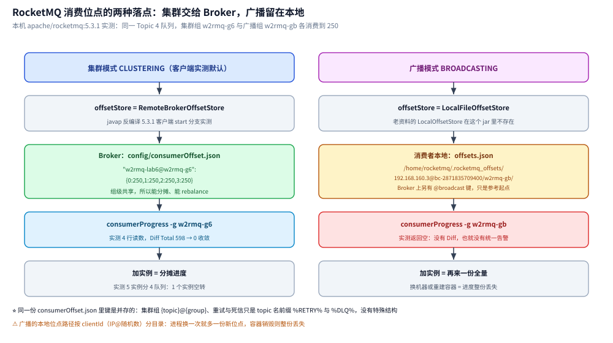
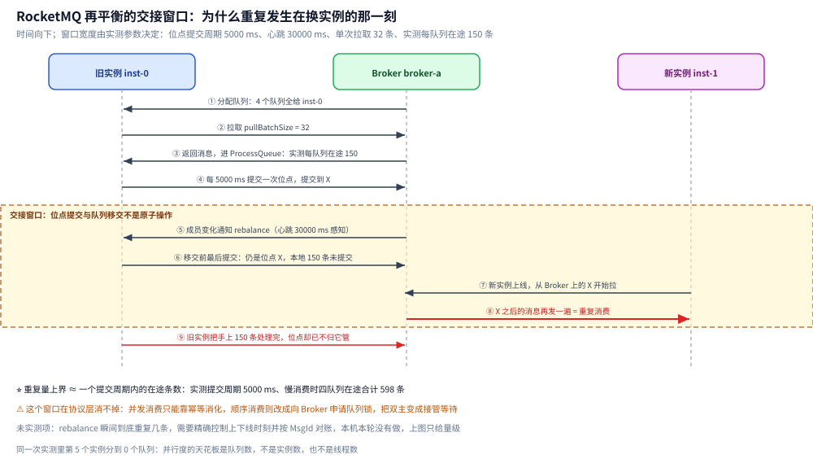

# 消费者与消费位点

> 覆盖 RocketMQ 的集群 / 广播两种消费模式、消费位点存在哪与怎么看/重置、rebalance 的分配模型与「为什么会重复」、顺序消费的三件锁事，以及消费端线程模型与并发度的三层封顶。
>
> 不覆盖：消费失败后的重投与死信机制见 [消息可靠性.md](消息可靠性.md)；堆积的排查 SOP 与消费停滞定位见 [运维与排障.md](运维与排障.md)；长轮询的 Broker 端挂起实现见 [核心概念与架构.md](核心概念与架构.md) 第六节。
>
> 内容整理自个人学习笔记；rebalance 与位点管理的部分参考《RocketMQ 分布式消息中间件核心原理与最佳实践》（李伟）。本篇读数来自本机 `apache/rocketmq:5.3.1` 单机集群 + `rocketmq-client 5.3.1`（Java）。

---

## 一、集群模式与广播模式：一条消息被消费几次

| 模式 | 配置 | 一条消息被消费几次 | 位点存哪 |
| --- | --- | --- | --- |
| **集群模式（默认）** | `messageModel = CLUSTERING` | 组内**分摊**，一个实例消费一次 | **Broker**（`config/consumerOffset.json`） |
| **广播模式** | `messageModel = BROADCASTING` | 组内**每个实例都消费一遍**（全量） | **消费者本地**（`~/.rocketmq_offsets`） |

⭐ 关键差异在「位点归属」：集群模式把位点放在 Broker，是**组级共享状态**（所以组内能分摊、能 rebalance）；广播模式把位点放在每个消费者本地文件，实例之间互不干扰，所以扩容一个实例不会接管别人的进度，而是**从头把全量再消费一遍**。

⚠️ 广播模式的两个连带后果：① 顺序消息**不支持广播**（见 [消息类型与语义.md](消息类型与语义.md) 2.1 节）；② 位点在本地文件，实例重建 / 换机器就丢进度，会大量重复消费。

### 1.1 实测：两种模式的位点各落在哪两个地方

上表说「集群存 Broker、广播存本地」，本机把两边文件都翻出来验证了一遍（同一 Broker、同一 Topic `w2rmq-lab6` 4 队列，分别用集群组 `w2rmq-g6` 与广播组 `w2rmq-gb` 各消费到 250）。

**① 客户端拿的是不同的 OffsetStore 类**（`javap` 反编译本机 `rocketmq-client-5.3.1.jar` 的 `DefaultMQPushConsumerImpl#start`，两条分支都在字节码里）：

| 模式 | 实例化的是 | 类全名 |
| --- | --- | --- |
| 广播 | `new LocalFileOffsetStore(...)` | `org.apache.rocketmq.client.consumer.store.LocalFileOffsetStore` |
| 集群 | `new RemoteBrokerOffsetStore(...)` | `org.apache.rocketmq.client.consumer.store.RemoteBrokerOffsetStore` |

⚠️ 老资料里的类名常写成 `LocalOffsetStore`——5.3.1 的 jar 里**没有这个类**，实名是 `LocalFileOffsetStore`，按名字去 `grep` 会一无所获。

**② 广播位点确实只在本机文件里**，路径按 `clientId` 分目录（`clientId` = `IP@进程随机数`，所以**同一台机器换一次进程就多一份新位点**）：

```text
/home/rocketmq/.rocketmq_offsets/192.168.160.3@bc-2871835709400/w2rmq-gb/offsets.json
```

**③ 但 Broker 侧也不是完全没记**：`config/consumerOffset.json` 的 `offsetTable` 里出现了带 `@broadcast` 后缀的键，与集群组的键并存：

```json
"offsetTable":{
  "w2rmq-lab6@w2rmq-g6":{0:250,1:250,2:250,3:250},
  "w2rmq-lab6@w2rmq-gb@broadcast":{0:250,1:250,2:250,3:250},
  "%RETRY%w2rmq-g1@w2rmq-g1":{0:18},
  "%DLQ%w2rmq-g1@w2rmq-g9":{0:9}
}
```

- 键格式是 `{topic}@{group}`，值是每个 `queueId` 的**下一条待拉位置**；重试队列与死信队列也是普通条目，只是 topic 名带 `%RETRY%` / `%DLQ%` 前缀。
- ⚠️ 那个 `@broadcast` 键是 Broker 侧 `BroadcastOffsetManager`（`org/apache/rocketmq/broker/offset/BroadcastOffsetManager.class`，本机 jar 里核实存在）为「新实例从哪开始」留的**参考位点**，不是消费进度权威——权威仍是各实例本地的 `offsets.json`。同一份文件里还有 `groupTopicMap`（组订了哪些 topic），运维上 `consumerOffset.json` + `groupTopicMap` 要一起备份。

**④ `consumerProgress` 对广播组是「查无此人」**：`mqadmin consumerProgress -n 192.168.160.2:9876 -g w2rmq-gb` 实测**返回空**（集群组 `-g w2rmq-g6` 同期返回 4 行 + `Diff Total`）。这就是第二节那句「广播组没有 Diff 可言」的直接证据：不是 Diff 很大或很小，而是**根本没有输出**。



## 二、消费位点：查看与重置

本机实测的位点命令与读数（`lab-java` 4 队列，消费 5 条后）：

```bash
mqadmin consumerProgress -n rmq-namesrv:9876 -g lab_consumer_group
```

```text
#Topic      #Group            #Broker   #QID  #Broker Offset  #Consumer Offset  #Diff  #Inflight  #Last
lab-java    lab_consumer_group broker-a  0     1               1                 0      0          2026-10-13 03:34:41
lab-java    lab_consumer_group broker-a  1     2               2                 0      0          2026-10-13 03:34:40
lab-java    lab_consumer_group broker-a  2     1               1                 0      0          2026-10-13 03:34:40
lab-java    lab_consumer_group broker-a  3     1               1                 0      0          2026-10-13 03:34:40

Consume TPS: 0.25
Consume Diff Total: 0
Consume Inflight Total: 0
```

| 列 | 读法 |
| --- | --- |
| `Broker Offset` | 该队列当前最大位点（生产者写到哪） |
| `Consumer Offset` | 该组已提交到哪 |
| `Diff` | ⭐ **堆量** = `Broker Offset − Consumer Offset`；`Diff Total` 是所有队列之和 |
| `Inflight` | 已拉到本地但还没提交的条数（在 ProcessQueue 里） |

- **重置位点**：`mqadmin resetOffsetByTime -g {group} -t {topic} -s <时间戳|"yyyy-MM-dd#HH:mm:ss:SSS">`。⚠️ 向前跳 = **永久跳过**未消费消息（无归档即真丢），是「手术不是吃药」，详见 [运维与排障.md](运维与排障.md) 第三节。
- **位点丢失**：集群模式位点在 Broker 数据目录，目录被清空则位点归零、引发大量重复消费。运维上要备份 `config/consumerOffset.json`，必要时用 `resetOffsetByTime` 校正。
- ⚠️ **广播组没有 `Diff` 可言**：位点在本地文件，`consumerProgress` 看不到统一进度，得去各实例机器上看 `~/.rocketmq_offsets`。

### 2.1 实测：5.3.1 的真实表头，和一次堆积里 Diff / Inflight 怎么推进

> ⚠️ 上面那段读数块是较早的客户端输出格式（表头带 `#Group`、末列 `#Last`）。本机 5.3.1 实测的表头**没有 `#Group` 列**、末列叫 `#LastTime`，且重试/死信队列会作为独立行混在同一张表里：

```text
#Topic               #Broker Name  #QID  #Broker Offset  #Consumer Offset  #Diff  #Inflight  #LastTime
%RETRY%w2rmq-g1      broker-a      0     6               6                 0      0          2026-10-14 17:23:21
w2rmq-lab            broker-a      0     1               1                 0      0          2026-10-14 17:22:26
w2rmq-lab            broker-a      1     0               0                 0      0          N/A
```

本机做一次「生产 600 条到 4 队列、消费端每条睡 20 ms」的慢消费，同一个 `-g w2rmq-g6` 连查 3 次（间隔约 12 s / 14 s）：

| 时刻 | 每队列 Broker Offset | 每队列 Consumer Offset | 每队列 Diff | 每队列 Inflight | Consume TPS | Diff Total | Inflight Total |
| --- | --- | --- | --- | --- | --- | --- | --- |
| poll 1（01:39:05） | 都是 150 | `0 / 1 / 1 / 0` | `150 / 149 / 149 / 150` | 与 Diff **完全相同** | 60.00 | **598** | **598** |
| poll 2（01:39:17） | 都是 150 | 都是 150 | 0 | 0 | 30.00 | 0 | 0 |
| poll 3（01:39:31） | 都是 150 | 都是 150 | 0 | 0 | — | 0 | 0 |

四条读法：

- ⭐ **堆积时 `Inflight == Diff` 是「消费慢」而非「拉不到」的指纹**：位点没提交、消息全在客户端 ProcessQueue 里等着，所以两个数一模一样。反过来 `Diff` 大、`Inflight` 为 0，方向就变成「没拉 / 拉了但没入队」，处置完全不同（见 [运维与排障.md](运维与排障.md) 第四节）。
- **`Diff` 是队列级整数差**，`Diff Total` 只是四个队列相加（`150+149+149+150=598`），它不告诉你哪个队列卡住——排障要看逐队列那一列，不要只看 Total。
- **`LastTime` 为 `N/A` 的队列是「该组从未在这个队列提交过位点」**（poll 1 里 q0/q3 是 `N/A`、q1/q2 有具体时间）。这从读数上印证了「位点是队列级独立提交」这件事，也说明 `N/A` 不等于「队列坏了」。
- **`Consume TPS` 是采样板的瞬时值，不要单点取数**：同一轮从 60.00 掉到 30.00 并不是变慢了，而是消费已经追平、没有新消息可消费（`Diff Total` 同时归 0）。告警要拿 Diff 的趋势，不要拿 TPS 的绝对值。
- 死信也计入本组：`consumerProgress -g w2rmq-g1` 在 9 条消息进 `%DLQ%` 后 `Consume Diff Total` 显示 9（读数见 [消息可靠性.md](消息可靠性.md) 2.2 节），所以「Diff 突增但 TPS 正常」要顺手查一下是不是有消息在往死信里掉。

## 三、rebalance：队列分配与顺序性的冲突

- **分配模型**：消费组内成员对 topic 队列做**客户端各自计算**的分配（默认平均分配：队列数 ÷ 实例数），无中心协调者；触发时机 = 组内成员变化（Broker 主动通知）+ 周期性兜底。这与 NameServer 的哲学一致：**分摊错误、事后自愈，不做强一致协调**。
- **再平衡瞬间为什么会重复**：切换不是原子交接——旧主还握着 ProcessQueue 里**未提交位点**的已拉消息，新主从 Broker 上「最后提交位点」重拉，交集即重复。所以重复消费的高峰不在日常，而在**发布 / 缩扩容 / 实例假死被判离线**这三类时刻（呼应 [消息可靠性.md](消息可靠性.md) 第四节：幂等不是防御异常，是防御常态）。并发消费在 rebalance 前会先把已缓存消息消费完并提交位点、且**位点提交与队列移交之间仍有窗口**，这个窗口无法靠客户端消除——at-least-once 的下界就在这。
- **顺序消息的「三件事」缺一不可**：

| 环节 | 机制 | 单独失效的后果 |
| --- | --- | --- |
| ① 生产端选同一队列 | `MessageQueueSelector` 按业务 Key 固定映射 | 同 Key 两条消息落不同队列，被不同线程并发消费——顺序在**入口**就没了，后面做得再好也没用 |
| ② 消费端单队列单线程 | 进程内每个队列一个 ProcessQueue + 本地锁 | 同一次拉取的多条消息被线程池并发回调，完成顺序 ≠ 提交顺序，**进程内**就乱了 |
| ③ 队列分布式锁 | 顺序消费前向 Broker 申请队列锁并周期续期，同组内谁持锁谁才能消费该队列 | rebalance 时新旧实例**同时**消费一个队列；旧实例宕机不释放则其他实例**等锁过期才能接管**——表现为扩缩容瞬间该队列停滞几十秒再突然追平 |

- 三件事的共同点：①②防「乱序」，③防「双主」；而 ③ 的续锁/过期机制又说明 RocketMQ 的顺序是**尽力而为的顺序**——锁过期窗口、Broker 主从切换瞬间仍可能双持锁，严格串行要业务层的序列号/版本号校验兜底（把「顺序」变成「可检测的矛盾」，再用幂等消化）。
- ⭐ 本机实测印证 ①②：生产者按 `orderId` 选队列后，4 条消息全部落 `queueId=1`、偏移连续 `0,1,2,3`；顺序消费者回调顺序与偏移一致（见 [消息类型与语义.md](消息类型与语义.md) 2.1 节）。

### 3.1 实测：4 个队列在 1 / 2 / 5 个实例之间到底怎么分

同一个 4 队列 Topic，每轮把每个实例的 `instanceName` 设成 `inst-0…inst-N`，每轮发 8 条（`K0~K7` 轮询落满 4 个队列），然后统计「哪个实例收到哪些队列的消息」：

| 实例数 | 实测分配结果（队列 → 实例） | 每实例收到条数 |
| --- | --- | --- |
| 1 | `inst-0` 拿到 q0、q1、q2、q3 全部 | 8 条全在一个实例（每队列 2 条） |
| 2 | `inst-0` = {q0, q1}、`inst-1` = {q2, q3} | 各 4 条，精确对半分 |
| 5 | `inst-0`={q0}、`inst-1`={q1}、`inst-2`={q2}、`inst-4`={q3}，**`inst-3` 一个队列都没拿到** | 拿到队列的各 2 条，`inst-3` 收到 **0 条** |

四点读法：

- ⭐ **实例数超过队列数，多出来的就是纯空转**：5 实例 / 4 队列时那个实例进程活着、心跳正常、日志干净、不报任何错，只是回调永远不会被调用。这就是第五节「加机器无效」的直接证据，也是最容易被当成「消息丢了」的一类误判。
- **队列是整块分配的**，一个队列同一时刻只属于组内一个实例；所以「实例 0 拿到 q0」这种对应关系是分配算法的结果，不是配置出来的——上表第 3 轮里空转的是 `inst-3` 而不是排在最后的 `inst-4`，说明**别指望某个队列固定落在某个实例**，排查时只能看客户端 `allocate` 日志或 `consumerProgress` 的实际进度，不能靠猜。
- **交接窗口的长度由位点提交周期决定**：本机实测 `persistConsumerOffsetInterval = 5000 ms`（4.1 节）。旧实例最多把「5 秒内拉走但还没提交」的消息留在本地（2.1 节 poll 1 里四队列 `Inflight` 合计 598 就是这种状态），新实例从 Broker 上最后一次提交的位点重拉，这段交集就是重复。所以**重复量的上界 ≈ 一个提交周期内的在途条数**，把提交周期调大只会让重复更多，不会更少。
- ⚠️ 但「rebalance 那一刻到底重复了几条」本机**没有直接测到**——要精确控制实例上下线时刻并按 MsgId 对账才拿得到，本轮没做。上面那条是按「实测提交周期 + 实测在途条数」做的推算，只用来判断量级，不要当实测结论引用。



## 四、消费端线程模型与并发度

「Push」不是真的推——`PullMessageService` 单线程发起拉取，消费在另一个线程池执行，「拉」与「用」解耦：

```text
rebalance(周期+成员变更) ─► 分到的队列 → 每队列一个 ProcessQueue(本地缓存)
        │ 入队 PullRequest                   │
        ▼                                   ▼
PullMessageService(单线程发起拉取,长轮询RPC) ─► 响应写入 ProcessQueue
                                                │ 流控(条数/体积阈值)超限→延迟重投 PullRequest
                                                ▼
                                    ConsumeMessageService 线程池(并发: consumeThreadMin/Max;
                                                                顺序: 每队列持锁单线程)
                                                │
                                    位点持久化线程：周期性把"下一条待拉位置"提交到 Broker
```

- **并发度由三层共同封顶**：**队列数**（>队列数的线程无效）→ **线程池大小** → **ProcessQueue 流控阈值**。调参时从这三层依次核对，只调线程池往往无效。
- **流控在客户端做**：每个队列的 ProcessQueue 有条数/体积阈值，消费慢 → 阈值超 → 暂停该队列拉取并延后重试。表现为「**消费 TPS 掉但客户端没报错**」——排查堆积时先想到它（见 [运维与排障.md](运维与排障.md) 第四节）。
- **批量拉取与位点**：`pullBatchSize` 一次拉多条，但位点是**队列级一个整数**——提交的是「下一条待拉位置」，批内第 3 条失败、整批不提交，下批从第 1 条重来：这是批消费重复放大的根源，批量消费更要绑紧幂等。
- **线程数与位点提交的配置项**（Java 客户端 `DefaultMQPushConsumer`）：

| 配置项 | 实测默认值 | 说明 |
| --- | --- | --- |
| `consumeThreadMin` | 20 | 消费线程池下限 |
| `consumeThreadMax` | 20 | ⚠️ 超过队列总数即无意义（一队列只分配一个线程） |
| `consumeMessageBatchMaxSize` | 1 | 一次回调最多几条（并发消费） |
| `maxReconsumeTimes` | **`-1`**（= 用框架默认） | ⭐ 字段默认是 `-1` 而不是 16：顺序消费把它映射成 `Integer.MAX_VALUE`（本机字节码核实），并发消费超限（默认 16 次）后进 `%DLQ%` |

> ⚠️ 老资料常写 `20 / 64`，以**客户端版本**为准——本机 `rocketmq-client 5.3.1` 实测 `consumeThreadMin` 与 `consumeThreadMax` 都是 20。真正的并发上限是队列数，不是这两个值。

### 4.1 实测：Push 消费端出厂默认值全表

上面那四条只是常被调的几个。本机用反射把 `DefaultMQPushConsumer` 构造完（不改任何参数）的 getter 全部打了一遍，补齐第三节 / 第四节里所有「周期性」「阈值」类参数的真实数字：

| 配置项（getter） | 实测值 | 属于哪一层 |
| --- | --- | --- |
| `getConsumeThreadMin` / `getConsumeThreadMax` | `20` / `20` | 消费线程池 |
| `getPullBatchSize` | `32` | 单次拉取条数（位点是队列级整数，批内失败整批重来） |
| `getConsumeMessageBatchMaxSize` | `1` | 一次回调喂几条 |
| `getPullThresholdForQueue` | **`1000`** | ⭐ 流控第一道：**每个队列**的 ProcessQueue 条数阈值 |
| `getPullThresholdSizeForQueue` | **`100`**（MB） | ⭐ 流控第二道：每个队列的体积阈值 |
| `getConsumeTimeout` | `15`（分钟） | 消费超时判定，超时后才可能重投 |
| `getPullInterval` | `0` | 拉取间隔 0，靠长轮询驱动 |
| `getSuspendCurrentQueueTimeMillis` | `1000` | ⚠️ 顺序消费返回 `SUSPEND` 后该队列挂起 1 秒（顺序消费「停滞」的读数来源） |
| `getPersistConsumerOffsetInterval` | **`5000`**（ms） | ⭐ 位点提交周期，即 3.1 节那个重复窗口宽度的上界 |
| `getHeartbeatBrokerInterval` | `30000`（ms） | 消费者向 Broker 报组内成员，rebalance 的感知延迟下界 |
| `getMaxReconsumeTimes` | `-1` | 用框架默认（并发 16 次后进 `%DLQ%`） |
| `getMessageModel` / `getConsumeFromWhere` | `CLUSTERING` / `CONSUME_FROM_LAST_OFFSET` | 默认集群模式 + 新组从队列尾开始 |
| `getAdjustThreadPoolNumsThreshold` | `100000` | 本地待消费条数到这个量级才考虑动态扩线程 |

- 把三层封顶换成数字就很直观：**队列数**（本机实验 4 队列 → 并行度上限就是 4 个实例）→ **线程池 20** → **流控 `1000 条 / 100 MB` 每队列**。4 个队列的实例本地最多缓存 4000 条，2.1 节 poll 1 里每队列在途 150 条**远未碰到 1000**，所以那次的 `Inflight == Diff` 是「消费慢」而不是「被流控挡住」——两个原因要用这条线来区分。
- ⚠️ 有两个值本机**没测到**：`pollNameServerInterval`（我按老资料的拼写 `getPollNameServerInteval` 反射，直接 `NoSuchMethodException`；`javap` 显示 5.3.1 里字段是 `pollNameServerInterval`、getter 是正确拼写，值未再取）与 `consumeTimestamp`（getter 返回的是「当前时刻格式化串」`20261014172510`，不是配置值）。这两个不写数字。

## 五、消息堆积与扩容

| 事项 | 说明 |
| --- | --- |
| 堆积根因 | 消费能力 < 生产速度：消费逻辑慢、线程不足、队列数不足、下游阻塞 |
| 扩容误区 | ⚠️ 消费者实例数 > 队列数时，多出的实例**完全分不到队列**，必须先扩队列再加机器 |
| 位点管理 | 查看 `mqadmin consumerProgress -g {group}`（`Diff Total` 即堆量）；重置 `mqadmin resetOffsetByTime`，⚠️ 会引发重复消费 |

⭐ 一句话口径：**「队列数」是消费并行度的天花板**，扩容的第一动作永远是加队列、第二动作才是加实例——顺序消息的 Topic 甚至不能加队列（同 Key 会落不同队列），只能整机加线程或换更强实例。完整的堆积处置顺序（先判方向 → 看分布 → 扩容量 → 扩并行 → 转投临时 Topic → 追位点）见 [运维与排障.md](运维与排障.md) 第三节。

## 延伸追问

- **rebalance 时一定会重复消费吗？怎么缓解？** 并发消费的交接窗口（旧主未提交位点的缓存消息 + 新主从已提交位点重拉）无法在协议层消除——at-least-once 的下界；缓解手段是减少 rebalance 频率（滚动发布批大小、会话参数）+ 消费端幂等。顺序消费靠 Broker 端队列分布式锁把「双主」变成「接管等待」，牺牲切换速度保正确性。（第三节）
- **顺序消费的三件锁事各挡什么，少一件会怎样？** 生产端 Key → 固定队列挡「入口分叉」；消费端单队列单线程挡「进程内并发乱序」；Broker 队列分布式锁挡「rebalance / 宕机时的双实例同队消费」。少任何一件都有对应的乱序路径，且第三件的锁过期窗口说明它是「尽力而为」，严格场景要业务序列号校验。（第三节）
- **为什么消费者实例数超过队列数就浪费了？** 队列是分配的最小单位，一个队列同一时刻只给组内一个消费者；多出的实例分不到队列，只会白占连接。正确顺序是「先加队列，再加实例」。（第五节）
- **集群模式和广播模式的位点为什么要区别对待？** 集群位点是 Broker 上的组级共享状态，所以能分摊、能 rebalance、能统一查看；广播位点在每个实例本地文件，实例之间完全独立，扩容等于「再来一份全量」。（第一节）
- **消费 TPS 掉了但客户端不报错，先查什么？** 先查 ProcessQueue 流控：消费慢导致本地缓存超阈值，客户端主动暂停该队列拉取并延后重试，所以看日志无异常、看位点不推进。配合 GC 日志与消费 RT 一起看。（第四节）
- **广播位点在 Broker 上也留了 `@broadcast` 键，为什么还说「换机器就丢进度」？** 本机实测 Broker 的 `consumerOffset.json` 里确实有 `w2rmq-lab6@w2rmq-gb@broadcast` 这样一条，但它是 Broker 侧 `BroadcastOffsetManager` 给「新实例从哪儿开始」用的参考起点，**消费进度的权威仍是各实例本地的 `offsets.json`**（路径按 `IP@随机数` 分目录，进程换一次就多一份）。`consumerProgress -g` 查广播组实测直接返回空，等于运维上拿不到统一进度、也没法拿 Diff 做告警。（第一节 1.1）
- **`Diff` 大而 `Inflight` 为 0，和 `Diff`、`Inflight` 一样大，处置方向有什么不同？** 后者（本机实测每队列 `Diff 150 / Inflight 150`）说明消息已经拉到本地缓在 ProcessQueue、只是没处理完没提交位点，瓶颈在消费逻辑或线程；前者说明根本没拉或拉了没入队，要先看订阅关系、实例是否真的拿到了队列（3.1 节那个空转实例就是典型）。两个方向对应 [运维与排障.md](运维与排障.md) 里不同的分支。（第二节 2.1、第四节）
- **`consumeThreadMax` 调到 100 为什么常常没效果？** 因为分配单位是队列：实测 4 队列 / 5 实例时有 1 个实例一个队列都拿不到，同理单实例拿 1 个队列时，其余线程只能等这一条队列的拉取结果；再往上一层还有 `pullThresholdForQueue`（实测默认 1000 条 / 队列）和 `adjustThreadPoolNumsThreshold`（实测 100000）把关，本地缓存不到那个量级，线程池也不会靠动态扩容救你。要提并行度先动队列数与实例数。（第三节 3.1、第四节 4.1）
- **把 `persistConsumerOffsetInterval` 调大或调小会怎样？** 它实测默认 `5000 ms`，直接决定 rebalance 交接窗口里「未提交在途消息」的多少：调大省 RPC 但重复窗口变宽，调小重复变少但提交 RPC 频率上升、Broker 侧 `consumerOffset.json` 写盘更密。它不能消除重复，只能改变重复的量级——真正的解法仍是消费端幂等。（第三节 3.1）

## 关联

- **上游/总纲**：[README.md](README.md) — 本目录导读与阅读路线
- **对照/互补**：[核心概念与架构.md](核心概念与架构.md) — 长轮询的 Broker 端挂起与到达通知
- **对照/互补**：[消息可靠性.md](消息可靠性.md) — 位点提交与「先处理后提交」的语义
- **对照/互补**：[消息类型与语义.md](消息类型与语义.md) — 顺序消息的四条限制
- **对照/互补**：[运维与排障.md](运维与排障.md) — 堆积 SOP 与消费停滞的三个原因
- **下游/实现**：[接入RocketMQ.md](../../../../01-编程语言/java/工程实践/接入RocketMQ.md) — 消费者注册、线程参数与顺序消费写法
- **对照/互补**：[消费者组与重平衡.md](../Kafka/消费者组与重平衡.md) — Kafka 侧同一问题的对照：分配策略与两个超时参数
