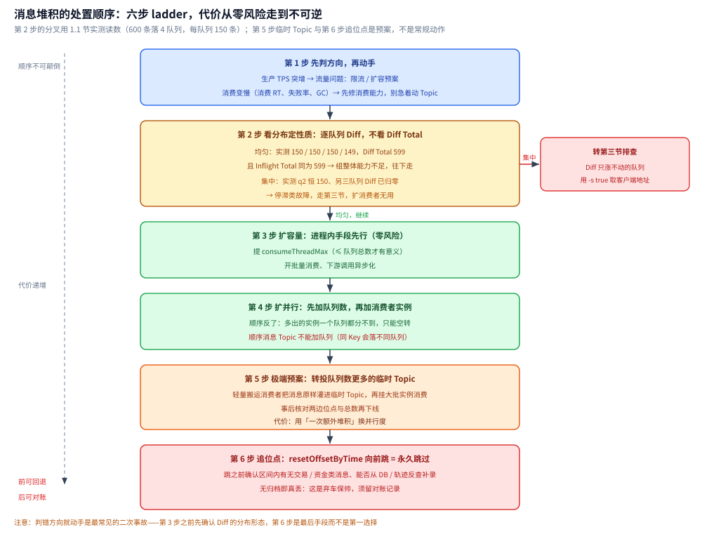
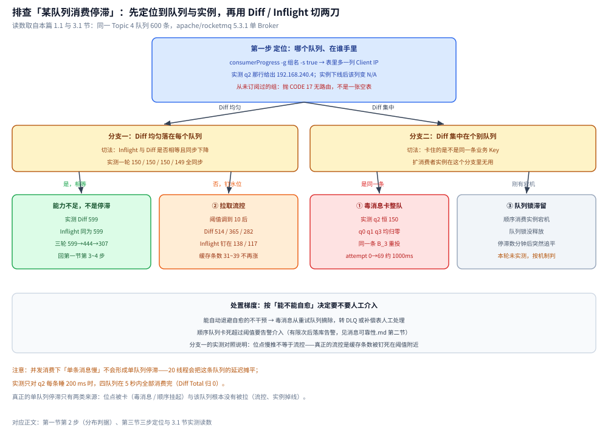
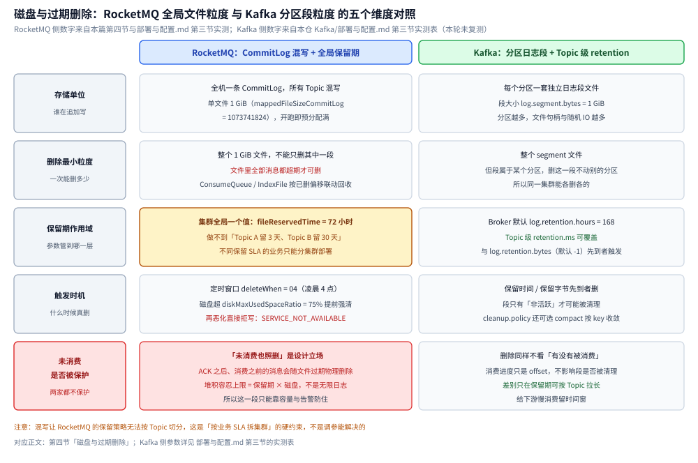

# 运维与排障

> 覆盖 RocketMQ 最常出问题的四件事：消息堆积怎么按顺序处置、某个队列消费停滞怎么定位、磁盘与过期删除为什么是**全局**粒度、以及一张常见故障处置表。
>
> 不覆盖：位点的查看与重置命令、rebalance 与消费线程模型见 [消费者与消费位点.md](消费者与消费位点.md)；刷盘 × 复制与重试死信见 [消息可靠性.md](消息可靠性.md)；配置项含义与磁盘水位参数见 [部署与配置.md](部署与配置.md)。
>
> 内容整理自个人学习笔记；堆积 SOP 与删除策略部分参考《RocketMQ 分布式消息中间件核心原理与最佳实践》（李伟）。本篇命令与配置默认值来自本机 `apache/rocketmq:5.3.1` 实测。

---

## 一、消息堆积的处理顺序（顺序本身比手段重要）

1. **先判方向，再动手**：对比生产 TPS 曲线与消费端指标（消费 RT、失败率、GC）。生产突增 → 是流量问题，走限流 / 扩容预案；消费变慢 → 是自身或下游问题（DB 慢、下游超时），**先修消费能力，别急着动 Topic**。
2. **看分布定性质**：`mqadmin consumerProgress` 里堆积**均匀分布在所有队列** → 组整体能力不足；**集中在个别队列** → 停滞类故障，走下一节，扩消费者无用。
3. **扩容量**：提 `consumeThreadMax`（≤ 队列总数才有意义）、开批量消费、下游调用异步化——**进程内手段先行，因为零风险**。
4. **扩并行**：先加队列数、再加消费者实例（顺序反了多出的实例分不到队列，见下节）。⚠️ 顺序消息 Topic **不能加队列**（同 Key 会落不同队列），只能整机加线程 / 换更强实例。
5. **极端预案——转投临时 Topic**：写一个只做搬运的轻量消费者把消息原样灌进队列数更多的临时 Topic，再挂大批实例消费临时 Topic。用「一次额外堆积」换并行度，事后核对两边位点与总数再下线。
6. **追位点是手术不是吃药**：`mqadmin resetOffsetByTime` 向前跳 = **永久跳过**未消费消息（无归档即真丢）。跳之前确认区间内有无交易 / 资金类消息、能否从 DB / 轨迹反查补录；这是「弃车保帅」，须留对账记录。

### 1.1 实测：均匀与集中两张分布照片

判方向靠 TPS 曲线，定性质必须看**逐队列那一列 Diff**——`Diff Total` 只是四个队列相加，看不出分布形态。以下读数来自本机 `w2r2g` 实验（`apache/rocketmq:5.3.1` 单 Broker `broker-a`、自定义网络 `w2r2g-net`、Topic `w2r2g_lab` 4 队列，一次性灌 600 条），发送侧打点原文：

```text
SENT n=600 wall=8750ms dist={0=150, 1=150, 2=150, 3=150}
```

**照片 A｜均匀分布**：消费组 `w2r2g_gU`，单实例单线程、每条睡 200 ms、`pullThresholdForQueue` 取默认值。同一场景连跑 3 轮、每轮约 25 s 采一次（`-g` 不带 `-s`）：

| 轮次与采样时刻 | queue0 / 1 / 2 / 3 的 Diff | Diff Total | Inflight Total | Consume TPS |
| --- | --- | --- | --- | --- |
| 第 1 轮 02:45:42 | 150 / 150 / 150 / 149 | 599 | 599 | 60.00 |
| 第 1 轮 02:46:06 | 118 / 90 / 118 / 118 | 444 | 444 | 20.00 |
| 第 1 轮 02:46:32 | 81 / 54 / 86 / 86 | 307 | 307 | 12.00 |
| 第 2 轮 02:55:54 | 150 / 118 / 118 / 148 | 534 | 534 | 30.00 |
| 第 2 轮 02:56:20 | 118 / 86 / 86 / 118 | 408 | 408 | 15.00 |
| 第 3 轮 03:08:06 | 118 / 118 / 147 / 150 | 533 | 533 | 30.00 |
| 第 3 轮 03:08:32 | 86 / 86 / 118 / 118 | 408 | 408 | 15.00 |

- 三轮之间只是采样相位差：**首个采样点的 Diff Total 落在 533~599、`Consume TPS` 落在 30.00~60.00**，同一量级；趋势才是可复用的结论——**四列 Diff 同数量级、一起往下掉，没有任何一列恒住不动**，这就是第一节第 2 步说的「组整体能力不足」，处置走第 3、4 步。
- `Diff Total` 与 `Inflight Total` 在每一行都相等（599=599 / 534=534 / 408=408）。原因是**一个消费线程对四个队列**：拉下来的消息全排在那个线程的处理队列里，「已拉未提交」=「未消费完」= 堆量。⚠️ 这个相等**不是常态**——触发拉取流控后 Inflight 会被钉在水位、远小于 Diff（见 3.1 节照片 C）。位点每 5 s 提交一次的机制见 [消费者与消费位点.md](消费者与消费位点.md) 第二节，本节不复测。

**照片 B｜集中在一个队列**：消费组 `w2r2g_gO`，`MessageListenerOrderly` + 4 线程，故意让 `queueId=2` 上业务 Key 为 `B_3` 的消息每次返回 `SUSPEND_CURRENT_QUEUE_A_MOMENT`：

| 采样时刻 | queue0 / 1 / 2 / 3 的 Diff | Diff Total | Inflight Total | Consume TPS | `queueId=2` 的 Consumer Offset |
| --- | --- | --- | --- | --- | --- |
| 03:02:17 | 0 / 0 / 150 / 0 | 150 | 150 | 30.00 | 0 |
| 03:02:43 | 0 / 0 / 150 / 0 | 150 | 150 | 12.00 | 0 |
| 03:03:08 | 0 / 0 / 150 / 0 | 150 | 150 | 0.00 | 0 |

- 客户端逐队列成功计数从 `OK t=10s q0=150 q1=150 q2=0 q3=150` 一直到 `t=70s` 都没变——**三个队列追平、一个队列一条没动**；`queueId=2` 那行的 `#LastTime` 恒为 `N/A`，而 `#Client IP` 正常显示 `192.168.240.4`（实例活着并且持着队列锁）。这正是第一节第 2 步「集中在个别队列 → 走第三节」的形态：**加消费者实例、加线程都无用**。
- 原地重试的节奏：`FAIL q=2 body=B_3` 的 `attempt` 取 0、1、2、9、19、29 … 69，相邻两次间隔 `gap = 1023 / 1001 / 1000 / 1001 ms`（即 `suspendCurrentQueueTimeMillis`，出厂默认 1000 ms，见 [消费者与消费位点.md](消费者与消费位点.md) 第四节），70 s 内累计失败 70 次且 **attempt 一路涨、没有停**；同组 `%RETRY%w2r2g_gO` 那行的 Broker Offset 始终 0 —— 顺序消费的失败**不进重试 Topic**（机制与「`-1` 被映射成 `Integer.MAX_VALUE`」见 [消息可靠性.md](消息可靠性.md) 第二节）。
- ⚠️ 顺着这条读数要记住一件事：第三节末尾那句「有限次后落库告警」只对**并发消费**成立（超限才改投 `%DLQ%`）；顺序消费的挂起分支既不进 `%RETRY%`、也不进 `%DLQ%`，只会原地重试到永远，所以那句「卡死超阈值要告警介入」只能靠**外部监控**兜，Broker 侧不会自己产生任何终态。

**一个造不出来的照片｜并发消费下「单队列慢」不等于停滞**（负结果，同样值得记）

- 20 线程、只让 `queueId=2` 每条睡 200 ms：三个采样点（02:50:27 / 02:50:58 / 02:51:25）四列 Diff **全为 0**，客户端计数 `GOT t=5s q0=150 q1=150 q2=150 q3=150` —— 5 秒内消费完，压根堆不起来。
- 把该队列改成串行睡 400 ms、其余队列照常（组 `w2r2g_gL`）：第 1 个采样点 Diff 为 `86 / 118 / 130 / 118`（Total 452），到 02:54:58 四个队列全部归零，只造成轻微倾斜，不是「恒住不动」。
- 结论：**并发消费的线程池跨队列共享、每个 ProcessQueue 各自限水位，单个队列的慢会被摊平**。真正的单队列停滞只有两类来源——位点被卡（毒消息 / 顺序挂起，见照片 B），或该队列根本没被拉（拉取流控、实例掉线，见 3.1 节）。



## 二、堆积根因与扩容误区

| 事项 | 说明 |
| --- | --- |
| 堆积根因 | 消费能力 < 生产速度：消费逻辑慢、线程不足、**队列数不足**、下游阻塞 |
| 扩容误区 | ⚠️ 消费者实例数 > 队列数时，多出的实例**完全分不到队列**，必须先扩队列再加机器 |
| 应对手段 | 提高 `consumeThreadMax`、批量消费、下游异步化、加队列后扩实例、必要时转存离线 |
| 位点视角 | `consumerProgress` 的 `Diff Total` 即堆量；`Inflight` 是已拉未提交的条数（本机实测消费完成后两者都归 0） |

⭐ 一句话口径：**「队列数」是消费并行度的天花板**（见 [消费者与消费位点.md](消费者与消费位点.md) 第四节），所有扩容动作都要先问「队列够不够」，再问「实例够不够」。

## 三、排查「某队列消费停滞」

- 第一步 Dashboard / `consumerProgress` 定位：哪个队列、分配给了哪个客户端实例（Diff 只涨不动的队列 → 客户端地址）。
- 三个高频原因按序核对：

| 序 | 原因 | 现象 | 判据 |
| --- | --- | --- | --- |
| ① | **毒消息** | 并发消费下该消息在 `%RETRY%` 里按递增退避反复重投；顺序消费下一条失败卡整队 | 看重试队列里是否有同一业务 Key |
| ② | **拉取流控** | 位点不动但**客户端无任何异常** | ProcessQueue 缓存超阈值暂停拉取（消费线程池被慢任务占满的间接症状），配合 GC 日志看 |
| ③ | **队列锁滞留** | 停滞数分钟后突然追平 | 顺序消费实例宕机后队列锁未释放，其他实例等锁过期才接管 |

- 处置梯度：能自动退避自愈的不干预；毒消息从重试队列摘除转 DLQ / 补偿表人工处理；顺序队列卡死超阈值要告警介入（「有限次后落库告警」的落地，见 [消息可靠性.md](消息可靠性.md) 第二节）。
- ⭐ 顺序消费的 ③ 与「为什么顺序消费不能走 `%RETRY%`」是同一枚硬币的两面：**并发要吞吐所以敢换队重投，顺序要语义所以只能卡住**。

### 3.1 实测：三步定位各自的读数形态

**第一步的命令形态**：`consumerProgress` 默认**不输出客户端地址**，必须加 `-s`（`--showClientIP`）才多出一列 `#Client IP`——第三节开头那句「Diff 只涨不动的队列 → 客户端地址」靠的就是这一列。本机 5.3.1 实测原文（组 `w2r2g_gU`，`-s true`，只保留关键行，逐列空格照原样）：

```text
#Topic                                                            #Broker Name                      #QID  #Broker Offset        #Consumer Offset      #Client IP           #Diff                #Inflight           #LastTime
%RETRY%w2r2g_gU                                                   broker-a                          0     0                     0                     192.168.240.4        0                    0                    N/A
w2r2g_lab                                                         broker-a                          0     150                   96                    192.168.240.4        54                   54                   2026-10-14 18:45:04
w2r2g_lab                                                         broker-a                          2     150                   75                    192.168.240.4        75                   75                   2026-10-14 18:45:04
```

同一次输出末尾是 `Consume TPS: 10.00` / `Consume Diff Total: 269` / `Consume Inflight Total: 269`。四个队列的 `#Client IP` 都是同一个 `192.168.240.4`（单实例持有全部队列，见 [消费者与消费位点.md](消费者与消费位点.md) 第三节）。

**实例掉线不是停滞**：`docker stop` 掉线后再查（停容器 + 等 75 s，让心跳 `heartbeatBrokerInterval` 过期）：

```text
%RETRY%w2r2g_gU                                                   broker-a                          0     0                     0                     N/A                  0                    0                    N/A
w2r2g_lab                                                         broker-a                          0     150                   96                    N/A                  54                   54                   2026-10-14 18:45:04
w2r2g_lab                                                         broker-a                          3     150                   80                    N/A                  70                   70                   2026-10-14 18:45:04
```

此时 `Consume TPS: 0.00`、Diff Total 232 = Inflight Total 232，四列 `#Client IP` 全变 `N/A`。⭐ 判据由此分成两半：**`#Client IP` 为 `N/A` = 没人持队列（先去拉客户端）；有 IP 但位点不动 = 队列真停滞（走下面三个原因）**。

⚠️ 一个容易误判的形态：查**从未订阅过的组**不会给你一张空表，而是整条命令抛异常（原文）：

```text
org.apache.rocketmq.tools.command.SubCommandException: ConsumerProgressSubCommand command failed
Caused by: org.apache.rocketmq.client.exception.MQClientException: CODE: 17  DESC: No topic route info in name server for the topic: %RETRY%w2r2g_gO
```

看到 `CODE: 17` 先怀疑组名写错或该组还没起过，不要读成「没有堆积」。

**照片 C｜② 拉取流控的指纹**：同一份 600 条堆积，把 `pullThresholdForQueue` 从默认 1000 改成 **10**（`pullBatchSize` 保持 32、单线程、每条睡 200 ms，组 `w2r2g_gF`）：

| 采样时刻 | queue0 / 1 / 2 / 3 的 Diff | queue0 / 1 / 2 / 3 的 Inflight | Diff Total | Inflight Total | Consume TPS |
| --- | --- | --- | --- | --- | --- |
| 02:48:53 | 118 / 125 / 122 / 149 | 32 / 39 / 36 / 31 | 514 | 138 | 9.59 |
| 02:49:23 | 86 / 86 / 86 / 107 | 32 / 32 / 32 / 21 | 365 | 117 | 7.04 |
| 02:49:53 | 54 / 56 / 86 / 86 | 32 / 34 / 32 / 32 | 282 | 130 | 4.27 |

- 关键在 **Diff Total 与 Inflight Total 拉开**：514 对 138、365 对 117、282 对 130。方向从「拉上来消化不掉」变成「没继续拉」——这才是第三节 ② 的形态；对照照片 A（阈值默认 1000）里两者始终相等，说明当时是纯能力不足。
- 客户端侧（反射 `rebalanceImpl.processQueueTable` 取的缓存条数）钉在 `count = 31 / 32 / 36 / 39`、`size = 47~195 字节`，同一时刻累计消费条数从 18 涨到 317 —— **缓存条数不再上涨、位点还在慢推**，是流控的第二个指纹。照片 A 同一测点的缓存是 `count=150 / size=722`、跟着 Diff 一起降。
- 处置口径：这个形态下加 `consumeThreadMax` 无效，要动的是 `pullThresholdForQueue` / `pullThresholdSizeForQueue` 与下游耗时（默认值见 [消费者与消费位点.md](消费者与消费位点.md) 第四节）。
- ⚠️ **未实测一项**：客户端触发流控时打印的那行 WARN 原文。本机挂了 `-Drocketmq.client.logConsole=true`、`-Drocketmq.client.logRoot` 之后，`docker logs` 里 `grep -c WARN` 仍为 **0**、挂载出来的 `logs/` 目录为空，**没取到那行日志**，所以本节不引用其文本，判据只用 Broker 侧 Inflight 与客户端缓存条数。

**三个原因的核对进度**：① 毒消息卡整队——已由 1.1 节照片 B 复现（顺序消费：同一条 `B_3` 每约 1000 ms 原地重投、`%RETRY%` 恒 0）；并发消费那条路（`RECONSUME_LATER` → 退避递增 → 超限进 DLQ）是 [消息可靠性.md](消息可靠性.md) 2.2 节已实测的内容，本篇不复测。② 拉取流控——由照片 C 复现。③ **队列锁滞留本轮未实测**：它需要「杀掉持锁实例、并在锁过期前后各取一次读数」的时序窗口，本机只做了「停掉并发消费实例后 +75 s 再查」（得到上面 `#Client IP` 全 `N/A` 的掉线形态），**没有覆盖顺序锁的等待与接管过程**，所以表里 ③ 那句「停滞数分钟后突然追平」仍按机制描述对待，不作为实测结论。



## 四、磁盘与过期删除：与 Kafka retention 的本质差异

- 删除粒度是**整个 1 GiB CommitLog 文件**（实测 `mappedFileSizeCommitLog=1073741824`）：文件里**全部**消息超过保留期（`fileReservedTime`，实测默认 72 小时）才可删，配合定时清理窗口（`deleteWhen`，实测默认 `04`，即凌晨 4 点执行）错峰。本机实测的清理日志：

```text
StoreScheduledThread1 - it's time to reclaim disk space, 04
StoreScheduledThread1 - begin to delete before 72 hours file. isTimeUp: true isUsageExceedsThreshold: false ...
```

- 磁盘超 `diskMaxUsedSpaceRatio`（实测默认 75）水位则提前强制清理、再恶化直接拒写。ConsumeQueue / IndexFile 按 CommitLog 已删除的最小物理偏移联动回收。
- ⭐ **「最多存多久」不是一个精确值**：`fileReservedTime=72h` 是**可删阈值**——文件**最后一次写入**距今超过 72h 才进入待删集合；清理线程默认只在 `deleteWhen=04` 这个窗口跑一次，所以文件真正被删是在「满 72h 后的第一个 04:00」。结果是消息通常保留 **72~96h**，文件填得慢时更久；磁盘水位超 `diskMaxUsedSpaceRatio=75` 会提前触发清理，保留时间随之缩短。⚠️ 反过来，**消费没追上不会延长保留**：到点仍按文件删除，未消费的消息一起没。
- ⚠️ 因为是**混写文件**，保留策略是**集群全局**的：做不到 Kafka 那样「Topic A 留 3 天、Topic B 留 30 天」——不同保留 SLA 的业务要分集群部署（对照 [部署与配置.md](../Kafka/部署与配置.md) 的 segment 级 retention）。
- 「未消费也照删」是设计立场：RocketMQ 的堆积容忍上限 = **保留期 × 磁盘**，不是无限日志；重要数据在业务库落库，MQ 只做通道。
- 结果：**ACK 之后、消费之前**的消息可能被过期物理删除（保留期 < 堆积时长时）——这是「三段责任表」里明确归为「只能靠容量与告警防住」的那一段（见 [消息可靠性.md](消息可靠性.md) 第五节）。

### 4.1 与 Kafka 的五维对照：分水岭是「删除的最小粒度与保留期作用域」

| 维度 | RocketMQ（本机 5.3.1 实测，参数出处见 [部署与配置.md](部署与配置.md) 第三节） | Kafka（读数取自 [部署与配置.md](../Kafka/部署与配置.md) 第三节实测表，**本轮未复测**） |
| --- | --- | --- |
| 存储单位 | 全机一条 CommitLog、所有 Topic 混写；单文件 `mappedFileSizeCommitLog = 1073741824`（1 GiB） | 每个分区一套独立日志段；`log.segment.bytes = 1073741824` |
| 删除最小粒度 | **整个 1 GiB 文件**，且必须文件里全部消息都超期；ConsumeQueue / IndexFile 按已删除的最小物理偏移联动回收 | **整个 segment**，但段属于某个分区，删这一段不动别的分区 |
| 保留期作用域 | 集群全局一个值：`fileReservedTime`（实测默认 72 小时） | Broker 默认 `log.retention.hours = 168`，Topic 级可覆盖；`log.retention.bytes` 默认 `-1`（不限），与时间先到者触发 |
| 触发时机 | 定时窗口 `deleteWhen = 04`（凌晨 4 点）；磁盘超 `diskMaxUsedSpaceRatio = 75` 提前强制清理，再恶化直接拒写（`SERVICE_NOT_AVAILABLE`） | 保留时间 / 保留字节先到者删；只有非活跃段会被清理；`log.cleanup.policy` 默认 `delete`，可设 `compact` 按 key 收敛 |
| 未消费是否被保护 | **不保护**：只看文件是否整体超期，不看有没有被消费 | **同样不保护**：消费进度只是一个 offset，不影响段是否被清理 |

- 两条读法。① 真正的差异不在「72 小时 vs 168 小时」这类数值，而在**保留期的作用域**：Kafka 能按 Topic 各留各的，RocketMQ 只能全局一个值——所以第四节那句「不同保留 SLA 的业务要分集群部署」是**存储结构决定的硬约束**，不是调参能绕过的。② 「未消费也照删」两家一样，所以 Kafka 侧的 LAG 告警与 RocketMQ 侧的「堆积时长必须小于 `fileReservedTime`」告警是**同一条保命线**（Kafka 侧 LAG 读法见 [运维与排障.md](../Kafka/运维与排障.md)）；区别只在于 Kafka 可以单独把某个慢下游 Topic 的保留期拉长，RocketMQ 一拉长就是全集群一起拉长。
- 数值口径提醒：本表 RocketMQ 侧四个数字（`1073741824` / `72` / `04` / `75`）与第四节正文、[部署与配置.md](部署与配置.md) 第三节实测表同源；Kafka 侧四个数字（`168` / `1073741824` / `-1` / `delete`）取自本仓 Kafka 篇的实测表，**本轮没有重新起 Kafka 容器复核**，若两处读数日后冲突，以各自篇目的实测表为准。



## 五、常见故障

| 故障 | 影响 | 处理 |
| --- | --- | --- |
| NameServer 挂（含全挂） | 已运行的客户端用**本地缓存路由**继续收发；新客户端启动、Topic 变更、Broker 上下线失效 | 无状态，直接重启任一节点；生产部署 2~3 台 |
| Broker 从节点只读 | Slave 默认不提供写；能否读 Slave 由 `slaveReadEnable` 决定（实测默认 `false`，开启后仅 Master 内存高水位时才从 Slave 拉取） | 4.x 主从为**异步**复制，Master 挂后 Slave 只读且可能丢最后一段数据；要自动切换需 DLedger |
| Broker 磁盘满 | `diskMaxUsedSpaceRatio` 触发后拒绝写入，生产者报 `SERVICE_NOT_AVAILABLE` | 清理过期 CommitLog 或扩盘；调小 `fileReservedTime` |
| 位点丢失 | 集群模式位点在 Broker，数据目录被清空则位点归零，引发大量重复消费 | 备份 `config/consumerOffset.json`，用 `resetOffsetByTime` 校正 |
| 消费停滞 | 见第三节三个原因 | 毒消息摘除 / 调大 ProcessQueue 阈值 / 等锁过期后核对顺序 |
| 消息「发了收不到」 | 常见于事务消息未 Commit、或延迟消息未到期 | 查 `RMQ_SYS_TRANS_HALF_TOPIC` 位点（见 [消息类型与语义.md](消息类型与语义.md) 第四节）；延迟消息查 `rmq_sys_wheel_timer` |

## 延伸追问

- **消息堆积怎么办？** 先定位是消费慢还是生产突增；手段为提消费线程（≤ 队列数）、批量消费、下游异步化、先扩队列再扩实例；⚠️ 队列数不变时加消费者实例无效。（第一、二节）
- **为什么「加机器」经常不管用？** 因为并行度上限是**队列数**，实例数超过队列数后多出的实例拿不到队列；顺序消息 Topic 更是连队列都不能加。扩容的正确顺序是「先队列、后实例」。（第二节）
- **位点不动但客户端没报错，最可能是哪一类问题？** 拉取流控：ProcessQueue 缓存超阈值后客户端主动暂停该队列拉取并延后重试，日志层面看不到异常，位点也不推进。（第三节）
- **RocketMQ 能不能像 Kafka 那样按 Topic 配不同的保留时长？** 不能。CommitLog 是全 Topic 混写的，删除以 1 GiB 文件为最小单位、保留期是集群全局参数；不同 SLA 的业务要拆集群。（第四节）
- **为什么「ACK 了但消费者没读就到」会真的丢？** 过期删除只看文件是否整体超期，不看有没有被消费；当堆积时长超过 `fileReservedTime` 时，未消费的消息会随文件一起被物理删除，没有任何「未消费不删」的承诺。（第四节）

## 关联

- **上游/总纲**：[README.md](README.md) — 本目录导读与阅读路线
- **对照/互补**：[消费者与消费位点.md](消费者与消费位点.md) — 位点命令、rebalance、消费线程模型
- **对照/互补**：[消息可靠性.md](消息可靠性.md) — 重试与死信、三段责任表
- **对照/互补**：[部署与配置.md](部署与配置.md) — 磁盘水位、`deleteWhen`、`fileReservedTime` 参数
- **对照/互补**：[运维与排障.md](../Kafka/运维与排障.md) — Kafka 侧的 LAG 读法与分区扩容对照
- **对照/互补**：[降级.md](../../../../04-架构与系统/分布式/稳定性/降级.md) — 失败的兜底思路：写降级补偿
> 反向引用（本篇被下列文档引到）：[接入RocketMQ.md](../../../../01-编程语言/go/工程实践/接入RocketMQ.md)
