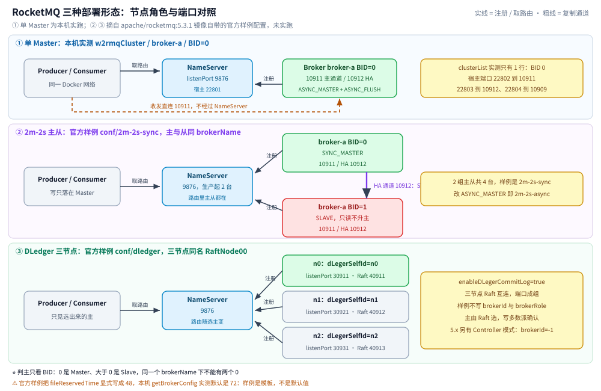
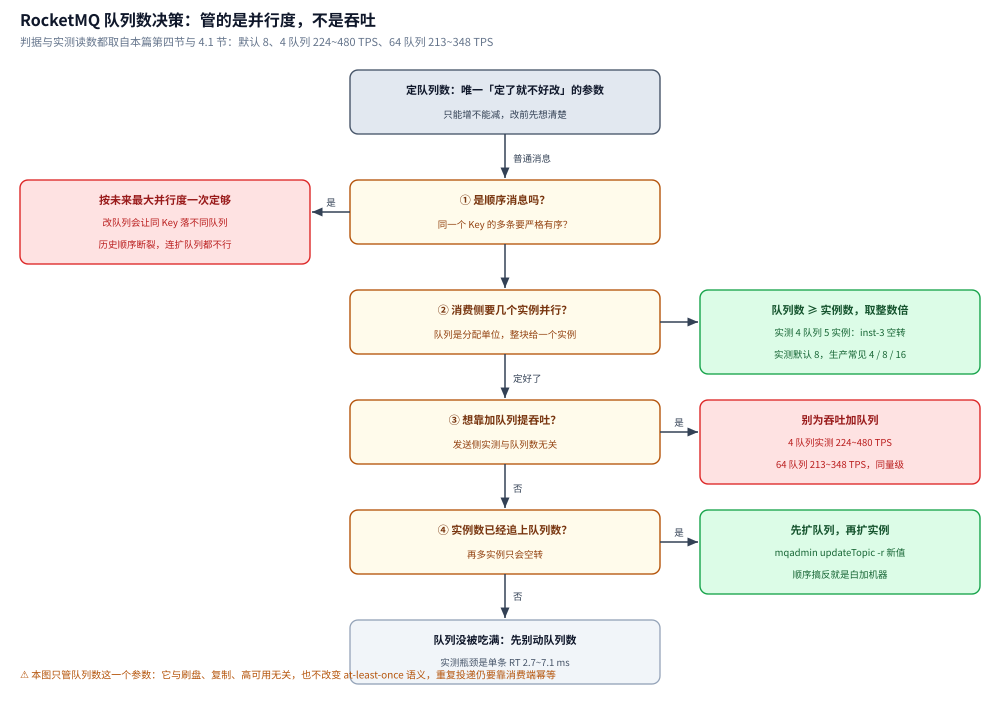

# 部署与配置

> 覆盖 RocketMQ 的端口与集群形态、单机与集群的起法（含本机实测的 `docker run` 参数与 `broker.conf`）、生产必改的关键配置项（附本机实测默认值）、以及**队列数到底定多少**。
>
> 不覆盖：存储文件尺寸与三层结构见 [核心概念与架构.md](核心概念与架构.md) 第四节；刷盘 × 复制的四组合取舍见 [消息可靠性.md](消息可靠性.md)；上线后的堆积与排障见 [运维与排障.md](运维与排障.md)。
>
> 内容整理自个人学习笔记；配置项说明参考《RocketMQ 分布式消息中间件核心原理与最佳实践》（李伟）。本篇默认值全部来自本机 `apache/rocketmq:5.3.1` 的 `mqadmin getBrokerConfig` 实测。

---

## 一、端口与集群形态

| 组件 / 通道 | 默认端口 | 说明 |
| --- | --- | --- |
| NameServer | **9876** | 路由注册与查询 |
| Broker 主通道 | **10911** | `listenPort`，客户端收发都走它 |
| Broker HA 通道 | **10912** | `listenPort + 1`，主从同步 |
| fastRemotingPort | 10909 | VIP 通道，5.x 已废弃 |
| rocketmq-dashboard | 8080 | 控制台 Web |

集群形态按「要不要自动切主」分两档：

| 形态 | 组成 | 主故障时 |
| --- | --- | --- |
| 常规主从（2m-2s） | 2 台 NameServer + 2 组主从 | Slave **只读不自动升主**，该组写能力中断 |
| DLedger（自动切主） | 每组 ≥3 节点组成 Raft 组 | 自动选主，恢复写；代价见 [消息可靠性.md](消息可靠性.md) 第一节 |

### 1.1 三种形态落到配置文件上：`brokerId`、`brokerRole` 与端口

上面那两档形态只是结论，真正写配置时只有三件事要决定：**同一组内谁是主（`brokerId`）、副本怎么复制（`brokerRole`）、端口占哪几个**。为避免二手资料失真，下面直接摘自本机 `apache/rocketmq:5.3.1` 镜像自带的官方样例目录（`conf/2m-noslave`、`conf/2m-2s-sync`、`conf/2m-2s-async`、`conf/dledger`、`conf/controller`、`conf/container/2container-2m-2s`），是文件原文：

| 形态 | 镜像样例目录 | 一组内的 `brokerName` | `brokerId` | `brokerRole` / `flushDiskType` | 端口 |
| --- | --- | --- | --- | --- | --- |
| 单 Master | `2m-noslave/broker-a.properties` | broker-a、broker-b **各自独立成组** | `0` | `ASYNC_MASTER` / `ASYNC_FLUSH` | `listenPort` 默认 10911 |
| 同步双写主从 | `2m-2s-sync/broker-a.properties` + `broker-a-s.properties` | 主与从**同名** `broker-a` | 主 `0` / 从 `1` | `SYNC_MASTER` / `SLAVE`，两者都 `ASYNC_FLUSH` | 每台 10911，HA 10912 |
| 异步复制主从 | `2m-2s-async/` 同结构（4 个文件 = 2 组主从） | 同名成组 | 主 `0` / 从 `1` | `ASYNC_MASTER` / `SLAVE` | 同上 |
| DLedger（Raft 复制 CommitLog） | `dledger/broker-n0/n1/n2.conf` | 三节点**同名** `RaftNode00` | ⚠️ 样例里**根本不写** `brokerId`（grep 命中 0 次） | ⚠️ 也不写 `brokerRole`；改由 `enableDLegerCommitLog=true` + `dLegerSelfId=n0/n1/n2` + `dLegerGroup=RaftNode00` + `dLegerPeers=n0-127.0.0.1:40911;n1-127.0.0.1:40912;n2-127.0.0.1:40913` | `listenPort` 样例取 **30911 / 30921 / 30931**，Raft 通道**另占** 40911/40912/40913 |
| Controller 主从切换（5.x） | `controller/quick-start/broker-n0.conf`、`cluster-3n-namesrv-plugin/namesrv-n0.conf` | 同组同名 `broker-a` | `-1`（角色交给 Controller 分配与切换） | 样例写 `brokerRole=SLAVE`，但同时开 `enableControllerMode=true`、`controllerAddr=127.0.0.1:9878`、`allAckInSyncStateSet=true` | Broker 30911/30921；Controller 通道 9878；内嵌 NameServer 时三节点 `9878 / 9868 / 9858`，NameServer 自身 `listenPort` 是 `9876 / 9886 / …` |

三条读法：

- ⭐ **`brokerId` 才是主从的唯一判据**：`0` = Master，`>0` = Slave，同一 `brokerName` 下不能出现两个 `0`。所以判断"这组有没有主"不用看进程、也不用看机器，`mqadmin clusterList` 的 `#BID` 列直接给答案——本机单 Master 实测输出：

  ```
  #Cluster Name    #Broker Name  #BID  #Addr                 #Version
  w2rmqCluster     broker-a      0     192.168.160.11:10911  V5_3_1
  ```

  只有一行、`#BID` 为 0，就是"单 Master、无副本"的形态特征；上了 2m-2s 会变成同一 `#Broker Name` 下两行（BID 0 与 1）。
- ⭐ **刷盘与复制是两条独立开关**：上面六个样例目录里 `flushDiskType` **从头到尾只有 `ASYNC_FLUSH` 一种值**，变的只有 `brokerRole`（`SYNC_MASTER` ↔ `ASYNC_MASTER` ↔ `SLAVE`）。这从配置文件的写法上印证了「刷盘管本机磁盘、复制管别的机器」的分工（组合取舍见 [消息可靠性.md](消息可靠性.md) 第一节）。
- ⚠️ **官方样例的值不等于默认值**：所有样例都显式写了 `deleteWhen=04`、`fileReservedTime=48`，而本机 `getBrokerConfig` 实测默认是 `deleteWhen=04`、`fileReservedTime=72`（见第三节）。样例是"建议写死"的模板，容量参数要按自己的磁盘规划定，不要以为不写就是 48。

端口避让只有一条规则：**一台机器（或同一张 Docker 网络）上第二个 Broker 必须整体错开 `listenPort`，HA 端口跟着 `listenPort + 1` 走**。官方 `conf/container/2container-2m-2s` 演示"一个容器跑两组主从"时就是这么给的：`broker-a` 用 `listenPort=10911`（`haListenPort=10912`），`broker-b` 用 `20911`；而**不同容器/不同机器之间可以都用 10911**，因为网络命名空间隔开。本机 Docker 的宿主端口避让（`w2rmq-` 前缀，228xx 段）：`w2rmq-namesrv` `22801→9876`、`w2rmq-broker` `22802→10911` / `22803→10912` / `22804→10909`。



> ⚠️ **本节只有"单 Master"是本机实跑的。** 主从、DLedger、Controller 三种形态本篇没有起过多节点容器，因此「Slave 只读不升主」「Raft 选主期间的写中断」「`allAckInSyncStateSet` 下的副本确认语义」这些结论仍属官方口径，不要当成实测。未实跑的原因是内存预算：本机 `apache/rocketmq:5.3.1` 镜像的启动脚本里写死的堆默认值是 `bin/runserver.sh` = `-Xms1g -Xmx1g -Xmn512M`、`bin/runbroker.sh` = `-Xms2g -Xmx2g -Xmn1g -XX:MaxDirectMemorySize=1g`（5.3.1 已把这两行改成 `HEAP_OPTS` 环境变量可覆盖，比 4.x 时代的 4g/8g 收敛很多），但一个 3 节点 DLedger 组仍要 3 × (2g 堆 + 1g DirectMemory)，而本机收工时的可用物理内存只有 4.6 GiB 左右、同机还并发跑着其他实验容器——本轮 `w2rmq-namesrv` / `w2rmq-broker` 这两个被压过堆的容器在收工前都各被系统回收过一次（`Exited (137)`）。单 Master 是把堆压到最小才跑稳的，多节点组没有这个预算。

## 二、起一台单机：本机实测的完整参数

本机实测环境（`apache/rocketmq:5.3.1`）：1 NameServer + 1 Broker，用同一个自定义网络让容器名可互相解析。

```bash
NET=rocketmq-lab-net
IMG=apache/rocketmq:5.3.1
docker network create "$NET"

# ① NameServer
docker run -d --name rmq-namesrv --network "$NET" -p 19876:9876 "$IMG" sh mqnamesrv

# ② Broker（挂载自定义 broker.conf）
docker run -d --name rmq-broker --network "$NET" \
  -p 19011:10911 -p 19012:10912 -p 19009:10909 \
  -v <本机路径>/broker.conf:/home/rocketmq/broker.conf \
  "$IMG" sh mqbroker -c /home/rocketmq/broker.conf
```

```properties
# broker.conf（本机实测用的最小可用配置）
brokerClusterName=DefaultCluster
brokerName=broker-a
brokerId=0                      # 0=Master，>0=Slave
namesrvAddr=rmq-namesrv:9876
brokerIP1=rmq-broker            # ⚠️ 必须写客户端能连通的地址，否则路由指向容器内网名
listenPort=10911
autoCreateTopicEnable=true      # 实验用；生产必须关
storePathRootDir=/home/rocketmq/store
flushDiskType=ASYNC_FLUSH
brokerRole=ASYNC_MASTER
```

集群起法（生产）：2 台 NameServer + 2m-2s，或 DLedger 组。运维命令：

```bash
sh bin/mqadmin clusterList -n <namesrv>:9876        # 本机实测输出 Title: DefaultCluster / broker-a / V5_3_1
sh bin/mqadmin updateTopic -n <namesrv>:9876 -c DefaultCluster -t lab-topic -r 4 -w 4
```

> ⚠️ 实测踩到的一条：`brokerIP1` 必须是**客户端可达的地址**。本机最初用容器名 `rmq-broker`，Java 客户端（同在 docker 网络）没问题，但 Go 老客户端（`rocketmq-client-go/v2`）在 `newProducer` 阶段就报 `new Namesrv failed.: IP addr error`——**它要求 NameServer 地址是 IP 而非主机名**。跨容器实测时把 NameServer / Broker 都固定成 IP 最省事。

## 三、生产必改的关键配置项

本机 `mqadmin getBrokerConfig -b rmq-broker:10911` 实测的值（5.3.1）：

| 配置项 | 实测默认值 | 说明 |
| --- | --- | --- |
| `mappedFileSizeCommitLog` | `1073741824` | CommitLog 单文件 1 GiB，**开跑即预分配满** |
| `mappedFileSizeConsumeQueue` | `6000000` | ConsumeQueue 单文件 = 30 万条 × 20 B |
| `flushDiskType` | `ASYNC_FLUSH` | ⭐ 刷盘开关之一；生产金融场景改 `SYNC_FLUSH` |
| `brokerRole` | `ASYNC_MASTER` | ⭐ 复制开关之一；高可用场景改 `SYNC_MASTER` |
| `deleteWhen` | `04` | 过期文件清理窗口：默认凌晨 4 点，错峰 |
| `fileReservedTime` | `72` | 消息保留 **72 小时**，按堆积时长与磁盘容量匹配 |
| `diskMaxUsedSpaceRatio` | `75` | 磁盘使用率超 75% 拒写（生产者收 `SERVICE_NOT_AVAILABLE`） |
| `autoCreateTopicEnable` | `true` | ⚠️ **生产必须改 `false`**，否则任何人可随手建 Topic |
| `autoCreateSubscriptionGroup` | `true` | ⚠️ 同理，生产建议关掉（防乱建消费组） |
| `defaultTopicQueueNums` | `8` | 自动建 Topic 时的默认队列数 |
| `maxMessageSize` | `4194304` | 单条消息上限 4 MiB |
| `messageDelayLevel` | `1s 5s … 1h 2h`（18 级） | 4.x 语义的固定延迟档位 |
| `timerPrecisionMs` | `1000` | 5.x 任意时间延迟的精度 |
| `timerMaxDelaySec` | `259200` | 5.x 延迟上限 = 3 天 |
| `osPageCacheBusyTimeOutMills` | `1000` | PageCache 繁忙超时，本质是磁盘写入跟不上 |
| `slaveReadEnable` | `false` | 是否允许在 Master 内存高水位时读 Slave |
| `listenPort` / `haListenPort` | `10911` / `10912` | 主通道 / 主从同步 |
| `commitCommitLogLeastPages` | `4` | 累计 4 页才提交一次（批量提交降低开销） |
| `commitCommitLogThoroughInterval` | `200` | ms，兜底提交间隔 |
| `sendMessageThreadPoolNums` | `4` | Broker 处理发送请求的线程数 |
| `useReentrantLockWhenPutMessage` | `true` | 写 CommitLog 用 `ReentrantLock`（吞吐略低于自旋锁，但更公平） |
| `totalReplicas` / `inSyncReplicas` | `1` / `1` | 单机的实时副本数；主从部署时会变成实际值 |

> ⭐ 三个「上线前必须动」的项：`autoCreateTopicEnable=false`、`autoCreateSubscriptionGroup=false`、以及按 SLA 把 `fileReservedTime` 与 `diskMaxUsedSpaceRatio` 配对设置。

⚠️ **动态改配置**：`flushDiskType` 与 `brokerRole` 这类核心项可以运行时改（本机实测 `mqadmin updateBrokerConfig -b rmq-broker:10911 -k flushDiskType -v SYNC_FLUSH` 立即生效），但**改完不落 `broker.conf`，重启即丢**——运维脚本里要一并写回配置文件。

## 四、队列数到底定多少

队列（`MessageQueue`）是消费并行度的**最小分配单位**，也是 RocketMQ 里唯一「定了就不好改」的容量参数（只能增，不能减；顺序 Topic 连增都不行）。

| 判据 | 说明 |
| --- | --- |
| 下限 | `队列数 ≥ 消费者实例数 × 每实例消费线程数`——否则多出的线程分不到队列，白占资源 |
| 上限 | 每个队列都有一套 ConsumeQueue 文件 + 位点 + 锁；队列过多会让索引文件数量与 rebalance 成本上升（虽然 RocketMQ 比 Kafka 能扛得多，但也没必要） |
| 默认与建议 | `defaultTopicQueueNums` 实测默认 `8`；生产一般取「消费者实例数的整数倍」，常见 4 / 8 / 16 |
| ⚠️ 顺序消息 | 队列数确定后**不能改**——扩容会让同一 Key 落不同队列，历史顺序断裂（见 [消息类型与语义.md](消息类型与语义.md) 2.1 节）。这类 Topic 要按**未来最大并行度**一次性定好 |
| 扩容顺序 | 先 `updateTopic -r <新队列数>` 扩队列，**再**扩消费者实例（反了就是白加机器） |

### 4.1 实测：队列数从 4 加到 64，发送吞吐没有变化

上面那张表讲的全是**消费侧**的并行度，但常被反过来当成"队列数越多发得越快"的容量参数。本机实测直接否掉这个推论：同一台 Broker（单 Master）、同一份 5.3.1 客户端、同样 4 个发送线程同步发 2000 条，只改 Topic 队列数：

```bash
sh bin/mqadmin updateTopic -n 192.168.160.2:9876 -c w2rmqCluster -t w2rmq-lab4 -r 4  -w 4
sh bin/mqadmin updateTopic -n 192.168.160.2:9876 -c w2rmqCluster -t w2rmq-lab5 -r 64 -w 64
```

| 轮次 | 4 队列（w2rmq-lab4） | 64 队列（w2rmq-lab5） |
| --- | --- | --- |
| 1 | 8572 ms → **233 TPS** | 9396 ms → **213 TPS** |
| 2 | 4170 ms → **480 TPS** | 6592 ms → **303 TPS** |
| 3 | 8942 ms → **224 TPS** | 5748 ms → **348 TPS** |
| 波动范围 | **224 ~ 480 TPS** | **213 ~ 348 TPS** |

三点读法（只断言趋势，不断言具体倍率——两轮之间的抖动接近 2 倍，本机单容器、堆内存压到最小，绝对值没有参考价值）：

- **队列数不是发送吞吐的函数**。16 倍队列数（4 → 64）没有带来任何提升，两组区间大面积重叠；反倒是 64 队列的中位数略低一点（要维护 64 套 ConsumeQueue 与 64 份索引写入），但这点差异落在抖动里，不足以断言"队列多会更慢"。
- **真正的天花板是单条 RT**。同机同步发送单条平均 RT 实测 2.7 ~ 7.1 ms（见 [消息可靠性.md](消息可靠性.md) 4.1 节），换算单线程上限 141 ~ 370 TPS；4 线程实测只跑到 224 ~ 480 TPS，**远低于线程数 × 单线程上限**——瓶颈在 Broker 侧的写入与 PageCache，不在客户端线程数，更不在队列数。
- ⚠️ **这条"队列数与吞吐无关"只对发送侧成立**，消费侧的硬约束是真的：同一 Broker、1 个 Topic 4 队列，起 5 个消费者实例时**第 5 个实例一条都收不到**（实测队列分配：`inst-0/1/2/4` 各拿 1 个队列，`inst-3` 空转，见 [消费者与消费位点.md](消费者与消费位点.md)）。所以「队列数」要按消费并行度定，不要按吞吐定。

> ⚠️ 修正一处上表的口径：表里"下限"那条写的是 `队列数 ≥ 消费者实例数 × 每实例消费线程数`，但实测能支撑的硬约束只有 **`队列数 ≥ 消费者实例数`**——队列是按「一个队列 → 一个实例」整块分配的，不会被切成两半分给两个实例，所以多出来的实例只会空转；而实例内的消费线程（实测 `consumeThreadMin` / `consumeThreadMax` 默认都是 20）是拿"从队列拉回来的一批批消息"去并行的，不需要按线程数去乘队列。把线程数乘进去只是一种更保守（浪费队列）的写法。



## 五、控制台与 PageCache

- **rocketmq-dashboard**（原名 rocketmq-console-ng）：`java -jar rocketmq-dashboard-2.0.0.jar --server.port=8080 --rocketmq.config.namesrvAddr=127.0.0.1:9876`，可看队列分布、消费堆积与 TPS、主从状态、消息轨迹、按 Key/MsgId 查消息、DLQ 重投。
- **PageCache**：CommitLog 用 **mmap 映射（单文件固定 1 GiB，实测 `mappedFileSizeCommitLog=1073741824`）**，写入先落 PageCache 再由刷盘线程落盘，因此异步刷盘下 `send` 成功 ≠ 已落盘；PageCache 不足会触发 `osPageCacheBusyTimeOutMills`（实测默认 1000ms）超时，本质是磁盘写入跟不上。要求磁盘预留 ≥30%、生产用 SSD，并把 `fileReservedTime` 与磁盘容量匹配。
- ⚠️ 优雅下线顺序：先停 Producer → 再停 Consumer → 最后 `sh bin/mqshutdown broker`，避免进程退出丢 PageCache 数据。

## 延伸追问

- **为什么生产必须关掉自动建 Topic？** 自动建的 Topic 借用默认 Topic（`TBW102`）的路由模板下发（见 [核心概念与架构.md](核心概念与架构.md) 3.1 节），意味着任何人写一个不存在的 Topic 名就能建出一个队列数、副本数都不受控的 Topic，路由表与存储都会被污染。本机实测该项默认就是 `true`，所以「默认值安全」这个假设在这里**不成立**。
- **`flushDiskType` 和 `brokerRole` 该一起改吗？** 它们决定的是两件事（本机磁盘 vs 别的机器），要一起评估才等于「不丢」；本机是单 Broker，所以只实测了刷盘侧。组合表与取舍见 [消息可靠性.md](消息可靠性.md) 第一节。
- **队列数定小了会怎样？** 消费并行度到顶，堆积无法靠加实例解决（多出的实例分不到队列），只能扩队列——而顺序 Topic 连这条路都堵死，所以顺序类 Topic 更要一次定够。
- **磁盘满了会怎样？** `diskMaxUsedSpaceRatio` 触发后 Broker 拒绝写入，生产者收到 `SERVICE_NOT_AVAILABLE`；处理办法是清理过期 CommitLog 或扩盘，并调小 `fileReservedTime`。（第三节）

## 关联

- **上游/总纲**：[README.md](README.md) — 本目录导读与阅读路线
- **对照/互补**：[核心概念与架构.md](核心概念与架构.md) — 存储文件尺寸与三层结构
- **对照/互补**：[消息可靠性.md](消息可靠性.md) — 刷盘 × 复制四组合与 DLedger
- **对照/互补**：[运维与排障.md](运维与排障.md) — 堆积 SOP、磁盘水位与常见故障
- **下游/实现**：[接入RocketMQ.md](../../../../01-编程语言/java/工程实践/接入RocketMQ.md) — 客户端侧 `namesrvAddr` 等接入配置
- **对照/互补**：[部署与配置.md](../Kafka/部署与配置.md) — Kafka 侧的单节点 / 三节点起法与分区数怎么定
> 反向引用（本篇被下列文档引到）：[接入RocketMQ.md](../../../../01-编程语言/go/工程实践/接入RocketMQ.md)
