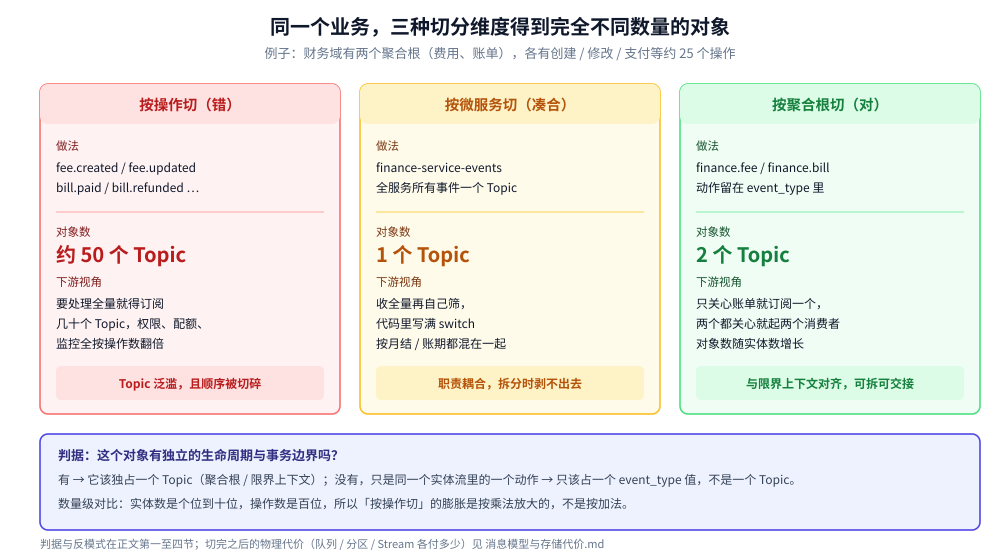
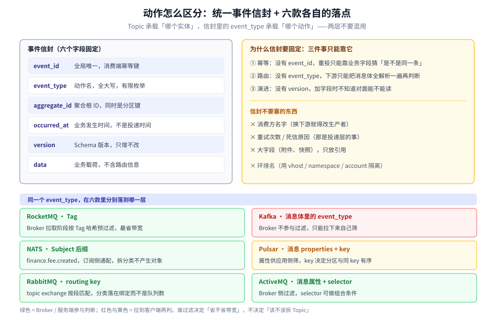

# Topic 切分与事件设计

> 覆盖 ⭐ **微服务架构下消息中间件的业务建模**：一个微服务该建几个 Topic、按什么维度切（操作 / 服务 / 聚合根）、同一实体内的动作怎么区分、什么时候可以不按实体切，以及事件驱动设计的七个反模式。核心判据一句话：**Topic 装的是「哪个实体」，event_type 装的是「哪个动作」**。
>
> 不覆盖：切完之后物理上要付多少代价（进程数、磁盘、分区数不可逆、cursor 倍增）见 [消息模型与存储代价.md](消息模型与存储代价.md) 第三节；六款的横向选型见 [消息队列选型对比.md](消息队列选型对比.md)；各产品的对象模型与命名落地见 [队列与绑定设计.md](RabbitMQ/队列与绑定设计.md) / [Topic与分区设计.md](Kafka/Topic与分区设计.md) / [Topic与队列设计.md](RocketMQ/Topic与队列设计.md) / [订阅与消费语义.md](Pulsar/订阅与消费语义.md) / [订阅与消费语义.md](NATS/订阅与消费语义.md)；跨产品的命名四条硬规则见 [消息模型与存储代价.md](消息模型与存储代价.md) 第四节。
>
> 内容整理自个人学习笔记，素材见 [素材清单.md](../../../素材清单.md)。**本篇是设计判据，未做动态验证**：产品行为的断言里，RocketMQ 的 Tag 过滤位置与 Tag 的两条边界有源码与实测依据，见 [Topic与队列设计.md](RocketMQ/Topic与队列设计.md) 第二、三节；六款的存储代价读数见 [消息模型与存储代价.md](消息模型与存储代价.md) 第三节；**Kafka / Pulsar / NATS 的「过滤发生在哪一侧」按官方文档与协议行为陈述，未做本机对照实验**。本篇不新增读数。

---

## 一、一个微服务该建几个 Topic？

**本节要点**：这是引入 MQ 时最先踩的坑，而且三种直觉切法里只有一种活得过架构演进。以财务域的**费用（Fee）**与**账单（Bill）** 为例——两个聚合根，各有创建 / 修改 / 冻结 / 支付等约 25 个操作。



三列分别是三种直觉切法：左边按操作切会得到约 50 个 Topic，中间按服务切只有 1 个但把两个聚合根焊死，右边按聚合根切是 2 个且能随实体数增长。每列底部的红黄绿结论行，就是这种切法在半年后暴露出来的第一个问题。

| 方案 | 具体做法 | 结果与评价 |
| --- | --- | --- |
| ❌ **按操作切** | 建 `fee.created`、`fee.updated`、`bill.paid` 等独立 Topic | **Topic 泛滥**：50 个操作就是 50 个 Topic，下游要拿全量得订阅几十个，权限、配额、监控全按操作数翻倍 |
| ❌ **按微服务切** | 建一个 `finance-service-events`，所有事件都往这里发 | **职责耦合**：费用与账单的生命周期、保留策略、消费速率都不同，一旦要拆服务，Topic 无法拆分，形成分布式单体 |
| ✅ **按聚合根切** | 建 `finance.fee` 与 `finance.bill` 两个 Topic | **高内聚低耦合**：与限界上下文对齐，消费者按需订阅，将来拆服务只是把生产权限交接过去 |

> ⭐ **数量级上的差别不是线性的**：实体数是个位到十位，操作数是百位。「按操作切」的膨胀是实体数 × 每实体操作数，是乘法；「按聚合根切」的增长只跟实体数走。**同一个系统里，这两种切法的对象数能差一到两个数量级。**

> ⚠️ **别把「数据库表」当聚合根**：一个聚合根常常对应两三张表（主表 + 明细 + 扩展），按表建 Topic 会让 Topic 数变成表数，而且同一事务内多条表变更会被拆成几条互不相关的事件——下游没法看出它们是一次业务动作。

## 二、为什么按聚合根切是对的？

**本节要点**：因为 Topic 本质上**是一个实体状态变更的事件流**，不是一堆杂乱消息的垃圾桶。这条定义直接决定了切分的边界该落在哪。

**理由一：与 DDD 的聚合根对齐**。「费用」和「账单」是两个独立的聚合根，有各自的生命周期与事务边界。把它们的事件混在一个 Topic 里，相当于在代码里把两个不相干的类塞进一个文件——能跑，但每次改都要通读全文。

**理由二：消费端只需订阅它关心的那一半**。风控只关心账单，就只订阅 `finance.bill`；总账对账两个都要，就起两个消费者分别订阅。这比「订阅全量再在代码里 switch」省的不只是带宽，还有**消费位点的语义**——两个下游的错误处理、重试、死信都不该互相牵连。

**理由三：拆分服务时不用改下游**。将来「账单」独立成服务，只需把 `finance.bill` 的生产权限交接给新服务，所有现有消费者**完全无感**。这是「按服务切」做不到的——`finance-service-events` 这个 Topic 里同时装着两个服务的事件，无论如何都切不开。

> ⭐ **按聚合根建 Topic ≠ 要做事件溯源（Event Sourcing）**。前者只是把「同类事件放同一个流」，消息可以被消费后按保留策略删掉；后者要求把事件当唯一事实来源长期保存、并能从事件重建状态。两者的存储成本差好几个量级，**不要因为「都按聚合根切」就顺手把保留策略设成永久**。

> ⚠️ **一个聚合根一个 Topic，但不必一个聚合根一个分区键**：分区键取**聚合根 ID**（`fee_id`），这样同一实体的变更严格有序、不同实体可以并行。取租户 ID 会让热点租户串行，取订单 ID 会让同一费用的多笔变更落到不同分区。

## 三、同一实体内的动作怎么区分？

**本节要点**：`finance.fee` 一个 Topic 承载了创建、修改、冻结等所有动作，下游必须能在**不解析业务载荷**的前提下知道这是哪个动作。六款里这件事落在不同层，但都归到同一个字段：信封里的 `event_type`。

| 中间件 | 落在哪一层 | 怎么写 | 谁过滤 |
| --- | --- | --- | --- |
| **RocketMQ** | 消息属性 —— **Tag** | 发送时带 `Tag: "CREATED"`，订阅写成 `CREATED \|\| PAID` | **Broker 拉取阶段**按 Tag 哈希预过滤，最省带宽 |
| **ActiveMQ** | 消息属性 + **selector** | `type = 'CREATED'` 写进消息属性，消费端用 selector 声明 | **Broker 侧**求值，可以做组合条件 |
| **RabbitMQ** | **routing key** 的一段 | `topic` exchange 绑 `finance.fee.created`，用段通配订阅 | **Broker 侧**按绑定匹配，分类落在绑定而不是队列数 |
| **Kafka** | **消息体里的 `event_type`** | `{"event_type": "FeeCreated", ...}` | ⚠️ **Broker 不参与**，拉到客户端自己筛 |
| **Pulsar** | 消息 **`properties`** + key | `properties: {event_type: FeeCreated}` | ⚠️ 属性供应用侧筛；key 只决定分区与同 key 有序 |
| **NATS** | **Subject 的后缀** | 发到 `finance.fee.created`，订阅用 `finance.fee.*` | Core 靠**订阅侧**兴趣表扇出；JetStream 按 Subject 集合划 Stream |



上半是信封的六个字段与「为什么必须固定」，下半是同一个 `event_type` 在六款里的落点。绿色是服务端参与判断、红色与黄色是拉到客户端再判——**这张图只回答「过滤发生在哪」，不回答「该不该拆 Topic」**，那件事在第一节已经定了。

> ⚠️ **Kafka 的坑要写准确**：0.11 之后确实有 Record Header，但 **Broker 不按 Header 过滤**，Header 只是随消息一起存下来、由消费端读。所以「用 Header 做路由」的真实代价不是「不支持」，而是**所有订阅这个 Topic 的消费者都要把不关心的消息拉下来再丢掉**。这就是 Kafka 侧必须靠**消费组**而不是 Topic 来隔离下游的原因。

> ⭐ **RocketMQ 的 Tag 有两个边界，别当万能分类**：① 过滤依据是 Tag 的**哈希码**，种类越多哈希冲突概率越高，种类应控制在几十种内；② Tag 不改变消息在 Broker 上的存储位置与队列分布，所以**需要独立队列数、独立保留策略、独立并行度时必须拆 Topic**，只有「同一类消息的不同子类型」才用 Tag。这两条在 [Topic与队列设计.md](RocketMQ/Topic与队列设计.md) 第二、三节展开。

> ⚠️ **NATS 要特别说明**：Subject 是它唯一的分类与路由单位，所以「一个聚合根一个流」在 NATS 里要落成「一个 Stream 绑 `finance.fee.*` 这一族 Subject」，**不是**把 Stream 绑到单个 `finance.fee.created`——后者会让每个动作一个 Stream，退化成了「按操作切」。JetStream 里 Stream 是存储与保留单位、Consumer 才是进度单位，见 [订阅与消费语义.md](NATS/订阅与消费语义.md)。

## 四、什么时候可以不按实体切？

**本节要点**：架构没有银弹，四种情况下「一实体一 Topic」该被打破，但每一种都要求**明确接受某个代价**，不是随手破坏。

| 情况 | 怎么切 | 接受什么代价 |
| --- | --- | --- |
| **巨无霸事件**（一个动作占 90% 流量或不允许丢） | 把它单独拎出来建 Topic，如 `finance.fee.payment` | 多一个 Topic 的存储与运维；换来热点不影响普通事件 |
| **强事务绑定的「小单体」**（两实体永远一起变、一起被同一组消费者处理） | 暂时共用一个 Topic，名字上体现大类，如 `finance.core.events` | 将来拆服务时必须做事件迁移；只适合明确短期不会拆的域 |
| **严格全局顺序**（两实体的变更必须按同一条时间线处理） | 进同一个单分区 Topic，用全局序号 | 吞吐被单分区锁死；这种情况在微服务里极少，多数只需「单实体局部有序」 |
| **高扇出的纯广播**（审计、变更日志） | 独立 Topic，如 `audit.all-events`，不参与业务路由 | 接受与业务事件重复；换来审计链路与业务解耦 |

> ⭐ **第三种的判据要卡死**：「需要全局顺序」和「需要同实体顺序」是两件事。绝大多数业务只需要**同实体局部有序**——用聚合根 ID 做分区键就够了，不必把两个实体塞进一个单分区。**判断方法：问一句「两条不同实体的消息顺序颠倒了，业务会出错吗」，答案通常是不会。**

> ⚠️ **「巨无霸事件」拆出来之后要重新想保留策略**：`finance.fee.payment` 的数据量与重要性都高于普通事件，如果沿用同一个保留时长，磁盘会被它一个人吃掉；反过来如果设得太短，对账又拿不到历史。**拆分的同时要单独给它定保留与告警阈值。**

## 五、事件驱动的七个反模式

**本节要点**：下面七条都在真实项目里出现过，共同点是**当时都能跑**，问题要等到下游变多或要拆服务时才暴露。每条给一句识别话术。

| # | 反模式 | 识别话术 | 正确做法 |
| --- | --- | --- | --- |
| 1 | **一个 Topic 塞多个聚合根** | 「我们只有一个 `xxx-events`」 | 按聚合根拆，见第一节 |
| 2 | **按操作建 Topic** | 「Topic 数量 = 服务数 × 操作数」 | 动作进 `event_type`，见第三、六节 |
| 3 | **事件与命令混在一个 Topic** | 同一个 Topic 里既有 `FeeCreated` 又有 `CreateFee` | 事件是**已发生的事实**（过去式，N 个订阅者），命令是**对一个执行者的请求**（祈使，必须有一个处理方）；两者消费语义不同，必须分开 |
| 4 | **消息体里带消费方信息** | 生产者代码里出现下游服务的名字或 URL | 生产者只描述「发生了什么」，路由交给订阅关系；知道下游就等于耦合下游 |
| 5 | **用 MQ 做同步 RPC** | 发一条消息然后阻塞等另一条回复 | 要同步响应就用 RPC；MQ 的价值是异步与解耦，等回复等于把两条链路串起来还多了一个中间件故障点 |
| 6 | **消息里放整份快照** | 单条消息几十 KB 到几 MB | 只放业务主键与必要字段，详情让下游回查；大字段会让保留策略、重放、迁移全部变贵 |
| 7 | **业务库与消息双写** | 「先 `insert` 再 `send`，失败了重试」 | 双写必然有不一致的窗口；用事务消息或本地消息表（outbox），见 [最终一致方案.md](../../../04-架构与系统/分布式/分布式事务/最终一致方案.md) 与 [消息类型与语义.md](RocketMQ/消息类型与语义.md) 第四节 |

> ⭐ **第 3 条最隐蔽**：命令和事件在代码里长得几乎一样（都是一个结构体 + 一次 `send`），但语义完全相反——事件可以没人消费（丢弃是正常状态），命令没人消费就是故障。**混在一个 Topic 里，你就没法给它们配不同的重试、死信与告警。**

## 六、应用场景

| 场景 | 推荐切分方式 | 关键点 |
| --- | --- | --- |
| **标准微服务业务解耦** | 一实体一 Topic（`domain.entity`） | 用 `event_type` / Tag / Subject 后缀区分动作 |
| **下游需要强类型消费**，且上下游数据格式完全不同 | 按动作独立 Topic | 只在**上下游已经彻底解耦、各自模型不共享**时才用；否则它退化成反模式 2 |
| **审计 / 广播全量日志** | 独立 Topic（`audit.all-events`） | 不参与业务路由；接受与业务事件的重复存储 |
| **订单 / 支付这类长生命周期实体** | 一实体一 Topic + 聚合根 ID 做分区键 | 同实体有序、跨实体并行，见 [Topic与分区设计.md](Kafka/Topic与分区设计.md) |
| **IoT 设备上报** | 一设备类型一 Topic，设备 ID 做分区键 | **不按设备建 Topic**，设备数不封顶 |
| **RocketMQ 生态内的子类型细分** | 一 Topic + 若干 Tag | Tag 种类控制在几十种内，见 [Topic与队列设计.md](RocketMQ/Topic与队列设计.md) |
| **JMS 生态按类型分发给不同系统** | Queue + selector，或用 Queue / Topic 两域 | selector 是 Broker 侧过滤，见 [消息类型与消费语义.md](ActiveMQ/消息类型与消费语义.md) |

本仓对应落地：[队列与绑定设计.md](RabbitMQ/队列与绑定设计.md)（topic exchange 与绑定怎么写）、[Topic与分区设计.md](Kafka/Topic与分区设计.md)（分区数决策与不可逆）、[Topic与队列设计.md](RocketMQ/Topic与队列设计.md)（Topic / MessageQueue / Tag 三级）、[订阅与消费语义.md](Pulsar/订阅与消费语义.md)（四种订阅类型）、[订阅与消费语义.md](NATS/订阅与消费语义.md)（Stream 与 Consumer）。

## 七、具体使用

### 7.1 事件信封

六款通用，字段名固定下来后换 MQ 不用改代码：

```json
{
  "event_id": "evt_0192a3f4-7c81-7a2e-b9d4-1f0c5e6b8a90",
  "event_type": "FeeCreated",
  "occurred_at": "2026-10-21T10:00:00Z",
  "aggregate_id": "fee_12345",
  "version": 1,
  "data": {
    "amount": "100.00",
    "currency": "CNY",
    "bill_id": "bill_67890"
  }
}
```

| 字段 | 约束 | 为什么 |
| --- | --- | --- |
| `event_id` | 全局唯一（UUIDv7 / 雪花 + 前缀） | 消费端幂等的**唯一**可靠依据；只用业务字段判重会在「合法重复」时误杀 |
| `event_type` | 大写下划线或 PascalCase，**全枚举有限** | 与 Tag / Subject 后缀同源，见第三节；枚举有限才能穷举测试 |
| `occurred_at` | ISO 8601 带时区 | 业务发生时间与投递时间可能差几小时（重试、堆积），对账要用前者 |
| `aggregate_id` | 聚合根 ID | 同时是分区键，保证同实体有序 |
| `version` | 整数，只增不改 | Schema 演进；下游按 `version` 决定怎么解析 |
| `data` | 只放业务字段 | 不放路由信息、不放消费方名字（反模式 4） |

> ⚠️ **金额用字符串不要用浮点**：`100.00` 写成 `100.0` 或 `1e2`，跨语言解析的精度与相等判断都会出事（Go 的 `float64`、PHP 的 `float`、Java 的 `BigDecimal` 三种语义）。

### 7.2 命名与枚举约定

- **Topic 名 = 域 + 实体**：`finance.fee`、`order.order`，不带动作、不带环境、不带版本（硬规则见 [消息模型与存储代价.md](消息模型与存储代价.md) 4.2）。
- **`event_type` 用过去式**：`FeeCreated` 而不是 `CreateFee`——过去式天然表达「已经发生」，也顺手把反模式 3 挡在门外。
- **枚举集中在 schema 仓**：事件定义（字段、类型、必填、兼容策略）放在一处版本化，生产端与消费端都从这里生成代码，避免两边各写一份结构体然后悄悄漂移。

### 7.3 排障与校验

```text
【校验一】Topic 数量是否失控？
    若「Topic 数 ≈ 微服务数 × 操作数」→ 按操作拆错了，动作应进 event_type。
    健康值：Topic 数与聚合根数同一量级。

【校验二】下游是否在盲目订阅？
    若某个下游订阅了 finance.* 却只处理账单，或代码里写满 switch-case 过滤
    → 分类颗粒度太粗（该按聚合根拆），或它在蹭别人的 Topic（该独立）。

【校验三】同一实体的事件是否跨了多个 Topic？
    若「创建」在 fee.created、「支付」在 fee.payment → 同实体的顺序无法保证，
    因为顺序只在单个队列/分区内成立。
```

三条都过不了的时候，先看 [消息模型与存储代价.md](消息模型与存储代价.md) 2.1——「消费逻辑不同 / 速率档不同」该拆，「只是事件类型不同」不该拆。

### 7.4 从「按操作」迁到「按聚合根」

已经按操作拆了的系统要改，不能一刀切：

```text
第 1 步（不动生产者）  新建 finance.fee 这个 Topic，起一个「汇流消费者」把 fee.* 的
                      消息原样转发进来 → 新 Topic 里立刻有全量事件，下游可以先切过来
第 2 步（改生产者）    生产者改为只发 finance.fee，动作放 event_type；汇流消费者观察
                      一段时间确认没有新消息进来后再下线
第 3 步（清旧 Topic）  旧 Topic 的保留期走完、确认无人订阅后再删；删之前先把权限收回，
                      防止有人偷偷又发进来
```

> ⚠️ **第 1 步的顺序不能反**：先改生产者再建汇流，中间会有一段「旧下游收不到、新下游还没建好」的空窗。**先汇流、再切生产、最后清旧**，每一步都可回退。

## 延伸追问

- **按微服务建 Topic 为什么不好？** 它在物理上省了 Topic 数量，但把服务内部的实现细节焊死了。一旦「账单」要独立成服务，`finance-service-events` 这个 Topic 里同时装着两个服务的事件——切不开，只能整条迁移，而下游全都订着它。
- **按操作建 Topic 为什么也不好？** 两个原因：一是运维面爆炸（50 个操作 50 个 Topic，权限 / 配额 / 监控全按操作数翻倍）；二是**顺序被切碎**——同一实体的「创建」和「支付」落在两个 Topic、两个队列，谁先谁后没有保证。第二种伤害比第一种更隐蔽。
- **RocketMQ 的 Tag 和 Kafka 的 Key 有什么区别？** 两者解决的维度完全不同。Tag 是**消息属性**，用于「这个下游要不要这条消息」的过滤，在 Broker 拉取阶段就生效；Key 是**分区路由依据**，用于「这条消息去哪个分区」以保证同 key 有序。**Tag 管消费范围，Key 管顺序与并行**，同名不同事。
- **为什么 Kafka 侧不能像 RocketMQ 那样用 Tag？** 因为 Kafka 的 Broker 不解析消息内容也不按属性过滤——这是它「零拷贝 + 顺序追加」的代价换来的。想在 Kafka 侧省带宽，只有两条路：拆 Topic（但见第一节，这会复制数据）或接受「拉下来再筛」（反模式 2 的反面）。所以 Kafka 生态里 `event_type` 走消息体是**唯一不引入额外代价的选择**。
- **「一实体一 Topic」会不会 Topic 太多？** 只要实体数是个位到十位就不会。真正会让 Topic 爆掉的是「按操作切」和「按租户 / 设备切」——后两者都是把**无限的维度**（租户数、设备数）当成了分类维度。判据：**分类维度的取值域是否有限且稳定**，有限才可以建对象。
- **事件驱动里「事件」和「命令」到底怎么分？** 三条判据：① 语义——事件是「已经发生了」（`FeeCreated`），命令是「请你做」（`CreateFee`）；② 数量——事件可以有 0 到 N 个订阅者，命令必须有且只有一个执行方；③ 失败处理——事件没人消费是正常，命令没人消费必须告警。混在一个 Topic 里，这三条都没法分别落地。

## 关联

- **上游/总纲**：[消息队列选型对比.md](消息队列选型对比.md) — 六款的十二维度对比，本篇的「按什么维度切」是选型前置的业务建模问题
- **下游机制**：[消息模型与存储代价.md](消息模型与存储代价.md) — 切分维度定好之后的物理代价：队列 / 分区 / Stream 各付多少、哪些不可逆
- **对照/互补**：[队列与绑定设计.md](RabbitMQ/队列与绑定设计.md) — RabbitMQ 里 `topic` 为什么不是分类容器，三种切法的队列拓扑长什么样
- **对照/互补**：[Topic与分区设计.md](Kafka/Topic与分区设计.md) — 分区数怎么定、为什么不可逆、分区键为什么会制造热点
- **对照/互补**：[Topic与队列设计.md](RocketMQ/Topic与队列设计.md) — Topic / MessageQueue / Tag 三级，Tag 的两条边界
- **对照/互补**：[订阅与消费语义.md](Pulsar/订阅与消费语义.md) — 四种订阅类型，Pulsar 的并行不必绑分区数
- **对照/互补**：[订阅与消费语义.md](NATS/订阅与消费语义.md) — Stream 与 Consumer 的关系，Subject 是 NATS 唯一的分类单位
- **下游机制**：[最终一致方案.md](../../../04-架构与系统/分布式/分布式事务/最终一致方案.md) — 反模式 7 的解法：事务消息与本地消息表
